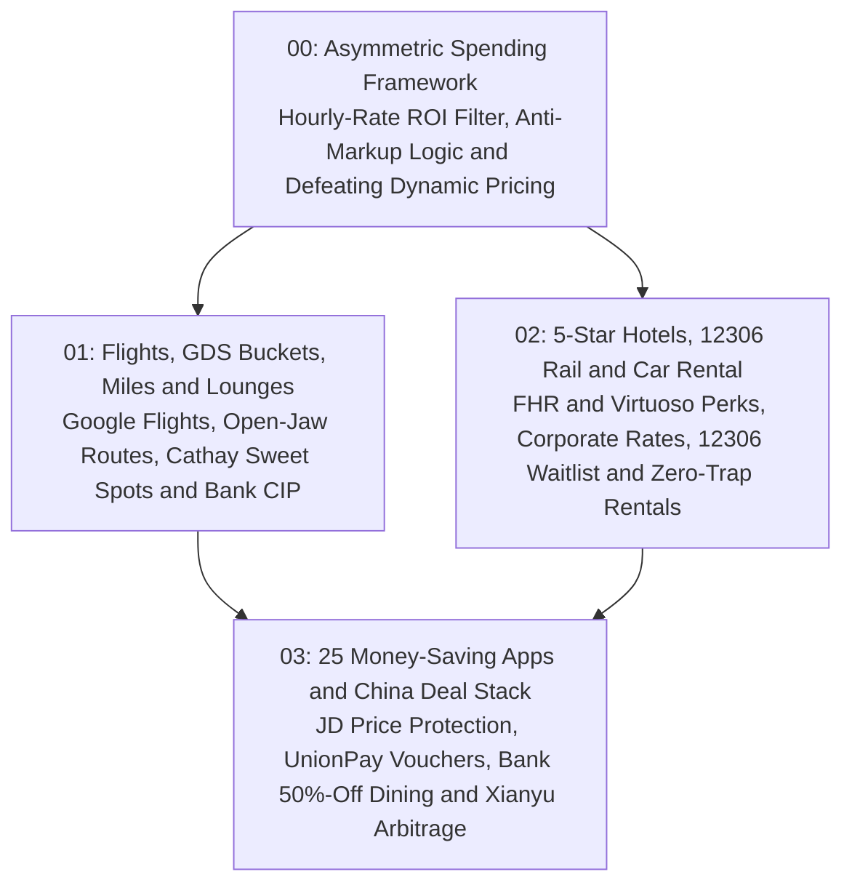
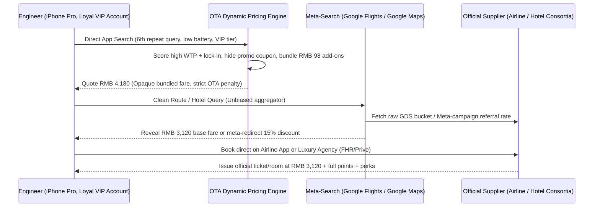

# Asymmetric Spending & Insider Life Hacks: Cutting Invisible Markups by 50% While Upgrading Quality of Life (反信息差与高杠杆消费工程学)

Most intelligent engineers fall into one of two broken financial extremes:

1. **Passive Overpaying (`信息差冤大头`)**: Working 60 hours a week to earn high compensation, then casually handing back `25%–50%` of post-tax disposable income to dynamic pricing algorithms (`大数据杀熟`), opaque OTA markups, retail rack rates, and silent auto-renewing subscriptions—convincing themselves that *"paying full retail saves time."*
2. **Exhausting Stinginess (`低时薪抠门内耗`)**: Spending 40 minutes forwarding spam links in WeChat groups to shave RMB 2.30 off paper towels, booking miserable 5:15 AM budget red-eye flights with 28-inch seat pitch that wreck two days of sleep, or eating low-grade takeout to save RMB 15.

**Asymmetric Optimization (`非对称消费工程学`)** rejects both extremes. The goal is **never** to downgrade your quality of life—it is to **strip out pure information-asymmetry markups while simultaneously upgrading the physical experience**: paying standard flexible hotel rates while getting free `USD 100` dining credits and breakfast for two via luxury agency channels (`FHR / 八大洲`), flying widebody business class on miles sweet spots instead of overpaying for last-minute economy, sitting in 12306 Quiet Car `F` window seats while redeeming `5%` free rail points, and walking through zero-queue bank CIP airport security lanes for free.

---

## Curriculum Architecture & Learning Path

### Clickable Table of Contents & Module Directory

| Module | File | Core Engineering Focus | Tangible Real-World Outcome |
| :--- | :--- | :--- | :--- |
| **00** | [00-README.md](00-README.md) | Hourly-ROI filter formula; algorithmic price discrimination (`大数据杀熟`) mechanics; the 6-step anti-markup protocol; 5 guardrails where you should never cheap out | Build a permanent mental filter that separates high-leverage arbitrage from low-value penny-pinching |
| **01** | [01-CHEAP-FLIGHTS-MILES-AND-AIRPORT-HACKS.md](01-CHEAP-FLIGHTS-MILES-AND-AIRPORT-HACKS.md) | GDS `26`-letter fare buckets; Google Flights + Skyscanner + ITA Matrix -> Official App vs Ctrip; Open-Jaw (`PVG-RBA + CMN-PVG`) & 5th-freedom routes; `航旅纵横`/`飞常准` aircraft forensics; Chinese airline member promo days (`东航18号`/`南航28号`); Cathay Asia Miles sweet spots; bank Platinum VIP lounges & CIP | Cut international & domestic airfare by `25%–55%` while unlocking widebody comfort, lounge meals, and fast-track security |
| **02** | [02-FIVE-STAR-HOTELS-TRAIN-AND-TRAVEL-TRICKS.md](02-FIVE-STAR-HOTELS-TRAIN-AND-TRAVEL-TRICKS.md) | Luxury agency rates (`FHR / Virtuoso / Hyatt Privé / Marriott STARS / Hilton Impresario` via `八大洲`/`游虾`) for free `USD 100` credit + breakfast + upgrade; legitimate MNC corporate rates (`外企协议价`); Google Maps mobile redirect discounts; Marriott/Hyatt status challenges; `12306` official `候补` vs useless OTA `加速包`, `铁路畅行` `5%` free points & Quiet Car `F`-seat | Stay at Park Hyatt, Conrad, Four Seasons & Ritz-Carlton at `35%–60%` net effective discount and master China high-speed rail |
| **03** | [03-HIDDEN-MONEY-SAVING-APPS-AND-CHINA-DEALS.md](03-HIDDEN-MONEY-SAVING-APPS-AND-CHINA-DEALS.md) | 25 high-signal apps in China: `慢慢买` & `什么值得买` price history + 1-click JD `价格保护`; `云闪付` government dining vouchers & `0`-fee credit card repayment; `招行掌上生活`/`交行买单吧` `50%`-off dining; `猫眼`/`淘票票`/`闲鱼` IMAX & coffee arbitrage; `菜鸟` RMB 6 courier shipping; Apple/Spotify/YouTube family plans, `SteamDB` & subscription leak audits | Save RMB `18,000–35,000+` per year on autopilot in under `20 seconds` per transaction |

---

## 1. The Engineer's Hourly-Rate ROI Filter (`反内耗时薪漏斗公式`)

Before adopting any money-saving trick, pass it through a strict **Post-Tax Effective Hourly Yield (`税后等效时薪`)** equation. Notice that saving RMB 1,000 is mathematically superior to earning RMB 1,000 in gross salary—at a `30%–35%` marginal tax + social insurance rate, **saving RMB 1,000 post-tax is equivalent to earning approx. RMB 1,500 pre-tax**:

$$\text{Pre-Tax Equivalent Hourly Yield} = \frac{\Delta S_{\text{cash}} + \Delta V_{\text{perks}}}{(1 - \tau) \times \left(T_{\text{setup}} + N \times T_{\text{exec}}\right)}$$

Where:
- $\Delta S_{\text{cash}}$ = Direct cash saved vs retail baseline (in RMB)
- $\Delta V_{\text{perks}}$ = Genuine cash-equivalent value of unlocked perks you actually value (e.g., hotel breakfast, `USD 100` dining credit, airport lounge meal, free return courier)
- $\tau$ = Your marginal income tax rate (e.g., `0.25` to `0.35`)
- $T_{\text{setup}}$ = One-time configuration time in hours
- $T_{\text{exec}}$ = Per-transaction execution time in hours across $N$ uses

### The 4-Quadrant Optimization Matrix

| Quadrant | Setup & Execution Time | Post-Tax Equivalent Yield | Verdict & Concrete Examples |
| :--- | :--- | :--- | :--- |
| **Q1: Set-Once Infrastructure (`一次性基建复利`)** | `5–15 min` once; `0 sec` thereafter | **Infinite (`RMB 3,000+/hr`)** | **Execute Immediately**: Activating `12306 铁路畅行` (`5%` automatic rail points); binding `云闪付` `0`-fee auto credit card repayment; joining Apple/YouTube/iCloud family group; configuring annual `个人所得税专项附加扣除` |
| **Q2: High-Ticket Travel & Gear Arbitrage (`大额高杠杆套利`)** | `3–10 min` per booking | **`RMB 2,000–12,000/hr`** | **Always Execute**: Booking a 5-star hotel via `八大洲/游虾` (`3 min` -> `USD 100` credit + breakfast + room upgrade = RMB `1,200+` gain); pricing an Open-Jaw flight via Google Flights -> Airline App (`10 min` -> RMB `2,500+` saved); clicking JD `一键价保` during `618/双11` (`15 sec` -> RMB `300–1,200` refunded) |
| **Q3: Zero-Friction Micro-Habits (`顺手20秒习惯`)** | `10–20 sec` while standing in line or at table | **`RMB 600–1,800/hr`** | **Adopt as Reflex**: Checking `大众点评代金券 / 招行饭票` before scanning restaurant QR (`15 sec` -> RMB `30–100` saved); ordering RMB 6 courier pickup via aggregated mini-program (`20 sec` -> RMB `8–12` saved); buying IMAX voucher before walking into cinema (`30 sec` -> RMB `45–70` saved) |
| **Q4: Attention-Trap Penny-Pinching (`低时薪精神内耗`)** | `15–60 min` of cognitive clutter & spam | **Under `RMB 25/hr`** | **Ruthlessly Eliminate**: Spamming Pinduoduo "slash-a-knife (`砍一刀`)" links to friends; watching `30-second` ad videos for RMB `0.05`; driving `12 km` across town for RMB `0.30/L` cheaper gas; stockpiling `5 years` of detergent to hit a `满300减50` threshold |

---

## 2. How Dynamic Pricing & `大数据杀熟` Actually Work Under the Hood

As a software engineer, stop viewing prices on travel apps, ride-hailing apps, and e-commerce platforms as static database rows (`SELECT price FROM products WHERE id = ?`). Modern consumer platforms run **real-time contextual bandit and gradient-boosted Willingness-to-Pay (`WTP`) inference pipelines** designed to capture your consumer surplus (`一级/三级价格歧视`).

### The 6 Feature Vectors Platforms Use to Inflate Your Price

1. **Loyalty Tier Inversion (`老用户与高级会员反向溢价`)**: Platforms subsidize *churn-risk* and *new/dormant* accounts with aggressive retention coupons (`回归神券 / 新客立减`), while high-frequency `黑钻 / 超级VIP` accounts have high switching friction (`转换成本高`)—so the coupon allocation model suppresses subsidies on loyal accounts!
2. **Device & Hardware Fingerprinting (`设备画像溢价`)**: User-Agent strings, screen resolution, and hardware identifiers (`iPhone 16/17 Pro Max` or cellular roaming in Tier-1 CBD) correlate strongly with higher conversion at elevated price tiers, altering default sort order (`默认推荐高价房型/专车车型`) and coupon visibility.
3. **Search Urgency & Repetition Signals (`高频搜索与电量焦虑特征`)**: Querying the exact same flight date (`PVG -> TYO` on Oct 1) five times in one evening—or hailing a car at `11:30 PM` in rain—signals inelastic demand. OTAs may display cached higher buckets or trigger urgency banners (`仅剩2张!`) to force immediate checkout.
4. **Channel Attribution Pricing (`入口渠道差异定价`)**: Opening Booking.com, Agoda, or Ctrip *directly* via the home-screen icon means the platform paid **zero customer acquisition cost** for that session, so it quotes standard retail. Clicking into the **exact same hotel room** from a **Google Maps or Google Flights meta-search comparison table** passes an attribution token (`utm_medium=metasearch`) where platforms bid down their own commission by `8%–20%` to win top rank!
5. **Dark-Pattern Bundled Add-Ons (`默认搭售与视觉诱导`)**: Highlighting the `"安心飞 / 极速出票 / 延误礼包"` button in giant orange font while hiding the `"普通预订 (无附加服务)"` link in pale `10px` grey text—silently padding RMB `68–198` per ticket.
6. **Dynamic Currency Conversion (`DCC 动态货币转换汇率暗坑`)**: Overseas POS terminals, PayPal, and cross-border OTAs offer to *"conveniently charge your card in CNY instead of EUR/JPY/USD."* That convenience embeds a **`3.5%–5.5%` predatory FX spread** over Visa/Mastercard/UnionPay wholesale clearing rates.

---

## 3. The 6-Step Anti-Markup Standard Operating Procedure (`反杀熟六步标准协议`)

Whenever a purchase exceeds **RMB 500**, run this `60-second` verification loop before tapping Pay:

1. **Decouple Discovery from Checkout (`搜索与下单分离`)**:
   - Flights -> Discover on **Google Flights / Skyscanner**, verify on **Airline Official App** vs **Ctrip/Trip.com**.
   - Hotels -> Discover on **Google Maps (Mobile)** + **Luxury Agency Mini-Program (`八大洲 / 游虾`)** + **Official Hotel App**, never single-homing on one domestic OTA.
   - Electronics/Goods -> Paste product URL into **`慢慢买` / `什么值得买`** to inspect the `180-day` real low before believing any `"百亿补贴 / 周年庆狂欢"` banner.
2. **Cross-Check Across Account Tiers (`双端/新老号交叉比价`)**:
   - On high-ticket hotel or takeout/ride orders, glance once at a secondary low-frequency account or family member's non-VIP account—if a RMB `150` "dormant user coupon" appears, book there.
3. **Enter OTAs Through Meta-Search Deep Links (`用比价入口倒逼渠道让利`)**:
   - When booking non-chain boutique hotels abroad, tap through **Google Maps -> Hotel Price List (set mobile view)** into Booking/Agoda/Trip.com to capture `"Mobile-Only + Meta-Search"` stacked discounts.
4. **Strip Every Pre-Checked Add-On (`剥离一切默认搭售`)**:
   - Never buy OTA flight delay insurance, VIP train acceleration packs (`12306加速包`), or rental-car third-party counter markups—your bank Platinum credit card often includes **free `2–4 hour` flight delay insurance (`延误险赔付 RMB 300–2,000`)** automatically when you buy the bare ticket with that card!
5. **Always Settle in Local Transaction Currency (`永远选择当地币种入账`)**:
   - Abroad or on foreign websites (`Agoda / Booking / Amazon JP`), always select **Local Currency (`JPY`, `EUR`, `USD`, `MAD`, `HKD`)** paired with a **`0%` Foreign Transaction Fee (`免货币转换费`)** credit card—never `CNY` DCC conversion.
6. **Harvest Post-Purchase Price Drops (`善用买后价保机制`)**:
   - After buying appliances, digital gear, or clothing on JD/Taobao, tap `一键价保` (`1-Click Price Protection`) during major promo peaks (`5月31日晚8点 / 6月17日晚8点 / 10月31日晚8点 / 11月10日晚8点`) to reclaim automatic cash refunds.

---

## 4. Panorama of the Invisible Markup Layers (`八大日常场景隐形溢价全景表`)

| Spending Domain | Naive Retail Path (High Markup) | Insider Asymmetric Path | Typical Savings / Extra Value | Effort |
| :--- | :--- | :--- | :--- | :--- |
| **International Flights** | Round-trip or 2 one-ways searched directly on a single OTA | Google Flights Date Grid + **Open-Jaw multi-city** + Airline App / Cathay Asia Miles sweet spot | **`25%–55%` cash saved** (or Business Class at `40%` of cash fare) | `8 min` |
| **Airport & HSR Transit** | Buying RMB 78 airport noodles + queuing 35 min at security | Free-annual-fee / points-waived **Bank Platinum Card CIP + DragonPass (`龙腾`)** | **RMB `200–400` value/trip** + `30 min` saved | `0 min` (after card setup) |
| **5-Star Luxury Hotels** | Ctrip/Booking prepaid room-only (`裸房无早无积分`) | **`八大洲 / 游虾` (`FHR / Privé / STARS`)** or compliant **MNC Corporate Rate** | **Free `USD 100` dining credit + 2 breakfasts + upgrade + points** (`35%–60%` net value) | `3 min` |
| **High-Speed Rail (`高铁`)** | Buying RMB `30–50` OTA `"VIP 抢票加速包"` with zero rail points | **12306 Native `候补`** (multi-train matrix) + **`铁路畅行` `5%` points** + Quiet Car `DF` seat | **RMB `30–50` saved/trip** + **1 free ticket every 20 rides** | `1 min` |
| **3C Electronics & Appliances** | Buying on impulse at fake crossed-out MSRP | **`慢慢买` 180-day check** + **Gov `国补` (`15%–20%`)** + **JD `一键价保`** | **`15%–35%` saved** (RMB `500–3,000` on laptops/cameras/AC) | `2 min` |
| **Quality Dining & Coffee** | Scanning table WeChat Pay QR directly at menu price | **`云闪付` Municipal Dining Vouchers (`乐品上海`)** or **`招行掌上生活/交行买单吧` `50%`-off** or **Dianping stackable vouchers** | **`15%–50%` off** identical restaurant check | `15 sec` |
| **IMAX Cinema & Local Fun** | Buying RMB `110` IMAX ticket at theater counter or full app price | **`88VIP` Taopiaopiao pass + Bank Cinema Promo** or **`闲鱼` verified instant seat-code booking** | **`40%–60%` off** (RMB `42–55` for flagship Laser IMAX) | `45 sec` |
| **Courier & Digital SaaS** | Retail SF/ZTO mini-program (RMB `14–18`) + solo iCloud/YouTube/Music bills | **Aggregated courier (`菜鸟商家/微快递` RMB `5.5–7`)** + **6-person Family Plan** + quarterly auto-debit audit | **RMB `2,500–4,500/year`** reclaimed with zero UX loss | `15 min/yr` |

---

## 5. Five Retailer Cognitive Traps & How to Inoculate Yourself (`零售商收割中产的五大心理陷阱`)

Beyond algorithmic pricing, merchants engineer checkout flows around five classic behavioral-economics exploits:

### 5.1 Fake MSRP Anchoring (`虚假划线价锚定`)
- **How It Works**: A suitcase or hotel suite displays a crossed-out `"原价 RMB 3,999"` next to `"限时特惠 RMB 1,299"`. Your brain anchors on the `RMB 2,700` "discount" instead of evaluating whether the item's BOM (`物料成本`) and `180-day` market clearing price is actually `RMB 899`.
- **Engineer's Countermeasure**: Ignore every crossed-out number on any screen. Only two numbers are real: **(a) the `180-day` lowest verified transaction price on `慢慢买` / `什么值得买`**, and **(b) the price of the closest competing alternative today**.

### 5.2 The Threshold-Padding Trap (`凑单满减反被套路`)
- **How It Works**: During `618` or `双11`, a `满300减50` (`16.7%` discount) banner tempts you, when buying a `RMB 210` item you actually need, to spend `25 minutes` adding a `RMB 95` gadget you *don't* need so the cart hits `RMB 305 -> RMB 255`. You just paid **RMB 45 more out of pocket** (`255 - 210`) to acquire clutter!
- **Engineer's Countermeasure**: Either pair threshold orders exclusively with **consumables you 100% burn through every quarter** (coffee beans, contact lens solution, Uniqlo crew socks, toothpaste), or use platforms' compliant split-order mechanics rather than keeping unwanted items.

### 5.3 Mental Accounting Distortion (`旅游/节日心理账户失真`)
- **How It Works**: An engineer carefully compares prices to save `RMB 80` on a mechanical keyboard at home, yet while on vacation in Tokyo or Paris shrugs off a `RMB 1,400` flight markup and a `RMB 180` DCC foreign-exchange fee because *"it's all in the vacation bucket anyway."*
- **Engineer's Countermeasure**: Money is `100%` fungible (`货币可替代性`). `RMB 1,500` saved in `4 minutes` via an `八大洲` hotel booking or local-currency card settlement buys **three unforgettable Michelin Bib Gourmand dinners** on that exact same trip!

### 5.4 Decoy Tier Engineering (`诱饵定价模型`)
- **How It Works**: Coffee shops, SaaS tools, popcorn counters, and airline fare families (`Basic Economy` vs `Standard` vs `Flex Plus`) place an intentionally crippled middle or base tier (`RMB 28 Small / RMB 34 Medium / RMB 36 Large`, or `裸票无行李 RMB 1,400 / 含行李不可退 RMB 1,850 / 全退改含选座 RMB 1,920`) solely to herd you into the highest-margin tier.
- **Engineer's Countermeasure**: Evaluate **only the specific attributes you have `> 30%` probability of using**. If your itinerary is locked and you travel carry-on (`7 kg` cabin roller + backpack), paying `RMB 520` extra for flexible refundability has negative expected value:
  $$\mathbb{E}[\text{Flex Add-On}] = P(\text{Cancel}) \times \text{Penalty Saved} - \Delta \text{Fare}$$
  When $P(\text{Cancel}) < 0.10$ and penalty is `RMB 800`, expected value of a `RMB 520` flex add-on is $0.10 \times 800 - 520 = -440\text{ RMB}$!

### 5.5 Sunk-Cost Paid Membership Lock-In (`付费会员沉没成本绑架`)
- **How It Works**: Once you pay for an airline pass, warehouse club card (`Sam's Club / Costco`), or OTA VIP card, you force yourself to buy exclusively from that channel—even when a competitor is `18%` cheaper!
- **Engineer's Countermeasure**: The membership fee paid months ago is a **sunk cost (`沉没成本 = 0` in marginal decisions)**. Every new transaction must still win on **marginal net price today**.

---

## 6. Worked Benchmark: One Year of Asymmetric Optimization (`上海工程师年度实测对照账单`)

To see how these habits compound without sacrificing a single ounce of lifestyle quality, compare two Shanghai software engineers taking **the exact same 9-day overseas trip + 3 domestic weekend trips + identical Shanghai dining/tech/lifestyle** over 12 months:

| Annual Scenario | Retail / Naive Execution | Asymmetric Insider Execution | Net Cash + Perk Gain |
| :--- | :--- | :--- | :--- |
| **9-Day Overseas Vacation (2 Adults)** | Direct OTA round-trip + backtracking train (`RMB 15,600`) | Google Flights **Open-Jaw (`PVG-RBA + CMN-PVG`)** booked on Official Airline App (`RMB 10,400`) | **+RMB `5,200`** |
| **4 Nights Luxury 5-Star Hotels** | OTA prepaid bare room (`4 x RMB 2,400 = RMB 9,600`, no breakfast, no points) | **`八大洲` Stay-4-Pay-3 `FHR/Privé`** (`RMB 7,200` + `USD 100` dining credit + `8` free breakfasts + room upgrade + `12,000` hotel points) | **+RMB `4,800`** (`RMB 2,400` cash + `RMB 2,400` food/points) |
| **6 Round-Trip Domestic Flights + Airport Transit** | Full non-promo fares + 12 airport meals (`RMB 11,800`) | Airline Member Days (`东航18号/南航28号`) + **Bank Platinum CIP & DragonPass Lounge Meals** (`RMB 8,200`) | **+RMB `3,600`** |
| **16 High-Speed Rail Trips (`京沪/江浙沪`)** | Ctrip + `RMB 30` VIP acceleration pack x 10 (`RMB 6,900`) | **12306 Native `候补`** + **`铁路畅行` `5%` free-ticket points** (`RMB 6,100` net) | **+RMB `800`** |
| **Annual Electronics Upgrade (Laptop + Lens + Appliance)** | Launch-week impulse MSRP (`RMB 24,000`) | **`慢慢买` check + Municipal `国补 15%-20%` + JD `一键价保` + Old-Gear Trade-In** (`RMB 18,400`) | **+RMB `5,600`** |
| **52 Weeks Dining, Coffee & IMAX Movies** | Direct table QR scan + retail box office (`RMB 26,000`) | **`云闪付` Gov Dining Vouchers + `招行/交行` `50%`-off + Dianping + `88VIP`/Xianyu IMAX** (`RMB 19,200`) | **+RMB `6,800`** |
| **Subscriptions, Courier & Individual Tax Deductions** | Solo SaaS bills + retail SF Express + missed tax deductions (`RMB 6,400`) | **Family Plans + RMB 6 Aggregated Courier + `个税专项附加扣除` (`RMB 1,500/mo` rent shield)** (`RMB 1,200` net after tax refund) | **+RMB `5,200`** |
| **12-Month Total** | **`RMB 100,300` Outflow** (Standard experience) | **`RMB 70,700` Outflow** (**Upgraded** lounges, 5-star breakfasts, upgrades, Quiet Car) | **+RMB `32,000` Total Gain** (approx. `RMB 45,700` pre-tax salary equivalent!) |

---

## 7. Five Sacred Guardrails: Where You Must NEVER Cheap Out (`绝对不省钱的五条红线`)

True financial intelligence knows exactly where optimization ends and self-sabotage begins:

1. **Never Sacrifice Circadian Sleep or Physical Ergonomics for Travel Savings**:
   - Saving RMB `400` by taking a `01:30 AM` red-eye with a `6-hour` terminal-floor layover destroys `48 hours` of cognitive sharpness and immunity. Pay for civilized `10:00 AM–4:00 PM` departures or redeem miles for flat-bed sleep on overnight intercontinental segments (`> 7 hours`).
2. **Never Touch Black-Market "Stolen Card / Hacked Account" Bookings (`远离黑产盗刷代订`)**:
   - On Xianyu or Telegram, if someone offers `"5折代订全球五星酒店/国际商务舱"` requiring *only your name* with unusually cheap prices (`远低于协议价和里程成本`), **90% of those are credit-card fraud (`盗刷外卡`) or stolen mileage accounts (`盗号黑分`)**. You risk being detained by local police at hotel check-in, blacklisted permanently by Marriott/Hyatt/Cathay, or stranded mid-journey when the airline cancels the fraudulent ticket! Stick strictly to **official channels (`八大洲/游虾`, your own compliant corporate badge, or your own miles)**—only use Xianyu for low-risk, instantly verifiable local coupons (cinema codes, coffee pickup codes).
3. **Never Gamble on Unregulated Transport or Cut-Rate Travel Insurance**:
   - Never take unlicensed airport `"黑车"` or skip comprehensive overseas medical/evacuation insurance (`申根/美日高额医疗险仅需 RMB 80–200`)—one overseas ER visit without insurance costs USD `5,000–30,000`.
4. **Never Let Coupons Dictate What You Eat, Buy, or Experience**:
   - **Correct order**: Decide *first* what you genuinely want to eat, buy, or where you want to travel -> *then* check for `20 seconds` whether an asymmetric channel prices that exact choice `30%` lower.
   - **Broken order**: Eating mediocre mall chain food you don't even crave just because you have a `50%-off` coupon (`为了醋包一顿饺子`).
5. **Never Bring Optimization Friction Into Warm Human Moments**:
   - On a romantic date, family celebration, or hosting close friends from out of town, never hold up the table for `5 minutes` troubleshooting three coupon codes at the cashier. Pre-buy a clean `大众点评` or `掌上生活` voucher quietly before dessert arrives—or just tap Apple Pay smoothly and move on. Generosity with people you love has infinite ROI; save your ruthless optimization for faceless pricing algorithms.

---

## 8. Your 30-Minute One-Time Setup Sprint (`半小时一次性基建清单`)

Complete these 7 setup actions once on a Sunday afternoon to unlock `80%` of the entire curriculum:

- [ ] **Rail**: Open `铁路12306` App -> `铁路会员` -> Activate **`铁路畅行`** (verify face once at any station gate/machine if first time) so every HSR ticket automatically banks `5%` free-ticket points ([Module 02](02-FIVE-STAR-HOTELS-TRAIN-AND-TRAVEL-TRICKS.md)).
- [ ] **Hotels**: Add WeChat mini-programs **`八大洲旅游`** and **`游虾旅行`** to favorites so you can check `FHR / Privé / STARS` `USD 100`-credit rates in `15 seconds` before ever booking a 5-star hotel ([Module 02](02-FIVE-STAR-HOTELS-TRAIN-AND-TRAVEL-TRICKS.md)).
- [ ] **Flights & Lounges**: Install **`航旅纵横` (Umetrip)**, register **Cathay Pacific `Asia Miles` (`国泰会员`)** + **`东航`/`南航`** accounts, and inspect your wallet for at least one **UnionPay Platinum (`银联白金`) / Bank Platinum card** with CIP & lounge access ([Module 01](01-CHEAP-FLIGHTS-MILES-AND-AIRPORT-HACKS.md)).
- [ ] **Payments**: Install **`云闪付` (UnionPay App)**, bind your main credit cards for **`0`-fee monthly repayment**, and bookmark your city's government dining voucher portal ([Module 03](03-HIDDEN-MONEY-SAVING-APPS-AND-CHINA-DEALS.md)).
- [ ] **Price History**: Install **`什么值得买`** and bookmark **`慢慢买` (`manmanbuy.com` / mini-program)** for instant `180-day` price-curve checks ([Module 03](03-HIDDEN-MONEY-SAVING-APPS-AND-CHINA-DEALS.md)).
- [ ] **Subscription Audit**: Open `iPhone Settings -> Apple Account -> Subscriptions`, `WeChat -> 服务 -> 钱包 -> 支付设置 -> 自动续费`, and `Alipay -> 设置 -> 支付设置 -> 免密支付/自动扣款`—cancel every zombie recurring charge right now ([Module 03](03-HIDDEN-MONEY-SAVING-APPS-AND-CHINA-DEALS.md)).
- [ ] **Tax Shield**: Every December, verify all eligible **`个人所得税` Special Additional Deductions (`专项附加扣除`: rent, elder care, continuing education)** in the official `个人所得税` App ([Module 03](03-HIDDEN-MONEY-SAVING-APPS-AND-CHINA-DEALS.md)).

---

## 9. Minimalist 3-Card Wallet Architecture (`不折腾的三卡极简支付底座`)

You do **not** need a binder of `15` credit cards to capture `95%` of travel, lounge, dining, and overseas FX benefits. Run a clean **3-Card Separation of Concerns**:

| Card Slot | Role in Your System | Ideal Card Profile | Zero-Maintenance Rule |
| :--- | :--- | :--- | :--- |
| **Slot 1: Domestic Flagship Platinum (`境内主刷权益卡`)** | Accumulate airline miles (`亚万 / 东航 / 国航`), unlock `6x+` Airport VIP Lounges / CIP, and provide automatic `2–4 hr` flight delay insurance | **CMB Classic Platinum (`招行经典白`)**, **BoCom White Kirin (`交行白麒麟`)**, or **ABC Essence Platinum (`农行精粹白`)** + UnionPay `62` Platinum | Bind to WeChat Pay / Alipay / `云闪付` default; waive annual fee via birthday multi-points or standard swipe count |
| **Slot 2: Zero-FX-Fee Overseas Chip-and-PIN Card (`境外0货转外币实体卡`)** | Pay overseas hotels (`FHR/Privé` front desk), car rental deposits, Apple Pay transit abroad, and foreign SaaS/AI subscriptions in native currency (`JPY / EUR / USD / MAD`) | **BOC Visa/Mastercard (`中行卓隽卡` with `8%–10%` cross-border cashback)**, **CMB Mastercard/Visa All-Currency (`全币种免货转`)**, or **ICBC Constellation (`工行宇宙星座/环球旅行`)** | Must have **`0%` Foreign Transaction Fee (`免1.5%货币转换费`)**, physical EMV chip + contactless tap, and auto-repay in RMB (`自动购汇还款`) |
| **Slot 3: Low-Limit Online / Trial Isolation Card (`线上试用与海淘风控隔离卡`)** | Sign up for SaaS free trials, Steam/digital storefronts, or unfamiliar overseas booking sites without exposing your primary card number | Any `0`-annual-fee virtual or secondary dual-currency credit card with bank-app **1-tap overseas online lock (`境外无卡交易锁`)** | Keep single-transaction cap at `USD 50` except during active checkout—renders card-skimming breaches `100%` harmless |

### Three Core Payment Routing Rules (`支付结算三条铁律`)
1. **Never Keep Excess Idle Cash on Non-Interest-Bearing Payment Sub-Wallets (`零钱通/余额宝外不留大额活期`)**: Route daily spending onto your Slot 1 Platinum card (`最长 50–56 天免息期`), earn miles/points on the spend, keep liquid cash earning money-market yield (`货币基金/现金管理理财`), and auto-repay at `0` fee via `云闪付` on the statement due date.
2. **Claim Card-Network Promotions Once Before Overseas Trips (`出境前3分钟报名卡组织返现`)**: Before flying abroad, open **`云闪付 -> 权益精选 -> 境外返现`**, **Mastercard `万事达消费大挑战`**, **Visa `V享臻选`**, and your issuing bank's cross-border tab—registering your card number once unlocks `1%–10%` automatic statement credits that stack seamlessly with duty-free tax refunds (`退税`)!
3. **Treat Points & Miles as Depreciating Currency (`积分里程不囤积原则`)**: Airline and hotel loyalty programs devalue award charts every `24–36 months` (`积分通胀贬值`). Earn strategically, then **burn decisively (`好钢用在刀刃上，早兑早享受`)** on your next big trip!

---

## 10. High-Leverage Consumer Escalation & Refund Rights (`零内耗合规维权与退赔通道`)

Even with optimal booking hygiene, airlines cancel flights, OTAs play games with ticket rules, or couriers damage parcels. Never waste `45 minutes` arguing with tier-1 call-center scripts that lack refund authority—route disputes directly to the **official regulatory supervisor** where merchants face mandatory response SLAs:

| Dispute Scenario | Skip Tier-1 Debate | Escalate Directly To (`官方高权限通道`) | Statutory Leverage & Typical Outcome |
| :--- | :--- | :--- | :--- |
| **OTA Ticket Price Mismatch (`机票暗加差价 / 阴阳行程单`) or Refused Flight-Change Refund (`航变拒不免费退改`)** | Endless OTA in-app chat loops | **`12326` CAAC Civil Aviation Service Portal (`中国民航局消费者事务中心 App / 微信小程序`)** | Airlines & licensed domestic OTAs must respond within strict CAAC SLAs; hidden OTA fare padding violates CAAC ticket-transparency rules (`退差价或退一赔三`), and airline-initiated schedule changes (`航司原因时刻变更/取消`) entitle you to **100% zero-fee full refund (`非自愿全退`)** |
| **E-Commerce Fake Promo, Refused Warranty, or Offline Price Gouging (`虚假促销 / 拒不三包 / 酒店到店毁约涨价`)** | Arguing with store clerks | **`全国12315平台` WeChat/Alipay Mini-Program** (file against the merchant's registered corporate entity on the invoice/license!) | Local Market Supervision Administration (`市场监管局`) assigns a formal case officer within `3–7` business days; `90%+` of clear-evidence disputes settle rapidly |
| **Lost, Crushed, or Stalled Express Parcel (`快递丢件 / 暴力破损拒赔`)** | Local courier branch phone line | **`国家邮政局申诉网站` / WeChat `"邮政业消费者申诉"` (`12305`)** | Courier headquarters (`顺丰/三通一达/德邦总部专员`) face regulatory KPI penalties on unresolved `12305` tickets and typically settle full declared value within `24–48 hours` |
| **Overseas Merchant Non-Delivery or Unauthorized Subscription Renewal (`境外盗刷 / 商户跑路拒退`)** | Unanswered overseas support emails | **Issuing Bank Credit Card `Chargeback` (`信用卡国际组织拒付争议申请`)** | Visa, Mastercard, and UnionPay network rules allow cardholders to file formal `Goods/Services Not Provided` or `Unauthorized Transaction` chargebacks within `60–120 days` of billing |
