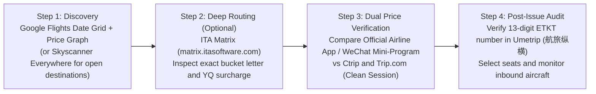
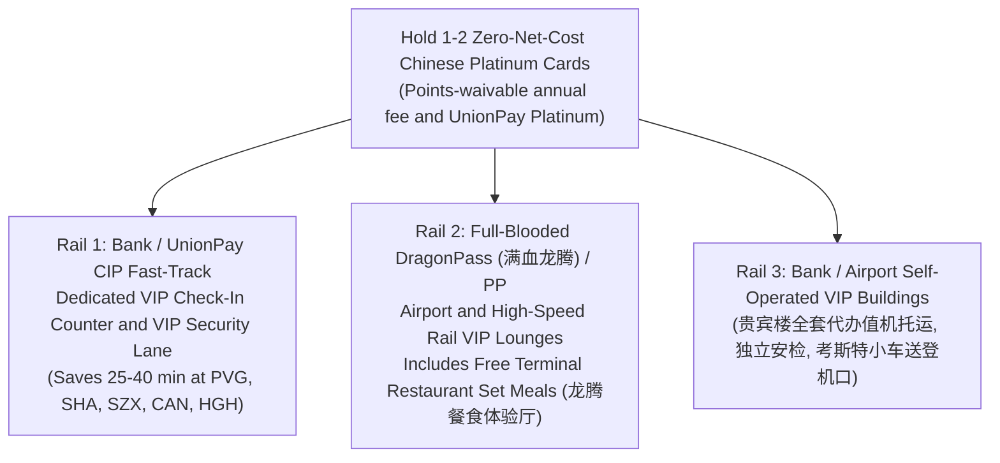

# Booking Cheaper Flights, Airline Pricing Mechanics, Miles Sweet Spots & Lounge Perks (机票底层定价、里程甜点与贵宾厅全攻略)

Airfare is the most aggressively yield-managed consumer product on earth. On a single Airbus A350 flying from Shanghai Pudong (`PVG`) to Tokyo (`NRT`) or Paris (`CDG`), two passengers sitting in identical `18-inch` economy seats next to each other frequently paid **RMB 1,650** and **RMB 6,400**—while a software engineer three rows ahead lying flat in Business Class paid **RMB 920–1,650 in taxes + 28,000–88,000 Asia Miles** accumulated passively.

Once you understand how **Global Distribution Systems (`GDS`)**, **fare-bucket inventory waterfalls**, **Open-Jaw routing construction**, and **Chinese bank CIP/lounge ecosystems** work under the hood, you will never pay retail airfare or queue `45 minutes` at airport security again.

> **Navigation**: Back to [00-README.md](00-README.md) | Next: [02-FIVE-STAR-HOTELS-TRAIN-AND-TRAVEL-TRICKS.md](02-FIVE-STAR-HOTELS-TRAIN-AND-TRAVEL-TRICKS.md) | Apps: [03-HIDDEN-MONEY-SAVING-APPS-AND-CHINA-DEALS.md](03-HIDDEN-MONEY-SAVING-APPS-AND-CHINA-DEALS.md)

---

## Table of Contents

1. [How Airline GDS & 26-Letter Fare Buckets Actually Work](#1-how-airline-gds-26-letter-fare-buckets-actually-work)
2. [The Pro 4-Step Flight Search & Verification Pipeline](#2-the-pro-4-step-flight-search-verification-pipeline)
3. [Open-Jaw Multi-City, Stopovers & 5th-Freedom Luxury Routes](#3-open-jaw-multi-city-stopovers-5th-freedom-luxury-routes)
4. [Chinese Airline Monthly Member Promo Days (`航司会员日日历`)](#4-chinese-airline-monthly-member-promo-days-航司会员日日历)
5. [`航旅纵横` & `飞常准`: Aircraft Hardware, Seat Pitch & Delay Forensics](#5-航旅纵横-飞常准-aircraft-hardware-seat-pitch-delay-forensics)
6. [Airline Miles Valuation & Cathay Asia Miles Sweet Spots](#6-airline-miles-valuation-cathay-asia-miles-sweet-spots)
7. [Chinese Bank Platinum Cards: Free Airport/HSR VIP Lounges & CIP](#7-chinese-bank-platinum-cards-free-airporthsr-vip-lounges-cip)
8. [Worked Case Study & Flight Delay Insurance Stacking (`延误险合规理赔与实操案例`)](#8-worked-case-study-flight-delay-insurance-stacking-延误险合规理赔与实操案例)

---

## 1. How Airline GDS & 26-Letter Fare Buckets Actually Work

Airlines do **not** price seats by physical cabin alone. Every flight's inventory is managed inside a **Global Distribution System** (**Amadeus**, **Sabre**, **Travelport** internationally, and **TravelSky `中航信`** for Chinese carriers), which slices the plane's `300` seats into **up to 26 alphabetical booking classes (`子舱位代码`)**:

| Physical Cabin | Typical GDS Sub-Bucket Letters (High Price -> Deep Promo) | Refund / Change Flexibility | Mileage Accrual Rate |
| :--- | :--- | :--- | :--- |
| **First Class (`头等舱`)** | `F` (Full First) -> `A` (Discounted First) -> `O / Z` (Award First) | Free or minimal fee | `150%–300%` (Award = `0%`) |
| **Business Class (`公务/商务舱`)** | `J, C` (Full Business) -> `D, R, I` (Discounted Promo Business!) -> `U / I` (Award Business) | Moderate fee on `I/R` | `125%–200%` (Award = `0%`) |
| **Premium Economy (`超级经济舱`)** | `W` (Full Prem Econ) -> `P, E, R` (Discounted Prem Econ) | Moderate fee | `100%–110%` |
| **Economy Class (`经济舱`)** | `Y, B, M, H` (`全价/高折扣`) -> `K, L, Q` (`中折扣`) -> `T, V, S, N, G, U` (`特价促销舱`) -> `X` (Award Economy) | `Y/B` flexible; `T/V/S` strict fee or non-refundable | `100%` (`Y/B`) down to `0%–25%` (`T/V/S`) |

### Three Exploitable Mechanics Inside GDS Inventory Engines

1. **The Multi-Passenger Same-Bucket Trap (`多人同行子舱位连坐溢价`)**:
   - **The Bug/Rule in GDS**: All passengers booked on a single Passenger Name Record (`PNR`) **must be booked into the exact same fare-bucket letter**.
   - **Concrete Failure Scenario**: Suppose Economy bucket `V` (`RMB 1,800`) has **`1` seat remaining**, and the next bucket up, `L` (`RMB 2,650`), has `6` seats remaining. If you search for **`2 adults`** together, the GDS skips `V` completely and prices *both* tickets into `L`: `2 x 2,650 = RMB 5,300`!
   - **The Fix**: **Always search for `1 Adult` first** to discover the true floor price! If `1 Adult` quotes `RMB 1,800` and `2 Adults` quotes `RMB 2,650` per person, split into two separate `1-person` bookings (`1,800 + 2,650 = RMB 4,450`, instantly saving **RMB 850**!), then link seats side-by-side during free online check-in on `航旅纵横` or the airline app.
2. **Base Fare vs Carrier-Imposed Surcharge (`票面价 Base Fare + 燃油附加费 YQ/YR + 机场税`)**:
   - Every international ticket obeys:
     $$P_{\text{total}} = F_{\text{base}} + S_{\text{YQ/YR}} + T_{\text{govt/airport}}$$
   - Airline "50%-off promo codes" and member-day discounts **only discount $F_{\text{base}}$ (`票面裸价`)**, never $S_{\text{YQ/YR}}$ (`航司燃油费`) or $T_{\text{govt}}$! On European/Japanese promos where $F_{\text{base}} = \text{RMB } 600$ and $S_{\text{YQ/YR}} + T_{\text{govt}} = \text{RMB } 2,200$, a `"20% off promo"` saves only `RMB 120`, not `RMB 560`. Conversely, carriers with **low or zero `YQ`** (e.g., Singapore Airlines, United, Air China domestic/select routes, Finnair award tickets) give dramatically higher real discounts and mileage value.
3. **Married Segment Pricing (`联程航段倒挂机制`)**:
   - Airlines price **Origin-to-Destination (`O&D`) markets**, not flight distance! Non-stop `HKG -> LHR` on Cathay Pacific has high corporate willingness-to-pay (`RMB 28,000` Business), whereas **`PVG -> HKG -> LHR`** or **`CAN -> HKG -> CDG`** competes against mainland Chinese/Middle Eastern carriers and routinely prices at **`RMB 14,500–17,500` in `I`-class Business**—literally **40% cheaper for flying *more* flights on the exact same long-haul aircraft**!

---

## 2. The Pro 4-Step Flight Search & Verification Pipeline

Never start a flight search inside a domestic OTA app. Use the **Global Meta-Search -> Matrix Forensics -> Direct Official Verification** funnel:

### How Each Tool in the Stack Earns Its Place

1. **Google Flights (`google.com/travel/flights`) — Unbeatable Speed & Multi-Airport Matrix**:
   - Enter **up to 5 origin and 5 destination airport codes separated by commas** in a single query! For example: Origin `PVG, SHA, HGH` -> Destination `NRT, HND, KIX, FUK` (all of Japan) or `CDG, LHR, AMS, FRA, MXP` (Europe gateways).
   - Click **Date Grid (`日期网格`)** to see a `7 x 7` heatmap of departure vs return dates—shifting departure from Friday night to Thursday night or Tuesday morning routinely drops international fares by **RMB 1,500–3,500**.
   - Toggle **Track Prices (`追踪价格`)** on 2–3 candidate dates `60–90 days` out; Google emails you the instant an airline revenue-management batch job re-opens cheap `T/V` or `I` sub-buckets!
2. **Skyscanner `"Explore Everywhere"` (`天巡探索任意目的地`) — Fixed-Date Vacation Finder**:
   - When your dates are fixed (e.g., National Day Oct 1–7, Spring Festival, or a sudden 5-day gap between projects) and you just want to escape somewhere cool without paying holiday surge prices, set Origin = `Shanghai (Any)` and Destination = **`Everywhere`**. Skyscanner ranks every country on earth from cheapest to priciest on those exact dates (often surfacing hidden gems like Fukuoka, Jeju, Kota Kinabalu, Tashkent, or Vladivostok at `1/3` the price of Bangkok/Tokyo).
3. **ITA Matrix (`matrix.itasoftware.com`) — Power-User Routing Surgical Scalpel**:
   - Built by MIT computer scientists (acquired by Google), ITA Matrix lets you write explicit routing expressions: e.g., `C:CX+` (Cathay flights only), `/ alliance oneworld` (earn Oneworld status), `/ maxconnect 180` (no layovers over 3 hours), or `/ f bc=i` (search discounted `I`-class Business only), and reveals the exact **Fare Basis Code** and **`YQ` fuel tax breakdown** before you buy.
4. **Checkout Showdown: Official Airline App (`航司官方App`) vs Ctrip / Trip.com (`携程 / Trip国际版`)**:
   - **Default Rule (`80%` of bookings)**: **Book on the Official Airline App / Official Website** whenever the price is within `RMB 50–100` of OTAs. Why?
     - **Official Change/Refund Rules (`严格执行官方客规`)**: Zero extra `"OTA service handling fee"`, instant online rebooking during typhoons/delays (`航变免费改签外航或本航前后航班`), early free seat selection, and occasional **official app exclusive coupons (`App专享直减 RMB 50–200`)**.
   - **When Ctrip or Trip.com (`国际版`) Wins (`20%` of bookings)**:
     - On multi-carrier international itineraries or consolidator private fares (`私有控位运价`), Trip.com (often using HKD/EUR/USD with foreign-card promo codes) or Ctrip bare-fare (`剥离一切保险礼包后的裸票`) can undercut official sites by `RMB 300–900`.
     - **Mandatory Safety Check (`防假出票铁律`)**: Within `2 hours` of paying any OTA, open **`航旅纵横` (Umetrip)** or the operating airline's website and verify that a real **13-digit Electronic Ticket Number (`电子客票号 ETKT`, e.g., `781-xxxxxxxxxx` for China Eastern, `999-` Air China, `784-` China Southern, `160-` Cathay)** matches the **exact cash price (`客票票面价一致，谨防大额差价阴阳票或积分盗刷票`)**! Under CAAC (`中国民航局`) regulations, if a domestic OTA charges higher than the official `行程单` ticket price (`暗加差价`), you are legally entitled to `"退一赔三"`!

---

## 3. Open-Jaw Multi-City, Stopovers & 5th-Freedom Luxury Routes

### 3.1 The Open-Jaw Multi-City Arbitrage (`缺口程 / 开口票神技`)

Beginners make one of two expensive mistakes on multi-city trips (such as visiting Morocco, Europe, or Japan's Kanto-to-Kansai route):
- **Mistake A (Two International One-Ways)**: Booking `PVG -> RBA` (Shanghai to Rabat) as one one-way ticket and `CMN -> PVG` (Casablanca to Shanghai) as a second one-way ticket. Full-service airlines price international one-ways into high business-traveler `Y/B/M` buckets—often costing **`75%–110%` of a round-trip FOR EACH LEG**!
- **Mistake B (Round-Trip + Backtracking)**: Booking `PVG <-> CMN` round-trip, which wastes your precious last vacation day hauling luggage back across the country just to catch your return flight.

**The Pro Solution — Single-Ticket Open-Jaw (`多程 / 缺口程联程票`)**:
Switch the search tab from `"Round-Trip"` to **`"Multi-City" (`多程`)** on Google Flights or the airline's official app (e.g., Air France, Qatar Airways, Etihad, China Eastern) and enter:
- **Flight 1**: `PVG -> RBA` (Shanghai Pudong -> Rabat, or `PVG -> CDG` -> `RBA`)
- *(Surface Sector `地面自理段`: Travel freely overland by Moroccan Al Boraq high-speed rail from Rabat/Tangier down to Casablanca/Marrakech!)*
- **Flight 2**: `CMN -> PVG` (Casablanca -> Shanghai Pudong, e.g., on China Eastern/Shanghai Airlines direct `FM872` or Gulf/European one-stop when within the same alliance/joint-venture!)

So long as the unflown surface gap (`缺口距离`) is shorter than the shortest flown international leg (standard IATA Open-Jaw tariff rule), the GDS prices the entire ticket as **`0.5 x Promo Round-Trip A + 0.5 x Promo Round-Trip B`**! Classic Open-Jaw combinations from Shanghai:
- **Morocco**: `PVG -> RBA` (or `RAK` Marrakech) + `CMN -> PVG`
- **Japan Golden Route (Zero Shinkansen Backtrack, Saves RMB 950/person!)**: `PVG -> TYO (HND/NRT)` + `KIX (Osaka) -> PVG`
- **Europe Twin Gateways**: `PVG -> LHR (London)` -> Eurostar -> `CDG (Paris) -> PVG`, or `PVG -> FCO (Rome)` + `MXP (Milan) -> PVG`

### 3.2 Free Hub Stopover Programs (`白嫖一国两游：中转免费停留与免费五星酒店`)

Turn a tedious `14-hour` intercontinental journey into **two vacations for the price of one** using official airline hub stopover perks:

| Airline & Hub | Official Stopover Program | Insider Perk Unlocked |
| :--- | :--- | :--- |
| **Qatar Airways (`DOH` Doha)** | **Discover Qatar Stopover** | `USD 14–25/night` 4-star and 5-star luxury hotels in Doha for `1–4` nights! |
| **Etihad Airways (`AUH` Abu Dhabi)** | **Abu Dhabi Stopover** | **Up to `2 nights` completely FREE 3/4-star hotel** (or 40% off 5-star beach resorts) when booking via `etihad.com` multi-city! |
| **Turkish Airlines (`IST` Istanbul)** | **Touristanbul / Stopover in Istanbul** | Free guided city tour + meals on `6–24 hr` layovers, OR **1 night (Economy) / 2 nights (Business) FREE 4–5 star Istanbul hotel**! |
| **China Eastern / Air China / Southern (`PVG / PEK / CAN / TFU`)** | **International Transit Hotel (`国际中转免费住宿`)** | Free overnight transit hotel + shuttle on qualifying `6–24 hr` international-to-domestic/international connections (must reserve in airline app `48h+` prior!) |

### 3.3 Fifth-Freedom Luxury Routes (`第五航权神仙航线`)

A **Fifth-Freedom Flight (`第五航权`)** occurs when Airline from Country A gets rights to carry commercial passengers solely between Country B and Country C as a tag-on extension of a long-haul route. Because the airline just wants to fill seats rather than fly half-empty on the tag sector, **prices are often dirt cheap on world-class widebody flagships**:
- **Emirates `HKG <-> BKK` (Hong Kong to Bangkok)**: Fly the iconic **Airbus A380 double-decker** (complete with onboard bar & shower spa in First/Business!) on a `3-hour` hop for approx. `RMB 1,300` Economy or `RMB 3,500` Business!
- **Singapore Airlines `NRT <-> LAX` (Tokyo Narita to Los Angeles)**: World-renowned SQ service across the Pacific, often pricing below US/Japanese carriers.
- **Ethiopian Airlines `NRT <-> ICN` (Tokyo to Seoul)**: Widebody Boeing `787 Dreamliner` with `2 x 23 kg` checked baggage at budget-carrier prices!
- **KLM `SIN <-> DPS` (Singapore to Bali)** & **Scoot / Jetstar / Cathay `TPE <-> NRT/KIX`**.

### 3.4 Skiplagging / Hidden-City Red Lines (`弃程票三大生死铁律`)

Sometimes `A -> B -> C` (`RMB 2,100`) is cheaper than non-stop `A -> B` (`RMB 4,200`). If you ever consider getting off at `B` and abandoning `B -> C` (`弃尾段`):
1. **NEVER Skip the First Leg (`严禁弃前段`)**: If you fail to board Leg 1 (`No-Show`), the GDS **automatically and irrevocably cancels ALL remaining outbound and return legs** on that ticket! Only the *very last* segment of an entire itinerary (one-way, or the final leg of the return journey) is physically skippable.
2. **Carry-On Only (`绝对不能托运行李`)**: Checked bags are tagged through to final city `C` (unless an overnight/customs port forces reclaim).
3. **Never Attach Your Frequent Flyer Number & Never Repeat on One Carrier**: Repeated skiplagging violates Conditions of Carriage and can get your airline mileage account frozen.

---

## 4. Chinese Airline Monthly Member Promo Days (`航司会员日日历`)

Every major Chinese carrier runs a fixed monthly **Member Promo Day (`会员日`)** inside its official App / WeChat Mini-Program featuring `10%–25%` base-fare discount codes, flash domestic promos (`RMB 199–399`), bonus mileage multipliers, and discounted mileage redemptions:

| Airline | Monthly Member Day | App / Program | Best Insider Play |
| :--- | :--- | :--- | :--- |
| **China Eastern (`中国东航 / 上航`)** | **18th of every month (`每月18号`)** | `东方航空` App (`东方万里行`) | Shanghai (`PVG/SHA`) home-base king! Grab `88折–92折` coupons, discounted points tickets, and `京沪/海外` flash packs |
| **China Southern (`中国南航`)** | **28th of every month (`每月28号`)** | `南方航空` App (`明珠俱乐部`) | Strongest nationwide flash sale (`南航会员日国内单程 RMB 200起`, international coupons, `里程5折兑` events) |
| **Air China (`中国国航`)** | **Same Month & Day (`每月同月同日`: Jan 1, Feb 2 ... Nov 11, Dec 12)** | `中国国航` App (`凤凰知音`) | Domestic/European coupons + youth (`青春权益卡`) / student discounts |
| **Hainan Airlines (`海南航空`)** | **8th of every month (`每月8号`)** | `海南航空` App (`金鹏俱乐部`) | Excellent widebody `B787 / A330` Business Class cash promos (`公务舱特惠 RMB 900–1,500` on trunk routes!) |
| **Sichuan Airlines (`四川航空`)** | **19th of every month (`每月19号`)** | `四川航空` App | Legendary onboard food (`喂猪航空`) + Chengdu (`TFU/CTU`) transit promos |
| **XiamenAir (`厦门航空`)** | **9th of every month (`每月9号`)** | `厦门航空` App (`白鹭俱乐部`) | Clean service + Fujian/SE Asia/Australia transit coupons |
| **Juneyao Air (`吉祥航空`)** | **25th of every month (`每月25号`)** | `吉祥航空` App | Shanghai (`PVG/SHA`) second hub; watch for **`B787-9 Dreamliner`** flights to Japan, Helsinki, Athens & domestic trunk routes! |
| **Spring Airlines (`春秋航空`)** | **27th (`每月27号`) / 9th-15th** | `春秋航空` App | Ultra-low-cost Japan/regional hops (`茨城/佐贺/高松/济州`) — **always buy extra luggage allowance inside the App `24h+` before departure** (`柜台现场买行李贵3倍!`) |

---

## 5. `航旅纵横` & `飞常准`: Aircraft Hardware, Seat Pitch & Delay Forensics

Two flights departing `30 minutes` apart at the **exact same RMB 950 ticket price** can differ wildly in physical comfort: one might be a cramped `14-year-old` narrowbody Boeing `737-800` with `30-inch` pitch and no USB port, while the other is a whisper-quiet `2-year-old` **Airbus `A350-900` or Boeing `787-9` widebody** with `32-inch` pitch, higher cabin humidity (`更高客舱气压与湿度，落地不头疼`), `AC/Type-C` fast charging, and giant overhead bins!

Before clicking pay, check **`航旅纵横` (Umetrip)** or **`飞常准` (VariFlight)** in `15 seconds`:

1. **Always Hunt Widebody Aircraft on Domestic Trunk Routes (`干线必挑宽体机`)**:
   - On **`SHA/PVG <-> PEK/PKX` (Shanghai–Beijing)**, **`SHA <-> CAN/SZX` (Guangzhou/Shenzhen)**, **`SHA <-> CTU/TFU` (Chengdu)**, and **`SHA <-> CKG/KMG/SYX`**, filter specifically for **`A350`**, **`B787`**, **`B777`**, **`A330`**, or try COMAC **`C919`** (whose middle seat is intentionally `0.5 inches` wider!). Also: upgrading a domestic widebody to flat-bed Business (`躺平公务舱`) at check-in (`值机升舱`) often costs just `RMB 400–700` extra!
2. **Economy Seat Selection Physics (`经济舱黄金选座法则`)**:
   - On **`A330` (`2-4-2` layout)** and **Embraer `E190` (`2-2` layout)**: Couples/solo travelers get **`2`-seat window pairs with zero middle seat**!
   - On **`B777` (`3-4-3` cramped `17-inch` seats)** vs **`A350` (`3-3-3` generous `18-inch` seats)**: Always pick **`A350`** over `10-abreast B777` on `12-hour` Europe flights!
   - **Emergency Exit Row (`安全出口排`)** gives infinite legroom, *except* verify on `航旅纵横` (`客舱布局图`) that it isn't the **row *in front* of the exit row (`安全出口前一排座椅锁死不可后仰!`)**!
3. **Pre-Emptive Delay Diagnosis via Inbound Aircraft (`查前序航班动态`)**:
   - On travel day, tap **`前序航班` (Previous Flight)** in `航旅纵横`/`飞常准`. If your `18:00` flight's assigned physical tail number (`B-xxxx`) hasn't even taken off from Harbin at `16:30`, your flight is `100%` delayed even if the airport board still lies `"On Time (计划)"`—giving you a `2-hour` head start to relax in the lounge or rebook onto an earlier flight!

---

## 6. Airline Miles Valuation & Cathay Asia Miles Sweet Spots

Evaluate every mileage redemption with the **Net Value per 10,000 Miles (`每万里程等效现金价值`)** formula:

$$V_{10\text{k}} = \frac{P_{\text{cash}} - T_{\text{miles\_tax}}}{M_{\text{redeemed}}} \times 10{,}000$$

- **Floor Benchmark (`回本红线`)**:
  - **Cathay `Asia Miles` (`国泰亚洲万里通`) / `Avios` / `ANA`**: Worth approx. **`RMB 850–1,100` per `10,000` miles**. Never redeem at `RMB 450/10k` on cheap off-peak Economy with high taxes; save them for **holiday peak Economy (`国庆/春节现金暴涨期`)** or **long-haul Business Class (`每万里程用出 RMB 1,600–2,800+`)**!
  - **China Eastern / Southern / Air China (`国内三大航`)**: Worth approx. **`RMB 500–750` per `10,000` kilometers/miles**.

### Top Mileage Sweet Spots for Mainland China Engineers

| Program | Sweet-Spot Route Archetype | Miles Needed (One-Way) | Why It Crushes Cash Fares |
| :--- | :--- | :--- | :--- |
| **Cathay `Asia Miles` (`国泰亚万`)** | **`PVG/SHA -> HKG` or `HKG -> TYO/KIX/ICN/BKK/SIN` (`751–2,750 mi` band)** | `10,000–13,000` Econ; `25,000–32,000` Business | Cathay's `A350/B777 Aria Suite` Business Class + world-famous HKG lounges (**The Pier `玉衡堂` / The Wing `寰宇堂`**)! |
| **Cathay `Asia Miles` (`国泰亚万`)** | **Long-Haul Business (`PVG -> HKG -> Europe / London / Paris / Madrid` or Oneworld `Qatar/Finnair`)** | **`84,000–88,000` Business** | Cash Business is `RMB 22,000–38,000` RT; `88k` miles + reasonable tax yields **`RMB 2,000+` per `10k` miles** on `13-hour` flat beds! |
| **British Airways / Qatar `Avios`** | **Short-Haul Non-Stop (`<= 650 mi` or `<= 1,150 mi`: e.g., `JAL` Japan domestic `HND-CTS/OKA`, `PVG-HKG`)** | **`6,000–11,000` Avios** | Last-minute JAL Tokyo-Sapporo cash tickets cost `RMB 1,800`; Avios locks it at fixed low points with minimal tax! |
| **China Eastern (`东方万里行`)** | **`PVG -> TYO/SEL` or Domestic Holiday Peak (`上海-三亚/哈尔滨/乌鲁木齐/丽江`)** | `12,000–32,000` pts (less `18号` discount!) | Dynamic/standard chart protects you when Spring Festival cash Economy spikes to `RMB 3,200` one-way |

*How to accumulate miles passively in China*: Convert credit card points from **CMB (`招行经典白/百夫长` -> Asia Miles / Eastern / Air China)**, **CITIC / BoCom / HSBC China (`汇丰中国旅行卡`)**, hotel points, and always credit paid Oneworld/SkyTeam/Star Alliance flights to a single core frequent-flyer hub rather than scattering orphan miles across 9 airlines.

---

## 7. Chinese Bank Platinum Cards: Free Airport/HSR VIP Lounges & CIP

You do **not** need a RMB `3,600/year` rigid-fee black card or airline Gold status to skip every security queue and eat hot noodle soup before flights. Understand the **3 distinct lounge/fast-track rails in China**:

### High-ROI Chinese Credit Card Lounge Matrix (Verify Current Yearly Terms Before Applying)

| Card / Tier | Annual Fee Waiver Rule (`免年费门槛`) | Key Travel Perks Unlocked | Best Use Case |
| :--- | :--- | :--- | :--- |
| **UnionPay Platinum / Diamond (`各行银联白金/钻石卡通用权益`)** | Many **`0`-annual-fee / swipe-6-times-waived** `"小白金"` qualify! | Via **`云闪付 -> 权益精选`**: **`RMB 1` or `RMB 6.2` Airport CIP** (`快速安检+休息室`, typically `2x` single + `1x` family per year per card!) + **`RMB 1` High-Speed Rail Lounge**! | Lowest-threshold entry! Every engineer should hold at least `1–2` free UnionPay Platinum cards |
| **CMB Classic Platinum (`招行经典白金卡`)** | `10,000` points waive RMB `3,600` fee (Birthday `10x` points = spend RMB `20,000` on birthday!) | **`6x/year` Airport VIP Lounges (`可带1人`)** (many airports include full **`贵宾楼独立安检+小车送机`**!) + `300+100` luxury hotel benefit + mileage exchange + free dental cleaning/checkup + flight delay insurance | Still the undisputed all-around benchmark for high-earning engineers |
| **ABC Essence Platinum (`农行精粹白金卡`)** | Swipe thresholds / points waiver (`首年及次年刷卡或积分免`) | **Unlimited (`无限次`) self-use nationwide Bank Airport VIP Lounges / VIP Buildings (`多地支持全套贵宾楼`)**! | Frequent domestic flyers (`10+` flights/year) |
| **BoCom White Kirin (`交行标准白金卡 白麒麟`)** | Points / new-customer waiver promos | **`6x` Airport Bank VIP + `6x` Worldwide DragonPass (`龙腾`)** + **Up to `3` FREE supplementary cards (`3张免费附属卡给父母伴侣同享贵宾厅!`)** + `2-hour` flight delay insurance | Best card for sharing lounge comfort with parents & partner for free |
| **ICBC Shanghai/Shenzhen Platinum (`工行大白金 / 上海超惠真金`)** | Varies (`超惠真金` tiny swipe waiver in select regions; `大白金` RMB `200k` spend) | ICBC self-operated lounges at **`PVG / SHA / SZX / CAN`** + DragonPass (check whether current year's DragonPass includes **`餐食体验厅`** dining!) | Home-base Shanghai/Shenzhen travelers |
| **CGB Ultimate Platinum (`广发鼎极白金卡` / 高铁白)** | Swipe `48x` or binding WeChat/Alipay (`极易免年费`) | Self-operated **广发机场 & 高铁贵宾厅** (`上海虹桥/广州南/深圳北/北京南/杭州东` High-Speed Rail VIP lounges right above the platforms!) | Frequent `上海虹桥` High-Speed Rail travelers |

### Critical Insider Distinction: "Full-Blooded" vs "Neutered" DragonPass (`满血龙腾 vs 阉割版龙腾`)
- **Full-Blooded DragonPass (`满血版龙腾`, e.g., select ICBC / CITIC / CEB / paid DragonPass)**: Can be swiped at **airport & HSR restaurants (`餐食体验厅`, such as Crystal Jade `翡翠拉面小笼包`, Kangshifu Chef's Table, burger/Cantonese restaurants)** for a **completely free RMB `120–160` hot set meal (`俗称"饭票"`)**!
- **Neutered Bank DragonPass (`阉割版龙腾`, e.g., many entry/mid-tier cards since 2024–2026)**: Restricted strictly to **lounge entry (`仅限休息室，不可刷餐厅吃饭`)**—still great for quiet sofa seating, Wi-Fi, drinks, and hot buffet hours (`饭点热食`), so check `掌上生活/买单吧/云闪付` lounge meal hours before arriving!

---

## 8. Worked Case Study & Flight Delay Insurance Stacking (`延误险合规理赔与实操案例`)

### 8.1 Real-World Pricing Breakdown: Shanghai to Morocco (`PVG-RBA + CMN-PVG`)

Suppose two travelers plan a 10-day spring trip from Shanghai to Rabat (`RBA`), Tangier, Chefchaouen, Marrakech, and Casablanca (`CMN`):

| Booking Strategy | Exact Routing & Channel | Per-Person Cost | Pain Points / Gains |
| :--- | :--- | :--- | :--- |
| **Naive Strategy 1: Two Separate One-Ways** | OTA search `PVG -> RBA` (`RMB 6,900`) + `CMN -> PVG` (`RMB 6,400`) | **`RMB 13,300`** | Priced into high `B/M` one-way fare buckets; massive cash waste |
| **Naive Strategy 2: Round-Trip + Backtrack** | OTA `PVG <-> CMN` (`RMB 7,600`) + `RMB 400` extra hotel/rail backtrack + OTA `RMB 168` insurance bundle | **`RMB 8,168`** | Loses half a vacation day backtracking to Casablanca; zero lounge perks |
| **Insider Strategy A: Open-Jaw Cash Ticket** | Google Flights Multi-City (`PVG -> CDG -> RBA` + `CMN -> CDG -> PVG` on Air France, or `PVG -> DOH -> RBA/CMN` on Qatar) -> Booked on Official Airline App using CMB Platinum Card | **`RMB 5,280`** | **Saves `RMB 2,888–8,020`/person**; lands directly in Rabat and departs Casablanca; free PVG CIP + lounge meal + automatic card delay insurance |
| **Insider Strategy B: Oneworld Asia Miles Business** | Redeem `88,000` Cathay Asia Miles (`PVG -> HKG -> DOH -> CMN` on Cathay + Qatar Qsuite!) | **`88k Miles + RMB 1,650 tax`** | `180-degree` lie-flat double suite (`Qsuite`), world-class Al Mourjan Doha Lounge, zero jet lag |

### 8.2 Automatic Credit Card Flight Delay & Baggage Delay Compensation (`免费航延险羊毛`)

Never pay an OTA `RMB 40–60` for commercial delay insurance before checking the **complimentary Travel Inconvenience Insurance (`航空延误险 / 行李延误险`)** already bundled into your Chinese Platinum credit card when you pay at least `80%–100%` of the ticket (or taxes on a mileage ticket!) with that card:

1. **Arrival Time vs Take-Off Time (`落地延误计算标准`)**:
   - Almost all bank delay policies measure **Actual Landing Time (`轮挡落地时间`) minus Scheduled Landing Time (`计划到达时间`)**, NOT pushback/take-off delay! Even if a plane takes off `2 hours` late, tailwinds can bring it in `1 hour 45 minutes` late (missing a `2-hour` threshold). Always screenshot `航旅纵横` / `飞常准` actual landing timestamps and download the **Official Airline Delay Certificate (`航司官方延误证明 PDF`)** inside the airline's app immediately after landing.
2. **Fixed-Payout vs Ticket-Reimbursement Cards (`定额赔付 vs 报销机票款`)**:
   - Cards like **CMB Classic Platinum / Centurion (`招行经典白`: `3–5 hour` delay reimburses up to `RMB 600–2,000` ticket cost or fixed allowance)**, **BoCom White Kirin (`交行白麒麟`: `2-hour` delay pays up to `RMB 1,000` per segment)**, **CCB Dashanbai (`建行大山白`: `4-hour` delay pays `RMB 1,000`)**, and **CITIC Paid Cards (`中信指定渠道购票 2小时赔 RMB 1,000`)** turn a frustrating thunderstorm delay during Shanghai plum-rain/typhoon season (`6–8月雷雨季`) into a free ticket refund!
3. **Checked Baggage Delay (`行李延误险 — 极少人知道的大羊毛`)**:
   - On international connections (`如欧洲法航/英航转机行李晚到 6–12 小时`), premium Visa Infinite / Mastercard World Elite / Amex / Bank Platinum policies reimburse **`RMB 1,000–4,000` of emergency toiletries, underwear, and clothes (`应急购置必需品发票实报实销`)** as long as you obtain a **PIR (`Property Irregularity Report 行李延误事故单`)** at the airport baggage service desk before exiting customs!

