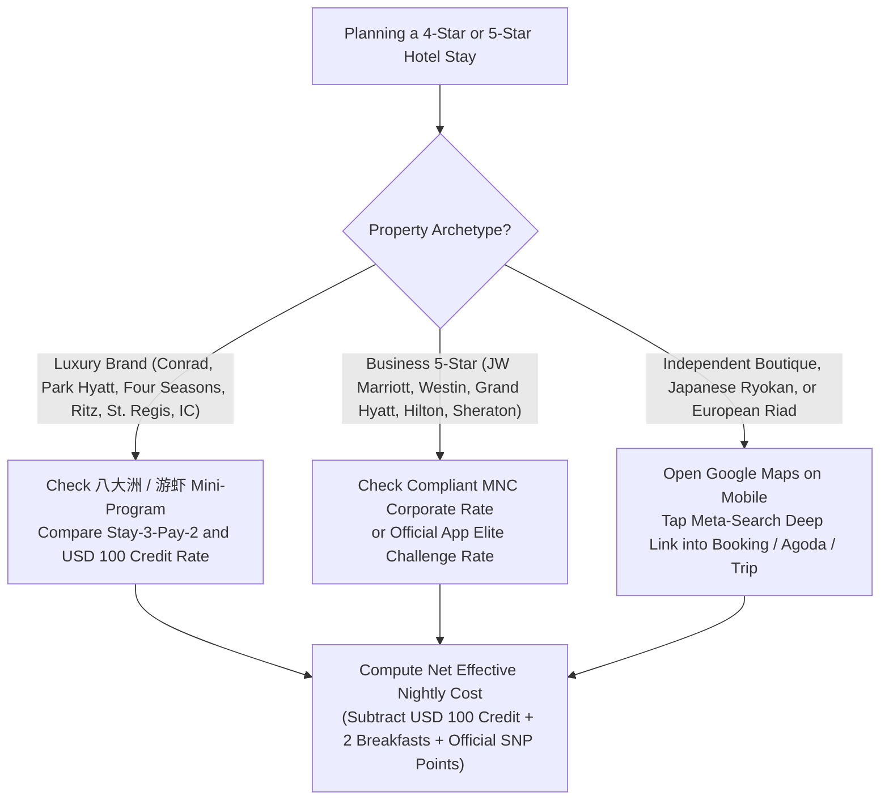
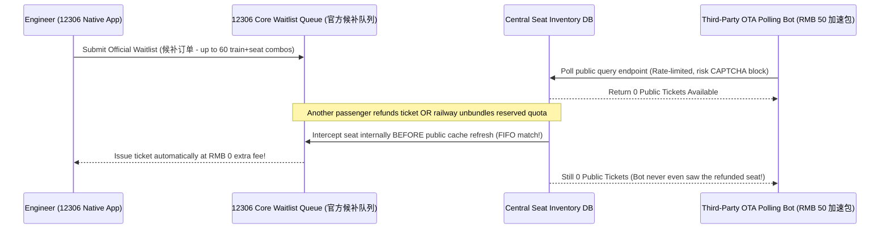

# 5-Star Hotels for Less, 12306 Rail Hacks & Car Rental Insider Rules (五星酒店FHR八大洲协议价、12306候补积分与租车避坑)

In travel, **hotels, high-speed rail, and rental cars** exhibit the widest gap between what the general public experiences on mainstream OTAs and what insiders unlock at the exact same—or `40%` lower—out-of-pocket cost.

Most travelers book a luxury 5-star hotel on Ctrip or Booking.com at **RMB 2,200 room-only (`裸房无早、无升级、无集团积分`)**, pay RMB `50` extra for a placebo `"12306 VIP 抢票加速包"`, and rent cars from third-party micro-agencies that hold a RMB `5,000` deposit hostage over a millimeter wheel scratch. This guide replaces all three traps with institutional-grade travel infrastructure.

> **Navigation**: Back to [00-README.md](00-README.md) | Previous: [01-CHEAP-FLIGHTS-MILES-AND-AIRPORT-HACKS.md](01-CHEAP-FLIGHTS-MILES-AND-AIRPORT-HACKS.md) | Next: [03-HIDDEN-MONEY-SAVING-APPS-AND-CHINA-DEALS.md](03-HIDDEN-MONEY-SAVING-APPS-AND-CHINA-DEALS.md)

---

## Table of Contents

1. [Luxury Preferred Agency Rates (`FHR / Virtuoso / Privé / STARS` via `八大洲` & `游虾`)](#1-luxury-preferred-agency-rates-fhr-virtuoso-privé-stars-via-八大洲-游虾)
2. [Legitimate MNC Corporate Rates (`外企协议价`) & Google Maps Meta-Search Redirects](#2-legitimate-mnc-corporate-rates-外企协议价-google-maps-meta-search-redirects)
3. [Marriott & Hyatt Status Challenges & Points Sweet Spots](#3-marriott-hyatt-status-challenges-points-sweet-spots)
4. [`12306` High-Speed Rail Mechanics: Official `候补`, `5%` Free Points & Quiet Car `F`-Seat](#4-12306-high-speed-rail-mechanics-official-候补-5-free-points-quiet-car-f-seat)
5. [Domestic & International Car Rental Anti-Trap Rules (`境内外租车防坑铁律`)](#5-domestic-international-car-rental-anti-trap-rules-境内外租车防坑铁律)
6. [Front-Desk Upgrade Engineering & Master Channel Cheat Sheet](#6-front-desk-upgrade-engineering-master-channel-cheat-sheet)
7. [Complimentary Airport Transfers & Hands-Free Travel Logistics (`免费接送机与空手旅行`)](#7-complimentary-airport-transfers-hands-free-travel-logistics-免费接送机与空手旅行)

---

## 1. Luxury Preferred Agency Rates (`FHR / Virtuoso / Privé / STARS` via `八大洲` & `游虾`)

Here is the single biggest open secret in global luxury hospitality: **5-star luxury hotel groups hate paying `15%–25%` commissions to mass-market OTAs (Expedia, Booking, Ctrip) that discount their brand image.** Instead, luxury hotels partner with invite-only **Preferred Luxury Consortia (`奢华酒店专享代理联盟`)**—where you pay the **exact same Official Best Available Flexible Rate (`最优弹性门市价 BAR`)**, pay at the hotel front desk upon check-in (`前台现付，提前24小时免费取消`), and receive **RMB `1,200–2,000+` in hard perks for free**:

| Official Luxury Program | Participating Hotel Brands | Standard Free Perks Included on Every Stay |
| :--- | :--- | :--- |
| **Amex Fine Hotels + Resorts (`FHR`)** | Four Seasons, Mandarin Oriental, Aman, Rosewood, Peninsula, Park Hyatt, Ritz-Carlton, St. Regis, Waldorf | Daily breakfast for `2`; **`USD 100` property dining/spa credit**; room upgrade (if available); **guaranteed `16:00` late check-out**! (*Requires Amex Platinum/Centurion*) |
| **Virtuoso (`维图索 / 运通外全球最大奢华旅行顾问联盟`)** | Four Seasons, Mandarin Oriental, Rosewood, Peninsula, Banyan Tree, SLH, independent palaces | Daily breakfast for `2`; **`USD 100` dining/spa credit**; room upgrade; early check-in / late check-out (*Zero special credit card required via agency!*) |
| **Hyatt Privé (`凯悦 Privé`)** | Park Hyatt (`柏悦`), Andaz (`安达仕`), Alila (`阿丽拉`), Thompson, Grand Hyatt (`君悦` select), Unbound Collection | Daily breakfast for `2`; **`USD 100` (or `USD 50–100`) property credit**; **confirmed upgrade within `24 hours` of booking** at many hotels; full Hyatt points & elite nights! |
| **Hilton for Luxury (`原 Hilton Impresario`)** | Waldorf Astoria (`华尔道夫`), Conrad (`康莱德`), LXR | Daily breakfast for `2`; **`USD 100` property credit**; room upgrade; **Double (`2x`) Hilton Honors Base Points**! |
| **Marriott STARS & Luminous (`万豪星级专享`)** | Ritz-Carlton (`丽思卡尔顿`), St. Regis (`瑞吉`), Edition (`艾迪逊`), Bulgari, Luxury Collection, W, JW Marriott | Daily breakfast for `2`; **`USD 100` credit** (`STARS` universal; `Luminous` select properties); upgrade; welcome gift; full Marriott SNP! |
| **IHG Destined (`洲际专享`)** | Regent (`丽晶`), InterContinental (`洲际`), Kimpton (`金普顿`), Hotel Indigo (select) | Daily breakfast for `2`; **`USD 100` property credit**; room upgrade; full IHG One Rewards points & nights! |

### How Anyone in China Accesses These Without a RMB 3,600 Amex Platinum Card

You do **not** need an American Express Centurion or private banker! Authorized Chinese luxury travel agencies expose real-time self-service booking engines right inside **WeChat Mini-Programs / Apps** with **`RMB 0` membership fees**:
- **`八大洲旅游` (`8Continents`)**: China's oldest Virtuoso / Hyatt Privé / Marriott STARS / Hilton for Luxury / Four Seasons Preferred Partner member—automated live inventory, clear Chinese perk breakdowns, and dedicated travel-advisor WeChat support.
- **`游虾旅行` (`Youxia`)** & **`赞那度` (`Zanadu`)**: Fast UI comparing OTA bare rates side-by-side against `Privé / STARS / Virtuoso` perk rates and **"Stay 3 Pay 2 (`住3付2`)" / "Stay 4 Pay 3 (`住4付3`)"** promotions!

### The Net Effective Nightly Cost Formula (`奢华酒店真实净成本公式`)

Never compare headline room price alone. Compute your **Net Effective Cost per Night**:

$$C_{\text{net}} = \frac{N_{\text{paid}} \times R_{\text{BAR}} - V_{\text{credit}} - N_{\text{stay}} \times V_{\text{breakfast}} - V_{\text{SNP}}}{N_{\text{stay}}}$$

#### Concrete Worked Example 1: 1-Night Weekend Staycation / Transit at Conrad (`康莱德`)
- **Ctrip Prepaid Non-Refundable Bare Room**: `RMB 1,380` (Zero breakfast, zero dining credit, zero Hilton points, non-refundable).
- **`八大洲 / 游虾` Hilton for Luxury Rate**: **`RMB 1,520`** (Free cancellation until day before, paid at hotel):
  - Includes **`USD 100` (`approx. RMB 710`) hotel dining credit** -> Enjoy a two-person Chinese restaurant or steakhouse dinner inside the hotel for free!
  - Includes **2 full buffet breakfasts** (worth `RMB 300+`) + **1-category room upgrade** (e.g., Bund/River View room) + **`2x` Hilton points (`approx. RMB 180` value)**.
  - **Net Effective Room Cost**: $1{,}520 - 710 - 300 - 180 = \mathbf{\text{RMB } 330}$! You stayed in an upgraded Conrad view room, ate dinner and two breakfasts, and paid less net than an Atour (`亚朵`) or Ji Hotel (`全季`)!

#### Concrete Worked Example 2: 3-Night Vacation (`住3付2` Promo) at Four Seasons / Park Hyatt / Regent
- Many luxury properties run **`住3付2` (`Stay 3, Pay 2` = `33%` off)** or **`住4付3` (`25%` off)** exclusively through `八大洲 / Virtuoso / Privé` during shoulder seasons.
- A `RMB 2,700/night` resort drops to `2 x 2,700 / 3 = RMB 1,800/night`, **AND still grants the `USD 100` dining credit + `6` free breakfasts (`3 days x 2`) + upgrade + official hotel points**!
- **Crucial Anti-Abuse Rule (`切酒店原则`)**: Because the `USD 100` credit is granted **once per stay (`每次入住送一次 100 美金`)**, consecutive back-to-back `1-night + 1-night` bookings at the *exact same hotel* (even switching between husband and wife's names) are merged into a single stay by hotel rules (`24小时内同店连住合并计算`). Instead, on a `2-night` trip in Bangkok, Tokyo, Shanghai, or Chengdu, **hotel-hop (`切房`)**: Night 1 at **Waldorf Astoria / Conrad** (`USD 100` dinner #1) -> Night 2 at **Park Hyatt / Andaz / St. Regis** `15 minutes` away (`USD 100` dinner #2)!

---

## 2. Legitimate MNC Corporate Rates (`外企协议价`) & Google Maps Meta-Search Redirects

### 2.1 Compliant Use of MNC Corporate Rates (`大厂/外企协议价合规指南`)

Major multinational corporations (**Apple, Microsoft, Google, Amazon, NVIDIA, SAP, Oracle, McKinsey, BCG, Goldman Sachs, Big 4, top pharma**) negotiate global **Last-Room-Availability (`LRA`) Corporate Rates (`公司协议价`)** with Marriott, Hyatt, Hilton, IHG, and Shangri-La:
- **Why Corporate Rates Are Magical**:
  1. **Fixed Negotiated Cap (`封顶锁价`)**: When a trade show or cherry-blossom week pushes Marriott/Westin public rates from `RMB 1,200` to `RMB 3,400`, an LRA corporate rate stays locked at **`RMB 950–1,350`** as long as a single standard room remains!
  2. **Ultra-Flexible Cancellation**: Almost all MNC corporate rates allow **free cancellation until `18:00` on the day of check-in (`入住当天下午6点前免费取消`)**—infinite optionality!
  3. **Complimentary Breakfast**: Many APAC corporate contracts automatically bundle `1` (or `2`) daily breakfasts.
- **Three Non-Negotiable Compliance Rules (`合规红线`)**:
  1. **Verify Leisure Eligibility (`区分公差码与个人休闲可用码`)**: Check your company's internal Travel Wiki! Many MNCs provide **two** codes—a strict business-travel code (`仅限公务出差`) and an **Employee Personal Leisure Code (`员工个人休假协议码`)** (or permit personal use of the main code when paying with a personal card). Always follow internal policy.
  2. **Always Carry Proof (`必带实体工牌 + 公司邮箱 App`)**: Front desks in Tokyo, Shanghai, Hong Kong, and Europe routinely verify your **employee badge (`工牌`)** or send a `6-digit` verification email to your **`@company.com` work inbox** at check-in.
  3. **NEVER Buy Pirated Codes or Fake Badges on Xianyu (`严禁闲鱼买假工牌/盗用协议码`)**: Hotels maintain fraud blacklists of abused corporate codes; getting caught at check-in forces you to pay the highest walk-in rack rate (`门市全价补差`) on the spot and risks police reports for forged corporate IDs.

### 2.2 The Google Maps Mobile Meta-Search Arbitrage (`谷歌地图手机端比价跳转暗折`)

When booking **non-chain boutique hotels, European historic stays, Moroccan Riads, or Japanese hot-spring ryokans (`温泉旅馆`)**:
1. Open the **Google Maps App on your smartphone** (do *not* open Booking.com or Agoda directly!).
2. Search the exact hotel name, input your check-in/check-out dates and guest count, and tap the **`Prices` (`价格`)** tab.
3. Scroll through the real-time **Meta-Search comparison links** (`Booking.com`, `Agoda`, `Trip.com`, `Hotels.com`, `Official Site`, `Jalan`).
4. **Why It Drops `10%–22%`**: Tapping the deep link from Google Maps passes a **sponsored meta-search campaign parameter** where Agoda/Booking sacrifices up to `15%` of its own `20%` merchant commission to win the click, **stacking on top of `"Mobile-Only Rate"` (`手机端专享价`)**!
5. **Final-Screen Tax Check**: Always click all the way to the **final payment page (`含税总价页`)**—Agoda is notorious for displaying pre-tax prices in list views and adding `17%–25%` service/city tax at the final step!

---

## 3. Marriott & Hyatt Status Challenges & Points Sweet Spots

If you spend **`12–20+` nights per year** in hotels (combining business trips + vacations), hotel elite status transforms your travel quality:

| Hotel Loyalty Program | Target Sweet-Spot Tier | Fast-Track Challenge Path (`快速挑战路径`) | Core Perks Unlocked |
| :--- | :--- | :--- | :--- |
| **Marriott Bonvoy (`万豪旅享家`)** | **Platinum Elite (`白金卡` — normally `50` nights)** | **`飞猪 Fliggy F4/F5` / `88VIP` `8–12 night` challenge** OR **Official Marriott Customer Service `90-day 16-night` Paid Stay Challenge (`电话申请官方白挑`)** | **Executive Lounge Access (`行政酒廊免费下午茶 + 晚间欢乐时光热食洋酒`)**; free breakfast for `2`; **`16:00` guaranteed late check-out**; upgrades up to **Standard Suites (`套房券/视房态升套`)**! |
| **World of Hyatt (`凯悦天地`)** | **Globalist (`环球客` — normally `60` nights)** | **MNC Corporate Email `90-day 20-night` Trial (`大厂企业邮箱注册20晚环球客挑战`)** — OR for infrequent travelers, simply acquire/receive a compliant **Guest of Honor (`GOH 嘉宾轩礼遇券`)** from a Globalist friend for a specific vacation! | Widely considered the **#1 top-tier status in hospitality**: waived resort fees, free valet parking on award stays, true suite upgrades, best-in-class Park Hyatt/Grand Hyatt breakfasts, and `16:00` checkout! |

### Points Redemption Rule: Crush Holiday Surge Pricing (`积分房对抗节假日天价`)
- Cash hotel prices **triple** on New Year's Eve, Cherry Blossom peak in Kyoto, National Day, or major concerts (`RMB 900 -> RMB 3,200`), whereas **Hyatt's fixed award chart (`Category 1–4: 3,500 to 18,000 points/night`)** and **Marriott's `"Stay 5 Nights on Points, Get the 5th Night Free (`积分住5免1`)"** cap your cost near off-peak levels!

---

## 4. `12306` High-Speed Rail Mechanics: Official `候补`, `5%` Free Points & Quiet Car `F`-Seat

### 4.1 Why OTA `"VIP 抢票加速包"` Are 100% Placebo Tax (`加速包智商税底层辟谣`)

Every holiday (`五一 / 国庆 / 春运`), domestic OTAs push RMB `30–80` `"光速抢票 / VIP专享服务器通道 / 好友助力包"`. As a systems engineer, look at the actual state-machine architecture of China Railway's **`12306` (`中国铁道科学研究院`)** ticketing cluster:

**Architectural Fact**: Once any train+seat bucket hits `0`, **100% of newly refunded tickets and unbundled quota flow directly into `12306`'s internal `候补` (Official Waitlist) matching engine first.** Public inventory only turns positive again if the `候补` queue for that segment is *completely empty*—meaning if an OTA `"加速包"` ever buys you a ticket, you could have bought it yourself for `RMB 0` on 12306! Worse, handing your `12306` password to third-party bots triggers **risk-control throttling (`风控排队慢速队列`)**.

### 4.2 Five Tactics That Actually Maximize `12306` Ticket Success

1. **Max Out the `候补` Matrix (`填满多车次+多席别组合`)**: A single `候补` order now supports **up to `60` `Train + Seat Class` combinations across `3` dates**. Add both `二等座 (Second Class)` and `一等座 (First Class)` across every viable train in your `4-hour` window, and **always toggle ON `"接受新增列车"` (`Accept Extra Peak/Overnight Trains`)**—during holidays, railway bureaus add dozens of temporary `临客 G/D` trains whose entire `1,000`-seat inventory is auto-allocated straight to `候补` users who checked that box!
2. **Know the 4 Deterministic Inventory Release Timestamps (`四大放票黄金节点`)**:
   - **Day `-15` Exact Station Opening Minute**: Check `12306 -> 起售时间` (e.g., `上海虹桥` `13:30`, `上海站` `14:30`—varies by station!).
   - **Day `-8` (Zero Refund-Fee Deadline `开车前8天以上免退票费截止前夜`)**: Huge wave of speculative duplicate bookings gets refunded!
   - **`48 Hours` & `24 Hours` Before Departure**: Unsold long-haul/diplomatic/group quota (`预留票额与联程复用席位`) is released back into the `候补` pool.
   - **Nightly `22:00–23:00` & `35–60 Minutes` Pre-Departure**: Emergency crew/standby buffer seats clear.
3. **Understand Long-Haul Quota Protection (`长途锁票与买长乘短`)**:
   - On `北京南 -> 上海虹桥`, intermediate stops (`济南西 -> 南京南`) are capped at small quotas so short-hop riders don't starve full-route revenue. In true emergencies when `候补` hasn't cleared, check `1–2` stations **earlier** or **later** on the same train (`买长乘短`: pay RMB `40` extra for `上海虹桥 -> 常州北` and exit smoothly at `苏州北`). **Warning**: Never do the reverse (`买短乘长`—buying 1 stop hoping to pay onboard `补票`) on holiday peak trains, as overloaded trains strictly refuse extension and force you off!
4. **Activate `铁路畅行` for Automatic `5%` Free HSR Tickets (`白捡 5% 免票积分`)**:
   - Open `12306 App -> 铁路会员 -> 立即激活` (complete quick ID verification once).
   - Every cash ticket earns **`5x` Ticket Price in Points** (`RMB 553 京沪高铁 = 2,765 points`; `100 points = RMB 1`, an automatic **`5%` tax-free rebate**! Youth aged `14–28` or seniors `60+` earn `10x–15x`!).
   - Once your balance hits **`10,000` points** (`RMB 2,000` cumulative tickets), redeem **100% FREE tickets** on any train marked **`"兑"`** for yourself or up to `8` added family/friends (`受让人添加满60天后生效，提前把伴侣和父母加进去!`).
5. **Book Quiet Car (`静音车厢`) & `DF` Two-Seat Window (`二等座黄金选座`)**:
   - Filter `12306` search by **`静音车厢` (`静` badge)** and check `"优先分配静音车厢"`—no TikTok/Douyin loud speakers, dimmed announcements, peaceful coding or reading!
   - Remember HSR Second Class (`3 + 2`) seat letters: **`A (Window) - B (Middle) - C (Aisle) | AISLE | D (Aisle) - F (Window)`**.
   - **Solo Engineer**: Pick **`F`** (window + wall power/ledge + only `1` neighbor `D` instead of climbing over `2` people on `ABC`!).
   - **Couple**: Pick **`D + F`** (private `2`-seat row to yourselves!).
   - **Power Outlet Location**: On **Fuxinghao (`复兴号 CR400AF/BF`)**, USB + `220V` sockets sit right **between every seat cushion (`两座中间下方`)**; on older **Hexiehao (`和谐号 CRH380`)**, check under the front calf support or wall!

---

## 5. Domestic & International Car Rental Anti-Trap Rules (`境内外租车防坑铁律`)

Self-drive road trips (`川西 / 新疆 / 云南 / 济州岛 / 欧洲 / 美西 / 摩洛哥 / 新西兰`) are unforgettable—unless a shady rental counter turns vehicle return into an extortion shakedown. Follow these **5 Iron Laws**:

### 5.1 Domestic China: Only Rent Direct Self-Operated Fleets (`国内只租神州/一嗨直营`)
- **NEVER** book the cheapest nameless third-party local agency (`XX汽车租赁行`) listed at the top of Ctrip, Fliggy, or Hello (`哈啰租车`). Their business model prices a Tank 300 or Model Y at `RMB 88/day` below cost, then uses a flashlight upon return (`提灯定损`) to find an old under-bumper stone chip and demand **`RMB 1,500` repair + `5 days x RMB 400 = RMB 2,000` "Vehicle Depreciation & Downtime Fee (`车辆折旧费 + 停运损失费`)"**!
- **Always use `一嗨租车 (eHi)` or `神州租车 (CAR Inc.)` Official Apps (`100% 全国直营车队`)**:
  - **eHi (`一嗨`) Advantage**: Zero cross-city one-way drop-off fee (`异地还车免手续费`) on many popular routes + Sesame Credit (`芝麻信用免押`) + transparent insurance (`行车无忧` covers all minor scratches/glass/tires with zero downtime extortion!).

### 5.2 International Road Trips: Licensing, `0`-Deductible Insurance & Video Forensics
1. **Verify Legal Driving Document Rules BEFORE Booking (`海外驾照合法性红线`)**:
   - **Countries Accepting Mainland China License + Certified Translation (`驾照原件 + 租租车国际驾照认证件 TIDL / 宣誓翻译件 / 公证件`)**: USA (most states—check state specifics!), Canada, Australia, New Zealand, UK, France, Germany (`德语宣誓翻译件`), Spain, Italy (`意大利使馆认证翻译`), Morocco, UAE, Thailand.
   - **Countries Where Mainland China Licenses Are STRICTLY ILLEGAL (`绝对不可自驾 — 无证驾驶重罪!`)**: **Japan (`日本`), South Korea (`韩国` including Jeju unless holding genuine Geneva `1949` IDP + foreign license)**, and Taiwan region! Never buy fake `"菲律宾/香港包装国际驾照"` online if you don't hold the underlying foreign resident license.
2. **Buy Full `0`-Deductible Coverage (`全额补充险 Super CDW / 0起赔额`)**:
   - Base European/US rental rates include standard `CDW` with a terrifying **`EUR 1,200–2,500` deductible (`起赔额`)**—meaning one cracked windshield or curbed alloy wheel in a narrow Italian alley costs you `EUR 1,500` out of pocket! Either add **`租租车 (Zuzuche) 超级补充全险` (`含玻璃轮胎底盘救援 0起赔`)** at booking (usually `40%` cheaper than buying `Super Cover` at the airport counter!) OR select official counter `Zero-Excess / Full Protection` for instant walk-away peace of mind.
3. **Bring a Physical Embossed Credit Card in the Main Driver's Exact Name (`主驾驶人名下实体外币信用卡`)**:
   - Overseas airport counters (`Hertz / Avis / Sixt / Alamo / Europcar`) **reject Alipay, WeChat Pay, debit cards, and spouse's credit cards** for the security pre-authorization (`预授权押金`). Carry a physical Visa/Mastercard credit card with `>= USD 2,000` available limit.
4. **The 90-Second `4K` Pickup & Return Video Ritual (`取还车 4K 绕车视频留证`)**:
   - Before driving `1 meter` out of the garage, turn on your iPhone flashlight and shoot one continuous `90-second` `4K` video covering: **(1) all 4 wheel rims (`轮毂划痕`), (2) lower front bumper lip (`前唇底部`), (3) windshield & roof (`挡风玻璃星点裂纹与车顶`), (4) interior upholstery, and (5) dashboard odometer + fuel level (`里程表与满油刻度`)**. Repeat for `30 seconds` at drop-off and photograph the final gas receipt within `10 km` of the airport—eliminating `100%` of post-trip surprise charges!

---

## 6. Front-Desk Upgrade Engineering & Master Channel Cheat Sheet

Even when two guests hold the exact same `FHR / Privé` rate or Marriott Platinum / Hyatt Globalist status, one routinely gets upgraded to a `90 sqm` Corner Suite while the other gets a `1-floor-higher` standard room. Hotel front-desk room controllers (`分房主管 Rooms Controller`) allocate scarce upgrades using predictable operational logic:

### 6.1 Five Ways to Triple Your Complimentary Room Upgrade Rate (`免费升房与升套实操法则`)

1. **Shorter Stays Upgrade Exponentially Easier (`短住更容易升套`)**:
   - Giving you a free suite on a **`1-night` or `2-night` stay** blocks virtually zero paid suite inventory, whereas a `6-night` continuous stay requires that exact suite to be unsold on all `6` consecutive nights! On a `5-night` city trip, splitting **`2 nights` at Hotel A + `3 nights` at Hotel B** gives you **two `USD 100` dining credits AND vastly higher suite-upgrade odds**!
2. **Pre-Arrival In-App Chat (`入住前24小时 App 礼貌谈心`)**:
   - Open the Marriott Bonvoy / World of Hyatt / Hilton App **`24 hours` before arrival** when the `Chat with Us` window opens (right when Rooms Control runs pre-blocking!) and send a warm, specific `2-sentence` note—mentioning if it is your first visit to the brand, a birthday, or an anniversary, and naming the **specific room view/type** you'd love if inventory permits (e.g., *"Hi team, really excited for our first stay at Park Hyatt tomorrow to celebrate our anniversary—if inventory permits, we'd love a high-floor river-view corner room or junior suite, and we are totally happy to wait until 3-4 PM for housekeeping!"*).
3. **Check In After `15:30` (Or Offer to Wait for Clean Inventory)**:
   - Arriving at `11:30 AM` demanding immediate room keys forces the desk agent to hand you **whatever un-upgraded standard room checked out at `08:00 AM`**, because previous night's suite guests all have `16:00` late check-out! Always tell the agent: *"No rush on the key—if a nicer view or suite is still being cleaned for 16:00, we're happy to drop bags and explore first."*
4. **Peek at Live Suite Inventory Before Stepping to the Desk (`提前1分钟查App在售房态`)**:
   - While standing in the lobby, search **tonight's exact stay dates** inside the official hotel app. If the app shows `"Standard King Suite"` still open for cash sale, you know objectively that inventory exists; if suites are `Sold Out`, save everyone awkwardness and graciously accept a high-floor view room.
5. **Know What `USD 100` Property Credit Covers (`100美金消费额度最大化用法`)**:
   - Always confirm in writing on the printed **`FHR / Privé / STARS` Welcome Letter (`欢迎信`)** at check-in: (a) the exact local RMB/JPY/EUR exchange rate the hotel uses for `USD 100` (some generous properties convert at `RMB 700–750`, a few fix at `RMB 650`), and (b) whether it covers **In-Room Dining (`客房送餐`)**, **Hotel Specialty Restaurants (`中餐厅/牛排馆`)**, or **Spa Treatments** (*note: third-party outsourced restaurants, retail gift shops, taxes/gratuities, and room rates themselves are typically excluded—always charge meals to your Room Number `挂房账`!*).

### 6.2 Master Ground & Hotel Channel Quick-Reference Matrix

| Scenario | Never Use (High Markup / Zero Perks) | Always Check First (Best Net Value) | Expected Gain |
| :--- | :--- | :--- | :--- |
| **1–2 Night Luxury Stay (`Conrad, Waldorf, Andaz, Park Hyatt`)** | Ctrip / Booking non-refundable bare room | **`八大洲` or `游虾` (`Hilton for Luxury / Privé / FHR`)** | `USD 100` free dinner + `2` breakfasts + upgrade + `1–2x` official points |
| **3–4 Night Luxury Resort (`Four Seasons, Regent, Ritz-Carlton, MO`)** | Direct retail BAR without consortia | **`八大洲 / 游虾` `"住3付2 / 住4付3"` Promo** | **`25%–33%` off room rate** + `USD 100` credit + daily breakfast for `2` |
| **Peak Trade-Show / Weekday Business 5-Star (`JW Marriott, Westin, Grand Hyatt`)** | Surge cash rate (`RMB 2,800+`) | **Compliant MNC Corporate Code (`外企协议价`)** or **Hyatt/Marriott Points** | **`40%–60%` cash saved** + `18:00` same-day free cancellation |
| **Boutique Hotel / Ryokan / Moroccan Riad (`非连锁精品民宿`)** | Opening Booking/Agoda app icon directly | **Google Maps Mobile -> Meta-Search Price Link** (verify tax-inclusive final screen!) | **`10%–22%` meta-redirect + mobile discount** |
| **Sold-Out Holiday High-Speed Rail (`五一/国庆/周五晚高铁`)** | Ctrip/Fliggy RMB `50` `"VIP 抢票加速包"` | **`12306` Official `候补`** (`60` combos + `接受新增列车`) + **`铁路畅行` `5%` points** | Higher real clearance rate + **`RMB 0` junk fee** + `5%` free ticket rebate |
| **Weekend Domestic Self-Drive (`江浙沪/川西/云南/新疆`)** | Cheapest third-party local shop on OTA | **`一嗨租车` or `神州租车` Official App (`全国直营 + 无忧全险`)** + `4K` walkaround video | Zero deposit extortion; zero `停运折旧费` traps; free cross-city drop-off |

---

## 7. Complimentary Airport Transfers & Hands-Free Travel Logistics (`免费接送机与空手旅行`)

Round out your door-to-door ground transit with two underrated quality-of-life upgrades:

### 7.1 Bank & Card Network `RMB 1` Business-Van Airport Transfers (`信用卡免费/1元专车接送机`)
- Taking a premier ride (`专车`) `45 km` between downtown Shanghai and Pudong International Airport (`PVG`) or Beijing Daxing (`PKX`) costs **`RMB 220–320` each way** at midnight.
- Check your card network & bank entitlements **`48 hours` before departure** (transfers require advance reservation!):
  - **UnionPay Diamond / Select Platinum (`云闪付 -> 权益精选 -> 机场接送`)**: Qualifying cards unlock `2x–4x/year` **`RMB 1` or `RMB 62` Mercedes/Buick GL8/Premier Sedan transfers (`同城50公里内舒适/商务专车接送机/高铁站`)**!
  - **Mastercard World / World Elite & Visa Infinite (`万事达世界之极/世界卡、Visa无限卡`)**: Offer heavily subsidized domestic & Asia-Pacific (`Tokyo Narita/Haneda, Hong Kong, Singapore, Bangkok`) airport transfers when meeting modest overseas spend thresholds.
  - **Bank Flagships (`兴业行悠白 4次境内+2次境外接送机` — widely regarded as China's #1 low-cost airport-transfer specialist card!, `建行大山白 3次`, `工行/邮储大白金`)**: Two round-trip `PVG` late-night pickups alone recover `RMB 1,000+` in hard taxi fares!

### 7.2 "Hands-Free Travel" Same-City Hotel-to-Airport Luggage Delivery (`空手旅行同城行李寄送`)
- On your final day in Tokyo, Kyoto, Hong Kong, Shanghai, Hangzhou, or Chengdu, **never waste `2.5 hours` riding back to your hotel at `16:00` just to retrieve stored suitcases before heading to the airport/HSR station!**
- **Domestic China (`顺丰同城行李寄送 / 领航行李 / 12306 高铁急送`)**: Hand your suitcase to the hotel bell desk at `09:30 AM` -> courier delivers it directly to **Shanghai Hongqiao / Pudong Airport / HSR service counter** by `16:00` for **`RMB 39–68`** while you enjoy cafés, museums, and dinner completely bag-free!
- **Japan (`Yamato Kuroneko 黑猫宅急便 空港宅急便` / `Airporter`)**: Drop luggage at Hotel A in Tokyo -> walk onto the Shinkansen with just your camera sling -> your suitcase waits inside your room at Hotel B in Kyoto!
