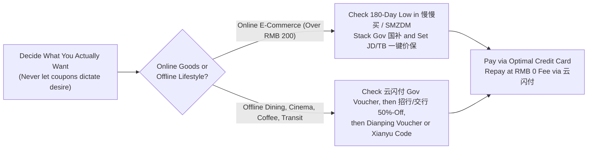
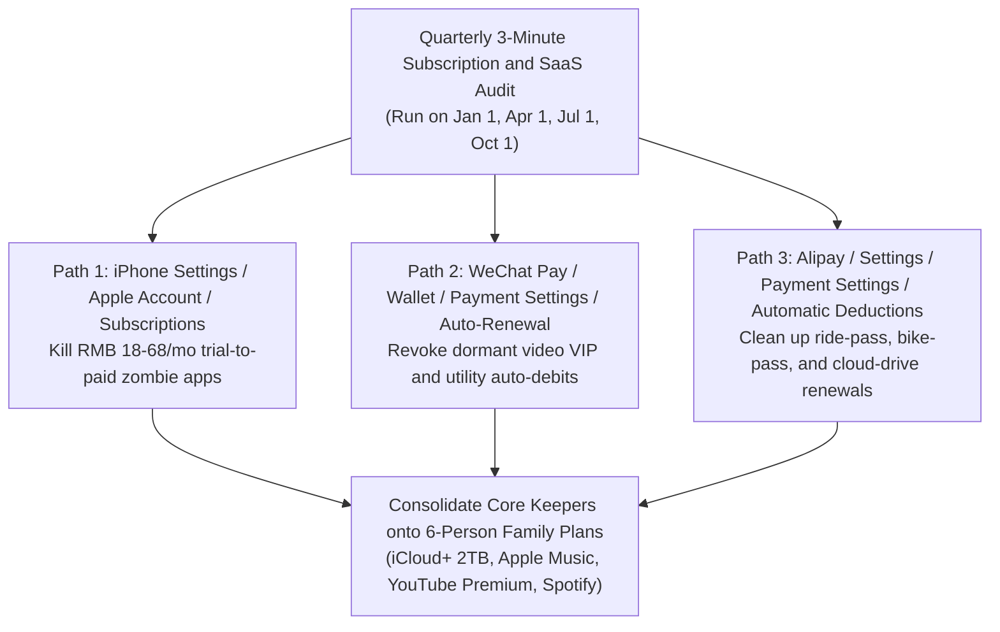

# 25 Underrated Money-Saving Apps & Anti-Overpaying Habits in China (中国25个宝藏省钱App与反溢价日常工具栈)

China's mobile internet has the most sophisticated subsidy, coupon-arbitrage, and post-purchase price-protection infrastructure in the world—yet `90%` of consumers either ignore it completely or install ad-bloated `"rebate apps (返利垃圾软件)"` that waste hours for pennies.

This reference curates **25 clean, high-signal apps and built-in mini-programs** organized into a **5-Layer Zero-Friction Stack**. Every tool below takes **`0` to `20` seconds per transaction**, protects your privacy, never degrades product quality, and compounds into **RMB `18,000–35,000+` of post-tax cash reclaimed every year**.

> **Navigation**: Back to [00-README.md](00-README.md) | Flights: [01-CHEAP-FLIGHTS-MILES-AND-AIRPORT-HACKS.md](01-CHEAP-FLIGHTS-MILES-AND-AIRPORT-HACKS.md) | Hotels & Rail: [02-FIVE-STAR-HOTELS-TRAIN-AND-TRAVEL-TRICKS.md](02-FIVE-STAR-HOTELS-TRAIN-AND-TRAVEL-TRICKS.md)

---

## Table of Contents

1. [The 20-Second Pre-Payment Routing Reflex](#1-the-20-second-pre-payment-routing-reflex)
2. [Layer 1: E-Commerce Price Forensics, `国补` & 1-Click Price Protection (Apps 1–5)](#2-layer-1-e-commerce-price-forensics-国补-1-click-price-protection-apps-15)
3. [Layer 2: Payment Rails, Gov Dining Vouchers, `50%`-Off Bank Apps & Tax Shield (Apps 6–11)](#3-layer-2-payment-rails-gov-dining-vouchers-50-off-bank-apps-tax-shield-apps-611)
4. [Layer 3: IMAX Cinema, Coffee, Dining & Medical-Account O2O Arbitrage (Apps 12–17)](#4-layer-3-imax-cinema-coffee-dining-medical-account-o2o-arbitrage-apps-1217)
5. [Layer 4: RMB 6 Courier Shipping, Second-Hand TCO & Official Gov Portals (Apps 18–20)](#5-layer-4-rmb-6-courier-shipping-second-hand-tco-official-gov-portals-apps-1820)
6. [Layer 5: Family Plans, `SteamDB` & Quarterly Subscription Leak Audits (Apps 21–25)](#6-layer-5-family-plans-steamdb-quarterly-subscription-leak-audits-apps-2125)
7. [Master Summary Table: The 25-Tool Stack at a Glance](#7-master-summary-table-the-25-tool-stack-at-a-glance)
8. [China Annual High-Leverage Deal & Audit Calendar (`全年关键省钱节点日历`)](#8-china-annual-high-leverage-deal-audit-calendar-全年关键省钱节点日历)

---

## 1. The 20-Second Pre-Payment Routing Reflex

Replace impulse `"Scan QR -> WeChat Pay Full Price"` with a muscle-memory **Pre-Payment Router** that runs in under `20 seconds`:

---

## 2. Layer 1: E-Commerce Price Forensics, `国补` & 1-Click Price Protection (Apps 1–5)

### App #1: `慢慢买` (`Manmanbuy` App / WeChat Mini-Program) — Fake-Promo Lie Detector
- **What It Solves**: Merchants routinely hike a monitor or jacket from `RMB 1,799` to `RMB 2,399` two weeks before `618` or `双11`, then slap a `"狂欢立减 400 -> 到手 1,999!"` banner on it (`先涨后降假促销`).
- **20-Second Habit**: Copy any JD, Taobao, Tmall, or Pinduoduo item link -> open `慢慢买` -> inspect the **`180-Day / 360-Day` Real Historical Low Curve (`历史最低到手价走势图`)**. If today's `"sale"` is `RMB 200` above last month's routine low, wait or switch channels.

### App #2: `什么值得买` (`SMZDM`) — Crowd-Verified All-Time Lows & Stacking Recipes
- **What It Solves**: Discovering **how** other engineers stacked `3` hidden coupons (`店铺券 + 品类神券 + Plus超级补贴 + 支付立减`) to hit an all-time low (`绝对值 / 历史低价`).
- **Insider Trick**: Search your exact target SKU (`e.g., Sony 24-70 GM II`, `Mac mini M4`, `Herman Miller Aeron`, `Uniqlo U`) -> sort by **`好价` (`Deals`)** and read the **top 5 user comments (`评论区真话`)**—SMZDM commenters mercilessly expose inferior revisions (`缩水减配批次`) within minutes! Follow keyword price alerts (`好价订阅`) for big-ticket wishlist items.

### App #3: `京东` (`JD.com`) — `一键价保` (`1-Click Price Protection`) + `国家补贴 (国补)`
- **1-Click Price-Drop Refund (`无脑退差价神器`)**:
  - Path: **`京东 App -> 我的 -> 客户服务 -> 价格保护 -> 一键价保`**.
  - JD's self-operated (`京东自营`) electronics carry `7-day` to **`30-day` price protection** (home appliances up to `30 days`). During `618` (`May 31 20:00` / `June 17 20:00`) or `双11` (`Oct 31 20:00` / `Nov 10 20:00`), tap `一键价保` once—if any item you bought last week dropped in price, cash refunds hit your card in `3 seconds`!
  - **Advanced JD Tip**: If automated `一键价保` says `"不支持"` only because a *new coupon* launched, place an **unpaid shadow order (`下个新单锁住优惠价先不付款`)** and send the screenshot to JD Plus human customer service (`专属客服申请差价补偿`)—they routinely refund the coupon gap manually!
- **National & Municipal Trade-In Subsidies (`国补 / 地方消费品补贴`)**:
  - Search **`"政府补贴" / "上海家电数码补贴"`** inside JD (paired with `云闪付` qualification claiming): Tier-1 energy-efficiency appliances, laptops, tablets, smartphones, and smart home gear qualify for **`15%–20%` instant government subsidies (up to `RMB 500–2,000` per category)** on top of platform sale prices!

### App #4: `淘宝 / 天猫` — `价保中心` + `88VIP` Negative-Cost Ecosystem
- **Price Protection Path**: **`我的淘宝 -> 官方客服 / 价保中心 -> 一键申请价保`**.
- **Why `88VIP` (`RMB 88/year` for high-Taobao-score accounts) Has `10x` Positive ROI**:
  - One `RMB 88` card unlocks: **(1) NetEase Cloud Music Black Vinyl VIP (`网易云黑胶年卡`, worth `RMB 158`)**, **(2) Quark Drive `6TB` VIP (`夸克网盘年卡`)**, **(3) Youku / MangoTV Annual VIP**, **(4) Unlimited Free Return-Shipping Quota (`无限次退货免运费补贴`—essential when trying clothes sizes!)**, **(5) `95折` (`5%` extra off) across hundreds of flagship brands (Uniqlo, Nike, New Balance, Sony, Muji)**, and **(6) Marriott Status Challenge**.

### App #5: `拼多多百亿补贴` (`Official Brand Black-Tag`) & `Keepa` (`Amazon Global`)
- **When to Use `拼多多百亿补贴`**: Strictly for **standardized, factory-sealed, high-value hardware** (`iPhone, iPad, AirPods, Nintendo Switch, DJI Osmo Pocket 3, Sony/Canon lenses, Dyson, Maotai`) carrying the **`百亿补贴 · 品牌黑标` (`Brand Official Subsidy`)** badge—often `RMB 500–1,800` cheaper than Apple/Sony retail!
- **Mandatory Unboxing Protocol (`一镜到底开箱铁律`)**: Shoot a continuous phone video showing the intact courier label -> outer seal -> product box serial number -> matching serial number on Apple/Sony/DJI official warranty website (`官网查未激活序列号`) before tearing inner plastic. Never buy non-standardized bulk food or unbranded chargers on PDD.
- **`Keepa` (`keepa.com` / Browser Extension)**: Tracks `Amazon US / Amazon JP / Amazon Germany` `3-year` price curves—phenomenal for buying Japanese outdoor gear (`Montbell, Snow Peak`), Western kitchenware, or SSDs via `亚马逊海外购` free-shipping promos!

---

## 3. Layer 2: Payment Rails, Gov Dining Vouchers, `50%`-Off Bank Apps & Tax Shield (Apps 6–11)

### App #6: `云闪付` (`UnionPay Official App`) — The #1 Most Underrated App in China
Backed directly by China UnionPay (`中国银联`), `云闪付` has zero social bloat and four massive financial superpowers:
1. **`0`-Fee Credit Card Repayment (`信用卡还款永久 0 手续费`)**: WeChat Pay and Alipay charge **`0.1%` (`RMB 10` per `RMB 10,000`)** once past tiny free quotas. Repaying `RMB 25,000/month` on credit cards via WeChat wastes `RMB 300/year` in pure friction fees; `云闪付` transfers directly from any debit card with **`RMB 0` fee** and unified multi-bank due-date tracking!
2. **Municipal Government Consumption Vouchers (`政府餐饮文旅消费券主阵地`)**: Cities like Shanghai (**`"乐品上海"`** dining & hotel vouchers: e.g., `满300减90`, `满500减150`, `满800减240`, `满1000减300` = **`30%` flat government cash subsidy at thousands of real restaurants!**), Hangzhou, Shenzhen, Chengdu, and Beijing distribute official vouchers primarily via `云闪付`! Set an alarm for the weekly release minute (`定点抢券`).
3. **UnionPay Cardholder Perks (`权益精选`)**: `RMB 1` Airport CIP fast-track security, `RMB 1` High-Speed Rail VIP lounge, `RMB 6.2` Manner/Starbucks/metro promos, and **`银联汇率优 / 境外返现报名`** (`1%–10%` overseas spending cashback!).

### App #7: `招商银行 掌上生活` (`CMB Life`) — `周三5折` Dining & Everyday `饭票`
- **Wednesday `50%`-Off (`周三5折美食节`)**: Every Wednesday at `10:00 AM`, dozens of popular mid-to-upscale restaurants, steakhouses, sushi bars, and bakeries release **`50%`-off cash vouchers (`如 RMB 50 抵 100 / RMB 100 抵 200`)** inside `掌上生活 -> 饭票 -> 周三5折`.
- **Everyday `饭票` (`日常立减`)**: Even on non-Wednesdays, buying a `招行饭票` voucher right at the restaurant table takes `10 seconds`, saves `5%–18%`, and is **100% refundable anytime if unused (`随时退、过期自动退`)**!

### App #8: `交通银行 买单吧` (`BoCom Maidanba`) — `最红星期五` `50%`-Off Dining, Grocery & Charging
- **Red Friday (`最红星期五`)**: Every Friday, qualifying BoCom cardholders grab **`50%`-off vouchers (`50元抵100元`)** or `10%–50%` instant swipe rebates across **restaurants, supermarkets (`盒马鲜生 / Olé / ALDI / 沃尔玛`), convenience stores (`全家 FamilyMart / 罗森 Lawson`), and gas stations / EV charging**!

### App #9: `中信 动卡空间` & `中国银行 手机银行` — Coffee Vouchers & `10%` Overseas Cashback
- **`动卡空间`**: **`精彩365` (`Wed & Sat 50%-off dining/bakery`)** + **`9分享兑`** (redeem monthly swipe milestones for free Starbucks/Heytea/NaiXue/video-VIP vouchers).
- **`中国银行 手机银行` (`跨境专区`)**: Before any overseas trip or foreign online purchase (`AWS, OpenAI/Claude API, Steam, Apple JP, Agoda`), register in `中行跨境返现` (`消费达标返 8%–10%` on Visa/Mastercard `卓隽卡`!).

### App #10: `数字人民币` (`Official e-CNY App`) — Zero-Ad Municipal Subsidies
- Keep `数字人民币` linked with hardware-wallet no-network tap (`手机无网无电碰一碰过地铁闸机!`)—local governments and banks regularly push `RMB 10–50` red packets, `RMB 0.01` public transit rides, and state-grid electricity bill discounts (`电费水费满减`).

### App #11: `个人所得税` (`Official Tax App`) — `10 Minutes` = `RMB 3,600–12,000` Cash Back
- **Never skip the December `专项附加扣除确认` (`Special Additional Deductions`)**! At a `20%–30%` marginal income tax bracket:
  - **Housing Rent (`住房租金`, no local property owned)**: **`RMB 1,500/month` (`RMB 18,000/year`)** pre-tax deduction in Tier-1 cities = **`RMB 3,600–5,400/year` real cash tax saved!**
  - **Elder Care (`赡养老人`, parents aged `60+`)**: Up to **`RMB 3,000/month` (`RMB 36,000/year`)** for only children (or split up to `RMB 1,500/mo` with siblings) = **`RMB 7,200–10,800/year` cash saved!**
  - **Childcare (`3岁以下婴幼儿照护`) & Children's Education (`子女教育`)**: `RMB 2,000/month` per child!
  - **Private Pension (`个人养老金 RMB 12,000/年`) Rational Math**: Upon withdrawal at retirement, `个人养老金` charges a flat **`3%` tax**. Therefore:
    - If your current marginal tax bracket $\tau \ge 20\%$: You save `RMB 2,400–5,400` tax today vs `RMB 360` future tax (`17%–42%` instant risk-free tax alpha—worth doing!).
    - If your marginal tax bracket $\tau \le 10\%$ (or `3%`): **Do NOT contribute**—locking liquidity for `30` years for a `0%–7%` tax spread is suboptimal!

---

## 4. Layer 3: IMAX Cinema, Coffee, Dining & Medical-Account O2O Arbitrage (Apps 12–17)

### App #12: `闲鱼` (`Xianyu`) — Instant Lifestyle & Ticket Arbitrage (`代下/卡券套利`)
Beyond selling used gear, `闲鱼` is a massive **real-time secondary clearinghouse** where corporate employees, bank-point holders, and VIP members liquidate unused perks at **`40%–65%` off retail**:
- **High-Success Instant Searches**:
  - **`"电影票代下 / 万达IMAX激光代买"`**: Screenshot the exact seat map from Maoyan/Taopiaopiao -> send to a high-credit seller -> get official theater ticket pickup QR code (`取票码`) in `2 minutes` for **`RMB 38–55` instead of `RMB 110`**!
  - **`"Manner / 星巴克 / 霸王茶姬 / 喜茶 代点"`**: Seller places mobile pickup order at your exact store using bank points -> walk in and grab your cup `3 minutes` later at `35%–50%` off!
  - **`"五星酒店游泳健身次卡 / 山姆体验副卡 / 机场贵宾厅单次"`**.
- **The 4-Rule Xianyu Safety Firewall (`闲鱼防骗四条铁律`)**:
  1. Only pick sellers with **`芝麻信用极好 (Sesame Credit Excellent)` + `>= 98%` positive reviews**.
  2. **NEVER click `"确认收货 (Confirm Receipt)"` BEFORE you have scanned the QR code at the cinema kiosk or picked up the coffee in your hand!**
  3. Keep `100%` of chat inside `闲鱼`—never scan external links or transfer via WeChat (`脱离平台交易0保障`).
  4. Never use `闲鱼` for international flights or overseas 5-star hotel bookings (`远离黑卡盗刷风险`, as warned in [00-README.md](00-README.md)).

### App #13: `猫眼` / `淘票票` — Bank Credit-Card Cinema Channel
- If you prefer official self-service over `闲鱼`, claim the free **`淘票票省钱月卡`** inside `88VIP` and pay through **`云闪付 / 工行e生活 / 招行掌上生活 影票专区`**, where bank weekend subsidies shave `RMB 15–35` off every seat!

### App #14: `大众点评` / `美团` — `10-Second` Table Check & Anti-Influencer-Trap Filter
- **At Checkout**: Before scanning the restaurant's table WeChat QR code, open `大众点评` for `10 seconds`: check **`买单` (`instant % off`)** vs **`团购代金券` (`e.g., RMB 85 for 100, stack 3x`)**—saves `RMB 45–90` on a `RMB 300` dinner with zero awkwardness.
- **Finding Truly Great Food (`反刷分选店法`)**: Ignore newly opened `4.9`-star influencer shops (`网红刷评重灾区` full of gifted-dessert `打卡送饮品` fake 5-star reviews!). Filter for **`3.8 to 4.4 stars` + `"收录 5 年以上 (Open 5+ Years)"`** or check **`必吃榜 (Must-Eat List)`**—older neighborhood restaurants with grumpy `4.0` service ratings and `4.5` taste ratings almost always serve incredible food!

### App #15: `美团买药` / `京东健康` + `医保电子凭证` — Spend Dormant Medical Balance Online!
- Most Tier-1 cities (including **Shanghai, Beijing, Shenzhen, Guangzhou, Hangzhou**) now support **Online Personal Medical Insurance Account Payment (`医保个账线上购药`)** right inside **`美团买药 / 饿了么买药 / 京东买药`** (look for the blue **`"医保"`** tag!).
- Street-corner pharmacies charge `RMB 48` for allergy pills or ibuprofen that cost **`RMB 14.5`** online with `30-minute` courier delivery—paid `100%` from your medical insurance individual account (`刷医保个人账户余额，不花一分现金`)!

### App #16: `高德打车` / `滴滴出行` — Strip High-Tier Auto-Checkboxes
- Ride-hailing apps love pre-checking `8` vehicle tiers at once (mixing `RMB 38` Economy with `RMB 72` Premier `专车/优享` so whichever driver is closest locks you into the higher fare!). **Uncheck every tier except clean `经济型/特惠快车` (or `专车` when you intentionally want comfort)**, and grab weekly `RMB 5–10` ride coupons inside `云闪付` / `掌上生活`.

### App #17: `奥乐齐 (ALDI)` / `山姆极速达` / `盒马晚间出清` — OEM Private-Label Arbitrage
- In Shanghai, **`ALDI (奥乐齐)` `"超值"` & private-label lines** and **Sam's Club `Member's Mark`** contract directly with top-tier OEM factories (`如明治同源乳品、新希望鲜奶、大牌同厂烘焙坚果`) while cutting `35%–50%` brand marketing markup. Walking past `盒马` or `ALDI` after `20:30` also unlocks `30%–50%` daily-fresh clearance (`日日鲜晚间打折`) on sashimi, steak, and bakery items.

---

## 5. Layer 4: RMB 6 Courier Shipping, Second-Hand TCO & Official Gov Portals (Apps 18–20)

### App #18: `菜鸟裹裹商家寄件` / Aggregated Courier Mini-Programs (`微快递 / 鲸寄 / 偏爱寄件`) — `RMB 6` Doorstep Pickup!
- **The Retail Markup**: Opening ZTO/YTO/STO/SF directly as an individual consumer quotes **`RMB 12–18` first-kg (`散客零售首重价`)**.
- **The Wholesale Bypass**: Search WeChat/Alipay for legitimate **Aggregated Courier Mini-Programs (`聚合寄件小程序: 如微快递、鲸寄、快递100特惠寄、菜鸟裹裹寄件券包`)**. These platforms pool millions of daily orders under e-commerce enterprise contracts (`协议大客户价`) and dispatch the **exact same official courier (`圆通/申通/中通/极兔/韵达/德邦/京东`) to knock on your apartment door (`免费上门取件`) for `RMB 5.5–7.5` nationwide**!
- **Heavy Luggage & Ski/Travel Gear (`大件物流神技`)**: Shipping a `20 kg` suitcase or snowboard across China via **Deppon (`德邦大件`) / JD Heavy (`京东大件`)** inside aggregated mini-programs costs **`RMB 35–55` door-to-door**—saving you `RMB 400` in airline overweight baggage fees and freeing your hands on the subway!

### App #19: `蜂鸟二手` / `闲鱼验货宝` / `爱回收` — Flagship Gear TCO Engineering
Software engineers love cameras, lenses, headphones, tablets, and GPUs. Stop thinking in **Purchase Price**; optimize **Total Cost of Ownership (`TCO`)**:

$$\text{TCO}_{\text{net}} = P_{\text{buy}} - P_{\text{resale}} + C_{\text{platform\_fee}}$$

- **Brand-New Off-Brand Plastic Gadget**: Buy at `RMB 1,800` -> worth `RMB 200` after `18 months` -> **Net TCO = `RMB 1,600`** for mediocre experience.
- **99-New In-Warranty Flagship (`如 Sony E-mount GM 镜头 / Fujifilm 相机 / MacBook Pro`)**: Buy slightly used via `闲鱼验货宝` or `蜂鸟严选` at `RMB 8,200` -> shoot razor-sharp photos for `18 months` (keep clean original box!) -> resell at `RMB 7,600` -> **Net TCO = `RMB 600`** (`RMB 33/month` to enjoy world-class flagship optics!).

### App #20: `交管 12123` + `随申办 / 浙里办 / 粤省事` — Zero-Agent Municipal Portals
- Never pay third-party agents or Taobao shops `RMB 150–300` for routine administrative errands: renewing an expiring driver's license (`期满换证`), getting your `6-year` inspection-exempt electronic mark (`申领免检标志`), international record checks, or printing tax/social-security certificates (`完税证明 / 社保证明 PDF`) takes `3 minutes` inside **`交管 12123`** and **`随申办`** for `RMB 0–10` official postage!

---

## 6. Layer 5: Family Plans, `SteamDB` & Quarterly Subscription Leak Audits (Apps 21–25)

### App #21: `Apple Family Sharing` (`iCloud+ 2TB + Apple Music 6人家庭车`)
- Paying solo for `iCloud+ 2TB` (`RMB 68/mo`) + `Apple Music` (`RMB 11/mo`) costs `RMB 948/year`.
- **Official Family Group (`苹果官方家庭共享`, up to `6` members)**: Add your partner, parents, or `4–5` trusted engineer colleagues (`RMB 68` `iCloud+ 2TB` + `RMB 17` `Apple Music Family` = `RMB 85/mo` total). Apple **strictly isolates every member's photos, iCloud Drive files, passwords, and messages (`完全隐私隔离，互不可见`)** while pooling the `2TB` storage and lossless music—dropping per-person cost to **`RMB 14.2/month` (`82%` savings)**!

### App #22: `YouTube Premium` & `Spotify` Official Family Plans
- A `6-person` official **YouTube Premium Family Plan** (ad-free YouTube on iOS/Apple TV + background play + **YouTube Music included free!**) or **Spotify Family Plan** split cleanly among `5–6` real friends on annual WeChat transfer eliminates ads forever at `RMB 12–22/month`—avoiding shady `闲鱼` `"月抛共享号"` that get kicked offline every `20` days.

### App #23: `SteamDB` (`steamdb.info`) + `小黑盒 (Heybox)` + `IsThereAnyDeal`
- Never buy a PC or Steam Deck game on random Tuesday impulse at `RMB 298`!
- Open **`steamdb.info`** or **`小黑盒 App`** -> check **`当前区史低价 (All-Time Historical Low)`** and the exact countdown to the next **Steam Major Seasonal Sale (`Spring / Summer / Autumn / Winter Sale`)**. AAA masterpieces (`Cyberpunk 2077, Elden Ring, Baldur's Gate 3, Red Dead 2, RDR2/Persona/Yakuza`) reliably hit `40%–85%` off every `6–8 weeks`!

### App #24: `Bitwarden` / `1Password` + Virtual/Locked Trial Card (`防免费试用反撸机制`)
- AI tools, PDF editors, and overseas SaaS love offering `"Free 7-Day Trial -> Auto-Bills USD 240 Annual Plan on Day 8!"`
- **Immediate Cancel Trick (`签约即取消自动续费`)**: On `95%` of App Store and Stripe SaaS trials, **canceling auto-renewal `10 seconds` after starting the free trial keeps your full 7-day or 30-day trial active** while guaranteeing `USD 0` surprise renewal! Pair overseas trials with a secondary credit card whose single-transaction overseas online cap (`境外线上单笔限额`) you toggle inside the bank app.

### App #25: Native Auto-Debit Consoles (`iOS + 微信 + 支付宝 三端免密扣费总闸`)
Run this **exact `180-second` sweep** once every quarter:
1. **iOS**: `设置 (Settings) -> [Your Name] -> 订阅 (Subscriptions)` -> Cancel every `"首月1元 / 免费试用"` scanner, photo-filter, or workout app under `Active`.
2. **WeChat**: `我 -> 服务 -> 钱包 -> 支付设置 (bottom) -> 自动续费` -> Revoke forgotten iQiyi/Tencent Video/Baidu Netdisk/shared-power-bank passes.
3. **Alipay**: `我的 -> 右上角设置齿轮 -> 支付设置 -> 免密支付/自动扣款` -> Clean out dormant bike-share monthly cards, OTA VIP auto-renewals, and trial memberships!

---

## 7. Master Summary Table: The 25-Tool Stack at a Glance

| # | App / Tool | Category | Core Superpower | Est. Annual Savings |
| :--- | :--- | :--- | :--- | :--- |
| **1** | **`慢慢买`** | Price History | `180–360 day` real price curves; exposes fake pre-sale markups | `RMB 800–2,000` |
| **2** | **`什么值得买` (`SMZDM`)** | Deal Intelligence | Crowd-verified historical lows; coupon-stacking formulas; honest comments | `RMB 1,000–3,000` |
| **3** | **`京东` (`一键价保 + 国补`)** | E-Commerce | `1`-click post-purchase cash refunds + `15%–20%` municipal hardware subsidies | `RMB 1,500–4,500` |
| **4** | **`淘宝` (`价保 + 88VIP`)** | E-Commerce | `RMB 88` unlocks NetEase Music, Quark `6TB`, `95折` brands & free return shipping | `RMB 600–1,500` |
| **5** | **`拼多多百亿补贴` + `Keepa`** | Hardware / Global | Brand-black-tag sealed electronics wholesale pricing; Amazon global lows | `RMB 1,000–2,500` |
| **6** | **`云闪付` (`UnionPay`)** | Payment Rail | `0`-fee credit card repayment; **`乐品上海` `30%`-off gov dining vouchers**; `RMB 1` CIP | `RMB 1,500–3,500` |
| **7** | **`招行 掌上生活`** | Bank Dining | **`周三5折`** restaurant vouchers + instant refundable everyday `饭票` | `RMB 800–2,000` |
| **8** | **`交行 买单吧`** | Bank Dining/Grocery | **`最红星期五` `50%`-off** dining, Hema/ALDI supermarkets & EV/gas | `RMB 800–1,800` |
| **9** | **`动卡空间` / `中行手机银行`** | Bank Coffee/FX | `9分享兑` coffee/tea + `8%–10%` overseas Visa/Mastercard spending cashback | `RMB 600–2,000` |
| **10** | **`数字人民币` (`e-CNY`)** | State Wallet | Power-off NFC metro tap + municipal red packets & utility bill promos | `RMB 150–400` |
| **11** | **`个人所得税` App** | Tax Shield | Rent (`RMB 1,500/mo`), elder care (`RMB 3,000/mo`), & rational pension tax shield | **`RMB 3,600–12,000`** |
| **12** | **`闲鱼` (`卡券/代下`)** | Lifestyle Arbitrage | `40%–55%` off Laser IMAX tickets, Manner/Starbucks coffee & gym passes | `RMB 1,000–2,200` |
| **13** | **`猫眼 / 淘票票`** | Cinema | `88VIP` cinema pass + bank credit card movie-day `RMB 15–35` instant off | `RMB 300–700` |
| **14** | **`大众点评 / 美团`** | Dining | `10-sec` stackable table vouchers + filtering `3.8–4.4` authentic `5yr+` eateries | `RMB 1,000–2,400` |
| **15** | **`美团买药` + `医保码`** | Healthcare O2O | `24h` OTC medicine delivery paid `100%` via dormant **Personal Medical Account** | `RMB 400–1,000` |
| **16** | **`高德 / 滴滴`** | Mobility | Unchecking high-fare car tiers + stacking UnionPay/bank ride coupons | `RMB 400–900` |
| **17** | **`ALDI 奥乐齐` / `山姆`** | Grocery OEM | Same Tier-1 OEM factory food & essentials at `40%` below branded retail | `RMB 1,200–2,500` |
| **18** | **`聚合寄件 / 菜鸟商家版`** | Logistics | **`RMB 5.5–7` doorstep courier pickup** + `50%`-off `20 kg` Deppon travel luggage | `RMB 300–900` |
| **19** | **`蜂鸟二手 / 验货宝`** | Gear Liquidity | Buy `99-new` flagship cameras/lenses & resell cleanly for near-zero net `TCO` | `RMB 1,500–5,000` |
| **20** | **`交管12123` / `随申办`** | Gov Services | `RMB 10` direct license renewal & digital certificates with zero middleman fees | `RMB 200–500` |
| **21** | **`Apple Family Sharing`** | Cloud & Music | `6`-person privacy-isolated `2TB iCloud+` & lossless Apple Music (`RMB 14.2/mo`) | `RMB 778` |
| **22** | **`YouTube / Spotify Family`** | Global Media | Clean `6`-friend official family group for ad-free video & music | `RMB 800–1,400` |
| **23** | **`SteamDB` / `小黑盒`** | Gaming | `2-year` all-time historical low tracking across Steam Seasonal Sales | `RMB 400–1,200` |
| **24** | **`Bitwarden / 1Password`** | Trial Hygiene | Cancel-on-Day-1 SaaS trial habit + low-limit card cap against `USD 240` traps | `RMB 500–1,800` |
| **25** | **`iOS + 微信 + 支付宝扣费管理`** | Leak Audit | `3-minute` quarterly purge of silent auto-renewing zombie subscriptions | `RMB 400–1,500` |

---

## 8. China Annual High-Leverage Deal & Audit Calendar (`全年关键省钱节点日历`)

Instead of checking deal forums daily, concentrate `90%` of your planned hardware, wardrobe, travel, and tax actions around **8 deterministic annual windows**:

| Window / Cadence | Exact Timing | High-Leverage Action |
| :--- | :--- | :--- |
| **Weekly Routine** | **Wed `10:00` & Fri `10:00` + Weekend Morning** | Grab `招行掌上生活 周三5折` dining vouchers, `交行买单吧 最红星期五` dining/grocery `50%`-off, and municipal **`云闪付` (`乐品上海`)** restaurant vouchers |
| **Monthly Airline Days** | **`8th` (`海航`), `18th` (`东航`), `25th` (`吉祥`), `28th` (`南航`), `M=D` (`国航`)** | Lock in upcoming domestic & regional travel coupons or discounted mileage redemptions ([Module 01](01-CHEAP-FLIGHTS-MILES-AND-AIRPORT-HACKS.md)) |
| **Quarterly Leak Sweep** | **Jan 1, Apr 1, Jul 1, Oct 1 (`3 minutes`)** | Audit iOS Subscriptions + WeChat/Alipay `免密自动扣费`; check expiring `铁路畅行` HSR points and credit card points |
| **Spring Travel Window** | **Late Feb – Mid March (`春节后淡季`)** | Best time of the year to book **`八大洲 / 游虾` `"住3付2"`** luxury hotels and shoulder-season Europe/Japan/Morocco Open-Jaw flights ([Module 02](02-FIVE-STAR-HOTELS-TRAIN-AND-TRAVEL-TRICKS.md)) |
| **`618` Mid-Year Peak** | **May 31 `20:00` – June 1 `24:00` & June 17 `20:00` – June 18** | Buy summer appliances, AC, SSDs, lenses, and household consumables (`国补 + 平台神券`), then tap **JD/Taobao `一键价保`** on June 18 night! |
| **Back-to-School / Apple Peak** | **July – Sept (`教育优惠季`) & Late Oct** | Apple Education Discount (`送 AirPods / Pencil`) or `拼多多百亿补贴黑标` post-launch `iPhone` price stabilization (`首发后4-6周破发甜点`) |
| **`双11` Annual Floor** | **Oct 31 `20:00` (`开门红` often beats Nov 11!) & Nov 10 `20:00`** | Annual lowest prices on winter goose-down outerwear, Uniqlo/brand basics, `88VIP` renewals, hotel packages (`可退房券，不核销随时全额退`), and flagship 3C gear |
| **December Tax & Points Lock** | **Dec 1 – Dec 25 (`年度必做`)** | Confirm next year's **`个人所得税 专项附加扣除`**; execute rational `个人养老金` deposit if $\tau \ge 20\%$; March 1–June 30 file annual `个税综合所得汇算清缴` (`选择奖金单独计税 vs 合并计税对比试算，哪边退税多选哪边!`) |

