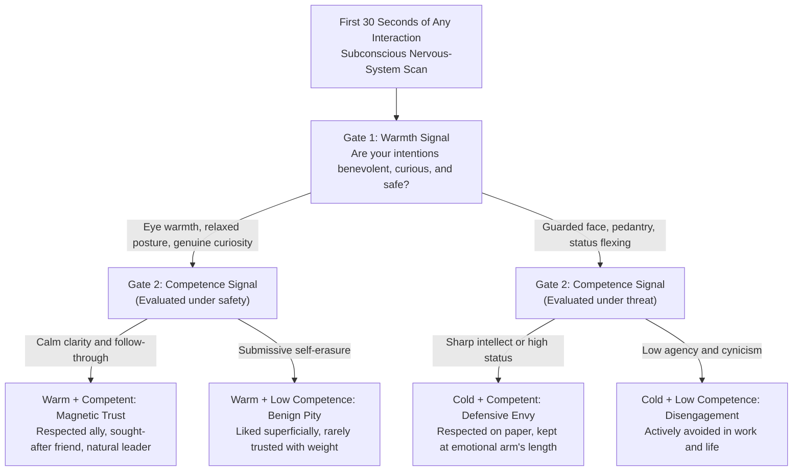
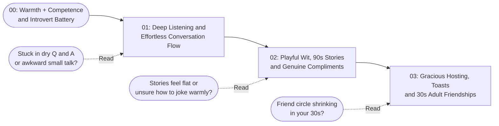

# Authentic Social Magnetism for Introverted Engineers

## 1. Why Technical Competence Hits a Relational Ceiling in Your 30s

For the first decade of an engineering career, life rewards **solo precision**: writing clean systems, debugging gnarly edge cases, and passing objective technical bars. Because those environments score correctness over warmth, many thoughtful engineers quietly absorb two false beliefs about charisma:

1. **The Extrovert Myth**: Believing that charismatic people are loud, fast-talking performers who dominate dinner tables and work a 50-person room effortlessly.
2. **The Slickness Myth**: Equating social skill with performative flattery, fake enthusiasm, or transactional networking (*油腻客套 / 场面话*)—and rejecting social growth altogether in the name of "being authentic."

In your thirties, that mental model quietly becomes a bottleneck. Whether you are leading cross-functional engineering initiatives, dating with intention, traveling across cultures, or trying to build a rich life outside work, **trying to look impressive creates distance, whereas making others feel genuinely seen and lighter creates effortless magnetism.**

Stanford and Harvard behavioral research (Olivia Fox Cabane, Amy Cuddy, Susan Fiske) demonstrates that **authentic charisma has zero correlation with volume or extroversion**. Instead, it is the product of three learnable signals:

$$\text{Authentic Magnetism} = \text{Unrushed Presence} \times (\text{Warmth} + \text{Competence})$$

Notice the multiplication sign: if **Presence** is zero (checking your phone mid-sentence or rehearsing your next smart remark inside your head), both warmth and competence collapse to zero. And inside the parentheses, **Warmth** and **Competence** are not weighted equally in sequence.

---

## 2. The Harvard Warmth-First Model (Amy Cuddy & Susan Fiske)

Across dozens of cultures studied in the **Stereotype Content Model** (Susan Fiske, Amy Cuddy, Peter Glick), every human brain subconsciously evaluates a new person on two evolutionary survival axes—always in strict priority order:

1. **Axis 1 — Warmth ("What are this person's intentions toward me?")**: Are they safe, benevolent, trustworthy, and genuinely glad I am here? Evolutionarily, knowing whether a stranger intends help or harm matters *before* knowing whether they can build a fire. Warmth accounts for roughly **80% of initial interpersonal trust**.
2. **Axis 2 — Competence ("Can this person enact those intentions?")**: Do they possess skill, agency, composure, and follow-through? Competence acts as a **force multiplier** *after* warmth is established.

Engineers routinely invert this order. When nervous at a gathering, dinner, or new team kickoff, we lead with **Competence Armor**—dropping credentials, correcting imprecise facts, or keeping a guarded analytical face so nobody thinks we are naive. Instead of winning respect, leading with competence before warmth triggers defensive guardedness.



### Distinguishing Grounded Magnetism from Common Counterfeits

Warmth does *not* mean spineless people-pleasing (*讨好型人格*). People-pleasing comes from anxiety ("Please approve of me"); authentic warmth comes from inner abundance ("I am secure in myself, so I have full bandwidth to enjoy who you are").

| Dimension | Cold Competence ("Impressive Shield") | Anxious People-Pleasing ("Nice Guy") | Grounded Warmth + Competence |
| :--- | :--- | :--- | :--- |
| **Internal Motive** | *"Don't look foolish; prove I'm smart."* | *"Don't upset anyone; earn approval."* | *"Make this person feel seen while staying myself."* |
| **Nonverbal Baseline** | Crossed arms, blank "debug face," clipped tone | Over-nodding, nervous laughter, rushed speech | Soft eyes, Duchenne smile, slow breathing, open torso |
| **Conversational Reflex** | Corrects details; pivots back to own expertise | Agrees with everything; hides real opinions | Listens for emotion underneath facts; shares real views kindly |
| **Boundaries** | Rigid, dismissive, or aloof | Porous; says yes then stews in silent resentment | Warm tone + clear, guilt-free "no" when needed |
| **Emotional Aftertaste** | *"Smart guy, exhausting or intimidating to talk to."* | *"Polite enough, hard to remember or deeply respect."* | *"I always leave conversations with him feeling lighter and sharper."* |

---

## 3. The "Emotional Aftertaste" Principle (如沐春风的底层逻辑)

In Chinese culture, the highest compliment for a person's presence is **如沐春风**—feeling as if bathed in an unforced spring breeze. Neurobiologically, humans regulate each other's autonomic nervous systems through vocal prosody, micro-expressions, and attentional quality (**limbic resonance**). People rarely remember the cleverness of your third point at dinner; they vividly remember how they felt *about themselves* while talking with you.

Three low-effort habits create an extraordinary emotional aftertaste without requiring a single extroverted performance trick:

1. **Full-Bandwidth Micro-Presence**: Turning your torso and feet toward the speaker, putting your phone completely away (not merely face-down on the table—research shows a visible phone on the table measurably degrades perceived empathy), and pausing 1.5 seconds after they finish speaking before replying. In an attention-starved era, 5 minutes of undivided presence feels rare and magnetic.
2. **Subtracting Conversational Friction (不扫兴 / 不抬杠)**: Notice the engineer reflex to run a code review on casual human speech. If a friend excitedly says, *"Kyoto in autumn was magical—every single street felt 1,000 years old!"*, the friction-adding engineer says, *"Well, technically most of central Kyoto was rebuilt after the Onin War."* The high-warmth engineer smiles and asks, *"Which corner stayed in your memory most vividly?"* Protect people's joy unless factual accuracy actually carries real-world stakes.
3. **Generous Status Elevation**: Instead of competing for the spotlight, spotlight others effortlessly—*"Wait, Ling actually built a home espresso rig from scratch, ask her how she dialed it in"* or giving credit by name when someone is not in the room. Only secure people elevate others freely; therefore, elevating others is the fastest subconscious signal of high status and high warmth simultaneously.

### Somatic Micro-Calibration: Fixing "Resting Debug Face"

Many deep-thinking engineers spend 8 hours a day frowning slightly at monitors in intense concentration. Without realizing it, they carry that exact brow furrow and flat vocal monotone into elevators, coffee lines, and dinner tables—broadcasting unintended coldness. Use these four somatic adjustments before walking into any room:

| Channel | Cold / Guarded Default | Warm + Grounded Calibration | Why It Works Biologically |
| :--- | :--- | :--- | :--- |
| **Eyes & Brow** | Narrowed focus, tight glabella ("debugging frown") | **Soften the outer corners of the eyes** (*Duchenne crinkle*) by picturing greeting an old friend | Activates orbicularis oculi muscles that humans instinctively read as genuine goodwill |
| **Greeting Cadence** | Instant jump to agenda (*"So about that ticket..."*) | **Half-second pause + warm recognition smile** when eyes first meet ("The Delayed Smile") | A smile that blooms *after* seeing *them* feels personal rather than pasted on for everyone |
| **Vocal Prosody** | Flat, clipped, rushed, rising pitch at sentence ends | **Lower breath into diaphragm; slow pace by 15%**; let declarative sentences land gently downward | Signals parasympathetic calm (competence) while resonant chest tone signals safety (warmth) |
| **Torso & Hands** | Crossed arms, hands stuffed deep in pockets, angled toward exit | **Uncrossed torso, visible relaxed hands**, feet pointed toward the conversation circle | Visible hands and open sternum are ancient mammalian non-threat cues |

### Cross-Cultural Warmth Nuances (East Asia vs. Western Contexts)

- **Chinese / East Asian Contexts**: Warmth is heavily communicated through **anticipatory consideration** (*体贴 / 周到*)—noticing someone's empty teacup before they ask, saving the best seat away from the AC draft, remembering dietary restrictions quietly, and avoiding putting anyone on the spot publicly. Overly loud verbal effusion from a near-stranger can read as insincere (*客套*).
- **North American / European Contexts**: Silence or understated reserve is more easily misread as disinterest or aloofness. Warmth requires **explicit verbalization**—smiling at eye contact, voicing enthusiasm aloud (*"It was genuinely great talking with you tonight"*), and asking direct open questions early ([01-DEEP-LISTENING-AND-CONVERSATION-FLOW.md](01-DEEP-LISTENING-AND-CONVERSATION-FLOW.md)).
- **The Universal Bridge**: Across both worlds, **relaxed attentiveness + unhurried voice + remembering small personal details** translates at 100% fidelity without ever feeling fake.

---

## 4. Social Battery Engineering for Introverted Builders

Introversion is not a social defect to "cure"; it is a neurobiological difference in **cortical arousal and sensory bandwidth**. Crowded rooms with competing conversations, loud background bass, and rapid surface-level small talk flood an introvert's working memory with unprocessed noise. Conversely, introverts possess natural superpowers in **1-on-1 depth, observational wit, thoughtful hosting, and loyal long-term friendship**—provided they manage their battery deliberately.

### The Introvert's Social ROI & Energy Portfolio

| Social Format | Battery Drain / Hour | Connection Depth | Optimal Protocol for an Introverted Engineer |
| :--- | :--- | :--- | :--- |
| **30+ Person Loud Mixer / Banquet** | Very High (85–100%) | Very Low | Cap attendance at 60–90 minutes; arrive early before noise peaks; anchor on 2 meaningful 1-on-1 chats, then exit warmly ([01-DEEP-LISTENING-AND-CONVERSATION-FLOW.md](01-DEEP-LISTENING-AND-CONVERSATION-FLOW.md)) |
| **8–12 Person Long-Table Dinner** | Moderate–High (65%) | Low–Moderate | Sit near a corner or mid-edge so you converse with 2–3 neighbors rather than shouting across 10 people |
| **4-Person Meal or Coffee** | Low–Moderate (35%) | Very High | **Golden group size**: supports single-thread shared storytelling where everyone speaks and listens deeply |
| **Side-by-Side Activity (Walk, Hike, Cooking, Board Game)** | Low (20%) | High | Shared physical focus removes continuous eye-contact pressure and lets deeper topics emerge organically ([03-HOSTING-GRATITUDE-AND-ADULT-FRIENDSHIPS.md](03-HOSTING-GRATITUDE-AND-ADULT-FRIENDSHIPS.md)) |
| **1-on-1 Tea / Walk with Close Friend** | Net Restorative | Maximum | Treat as co-regulated nervous-system recovery; schedule at least once every 1–2 weeks |

### Four Rules of Social Battery Hygiene

- **Pre-Allocate the Exit Time Up Front**: Saying *"I'd love to swing by from 7:00 to 8:30—I have an early morning run tomorrow"* removes internal trapped-feeling dread and lets you bring 100% warm energy for those 90 minutes.
- **Give Yourself a Functional Micro-Role**: At parties where standing idle feels awkward, help pour tea/wine, slice fruit, or introduce two guests who share an interest. Having a useful role calms self-consciousness immediately ([03-HOSTING-GRATITUDE-AND-ADULT-FRIENDSHIPS.md](03-HOSTING-GRATITUDE-AND-ADULT-FRIENDSHIPS.md)).
- **Avoid Back-to-Back High-Drain Windows**: Never stack a 4-hour Friday team offsite dinner directly before an all-day Saturday group outing without a quiet morning recovery buffer.
- **Never Confuse Solitude Restoration with Chronic Avoidance**: Taking Sunday afternoon alone after a Saturday dinner is healthy recharging; canceling four invitations in a row to scroll alone in bed is isolation masquerading as introversion.

---

## 5. Curriculum Map & Learning Path

Use the visual map below to navigate directly to the social skill you want to sharpen this week, or read sequentially from `01` to `03` as a complete playbook.



### Complete Folder Index

1. **[00-README.md](00-README.md) — Authentic Social Magnetism for Introverted Engineers (This Guide)**
   - Harvard Warmth-First model, distinguishing grounded warmth from people-pleasing, creating a light emotional aftertaste (*如沐春风*), and managing an introvert's social battery.
2. **[01-DEEP-LISTENING-AND-CONVERSATION-FLOW.md](01-DEEP-LISTENING-AND-CONVERSATION-FLOW.md) — The Art of Deep Listening & Effortless Conversation**
   - Escaping "interview-mode" interrogation and conversational narcissism; Loop-Listening; upgrading dry fact questions to Second-Level Feeling & Meaning questions; graceful group entry/exit scripts; and a lightweight system for remembering names and life details.
3. **[02-HUMOR-STORYTELLING-AND-PLAYFUL-WIT.md](02-HUMOR-STORYTELLING-AND-PLAYFUL-WIT.md) — Everyday Humor, Storytelling & Warm Presence Across Cultures**
   - Why playful self-deprecation (*适度自嘲*) and observational callbacks build instant cross-cultural warmth while sarcasm erodes safety; the **90-Second Dinner Story** arc (`Hook -> Concrete Sensory Moment -> Human Vulnerability -> Crisp Landing`); and delivering specific, zero-creepiness compliments.
4. **[03-HOSTING-GRATITUDE-AND-ADULT-FRIENDSHIPS.md](03-HOSTING-GRATITUDE-AND-ADULT-FRIENDSHIPS.md) — Hosting Graciously, Expressing Gratitude & Building High-Character Adult Friendships in Your 30s**
   - Low-stress blueprint for hosting 4–6 friends over dinner, coffee, or games; the 45-second toast structure; replacing silent East Asian stoicism with explicit appreciation; and maintaining 3–5 lifelong friendships across cities and decades.

---

## 6. Real-World Scenarios: Upgrading Cold Competence to Magnetic Warmth

Seeing concrete side-by-side upgrades makes the Harvard Warmth + Competence balance tangible in daily engineering and personal life:

### Scenario 1: Pushing Back in an Architecture or Design Review
- **Cold Competence**: *"This caching design won't scale past 10k RPS. You missed cache-stampede locking on line 42."* (Technically accurate; triggers ego defense in front of peers.)
- **Submissive Nice**: *"Looks totally fine to me, whatever you think is best!"* (Warmth without competence; ships an outage.)
- **Warmth + Competence**: *"The separation between read and write paths here is super clean. One edge case let's stress-test together: if a hot key expires at 10k RPS, how do we want to guard against a stampede—request coalescing or jittered TTLs?"*

### Scenario 2: Meeting a Friend's Partner or Non-Tech Guest at Dinner
- **Cold Competence**: Spending 25 minutes talking shop about distributed consensus and company stock refreshers with your fellow engineer while the non-tech partner checks their phone silently.
- **Warmth + Competence**: Catching the drift within 90 seconds, smiling warmly toward the non-tech guest, and bridging: *"Okay, we're officially banning database talk for the rest of dinner—Jia, Wei mentioned you curate art exhibitions, what's the coolest project you've worked on this year?"* ([01-DEEP-LISTENING-AND-CONVERSATION-FLOW.md](01-DEEP-LISTENING-AND-CONVERSATION-FLOW.md))

### Scenario 3: Running 7 Minutes Late to Coffee or Dinner
- **Low-Warmth Defensiveness**: *"Sorry, Line 2 was delayed and traffic was crazy."* (Centers excuses; shifts focus onto yourself.)
- **Over-Apologetic Panic**: Apologizing six times throughout the first 20 minutes, forcing your friend to comfort *you*.
- **Warmth + Competence**: Texting 15 minutes *before* the meeting time with an exact ETA, then upon arriving, smiling warmly and flipping the focus to gratitude: *"Thank you for your patience waiting—really glad to see you! Did you already spot what looks good on the menu?"* (Gratitude for someone's patience leaves a far warmer emotional aftertaste than repetitive guilt.)

### Scenario 4: Receiving Unexpected Help from a Service Worker or Colleague
- **Default Autopilot**: Quick nod without looking up from your phone: *"Thanks."*
- **Grounded Magnetism**: Pausing 2 seconds, making genuine eye contact, using a specific observation: *"Thank you for tracking down that adapter right before closing—you genuinely saved my morning presentation tomorrow."* ([02-HUMOR-STORYTELLING-AND-PLAYFUL-WIT.md](02-HUMOR-STORYTELLING-AND-PLAYFUL-WIT.md))

---

## 7. Four Engineer Anti-Patterns to Retire Permanently

1. **Unsolicited Debugging of Feelings**: When a friend or partner vents about an exhausting week, jumping within 12 seconds into *"Here are the three things you should tell your manager"* makes them feel unheard and subtly lectured. Always ask inwardly (or aloud): *"Does this moment call for resonance first, or troubleshooting?"* Ninety percent of the time, resonance comes first ([01-DEEP-LISTENING-AND-CONVERSATION-FLOW.md](01-DEEP-LISTENING-AND-CONVERSATION-FLOW.md)).
2. **Irony Poisoning & Cynical Detachment**: Using dry sarcasm or acting perpetually unimpressed to protect yourself from looking earnest. Cynicism looks clever at 21 and emotionally stunted at 32. Sincere enthusiasm about good food, craft, nature, or other people's wins is deeply attractive in adults.
3. **Keeping Warm Thoughts Locked in RAM**: Thinking *"I really admire how calm Sam stayed during that outage"* or *"That dinner Alex cooked meant a lot to me"*—and never saying a word aloud. Unspoken gratitude has zero relational surface area ([03-HOSTING-GRATITUDE-AND-ADULT-FRIENDSHIPS.md](03-HOSTING-GRATITUDE-AND-ADULT-FRIENDSHIPS.md)).
4. **Waiting Passively to Be Invited**: Assuming adult friendships will self-assemble the way college dorm friendships did. After 30, the person who sends the concrete message (*"Grabbing pour-over Saturday at 10:30 AM near Xuhui / SOMA—want to join?"*) becomes the gravitational center of a high-quality circle.

---

## 8. Quick-Start Self-Audit & Evidence-Based Shelf

Rate yourself honestly from `1` (rarely true) to `5` (natural habit), and pick **one** target module to practice over the next 14 days:

| Dimension | Behavioral Indicator | Score (`1–5`) | Primary Module |
| :--- | :--- | :--- | :--- |
| **1. First-60s Warmth** | My default Resting Face, posture, and greeting signal relaxed gladness rather than guarded evaluation. | `___ / 5` | [00-README.md](00-README.md) |
| **2. Deep Listening** | People open up to me easily because I follow emotional threads instead of firing rapid checklist questions. | `___ / 5` | [01-DEEP-LISTENING-AND-CONVERSATION-FLOW.md](01-DEEP-LISTENING-AND-CONVERSATION-FLOW.md) |
| **3. Playful Lightness** | I can laugh warmly at my own foibles and tell a vivid 90-second story without rambling into technical weeds. | `___ / 5` | [02-HUMOR-STORYTELLING-AND-PLAYFUL-WIT.md](02-HUMOR-STORYTELLING-AND-PLAYFUL-WIT.md) |
| **4. Explicit Warmth** | When I admire or appreciate someone, I voice a specific, sincere compliment or thank-you within 24 hours. | `___ / 5` | [02-HUMOR-STORYTELLING-AND-PLAYFUL-WIT.md](02-HUMOR-STORYTELLING-AND-PLAYFUL-WIT.md) & [03-HOSTING-GRATITUDE-AND-ADULT-FRIENDSHIPS.md](03-HOSTING-GRATITUDE-AND-ADULT-FRIENDSHIPS.md) |
| **5. Relational Initiative** | I proactively initiate small gatherings or check-ins with my core 3–5 friends every month. | `___ / 5` | [03-HOSTING-GRATITUDE-AND-ADULT-FRIENDSHIPS.md](03-HOSTING-GRATITUDE-AND-ADULT-FRIENDSHIPS.md) |

### Copy-Pasteable Weekly Social Battery & Warmth Check-In

Drop this 2-minute reflection into your Sunday review note:

```markdown
## Weekly Relational & Social Battery Check — YYYY-MM-DD
- **Current Social Battery (1-10) & Recovery Needed**:
- **Most Energizing Conversation This Week (Who & Why)**:
- **One Unspoken Appreciation I Will Send Right Now (30s text)**:
- **One Low-Friction Coffee / Meal / Walk to Initiate Next Week**:
- **Habit Focus for Next 7 Days (Presence / Loop-Listening / Story / Hosting)**:
```

### The 60-Second Doorway Reset (Before Entering Any Room or Call)

Whenever you transition straight from deep coding into a dinner, date, or team social, run this four-step state switch before opening the door:

1. **Phone Away**: Silence notifications and slide the phone into a jacket or bag pocket—never enter holding it in your hand.
2. **Exhale Twice as Long as You Inhale**: Drop your shoulders away from your ears and unclench your jaw to clear residual debugging tension.
3. **Flip the Spotlight Outward**: Replace the anxious internal question (*"How am I coming across?"*) with a curious external mission (*"Who in this room has an interesting story tonight, and how can I make two people feel glad they came?"*).
4. **Warmth First**: Greet the first person you see—including the barista, host, or security guard—with unhurried eye contact and genuine warmth. How you treat people who offer you zero career leverage is your truest baseline of character.

### High-Signal Reading Shelf

1. **Amy Cuddy** — *Presence* & Harvard Stereotype Content papers with **Susan Fiske** (empirical mechanics of Warmth + Competence).
2. **Olivia Fox Cabane** — *The Charisma Myth* (practical breakdown of presence, warmth, and power for analytical professionals).
3. **David Brooks** — *How to Know a Person* (the art of seeing others deeply and asking questions that illuminate).
4. **Dale Carnegie** — *How to Win Friends and Influence People* (timeless when practiced from genuine curiosity rather than salesmanship).
5. **Marisa G. Franco** — *Platonic: How the Science of Attachment Can Help You Make—and Keep—Friends* (evidence-based adult friendship architecture).
