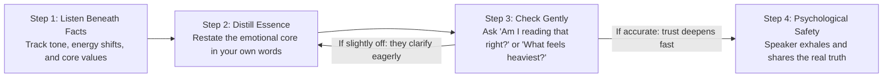
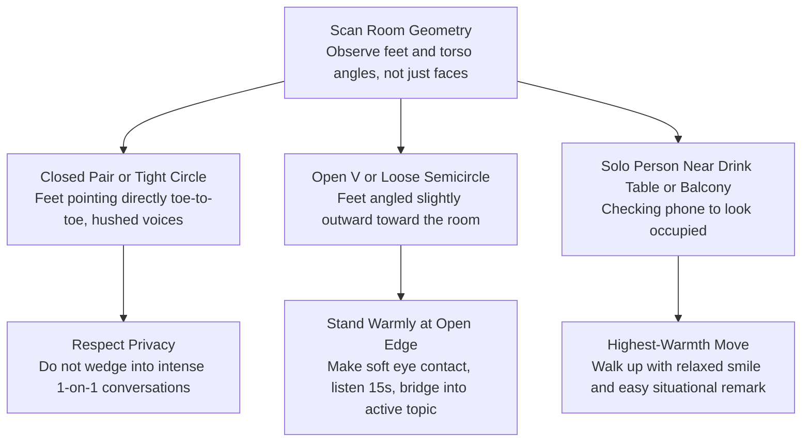

# The Art of Deep Listening & Effortless Conversation

## 1. The Two Classic Conversation Killers: Interrogation & Boomeranging

Most analytical professionals who feel awkward in social conversation are not uncaring; they are simply trapped in one of two mechanical habits when silence appears:

1. **Interview-Mode Interrogation (查户口式提问)**: Firing a sequence of closed factual questions (*"Where do you work? Which team? What stack? Where did you grow up? How long have you lived here?"*). Each answer terminates in 4 seconds, forcing you to invent yet another question while the other person feels like they are going through customs inspection.
2. **Conversational Narcissism / Boomeranging**: Coined by sociologist Charles Derber, this is the unconscious habit of using **Shift-Responses** instead of **Support-Responses**. Even with good intentions ("showing we have something in common!"), hijacking someone's story to tell your own prematurely starves the moment of warmth.

### Shift-Response vs. Interrogation vs. Support-Response

| What the Other Person Says | Shift-Response (Boomerangs to Self) | Dry Interrogation (Kills Momentum) | Warm Support-Response (Deepens Connection) |
| :--- | :--- | :--- | :--- |
| *"I barely slept all week shipping our Q4 migration."* | *"Tell me about it, last quarter I pulled three 2 AM nights in a row."* | *"Was it a Postgres or MySQL migration? How many terabytes?"* | *"You must be running on fumes right now. Did crossing the finish line feel like relief, or are you still wired?"* |
| *"I'm taking two weeks off in Yunnan next month."* | *"Oh nice, I went to Dali in 2023—you have to eat at this one spot I found."* | *"Are you flying into Kunming or Lijiang? How much were flights?"* | *"Two full weeks sounds restorative. What kind of pace are you hoping for—wandering slow towns or hiking high trails?"* |
| *"I started learning pottery on Sunday mornings."* | *"Haha I tried painting once and quit after two classes, I have zero artistic talent."* | *"Where is the studio located? How long is each class?"* | *"Working with your hands offline on a Sunday sounds grounding. What surprised you most the first time you sat at the wheel?"* |
| *"Honestly I'm still figuring out whether this city feels like home."* | *"Yeah, moving is tough. When I moved to Shenzhen it took me a year."* | *"Which district do you live in? How long is your commute?"* | *"That in-between phase can feel pretty disorienting. Which moments here make you feel most at ease so far, and what do you miss most?"* |

> **The 70 / 30 Rhythm Rule**: Great conversation is neither 100% listening (which feels like talking to a silent therapist) nor 80% talking (monologuing). Aim to spend roughly **60–70% of a conversation drawing out and resonating with the other person**, and **30–40% sharing vivid, honest pieces of your own inner world** so they feel met by a real human ([02-HUMOR-STORYTELLING-AND-PLAYFUL-WIT.md](02-HUMOR-STORYTELLING-AND-PLAYFUL-WIT.md)).

---

## 2. The Loop-Listening Protocol: Proving You Truly Heard

Nodding and saying *"Yeah, totally"* only proves your ears are functioning; it does not prove you understood. Harvard Business School researcher Alison Wood Brooks and journalist Charles Duhigg (*Supercommunicators*) highlight **Looping for Understanding** as the single highest-leverage habit in deep conversations—especially when emotions, conflict, or big life choices are on the table.



### Why Distilling Beats Parroting

Never repeat someone's exact words like a chatbot (*"So you are saying your manager changed the roadmap"*). Instead, reflect the **underlying tension or value** in fresh language:

- **Surface Facts Heard**: *"The startup offer pays 25% more and the founder seems sharp, yet I keep stalling on signing because my current team actually respects evenings and my parents are getting older."*
- **Weak Engineer Reply (Premature Advice)**: *"Just calculate expected equity value and negotiate remote Fridays."*
- **High-Warmth Loop Reply**: *"It sounds like on paper the startup excites the builder side of you, while underneath you're weighing whether the extra upside is worth trading away peace of mind and bandwidth for your parents. Does that capture the tug-of-war?"*

Notice what happens physiologically when you deliver a clean Loop: the other person's shoulders drop, their eyes light up, and they say, *"Yes—that's exactly it."* Even if your summary is 20% wrong, asking *"Am I reading that right?"* invites them to refine their own thinking aloud—making you the clearest, safest sounding board in their life.

### The Empathy-Before-Debugging Gate

Engineers are trained to solve problems the millisecond an error log appears. In human relationships, offering unsolicited fixes before emotional validation reads as *"Your feelings are an inconvenience I want to close quickly."*

Whenever a friend, colleague, or partner vents, run this two-mode check:

1. **Default to Resonance First (First 3–5 Minutes)**: Validate the human weight (*"Anyone in your shoes would feel blindsided by that decision"*).
2. **Ask Explicit Permission Before Switching Modes**: *"I'm completely in your corner here—do you feel more like venting and letting it out tonight, or would brainstorming options together actually help?"*

---

## 3. Upgrading Dry Fact Questions to Second-Level Feeling Questions

Human memory is organized in layers. **Level-1 Fact Questions** (`What`, `Where`, `How long`, `How many`) query dry biographical metadata. **Level-2 Feeling & Motivation Questions** (`Why`, `What felt like...`, `What sparked...`, `What changed your mind...`) invite people to talk about what they care about, value, and notice.

### The Conversational Upgrade Matrix

| Context | Level-1 Dry Fact Question | Level-2 Warm Meaning Question | Why It Unlocks Flow |
| :--- | :--- | :--- | :--- |
| **Work / Career** | *"What do you do?"* | *"What's keeping you busiest at work lately—and is it the fun kind of busy or the chaotic kind?"* | Gives them permission to talk about energy rather than reciting a LinkedIn headline |
| **Engineering Peer** | *"Which infra stack do you use?"* | *"What's the most satisfying problem you've gotten to solve this year?"* | Shifts from tool tribalism to craft pride and curiosity ([00-README.md](00-README.md)) |
| **Hometown / Roots** | *"Where did you grow up?"* | *"What was it like growing up there—do you feel like that city shaped your personality?"* | Moves immediately from geography to identity and vivid childhood stories |
| **Travel / Weekends** | *"How was Japan?"* | *"What was one small moment on the trip you wish you could bottle up and replay?"* | Eliminates generic *"It was good!"* summaries by zooming into a single sensory scene |
| **Career Pivot** | *"Why did you leave your old company?"* | *"What was the moment you realized it was time for a new chapter?"* | Invites a narrative turning point rather than defensive corporate politics |
| **Books / Media** | *"Read anything good lately?"* | *"Has any book, film, or idea stayed in the back of your head over the past few months?"* | Removes pressure to look well-read; includes podcasts, movies, or real-life realizations |
| **Longtime Friend** | *"How have things been?"* | *"What's been giving you energy lately, and what's been quietly draining it?"* | Bypasses automatic *"Busy, same old"* autopilot at the start of dinner |
| **Passions / Craft** | *"How long have you played tennis?"* | *"What hooked you on tennis in the beginning—the strategy, the movement, or the community?"* | Lets someone articulate what they love, which instantly releases warm dopamine |

### Conversational Threading & Statement Hooks

You never need to interrogate when you practice **Multi-Hook Threading**. Almost every ordinary sentence contains three or four distinct threads:

> *"I've barely cooked this month because I've been prepping for a half-marathon in Hangzhou with two college roommates."*

Instead of panicking about what to say next, observe the four live hooks sitting on the table:
- **Hook A (Cooking)**: Favorite comfort dish when life isn't hectic.
- **Hook B (Running)**: First half-marathon vs. veteran runner; training highs and lows.
- **Hook C (Hangzhou)**: Running around West Lake in autumn mist.
- **Hook D (Friendship)**: Staying close enough with college roommates in your 30s to travel and run together.

Pick **Hook D or Hook C** (the highest emotional warmth), pair a brief **Statement Observation** with an easy open prompt: *"Doing a race trip with college roommates in your thirties is rare and awesome—whose idea was it originally?"* Adding brief warm statements between questions eliminates any feeling of interrogation.

---

## 4. The Graduated Vulnerability Ladder: Escaping Shallow Small Talk Safely

Why do some 60-minute coffees feel forgettable while others leave two people feeling like old friends? Psychologist Arthur Aron's closeness research reveals that depth does not come from jumping straight from *"Nice weather"* to raw existential confessions (which triggers discomfort); it comes from **Graduated, Reciprocal Escalation**—going half a rung deeper in honesty, then watching whether the other person matches you.

| Rung | Depth Level | What You Share (30% Airtime) | Matching Invitation You Offer |
| :--- | :--- | :--- | :--- |
| **Rung 1: Shared Context** | Light & Situational (First 3 mins) | Easy observation about the setting, food, event, or week's pace | *"How has your week treated you so far?"* |
| **Rung 2: Taste & Mild Candor** | Personal Texture (Mins 3–15) | A genuine opinion, quirk, or small current experiment (*"Honestly I realized I was spending every Sunday afternoon on screens, so I started walking without podcasts"*) | *"Do you have a weekend ritual that actually resets your brain?"* |
| **Rung 3: Values & Real Stakes** | Human Depth (Mins 15+) | An honest tension, growth edge, or lesson (*"Turning 32 made me realize I optimized hard for career velocity in my twenties and under-invested in offline friendships—trying to rebalance that this year"*) | *"Has your definition of a good year shifted much since your twenties?"* |

### Full 6-Turn Dialogue Walkthrough: Small Talk to Real Warmth in 90 Seconds

Notice how natural statements, Loop-Listening, and Rung-2 candor work together without a single checklist question:

- **Turn 1 (Rung 1 — Warm Observation)**: *"I'm glad you picked this tea house—quiet spots where you can actually hear each other think are getting hard to find downtown."*
- **Turn 2 (Friend)**: *"Right? My office near Lujiazui has been non-stop noise all month."*
- **Turn 3 (Rung 2 — Support Response + Feeling Question)**: *"Sounds like it's been an intense stretch. Is it exciting launch chaos, or the draining kind of chaos?"*
- **Turn 4 (Friend)**: *"Honestly a mix—we're shipping a cool AI agent workflow, except half the requirements keep changing every Tuesday."*
- **Turn 5 (Loop-Listen + Mild Self-Disclosure)**: *"Ah, that whiplash where the engineering puzzle itself is fun, yet moving goalposts burn half your energy before you write code. I hit that exact wall last spring—took me months to learn how to lock weekly scope without sounding defensive. How are you keeping your sanity through it?"*
- **Turn 6 (Friend opens up into Rung 3)**: *"Honestly I haven't solved that part yet—I still check Slack at 11 PM..."*

Within ninety seconds, zero HR-style interrogation occurred, and both people are talking about real life with warmth and mutual trust ([00-README.md](00-README.md)).

---

## 5. Group Gatherings: Graceful Entry & Peak-End Exits

Walking into a room where clusters of people are already talking—or trying to leave a conversation without awkwardness—triggers unnecessary friction for introverts until you know the underlying social mechanics.



### Entering a Conversation Smoothly

1. **Rescue Another Introvert First**: In almost every gathering of 15+ people, at least two smart, interesting people are standing near the food table or bookshelf pretending to check emails because they feel awkward too. Walking over and offering a relaxed situational comment (*"That snack spread looks dangerous—have you tried the spiced nuts yet?"* or *"How do you know the host?"*) makes you their favorite person of the night within 10 seconds.
2. **Join Open Circles via Listening First**: When joining a 3–4 person open semicircle, step gently into the open gap without interrupting the current speaker. Smile briefly to acknowledge eye contact, listen to the current story for 15–20 seconds, respond warmly to what was just said, and introduce yourself at the next natural beat (*"By the way, I'm Yongjin—great to meet you all"*).

### Exiting at the Peak (Daniel Kahneman's Peak-End Rule)

Nobel laureate Daniel Kahneman demonstrated that human memory evaluates an experience primarily by its **emotional peak** and its **final 30 seconds**, largely ignoring total duration. Staying 20 extra minutes while both people run out of steam and stare at their shoes overwrites a great 15-minute chat with awkward drag. **Leave while the warmth is still high.**

Use these clean, zero-guilt exit scripts:

- **Circulating at a Gathering**: *"I've really enjoyed hearing about your Yunnan plans, Mei. I promised I'd say hello to a couple of friends across the room before they head out, so I'm going to wander over—hope you have an amazing trip!"*
- **Warm Handoff Introduction**: *"Actually, before I grab some water—have you met Kevin? He just hiked Tiger Leaping Gorge last spring. Kevin, Mei is heading to Yunnan next month."* (Wait 20 seconds until their thread catches fire, then step away warmly.)
- **Heading Home Early (Protecting Your Battery)**: Find the host privately (no need for a 12-person farewell tour if the dinner is huge), smile warmly, and say: *"Thank you so much for bringing everyone together tonight—the food and energy are wonderful. I have an early morning tomorrow so I'm going to slip out now, let's grab coffee soon!"* ([03-HOSTING-GRATITUDE-AND-ADULT-FRIENDSHIPS.md](03-HOSTING-GRATITUDE-AND-ADULT-FRIENDSHIPS.md)).
- **Wrapping Up a Coffee or Hallway Chat**: *"I want to respect your afternoon block—it was genuinely energizing catching up today. Let's pick this back up next month."*

---

## 6. Remembering Names & Meaningful Life Details

Dale Carnegie's observation remains undefeated across languages: a person's name—and the specific small chapters of their life—is the sweetest sound in the world to them because it signals *"You exist to me as a distinct individual, not background NPC noise."*

### The 3-Touch Name Encoding Protocol

When you "forget" someone's name 5 seconds after shaking hands, your hippocampus never recorded it in the first place because your attention was turned inward (*"Don't sound awkward"*). Fix encoding on input:

1. **Touch 1 — Clean Capture + Care for Pronunciation**: Pause half a second when they say their name and repeat it warmly: *"Nice to meet you, Siobhan—did I pronounce that right?"* Asking respectfully how to pronounce an unfamiliar name across cultures signals high care, never ignorance.
2. **Touch 2 — Natural Mid-Chat Anchor**: Use their name once organically (never repetitively like a pushy salesperson, which triggers uncanny-valley discomfort): *"Wait, Siobhan, what made you choose Lisbon over Barcelona?"*
3. **Touch 3 — Farewell Lock + 15-Second Note**: Say their name as you part (*"Really glad we crossed paths tonight, Siobhan"*).

**If You Blank on Someone's Name Later**: Drop the fake bluffing immediately. Smile warmly, own the human glitch with zero shame, and affirm what you *do* remember: *"I'm so glad to run into you—remembering our conversation about home-roasting Ethiopian beans at Sarah's dinner, and my brain is completely blanking on your name right this second. Remind me?"* Specific context memory + honest humility preserves 95% of warmth.

### The Minimalist Personal Detail Log (Non-Transactional Care)

Engineers happily maintain meticulous documentation for microservices while trusting volatile biological RAM for the people who matter in their lives. Keep a private, encrypted note on your phone exclusively for **generosity and care** (never leverage):

```markdown
## Friends & Meaningful Connections
- **Lin Wei** (Met at Xuhui run club, Oct): Partner = Jia; elderly dad recovering from knee surgery in Suzhou; loves Yunnan washed pour-over; training for sub-1:45 half marathon in Nov.
- **Marcus Chen** (Ex-infra teammate): Daughter Chloe born April; allergic to shellfish; obsessed with mechanical keyboards and Japanese woodworking.
```

Two weeks later, sending a two-sentence message with zero agenda—*"Hey Wei, walked past a café serving a great Baoshan washed pour-over today and thought of you—how is your dad's knee recovery coming along?"*—places you in the top 1% of thoughtful humans in modern adult life ([03-HOSTING-GRATITUDE-AND-ADULT-FRIENDSHIPS.md](03-HOSTING-GRATITUDE-AND-ADULT-FRIENDSHIPS.md)).

---

## 7. Troubleshooting Real-World Conversational Edge Cases

Even when you bring warm curiosity, human conversations hit edge cases. Rather than blaming yourself when flow stalls, recognize which pattern is active and run the matching response:

| Edge Case | What Is Actually Happening | Unhelpful Reflex | High-Warmth Recovery Move |
| :--- | :--- | :--- | :--- |
| **4-Second Natural Silence** | Both people are digesting a thought or taking a sip of tea | Panicking and blurting out a random filler question | **Let the silence breathe warmly** for 3–4 seconds with a relaxed expression; unhurried silence signals deep intimacy and security ([00-README.md](00-README.md)) |
| **Repeated 2-Word Replies** | The person is exhausted, shy, distracted, or simply low-chemistry today | Trying twice as hard like an anxious talk-show host | Offer one low-pressure **Statement Story** of your own; if they still do not engage after two warm passes, smile and run a graceful exit—not every pair clicks |
| **The Runaway Monologuer** | Nervous talker or low-self-awareness colleague speaking for 8+ minutes nonstop | Glazing over silently while feeling trapped and resentful | Wait for a micro-breath, say their name warmly + validate one concrete point + pivot (*"David—that point about vendor lock-in is wild. Hold that thought, I'd love to hear how Priya's team handled that too"*) |
| **Intrusive Personal Questions** (*催婚 / 问薪资*) | Relatives or nosy acquaintances probing salary, marriage timeline, or net worth | Getting visibly defensive, angry, or over-explaining your life choices | **Warm Deflection + Light Humor + Immediate Pivot**: Smile easily, give a breezy non-answer (*"Still letting compounding work at its own pace!"*), and ask about their upcoming trip or health ([02-HUMOR-STORYTELLING-AND-PLAYFUL-WIT.md](02-HUMOR-STORYTELLING-AND-PLAYFUL-WIT.md)) |
| **Accidental Interruptions** | Two people start speaking at the exact same millisecond | Both stopping awkwardly three times, or bulldozing ahead | Yield once cleanly (*"Go ahead—I want to hear yours first"*), and crucially, **circle back** afterward when someone else gets cut off in a group (*"Wait, Lin, you were about to say something earlier before we got sidetracked—what was it?"*) |

### The "Circle-Back" Superpower in Group Conversations

If you only adopt one habit from this entire guide for group dinners and engineering meetings, make it **Circling Back for Cut-Off Voices**. In almost every 5-person conversation, a quieter person starts sharing a thought just as a louder voice jumps in with a joke or tangent. Most rooms forget instantly.

When that tangent finishes 60 seconds later, turn warmly toward the quieter person and say:

> *"Hey Jia, two minutes ago you started saying something about the Tokyo museum exhibit before we detoured—I really wanted to hear where you were going with that."*

That single sentence requires zero extroversion, takes four seconds, and makes quieter people feel deeply respected and safe whenever you are at the table.

### Deep Listening Over Video Calls & Long-Distance Audio

Modern engineers hold half their 1-on-1s and cross-city friend catch-ups over screens or earbuds, where micro-latency changes conversational physics:

- **Move the Active Speaker Window Directly Under Your Webcam**: Looking at the bottom corner of a 27-inch monitor makes you appear to be staring down at your keyboard. Dragging their video tile directly beneath the camera lens restores natural eye-level warmth.
- **Use Visual Nodding Instead of Audio "Mm-Hmm"**: Over Zoom or WeChat Voice, `150ms` packet delay turns verbal backchanneling (*"Yeah, right"*) into accidental interruptions that mute the speaker's audio stream. Nod visibly with warm facial expression instead, then pause a full second before replying.
- **Close Slack and IDE Tabs During 1-on-1s**: Micro-saccades of your eyes reading a notification across the screen are instantly detectable to the human brain on the other end—even when your head does not move. Thirty minutes of single-tab attention beats an hour of split-screen half-listening.

---

## 8. Weekly Deliberate Practice Micro-Drills

Do not try to overhaul every habit simultaneously. Run one low-stakes experiment per week:

1. **Week 1 — Zero Shift-Responses for 48 Hours**: Catch every urge to reply to someone's story with *"Same! Last year I..."* and replace it with one curious follow-up question about *their* experience first.
2. **Week 2 — Daily Level-2 Upgrade**: Upgrade one routine *"How was your weekend?"* or *"How's work?"* into *"What was the highlight of your weekend?"* with a barista, teammate, or friend.
3. **Week 3 — One Clean Loop-Listen**: When someone shares frustration or a tough decision, distill the emotional core in your own words and ask *"Did I catch that right?"* before offering a single piece of advice.
4. **Week 4 — Peak-End Exit + Detail Note**: Practice exiting one social chat while energy is still warm, then jot down two meaningful personal details you learned within 5 minutes of leaving.

---

## 9. Evidence-Based Reference Shelf

1. **Charles Duhigg** — *Supercommunicators: How to Unlock the Secret Language of Connection* (Looping for Understanding and matching practical, emotional, and social conversations).
2. **Kate Murphy** — *You're Not Listening: What You're Missing and Why It Matters* (neuroscience of deep listening, silence tolerance, and escaping shift-responses).
3. **Alison Wood Brooks & Leslie K. John** (2018, *Harvard Business Review* / *Journal of Personality and Social Psychology*) — *"The Surprising Power of Questions"* (empirical proof that follow-up questions dramatically increase likability and trust).
4. **Charles Derber** — *The Pursuit of Attention* (foundational sociological research on conversational narcissism, shift-responses vs. support-responses).
5. **Arthur Aron et al.** (1997, *Personality and Social Psychology Bulletin*) — *"The Experimental Generation of Interpersonal Closeness"* (graduated, reciprocal self-disclosure mechanics).
