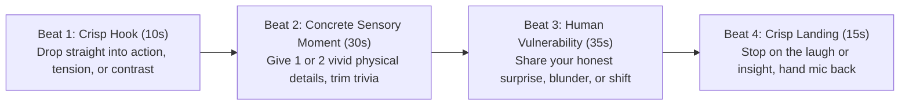
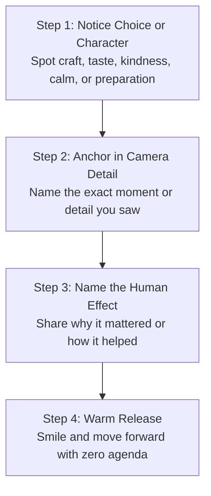

# Everyday Humor, Storytelling & Warm Presence Across Cultures

## 1. Lightness Over Comedy: Why Everyday Wit Is About Safety, Not Punchlines

Many introverted engineers quietly assume they "aren't funny" because they picture humor as loud stand-up comedy—holding court before twelve people and landing theatrical punchlines. In real adult life, trying to be the loudest comedian at the table quickly turns exhausting.

Everyday social wit is something far simpler and warmer: **inviting another person to share a moment of lightness, absurdity, or relief together.**

Social psychologist Elliot Aronson demonstrated why lightness is such a potent charisma multiplier through the **Pratfall Effect**: when an already competent person makes a small human blunder—or laughs good-naturedly at their own imperfection—their likability spikes sharply. Perfection creates intimidation; **competence paired with playful self-awareness** creates instant warmth ([00-README.md](00-README.md)).

### Psychologist Rod Martin's Four Humor Styles in Practice

Not all laughter builds connection. Before making any joke, notice whose dignity rises or falls when the laugh lands:

| Humor Style | Target of Joke | Status & Safety Signal | Cross-Cultural Reception | Real-Life Example |
| :--- | :--- | :--- | :--- | :--- |
| **Playful Self-Deprecation** (*适度自嘲*) | Your own minor quirks or harmless over-optimizations | High status + high safety (*"I'm secure enough not to take myself too seriously"*) | Universally disarming across East Asia, Europe, and North America | *"I built a Notion database to compare four rice cookers and still burned my first pot."* |
| **Affiliative Shared Wit** (*共鸣式幽默*) | Shared human absurdities (weather, meetings, travel chaos) | High warmth (*"We are on the same team observing life together"*) | High trust everywhere | *"Nothing humbles human ambition faster than folding a fitted bedsheet at midnight."* |
| **Self-Defeating Put-Downs** (*过度自卑*) | Your core worth, intelligence, or lovability | Low status + awkwardness (*forces others to stop and reassure you*) | Makes listeners uncomfortable globally | *"Haha I'm basically a socially awkward loser who has no life outside code."* |
| **Aggressive Sarcasm / Roasting** (*损人抖机灵*) | Another person's appearance, accent, mistake, or insecurity | Threat signal (*"Anyone at this table could be mocked next"*) | Destroys warmth fast; easily misread across languages | *"Wow, took you three years to learn basic SQL? Impressive."* |

> **The Golden Rule of Warm Humor**: Punch *up* at institutions, absurd situations, or your own harmless quirks; **never punch down** at service workers, junior teammates, someone's pronunciation, or a friend's genuine enthusiasm. One cheap laugh earned by making someone feel small costs months of relational trust.

---

## 2. Three Low-Effort Humor Mechanics for Analytical Minds

You never need memorized jokes when you rely on observational attention—a skill engineers already possess in abundance.

### 1. The Conversational Callback (前后呼应)

In comedy and great dinner conversation alike, a **Callback** is a playful nod to a specific detail mentioned 20–40 minutes earlier. Because it requires active listening ([01-DEEP-LISTENING-AND-CONVERSATION-FLOW.md](01-DEEP-LISTENING-AND-CONVERSATION-FLOW.md)), a gentle callback signals both wit and care simultaneously—creating an instant "inside joke" among people who met an hour ago.

- *Earlier at 7:15 PM*: Sarah laughs about how she brings hot sauce in her tote bag on every business trip.
- *Later at 8:05 PM* (when talking about surviving a bleak winter hike): You smile toward Sarah and add, *"Honestly, as long as Sarah packed emergency tote-bag chili oil, the whole team makes it off that mountain alive."*

### 2. Technical Precision Applied to Mundane Human Chaos (反差萌)

Engineers naturally think in edge cases, SLAs, and root causes. Applying crisp engineering framing to ordinary domestic life creates effortless, charming contrast—without sounding nerdy or exclusionary:

- *"My weekend recovery SLA had 99.9% uptime until my mom called at 8 AM Sunday about fixing her Wi-Fi router remotely."*
- *"My cat treats every closed bedroom door like a P0 production incident."*
- *"I have impressive willpower in code reviews and zero willpower within five meters of freshly baked egg tarts."*

### 3. The "Yes, And" Playful Escalation

Borrowed from improv theater, when someone makes a lighthearted remark, resist the literal-minded urge to fact-check it. Accept their playful premise (**"Yes"**) and heighten it by one small, absurd degree (**"And..."**), then hand the ball back with a grin:

- **Friend**: *"If I drink one more espresso today I think I'll be able to see through walls."*
- **Literal Killer**: *"Caffeine half-life is five hours, you should probably switch to decaf."*
- **Warm "Yes, And"**: *"Honestly at four shots you stop writing code with a keyboard and just beam bytecode straight into GitHub."*

### Cross-Cultural Humor Calibration

When conversing across English, Mandarin, or multicultural teams:
- **Retire Deadpan Sarcasm in Second-Language Rooms**: Saying the opposite of what you mean with a flat face (*"Oh yeah, I just LOVE 7 AM Monday status calls"*) frequently gets decoded literally across linguistic boundaries, creating confusion or unintended hurt.
- **Let Your Eyes Smile First**: Pair light teasing or self-deprecation with a visible crinkle around the eyes so listeners immediately read playfulness rather than complaint.

### The Cardinal Law of Playful Teasing: Tease Strengths, Never Wounds

Among close friends or on a great date, gentle playful banter creates spark and chemistry—yet one misjudged tease can ruin an evening. Follow one unbreakable rule: **only tease someone about an area where they already feel unmistakably confident, never an actual insecurity.**

| Safe, Affectionate Banter (Teasing a Clear Strength) | Toxic / Hurtful Teasing (Touching a Potential Wound) |
| :--- | :--- |
| Teasing your ultramarathon friend who takes the elevator up two floors (*"Saving your quads for Mount Everest?"*) | Teasing an out-of-shape friend who just started going to the gym |
| Teasing a meticulous staff engineer when they misplace their coffee mug (*"Distributed consensus solved; local mug state lost"*) | Teasing a junior engineer about a bug that caused a production rollback |
| Teasing a partner with great style for taking five extra minutes picking a scarf | Teasing someone's English pronunciation, height, hairline, family background, or salary |

### Asynchronous Wit: Warmth & Lightness in WeChat, iMessage & Slack

Sixty percent of modern connection happens in text boxes, where vocal warmth is stripped away:
- **Replace Generic Check-Ins with Visual Callbacks**: Instead of texting *"Hey how are you?"*, snap a photo of an absurdly tiny espresso cup or a street sign related to last week's joke with a one-line caption: *"Found the microservice version of your morning latte."*
- **Mind Punctuation Prosody**: To younger or cross-cultural peers, a bare `"Ok."` or `"Fine."` with a period reads like cold displeasure. `"Sounds great!"` or `"Got it, thanks Lin"` carries clean, effortless warmth without needing ten exclamation marks.
- **Workplace Slack Rule**: Keep public channel humor 100% punch-up (laughing at gnarly legacy docs, flaky CI runners, or your own typo)—never snark at another team's outage in a shared channel, because written text screenshots live forever without facial context.

---

## 3. The 90-Second Dinner Story Architecture

Why do smart engineers sometimes lose the table halfway through telling a story? Usually because we narrate like a **system audit log**: chronological, exhaustive, packed with irrelevant timestamps (*"Wait, was that October 14th or 16th? No, it was Thursday because we deployed v2.4..."*), and devoid of sensory or emotional stakes.

Great conversationalists—studied by Moth GrandSLAM champion Matthew Dicks (*Storyworthy*)—know that a dinner story is not an affidavit; it is a **90-second cinema clip** built around one moment of human change or surprise.



### Side-by-Side Story Refactor: Audit Log vs. 90-Second Story

Suppose someone at dinner asks: *"Have you cooked anything memorable lately?"*

| Beat | Audit-Log Ramble (Loses the Table) | 90-Second Warm Story (Captivates the Table) |
| :--- | :--- | :--- |
| **1. Crisp Hook (10s)** | *"Yeah, two weeks ago—actually maybe three weeks ago, right after the holiday—I bought a carbon steel wok online because my nonstick pan was scratched..."* | *"Last Sunday I confidently invited two friends over to show off homemade mapo tofu—and managed to set off my smoke alarm before they even took their shoes off."* |
| **2. Concrete Sensory Moment (30s)** | *"First I read three blogs on seasoning temperatures, washed off the factory oil, heated it for twenty minutes, bought Pixian broad bean paste..."* | *"I had every ingredient lined up in little glass bowls like a cooking show. The second the chili paste hit smoking oil, a scarlet cloud went straight to the ceiling while I stood there waving a dish towel in one hand and holding the door open with the other."* |
| **3. Human Vulnerability (35s)** | *"Anyway the ventilation fan wasn't strong enough so it got smoky, then we opened the windows and eventually ate around 7:45 and it tasted pretty decent."* | *"I felt so embarrassed expecting them to want takeout—instead both of them immediately grabbed aprons, opened the balcony windows laughing, and said chaotic kitchen smoke is how you know Sichuan food is legit."* |
| **4. Crisp Landing (15s)** | *"So yeah, next time I'll turn the stove down a bit earlier I guess."* | *"Ended up being my favorite dinner all autumn—mostly because burning the chili oil killed all the stiff hosting pressure in thirty seconds. What's your biggest kitchen near-miss?"* |

### Three Editing Rules Before Speaking

1. **Start as Close to the Heat as Possible**: Cut the airport check-in, the taxi ride, and the weather unless the story is *about* the taxi ride.
2. **Never Correct Trivial Facts Mid-Flight**: Nobody at dinner cares whether the hike was 11 kilometers or 13 kilometers, or whether it happened in March or April. Keep momentum moving.
3. **End With a Pass**: Attach a warm turn-taking question or pause cleanly on the final beat so the table jumps in naturally instead of trailing off with *"So... yeah, anyway."*

### Keeping a "Story Pocket" (Homework for Life)

If your mind goes blank when someone asks *"What's new with you?"*, spend 30 seconds each evening writing **one sentence** about a small moment that made you smile, pause, or learn something today (an elderly couple sharing headphones on the metro, a funny bug, a great street noodle stall). Having 4–5 fresh real-life vignettes in working memory makes you effortlessly engaging anywhere ([03-HOSTING-GRATITUDE-AND-ADULT-FRIENDSHIPS.md](03-HOSTING-GRATITUDE-AND-ADULT-FRIENDSHIPS.md)).

---

## 4. Delivering Specific, Zero-Creepiness Compliments

Behavioral scientists Xuan Zhao and Nicholas Epley found a striking "compliment gap": people consistently underestimate by nearly **50%** how deeply a sincere compliment brightens someone's day, while wildly overestimating how awkward giving it will feel.

Why do good men sometimes hesitate to give compliments? Because nobody wants to come across as flattering, transactional, or creepy. Understanding the structural boundary makes compliments 100% safe and deeply magnetic:

- **Low-Trust / Awkward Compliments** target **involuntary physical traits**, linger expectantly as if fishing for a favor or romantic validation, or use generic superlatives (*"You're amazing!"*).
- **High-Warmth / High-Respect Compliments** target **deliberate choices, craft, effort, character, or emotional impact**, name the exact detail you observed, and **release cleanly** with zero expectation of return.



### High-Warmth Compliment Calibration Across Contexts

| Recipient | Vague or Uncomfortable | Specific, Grounded & Zero-Creepiness |
| :--- | :--- | :--- |
| **Teammate / Junior Engineer** | *"Good job on the presentation."* | *"The way you structured that architecture diagram turned a messy race condition into something the whole room grasped in two minutes—really crisp work."* |
| **Colleague Under Fire** | *"You're so smart, don't worry."* | *"I really respected how calm and non-defensive you stayed when product pushed back in that review; it steadied the whole meeting."* |
| **Friend / Acquaintance (Style)** | *"You look hot tonight."* (Risky outside established romance) | *"That olive overshirt color looks sharp—great texture choice for autumn."* (Compliments *taste and choice*, never anatomy) |
| **Date or Partner** | *"You're really pretty."* (Fine occasionally, forgettable early) | *"I love how your eyes light up whenever you talk about your little sister—and how kindly you treated our server just now."* |
| **Dinner Host / Barista** | *"Thanks, nice place."* | *"The playlist and warm lighting you picked made everyone relax the second we walked in—thank you for putting real care into tonight."* ([03-HOSTING-GRATITUDE-AND-ADULT-FRIENDSHIPS.md](03-HOSTING-GRATITUDE-AND-ADULT-FRIENDSHIPS.md)) |

### Receiving Compliments Without Self-Erasure

In East Asian upbringing, modesty norms train us to deflect praise reflexively (*"哪里哪里，随便弄的 / Oh no, it was nothing, honestly the code was super messy"*). In global and modern adult relationships, swatting away a sincere compliment subtly invalidates the giver's judgment—like handing back a wrapped gift unopened.

Upgrade deflection to **Warm Acceptance + Shared Credit**:
- **Simple & Grounded**: Pause, make warm eye contact, smile, and say: *"Thank you—that genuinely means a lot coming from you."*
- **In Team Settings**: *"Thank you! Honestly I enjoyed building that piece, and Priya's early feedback on the API shape saved us days."* You stay humble *and* elevate others at the exact same time ([00-README.md](00-README.md)).

---

## 5. Delivery Mechanics: Why Timing & Pauses Beat Volume

You do not need theatrical gestures to make a story or dry observation land. Most flat delivery comes from **rushing through the punchline out of mild nervousness** or laughing over your own final three words so nobody hears them clearly.

Apply three subtle vocal adjustments:

1. **The Half-Second Pre-Landing Pause**: Right before the surprising turn of a story or playful remark, pause for half a beat (`0.5s`). That tiny silence signals listeners' brains to lean in and gives the contrast crisp edges.
2. **Don't Step on Your Own Landing**: Deliver the final words clearly, smile warmly, and let the table supply the laugh rather than rushing to explain *"Get it? Because our SLA was..."* Explaining a joke dissects the frog.
3. **Match Facial Warmth to Dry Wit**: If your natural style is understated, quiet wit (*冷幽默*), soften your eyes or let a slight corner-of-the-mouth grin show half a second *after* speaking. That micro-cue tells the room *"We are playing,"* preventing thoughtful people from wondering if you were being serious.

---

## 6. High-Composure Recovery When a Joke Misses or You Stumble

Fear of a joke falling flat keeps many smart introverts locked in safe, colorless speech. Paradoxically, **how calmly you handle a missed joke signals higher social confidence than the joke itself ever could.** Awkwardness is only contagious when the speaker panics or gets defensive.

| Social Glitch | Low-Composure Reaction (Amplifies Cringe) | High-Warmth Recovery Script (Dissolves Tension Instantly) |
| :--- | :--- | :--- |
| **A light joke gets zero laughs** | Explaining the joke twice, blushing, or muttering *"Never mind, tough crowd"* | Smile easily at yourself: *"Okay, that sounded 10x funnier inside my head five seconds ago—moving right along!"* (Often gets a bigger laugh than the original line) |
| **Spilling tea / knocking over a fork** | Apologizing twelve times frantically and looking mortified | Clean it up calmly with one light remark: *"Just making sure everyone at this end of the table is fully awake,"* thank the server warmly, and resume the thread |
| **Accidentally touching a sore topic** | Freezing up or pretending nothing happened | Immediate, clean, zero-ego repair: *"Hey, I realized right after saying that it was insensitive—I'm sorry about that."* No over-dramatizing that forces *them* to comfort *you* |
| **Losing your train of thought mid-story** | Staring blankly in panic for 10 seconds | Laugh lightly: *"My mental stack frame just got garbage-collected—where were we right before the tangent?"* ([01-DEEP-LISTENING-AND-CONVERSATION-FLOW.md](01-DEEP-LISTENING-AND-CONVERSATION-FLOW.md)) |

### Reading the Room: Four Contexts Where Calm Sincerity Beats Humor

True social intelligence includes knowing when **not** to reach for a joke. Deflecting with humor when gravity is called for makes people feel emotionally unsafe:

1. **Fresh Grief, Layoffs, Breakups, or Medical Scares**: Never crack a silver-lining joke while someone is still in shock. Offer calm, grounded presence (*"I'm really sorry you're carrying this right now—I'm here with you"*). Lightness can return days later once they initiate it first.
2. **During an Active Customer-Impacting Outage**: While systems are burning and teammates are stressed, quips in the incident channel read as cavalier. Save the light self-deprecating humor for the retrospective *after* service is restored.
3. **When Someone Shares a Vulnerable Dream or Risk**: If a friend admits *"I'm terrified about applying to grad school abroad at 32"* or *"I signed up for singing lessons,"* zero teasing is allowed. Protect early vulnerability fiercely ([03-HOSTING-GRATITUDE-AND-ADULT-FRIENDSHIPS.md](03-HOSTING-GRATITUDE-AND-ADULT-FRIENDSHIPS.md)).
4. **Delivering Direct Constructive Feedback or Apologies**: Never wrap a real apology or tough performance conversation inside a jokey "compliment sandwich" that muddies clarity. Be warm, direct, and clean.

---

## 7. 14-Day Lightness & Storytelling Practice Plan

Build natural wit and warmth through tiny daily reps rather than high-pressure performances:

- **Days 1–4 (Story Pocket Habit)**: Every night before sleep, jot down **one single sentence** capturing the funniest, strangest, or most human 5-second scene you witnessed that day.
- **Days 5–8 (One Specific Compliment Daily)**: Voice one specific, zero-agenda compliment per day focused on someone's *choice, craft, or calming presence*—then move on cleanly.
- **Days 9–11 (Trim Chronological Bloat)**: Tell one 90-second story over coffee or dinner, deliberately cutting all setup before the moment of tension or surprise.
- **Days 12–14 (Spot One Callback)**: During a meal or team hangout, listen closely enough to weave one warm, lighthearted callback to something a friend shared 20 minutes earlier.

### Copy-Pasteable "Story Pocket" Note Template

Keep a running note in Apple Notes or Obsidian with 5–8 ready-to-share human moments across everyday themes so you never default to dry shop talk:

```markdown
## My 90-Second Story Pocket
- **Kitchen / Food Mishap**: [1-line prompt: e.g., Mapo tofu smoke alarm -> friends grabbed aprons]
- **Travel Surprise / Kindness of Strangers**: [1-line prompt: e.g., Lost in Kyoto rain -> elderly shopkeeper walked 3 blocks with umbrella]
- **Humble Beginner Hobby Moment**: [1-line prompt: e.g., First tennis clinic -> ball cleared the fence into a parking lot]
- **Childhood / Hometown Memory**: [1-line prompt: e.g., Summer night watermelon on grandma's rooftop]
- **Funny Engineering-Meets-Real-Life Contrast**: [1-line prompt: e.g., Automated smart lights -> sat in total darkness during firmware update]
```

Reviewing three lines from this note while riding the metro to a dinner takes 20 seconds and primes your brain for warm, effortless storytelling all evening.

---

## 8. Evidence-Based Reference Shelf

1. **Jennifer Aaker & Naomi Bagdonas** — *Humor, Seriously* (Stanford Graduate School of Business curriculum on how understated levity amplifies executive trust and warmth).
2. **Matthew Dicks** — *Storyworthy* (the 5-second moment of transformation, cutting chronological bloat, and "Homework for Life").
3. **Rod A. Martin** — *The Psychology of Humor: An Integrative Approach* (empirical taxonomy distinguishing affiliative and self-enhancing humor from aggressive and self-defeating styles).
4. **Xuan Zhao & Nicholas Epley** (2021, *Personality and Social Psychology Bulletin*) — *"Insufficiently Complimentary?"* (why humans systematically underestimate the positive impact of specific, sincere praise).
