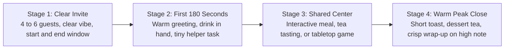
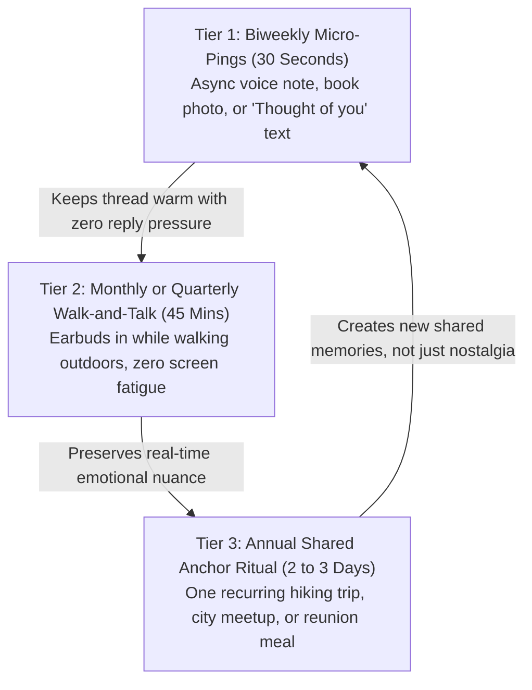

# Hosting Graciously, Expressing Gratitude & Building Adult Friendships

## 1. Why Adult Friendships Decay by Default After 30 (And How to Reverse It)

In school and university, sociologists note that the three structural ingredients of close friendship—**unplanned proximity, repeated weekly contact, and shared low-stakes vulnerability**—were handed to you for free by dorm hallways and campus cafeterias.

Around age 30–35, all three structural supports vanish simultaneously. Work intensifies, peers move across cities or countries, couples nest indoors, and free evenings shrink. Communication researcher Jeffrey Hall (University of Kansas) measured the actual time investment behind adult closeness: it takes roughly **50 shared hours** to turn an acquaintance into a casual friend, **90 hours** to become a real friend, and **200+ hours** to enter the lifelong inner circle.

Left on autopilot, adult men especially experience a quiet "friendship recession"—ending up at 35 with plenty of Slack coworkers and WeChat contacts, yet nobody they could call at 11 PM in a genuine crisis.

### Overcoming the "Liking Gap" & Claiming the Initiator Advantage

Two psychological findings unlock effortless momentum in your thirties:

1. **The Liking Gap (Boothby et al., Yale / Cornell)**: After almost every conversation, both people systematically *underestimate* how much the other person liked them and enjoyed their company. When you hesitate to text *"Great talking tonight—want to grab pour-over next Saturday?"* out of fear of bothering them, remember they are almost certainly hoping someone initiates first.
2. **Proactive Initiation Is a Superpower (Marisa Franco, *Platonic*)**: Waiting for friendships to "happen organically" after 30 means waiting forever. Becoming the calm, low-pressure **Micro-Gatherer**—the person who puts concrete dates on calendars without ego if someone is busy—makes you the most valued connector in your circle ([00-README.md](00-README.md)).

> **The Low-Friction Invite Rule**: Never send vague dead-end messages like *"We should catch up sometime!"* Always offer a **concrete anchor + easy opt-out**: *"Hey Chen, grabbing Yunnan pour-over near Jing'an / Mission this Saturday around 10:30 AM before a park walk—would love to catch up if you're free, zero pressure if your weekend is packed!"*

---

## 2. The Introvert's Zero-Stress Blueprint for Gracious Hosting

Many engineers avoid hosting friends because they imagine hosting requires a palatial apartment and five restaurant-grade dishes cooked from scratch. Facilitator Priya Parker (*The Art of Gathering*) points out the opposite truth: **an exhausted, stressed-out host makes every guest tense, whereas a relaxed host serving simple food makes everyone feel at home.**



### Four High-Warmth, Low-Stress Gathering Formats

| Gathering Format | Ideal Headcount | Host Prep Load | Why Introverts Thrive Here | Hosting Secret |
| :--- | :--- | :--- | :--- | :--- |
| **Home Hotpot / Raclette / Taco Bar** | 4–6 people | 30 mins chopping + broth | Zero stove slavery during dinner; cooking happens communally at the table | Prep ingredients before guests arrive so you sit with them 95% of the night |
| **Saturday Morning Coffee / Tea Walk** | 2–3 people | Near zero | Morning energy is fresh; walking side-by-side removes stiff face-to-face pressure | Pick a scenic 45-minute loop ending at a bakery; leaves Saturday evening free to recharge |
| **One-Pot Pasta / Braise + Board Game** | 4–5 people | 1 braised dish made ahead | Games (*Codenames*, *Azul*, *Dixit*, *Ticket to Ride*) supply effortless shared laughter ([02-HUMOR-STORYTELLING-AND-PLAYFUL-WIT.md](02-HUMOR-STORYTELLING-AND-PLAYFUL-WIT.md)) | Choose light 30-minute games with 2-minute rules—never 90-minute rulebook lectures |
| **Curated Neighborhood Table** | 4 people | Zero cleanup | Ideal when your apartment is tiny; round 4-top keeps a single shared conversation thread | Arrive 10 minutes early, pre-check dietary needs quietly, and handle splitting the bill smoothly |

### Three Hosting Details That Create Instant Magic

1. **Bridge Every Introduction with Two Hooks**: Never introduce two friends with bare names (*"Lin, this is Sam"*), leaving them stranded in small talk. Give them an immediate bridge: *"Lin, meet Sam—Sam led our distributed storage migration and also bakes wild-yeast sourdough every Sunday. Sam, Lin just came back from two weeks eating his way through Chengdu."* ([01-DEEP-LISTENING-AND-CONVERSATION-FLOW.md](01-DEEP-LISTENING-AND-CONVERSATION-FLOW.md)).
2. **Cure Arrival Awkwardness with a 2-Minute Micro-Job**: The stiffest moment of any gathering is when the first one or two guests arrive early. Hand them a tiny, tactile task—*"Come keep me company while I slice these limes—would you mind picking a relaxed jazz or indie playlist on the speaker?"* Having useful hands dissolves self-consciousness instantly.
3. **Lighting, Music & Non-Alcoholic Care**: Switch off harsh overhead white ceiling lights in favor of warm lamps (`2700K`), play warm instrumental or low-vocal music at 25% volume (silence feels like an exam room), and always stock thoughtful sparkling water or good oolong tea alongside wine/beer so non-drinkers feel equally celebrated.

### The Stress-Free 4-Person Home Dinner Runbook

- **T-48 Hours**: Confirm headcount and ask one clean question: *"Any food allergies or ingredients anyone avoids?"* Pick a forgiving menu (1 make-ahead braised dish or hotpot + 1 crisp cold vegetable dish + rice/bread + cut fruit/tea).
- **T-60 Minutes**: Wipe bathroom sink and put out a fresh hand towel (guests always notice a clean bathroom more than gourmet plating), dim harsh lights, start low music, set out water glasses and slippers.
- **T+0 to T+15 Minutes**: Greet warmly at the door, offer a warm or sparkling drink within 90 seconds, and introduce guests with two shared hooks.
- **T+90 Minutes (Over Tea or Fruit)**: Ask **one shared round-the-table prompt** that pulls everyone into a single meaningful conversation—for example: *"What's one small purchase under RMB 300 / USD 50 or one habit that noticeably improved your life this year?"* or *"Where is one place you'd love to travel next year?"*
- **T+150 Minutes (Graceful Wrap-Up)**: Serve warm decaf tea or sliced fruit as a natural gentle signal that the evening is landing, letting weekday guests head home rested around 9:30–10:00 PM while energy is still warm.

### The Flip Side: Being the Guest Everyone Invites Back

High-warmth social grace shows just as clearly when *you* are invited:
- **Never Arrive Empty-Handed to a Home Meal**: Bring something thoughtful that **creates zero immediate work for the host**—seasonal fruit (peaches, cherries, shine muscat), a bag of specialty coffee beans for their *next* morning, quality sparkling tea/wine, or pastries from a great bakery. (Never bring uncut flowers without a vase—the host has to scramble for scissors and a jar while cooking.)
- **Navigate Bill-Splitting & Reciprocity Smoothly**:
  - *In Chinese contexts*: Instead of theatrical 5-minute wrestling at the cashier (*抢买单*), either quietly settle the bill when stepping out to wash hands (*"Tonight is my treat since you hosted last month—you've got the next one!"*), or agree cleanly on alternating turns (*轮流做东*), which builds ongoing momentum better than down-to-the-fen AA accounting among close friends.
  - *In Western / International contexts*: Offer cleanly to split evenly or cover the tip/drinks if someone ordered lightly, without turning the receipt into an awkward spreadsheet audit at the table.
- **Send the Next-Morning Thank-You Note**: A specific two-sentence text within 18 hours places you in the top 5% of gracious adults.

---

## 3. Giving a Crisp, Memorable 45-Second Toast

Whether hosting friends at home, sending off a respected teammate, or raising a glass at a wedding or Lunar New Year table (*祝酒词*), being able to deliver a warm 45-second toast is a rare mark of adult poise. Most people err by either mumbling *"Uh, cheers everyone"* or rambling without a landing gear for four minutes.

Use this reliable **4-Beat Toast Structure** (approx. 90–110 spoken words):

1. **Beat 1 — Calm Attention (5s)**: Stand or raise your glass at chest height, smile warmly, and pause 2 seconds until chatter settles naturally.
2. **Beat 2 — Gratitude for the Room (10s)**: Name why having *these specific people* in one place feels meaningful tonight.
3. **Beat 3 — One Concrete Character Observation (20s)**: Share **one specific, warm detail** about the guest of honor or the season of life you share—never an embarrassing inside joke that alienates half the table ([02-HUMOR-STORYTELLING-AND-PLAYFUL-WIT.md](02-HUMOR-STORYTELLING-AND-PLAYFUL-WIT.md)).
4. **Beat 4 — Forward Wish + Clean Lift (10s)**: End with a clear upward wish and raise your glass decisively.

### Three Ready-to-Use Toast Templates

- **At a 5-Person Home Dinner**: *"Before we dig in while the broth is hot—I just wanted to say how glad I am to have the five of you around one table tonight. Between busy Q4 sprints and everyone traveling, evenings where we actually slow down offline together are rare. Thank you for bringing good energy and stories tonight—here's to good health, good food, and a slower winter ahead. Cheers!"*
- **At a Respected Teammate's Farewell**: *"Quick toast to Maya before desserts arrive. Everyone here knows Maya writes rock-solid systems, yet what I'll miss most is how steady and generous she stayed during our hardest 2 AM incidents—always the first to share credit and the last to blame anyone. Her new team is ridiculously lucky, and we're lucky we got three years building together. To Maya's next adventure!"*
- **At a Close Friend's Milestone / Wedding Dinner**: *"Knowing Liang for eight years—from debugging terrible dorm code over RMB 12 late-night noodles to watching how thoughtfully he shows up for Mei every single day—one thing has never changed: when Liang says he has your back, you can bet your life on it. Seeing the two of you build a home full of warmth makes everyone in this room happy. To Liang and Mei!"*

---

## 4. Retiring Silent Stoicism: Expressing Explicit Gratitude

Traditional male and East Asian upbringing (*大恩不言谢*—assuming deep gratitude needs no words) carries a hidden relational cost in adulthood: **people cannot feel appreciation that stays compiled inside your private thoughts.**

Psychologist Sara Algoe's **Find-Remind-and-Bind Theory** of gratitude shows a crucial distinction in how thank-yous land:
- **Self-Focused Gratitude** (*"Thanks for reviewing my doc, saved me tons of time!"*) feels polite yet transactional.
- **Other-Praising Gratitude** (*"It meant a lot how thoughtfully you carved out an hour during your own launch week to walk me through those blind spots—you always look out for people around you"*) names the **character virtue and personal care** of the giver, creating lasting warmth.

### Upgrading Everyday Appreciation Scripts

| Relationship | Default Stoic / Minimal Reply | High-Character Explicit Gratitude Script |
| :--- | :--- | :--- |
| **Mentor or Senior Peer** | *"Thanks for the advice yesterday!"* | *"Hey Arjun, wanted to circle back after our chat—your framing around optimizing for team trust over short-term scope completely cleared my head. Thank you for always being generous with hard-won perspective."* |
| **Friend Who Hosted Dinner** | *"Fun night, thanks!"* (or silence) | *Next morning text*: *"Thank you again for hosting last night, Lin—that braised beef was incredible, and the mix of friends you brought together made my whole week feel lighter. Next round of coffee or dinner is on me."* |
| **Friend Who Listened in a Hard Week** | Changing the subject out of awkwardness | *"Hey, thank you for just listening on our walk tonight without rushing to fix things. Honestly felt ten pounds lighter walking home—grateful to have you in my corner."* ([01-DEEP-LISTENING-AND-CONVERSATION-FLOW.md](01-DEEP-LISTENING-AND-CONVERSATION-FLOW.md)) |
| **Aging Parents** | Only talking logistics (*"Did you take your medicine?"*) | *"Mom / Dad, I was cooking that soup you taught me tonight and realized how steady you both kept our home even when work was tough back then. Just wanted to tell you I appreciate you and hope you had a peaceful week."* |

### Analog Artifacts: Why a 4-Line Handwritten Note Hits 100x Harder

Because 99.9% of adult communication is ephemeral pixels, a physical four-sentence card—slipped onto a departing colleague's desk, brought with a housewarming gift, or mailed after a wedding—often stays in someone's desk drawer for ten years. Keep a pack of clean, minimalist heavy-stock blank cards in your desk drawer so friction is zero when a meaningful moment arrives.

---

## 5. Cultivating 3–5 Lifelong High-Character Friends Across Cities

Anthropologist Robin Dunbar's research confirms that human emotional bandwidth is finite: no one maintains 40 deep friendships. A deeply supported adult life rests on **3–5 inner-circle, high-character friends**, surrounded by 10–15 warm community peers.

### Choosing Character: The "Freudenfreude" Litmus Test

Psychologist Shelley Gable proved that how a friend reacts to your **good news** predicts long-term relationship health even more accurately than how they react to bad news. Anybody can commiserate when you fail; rare, high-character friends practice **Active-Constructive Responding (*Freudenfreude*)**—lighting up with genuine, un-envious joy when something goes well for you.

Invest your scarce 30s hours asymmetrically into people who pass three bars:
1. **Un-Envious Celebration**: They cheer your wins without subtle one-upmanship or backhanded cynicism.
2. **Mutual Emotional Reciprocity**: Both of you ask questions, listen, and initiate roughly over time (say 60/40 across seasons, never 95/5 for years).
3. **Private Honesty + Public Loyalty**: They tell you kindly to your face when you have a blind spot, and defend your name whenever you are not in the room.

| Dimension | Lifelong Inner-Circle Green Flag | Quiet 30s Red Flag (Shift to Outer Circle) |
| :--- | :--- | :--- |
| **Response to Your Good News** | Asks enthusiastic follow-up questions; genuinely happy (*Freudenfreude*) | Changes subject quickly, minimizes the win, or immediately compares salaries/status |
| **How They Speak About Absent Friends** | Speaks with warmth, nuance, and discretion when someone isn't at the table | Bonds via gossiping or mocking other "close friends" (they do the exact same when you leave) |
| **Reliability & Repair** | Keeps commitments; when life explodes, communicates early and reschedules proactively | Habitually flakes 30 minutes beforehand waiting for a "better option" with zero accountability |
| **Post-Hangout Nervous System State** | You walk home feeling grounded, energized, and more like your best self ([00-README.md](00-README.md)) | You walk home feeling subtly drained, defensive, or cynical |

### Multi-City Maintenance Cadence (Keeping Close Friends Across Time Zones)

When your best friends scatter across Shanghai, Shenzhen, Singapore, Tokyo, Seattle, or London, replace high-friction scheduling (*"Let's find a 2-hour Zoom slot next month"*) with a **Three-Tier Rhythm**:



- **Send "No-Reply-Needed" Async Warmth**: *"Just walked past that tiny ramen counter near Shibuya we stumbled into in 2023—hope your autumn is treating you well, zero rush to reply!"* Removing obligation makes staying connected effortless.
- **Protect One Annual Shared Adventure**: Friendships that only reminisce about 2018 eventually fossilize. Booking even one 48-hour hiking weekend or meeting in a middle city once a year creates **fresh shared stories**—ensuring that at age 45 and 60, your closest friends know the person you are *today*, not merely who you were at 22.

---

## 6. Building Friendships From Scratch in a New City or Country

Relocating in your thirties—whether moving across China or moving abroad—tests social agency directly. Avoid one-off networking mixers (where you meet 20 strangers once and never see them again) and engineer **Recurring Proximity + Context Shifting**:

### Step 1: Join a Recurring Weekly "Third Place" Cohort

Pick **one** physical space where the **exact same 12–25 people** show up every single week around a shared craft or movement:
- Weekly Saturday morning pace-group run club, bouldering/climbing gym night, or badminton/tennis ladder.
- Multi-week small-cohort classes (ceramics, improv, specialty coffee cupping, cooking, or local language table).
- Regular open-source hardware/AI build nights or volunteer trail/community crews.

Showing up consistently for **6 consecutive weeks** activates psychologists' **Mere Exposure Effect**: familiarity builds trust effortlessly without forcing awkward cold approaches.

### Step 2: Practice "Repotting" (Moving Out of the Original Container)

A "climbing gym buddy" or "work friend" remains a single-context acquaintance until you **repot** the relationship into a second setting. Around week 3 or 4, make a casual, low-stakes 30-minute bridge right after the activity:

> *"A couple of us are grabbing beef noodles two blocks over after this session—want to join for half an hour?"*

Once two people share food or a walk outside the original venue, conversation naturally shifts from technique to personal life stories ([01-DEEP-LISTENING-AND-CONVERSATION-FLOW.md](01-DEEP-LISTENING-AND-CONVERSATION-FLOW.md)), crossing the 50-hour threshold rapidly.

---

## 7. Repairing Friction Cleanly & Releasing Outgrown Ties

Long-term friendships inevitably encounter occasional dropped balls, missed birthdays, or moments of friction. High-character adults distinguish between **good friends worth repairing quickly** and **draining dynamics worth releasing peacefully**.

### Fast, Ego-Free Repair With High-Character Friends

Avoid the classic engineer failure mode of letting awkwardness fester into a 2-year silent drift because you felt embarrassed about replying three weeks late or speaking sharply when stressed. Own it cleanly:

- **After Dropping the Ball When Overwhelmed**: *"Hey Marcus, I owe you an apology for going dark this past month—work and family logistics got chaotic and I retreated into my cave, which isn't how I want to show up for friends I care about. Would love to treat you to lunch next week and hear how your autumn has been."*
- **After a Sharp Disagreement**: *"Hey, thinking back on dinner last night, I came across way too rigid on that topic. Our friendship matters infinitely more to me than winning a debate—sorry for bringing defensive energy."*

### Releasing Low-Character or One-Way Dynamics Without Drama

Not every 20s friendship belongs in your 30s inner circle. If someone consistently exhibits **chronic envy at your wins, subtle disrespect, gossip about mutual friends, or years of 100% one-way emotional dumping**, you do not owe them a dramatic breakup speech. Simply shift them gracefully from your **Inner 5** to polite **Outer-Circle Warmth**—wishing them well on holidays while reserving your prime evenings and hosting energy for people who bring mutual respect, curiosity, and warmth.

---

## 8. Quarterly Friendship & Gratitude Stewardship Checklist

Run this 10-minute check once at the start of every season (Spring, Summer, Autumn, Winter):

- [ ] **Inner-5 Pulse Check**: Have I had a real unhurried conversation (walk, meal, or 40-minute voice call) with each of my 3–5 closest friends in the past 90 days?
- [ ] **Micro-Gathering on the Calendar**: Put **one** concrete 3–5 person coffee walk, hotpot night, or neighborhood dinner on the calendar within the next 3 weeks.
- [ ] **Explicit Gratitude Sent**: Send **two** specific, other-praising appreciation notes—one to a friend/mentor and one to family—naming something concrete they did that mattered.
- [ ] **Annual Anchor Planned**: Confirm whether this year's shared weekend trip, hike, or cross-city reunion with longtime friends has a locked weekend on the calendar.

### Copy-Pasteable 4-Person Gathering Prep Card

Use this lightweight checklist whenever you bring 3–5 friends together so nothing feels stressful:

```markdown
## Micro-Gathering Plan — YYYY-MM-DD (Start: 18:30 | Warm Wrap: 21:30)
- **Guests (3 to 5 max)**:
- **Dietary / Non-Alcoholic Notes**:
- **Zero-Stress Menu or Venue**:
- **Warm Intro Bridges Prepared (Who hasn't met whom + 2 shared hooks)**:
- **Arrival Micro-Job for Early Guest**:
- **One Round-the-Table Dessert/Tea Question**:
```

Being the person who creates warm rooms, speaks appreciation aloud while people are here to hear it, and invests steadily in high-character friends ensures your thirties, forties, and beyond grow deeper—never lonelier—with every passing year.

---

## 9. Evidence-Based Reference Shelf

1. **Priya Parker** — *The Art of Gathering: How We Meet and Why It Matters* (designing warm, low-stress human gatherings with clear thresholds, shared purpose, and crisp endings).
2. **Marisa G. Franco** — *Platonic* (attachment psychology applied to proactive adult friendship initiation and overcoming the Liking Gap).
3. **Robin Dunbar** — *Friends: Understanding the Power of Our Most Important Relationships* (neurobiological bandwidth limits and why 3–5 inner-circle ties anchor adult health).
4. **Jeffrey A. Hall** (2018, *Journal of Social and Personal Relationships*) — *"How many hours does it take to make a friend?"* (empirical 50 / 90 / 200-hour friendship thresholds).
5. **Sara B. Algoe** — *Find, Remind, and Bind Theory of Gratitude* (why other-praising character appreciation builds deeper long-term bonds than transactional thanks).
