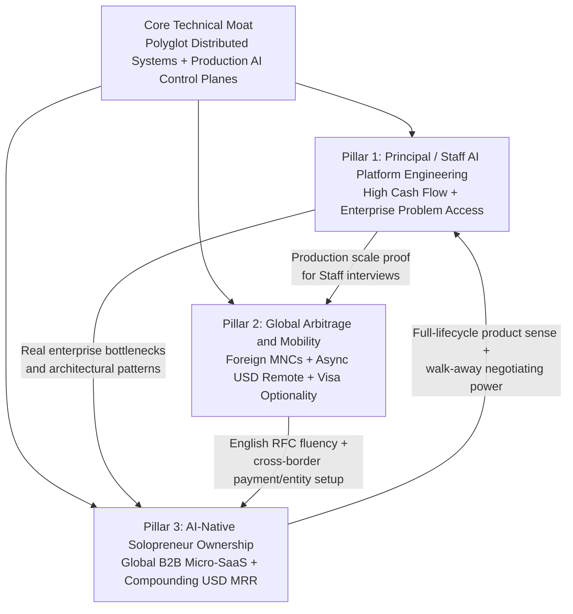
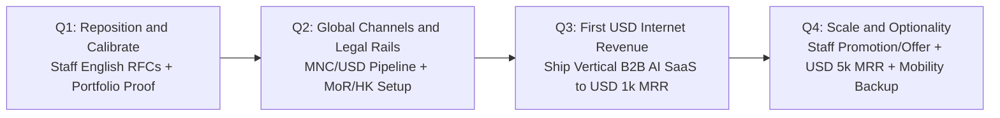
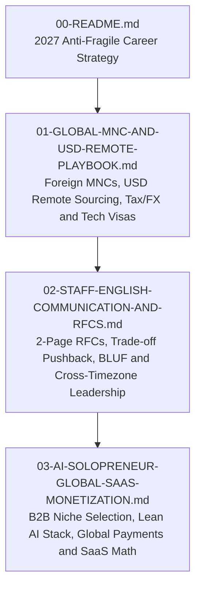

# The 2027 Undefeatable Software Engineer Strategy

> **Target Profile**: Age 32+, 8–12 Years of Experience, Polyglot Backend & Full-Stack Engineer (Go / Python / Java / TypeScript), Distributed Systems + Production AI Infrastructure Builder, operating out of a Tier-1 hub in China with global ambitions.

---

## 1. Why 2027 Is a Structural Fork in the Road at Age 32+

In China's domestic software market, age 32 to 35 has historically triggered structural anxiety—often called the "35-year-old cliff." Yet that cliff does not hit "software engineers" uniformly; it specifically liquidates **undifferentiated, single-market CRUD labor** priced at senior salaries.

By 2027, two macroeconomic and technological forces have converged:

1. **Coding Agents Have Collapsed Implementation Scarcity**: Boilerplate REST endpoints, standard React admin consoles, SQL CRUD migrations, and isolated unit tests are generated in minutes. If 80% of an engineer's calendar is translating product requirement documents (PRDs) into framework code inside a domestic headcount-heavy hierarchy, a 25-year-old engineer armed with Claude Code or Codex delivers 85% of that output at 45% of the payroll cost.
2. **Enterprise AI Infrastructure & Cross-Border Leverage Have Exploded in Scarcity**: While writing isolated features is cheap, **operating deterministic systems around non-deterministic models**—unified LLM gateways, multi-agent sandboxes, real-time SSE token streaming, OpenTelemetry cost/latency attribution, human-in-the-loop (HITL) governance, and idempotent financial ledgers—is harder than ever. Simultaneously, global companies and solo founders can now serve international B2B markets without massive headcount.

At age 32 with 9+ years of production scars, you sit in the highest-leverage compounding window of your career—**provided you stop competing in the domestic feature-factory game and re-architect your career around rare intersections.**

---

## 2. Skill Portfolio Audit: Depreciating vs. Compounding Assets (2027)

An engineer with experience across high-QPS billing systems, polyglot microservices (Go, Python, Java, TypeScript), Kubernetes observability, and multi-agent LLM data planes already possesses world-class raw ingredients. The strategic mistake is packaging those ingredients as "a versatile senior developer who can write anything" rather than **a Staff-caliber AI Platform Architect & Product Owner**.

| Dimension | Rapidly Depreciating (Commoditized in 2027) | High-Moat & Appreciating (Undefeatable in 2027+) |
| :--- | :--- | :--- |
| **Backend Engineering** | Standard Spring Boot / Gin / Django CRUD APIs, basic ORM queries, manual DTO wiring | Idempotent distributed ledgers (`freeze -> consume -> rollback`), multi-tenant isolation, connection-pool & lock-contention tuning at 5k+ QPS |
| **AI & LLM Work** | Thin prompt wrappers, basic single-document RAG demos, manual LangChain chains without evals | Unified LLM Gateways (Responses API, SSE backpressure, fallback routing), HITL governance guardrails, agent eval harnesses, per-tenant token attribution via OpenTelemetry |
| **Frontend & UX** | Static admin tables, generic form pages | Real-time streaming agent consoles (React 19 + TanStack Query), optimistic state reconciliation, low-latency artifact viewers & human approval workflows |
| **Communication** | Passive ticket execution in Mandarin-only hierarchies; waiting for PM specs | Writing crisp 2-page English RFCs/ADRs, pricing engineering trade-offs for global stakeholders, driving async convergence across US/EU/APAC timezones |
| **Economic Capture** | 100% reliance on a single domestic RMB employer or vendor contract | Multi-currency optionality: Tier-1 Foreign MNC / Global USD Remote + Proprietary B2B Micro-SaaS equity |

### The 5 Urgent Technical Multipliers to Lock In First (2027 Priority Stack)

Given a strong foundation in Go, Python/FastAPI, Java/Spring, TypeScript/React, Kubernetes, OpenTelemetry, and LLM gateways, **do not spend 2027 learning another general-purpose language**. Close these five high-ROI capability gaps to command top-decile global compensation:

1. **Automated Agent Evaluation & Regression Harnesses (`Trace-to-Eval` Loops)**
   - *Why it pays*: 90% of enterprise AI teams can build an agent prototype; fewer than 10% can prove a prompt, model, or tool-schema upgrade did not break 40 edge cases in production.
   - *Concrete Deliverable*: Build deterministic trajectory assertions + rubric-calibrated LLM-as-judge CI gates that automatically convert production OpenTelemetry failure traces into golden regression test cases.
2. **Inference Unit Economics & KV-Cache Prefix Engineering**
   - *Why it pays*: At enterprise scale, naive multi-turn agent loops burn tens of thousands of USD per month.
   - *Concrete Deliverable*: Master prompt-prefix stability (keeping system instructions, tool definitions, and static context byte-identical for 80%+ KV-cache hit rates), tiered model routing (fast small models for intent/extraction, frontier reasoning models strictly for ambiguous synthesis), and per-tenant token-budget circuit breakers.
3. **Sandboxed Execution & Deterministic Policy Guardrails**
   - *Why it pays*: Giving agents write access to production databases, cloud APIs, or code execution terrifies enterprise CISO teams.
   - *Concrete Deliverable*: Master SQL AST read/write verification (e.g., `sqlglot` policy gates), scoped short-lived OAuth token brokering for MCP tools, ephemeral container/microVM sandboxing, and resumable HITL approval state machines.
4. **Durable Execution & Stream Resumption Under Failure**
   - *Why it pays*: Long-running research or supply-chain workflows span 30 seconds to 15 minutes; stateless HTTP timeouts cause data corruption and duplicate tool side effects.
   - *Concrete Deliverable*: Master durable workflow checkpointing (LangGraph persistent checkpointers, Temporal, or Redis Stream cursor replay with `Last-Event-ID` + idempotency keys).
5. **Full-Funnel B2B Product & Monetization Engineering**
   - *Why it pays*: Bridges the gap between "expensive employee" and "revenue-generating partner or founder."
   - *Concrete Deliverable*: Understand Merchant-of-Record tax compliance, Stripe/Paddle webhook state machines, programmatic SEO architecture, and SaaS churn/LTV unit economics.

---

## 3. The Anti-Fragile 3-Legged Stool Architecture

Relying on one employer, one currency, and one jurisdiction makes even a talented engineer fragile to reorgs, vendor contract renewals, or regional hiring freezes. True career invulnerability comes from constructing three mutually reinforcing pillars where **every hour spent on one pillar compounds the other two**.

### How the Flywheel Compounds Without Burnout

The fatal error most 32-year-old engineers make is treating these three pillars as three unrelated jobs—working 996 in Java CRUD by day, memorizing IELTS vocabulary at midnight, and building a random consumer habit-tracker app on weekends. That guarantees exhaustion and zero traction.

Instead, align the flywheel so **a single technical domain powers all three**:

1. **Day Job as Paid R&D (Pillar 1)**: Focus your 40-hour workweek on the hardest platform problems available—LLM gateway reliability, SSE streaming backpressure, OpenTelemetry agent tracing, RBAC/SQL guardrails, and React streaming UX. Document every design decision as a structured 2-page English RFC.
2. **Global Market Positioning (Pillar 2)**: Those exact production metrics and English RFC habits make you immediately hireable by Tier-1 foreign R&D centers in Shanghai/Singapore/Tokyo and US Series A–C remote AI infrastructure teams paying USD 120k to 220k+.
3. **Micro-SaaS Extraction (Pillar 3)**: Abstract the non-proprietary workflow pain you observe in enterprise operations (never copying employer code or confidential data, only solving universal structural problems like schema-validated document extraction, LLM cost governance, or automated compliance verification) into a lean B2B Micro-SaaS sold globally in USD.

---

## 4. The Mathematical Model of Career Leverage

Your market resilience and compensation ceiling can be modeled through the **Anti-Fragile Career Valuation Equation**:

$$V_{\text{career}} = \frac{(S_{\text{domain}} \times L_{\text{AI}} \times D_{\text{global}})^{\alpha}}{R_{\text{concentration}}}$$

Where:
- $S_{\text{domain}} \in [1, 10]$: **Technical Intersection Scarcity**. Knowing Python alone is $1.5$. Knowing distributed financial ledgers + K8s observability + multi-agent LLM data planes + React streaming UI in one brain is $8.5$, because a startup or platform team can hire *one* architect instead of coordinating four specialists.
- $L_{\text{AI}} \in [1, 5]$: **AI Execution Multiplier**. Using AI coding agents, automated evals, and deterministic scaffolding to ship at 4x the throughput of a traditional team.
- $D_{\text{global}} \in [1, 10]$: **Global Distribution & Communication Reach**. If you can only sell your labor or software in Mandarin within one city, $D_{\text{global}} = 1$. If you operate fluently in Staff-level async English and accept global Stripe/MoR payments, your addressable market expands 8x to 10x.
- $\alpha > 1$: **Ownership Exponent**. Pure salaried labor scales linearly ($\alpha = 1$). Owning recurring SaaS revenue, open-source authority, or equity scales super-linearly ($\alpha \approx 1.4$).
- $R_{\text{concentration}} \in [0.5, 3]$: **Concentration Risk Discount**. Single domestic industry + no overseas entity/visa pathway + zero side cash flow creates high fragility ($R = 2.5$). Diversified currency + portable global reputation compresses $R \to 0.6$.

### Compensation & Resilience Quadrant Comparison (2027 Benchmarks)

| Career Archetype | Typical Annual Comp Range | Effective Hourly Wage | Age 35+ Fragility | Primary Bottleneck |
| :--- | :--- | :--- | :--- | :--- |
| **Domestic Feature/CRUD Senior** | RMB 350k to 600k | Low (55–65h/wk) | **Critical** (High layoff replacement risk) | Competing on stamina & framework syntax |
| **Domestic Big-Tech Architect (P7/P8)** | RMB 800k to 1.6M | Medium (60–70h/wk, high politics) | **High** (Org reshuffles, illiquid/volatile options) | Internal politics & narrow internal infra lock-in |
| **Tier-1 China Foreign MNC Staff / Lead** | RMB 650k to 1.3M (Base + liquid USD RSU) | **High** (40–45h/wk, 15–20d PTO) | **Low** (Tenure valued, internal L-1/SG/EU mobility) | English architectural influence & headcount selectivity |
| **Global Async USD Remote Senior/Staff** | USD 100k to 200k (RMB 720k to 1.45M) | **Very High** (Async 35–42h/wk, geographic arbitrage) | **Low** (Output-judged, age-blind engineering culture) | Sourcing trust, async English clarity, tax/FX setup |
| **MNC/Remote + Profitable B2B Micro-SaaS** | Base Comp + USD 3k to 25k/mo MRR | **Compounding** (Decoupled from hours) | **Anti-Fragile** (True walk-away power) | Distribution discipline & avoiding over-engineering |

---

## 5. The Weekly `40 + 7 + 3` Sustainable Execution Protocol

At age 32, sacrificing sleep, metabolic health, or psychological stability destroys the exact prefrontal executive function required for Staff architecture and product judgment. Never run a 90-hour hustle schedule. Run a **50-hour precision week** with zero wasted motion:

| Block | Weekly Hours | Allocation & Concrete Deliverables |
| :--- | :---: | :--- |
| **1. High-Leverage Day Job** | **40.0 h** | Deliver top-10% reliability on AI platform / core architecture. Ruthlessly automate repetitive debugging and tests with coding agents. Volunteer to author 2-page English RFCs and observability standards rather than hoarding low-visibility maintenance tickets. |
| **2. Deep Solopreneur / Asset Build** | **7.0 h** | Five 60-minute pre-work morning blocks (Mon–Fri, e.g., 07:30–08:30 before Slack/WeChat noise) + one 2-hour Saturday morning block. Strictly ship revenue-bearing B2B Micro-SaaS workflows, pSEO pages, or open-source AI infra benchmarks. |
| **3. Global Distribution & English Calibration** | **3.0 h** | Three 30-minute spoken English architectural walkthrough drills + 90 minutes/week publishing technical write-ups on X/GitHub/LinkedIn and nurturing MNC/YC founder relationships. |
| **Protected Recovery** | **Uncompromised** | 7.5+ hours sleep, 3–4x/week resistance/zone-2 training, real cooking, social life, and creative hobbies. Burnout resets compounding to zero. |

### Quarterly Anti-Fragility Self-Audit Scorecard (Score Out of 100 Every 90 Days)

Run this audit on the last Sunday of every quarter to verify you are building structural leverage rather than drifting back into busywork:

| Pillar | Verification Metric | Target Benchmark | Weight |
| :--- | :--- | :--- | :---: |
| **Pillar 1: Principal AI Infra Moat** | Authored >= 2 architectural RFCs/ADRs with quantified latency, reliability, or token-cost wins that survive outside internal jargon | Concrete metrics ready for public/interview narrative | **25 pts** |
| **Pillar 2A: Global Market Calibration** | Completed >= 2 conversations or interviews with Tier-1 MNC hiring managers or global USD remote founders | Active external price discovery every 6 months | **20 pts** |
| **Pillar 2B: Cross-Border Infrastructure** | Clean English 1-page resume, active LinkedIn/GitHub proof-of-work, compliant multi-currency bank/MoR readiness, valid passport + visa awareness | Ready to accept global USD wire or relocate within 30 days | **15 pts** |
| **Pillar 3A: Shipped Product Surface** | Live global B2B Micro-SaaS or open-source AI infra tool with self-serve onboarding and programmatic SEO / distribution loop | Live URL accepting global cards (not localhost) | **25 pts** |
| **Pillar 3B: Physiological & Mental Base** | Resting heart rate, blood panel, 7.5h sleep consistency, >= 3 workouts/week, zero chronic burnout symptoms | Sustainable 10-year compounding pace | **15 pts** |

---

## 6. 12-Month Transformation Roadmap (2027)

### Quarter-by-Quarter Milestones

- **Q1 (Months 1–3) — Repositioning & Staff Signal**:
  - Rewrite resume, LinkedIn, and GitHub profile around **Production AI Control Planes + High-Throughput Distributed Ledgers** (quantified latency, QPS, token throughput, reliability SLAs).
  - Adopt the 2-page English RFC and BLUF status protocol in daily engineering work.
  - Publish 2 deep architectural posts in English (e.g., *"Designing Idempotent Token Budget Ledgers for Streaming LLM Gateways"* or *"End-to-End OpenTelemetry Tracing Across Multi-Agent Tool Calls"*).
- **Q2 (Months 4–6) — Global Market Calibration & Monetization Infrastructure**:
  - Test market value across 3–5 Tier-1 foreign MNC roles or global async USD remote startups—even if happy in your current seat—to calibrate interview bar and build executive relationships.
  - Validate 3 B2B workflow pain points via customer conversations and search-intent data; kill weak ideas in 72 hours.
  - Set up clean cross-border payment rails (start with Merchant of Record like Lemon Squeezy / Paddle; incorporate HK Limited or US entity once recurring revenue crosses USD 2k–3k/mo).
- **Q3 (Months 7–9) — First Recurring USD Revenue**:
  - Ship a focused B2B AI workflow Micro-SaaS using the lean Next.js + Supabase + FastAPI stack in 14 days.
  - Execute programmatic SEO and problem-first launches on Reddit, Hacker News, and X until reaching the first 10–15 paying B2B customers (USD 500 to 1,500 MRR).
- **Q4 (Months 10–12) — Compounding & Structural Optionality**:
  - Convert enterprise platform impact into either a direct MNC FTE / Staff promotion or a high-paying USD remote engineering contract.
  - Compound Micro-SaaS retention and SEO acquisition toward USD 3k to 10k MRR.
  - Evaluate residency/mobility optionality (HK TTPS/QMAS, Singapore EP, or Japan HSP/J-Skip) from a position of financial surplus rather than urgency.

---

## 7. Fatal Anti-Patterns to Avoid at Age 32+

1. **The "One More Certificate / Framework" Procrastination Loop**: Learning Rust, Zig, or a fifth frontend state library will not raise your compensation by 50% if you already know Go, Python, Java, and TypeScript. Your bottleneck is **architectural positioning, English executive influence, and global distribution**—never another syntax tutorial.
2. **Vendor-Seat Passivity**: If working inside an international enterprise ecosystem via a partner or consulting engagement, passively closing assigned Jira tickets makes you replaceable at contract renewal. Actively owning cross-service RFCs, observability standards, and architectural clarity makes you the engineer hiring managers fight to convert or refer.
3. **Quitting Your Day Job at USD 0 MRR**: Going "full-time indie hacker" with zero recurring revenue burns savings and induces panic-driven product decisions. Keep your high-cash-flow AI platform salary until Micro-SaaS net profit reliably covers 100%+ of base living expenses for 6 consecutive months.
4. **Building B2C AI Wrappers for Consumers**: Selling USD 5/mo chat wrappers to consumers yields 15%+ monthly churn and brutal support load. Sell USD 49 to 299/mo deterministic workflow automation to businesses where saving 5 hours of analyst/ops labor is an instant ROI decision.
5. **Over-Engineering MVP Infrastructure**: Do not deploy Helm charts, Kafka clusters, and multi-region Kubernetes for a SaaS with 3 users. Reserve enterprise infrastructure complexity for your day job; run single-node managed Postgres + FastAPI + Vercel for your solopreneur product until revenue demands otherwise.

### Capital, Runway & Transition Trigger Matrix (Age 32–36)

Never make emotional career leaps. Govern every transition between domestic roles, foreign MNCs, remote USD contracts, and full-time solopreneurship using hard financial gates:

| Transition Decision | Minimum Liquid Runway Required | Mandatory Pre-Condition Gate | Primary Risk Mitigated |
| :--- | :--- | :--- | :--- |
| **Partner/Vendor Seat -> Direct MNC FTE or Peer MNC** | 6 months living expenses | >= 2 signed Staff-level architectural wins documented in 1-page English CV + active internal/peer referrals | Eliminates vendor contract renewal dependency while upgrading RSU & benefits base |
| **Salaried MNC -> Full-Time Global USD Contractor** | 12 months living expenses | >= 25% net after-tax compensation premium over FTE + executed Deel/MSA contract + Shanghai `灵活就业` continuity plan | Buffers contractor notice periods (typically 14–30 days) and self-funded benefits |
| **Salaried + Side SaaS -> Full-Time Solopreneur** | **18–24 months** liquid cash reserve | SaaS net profit >= **1.2x monthly household burn for 6 consecutive months** with monthly logo churn < 4.5% | Prevents panic pricing, premature feature pivoting, and psychological scarcity |
| **Triggering Overseas Relocation (SG / JP / EU)** | 12 months destination burn | Signed local offer meeting HSP 80-pt / COMPASS / Blue Card threshold + clear family/career 3-year ROI thesis | Avoids burning savings on high-tax/high-rent relocation without permanent residency upside |

---

## 8. Curriculum Navigation & Study Order

Work through the three playbooks in this vault sequentially, keeping them open as active operational manuals throughout 2027:

### Complete Vault Table of Contents

1. **[00-README.md](00-README.md) — The 2027 Undefeatable Software Engineer Strategy** *(Current Document)*
   - Macro skill audit, the 3-legged anti-fragile stool, the career leverage valuation formula, weekly `40 + 7 + 3` protocol, and 12-month execution roadmap.
2. **[01-GLOBAL-MNC-AND-USD-REMOTE-PLAYBOOK.md](01-GLOBAL-MNC-AND-USD-REMOTE-PLAYBOOK.md) — Landing Foreign MNC Roles in China, Global USD Remote Jobs & Tech Visas**
   - Tier-1 foreign engineering centers in Shanghai/Beijing/Shenzhen, vendor-to-FTE bridge tactics, sourcing real async USD remote jobs on HiringCafe/YC/GitHub, contractor invoicing (`W-8BEN`, Deel, FX compliance), and realistic comparison of HK TTPS, Singapore EP (COMPASS), Japan J-Skip/HSP, and EU Blue Card.
3. **[02-STAFF-ENGLISH-COMMUNICATION-AND-RFCS.md](02-STAFF-ENGLISH-COMMUNICATION-AND-RFCS.md) — Staff-Level Engineering English: RFCs, Architecture Reviews & Global Collaboration**
   - Eliminating seniority leaks in engineering English, complete 2-page production RFC/ADR template, exact phrasebooks for architectural disagreement and scope pushback, Minto Pyramid / BLUF executive updates, and Shanghai-to-US/EU async collaboration protocols.
4. **[03-AI-SOLOPRENEUR-GLOBAL-SAAS-MONETIZATION.md](03-AI-SOLOPRENEUR-GLOBAL-SAAS-MONETIZATION.md) — AI-Native Solopreneurship: Global Micro-SaaS & Monetization**
   - B2B workflow niche validation vs wrapper traps, lean Next.js + Supabase + FastAPI zero-ops architecture, idempotent LLM credit ledger code, cross-border entity & payment setup (Lemon Squeezy / Paddle MoR vs HK Limited vs Stripe Atlas US LLC + Form 5472 compliance), pSEO + Reddit/X launch loops, and SaaS churn/LTV mathematics.
