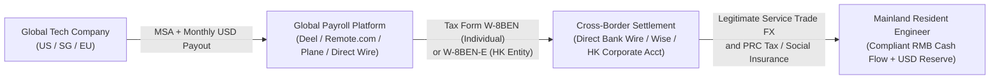
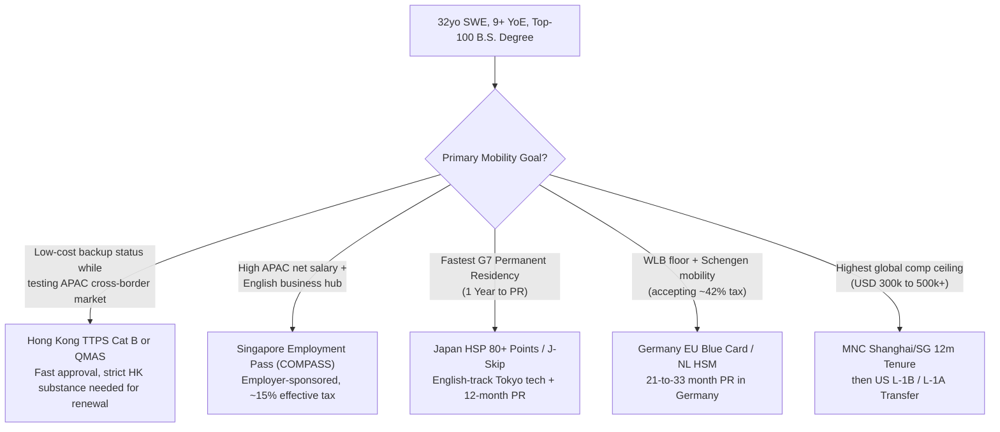

# Global MNCs in China, USD Remote Roles & Tech Visas Playbook

> **Strategic Objective**: Decouple your engineering compensation and career longevity from single-market domestic headcount cycles by mastering three global channels: **Tier-1 Foreign MNC R&D Centers in China**, **Direct USD Async Remote Contracts**, and **High-Optionality Global Tech Visas**.

---

## 1. Foreign MNC Engineering Centers in China (2027 Landscape)

Despite selective headquarters consolidations between 2023 and 2026, foreign multinational corporations (MNCs) in Shanghai, Beijing, Shenzhen, and Suzhou remain one of the highest risk-adjusted career seats in the world: **first-world total compensation paired with Tier-1 China infrastructure, statutory 15–20 days paid annual leave, commercial family medical coverage, and age-neutral IC tracks.**

### Tiered Foreign Engineering Center Matrix

| Tier & Category | Representative Companies (Primary China Hubs) | Core Technical Demand in 2027 | Typical Senior / Staff Total Comp | Cultural & Mobility Characteristics |
| :--- | :--- | :--- | :--- | :--- |
| **Tier-1 US Cloud, Silicon & Consumer Tech** | Microsoft (STCA Beijing/Suzhou/SH), Apple (Shanghai/SZ), NVIDIA (Shanghai), Tesla (Shanghai), Google (SH/BJ selective), Meta (SH hardware/infra) | AI infra, LLM data planes, GPU/CUDA & inference serving, supply-chain automation, distributed storage, observability | RMB 750k to 1.6M+ (Base + 15% Bonus + liquid USD RSUs) | Strong English requirement; internal transfer pathways (L-1B/L-1A to US, or internal transfer to SG/Vancouver/Dublin) after 12–24 months |
| **Global FinTech, Payments & E-Commerce** | PayPal (Shanghai), eBay (Shanghai), Coupang (Shanghai/BJ), Airwallex (Shanghai/SZ), Grab (BJ/Regional), Wise (SG/Remote), Stripe (SG hub) | High-QPS billing ledgers, risk/fraud ML pipelines, multi-currency clearing, idempotent payment gateways (Java / Go / Python) | RMB 650k to 1.35M | High bar on distributed consistency, database contention tuning, and production incident discipline; APAC-friendly overlap |
| **Global Retail, SaaS & Vertical Tech** | Autodesk (Shanghai/BJ), Lululemon Digital (SH), Adidas Digital (SH), Nike Tech (SH), Booking/Agoda (SH/Bangkok), Zoom/RingCentral | Cloud-native SaaS platforms, Kubernetes platform engineering, internal AI developer copilots, full-stack React + microservices | RMB 500k to 950k | 40-hour sustainable workweeks, strong engineering craftsmanship, ideal runway for side-building a B2B Micro-SaaS |
| **European Industrial, Auto & Enterprise** | SAP (Shanghai Labs), Bosch, Siemens, Mercedes-Benz R&D (BJ/SH), Porsche Digital (SH), Ericsson | Industrial AI agents, IoT/edge telemetry, enterprise ERP extensions, cloud platform governance | RMB 450k to 800k | Highest job stability and PTO generosity (15–25 days), lower equity upside, occasional EU relocation opportunities |

### Calculating Real Compensation: The Effective Hourly Yield

Never compare a domestic 996 "RMB 900k package" against a foreign MNC "RMB 750k package" on gross headline numbers alone. Domestic packages frequently bundle illiquid paper options, year-end discretionary bonuses that evaporate during org restructurings, and 60-hour workweeks. Always evaluate offers via **Risk-Adjusted Effective Hourly Yield**:

$$Y_{\text{hourly}} = \frac{\text{After-Tax Cash} + (p_{\text{vest}} \times \text{Liquid USD Equity}) + \text{Employer Housing/Medical Benefits}}{52 \times H_{\text{weekly}} - 8 \times D_{\text{PTO}}}$$

Where $p_{\text{vest}} \approx 0.95$ for public NASDAQ RSUs vs. $p_{\text{vest}} \in [0.05, 0.25]$ for unquoted domestic startup options. An MNC role paying RMB 800k liquid at $H_{\text{weekly}} = 40$ with $D_{\text{PTO}} = 18$ yields roughly **45% more per hour** than a domestic role paying RMB 950k nominal at $H_{\text{weekly}} = 60$ with $D_{\text{PTO}} = 5$—while preserving 15+ prime cognitive hours every week to compound your own Micro-SaaS.

### The Partner/Vendor-to-Direct-FTE Conversion & Lateral Bridge Protocol

If you are already building mission-critical AI infrastructure or internal platforms for a Tier-1 global tech giant through an engineering partner or consulting engagement, you hold an asymmetric advantage over cold external applicants—**if and only if you manage your positioning deliberately**:

1. **Operate as a Platform Owner, Never a Ticket Taker**: Volunteer to write the architectural RFCs, define the OpenTelemetry semantic conventions, and own cross-service reliability SLAs. Full-time engineering managers convert or refer engineers who reduce *their* cognitive load.
2. **Build Clean, NDA-Safe Portfolio Signal**: Never expose internal codenames, proprietary schemas, or confidential business metrics outside the firewall. Instead, abstract the *architectural pattern* on your resume and public technical blog:
   - *Weak/Risky*: "Worked on internal project X APIs using FastAPI and LangChain."
   - *Staff/Safe*: "Architected unified multi-agent LLM gateway serving real-time Responses API SSE streams with isolated workspaces, Pydantic/DDL HITL guardrails, and end-to-end OpenTelemetry latency/cost attribution."
3. **Run Dual-Track Conversion**: Internally, align with full-time Staff engineers and hiring managers 6 months before headcount cycles open so they know you want a direct badge conversion or global hub transfer. Externally, leverage that exact Tier-1 enterprise AI platform credibility to interview directly with peer MNCs (Microsoft, NVIDIA, PayPal, Coupang, Autodesk) where external FTE bands carry no vendor conversion cap.

---

## 2. Sourcing Real Async USD Remote Engineering Roles

Between 80% and 90% of "Remote" listings on LinkedIn are **US-Only Remote** (requiring US W-2 work authorization for state payroll compliance). Applying to US-only W-2 roles from Shanghai wastes hundreds of hours. You must target **Global-First / Remote-Anywhere / International Contractor** companies—typically seed-to-Series-B YC startups, developer-tool companies, AI infrastructure vendors, and profitable bootstrapped SaaS businesses.

### High-Signal Remote Job Channels & Search Mechanics

| Platform / Channel | Signal-to-Noise | Exact Filtering & Sourcing Strategy | Typical Comp Band (USD) |
| :--- | :---: | :--- | :--- |
| **HiringCafe (`hiring.cafe`)** | **Very High** | Scrapes company ATS boards (Ashby, Linear, Greenhouse, Lever) directly. Filter Location = `Anywhere in the World` or `APAC`, Workplace = `Remote`, Keywords = `("FastAPI" OR "Golang") AND ("LLM" OR "OpenTelemetry" OR "Distributed")` | USD 90k to 190k |
| **YC Work at a Startup** | **Very High** | Filter `Remote -> Yes (International / Outside US)`, `Role -> Backend / Full-Stack / AI`, Batch `W24–W27`, Team size `5–40`. Message the founder directly via the integrated YC inbox | USD 100k to 180k + 0.1%–0.5% equity |
| **Hacker News `Who is Hiring`** | **High** | Published on the 1st business day of every month. Search the thread with regex for `REMOTE` excluding `REMOTE (US only)`: look for `Remote (Global)`, `UTC+8`, `Async`, `Deel` | USD 110k to 200k |
| **Open-Source PR-First Inbound** | **Highest (40%+ reply)** | Target funded OSS AI infra companies (LangChain, LiteLLM, Arize Phoenix, PostHog, Supabase, Trigger.dev, Dify, Hatchet). Fix 2 non-trivial bugs or streaming/OTel issues before emailing the CTO | USD 130k to 220k |
| **Wellfound & RemoteOK** | **Medium** | Filter strictly by `Verified Salary` + `Accepts Remote Outside US`. Skip agency middleman listings; apply only when the hiring company is named | USD 70k to 150k |

### Why Global Startups Hire a 9-YoE Polyglot Engineer Over Two Juniors

A US Series A founder who just raised USD 12M faces a brutal math problem: hiring one mid-level SF engineer costs USD 210k base + payroll taxes + office overhead, and that engineer may only touch Python prompts or React UI.

When you pitch yourself as **a single self-managed Staff-caliber builder** who has:
- Scaled distributed billing APIs to 5,000+ QPS in Go/Python,
- Built production LLM gateways, SSE streaming, LangGraph agents, and OpenTelemetry pipelines, and
- Shipped clean React + TanStack Query consoles end-to-end,

hiring you as a USD 130k–170k international contractor via Deel saves the founder money *and* cuts cross-team coordination latency in half.

### The High-Conversion Founder Cold Outreach Template

Never send "Dear Hiring Manager, please find attached my CV." Send a 110-word **Proof-of-Work technical note** directly to the CTO or Founder:

```text
Subject: [Company] SSE agent streaming + OTel tracing — quick architectural note

Hi [Founder First Name],

Saw [Company] is scaling [specific product/repo] after your [seed/Series A / recent launch].
I tested [specific workflow / OSS repo] today and noticed [1 concrete technical observation, e.g., retry behavior on tool-call stream disconnects or trace context propagation].

Over 9+ years (Shopee high-QPS billing, plus architecting a multi-agent LLM gateway & HITL Studio Copilot in Python/FastAPI, Go, and React/TanStack Query), I've solved this exact control-plane problem in production.

Put together a 1-page diagram on how I'd harden [specific bottleneck] in your stack: [link to clean public Gist / Notion / portfolio doc].

Open to a 15-min call around your morning PT (my evening UTC+8) if you're hiring senior/staff builders globally via Deel?

Best,
[Your Name] | [GitHub URL] | [Portfolio URL]
```

### Global Resume Transformation: Eliminating Domestic CV Anti-Patterns

Global hiring managers spend **6 to 8 seconds** on an initial resume scan. Domestic Chinese CV conventions routinely trigger instant rejection in US, European, and Singaporean ATS pipelines:

| Dimension | Domestic Chinese CV Habit (Avoid Globally) | Global MNC / USD Remote Standard (Adopt) |
| :--- | :--- | :--- |
| **Length & Personal Metadata** | 3–4 pages; includes headshot photo, age (`32岁`), marital status, hometown, political status | **Strict 1 page** (max 2 pages for Staff+); **zero** photo, age, birth date, or marital status (triggers anti-discrimination auto-reject in US/EU) |
| **Project Structure** | Separate "Work History" + repetitive 6-project "Project Experience" listing every CRUD module (`负责用户模块、订单模块`) | Unified reverse-chronological **Role + Quantified Impact Bullets**; group architectural wins directly under each company |
| **Impact Framing** | *"Used FastAPI, Redis, and K8s to build AI platform APIs and improve system stability"* | *"Architected multi-agent LLM data plane in FastAPI/K8s serving 1.2M daily requests with 99.95% availability and P99 TTFT < 420ms"* |
| **Tech Stack Signal** | Laundry list of 35 tools ("Familiar with Maven, Git, Postman, MyBatis, CentOS...") | Curated **12–15 high-signal production primitives** (`Go, Python, TypeScript, Java, FastAPI, React, PostgreSQL, Redis, Kafka, K8s, OpenTelemetry, LangGraph`) |
| **Verifiable Proof** | Closed-source claims only | Clickable links to live portfolio, architectural deep-dive blog posts, and clean GitHub repositories in header |

---

## 3. International Contractor Setup, Invoicing & Compliance

When a US, Singaporean, or European company hires you remotely while you reside in Mainland China, they do **not** open a Chinese subsidiary for one person. Instead, the engagement uses either an **Employer of Record / Contractor Platform** or a **B2B Consulting Agreement**.



### Operational & Legal Compliance Rules

1. **US Tax Withholding (`Form W-8BEN` vs `W-8BEN-E`)**:
   - Under IRS rules, foreign independent contractors who are **non-US citizens/non-residents performing 100% of their engineering services physically outside the United States** owe **0% US federal income tax withholding**.
   - You sign IRS **Form W-8BEN** (as an individual contractor on Deel/Plane) or **Form W-8BEN-E** (if contracting through your Hong Kong Limited Company). Never sign a W-9 (which is strictly for US tax persons).
2. **Foreign Exchange (`SAFE` USD-to-RMB Settlement) & Bank Card Safety**:
   - Mainland individuals have a statutory USD 50,000/year convenient foreign exchange settlement quota (`便利化结汇额度`). For legitimate software consulting income exceeding USD 50,000/year, major commercial banks (e.g., China Merchants Bank, Bank of China) allow **beyond-quota current-account service trade settlement** when you present the executed Deel/Client Contractor Agreement, monthly Invoices, and payment receipts.
   - **ABSOLUTE RED LINE**: Never convert USD salary or crypto payroll into RMB via peer-to-peer OTC merchants or underground FX channels (`地下钱庄` / C2C USDT off-ramps). Contaminated counterparty funds routinely trigger criminal judicial freezes (`冻卡`) across all domestic bank accounts. Keep 100% of funds on clean, auditable SWIFT/Deel/HK-bank rails.
3. **Domestic PRC Tax & Shanghai Social Insurance (`五险一金` Continuity)**:
   - PRC tax residents are legally subject to PRC Individual Income Tax (`个人所得税综合所得 / 经营所得`) on worldwide income. Maintain clean contract and invoice records and file annual reconciliation (`个税汇算清缴`) honestly.
   - To preserve continuous Shanghai medical insurance, pension years, and `居转户` / residency continuity while working remotely, register directly via Shanghai's official **Flexible Employment (`灵活就业参保`)** channel on *Suishenban* (`随申办`) or pay through your own compliant domestic micro-entity. Never use illegal third-party `社保挂靠` shell agencies, which face strict regulatory audits.

### Pricing Your USD Contractor Rate & Compliant Invoice Template

When converting from salaried employment to an international contractor agreement, **never divide a salaried base directly by 12**—contractors fund their own paid time off, medical/pension contributions, hardware, and contract transition buffer. Use the **1.25x Contractor Parity Formula**:

$$R_{\text{monthly}} = \frac{\text{Target Equivalent FTE Base} \times 1.25}{12}, \qquad R_{\text{hourly}} = \frac{\text{Target Equivalent FTE Base} \times 1.25}{1,840 \text{ billable hours}}$$

- *Example*: Targeting a USD 130,000 FTE equivalent base translates to **~USD 13,500/month retainer** or **~USD 88/hour** for full-time dedicated contracting.

When invoicing a foreign client directly (or generating supporting documentation for bank cross-border service-trade FX settlement), include these exact fields on every monthly PDF invoice:

```text
INVOICE #: INV-2027-03
DATE: 2027-03-31 | DUE DATE: Net 15 (2027-04-15)

FROM (Contractor):
[Your Full Legal Pinyin Name / HK Company Name]
[Residential or Registered Address] | Tax Status: Non-US Person (Form W-8BEN on file)

BILL TO (Client):
[Client Legal Entity Name, e.g., Acme AI Inc.]
[Client Registered Corporate Address, Delaware / San Francisco, USA]

DESCRIPTION OF SERVICES (100% Performed Outside the United States):
- Software Architecture & AI Platform Engineering Services (March 1 – March 31, 2027)
  Pursuant to Master Services Agreement dated 2027-01-15
  1 Month Retainer (Fixed Monthly Fee) ............................ USD 13,500.00

TOTAL AMOUNT DUE: USD 13,500.00
PAYMENT INSTRUCTIONS: [SWIFT / BIC, Account Number, Bank Name & Branch Address]
```

### Critical Red Flags & Legal Guardrails in Remote Contracting

1. **Never Overlap Conflicting Full-Time Employment ("Overemployment" IP Risk)**: Domestic employment contracts and MNC agreements contain strict **Invention Assignment, Non-Compete, and Exclusivity clauses**—and NEVER touch company laptops, VPNs, or working hours for outside work. Keep transitions clean, or obtain explicit written carve-outs for non-competing personal software projects.
2. **Reject Unpaid "Build Us a Feature" Take-Homes**: A 2-to-4 hour bounded system design or coding exercise on synthetic data is normal. A startup asking you to spend 25 unpaid hours building a feature directly inside their production codebase is extracting free labor—propose a **paid 1-week trial sprint (USD 1,500 to 2,500)** instead.
3. **Avoid Zero-Cash "Equity/Token Only" Offers**: Legitimate global startups have venture capital or customer revenue to pay USD 8,000 to 16,000+/month cash. Treat startup options as a call option worth zero until liquidity.

---

## 4. Global Tech Visa & Residency Optionality Matrix (2026–2027)

Even if your optimal base today is living in Shanghai while earning MNC or USD income, **holding a second residency or work-visa pathway removes geographic single-point failure**. Below is the realistic 2027 decision framework for a 32-year-old engineer with a top-tier Chinese Bachelor's degree (Double First-Class / World Top-100 ranked university) and 9+ years of experience.



### Side-by-Side Tech Visa Comparison (2027 Rules)

| Pathway | Eligibility for 32yo / 9+ YoE Profile | Employer Offer Required First? | Time to Permanent Residency (PR) | Effective Tax Rate | Critical Reality Check & Renewal Trap |
| :--- | :--- | :---: | :--- | :--- | :--- |
| **Hong Kong TTPS (`高才通` Cat B / Cat A)** | **Cat B**: Bachelor's degree from HK ImmD's eligible Top-100 universities list (includes top mainland universities like SYSU, Fudan, SJTU, ZJU, etc.) + >= 3 yrs work exp in past 5 yrs; **Cat A**: Annual taxable income >= HKD 2.5M | **No** (for initial 2-year/3-year grant) | **7 years** continuous ordinary residence | 15%–17% standard ceiling | **Do NOT trigger TTPS prematurely!** It is a once-in-a-lifetime entry grant. Renewal at Year 2 strictly requires **verifiable HK employment at market salary** or **substantive HK company operations** (real office, MPF, audited revenue). Shell companies are rejected. |
| **Singapore Employment Pass (EP + COMPASS)** | Qualifying monthly salary rises with age: at age 32–34, budget **SGD 8,000–9,500+/mo** minimum + **40 points on COMPASS** (Top-100 degree gives 20 pts; AI/Cloud Shortage List gives +20 bonus pts) | **Yes** | Discretionary (2–4+ years; competitive quota for non-Malaysian Chinese) | **8%–14%** at SGD 150k–220k/yr | Best net-after-tax cash savings in APAC outside US; high rent (SGD 3,200–4,500/mo for 1BR), PR approval is opaque so treat SG primarily as a wealth-accumulation & regional HQ hub. |
| **Japan HSP (`高度人才` 80-Pt Track) & J-Skip** | **HSP 80+ pts**: Age 30–34 (10 pts) + 7+ yrs exp (15 pts) + B.S. (10 pts) + QS/THE Top-300 Univ bonus (10 pts) + Offer >= JPY 10M (40 pts) = **85 points**! (J-Skip requires 10+ yrs exp + JPY 20M) | **Yes** | **1 Year** (at 80+ HSP points!) | ~25%–33% (incl. social insurance & resident tax) | Fastest G7 Permanent Residency on Earth. Target English-working-language Tokyo firms (**Woven by Toyota, PayPay, Rakuten, Mercari, Indeed Tokyo, Money Forward**). JPY purchasing power is lower than USD, so negotiate JPY 12M–18M+ bands. |
| **Germany EU Blue Card / Netherlands HSM** | Recognized university degree + signed tech contract meeting statutory Blue Card / HSM salary floor (~EUR 48k–65k+, target EUR 85k–115k for Senior SWE) | **Yes** | **Germany**: **21 months** (with B1 German) or **27 months** (A1 German); **NL**: 5 years | **38%–45%** (NL 30%/27% ruling partially offsets for 5 yrs) | Net disposable cash is often **lower** than Shanghai MNC or USD remote roles due to heavy taxation and housing shortages in Munich/Berlin/Amsterdam. Choose EU for lifestyle security and passport, not rapid cash accumulation. |
| **US L-1B (Specialized Knowledge) / L-1A** | 12+ continuous months employed full-time at a qualifying foreign subsidiary of a US MNC (e.g., Shanghai, Singapore, or Vancouver office) | **Yes** (Internal MNC transfer) | 4–8+ years (EB-2/EB-3 China backlog; EB-1C via L-1A or EB-1A cuts wait) | 28%–36% (State-dependent; 0% state tax in WA/TX) | Bypasses the ~20% H-1B lottery bottleneck completely. Caution: L-1B ties you to that single employer until green card EAD or H-1B dual-track selection arrives. |

---

## 5. Tactical Interview Preparation Adjustments for Global Roles

Interviewing for foreign MNCs and US remote startups differs sharply from domestic Chinese `八股文` (rote framework trivia, JVM bytecode minutiae, or obscure MySQL B+Tree page-header memorization):

1. **Algorithmic Bar**: Expect **clean, communicative LeetCode Mediums** (graphs, sliding windows, heaps, concurrency-safe LRU/rate-limiters) where **explaining invariants, edge cases, and complexity out loud in calm English** accounts for 50% of the scorecard—unlike domestic OAs demanding obscure dynamic programming tricks in silence.
2. **Pragmatic System Design**: Instead of drawing a generic 20-box diagram, interviewers probe **operational ownership and trade-off clarity**:
   - *"How did you drop database connections from 4,000 to 1,000 while raising billing QPS to 5,000 without losing transactional consistency?"*
   - *"When an upstream LLM provider stalls mid-SSE stream after 3 tool calls, how does your gateway handle client reconnects, partial token accounting, and idempotency keys?"*
3. **Behavioral Ownership (Staff Calibration)**: Prepare 5 crisp **STAR + Trade-Off** stories in English covering:
   - Driving alignment across teams without formal authority,
   - Pushing back on an unsafe architectural shortcut with quantified evidence,
   - Leading a blameless production postmortem that permanently eliminated a failure class.

### High-Frequency Global Interview Prompts for AI Platform & Backend Engineers (2027)

Practice delivering structured 4-minute answers (Context -> Bottleneck -> Architecture & Trade-offs -> Quantified Result) for each of these real MNC and YC-startup prompts:

| Round Type | Representative Global Interview Prompt | What Staff Interviewers Actually Grade |
| :--- | :--- | :--- |
| **AI Infra System Design** | *"Design a multi-tenant LLM gateway supporting streaming tool calls, per-workspace rate/cost budgets, and automatic provider failover under < 5ms proxy overhead."* | SSE backpressure & disconnect handling, atomic token reservation (`freeze -> settle`), circuit-breaker state transitions, OpenTelemetry trace propagation |
| **Distributed Ledger / DB** | *"Design a usage-based billing and credit wallet service handling 5,000 RPS with zero double-charging across webhook retries and concurrent agent runs."* | Idempotency keys, optimistic vs pessimistic row locking, hot-wallet shard splitting, asynchronous reconciliation jobs |
| **Agent Safety & HITL** | *"How do you allow an internal enterprise copilot to propose RBAC and SQL schema mutations without risking privilege escalation or destructive DDL?"* | Deterministic AST parsing (`sqlglot` / Pydantic), strict separation between LLM proposal and policy engine enforcement, auditable human-approval state machine |
| **Production Debugging** | *"Walk me through the hardest production latency or connection-pool incident you diagnosed personally. How did you isolate signal from noise?"* | Methodical elimination using metrics/traces before guessing, connection pool math (`max_connections` vs pod replicas), permanent guardrail added afterward |
| **Cross-Team Influence** | *"Tell me about a time you convinced a product or partner team to change an architectural direction they were already committed to."* | Empathy for business deadlines, framing pushback via quantified risk + concrete alternative options rather than ego or rigid perfectionism |

> **Next Step**: Once you can source global roles, your primary conversion lever—both in interviews and on the job—is how you write and speak as a technical leader. Proceed to **[02-STAFF-ENGLISH-COMMUNICATION-AND-RFCS.md](02-STAFF-ENGLISH-COMMUNICATION-AND-RFCS.md)**.
