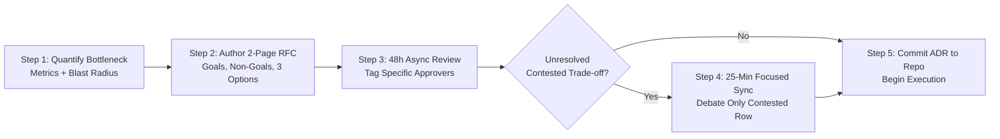
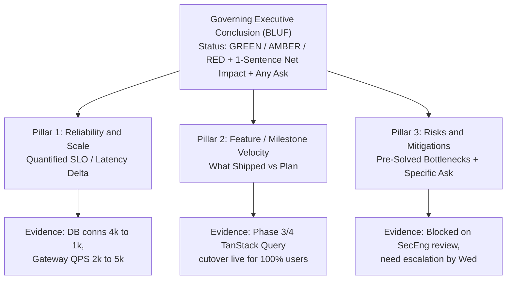

# Staff-Level Engineering English: RFCs, Reviews & Async Leadership

> **Core Thesis**: In global MNCs and USD remote startups, Chinese engineers rarely hit a ceiling because of vocabulary size or accent. They get capped at Senior (IC4/IC5) because subtle translation habits, chronological bottom-up explanations, and passive phrasing signal **task execution** rather than **architectural ownership**. Staff-level English is not literary prose—it is **calibrated epistemic clarity, explicit trade-off pricing, and zero-roundtrip async writing**.

---

## 1. Eliminating "Seniority Leaks" in Engineering English

Many phrases that feel polite, modest, or direct in Mandarin (`不好意思打扰一下`, `你需要改一下这里`, `这个做不了`, `我试一下`) translate into English with unintended subtext—sounding either **junior and apologetic** or **blunt and uncollaborative**.

### The 12-Pattern Diagnostic & Calibration Matrix

| Pattern Category | Junior / Literal Translation ("Seniority Leak") | Why It Hurts Your Perceived Level | Staff-Calibrated Engineering Phrasing |
| :--- | :--- | :--- | :--- |
| **1. Apologetic Openers** | *"Sorry to bother you, can I ask a small question about the auth service?"* | Signals your work is lower priority than theirs; forces a wasted async roundtrip before stating the question. | *"Context: migrating Studio RBAC to token v2. Question: does `auth-gateway` strip custom `x-workspace-id` headers on internal gRPC hops?"* |
| **2. Imperative Code Review** | *"You need to change this SQL query, otherwise it will lock the table."* (from `你需要改一下...`) | Reads as top-down command (`need to` / `should`), triggering defensiveness in Western engineering culture. | *"[Blocking] Under >500 RPS, an unindexed `UPDATE ... WHERE` here escalates to a gap lock. Could we scope this by primary key batching instead?"* |
| **3. Unpriced Refusal** | *"No, we cannot finish SSE reconnection before Friday. It's too complex."* | Sounds obstructive and leaves product leadership with zero levers to pull. | *"Shipping full SSE cursor resumption by Friday carries high data-loss risk. We can either (A) ship stateless retry by Friday and cursor resumption Tuesday, or (B) drop the CSV export scope to hit Friday. I recommend (A)."* |
| **4. Non-Committal Effort** | *"I will have a try / try my best to fix the memory leak today."* (from `我试一下`) | Signals uncertainty and lack of diagnostic method. Leaders cannot plan around "trying." | *"I'm isolating the worker heap growth via `py-spy` profiles today. I'll post root-cause findings or a mitigation PR by 17:00 UTC+8."* |
| **5. Passive Agency Hiding** | *"Some timeout errors were found in the LLM gateway, and Redis was scaled."* | Hides who diagnosed the issue, how big the blast radius was, and whether the root cause is actually solved. | *"We observed a 2.4% spike in gateway `504` responses at 14:10 UTC due to Redis connection pool exhaustion. I raised pool max-idle from 64 to 256, restoring P99 latency to 310ms."* |
| **6. Vague Quantifiers** | *"The database has a big performance problem when there are more and more agents."* | Unfalsifiable; sounds like guesswork rather than engineering telemetry. | *"At 400 concurrent agent runs, Postgres active connections hit 92% of `max_connections` (3,680/4,000), adding 420ms queue wait to every tool call."* |
| **7. Chronological Dumping** | *"First I checked CloudWatch, then I looked at FastAPI logs, then I asked Bob, and finally..."* | Exhausts executive attention before reaching the conclusion. Save detective diaries for appendix notes. | *"Root cause: S3 presigned URL clock skew on rotated pods. Impact: 0.8% artifact upload failures over 18m. Fix deployed in `v2.4.1`; zero errors since."* |
| **8. Silent Live Agreement** | Staying completely silent for 45 minutes on a Zoom architecture call to mentally polish grammar. | Interpreted in US/EU meetings as disengagement or lack of architectural opinion. | Speak within the first 10 minutes—even a crisp framing question: *"Before we pick the queue topology, can we align on whether strict ordering per workspace is a hard requirement?"* |
| **9. Binary Epistemic Certainty** | *"This architecture is definitely the best way."* vs *"Maybe we can..."* | Oscillates between rigid dogmatism and weak diffidence. | Use calibrated confidence: *"High confidence (~85%) that single-region Postgres handles Year-1 volume; main invalidated assumption would be >10k writes/sec."* |
| **10. Escalation Without Options** | *"Team B hasn't replied for 3 days, what should we do?"* | Pushes management work upward onto your Director. | *"Blocked 48h on Team B's schema sign-off. Unless you see a concern, I'll proceed behind a feature flag using our v1 contract and sync with their lead Monday."* |
| **11. Weak PR / Commit Context** | *"Update fuyao_router.py and fix bug"* | Wastes reviewer time reconstructing *why* the code changed. | *"fix(gateway): release Redis token-reservation lease when client aborts SSE stream mid-generation"* |
| **12. Over-Thanking / Deference** | *"Thank you very much for your valuable guidance, Boss/Teacher!"* | Hierarchically awkward in flat IC engineering cultures where Staff ICs are peers to Directors on technical truth. | *"Thanks [First Name]—good catch on the retry storm edge case. Updated Section 4.2 of the RFC to cap jittered backoff."* |

---

## 2. Writing Crisp 2-Page Engineering RFCs & ADRs

In distributed global engineering teams, **writing is your primary scaling mechanism**. A 15-page Google Doc nobody finishes creates zero alignment; a sharp **2-page Request for Comments (RFC)** read asynchronously in 7 minutes lets you drive architectural consensus across Shanghai, Cupertino, London, and Singapore while you sleep.



### Anatomy of an Undefeatable 2-Page RFC (Reference Example)

Below is a compact, production-caliber RFC template modeled on real AI infrastructure decisions. Copy this exact skeleton for internal architecture reviews or remote startup take-home design prompts:

```markdown
# RFC-014: Durable SSE Stream Resumption & Atomic Token Budget Guardrails

- **Status**: Proposed (Decision Target: 2027-03-14 18:00 UTC)
- **Author / DRI**: [Your Name] (AI Platform)
- **Approvers**: @staff-infra, @studio-frontend-lead, @security-eng
- **Default Resolution**: If no blocking objections by target date, we proceed with **Option B**.

## 1. Executive Summary (BLUF)
Multi-step agent runs in the Studio Console average 42 seconds per response. Mobile/VPN network blips currently drop 3.8% of active SSE connections, forcing users to re-trigger full LLM runs—wasting ~USD 4,200/month in duplicate inference tokens and leaving dangling tool-execution locks. We propose adding **Redis Stream 15-minute replay buffers** paired with **atomic Lua token-reservation leases** (`freeze -> settle/rollback`) at the LLM Gateway layer.

## 2. Goals & Explicit Non-Goals
- **Goals**:
  1. Allow clients reconnecting within 120s with `Last-Event-ID` to resume token/tool events with zero duplicate LLM invocation.
  2. Enforce per-workspace token quotas atomically before upstream provider dispatch (< 3ms P99 gateway overhead).
  3. Release unconsumed reserved tokens deterministically on upstream timeout or client hard-cancel.
- **Non-Goals** *(Crucial Staff Signal — prevents scope creep)*:
  1. Long-term conversation history archival (remains in PostgreSQL + S3).
  2. Cross-region active-active failover of in-flight SSE streams (deferred to Q3).

## 3. Options Evaluated & Trade-Off Matrix

| Criterion | Option A: Stateless Client Retry | Option B: Redis Streams + Lua Lease (Recommended) | Option C: Kafka Partitioned Event Log |
| :--- | :--- | :--- | :--- |
| **Duplicate LLM Cost** | High (re-runs entire prompt) | **Zero** within 15m TTL window | **Zero** |
| **Added Gateway P99** | 0 ms | **+1.8 ms** (single pipeline RTT) | +9 to 18 ms |
| **Infra & Ops Overhead** | None | **Low** (reuses existing Redis 7 cluster) | High (new consumer-group rebalance complexity) |
| **Implementation Effort** | 2 engineer-days | **6 engineer-days** | 18 engineer-days |

## 4. Failure Modes & Operational Guardrails
1. **Redis Node Failover Mid-Stream**: Gateway degrades gracefully to direct pass-through streaming (`fail-open` for internal tier-1 agents, `fail-closed` for untrusted external tenants) and emits `otel.gateway.redis_degraded=1`.
2. **Orphaned Token Freezes** (Worker pod OOMKilled mid-generation): Every reservation carries a 300s TTL key + idempotent reconciliation sweep reconciling `reserved_tokens` vs `actual_usage_tokens` from OpenTelemetry spans.
3. **Memory Ceiling**: `XADD ... MAXLEN ~ 2000` + `EXPIRE 900s` bounds worst-case buffer memory at `500 concurrent streams * 64 KB = 32 MB`.

## 5. Rollout & Rollback Plan
- Dark-launch behind `feature.sse_resume_v2` at 5% -> 25% -> 100% of internal workspaces over 5 days.
- **Automated Rollback Trigger**: Gateway `5xx` > 0.2% or P99 TTFT overhead > 10ms for 5 consecutive minutes flips flag off in < 30 seconds without redeployment.
```

### Why This 2-Page Format Commands Immediate Respect
1. **Explicit Non-Goals** preempt 70% of unfocused review comments (*"What about multi-region DR?"*).
2. **Quantified Memory & Latency Math** (`500 * 64 KB = 32 MB`, `+1.8 ms`) proves you engineer from numbers, not vibes.
3. **Default Resolution Deadlines** prevent async paralysis across timezones—reviewers know silence equals consent by Thursday 18:00 UTC.

---

## 3. High-Stakes Engineering Phrasebook

Memorize the structural bones of these five high-friction scenarios until you can deploy them calmly at 22:00 on a live call.

### Scenario A: Constructive Disagreement in an Architecture Review
Never attack the person or call an idea "bad" or "wrong." **Validate the shared objective, isolate the specific scaling/failure assumption, and propose a testable invariant.**

- **Opening Alignment + Pivot**:
  > *"I'm 100% aligned on keeping the developer SDK surface minimal. Where I want to pressure-test this design is what happens under downstream backpressure when an external MCP tool hangs for 30 seconds."*
- **Surfacing Hidden Coupling**:
  > *"Putting DDL validation inside the React client optimizes happy-path UX, which makes sense. My concern is security boundary enforcement—any direct SDK caller bypasses UI checks. Can we keep syntax hints in React, but make the FastAPI policy engine the single source of truth?"*
- **Breaking a Deadlock ("Disagree and Commit" or "Timeboxed Spike")**:
  > *"It sounds like our core disagreement comes down to whether `pgvector` sustains < 25ms P95 past 5M embeddings. Rather than debating in the abstract, let's timebox a 4-hour benchmark tomorrow with synthetic prod distribution and let the P95 curve decide."*

### Scenario B: Pushing Back on Scope Creep & Unrealistic Deadlines
Replace emotional resistance (*"We're overloaded"*) with **transparent capacity pricing**:

- **The "Fixed Capacity Triangle" Frame**:
  > *"We have 12 engineer-days left in this sprint, currently allocated to OpenTelemetry actor attribution and S3 cursor pagination. Pulling in custom RBAC audit exports takes ~5 days. Which of the current two deliverables should we push to next sprint, or should we ship a read-only CLI export first in 1 day?"*
- **Flagging Technical Debt Interest Explicitly**:
  > *"We can hardcode tenant routing rules to unblock Monday's demo, and I support doing that if the demo is immovable. I just want us eyes-wide-open that onboarding the next 3 tenants will require a 4-day refactor before GA—let's log that ticket into Sprint 15 right now so it doesn't become invisible debt."*

### Scenario C: High-Signal, Low-Ego Async Code Reviews
Prefix every non-trivial PR comment with a severity label so an engineer waking up 12 hours later in California knows immediately whether they can merge:

- **`[Blocking — Correctness]`**: *"If `stripe_webhook` delivers `invoice.paid` twice concurrently, `SELECT` then `UPDATE` without `SELECT ... FOR UPDATE` or a unique `event_id` constraint credits tokens twice. Let's guard this with an `idempotency_keys` insert inside the same transaction."*
- **`[Risk — Observability]`**: *"Non-blocking for this PR, but swallowing `TimeoutError` into `return []` hides upstream degradation from our SLO alerts. Could we emit a span exception + counter here?"*
- **`[Nit — Non-blocking]`**: *"Nit (feel free to ignore and merge): `parse_sse_chunk` could be a pure function in `streaming.py` for easier unit testing."*

### Scenario D: Commanding a Live Production Incident (SEV-1 / SEV-2)
During outages, verbosity creates panic. Speak in **Timestamp -> Customer Impact -> Current Hypothesis -> Next Checkpoint**:

> *"Status at 06:20 UTC: ~12% of streaming agent completions in `ap-east` are failing with `502`. Non-streaming APIs and data persistence are unaffected. Primary hypothesis is connection exhaustion after the `v1.18.0` rollout at 06:04 UTC. I am initiating helm rollback to `v1.17.4` now; ETA 3 minutes. Next update at 06:28 UTC."*

### Scenario E: Facilitating a 30-Minute Global Architecture Sync

When you host a cross-timezone design review with US/EU/APAC engineers, **whoever frames the agenda and summarizes the decision owns the Staff credibility in the room**. Use this 4-stage facilitation script:

1. **Minute 0–2 (Frame Context & Decision Target)**:
   > *"Thanks everyone for joining across timezones. Everyone has seen RFC-014; Sections 1–3 have async sign-off, so we don't need to re-read the doc. Our single goal in the next 28 minutes is locking one decision: **Redis Streams vs. Kafka for 15-minute SSE replay**."*
2. **Minute 2–18 (Timebox Tangents Without Bruising Egos)**:
   > *"That's an important point on multi-region compliance, [Name]. Since Phase 1 is strictly scoped to single-region `us-west-2`, let me capture that under Q3 Non-Goals right now so we don't lose it, and bring us back to the Redis failover behavior."*
3. **Minute 18–25 (Draw Out Quiet Domain Owners)**:
   > *"Before we converge on Option B, [Security/SRE Lead Name], from an operational on-call standpoint, is there any failure mode in the Lua TTL cleanup that makes you uncomfortable?"*
4. **Minute 25–30 (Lock Explicit DRI, Decision & Written Trail)**:
   > *"Great—to confirm our decision: we are proceeding with **Option B (Redis Streams + 300s lease TTL)**. I'll update Section 4 of the RFC and post the ADR summary in `#eng-architecture` within an hour. [Frontend Lead] owns the `Last-Event-ID` client hook by Thursday."*

---

## 4. Executive Updates: BLUF & The Minto Pyramid Principle

Directors and VPs read status updates on their phones between back-to-back meetings. If your main takeaway is buried in Paragraph 4, you look tactical rather than strategic. Structure every weekly update, Slack escalation, and promotion packet using **Barbara Minto's Pyramid Principle**:



### Before vs. After Weekly Status Update

**Weak (Chronological Activity Log — Reads Like IC3)**:
> *"Hi team, this week I worked on migrating the Studio console queries to TanStack Query and fixed three pagination bugs on the S3 artifact list. Also, we added OpenTelemetry spans to the LangGraph runner, and I had two meetings with the infra team about CloudWatch EMF costs. Next week I will continue Phase 4 and look into rate limiting."*

**Staff-Calibrated (BLUF + Outcomes + Risk Ownership — Reads Like IC6)**:
> **AI Platform Weekly — `[GREEN]` (Phase 3 Console Live; Agent OTel Coverage at 100%)**
> - **Impact Shipped**: Completed Phase 3 React + TanStack Query cutover and S3 cursor pagination; artifact list P95 load dropped **62% (1.4s -> 530ms)** with zero regressions.
> - **Observability**: End-to-end OpenTelemetry + CloudWatch EMF tracing is now live across 100% of agent LLM/DB/S3 calls, exposing that 1 external tenant accounts for 41% of egress latency.
> - **Risk & Next Week**: CloudWatch custom metric cardinality would add ~USD 900/mo at full scale; moving high-cardinality `actor_id` attributes from EMF dimensions to structured logs on Tuesday before Phase 4 rollout. **No leadership escalation needed.**

### Writing Staff Promotion Packets & Performance Self-Reviews ("Brag Docs")

A pervasive cultural trap for Chinese engineers inside foreign MNCs is **uncalibrated modesty during annual performance reviews**—writing *"Helped the team complete the Fuyao migration"* and assuming your manager remembers every crisis you prevented in March. In global calibration rooms, your manager represents you to 8 other managers who do not know your code; **they can only defend your promotion or top-tier RSU refresh using the exact evidence you hand them**.

Maintain a running bi-weekly `impact-ledger.md` and structure every annual self-review claim using the **4-Part Staff Impact Formula**:

1. **Ambiguity / Org-Level Problem**: Why was this problem hard, cross-team, and previously unsolved?
2. **Personal Architectural Wedge**: What specific RFC, abstraction, or mechanism did *you* originate (distinct from routine team execution)?
3. **Quantified Business / Engineering Delta**: Exact latency, QPS, incident reduction, developer velocity, or USD cost savings.
4. **Force Multiplication (How Others Built on Your Work)**: How many engineers, services, or external teams adopted your pattern without needing you in the loop?

**Reference Staff Self-Review Paragraph**:
> *"Originated and led the end-to-end observability and governance architecture for our multi-agent supply-chain platform (RFC-009, RFC-014). Prior to Q2, multi-hop agent tool failures required 3+ hours of manual cross-pod log correlation and lacked per-tenant cost visibility. I designed unified OpenTelemetry context propagation across the FastAPI LLM gateway, LangGraph runners, and CloudWatch EMF sinks, reducing mean-time-to-diagnose (MTTD) by **78% (180m -> 40m)** and uncovering USD 48k/yr in redundant retry tokens. Adopted as the default SDK standard by **4 partner engineering teams (26 engineers)** onboarding new domain agents."*

---

## 5. Cross-Timezone Mastery (Shanghai `UTC+8` & Global Hubs)

Working from `UTC+8` with US West Coast (`UTC-8` / `UTC-7`) or Europe (`UTC+1` / `UTC+2`) can either destroy your circadian health (if you accept random midnight calls) or turn you into a **24-hour velocity engine** (if you enforce async discipline).

### Optimal Overlap Windows (Protecting Sleep at Age 32+)

| Counterpart Hub | Local Counterpart Window | Your Shanghai (`UTC+8`) Window | Recommended Interaction Mode |
| :--- | :--- | :--- | :--- |
| **US West (SF / Cupertino / Seattle)** | 16:30–18:00 PT (DST) / 08:00–09:00 PT | **07:30–09:00 CST** or **22:00–23:00 CST** (Max 2 evenings/wk!) | Keep live syncs to **<= 2x 30-min/week** strictly for relationship building & contested RFC rows; move 85% to async RFCs + 3-min Loom videos |
| **US East (NYC / Boston)** | 08:00–10:00 ET | **20:00–22:00 CST** | High-leverage evening overlap; leaves your entire daytime (09:00–18:00 CST) uninterrupted for deep architecture |
| **Europe (London / Berlin / Amsterdam)** | 09:00–12:00 CET | **15:00–18:00 CST** | Effortless afternoon overlap within normal working hours |
| **APAC (Singapore / Tokyo / HK)** | 09:00–18:00 SGT/JST | **09:00–17:00 CST** | Zero timezone friction; synchronous parity |

### The "Zero-Roundtrip" Async Handoff Checklist

Across a 15-hour timezone gap, every lazy Slack message costs **24 to 48 hours of calendar delay**. Before ending your workday in `UTC+8`, ensure every outbound message or PR passes the **4-Part Zero-Roundtrip Check**:

1. **Full Reproducible Context**: Link the exact trace ID, PR line permalink, and metric screenshot—never make the reader hunt.
2. **Pre-Answered Branching Logic**: Instead of *"Should we use `429` or queue?"*, write *"I implemented `429` with `Retry-After` behind `config.rate_limit_mode` (PR #412); if you prefer bounded queuing, comment before your EOD and I'll flip the handler tomorrow morning."*
3. **3-Minute Loom Architecture Walkthrough**: When shipping a complex UI or multi-service PR, record a crisp 3-minute screen-share walking through the state machine and key trade-offs. Watching a 3-minute Loom at 1.5x speed builds 10x more personal trust with remote founders and VPs than text walls alone.
4. **Explicit Deadline & Default Action**: State the exact UTC timestamp when you will merge or proceed if no blocking feedback arrives, eliminating indefinite "waiting for review" limbo.

---

## 6. The 15-Minute Daily Spoken Calibration Protocol

Do not waste time on generic conversational English apps or memorizing literary idioms. Train **spontaneous technical synthesis under mild time pressure** in 15 minutes/day:

1. **Minutes 0–5 (Input Cadence Shadowing)**: Play 5 minutes of a Staff/Principal engineering talk (e.g., Strange Loop, QCon, InfoQ architecture talks, or YC founder technical deep dives) at 1.0x speed. Shadow the speaker's *pause placement, stress on contrast words, and transition phrases* out loud.
2. **Minutes 5–10 (Cold 3-Minute Recorded Walkthrough)**: Pick one system you touched today (e.g., *"How our HITL approval state machine prevents race conditions"*). Start your phone voice recorder and explain it in **structured BLUF format** (Problem -> Constraint -> Architecture -> Trade-off) in one unedited 3-minute take.
3. **Minutes 10–15 (Transcript Diff & Compression)**: Feed your raw voice transcript to an LLM with the prompt:
   > *"Rewrite my 3-minute spoken architectural explanation as a native Staff Engineer at Stripe/Apple would say it aloud—keep it natural and spoken (not essayistic), cut filler words by 35%, and highlight the 3 exact phrasing upgrades I should internalize tomorrow."*

Within 60 days (15 total hours), your real-time interview and architecture-review delivery shifts noticeably from **translating thoughts on the fly** to **deploying pre-compiled architectural building blocks**.

> **Next Step**: With global sourcing channels and Staff-level English leverage in place, proceed to **[03-AI-SOLOPRENEUR-GLOBAL-SAAS-MONETIZATION.md](03-AI-SOLOPRENEUR-GLOBAL-SAAS-MONETIZATION.md)** to build your compounding USD product equity pillar.
