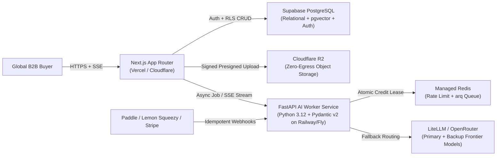
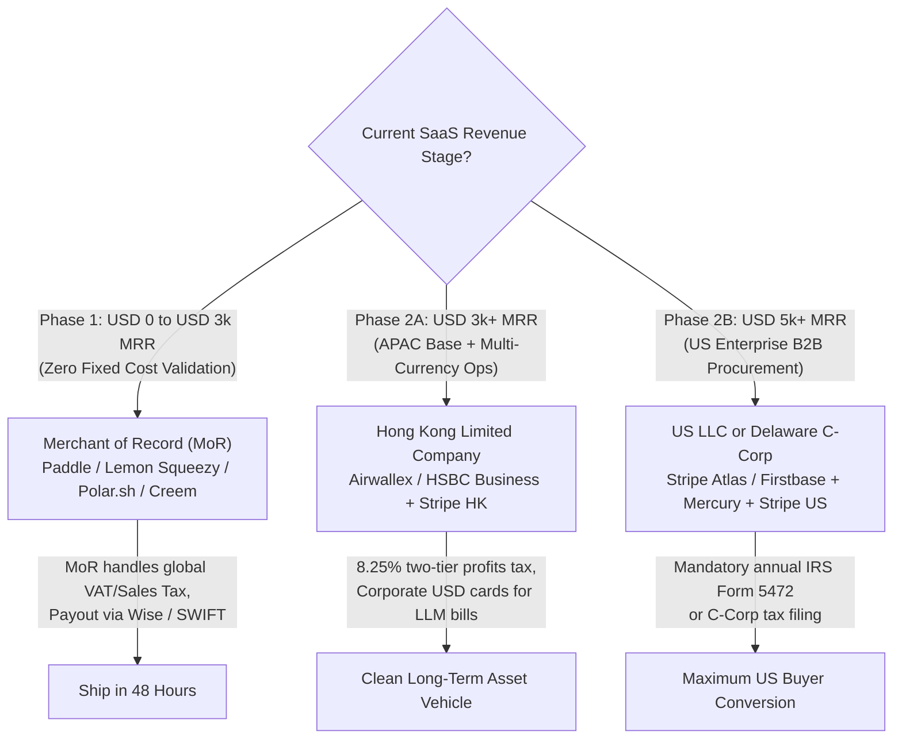

# AI-Native Solopreneurship: Global Micro-SaaS & Monetization

> **Core Thesis (`出海独立开发核心逻辑`)**: In 2027, coding agents let anyone generate a flashy landing page and a thin ChatGPT wrapper in an afternoon—which means consumer wrappers have **zero moat, brutal churn, and negative unit economics**. As a 9+ YoE Backend & AI Platform Engineer, your unfair advantage is building **deterministic B2B workflow software where vibe-coders break**: strict schema validation, human-in-the-loop (HITL) audit trails, reliable multi-step execution, and idempotent credit accounting—priced in USD to global businesses.

---

## 1. Niche Selection: Escaping the Thin-Wrapper Graveyard

Most first-time indie developers build products for *themselves* (yet another Markdown note app, prompt manager, or generic "Chat with PDF" tool). Consumers and hobbyists haggle over USD 9/month and churn the week a new frontier model drops. Businesses gladly put a corporate card down for **USD 79 to 299/month** if your software eliminates 8 hours of error-prone operational work or prevents a compliance mistake.

### Wrapper Trap vs. Defensible Vertical B2B Workflow Engine

| Dimension | Consumer / Prosumer Wrapper Trap | Vertical B2B AI Workflow Engine (Target) |
| :--- | :--- | :--- |
| **Core Value Proposition** | *"Generate text / summarize PDFs faster"* | *"Convert messy vendor commercial invoices into validated ERP import batches with 0 math errors"* |
| **Buyer & Budget Source** | Individual debit card (discretionary entertainment budget) | Ops Manager, Engineering Lead, Finance Controller (corporate expense card) |
| **Price Floor (ARPU)** | USD 5 to 15 / month | **USD 49 to 299 / month** |
| **Monthly Logo Churn** | 12% to 25% (treadmill of death) | **2.5% to 5.0%** (sticky operational system of record) |
| **Where the LLM Sits** | 90% of the codebase (1 system prompt + chat box) | **20% of the codebase** (surrounded by 80% parsers, deterministic validators, diff UI, webhooks, audit logs) |
| **Platform Risk** | Wiped out by one OpenAI / Anthropic UI update | **Strengthened** by cheaper/better models (your gross margin rises while workflow lock-in stays intact) |

### The 5-Gate Pre-Code Validation Rubric

Never open your IDE for a new SaaS idea until it passes all 5 gates:

1. **Money / Compliance / Labor Proximity**: Does the workflow sit within 1 hop of revenue collection, cost leakage, regulatory compliance, or repetitive B2B back-office labor?
2. **Non-Trivial Determinism Requirement**: Would pasting the input into raw ChatGPT fail in production because the user needs batch processing, cross-row arithmetic reconciliation, domain schema enforcement, RBAC, or webhook delivery?
3. **Existing Budget Proof**: Are companies *already* paying either clunky legacy software (founded 2010–2018 with terrible UX) or human freelancers/VAs on Upwork to do this exact job? *(Competition proves willingness to pay; zero competition usually means zero market.)*
4. **Searchable or Congregating Buyer**: Can you identify 20 exact long-tail Google search phrases (e.g., `"convert packing list pdf to netsuite csv"`) or 3 niche communities where these buyers complain weekly?
5. **14-Day Solo MVP Scope**: Can you ship the single core job-to-be-done in <= 14 days without custom enterprise integrations?

### High-Margin 2027 Archetypes Suited to a Backend + AI Platform Engineer

- **Cross-Border Supply Chain & Trade Document Reconciliation**: Parsing heterogeneous freight forwarder bills of lading, commercial invoices, and customs packing lists into strict customs/ERP schemas with automated line-item sum verification and side-by-side HITL exception approval.
- **LLM Gateway Cost & Regression Guardrail SaaS for Mid-Market Teams**: Lightweight OpenTelemetry ingest + CI eval runner that catches prompt latency spikes, schema drift, and runaway tenant token burn before startups get hit with surprise USD 10k API bills.
- **Automated Security Questionnaire & Vendor Compliance Mapper**: Grounding SOC2 / ISO27001 / GDPR vendor questionnaires strictly against a company's approved policy vault with mandatory sentence-level source citations and human reviewer sign-off.
- **Multi-Channel POS / E-Commerce Payout & Chargeback Reconciler**: Reconciling Stripe/Shopify/delivery-platform payouts, fee deductions, and automated dispute evidence packets for multi-location operators.

---

## 2. The Lean 1-Person Production Stack (Zero-Ops Until USD 10k MRR)

Senior backend engineers routinely sabotage their own solopreneur startups by deploying Kubernetes, Helm, Kafka, microservices, and custom auth before earning USD 1. **Enforce strict architectural minimalism**: use boring managed primitives for web/auth/storage, and concentrate 100% of your custom engineering on the **AI execution engine and billing safety**.



### Why This Exact Split Wins for One Person
- **Next.js + Tailwind + shadcn/ui**: Gives you static marketing/pSEO pages (instant Core Web Vitals for Google) and a reactive authenticated console in one TypeScript repo.
- **Supabase (PostgreSQL)**: Eliminates auth boilerplate while giving you real ACID transactions for billing ledgers and `pgvector` for hybrid BM25 + vector search in a single database.
- **Dedicated FastAPI Service**: Keeps long-running SSE agent streams, OCR/PDF parsing, and Pydantic structured-output validation off serverless 30-second timeout limits without Kubernetes overhead (~USD 5 to 20/month on Railway or Fly.io).

### Production Blueprint: Idempotent LLM Credit Ledger (`Freeze -> Settle -> Rollback`)

The #1 operational killer of solo AI SaaS products is **runaway API token drain** from double-clicked requests, script abuse, or upstream timeouts after partial generation. Reuse enterprise billing discipline with a single PostgreSQL transactional ledger:

```sql
CREATE TABLE workspace_wallets (
    workspace_id UUID PRIMARY KEY,
    available_credits BIGINT NOT NULL CHECK (available_credits >= 0),
    frozen_credits    BIGINT NOT NULL DEFAULT 0 CHECK (frozen_credits >= 0),
    updated_at        TIMESTAMPTZ NOT NULL DEFAULT NOW()
);

CREATE TABLE credit_ledger_entries (
    idempotency_key   TEXT PRIMARY KEY,
    workspace_id      UUID NOT NULL REFERENCES workspace_wallets(workspace_id),
    phase             TEXT NOT NULL CHECK (phase IN ('FREEZE', 'SETTLE', 'ROLLBACK')),
    delta_available   BIGINT NOT NULL,
    delta_frozen      BIGINT NOT NULL,
    actual_cost       BIGINT NOT NULL DEFAULT 0,
    created_at        TIMESTAMPTZ NOT NULL DEFAULT NOW()
);
```

```python
from sqlalchemy import text
from sqlalchemy.ext.asyncio import AsyncSession

class InsufficientCreditsError(Exception):
    pass

async def freeze_credits(
    db: AsyncSession, workspace_id: str, request_id: str, max_credits: int
) -> None:
    """Atomically reserve worst-case credits BEFORE dispatching any upstream LLM call."""
    async with db.begin():
        # Idempotency check: safe if client retries with same request_id
        existing = await db.execute(
            text("SELECT 1 FROM credit_ledger_entries WHERE idempotency_key = :key"),
            {"key": f"{request_id}:freeze"},
        )
        if existing.scalar_one_or_none():
            return

        res = await db.execute(
            text("""
                UPDATE workspace_wallets
                   SET available_credits = available_credits - :amt,
                       frozen_credits    = frozen_credits + :amt,
                       updated_at        = NOW()
                 WHERE workspace_id = :wid
                   AND available_credits >= :amt
                RETURNING available_credits
            """),
            {"wid": workspace_id, "amt": max_credits},
        )
        if res.scalar_one_or_none() is None:
            raise InsufficientCreditsError("Insufficient workspace credits")

        await db.execute(
            text("""
                INSERT INTO credit_ledger_entries
                    (idempotency_key, workspace_id, phase, delta_available, delta_frozen)
                VALUES (:key, :wid, 'FREEZE', -:amt, :amt)
            """),
            {"key": f"{request_id}:freeze", "wid": workspace_id, "amt": max_credits},
        )

async def settle_or_rollback_credits(
    db: AsyncSession, workspace_id: str, request_id: str, reserved: int, actual: int
) -> None:
    """Consume actual credits used and refund unused reservation atomically."""
    charged = min(reserved, max(0, actual))
    refund = reserved - charged
    phase = "ROLLBACK" if charged == 0 else "SETTLE"

    async with db.begin():
        existing = await db.execute(
            text("SELECT 1 FROM credit_ledger_entries WHERE idempotency_key = :key"),
            {"key": f"{request_id}:final"},
        )
        if existing.scalar_one_or_none():
            return

        await db.execute(
            text("""
                UPDATE workspace_wallets
                   SET available_credits = available_credits + :refund,
                       frozen_credits    = frozen_credits - :reserved,
                       updated_at        = NOW()
                 WHERE workspace_id = :wid
            """),
            {"wid": workspace_id, "refund": refund, "reserved": reserved},
        )
        await db.execute(
            text("""
                INSERT INTO credit_ledger_entries
                    (idempotency_key, workspace_id, phase, delta_available, delta_frozen, actual_cost)
                VALUES (:key, :wid, :phase, :refund, -:reserved, :charged)
            """),
            {
                "key": f"{request_id}:final",
                "wid": workspace_id,
                "phase": phase,
                "refund": refund,
                "reserved": reserved,
                "charged": charged,
            },
        )
```

---

## 3. Global Payment Infrastructure & Entity Compliance (`出海收款合规路径`)

Stripe does not currently support direct Mainland China personal/company onboarding for standard global SaaS subscriptions, and selling software globally triggers complex **EU VAT, UK VAT, and US State Sales Tax** nexus rules. Follow a staged architecture so you never spend USD 2,000 incorporating before validating product-market fit.



### Side-by-Side Entity & Payment Rail Comparison

| Dimension | Track 1: Merchant of Record (Paddle / Lemon Squeezy / Polar) | Track 2: Hong Kong Limited (`香港有限公司` + Stripe HK) | Track 3: US Single-Member LLC / Stripe Atlas C-Corp |
| :--- | :--- | :--- | :--- |
| **Upfront Setup Cost** | **USD 0** | HKD 4,500 to 8,000 (~USD 600–1,000) | USD 350–500 (Firstbase / Stripe Atlas) |
| **Annual Maintenance Cost** | **USD 0** | HKD 7,000 to 12,000/yr (Company Secretary + CPA Audit) | LLC: USD 300–600/yr (Agent + Form 5472 CPA); C-Corp: USD 800–1,800+/yr |
| **Transaction Fee** | ~5.0% + USD 0.50 (+ 1%–2% payout FX) | ~3.4% + HKD 2.35 (Stripe HK) | **2.9% + USD 0.30** (Stripe US — lowest card fee) |
| **Global EU VAT / US Sales Tax** | **100% Automated by MoR** (MoR is legal seller on invoice) | Your responsibility once crossing country thresholds (use Stripe Tax) | Your responsibility once crossing US state economic nexus thresholds |
| **Corporate USD Virtual Cards** | No (must pay OpenAI/AWS via separate card) | **Yes** (Airwallex / HSBC corporate cards pay AWS/Anthropic seamlessly) | **Yes** (Mercury corporate Visa/Mastercard) |
| **Critical Compliance Trap** | Strict onboarding review: bans fake scarcity, NSFW, copyright scraping, or unfinished landing pages without working demo | Must complete annual **audited financial statements** (`做账审计`) even if profit is small; keep every SaaS/LLM invoice | **Foreign-owned US Single-Member LLC MUST file IRS Form 5472 + pro-forma 1120 every April 15—even with USD 0 revenue! Late penalty is USD 25,000!** |

### Practical Onboarding Checklist to Pass MoR / Stripe Risk Review on Attempt #1
1. **Live Production Domain + Work Email**: Never apply with a `gmail.com` or `foxmail.com` address; configure `founder@yourdomain.com` (Cloudflare Email Routing + Resend/Google Workspace) with valid SPF/DKIM/DMARC.
2. **Mandatory Legal Footer Pages**: Publish clear `/terms`, `/privacy`, `/refund-policy` (offer a no-questions-asked 7-day or 14-day refund window to prevent chargebacks—a >0.75% chargeback rate gets any Stripe/MoR account terminated), and visible support email.
3. **Demonstrable Product Utility**: Record a 90-second unedited Loom demo link directly on the landing page or application form proving your AI workflow actually exists and processes user data safely.

---

## 4. Distribution Engineering: Repeatable Acquisition Loops

Engineers fail at marketing because they treat marketing as "tweeting once on launch day." Treat customer acquisition as an **engineered funnel with compounding SEO assets and deterministic outreach loops**. Enforce the **50/50 Rule**: spend 50% of your weekly 7-hour build budget on product code and 50% on distribution assets.

### Loop 1: Free Deterministic Micro-Tools + Programmatic SEO (pSEO)
Instead of writing generic AI blog posts that nobody reads, build **10 to 30 free, no-signup single-purpose browser/API utilities** targeting high-intent B2B bottom-of-funnel queries:
- *If your paid SaaS reconciles logistics invoices*: ship free tools at `/tools/hs-code-validator`, `/tools/commercial-invoice-json-schema-checker`, `/tools/incoterms-landed-cost-calculator`.
- Each tool solves 1 immediate micro-problem in 5 seconds and presents a natural contextual CTA: *"Processing 50+ vendor PDFs per week? Automate batch extraction + ERP validation -> Start 7-Day Trial."*
- Expose clean JSON-LD structured data, deterministic benchmark tables, and `llms.txt` documentation so both Google Search and AI answer engines (ChatGPT Search, Perplexity, Claude) cite your domain as the canonical reference (**Generative Engine Optimization / GEO**).

### Loop 2: Problem-First Launches on Reddit, Hacker News (`Show HN`), and X
Reddit moderators ruthlessly ban self-promotional links, while Hacker News rewards deep technical transparency.
- **On Reddit** (niche operational subreddits like `r/supplychain`, `r/MSP`, `r/accounting`, `r/devops`, `r/ecommerce`): Spend 2 weeks answering complex workflow questions genuinely with zero links. Then post a **benchmark or teardown** (*"We benchmarked 4 OCR + LLM pipelines across 300 skewed customs invoices—here are the exact failure modes and how to fix table-spanning line items"*), mentioning your tool naturally only at the bottom or when asked.
- **On Hacker News (`Show HN`)**: Lead with **architecture, hard edge cases, and interactive no-login sandbox**. Engineers upvote honest engineering (*"Why naive JSON-mode failed on 18-page PDFs and how we combined pdfplumber bounding boxes with Pydantic validators"*).

### Loop 3: Ecosystem & Protocol Piggybacking
Publish lightweight open-source connectors where high-intent users already browse daily:
- An official **MCP (Model Context Protocol) server** in public MCP registries connecting Claude/Cursor to your vertical validation API.
- **GitHub Actions Marketplace**, **Shopify App Store**, **Linear / Slack / Notion** integration directories—piggybacking on platforms that already have built-in B2B search traffic.

---

## 5. SaaS Pricing Architecture & Churn Mathematics

### The 3-Tier B2B Value-Metric Pricing Structure

Never offer an "Unlimited AI" flat tier, and avoid pure per-token metering (B2B buyers hate unpredictable monthly bills). Price on **business outcomes / processed documents / active seats** with clear credit allowances:

| Tier | Monthly Price | Annual Price (2 Months Free) | Included Allowance | Strategic Purpose |
| :--- | :--- | :--- | :--- | :--- |
| **Starter** | USD 49 / mo | USD 490 / yr | 250 validated workflows/mo, 1 workspace, CSV/JSON export | Low-friction solo operator entry; self-serve credit card swipe |
| **Growth (Anchor)** | **USD 119 / mo** | **USD 1,190 / yr** | 1,000 workflows/mo, 5 team seats, HITL review queue, webhooks | Primary revenue engine (~65% of customers); 85%+ gross margin |
| **Scale / Pro** | USD 299 / mo | USD 2,990 / yr | 3,500 workflows/mo, unlimited seats, SSO, custom schema rules, priority SLA | High-ARPU expansion tier that drives Net Dollar Retention > 100% |

### Essential SaaS Unit Economics Formulas

1. **LLM-Adjusted SaaS Gross Margin** (Target $\ge 80\%$):
   $$\text{GM} = \frac{\text{ARPU} - (C_{\text{LLM}} + C_{\text{infra}} + C_{\text{payment}})}{\text{ARPU}}$$
   *Rule of Thumb*: Keep average monthly LLM token COGS ($C_{\text{LLM}}$) below **8% to 12% of ARPU** via prompt caching, small-model routing for classification, and frontier models strictly for hard reasoning steps.

2. **The Asymptotic MRR Ceiling Equation** (Why Churn Dictates Destiny):
   If you acquire $\Delta M_{\text{new}}$ in new monthly recurring revenue every month and lose a fraction $c$ of existing MRR each month, your business hits a mathematical ceiling where monthly churn equals monthly new sales:
   $$\text{MRR}_{\max} = \frac{\Delta M_{\text{new}}}{c}$$

3. **Customer Lifetime Value ($\text{LTV}$) & Payback Period**:
   $$\text{LTV} = \frac{\text{ARPU} \times \text{GM}}{c}, \qquad \text{Target } \frac{\text{LTV}}{\text{CAC}} \ge 3.0$$

### Proof by Math: Consumer Wrapper vs. B2B Workflow Engine

Suppose two solo engineers each acquire **25 new paying customers every single month**:

| Metric | Engineer A: Consumer AI Wrapper | Engineer B: Vertical B2B Workflow SaaS |
| :--- | :--- | :--- |
| **Monthly Price ($\text{ARPU}$)** | USD 9 | USD 99 |
| **New Customers / Month** | 25 | 25 |
| **New MRR Added / Month ($\Delta M_{\text{new}}$)** | USD 225 / mo | USD 2,475 / mo |
| **Monthly Churn Rate ($c$)** | 15.0% (avg tenure: 6.7 months) | 3.5% (avg tenure: 28.6 months) |
| **Month-12 Active MRR** | ~USD 1,280 / mo | **~USD 24,500 / mo** |
| **Mathematical MRR Ceiling ($\text{MRR}_{\max}$)** | **USD 1,500 / mo** (permanently stuck!) | **USD 70,714 / mo** (USD 848k ARR!) |
| **Support Burden** | Hundreds of angry USD 9 consumers | ~250 professional B2B accounts |

**Takeaway**: Identical engineering effort and identical monthly signup count (25/month) produce **USD 1,280/mo vs. USD 24,500/mo** at Month 12 solely because of **B2B ARPU and low workflow churn**.

---

## 6. The 30-Day Zero-to-First-USD Execution Checklist

- **Days 1–4 (Problem & Buyer Discovery)**: Shortlist 3 vertical B2B workflows. Extract 50 real complaints from Reddit, G2 2-star reviews of legacy B2B tools, and Upwork job postings where companies pay humans USD 500+ repeatedly for structured data/compliance work.
- **Days 5–7 (Smoke Test & Concierge Proof)**: Build a landing page with concrete before/after workflow artifacts + sample input/output downloader. Message 20 target operators offering to process their messy batch free to validate edge cases.
- **Days 8–18 (Core Engine MVP)**: Scaffold `Next.js + Supabase + FastAPI` with the atomic credit ledger above. Implement **one** killer end-to-end loop (Upload -> AI Parse + Deterministic Schema Check -> Side-by-Side HITL Review -> Export/Webhook). Cut every secondary feature.
- **Days 19–21 (MoR Payment & Legal Live)**: Configure custom domain email, `/terms`, `/privacy`, `/refund-policy`, and connect Paddle / Lemon Squeezy with Starter (USD 49) + Growth (USD 119) + Annual toggle.
- **Days 22–30 (Distribution Sprint)**: Ship 3 free micro-tools on `/tools/*` for long-tail search intent, publish an architectural teardown on Hacker News / Reddit, and iterate weekly with your first 5 paying customers until retention locks in.

---

> **Curriculum Loop Complete**: Return to **[00-README.md](00-README.md)** to review how your **AI Platform Day Job**, **[Global MNC / USD Remote Mobility](01-GLOBAL-MNC-AND-USD-REMOTE-PLAYBOOK.md)**, and **[Staff-Level English Leadership](02-STAFF-ENGLISH-COMMUNICATION-AND-RFCS.md)** reinforce this Micro-SaaS engine into an undefeatable 2027 career portfolio.
