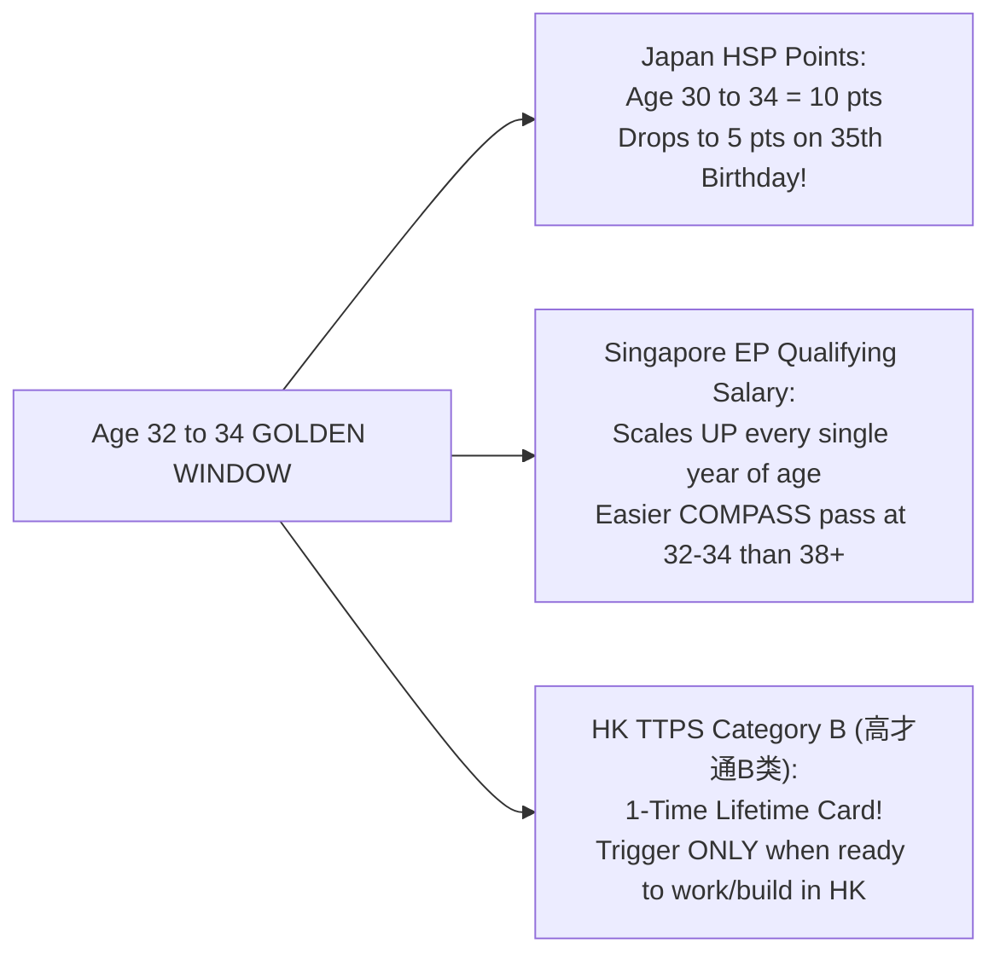

# Working Abroad as a Chinese Engineer: 2027–2030 Opportunity Radar & Geo-Strategy (程序员海外就业全景雷达)

While [01-GLOBAL-MNC-AND-USD-REMOTE-PLAYBOOK.md](01-GLOBAL-MNC-AND-USD-REMOTE-PLAYBOOK.md) covers China-based foreign MNCs, async USD contracting, and baseline visa mechanics, **physically relocating abroad (`肉身出海工作`)** with a PRC passport requires watching **macro hiring waves, age-sensitive visa clocks, and partner/family geography**.

This guide maps the **6 concrete overseas employment waves Chinese engineers actually win in 2027–2030**, ranked by approval probability, net savings, lifestyle, and cross-continental convenience (especially between **East Asia, Europe, the Gulf, and North Africa / Morocco**).

---

## Table of Contents

1. [Your 4 Unfair Advantages (Cards Most Candidates Don't Have)](#1-your-4-unfair-advantages-cards-most-candidates-dont-have)
2. [Time-Sensitive Visa Clocks Between Age 32 and 35](#2-time-sensitive-visa-clocks-between-age-32-and-35)
3. [The 6 Real Overseas Hiring Waves to Watch (2027–2030)](#3-the-6-real-overseas-hiring-waves-to-watch-20272030)
4. [Destination Deep-Compare (Including Proximity to Rabat, Morocco!)](#4-destination-deep-compare-including-proximity-to-rabat-morocco)
5. [Signal Radar: Early Indicators & Job Boards to Monitor Monthly](#5-signal-radar-early-indicators--job-boards-to-monitor-monthly)
6. [Step-by-Step 18-Month Execution Plan](#6-step-by-step-18-month-execution-plan)

---

## 1. Your 4 Unfair Advantages (Cards Most Candidates Don't Have)

Most Chinese developers fail at overseas job hunting because their resume only has domestic Mandarin-only enterprises and non-Top-100 degrees. Look at the four structural cards you already hold:

1. **Global Top-100 University Degree (`中山大学 SYSU`)**:
   - Recognized on **Hong Kong's TTPS Category B (`高才通B类`)** Top-100 list, **Singapore COMPASS's `20-point` Top-Tier Institution list**, **Japan Immigration's `J-Find / HSP +10 bonus point` list**, and Germany's **`Anabin H+`** database (zero degree-verification delays).
2. **Global-Brand Tech Pedigree (`Shopee` Senior SWE + `Apple` Ecosystem AI Platform)**:
   - International recruiters in **Singapore, Amsterdam, London, Dubai, and Tokyo** immediately recognize *Shopee (Sea Group)* and *Apple multi-agent LLM infrastructure*—giving you instant resume-screen credibility over purely domestic peers.
3. **2027's #1 Visa-Sponsoring Specialty (`AI Platform / LLM Gateway + Polyglot Go/Python/K8s`)**:
   - Overseas governments have tightened visas for junior web/CRUD devs while creating **explicit shortage-occupation fast tracks** for AI Infrastructure, Distributed Systems, and Platform Engineers.
4. **Cross-Border English Production Experience (`Tarro` + `Apple` Engagement)**:
   - You aren't starting from zero in English collaboration—you only need to sharpen spoken architectural storytelling to Staff level.

---

## 2. Time-Sensitive Visa Clocks Between Age 32 and 35

Watch these three hard regulatory clocks closely over the next **24–30 months**:

- **Rule #1**: Do **not** impulsively apply for Hong Kong `高才通 B类` "just to hold the card" if you plan to stay in Shanghai for the next 2 years—HK ImmD only grants TTPS **once in a lifetime**, and Year-2 renewal strictly audits real HK payroll or genuine HK office/business operations. Keep it in your pocket until you actually want to use it!
- **Rule #2**: Ages **32–34** are peak points-scoring years for Japan (`高度人才 80分 -> 1年拿永住`) and sweet-spot salary-to-experience years for Singapore (`EP`), Netherlands (`30%/27% Expat Tax Ruling`), and UAE (`10-Year Golden Visa`).

---

## 3. The 6 Real Overseas Hiring Waves to Watch (2027–2030)

Cold-applying randomly to 500 LinkedIn jobs in the US has a `<0.2%` hit rate due to the `H-1B` lottery. Focus 95% of your energy on the **6 high-probability channels** where Chinese citizens actually land sponsored visas every month:

### Wave 1: Chinese Tech Giants' Global R&D & Expansion Hubs (`中企出海海外直招 / 外派`)
- **Why It's High-Probability**: Zero prejudice against PRC passports, smooth visa sponsorship teams, appreciates bilingual Mandarin + English engineers who understand high-QPS systems.
- **Who to Watch**:
  - **Singapore**: **TikTok / ByteDance SG**, **Sea / Shopee SG** (*huge boomerang advantage as an ex-Shopee Senior SWE!*), **Alibaba International (`AIDC` / Lazada)**, **Ant International**, **Trip.com (`携程国际`)**, **Grab**, **OKX / Bitget**.
  - **Middle East (Dubai / Riyadh)**: **Meituan `Keeta`** (massive MENA expansion!), **TikTok Dubai**, **Alibaba Cloud / Huawei Cloud MENA**, **SHEIN**.
  - **Europe (Amsterdam / London / Dublin / Warsaw)**: **TikTok UK/Ireland** (huge AI & Trust/Safety/Infra teams in London & Dublin!), **Trip.com Amsterdam** (*Trip.com has a major engineering hub in Amsterdam!*), **Temu / PDD Dublin**.

### Wave 2: Sovereign AI & Tax-Free Tech Boom in the UAE (`迪拜 / 阿布扎比 AI 与金融科技潮`)
- **Why Watch This Closely in 2027+**:
  - The UAE (Abu Dhabi & Dubai) is pouring tens of billions of petrodollars into becoming the **AI hub between East and West** (**G42 / Core42 / Inception / Falcon LLM**, **Microsoft + NVIDIA UAE AI campuses**, **Careem**, **Talabat**, **Noon**, **Property Finder**, **Wio Bank**, global Web3/FinTech HQs).
  - **0% Personal Income Tax**: A `USD 120k–180k` (`AED 440k–660k`) package in Dubai/Abu Dhabi equals `USD 200k–280k` pre-tax in Europe or California!
  - **10-Year Self-Sponsored UAE Golden Visa**: Software & AI engineers earning `>= AED 30,000/month` (`~USD 98k/yr`) with a recognized Bachelor's degree qualify for a **10-year renewable Golden Visa** not tied to a single employer!
  - **Bonus Personal Fit (Shanghai ↔ UAE ↔ Rabat)**: Abu Dhabi (`AUH`) and Dubai (`DXB`) sit directly halfway between China and Morocco, with **non-stop flights to both Shanghai (`PVG`) AND Rabat (`RBA`) / Casablanca (`CMN`)**, vibrant Moroccan/French/English expat communities, ultra-safe streets, and world-class Halal dining!

### Wave 3: Western Europe Recognized-Sponsor Tech Hubs (`荷兰 / 德国 / 西班牙 / 爱尔兰 / 法国`)
- **Why Watch This Closely (Especially With a Partner from Rabat!)**:
  - From **Amsterdam, Paris, Madrid, Barcelona, or Frankfurt**, flying to **Rabat (`RBA`)** takes **2 to 3 hours (`EUR 40–120` weekend ticket)** with **zero or 1-hour jet lag**!
  - Holding an **EU Blue Card** or **Dutch Highly Skilled Migrant (`Kennismigrant`)** residence permit gives visa-free travel across all 29 Schengen countries and straightforward **family/partner reunification** (`MVV` / EU spouse visa—no multi-year quota backlogs!).
- **Top English-Speaking Sponsoring Companies in Europe**:
  - **Amsterdam (Netherlands — #1 English-Friendly EU Tech Hub)**: **Booking.com**, **Uber** (major global payments/billing Go/Java engineering hub in Amsterdam—matches your Shopee billing + Go background 100%!), **Databricks Amsterdam** (huge AI/Cloud infra hub!), **Adyen**, **Nebius AI** (massive European GPU/AI cloud!), **Miro**, **Elastic**, **Trip.com Amsterdam**.
  - **London / Dublin**: **Google DeepMind / Cloud**, **Meta**, **Stripe Dublin**, **TikTok London/Dublin**, **Intercom**, **Revolut**, **Monzo**, **Cloudflare London/Lisbon**.
  - **Berlin / Munich**: **Delivery Hero**, **Zalando**, **Celonis**, **N26**, **JetBrains Munich**, **Apple Munich**, **SAP**.
  - **Paris**: **Mistral AI**, **Hugging Face**, **Datadog Paris** (massive Go/Python observability hub—matches your OpenTelemetry experience directly!), **Criteo**, **Alan**.

### Wave 4: The "Remote-First -> Digital Nomad Visa" Two-Step (`先拿美元远程，再拿南欧数字游民居留`)
- **How It Works**: Instead of waiting for a local European company to sponsor a work visa, you first land an **async USD remote contract (`USD 100k–170k/yr`)** while still living comfortably in Shanghai. Once you have 3+ months of steady remote contractor income:
  - Apply for **Spain's Digital Nomad Visa (`Visado de Teletrabajo`)** (live in Madrid, Barcelona, Valencia, or Málaga—literally across the sea from Rabat, 1-hour flight, Mediterranean sunshine, counts toward Spanish residency!) or **Portugal's D8 Digital Nomad Visa**.
  - Under Spain's *Beckham Law* / DNV regime and bilateral logic, you keep your high Silicon Valley/global USD pay while enjoying Mediterranean cost of living!

### Wave 5: Foreign MNC Internal Transfer (`外企内部转岗 Relocate / L-1B`)
- Join (or convert into FTE at) a foreign MNC in Shanghai (**Microsoft, Apple, PayPal, Coupang, Autodesk, SAP, Booking**) -> deliver top-tier impact for **12–18 months** -> apply on the internal job portal (`Internal Mobility`) to transfer to **Singapore, Vancouver, Amsterdam, Dublin, Munich, or Seattle/Bay Area (`L-1B`)**. Internal hiring managers trust internal performance reviews 10x more than external overseas resumes.

### Wave 6: English-Track Tokyo Tech + 1-Year Japan PR (`日本纯英文大厂 + 高度人才1年永住`)
- **Zero Japanese Required** at specific global engineering orgs in Tokyo: **Woven by Toyota**, **PayPay**, **Mercari**, **Rakuten**, **Indeed Tokyo** (high USD-linked pay!), **Money Forward**, ** Mujin / Sakana AI** (frontier robotics & AI!).
- With **SYSU + 9 YoE + Age <35 + `JPY 10M+` offer**, you clear **80 points on day one** and can apply for **Japan Permanent Residency (`永住者`) after just 12 months**—giving you a permanent Asian base 2.5 hours from Shanghai.

---

## 4. Destination Deep-Compare (Including Proximity to Rabat, Morocco!)

| Region / Hub | Visa Difficulty (for Your Profile) | Net After-Tax Savings | Flight Time to Shanghai / Rabat | Language in Daily Life | Overall Fit Verdict |
| :--- | :---: | :---: | :---: | :--- | :--- |
| **Amsterdam / Spain / Paris / London (Western Europe)** | Medium (`HSM` / `Blue Card` / `Spain DNV`) | Medium (`EUR 55k–95k` net after tax) | `11–12h` to SH; **`1–3h` to Rabat (`0–1h` TZ!)** | English (95% in NL/UK/IE; local lang helpful in FR/ES) | **Best Relationship & Lifestyle Choice** — weekend flights to Rabat, 25–30 days PTO, Schengen residency |
| **Dubai / Abu Dhabi (UAE)** | Medium-Easy (`Work Visa` -> `10yr Golden Visa`) | **Very High (`0%` Income Tax!)** | `8.5h` to SH; **`7.5–8h` direct to Rabat/Casa** | **100% English** (+ Arabic/French culturally welcomed!) | **Best Tax-Free Wealth + East-West Midpoint** — culturally warm for both Chinese & Moroccan expats |
| **Singapore** | Medium (`EP` + `COMPASS`, ex-Shopee edge!) | **High (`~10–14%` tax)** | `5h` to SH; `15–17h` (1-stop) to Rabat | English + Mandarin | **Easiest Cultural Transition & Highest APAC Net Cash** |
| **Tokyo (English-Track Tech)** | Easy-Medium (`HSP 80pt`) | Medium (weak JPY, higher tax) | `3h` to SH; `17–19h` (1-stop) to Rabat | Japanese outside work | **Fastest Permanent Residency Backup (`1 Year`)** |
| **United States (`L-1B` / `O-1A`)** | **Hard** (requires MNC transfer or `O-1A`) | **Highest (`USD 220k–450k+`)** | `13–15h` to SH; `8–11h` (NYC->CMN direct) | English | Long-term ceiling via MNC internal transfer, never cold `H-1B` |

---

## 5. Signal Radar: Early Indicators & Job Boards to Monitor Monthly

Set up a **20-minute Sunday evening radar** watching these exact sources:

1. **Company Career Pages (Direct ATS Alerts — Highest Signal)**:
   - **Europe**: `Uber Careers` (Filter: Amsterdam + Backend/Go), `Databricks Careers` (Amsterdam), `Datadog Careers` (Paris — OpenTelemetry/Go/Python), `Booking.jobs` (Amsterdam), `Nebius` (Amsterdam), `Trip.com` (Amsterdam), `TikTok Careers` (London/Dublin/Singapore).
   - **UAE / Middle East**: `Core42 / G42 / Inception` (Abu Dhabi AI Infra), `Careem` (Dubai), `Talabat` (Dubai), `Meituan Keeta` (Overseas/Riyadh/Dubai).
   - **Singapore**: `Sea / Shopee` (Singapore AI & Platform), `Grab`, `Stripe` (Singapore), `Airwallex`.
   - **Japan (English-only)**: `Japan Dev` (`japan-dev.com`) & `TokyoDev` (`tokyodev.com`) — both curate strictly **English-speaking + Overseas Visa-Sponsoring** roles!
2. **Global Visa-Sponsoring Aggregators**:
   - **`relocate.me`** & **`arbeitnow.com`** (filter `Visa Sponsorship` in Netherlands/Germany/UK).
   - **`HiringCafe`** (`hiring.cafe` — filter `Anywhere` or `EMEA / APAC` + `Visa Sponsorship`).
   - **`YC Work at a Startup`** (filter `International Remote` or `London / Europe`).
3. **Macro Signals That Trigger Hiring Waves**:
   - Whenever a US/AI giant announces a **new sovereign data center or European/MENA AI hub** (e.g., AWS/Microsoft/NVIDIA/Nebius/Core42 capacity expansions in UAE, Netherlands, Spain, or Singapore), local platform & inference hiring spikes 3–6 months later with generous relocation budgets!
   - Whenever a Chinese tech giant enters a new region (`Keeta` launching in UAE/Europe, `Trip.com` expanding EU R&D, `TikTok` scaling AI infra in London/SG), apply in the **first 6 months of hub build-out** when overseas visa quotas are wide open.

---

## 6. Step-by-Step 18-Month Execution Plan

1. **Months 1–3 (While Thriving in Your Current AI Platform Role)**:
   - Polish your **1-Page Global English CV** (no photo, no age, no marital status; highlight **Apple Kunpeng/Fuyao LLM Gateway + OpenTelemetry + Shopee 5k QPS Go/Python Billing + SYSU**).
   - Optimize your **LinkedIn Profile in 100% English**: Headline = `Senior / Staff AI Platform & Distributed Systems Engineer | LLM Gateways, Agents, Go, Python, K8s, OpenTelemetry (Ex-Shopee)`, set "Open to Work (Recruiters Only)" for target cities (`Amsterdam, Singapore, Dubai, Abu Dhabi, London, Dublin`).
2. **Months 4–9 (Build Public Proof & Interview Muscle)**:
   - Ship 1–2 crisp open-source contributions or technical deep-dives in `LiteLLM` / `LangGraph` / `OpenTelemetry Python/Go` so European/US/UAE Staff engineers see clean English code & PR communication.
   - Take 1 interview loop per quarter with **Amsterdam / Dubai / Singapore / USD Remote** teams to calibrate your spoken system-design fluency.
3. **Months 10–18 (Choose Your Highest-Fit Move Before Age 34)**:
   - Compare concrete offers across **(A) Direct Relocation to Europe (Amsterdam/London/Paris) or UAE (Dubai/Abu Dhabi)**, **(B) Singapore Regional HQ**, or **(C) High-USD Remote Contract -> Spain Digital Nomad Visa**, aligning career upside with your personal life and relationship plans!
