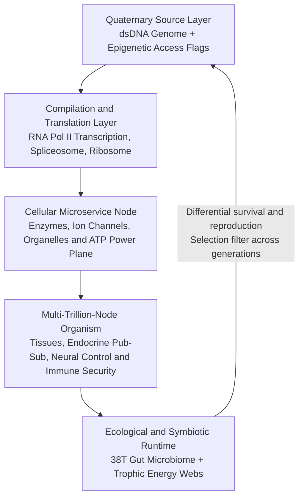
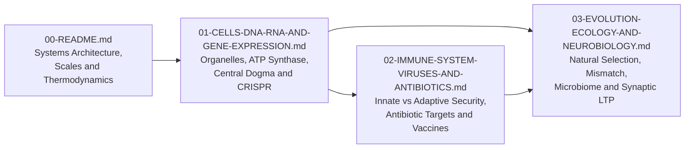

# Modern Biology for Engineers: Carbon-Based Distributed Systems, Code & Evolution

> **Scope & Mental Model**: A first-principles engineering guide to modern biology—treating living organisms not as a bag of Latin vocabulary to memorize, but as **self-assembling, fault-tolerant, electrochemical distributed clusters** running on 3.8 billion years of quaternary legacy code.

---

## 1. Why Software Engineers Need First-Principles Biology

Most engineers suffered through high school biology as an exercise in rote taxonomy: memorizing organelle names, flower parts, and arbitrary biochemical acronyms without an underlying execution model. That pedagogical failure obscures one of the deepest truths in science: **molecular biology is information technology implemented in wetware**.

Long before Alan Turing formalized universal computation or Claude Shannon formalized channel capacity and error-correcting codes, terrestrial life solved every core problem of distributed systems engineering under extreme physical constraints:

1. **Ultra-Dense Non-Volatile Storage with Forward Error Correction**: Human genomic DNA stores roughly $1.6\text{ GB}$ of diploid quaternary source code inside a $6\text{ }\mu\text{m}$ cell nucleus—achieving volumetric storage densities orders of magnitude beyond modern 3D NAND flash, replicated with an end-to-end error rate of $10^{-9}$ to $10^{-10}$ per base pair via three-stage enzymatic proofreading.
2. **Decentralized Multi-Node Consensus Without a Master Node**: Your body coordinates approx. $3.7 \times 10^{13}$ autonomous eukaryotic cells—plus approx. $3.8 \times 10^{13}$ symbiotic gut microbes—with zero central orchestrator. Every somatic cell boots from the exact same genome binary, differentiating into 200+ specialized node types (neurons, cardiomyocytes, hepatocytes, T-cells) purely through **epigenetic runtime flags** and local paracrine/endocrine message passing.
3. **20-Watt Electrochemical Compute**: The human brain executes massively parallel pattern recognition, sensorimotor control, and world-model simulation across $8.6 \times 10^{10}$ neurons and $10^{14}$ analog-digital synapses on roughly **20 watts of power**—less than an idle laptop—while dynamically rewiring its own physical topology during sleep.
4. **High-Stakes Personal & Technological Leverage**: Understanding the mechanistic difference between a bacterial peptidoglycan cell wall and a viral RNA capsid stops you from taking useless antibiotics that wreck your microbiome. Understanding action potentials, adenosine, dopamine prediction error, and evolutionary mismatch lets you debug your own focus, sleep, and metabolic health using physiology rather than pop-science fads. Meanwhile, the convergence of AI and programmable biology (AlphaFold structural prediction, CRISPR prime editing, mRNA-LNP therapeutics) is turning biomedicine into an engineering discipline.

---

## 2. Silicon Systems vs. Carbon Wetware: Architectural Mapping

When reading molecular biology, immunology, or neuroscience, map unfamiliar biological terms onto their exact systems-engineering equivalents—while paying close attention to where wetware diverges from von Neumann silicon:

| System Layer | Silicon Distributed Computing | Carbon Biological Systems | Key Architectural Difference |
| :--- | :--- | :--- | :--- |
| **Instruction Encoding** | Binary (`0`, `1`) in CMOS transistors and SSD charge traps | Quaternary Base-4 (`A`, `T`, `C`, `G`) in antiparallel dsDNA | DNA pairs complementary strands (`A=T`, `G=C`) as built-in RAID-1 hardware mirroring |
| **Executable Compilation** | Source Code -> AST/IR -> Machine Binary (`gcc` / `rustc`) | DNA -> pre-mRNA -> Spliced mRNA -> Ribosome -> 3D Folded Protein | Alternative splicing compiles 1 gene into 5 to 20+ distinct protein binaries depending on tissue context |
| **Runtime Config & Flags** | Environment variables, LaunchDarkly flags, K8s ConfigMaps | Epigenetics (CpG DNA methylation and histone acetylation) | Modifies read permissions by physically spooling or unspooling chromatin without altering source bases |
| **Compute & Actuation** | Logic gates flipping voltage states on fixed copper traces | Shape-complementary 3D proteins (enzymes, ion channels, motors) | In biology, **geometry is function**: a protein computes and catalyzes by physically binding and flexing |
| **Power & Energy Plane** | AC/DC power rails (`12V` / `1.2V`) regulated by VRMs | Proton-motive force ($\Delta p$) driving rotary ATP Synthase | Cells trickle-step glucose energy into portable $\text{ATP}$ chemical packets; losing membrane potential is instant node death |
| **Inter-Node Networking** | TCP/IP RPCs, Kafka pub/sub, shared-memory IPC | Synaptic spikes (ms), gap junctions, hormones (s to hr), cytokines | Wetware routes messages by **molecular shape specificity** (receptor lock-and-key) rather than IP addresses; transport is diffusion-limited at short range |
| **Zero-Trust Security** | Firewalls, mTLS certificates, EDR signature + anomaly scanners | Skin/mucosa, Innate PRRs, MHC-I self-attestation, Adaptive B/T cells | Adaptive immunity uses somatic DNA shuffling to synthesize $10^{11}+$ novel receptors *before* an attacker ever arrives |
| **CI/CD & Optimization** | Human-authored PRs, unit tests, canary rollouts | Random mutation + recombination + Darwinian natural selection | Evolution has **no foresight and cannot refactor from scratch**; every intermediate build must boot and reproduce in production |

---

## 3. Numbers Every Engineer Should Know About Living Systems

Just as Jeff Dean's *Latency Numbers Every Programmer Should Know* grounds distributed systems intuition in orders of magnitude, anchoring yourself to physical and temporal scales prevents catastrophic misunderstandings in biology. Notice in particular the **1,000x size gulf** between a human cell, a bacterium, and a virus:

| Biological Entity or Process | Characteristic Metric / Scale | Engineering Intuition & Practical Consequence |
| :--- | :--- | :--- |
| **Water / Glucose / ATP Molecule** | approx. $0.3\text{ to }1.5\text{ nm}$ | Atomic-scale substrates and energy currency packets |
| **Typical Folded Protein (e.g., Hemoglobin)** | approx. $5\text{ nm}$ (300 to 500 amino acids) | Nanoscale state machine; jiggles violently from $k_B T$ thermal noise |
| **Virus Particle (Virion)** | $20\text{ to }300\text{ nm}$ (SARS-CoV-2 is approx. $100\text{ nm}$) | Too small for standard optical microscopes; passes straight through coarse cloth pores unless trapped electrostatically in N95 melt-blown fibers |
| **Bacterium (e.g., *E. coli*)** | $1\text{ to }3\text{ }\mu\text{m}$ ($1,000\text{ to }3,000\text{ nm}$) | Self-contained prokaryotic server with its own ribosomes, metabolism, and peptidoglycan wall; caught by $0.22\text{ }\mu\text{m}$ sterile filters |
| **Typical Human Eukaryotic Cell** | $10\text{ to }30\text{ }\mu\text{m}$ (volume approx. $1,000\times$ *E. coli*) | Compartmentalized cluster node housing hundreds to thousands of mitochondria (formerly bacteria themselves!) |
| **DNA Replication Throughput & Fidelity** | approx. $50\text{ nt/s}$ per fork (human); error $\approx 10^{-10}/\text{bp}$ | Parallelized across tens of thousands of replication origins so $6.4 \times 10^9\text{ bp}$ copies in hours rather than years |
| **Ribosome Protein Compilation Speed** | $15\text{ to }20\text{ amino acids/s}$ (prokaryotic) / $5\text{ to }9\text{ aa/s}$ (eukaryotic) | Multiple ribosomes translate a single mRNA concurrently (`polyribosome` worker pool) |
| **Daily Human ATP Turnover** | approx. $40\text{ to }75\text{ kg/day}$ of ATP recycled | Your body holds only approx. $50\text{ to }100\text{ g}$ of ATP at any instant; each ATP molecule is phosphorylated and spent $500\text{ to }1,000+$ times daily |
| **Action Potential Conduction Velocity** | $0.5\text{ to }2\text{ m/s}$ (unmyelinated) vs $70\text{ to }120\text{ m/s}$ (myelinated) | Electrical wire signals travel near $2 \times 10^8\text{ m/s}$; neural signals are electrochemical ion waves $10^6\times$ slower, forcing predictive motor control |
| **Human Somatic Cell Count vs Gut Microbes** | approx. $3.7 \times 10^{13}$ human cells : $3.8 \times 10^{13}$ microbes | Roughly $1:1$ by cell count (mostly erythrocytes on the human side, colonic bacteria on the microbial side), but microbes carry $100\times$ more unique genes |

---

## 4. The Physics of Being Alive: Thermodynamics & Negative Entropy

In his landmark 1944 monograph *What Is Life?*—which directly inspired Francis Crick and James Watson to hunt for the structure of DNA—physicist Erwin Schrödinger asked a foundational question: *How does a living cell maintain exquisite atomic-level order for decades when the Second Law of Thermodynamics dictates that isolated systems inexorably decay toward maximum entropy (disorder)?*

The answer is that **a living organism is not an isolated equilibrium crystal; it is an open, far-from-equilibrium dissipative engine**. Life obeys the Gibbs free energy equation at constant temperature $T$ and pressure:

$$\Delta G = \Delta H - T\Delta S$$

Where:
- $\Delta G$: **Change in Gibbs Free Energy**. A biochemical reaction proceeds spontaneously only when $\Delta G < 0$ (exergonic).
- $\Delta H$: **Change in Enthalpy** (chemical bond energy released or absorbed).
- $T\Delta S$: **Temperature-scaled Entropy Change** (system disorder).

Building complex macromolecules—polymerizing nucleotides into DNA, linking amino acids into proteins, or pumping $\text{Na}^+$ ions uphill against a concentration gradient—requires **positive** free energy ($\Delta G > 0$). Left alone, those reactions never happen; in fact, water constantly hydrolyzes DNA and proteins back into fragments.

Cells overcome this barrier via **energetic reaction coupling**:

$$\text{ATP} + \text{H}_2\text{O} \longrightarrow \text{ADP} + \text{P}_i \qquad (\Delta G_{\text{cellular}} \approx -50\text{ to }-57\text{ kJ/mol})$$

By mechanically coupling an unfavorable biosynthetic step (say, $\Delta G = +25\text{ kJ/mol}$) to the hydrolysis of $\text{ATP}$ ($\Delta G \approx -54\text{ kJ/mol}$), the combined state transition yields a net $\Delta G \approx -29\text{ kJ/mol} < 0$, driving synthesis forward irreversibly while radiating waste heat into the surrounding environment so total universe entropy still increases ($\Delta S_{\text{universe}} > 0$).

### Steady-State Homeostasis vs. Thermodynamic Equilibrium

Engineers must never confuse **homeostasis** (dynamic steady state) with **chemical equilibrium**:
- **Thermodynamic Equilibrium ($\Delta G = 0$)**: Ion concentrations inside and outside the cell equalize; membrane voltage drops to $0\text{ mV}$; ATP/ADP ratios flatten. **In biology, thermodynamic equilibrium is the exact physical definition of death.**
- **Homeostatic Steady State ($\Delta G \ll 0$)**: Your core temperature stays near $37.0^\circ\text{C}$, arterial blood $\text{pH}$ stays tightly clamped inside $7.35\text{ to }7.45$, and fasting blood glucose stays near $4.0\text{ to }5.5\text{ mmol/L}$ ($70\text{ to }100\text{ mg/dL}$) *only* because negative-feedback control loops (proportional-integral-derivative biological controllers in the hypothalamus, pancreas, and kidneys) continuously burn $\text{ATP}$ to counteract external perturbations.

### Why Carbon, Water & Weak Bonds? The Bond-Energy Hierarchy at 310 K

Science fiction loves "silicon-based life," since silicon sits directly below carbon in Group 14 of the periodic table with four valence electrons. Chemically, silicon fails in aqueous environments for three reasons:
1. **The $\text{CO}_2$ vs. $\text{SiO}_2$ Exhaust Problem**: Oxidizing carbon fuel yields gaseous, water-soluble $\text{CO}_2$ that diffuses effortlessly out of cells and lungs. Oxidizing silicon yields $\text{SiO}_2$—solid crystalline quartz sand—which would instantly brick cellular exhaust pipes.
2. **Polymer Stability in Water**: Carbon-carbon ($\text{C-C}$, approx. $348\text{ kJ/mol}$) and carbon-oxygen/nitrogen bonds form stable chains, rings, and chiral stereocenters in water, whereas $\text{Si-Si}$ chains spontaneously hydrolyze.
3. **Operating Near Thermal Noise ($k_B T$)**: At human body temperature ($T = 310.15\text{ K}$ or $37^\circ\text{C}$), ambient thermal agitation carries energy $R T \approx 2.58\text{ kJ/mol}$ per mole of degrees of freedom. Biology exploits a strict **two-tier bond energy architecture** relative to thermal noise:

| Bond Class | Typical Energy ($\text{kJ/mol}$) | Ratio to Thermal Noise ($RT$) | Architectural Role in the Cell |
| :--- | :---: | :---: | :--- |
| **Covalent Backbone Bonds** (`C-C`, phosphodiester, peptide) | $300\text{ to }400$ | $115\times\text{ to }155\times$ | **Non-volatile ROM**: Never breaks from $37^\circ\text{C}$ thermal jiggling; requires dedicated catalytic enzymes (nucleases, proteases) to cleave |
| **ATP Phosphoanhydride Bond** ($\gamma$-phosphate hydrolysis) | $50\text{ to }57$ (in vivo) | $20\times\text{ to }22\times$ | **Portable Power Packet**: Stable enough not to self-detonate in water, energetic enough to flip protein conformations on demand |
| **Ionic Salt Bridges** (in aqueous interior vs protein core) | $10\text{ to }30$ | $4\times\text{ to }12\times$ | **Electrostatic Docking**: Guides charged substrates (like negatively charged DNA around positively charged lysine-rich histones) |
| **Hydrogen Bonds** (`N-H...O`, `N-H...N` in DNA base pairs) | $8\text{ to }20$ | $3\times\text{ to }8\times$ | **Reversible Zippers**: Weak individually so helicase can unzip DNA for reading, strong collectively across millions of base pairs |
| **Hydrophobic Exclusion & van der Waals** | $2\text{ to }8$ | $1\times\text{ to }3\times$ | **Self-Assembly Engine**: Water's hydrogen-bond network squeezes non-polar lipids into cell membranes and folds oily amino acid cores inward |

---

## 5. High-Leverage Bio-Literacy for Everyday Engineering & Health Decisions

You do not study this curriculum to pass a university midterm; you study it so that whenever you face a medical decision, read a biotech paper, or debug afternoon brain fog, you reason from **cellular mechanisms** rather than superstition:

1. **Antibiotic Stewardship & Pathogen Triage**: When you catch an acute sore throat, cough, or viral cold, you immediately ask: *Does this pathogen even possess peptidoglycan cell walls or 70S bacterial ribosomes?* Because viruses hijack host 80S ribosomes inside your own cells, popping leftover amoxicillin or cephalosporin does literally zero antiviral work while wiping out butyrate-producing gut commensals and selecting for drug-resistant plasmids.
2. **Decoding Vaccines & Biotech Modalities Without Hype or Fear**: Knowing the strict one-way directionality of eukaryotic translation (`cytoplasmic mRNA -> Ribosome -> Protein`, followed by ribonuclease garbage collection within hours to days, lacking both nuclear-import signals and reverse transcriptase) makes it obvious why mRNA vaccines cannot rewrite nuclear DNA—and simultaneously explains how lipid nanoparticle (LNP) mRNA delivery and CRISPR-Cas9 ribonucleoproteins are revolutionizing oncology and rare genetic diseases.
3. **Working With Your Neurobiology Instead of Fighting It**:
   - **Caffeine vs. Sleep**: Knowing that caffeine is a competitive **adenosine receptor antagonist** (it parks inside $A_{2A}$ receptors without clearing accumulated adenosine, so sleep pressure keeps piling up behind the dam) stops you from drinking espresso at 16:00 and wondering why deep slow-wave NREM sleep—and next-day prefrontal architecture clarity—collapses even if you fall asleep.
   - **Skill Acquisition via Hebbian LTP**: Knowing that deep technical mastery physically requires **acetylcholine spotlight focus** during waking error-correction *followed by* **NREM/REM synaptic replay** during 7.5+ hours of sleep proves why cramming 14 hours straight produces vastly less myelin and dendritic spine consolidation than focused 90-minute bouts paired with real sleep.
4. **Correcting Evolutionary Mismatch**: Treating insulin resistance, chronic lower-back/metabolic decay, and doomscrolling anxiety not as "personal moral failings," but as predictable hardware bugs triggered when a hunter-gatherer genome optimized for caloric scarcity, solar light cycles, and 15,000 daily steps is placed inside an air-conditioned chair surrounded by ultra-processed sucrose and infinite algorithmic feeds.

### Reading Your Annual Blood Panel Like a Production Grafana Dashboard

Once you understand cell membranes, immune lineages, and metabolic homeostasis, standard clinical lab panels stop looking like opaque medical codes and start reading like node telemetry:

| Biomarker / Panel Metric | Underlying Cellular Mechanism | What Abnormal Telemetry Signals (Consult a Physician) | Vault Module Link |
| :--- | :--- | :--- | :--- |
| **WBC Differential: Neutrophils vs. Lymphocytes** | Neutrophils are frontline bacterial phagocytes; lymphocytes (B, T, NK) target intracellular viruses | **High WBC + High Neutrophils** suggests acute bacterial infection or tissue trauma; **Normal/Low WBC + Relative Lymphocytosis** typically points to a viral infection | [02-IMMUNE-SYSTEM-VIRUSES-AND-ANTIBIOTICS.md](02-IMMUNE-SYSTEM-VIRUSES-AND-ANTIBIOTICS.md) |
| **hs-CRP (High-Sensitivity C-Reactive Protein)** | Acute-phase opsonin synthesized by the liver in response to macrophage IL-6 cytokine signaling | Elevated baseline ($> 2.0\text{ mg/L}$ without acute cold) flags chronic systemic innate inflammation or vascular endothelial stress; $> 10\text{ to }50\text{ mg/L}$ accompanies acute infection | [02-IMMUNE-SYSTEM-VIRUSES-AND-ANTIBIOTICS.md](02-IMMUNE-SYSTEM-VIRUSES-AND-ANTIBIOTICS.md) |
| **HbA1c & Fasting Insulin** | Glucose non-enzymatically glycates hemoglobin inside 120-day red blood cells; pancreas secretes insulin to open GLUT4 channels | Fasting glucose can look normal ($< 5.6\text{ mmol/L}$) for years while **fasting insulin climbs** to compensate for skeletal-muscle insulin resistance; HbA1c integrates a 90-day moving average | [03-EVOLUTION-ECOLOGY-AND-NEUROBIOLOGY.md](03-EVOLUTION-ECOLOGY-AND-NEUROBIOLOGY.md) |
| **ALT & AST (Liver Transaminases)** | Intracellular metabolic enzymes that belong *inside* hepatocyte cytoplasm and mitochondria | Elevated serum ALT/AST is literally a **container memory leak**: stressed, fatty, or inflamed liver cells have ruptured membranes spilling internal enzymes into blood | [01-CELLS-DNA-RNA-AND-GENE-EXPRESSION.md](01-CELLS-DNA-RNA-AND-GENE-EXPRESSION.md) |
| **ApoB / LDL-C & Triglyceride-to-HDL Ratio** | Lipoprotein cargo containers ferrying hydrophobic cholesterol and triglycerides through aqueous blood | Each atherogenic particle carries exactly one **Apolipoprotein B (ApoB)** molecule; high ApoB particle count drives arterial wall retention, while high TG/HDL tracks hepatic de novo lipogenesis from excess fructose/refined carbs | [03-EVOLUTION-ECOLOGY-AND-NEUROBIOLOGY.md](03-EVOLUTION-ECOLOGY-AND-NEUROBIOLOGY.md) |

---

## 6. Five Classic Misconceptions Engineers Bring to Biology

Before diving into Module 01, purge five intuitive fallacies that trip up analytically trained software engineers:

1. **"DNA Is a Static Blueprint Like a CAD File"**: False. A CAD blueprint has a 1-to-1 geometric mapping to a house wall (`pixel X -> brick X`). DNA has no miniature map of a hand or an eye. Instead, DNA is a **decentralized reactive program** (`if concentration(Morphogen_A) > threshold && Methylation == OFF -> transcribe(Gene_B)`). Embryogenesis emerges from local reaction-diffusion gradients (famously modeled by Alan Turing in 1952!) and cell-to-cell signaling rules.
2. **"Evolution Optimizes Organisms for Happiness, Longevity, or Perfection"**: False. Natural selection optimizes strictly for **inclusive reproductive allele propagation** in ancestral environments, subject to path-dependent legacy constraints. Once an organism passes peak reproductive and child-rearing age, selective pressure against late-onset bugs (like Huntington's disease, atherosclerosis, or cancer at age 70) drops sharply—a phenomenon evolutionary biologists call the **selection shadow**.
3. **"A Gene For X Means Deterministic Fate"**: Only rare monogenic Mendelian disorders (like cystic fibrosis or Huntington's) map to single broken genes. Most complex human traits—height, cardiovascular risk, intelligence, metabolic resilience—are **highly polygenic** (governed by thousands of small-effect variants) interacting continuously with environment, nutrition, exercise, and epigenetic expression.
4. **"Boosting the Immune System Is Always Good"**: Your immune system is armed with cytotoxic perforins, reactive oxygen bleach, and systemic inflammatory cytokines. An "over-boosted" immune system is not health—it is **anaphylaxis, autoimmune tissue destruction (lupus, rheumatoid arthritis, Type 1 diabetes), or lethal cytokine storm**. Optimal immunity is **precision calibration**: lethal against genuine pathogens, strictly tolerant of self-tissues and harmless pollen/food antigens.
5. **"Dopamine Is the Pleasure Chemical"**: Neurobiologically wrong. Endogenous opioids and endocannabinoids mediate consummatory liking/pleasure; **phasic dopamine encodes Reward Prediction Error** ($\delta = R_{\text{received}} - R_{\text{expected}}$)—driving *craving, pursuit, and reinforcement learning* whenever reality beats or misses expectation.

---

## 7. Three Universal Control-Theory Primitives in Living Wetware

Before reading the molecular details of cells, immunity, and neurons, recognize that nature reuses **three control-systems design patterns** at every scale—from single metabolic enzymes up to whole-body endocrine loops:

### 1. Negative-Feedback PID Homeostasis (`Dual-Actuator Clamping`)
Whenever a biological variable must stay inside a narrow viable band (blood glucose, arterial $\text{pH}$, core temperature, serum $\text{Ca}^{2+}$), relying on passive drift is fatal, and single-sided actuation overshoots when perturbations reverse. Biology pairs **opposing push-pull hormones** around an error sensor:
- **Post-Meal Glucose Surge ($> 5.6\text{ mmol/L}$)**: Pancreatic **$\beta$-cells** import glucose via `GLUT2`, oxidize it into $\text{ATP}$, close $\text{ATP}$-sensitive $\text{K}^+$ channels, depolarize, and secrete **Insulin**. Insulin binds tyrosine-kinase receptors on skeletal muscle and adipose cells, translocating **`GLUT4` glucose channels** to cell membranes within minutes to pull blood sugar back down into glycogen storage.
- **Overnight Fasting Dip ($< 4.0\text{ mmol/L}$)**: Insulin drops to baseline while pancreatic **$\alpha$-cells** secrete **Glucagon**, instructing hepatocytes to cleave stored glycogen (`glycogenolysis`) and synthesize fresh glucose from amino acids and glycerol (`gluconeogenesis`), guaranteeing uninterrupted fuel for your brain.

### 2. Allosteric Backpressure Throttling (`Sub-Second Rate Limiting`)
If *E. coli* or a human hepatocyte already has plenty of Cytidine Triphosphate (`CTP`) or Cholesterol in stock, waiting $30\text{ minutes}$ to turn off nuclear gene transcription wastes massive $\text{ATP}$ and overflows cytosolic pools.
- Instead, the **first committed enzyme** of almost every metabolic assembly line possesses two distinct pockets: a **catalytic active site** for substrates and a regulatory **allosteric site** that binds the pathway's *final end-product*.
- The instant downstream product concentration rises above target, end-product molecules bind the upstream allosteric port, flexing the enzyme into an inactive **T-state (`Tense`)** in **milliseconds**—implementing zero-latency hardware backpressure! (For example, **HMG-CoA Reductase**—the rate-limiting step of liver cholesterol synthesis, and the exact molecular target of **statin** drugs—is throttled both allosterically and via `SREBP` proteolytic degradation when cellular sterols are high.)

### 3. Positive-Feedback Bistable Latches (`Hysteresis` & All-or-Nothing Switches)
In steady-state control, positive feedback (`output amplifies input`) causes catastrophic runaway—such as septic **cytokine storms** or malignant hyperthermia. Yet positive feedback is indispensable whenever biology needs a **clean, irreversible digital state flip** that never dithers halfway in noisy analog chemistry:
- **Action Potential Ignition**: Crossing $-55\text{ mV}$ opens $\text{Na}_v$ channels -> inward $\text{Na}^+$ raises voltage further -> opens *all* remaining $\text{Na}_v$ channels within $0.5\text{ ms}$, turning noisy analog dendritic inputs into a crisp $+30\text{ mV}$ digital pulse.
- **Hemostatic Blood Clotting**: A tiny vascular tear activates Trace Factor Xa -> cleaves prothrombin into **Thrombin**, which explosively activates Factors V, VIII, XI, and platelets locally to seal a high-pressure artery in minutes while circulating **Antithrombin III** prevents the clot from propagating system-wide.
- **Cell-Cycle Checkpoints (`G1 -> S` & Mitosis)**: Cyclin-CDK positive-feedback loops create bistable **hysteresis**—once a cell commits to copying its DNA, transient dips in growth signals cannot leave chromosomes half-replicated!

| Control Pattern | Transfer Characteristic | Latency Scale | Canonical Biological Implementations | Failure Mode When Broken |
| :--- | :--- | :---: | :--- | :--- |
| **Negative Feedback** | Stabilizes variable around setpoint $x^*$ | Seconds to Hours | Insulin/Glucagon glucose loop; Hypothalamic thermoregulation; Baroreceptor blood-pressure reflex | Type 1 / Type 2 Diabetes; Hypertension |
| **Allosteric Backpressure** | Upstream enzyme throttled by final pathway output | Milliseconds | `ATCase` pyrimidine synthesis; Phosphofructokinase-1 (`PFK-1`) throttled by high $\text{ATP}$ / Citrate | Gout (`PRPP` purine overproduction mutations) |
| **Positive-Feedback Latch** | Converts continuous input into binary bistable switch | Sub-ms to Hours | $\text{Na}_v$ neuronal spike; Thrombin coagulation cascade; Oxytocin labor contractions; `CDK1` mitosis trigger | Epilepsy; Disseminated Intravascular Coagulation (`DIC`); Unchecked cancer proliferation |

### Worked Back-of-the-Envelope Check: Why Does a Resting Human Radiate approx. 80 to 100 Watts?

Engineers love sanity-checking physical claims from first principles. Suppose an adult consumes a baseline resting diet of **$2,000\text{ kcal/day}$**:

1. Convert kilocalories (`food Calories`) into Joules ($1\text{ kcal} = 4,184\text{ J}$):
   $$E_{\text{daily}} = 2,000\text{ kcal} \times 4,184\text{ J/kcal} = 8.368 \times 10^6\text{ J/day}$$
2. Divide by the number of seconds in a 24-hour day ($86,400\text{ s}$):
   $$P_{\text{basal}} = \frac{8.368 \times 10^6\text{ J}}{86,400\text{ s}} \approx 96.85\text{ J/s} \approx 97\text{ Watts}$$
3. Where does that $97\text{ W}$ continuous power budget go?
   - **Brain (`20 W`, approx. 20%)**: $\text{Na}^+/\text{K}^+$-ATPase resetting synaptic and axonal ion gradients.
   - **Liver & Visceral Organs (`25 W`, approx. 26%)**: Gluconeogenesis, protein synthesis, `CYP450` detoxification, urea cycle.
   - **Heart & Kidneys (`17 W`, approx. 18%)**: Mechanical blood pumping ($7,000\text{ L/day}$) + active renal tubular reabsorption ($180\text{ L/day}$ glomerular filtrate concentrated down to $1.5\text{ L}$ urine!).
   - **Skeletal Muscle at Rest (`18 W`, approx. 18%) & Other Tissues (`17 W`, approx. 18%)**: Protein turnover, basal membrane leak maintenance, and thermogenesis—scaling upward to **$800\text{ to }1,200+\text{ W}$** during an all-out cycling sprint!

### Core Systems-to-Biology Rosetta Stone (Quick Glossary)

Keep this translation table handy as you read Modules 01 through 03:

| Biological Term | Exact Physical Definition | Closest Systems Engineering Analog |
| :--- | :--- | :--- |
| **Prokaryote vs. Eukaryote** | Single-compartment microbe (*Bacteria / Archaea*) vs. organelle-partitioned cell (*Animals, Plants, Fungi*) | Bare-metal single-namespace binary vs. Kubernetes pod running isolated sidecar containers |
| **Enzyme (`-ase` suffix)** | Folded 3D protein (or ribozyme) lowering activation energy $E_a$ by $10^6\times\text{ to }10^{17}\times$ without being consumed | Hardware ASIC / FPGA accelerating a specific state transition at $37^\circ\text{C}$ |
| **Ligand & Receptor** | Signaling molecule (hormone, neurotransmitter, cytokine) docking non-covalently into a target pocket | Typed RPC payload + authenticated API endpoint triggering an intracellular callback |
| **Transcription vs. Translation** | Copying `dsDNA -> ssRNA` (same base-4 language) vs. compiling `mRNA -> Amino Acid Protein` (new 20-letter language) | Copying source file into RAM cache vs. compiling bytecode into executable hardware |
| **Apoptosis vs. Necrosis** | Caspase-orchestrated clean self-disassembly into neat membrane-wrapped bags vs. messy traumatic rupture | Graceful `SIGTERM` pod drain with zero resource leak vs. kernel panic `OOM` crash spraying corrupt memory (`inflammation`) |
| **Commensal / Symbiont vs. Pathogen** | Co-evolved microbe trading metabolic services (*butyrate, vitamin K2*) vs. parasitic organism damaging host tissue | Trusted third-party plugin microservice vs. hostile cryptominer / ransomware worm |
| **Genotype vs. Phenotype** | Underlying inherited DNA allele sequence vs. observable physical/physiological runtime behavior | Checked-in Git repository source code vs. live rendered UI + production latency under real traffic |

---

## 8. Curriculum Architecture & Recommended Learning Path

Work through this four-part curriculum sequentially—each layer builds the molecular substrate required to understand the layer above it, moving from nanoscale quaternary code up to cellular immunity, macro-evolution, and neural plasticity:

### Complete Vault Table of Contents

1. **[00-README.md](00-README.md) — Modern Biology for Engineers: Carbon-Based Distributed Systems, Code & Evolution** *(Current Document)*
   - Why software engineers should master first-principles wetware; Silicon vs. Carbon systems architecture matrix; biological scale & latency benchmarks; Gibbs free energy ($\Delta G$), ATP reaction coupling, and steady-state homeostasis vs. thermodynamic equilibrium; debunking five classic engineering misconceptions.
2. **[01-CELLS-DNA-RNA-AND-GENE-EXPRESSION.md](01-CELLS-DNA-RNA-AND-GENE-EXPRESSION.md) — Cellular Architecture & Molecular Genetics**
   - Eukaryotic cell organelles mapped as containerized infrastructure; mitochondrial endosymbiosis, the electron transport chain, and $F_O F_1$-ATP rotary synthase; DNA 2-bit quaternary storage (`A/T/C/G`), antiparallel strands, and chromatin compaction; the Central Dogma compilation pipeline (`DNA -> pre-mRNA -> alternative splicing -> Ribosome 3D protein`); mutation classes, CpG/histone epigenetics, and how CRISPR-Cas9, Base Editing, and Prime Editing patch live genomes.
3. **[02-IMMUNE-SYSTEM-VIRUSES-AND-ANTIBIOTICS.md](02-IMMUNE-SYSTEM-VIRUSES-AND-ANTIBIOTICS.md) — How Your Immune System Fights Invaders: Viruses, Bacteria, Antibiotics & Vaccines**
   - Defense-in-depth immunology: Innate perimeter & zero-latency effectors (macrophages, neutrophils, complement, NK cells checking MHC-I certificates, fever setpoint physics) vs. Adaptive threat synthesis ($V(D)J$ recombination, $\text{CD4}^+$ helper T-cells, $\text{CD8}^+$ cytotoxic T-cells, B-cell antibody factories); structural comparison of bacteria vs. viruses; why taking amoxicillin or cephalosporins for viral colds/flu has zero antiviral target and breeds superbugs via horizontal plasmid transfer; how subunit and mRNA-LNP vaccines train long-lived memory B and T cells.
4. **[03-EVOLUTION-ECOLOGY-AND-NEUROBIOLOGY.md](03-EVOLUTION-ECOLOGY-AND-NEUROBIOLOGY.md) — Evolutionary Biology, Microbiome Symbiosis & Neuroscience Foundations**
   - Darwinian natural selection as stochastic optimization, legacy refactoring constraints, Dawkins' *Selfish Gene*, and Hamilton's inclusive fitness rule ($rB > C$); evolutionary mismatch in modern sedentary, sugar-saturated, blue-lit cities; ecological carrying capacity and the 38-trillion-cell gut microbiome (`fiber -> butyrate -> vagus gut-brain axis`); neuron hardware, the $-70\text{ mV}$ to $+30\text{ mV}$ action potential state machine, neurotransmitter engineering guide, and NMDA Hebbian Long-Term Potentiation (LTP) for wiring habits and deep skills.
