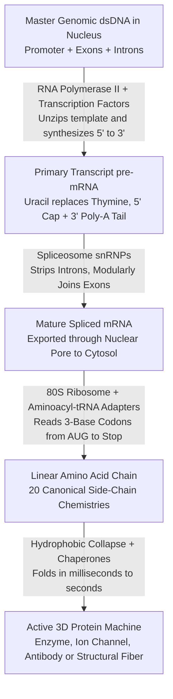
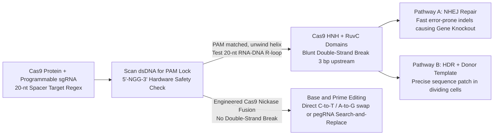

# Cellular Architecture & Molecular Genetics: From Organelles to CRISPR

> **Module Scope**: Inside a single $20\text{ }\mu\text{m}$ human eukaryotic cell—how compartmentalized organelles isolate hazardous workloads, how mitochondrial rotary stepper motors mint $\text{ATP}$ at $100+\text{ Hz}$, how 2-bit quaternary DNA compiles into 3D protein machinery via the Central Dogma, how epigenetics toggles tissue identity without altering source code, and how CRISPR-Cas9 edits live genomes.

---

## 1. The Eukaryotic Cell as a Containerized Microservice Pod

Around $2.0\text{ billion}$ years ago, life made its greatest architectural leap: transitioning from **prokaryotes** (bacteria and archaea—bare-metal processes where DNA, ribosomes, and metabolic enzymes float in one shared cytoplasm) to **eukaryotes** (compartmentalized pods with membrane-bound sub-containers called **organelles**).

Why compartmentalize? For the exact same reasons systems engineers isolate workloads in containers and namespaces: **incompatible chemical environments and security boundaries**. You cannot run acid-hydrolysis garbage collection ($\text{pH } 4.5$) in the same unpartitioned address space as delicate RNA transcription ($\text{pH } 7.2$) without corrupting everything.

### Complete Organelle Infrastructure Reference

| Cellular Component | Systems Engineering Equivalent | Physical Structure & Biochemical Mechanism | Failure Mode in Human Disease |
| :--- | :--- | :--- | :--- |
| **Plasma Membrane** | Zero-Trust Ingress Firewall + mTLS Terminus | Self-sealing $5\text{ nm}$ **phospholipid bilayer** (hydrophilic phosphate heads facing water, hydrophobic fatty-acid tails facing inward); blocks ions and polar molecules unless admitted by selective ion channels, GPCRs, or active transporters | Channelopathies (e.g., Cystic Fibrosis broken $\text{CFTR}$ chloride channel); toxin pore formation |
| **Cell Nucleus & Nuclear Pore Complex** | Air-Gapped Master Git Repo + Authenticated API Gateway | Double lipid membrane housing chromosomal dsDNA; **Nuclear Pore Complexes (NPCs)** enforce strict cryptographic-like tag checks (Nuclear Localization Signals) before letting transcription factors in or mature mRNA out | Laminopathies (Progeria); viral hijacking of nuclear import (e.g., Influenza, Adenovirus) |
| **Mitochondria** | Dedicated Power Plant + Apoptosis Kill-Switch | Double-membrane endosymbiotic bacteria carrying their own $16.5\text{ kb}$ circular **mtDNA** (maternally inherited); pumps protons across folded cristae to drive rotary $\text{ATP}$ synthesis; releases **Cytochrome c** to trigger clean cellular self-destruction (`apoptosis`) if damaged | Mitochondrial myopathies; neurodegenerative energy failure (Parkinson's); cancer disabling Cytochrome c kill-switch |
| **Rough Endoplasmic Reticulum (RER)** | Supervised Build & Folding Cluster | Sheet-like membrane network studded with translating ribosomes; threads nascent secretory/membrane proteins into the ER lumen where **chaperones** (BiP, calnexin) fold them and add disulfide (`-S-S-`) structural cross-links | **Unfolded Protein Response (UPR)** overload causing beta-cell burnout in Type 2 diabetes |
| **Smooth ER** | Lipid Factory, Detox Worker & $\text{Ca}^{2+}$ Cache | Ribosome-free tubular membranes housing **Cytochrome P450 (CYP450)** enzymes that oxidize hydrophobic drugs/alcohol/toxins into water-soluble forms for kidney excretion; sequesters $\text{Ca}^{2+}$ ions for muscle contraction | Drug-drug interactions (e.g., grapefruit furanocoumarins inhibiting `CYP3A4`, spiking statin blood levels) |
| **Golgi Apparatus** | Packet Router & Glycosylation Shipping Hub | Stack of flattened cisternae (`cis -> medial -> trans`); attaches oligosaccharide address headers (e.g., mannose-6-phosphate tags for lysosomes) and packages cargo into lipid vesicles | Congenital disorders of glycosylation; misrouted lysosomal enzymes |
| **Lysosomes & Proteasomes** | Acid Incinerator + Reference-Counted GC (`free()`) | **Lysosomes** ($\text{pH } 4.5\text{ to }5.0$ maintained by V-ATPase proton pumps) digest whole organelles (`autophagy`) and engulfed bacteria; **26S Proteasomes** shred misfolded cytosolic proteins tagged with a chain of **Ubiquitin** ("death-kiss" GC marker) | Tay-Sachs & Gaucher lysosomal storage diseases; Alzheimer's/ALS toxic protein aggregation |
| **Cytoskeleton & Kinesin / Dynein** | Fiber-Optic Structural Mesh + Automated Conveyor Trucks | Dynamic highway network of **actin filaments**, **intermediate filaments**, and hollow **microtubule** pipes ($25\text{ nm}$ diameter); **Kinesin** motor proteins literally walk hand-over-hand ($8\text{ nm}$ steps per $\text{ATP}$ spent!) hauling vesicles from soma to axon tip | Tau protein hyperphosphorylation collapsing neuronal microtubule tracks in Alzheimer's |

---

## 2. Bioenergetics & The Mitochondrial `FoF1`-ATP Rotary Synthase

How does a sandwich or bowl of rice keep your neurons firing at $-70\text{ mV}$? If a cell oxidized glucose ($\text{C}_6\text{H}_{12}\text{O}_6 + 6\text{O}_2 \to 6\text{CO}_2 + 6\text{H}_2\text{O}$, $\Delta G^{\circ\prime} = -2,870\text{ kJ/mol}$) in a single uncontrolled combustion step, 100% of that energy would release as thermal heat, boiling the cell alive.

Instead, cellular respiration steps down chemical energy across three staged pipelines—**Glycolysis** (cytosol, no $\text{O}_2$ required, net $2\text{ ATP}$), the **Citric Acid / Krebs Cycle** (mitochondrial matrix, stripping high-energy electrons onto $\text{NADH}$ and $\text{FADH}_2$ carriers while exhaling $\text{CO}_2$), and **Oxidative Phosphorylation** (inner mitochondrial membrane, yielding approx. $26\text{ to }28\text{ ATP}$ per glucose molecule).

### The Proton-Motive Force & Nanoscale Rotary Turbine

British biochemist Peter Mitchell shocked biology in 1961 with his **Chemiosmotic Hypothesis** (1978 Nobel Prize): mitochondria do not synthesize most $\text{ATP}$ via direct chemical intermediates. They run a **hydroelectric dam**:

1. **Charging the Capacitor (Electron Transport Chain, Complexes I–IV)**: High-energy electrons from $\text{NADH}$ and $\text{FADH}_2$ cascade down a series of redox-potential steps across four membrane complexes, terminating at **molecular oxygen ($\text{O}_2$)**—the ultimate electron sink, reduced to harmless water ($\frac{1}{2}\text{O}_2 + 2\text{H}^+ + 2e^- \to \text{H}_2\text{O}$). That is the **sole fundamental reason you breathe oxygen**: if $\text{O}_2$ stops arriving (asphyxiation or ischemia) or Complex IV is jammed by cyanide ($\text{CN}^-$), the electron queue backs up in seconds and $\text{ATP}$ synthesis halts.
2. **Pumping Protons Uphill**: As electrons step down in energy, Complexes I, III, and IV pump $\text{H}^+$ protons out of the mitochondrial matrix into the narrow intermembrane space, establishing an electrochemical **Proton-Motive Force ($\Delta p$)** of approx. $180\text{ to }200\text{ mV}$ combining voltage ($\Delta \Psi$) and a $\Delta\text{pH}$ gradient:
   $$\Delta p = \Delta \Psi - \frac{2.303 RT}{F} \Delta \text{pH}$$
3. **Mechanical Rotation of $F_O F_1$-ATP Synthase**: Protons rush back down their steep electrochemical gradient through the membrane-embedded **$F_O$ c-ring rotor**, spinning a central asymmetric $\gamma$-driveshaft inside the catalytic **$F_1$ hexamer stator** at **$100\text{ to }150\text{ revolutions per second}$** ($6,000\text{ to }9,000\text{ RPM}$!). Every $120^\circ$ mechanical click physically squeezes $\text{ADP}$ and inorganic phosphate ($\text{P}_i$) together into $\text{ATP}$, achieving $>80\%$ thermodynamic conversion efficiency.

> **Engineering Intuition — Brown Fat & Uncoupling (`Thermogenesis`)**: What happens if you punch a controlled proton leak channel (**UCP1 / Thermogenin**) into the inner mitochondrial membrane so $\text{H}^+$ bypasses the ATP Synthase turbine? Just like short-circuiting a battery across a resistor, all $\Delta p$ potential energy dissipates directly as **pure heat**—which is exactly how hibernating mammals, human newborns, and cold-adapted **brown adipose tissue (BAT)** warm core blood without shivering!

---

## 3. DNA as 2-Bit Quaternary Storage & RAID-1 Hardware Mirroring

Strip away chemical mystique and **Deoxyribonucleic Acid (DNA)** is an extraordinarily clean persistent data structure:

- **2-Bit Base-4 Alphabet**: Each nucleotide monomer stores exactly $\log_2(4) = 2\text{ bits}$ of information across four nitrogenous bases: two double-ring **purines**—**Adenine (`A`)** and **Guanine (`G`)**—and two single-ring **pyrimidines**—**Thymine (`T`)** and **Cytosine (`C`)**.
- **Directional Sugar-Phosphate Backbone ($5' \to 3'$)**: Nucleotides link via covalent phosphodiester bonds between the $3'$ hydroxyl carbon of one deoxyribose sugar and the $5'$ phosphate carbon of the next. Just as C strings or network byte streams have a strict read direction, **all nucleic acid polymerases read templates $3' \to 5'$ and synthesize new strands exclusively $5' \to 3'$**.
- **Antiparallel Complementary Pairing (`RAID-1 Mirroring`)**: Two strands wind into a right-handed double helix running in opposite directions ($5' \to 3'$ paired against $3' \to 5'$), obeying strict **Watson-Crick geometric complementarity**:
  - $\text{A} = \text{T}$ linked by **2 hydrogen bonds**
  - $\text{G} \equiv \text{C}$ linked by **3 hydrogen bonds** (making GC-rich genomic regions thermally stabler with a higher melting temperature $T_m$, a crucial parameter when designing PCR primers!)

Why store two mirrored strands when one strand holds the entire bit sequence? **Fault tolerance.** If cosmic ionizing radiation, UV light, or reactive oxygen species corrupts a base on Strand A, **Base Excision Repair (BER)** and **Nucleotide Excision Repair (NER)** enzymes snip out the damaged segment and reconstruct the exact original sequence by reading the intact complementary base on Strand B!

### Genome Scale & Multi-Tier Chromatin Compaction

If you stretched out the $46$ chromosomes ($23$ homologous pairs: $22$ autosomes + $XX$ or $XY$) inside a **single** diploid human cell end to end, the $6.4 \times 10^9$ base pairs ($0.34\text{ nm}$ per bp) would measure **approx. $2.1\text{ meters}$ long**—yet it fits cleanly inside a **$6\text{ }\mu\text{m}$ nucleus** without tangling during mitosis:

$$\text{Raw Diploid Payload} = 6.4 \times 10^9\text{ bp} \times 2\text{ bits/bp} = 1.28 \times 10^{10}\text{ bits} \approx 1.6\text{ GB}$$

Across your $3 \times 10^{13}$ nucleated cells, your body carries roughly $6 \times 10^{10}\text{ km}$ of DNA—enough to stretch from Earth to Pluto and back four times. Cells achieve a **$10,000\times$ linear compression ratio** by wrapping negatively charged DNA ($147\text{ bp}$ per turn) around positively charged spools of **histone octamer proteins** to form **nucleosomes** ("beads on a string"), which further coil into chromatin loops and chromosomal territories.

### Replication Asymmetry, Okazaki Fragments & The Telomere Clock (`Hayflick Limit`)

Before a cell divides (`S-phase` of the cell cycle), it must duplicate all $6.4 \times 10^9\text{ bp}$ with near-zero data loss. Because the two DNA strands run antiparallel ($5' \to 3'$ vs $3' \to 5'$) while **DNA Polymerase $\delta / \epsilon$ can only append nucleotides in the $5' \to 3'$ direction** and requires an existing $3'\text{-OH}$ RNA primer laid down by **Primase**, replication forks are fundamentally asymmetric:

1. **Leading Strand (Continuous Streaming Write)**: Synthesized smoothly in one continuous $5' \to 3'$ stream chasing the unzipping **Helicase** fork, while **Topoisomerase** snips and swivels the helix ahead of the fork to relieve torsional supercoiling stress.
2. **Lagging Strand (Chunked Backfill via Okazaki Fragments)**: Synthesized *backwards* away from the moving fork in short $100\text{ to }200\text{ nt}$ chunks called **Okazaki fragments**, after which RNase H strips out the temporary RNA primers and **DNA Ligase** welds the sugar-phosphate backbone shut.
3. **Three-Tier Error Correction ($10^{-4} \to 10^{-7} \to 10^{-10}$)**: Raw base-pairing thermodynamics alone makes roughly $1$ error per $10^4$ bases. DNA Polymerase's built-in $3' \to 5'$ **exonuclease backspace key** (`proofreading`) improves fidelity $100\text{- to }1,000\text{-fold}$ to $10^{-7}$, and post-replication **Mismatch Repair (`MMR`)** scans for helix bulges to push final error rates down to **$10^{-9}\text{ to }10^{-10}$ per base pair**—less than 1 typo per gigabyte!
4. **The End-Replication Bug & Telomeres**: When the final RNA primer at the extreme $5'$ tip of a linear lagging strand is removed, DNA Polymerase has no upstream $3'\text{-OH}$ hook from which to backfill the gap! Consequently, linear chromosomes lose $50\text{ to }150\text{ bp}$ on every somatic cell division.
   - To prevent this erosion from chewing into vital genes, chromosome ends are buffered with thousands of disposable **`TTAGGG` hexamer repeats** called **Telomeres**.
   - Once telomeres shrink below a critical length after **$50\text{ to }70$ divisions** (the **Hayflick Limit**), `p53` triggers permanent cell-cycle arrest (**replicative senescence**) or apoptosis—acting as a hardware tumor-suppressor counter!
   - Germline cells and stem cells express **Telomerase** (a ribonucleoprotein reverse transcriptase carrying its own RNA template) to re-extend `TTAGGG` caps; **$85\%\text{ to }90\%$ of human cancers** hijack telomerase reactivation to bypass the Hayflick Limit and divide indefinitely.

---

## 4. The Central Dogma Compilation Pipeline

Formulated by Francis Crick in 1958, the **Central Dogma of Molecular Biology** defines the directional flow of sequence information: nucleic acid templates can copy into nucleic acids (`DNA -> DNA` replication, `DNA -> RNA` transcription), and RNA compiles into polypeptide amino acid sequences (`mRNA -> Protein` translation), **never** backwards from a folded protein sequence back into RNA or DNA.

### Stage 1: Transcription (`Source Code -> Ephemeral RAM Script`)
Cells never let ribosomes chew directly on master nuclear DNA. Instead, when tissue-specific **Transcription Factors** bind enhancer/promoter motifs (such as the `TATA` box) upstream of a gene, **RNA Polymerase II** pries open a short transcription bubble and synthesizes single-stranded **Messenger RNA (mRNA)**:
- RNA uses **Ribose** sugar (whose $2'\text{-OH}$ group makes RNA chemically self-cleaving and short-lived—ideal for temporary worker scripts that should auto-expire!) instead of ultra-stable **2'-Deoxyribose**.
- RNA substitutes **Uracil (`U`)** in place of Thymine (`T`). Why does DNA spend extra metabolic energy methylating `U` into `T`? Because Cytosine (`C`) spontaneously deaminates in water into Uracil (`U`) approx. $100\text{ to }500$ times per cell per day! If `U` were legal in DNA, repair enzymes could never tell whether a `U` belonged there originally or was a corrupted `C`. Making `T` the sole legal base in DNA turns every `U` in DNA into an instant syntax error that **Uracil-DNA Glycosylase** repairs on sight!

### Stage 2: Alternative Splicing (`Modular Build Flags`)
Early Sequencers of the Human Genome Project expected $100,000+$ protein-coding genes to explain human complexity relative to a $1\text{ mm}$ *C. elegans* roundworm ($20,000$ genes). Shockingly, humans also have **only approx. $20,000$ protein-coding genes**—occupying just **$1.5\%$** of our entire $3.2\text{ Gb}$ haploid genome! (The remaining $98.5\%$ comprises regulatory enhancers, introns, structural telomeres/centromeres, non-coding RNAs, and ancient inactivated viral fossils called retrotransposons.)

How do $20,000$ human genes build $100,000+$ distinct proteins? **Alternative Splicing**:
- Eukaryotic genes are split into coding **Exons** interrupted by non-coding **Introns**.
- After RNA Pol II produces `pre-mRNA`, a macromolecular RNA-protein complex called the **Spliceosome** snips out introns (`lariats`) and stitches selected exons together.
- By including Exons `[1, 2, 4, 5]` in skeletal muscle and Exons `[1, 3, 4, 6]` in brain tissue, a single genomic locus compiles into multiple specialized protein isoforms!

### Stage 3: The Genetic Code & Ribosomal Translation (`Bytecode -> 3D Hardware`)
To translate a 4-letter RNA alphabet (`A, U, G, C`) into **20 canonical amino acids** (varying across hydrophobic, polar, positively charged, and negatively charged side chains), nature needs a minimum word length $k$:
- $4^1 = 4 < 20$ (insufficient)
- $4^2 = 16 < 20$ (insufficient)
- $4^3 = 64 \ge 20$ (**Triplet Codons**—the minimum viable word width!)

All known life on Earth—from deep-sea archaea and *E. coli* to redwood trees and humans—shares virtually the exact same **64-entry codon lookup table** (overwhelming proof of a single **Last Universal Common Ancestor, LUCA**):
- **1 Start Codon (`AUG`)**: Codes for Methionine *and* sets the 3-byte reading-frame alignment.
- **60 Sense Codons**: Map onto the remaining 19 amino acids.
- **3 Stop Codons (`UAA`, `UAG`, `UGA`)**: Bind release factors that terminate polypeptide synthesis.

Notice the brilliant **fault-tolerant degeneracy** of that $64 \to 20$ mapping: most amino acids have 2 to 6 synonymous codons differing only in the **3rd ("wobble") nucleotide** (e.g., `CCU`, `CCC`, `CCA`, and `CCG` all compile to Proline). Furthermore, single-base substitutions in the 1st or 2nd positions preferentially swap a hydrophobic amino acid for another hydrophobic amino acid, minimizing catastrophic protein misfolding!

Inside the cytosol, the **Ribosome** (an ancient **ribozyme** whose catalytic peptidyl-transferase core is actually made of ribosomal RNA rather than protein!) steps along `mRNA` three bases at a time across its **A (Aminoacyl) -> P (Peptidyl) -> E (Exit)** slots, matching each codon against the complementary **anticodon** of an incoming **tRNA** molecule carrying the specified amino acid. Within milliseconds of emerging from the ribosome exit tunnel, hydrophobic exclusion and hydrogen bonding fold the 1D amino acid chain into a precise 3D catalytic machine—the physical sequence-to-structure problem solved computationally by **AlphaFold 2 / 3**.

### Why 20 Amino Acids? The Four Side-Chain (`R-Group`) Hardware Primitives

Every amino acid shares an identical `NH2 - CH(R) - COOH` peptide backbone; all 3D folding and catalytic chemistry comes from the **20 distinct `R` side chains**, which divide cleanly into four engineering classes:

| Side-Chain Class | Member Amino Acids | Chemical Behavior in Water ($\text{pH } 7.4$) | Structural & Functional Role in Proteins |
| :--- | :--- | :--- | :--- |
| **1. Non-Polar Hydrophobic** | `Ala, Val, Leu, Ile, Met, Phe, Trp` | Repelled by water's hydrogen-bond network (`oily`) | **Core Folding Engine** (`hydrophobic collapse` buries them inside globular proteins) + spans lipid cell membranes in ion channels/GPCRs |
| **2. Polar Uncharged** | `Ser, Thr, Asn, Gln, Tyr` | Hydrophilic; forms reversible hydrogen bonds (`-OH`, `-CONH2`) | Coats water-facing protein exteriors; **`Ser / Thr / Tyr` hydroxyls** serve as binary **phosphorylation switches** toggled by kinases! |
| **3. Electrically Charged** | **Basic (`+`)**: `Lys, Arg, His`; **Acidic (`-`)**: `Asp, Glu` | Carries full `+1` or `-1` electrostatic charge | Forms structural **ionic salt bridges**; `Lys/Arg` bind negatively charged DNA (`histones`); `His` ($\text{p}K_a \approx 6.0$) shuttles protons inside enzyme active sites |
| **4. Geometric Specialists** | **`Glycine`**, **`Proline`**, **`Cysteine`** | Special steric or covalent bond mechanics | **`Gly`** (`R = H`, tiny) enables ultra-tight turns (`collagen`); **`Pro`** (cyclic ring) introduces rigid kinks breaking $\alpha$-helices; **`Cys`** (`-SH` thiol) welds permanent **`-S-S-` disulfide staples** in secreted antibodies & insulin! |

---

## 5. Mutations, Repair & Epigenetic Runtime Configuration

### Four Classes of Genomic Bugs

When replication errors, UV pyrimidine dimers, or chemical mutagens (like tobacco benzopyrene or aflatoxin B1) slip past DNA repair, the resulting bug severity depends entirely on how it alters the triplet reading frame or regulatory logic:

| Mutation Class | Source-Code Change Example | Downstream Protein Impact | Concrete Clinical Example |
| :--- | :--- | :--- | :--- |
| **Silent (Synonymous)** | `GAA -> GAG` (3rd-base wobble) | **Zero amino acid change** (`Glu -> Glu`); occasionally alters mRNA stability or splicing speed | Most neutral human SNPs (`Single Nucleotide Polymorphisms`) |
| **Missense** | `GAG -> GUG` in *HBB* $\beta$-globin codon 6 | Swaps hydrophilic **Glutamate** for hydrophobic **Valine** on hemoglobin's outer surface | **Sickle-Cell Disease**: sticky hydrophobic patch polymerizes deoxygenated hemoglobin into rigid rods; heterozygotes (`HbAS`) gain malaria resistance! |
| **Nonsense** | `CAG (Gln) -> UAG (Stop)` | **Premature termination (`segfault`)**; truncated protein + Nonsense-Mediated Decay destroys the mRNA | Duchenne Muscular Dystrophy (*DMD* truncations); approx. 10% of Cystic Fibrosis cases |
| **Frameshift Indel** | Deleting 1 or 2 bases (non-multiple of 3) | **Catastrophic off-by-one byte misalignment**: corrupts *every* codon downstream until hitting a random Stop | **Tay-Sachs** 4-bp insertion in *HEXA*; *CCR5*-$\Delta 32$ 32-bp deletion conferring natural HIV-1 entry immunity |

### Epigenetics: Why a Neuron and a Hepatocyte Run Different Apps on Identical Hardware

Every nucleated cell in your body (except rearranged B/T lymphocytes and haploid gametes) contains the **exact same $6.4\text{ Gb}$ genome**. Why doesn't an eyeball photoreceptor secrete stomach pepsinogen or beat like a heart cell?

Because **Epigenetics** acts as an inheritable **filesystem permission layer (`chmod`)** sitting physically on top of DNA without mutating a single `A, T, C, G` letter:

1. **DNA CpG Methylation (`chmod 000` — Hard Read Lock)**: DNA Methyltransferases (`DNMTs`) attach methyl groups (`-CH3`) onto Cytosines in `5'-CpG-3'` islands inside gene promoters. Methylated promoters recruit repressor complexes that physically block transcription factors from binding, silencing genes across cell divisions (e.g., silencing pluripotency genes *OCT4* and *NANOG* once an embryonic stem cell commits to becoming a skin fibroblast—the exact lock Shinya Yamanaka learned to reset in 2006 to reprogram adult cells back into **iPSCs**!).
2. **Histone Tail Modifications (`Spool Tension Control`)**:
   - **Histone Acetylation (`HATs`)**: Neutralizes the positive charge on histone lysine tails, loosening their electrostatic grip on negatively charged DNA -> **Euchromatin** (open, active read/transcribe state).
   - **Histone Deacetylation (`HDACs`) & Repressive Methylation (`H3K27me3`)**: Tightens DNA spooling into dense **Heterochromatin** -> physically inaccessible to RNA Polymerase II.
3. **MicroRNAs (`miRNA` Post-Transcriptional Throttling)**: Short $22\text{-nt}$ non-coding RNAs load into the **RISC** complex to bind complementary $3'\text{-UTR}$ tails on target mRNAs, throttling translation or triggering rapid mRNA cleavage.

---

## 6. Programmable Wetware: How CRISPR-Cas9, Base & Prime Editing Work

For decades, reading DNA (`Sequencing`) grew exponentially cheaper than Moore's Law—falling from **USD 2.7 billion** for the first reference human genome (2001) to **under USD 200 to 600** on modern Illumina short-read and Oxford Nanopore / PacBio long-read sequencers—while *editing* a specific locus inside $3.2\text{ billion}$ base pairs required months of bespoke protein engineering (ZFNs or TALENs).

In 2012, Jennifer Doudna and Emmanuelle Charpentier (2020 Nobel Prize) demonstrated that a bacterial adaptive antiviral defense—**CRISPR-Cas9** (*Clustered Regularly Interspaced Short Palindromic Repeats*)—could be reprogrammed simply by swapping a **20-letter RNA search string**, turning genome editing from hardware design into software configuration.

### Step-by-Step CRISPR-Cas9 Execution Mechanics

1. **Origin as a Bacterial Antivirus Log**: Wild bacteria (like *Streptococcus pyogenes*) that survive a bacteriophage viral attack snip a $20\text{ bp}$ hash of the invader's DNA and paste it into their own genomic **CRISPR array**. They transcribe those stored viral hashes into guide RNAs loaded into **Cas9** endonuclease scissors; if the same phage ever injects its DNA again, Cas9 matches the hash and shreds the viral genome in seconds.
2. **The PAM Hardware Interlock (`5'-NGG-3'`)**: Wait—if the bacterium stores the viral sequence inside its *own* CRISPR locus, why doesn't Cas9 slice the bacterium's own chromosome in half? Because Cas9 **never** unwinds DNA to test the 20-nt RNA guide *unless* it first bumps into a short **Protospacer Adjacent Motif (PAM)**—`5'-NGG-3'` for SpCas9—present next to the target in the virus, **absent** inside the host's own CRISPR repeat spacers! That PAM check also lets Cas9 scan billions of base pairs in minutes via fast 3D diffusion + 1D hopping rather than melting every helix turn.
3. **Classic Cas9 Double-Strand Break (`DSB`) Outcomes**:
   - **Non-Homologous End Joining (`NHEJ`)**: The cell's emergency repair crew glues the severed ends back together, frequently inserting or deleting a few random bases (`indels`) -> triggers a frameshift **Gene Knockout** (used clinically in **Casgevy**, the first FDA-approved CRISPR therapy for Sickle-Cell Disease and $\beta$-Thalassemia, which knocks out the *BCL11A* repressor in a patient's own bone-marrow stem cells to reactivate fetal hemoglobin!).
   - **Homology-Directed Repair (`HDR`)**: Supplying a synthetic donor DNA template alongside Cas9 lets dividing cells copy a new sequence across the break, though HDR has lower efficiency in non-dividing neurons or cardiomyocytes and carries risks of unwanted large deletions or off-target DSBs.
4. **Generation 2.0 & 3.0 — Base Editing & Prime Editing (`git commit --amend` Without Cutting Both Strands)**:
   - **Base Editors** (invented by David Liu's lab): Disable one blade of Cas9 (`Cas9 nickase`) and fuse a cytidine or adenine deaminase enzyme, chemically converting `C•G -> T•A` or `A•T -> G•C` at single-base resolution **without ever creating a double-strand break**.
   - **Prime Editing**: Fuses Cas9 nickase to an engineered **Reverse Transcriptase** guided by a **pegRNA** (*prime editing guide RNA*) that carries *both* the target address and the replacement string—performing true programmable `search-and-replace` across all 12 possible point mutations plus small insertions and deletions with minimal off-target collateral damage.

---

## 7. Essential Wet-Lab & AI-Bio Primitives Every Engineer Should Know

To read modern biotechnology papers, clinical diagnostics, or AI-for-science breakthroughs fluently, pair CRISPR with four foundational molecular primitives:

### 1. Polymerase Chain Reaction (`PCR` — Exponential `grep + copy` for DNA)
Invented by Kary Mullis in 1983 (1993 Nobel Prize), **PCR** exploits a heat-proof DNA polymerase (**Taq Polymerase**, isolated from *Thermus aquaticus* bacteria thriving in boiling Yellowstone geysers) to amplify a needle-in-a-haystack target sequence inside a $3.2\text{ Gb}$ genome without cloning it into living cells:
- **Step 1 — Denaturation ($95^\circ\text{C}$, $15\text{ s}$)**: Thermal energy breaks hydrogen bonds (`A=T`, `G=C`) without harming covalent phosphodiester backbones, unzipping dsDNA into single strands.
- **Step 2 — Annealing ($55\text{ to }62^\circ\text{C}$, $20\text{ s}$)**: Synthetic $20\text{-nt}$ forward and reverse **DNA Primers** hybridize exclusively to the $3'$ flanking boundaries of your target amplicon.
- **Step 3 — Extension ($72^\circ\text{C}$, $30\text{ s}$)**: *Taq* Polymerase synthesizes complementary strands $5' \to 3'$, doubling target copy count every 90-second cycle:
  $$N(c) = N_0 \cdot (1 + E)^c \approx N_0 \cdot 2^c$$
  After $c = 35$ cycles ($< 1\text{ hour}$), a single starting DNA molecule ($N_0 = 1$) amplifies into $2^{35} \approx 3.43 \times 10^{10}$ copies!
- **Understanding Clinical `RT-qPCR Ct` (`Cycle Threshold`) Values**: For RNA viruses (SARS-CoV-2, Influenza, HIV viral load), **Reverse Transcriptase** first converts viral `RNA -> cDNA`, then fluorescent probes track real-time doubling until fluorescence crosses background noise at cycle **$C_t$**:
  - Because $2^{3.32} \approx 10$, **every $3.3\text{-cycle}$ drop in $C_t$ means a $10\times$ higher starting viral RNA load**! A nasal swab at $C_t = 18$ carries roughly **$1,000,000\times$ ($10^6\times$) more viral copies** than a tail-end recovery swab at $C_t = 38$.

### 2. Recombinant Bioreactors (`Compiling Human Proteins Inside Microbes`)
Prior to 1982, Type 1 diabetics injected insulin extracted from **two tons of slaughtered pig and cow pancreases** per pound of purified hormone—risking allergic immune reactions to porcine amino acid differences. Because the **64-codon genetic lookup table is universal across Earth's biosphere**, Genentech synthesized the human *INS* A- and B-chain coding DNA (introns pre-stripped as `cDNA` since bacteria lack spliceosomes!) and spliced it into an *E. coli* expression plasmid downstream of an inducible `lac` promoter. Today, stainless-steel bacterial, yeast, and CHO (*Chinese Hamster Ovary* mammalian cell—used when human-style Golgi glycosylation tags are required, such as monoclonal antibodies like `Keytruda` or `Herceptin`) bioreactors brew $100\%$ sequence-identical human biologics at industrial scale.

### 3. Levinthal's Paradox & How AlphaFold Solved 3D Protein Structure Prediction
Why was predicting a protein's 3D atomic coordinates from its 1D amino-acid string a 50-year grand challenge in computer science?
- **Levinthal's Paradox (1969)**: Consider a modest $101\text{-amino-acid}$ polypeptide with $100$ peptide bonds. Even if each residue sampled just $3$ discrete $(\phi, \psi)$ backbone torsion angles, the search space contains $3^{100} \approx 5 \times 10^{47}$ conformations. Sampling one conformation every $10^{-13}\text{ s}$ (picosecond bond vibration rate) via brute-force random search would take **$10^{27}\text{ years}$**—$10^{17}$ times the age of the universe!
- **Physical Resolution (`Funneled Energy Landscape`)**: Real proteins do not search randomly; water immediately drives oily hydrophobic side chains inward (`hydrophobic collapse`) while local $\alpha$-helices and $\beta$-sheets nucleate simultaneously down a steep thermodynamic free-energy funnel ($\Delta G < 0$) in **milliseconds**.
- **Computational Breakthrough (`AlphaFold 2 / 3`, 2024 Nobel Prize in Chemistry)**: Instead of simulating femtosecond molecular-dynamics physics from scratch, DeepMind combined **Evolutionary Co-Variation** across **Multiple Sequence Alignments (`MSAs`)**—if Position $42$ mutates from positively charged Lysine to negatively charged Glutamate in frogs, and Position $187$ simultaneously flips from Glutamate to Lysine to preserve the fold, **Positions $42$ and $187$ must touch in 3D space!**—with $SE(3)$-equivariant **Evoformer** geometric attention, achieving near-X-ray-crystallography accuracy ($< 0.15\text{ nm}$ or $1.5\text{ Å}$ backbone RMSD) across $200\text{ million}+$ known proteins.

| Technology Primitive | Core Input -> Output | Computational / Physical Scaling | Landmark Application |
| :--- | :--- | :--- | :--- |
| **PCR / RT-qPCR** | Trace DNA/RNA -> $10^{10}$ copies + $C_t$ quantification | $2^c$ exponential doubling ($10\times$ per $3.32$ cycles) | Viral diagnostics, forensic STR profiling, cloning |
| **Illumina / Nanopore NGS** | Fragmented genomic DNA -> `.fastq` base calls | $10^9+$ parallel bridge-PCR clusters or ionic nanopore currents | Whole-genome sequencing under USD 300, liquid cancer biopsy (`ctDNA`) |
| **CHO / *E. coli* Bioreactors** | Synthetic `cDNA` plasmid -> Gram-scale folded biologic | Universal 64-codon table (`CHO` adds human Golgi glycans) | Recombinant human insulin, mAbs (`Keytruda`, `Humira`), Factor VIII |
| **AlphaFold / RoseTTAFold / RFdiffusion** | 1D amino acid string -> 3D coordinates (or *inverse* de novo design!) | Co-evolutionary MSA pairwise constraints + geometric attention | Structural drug discovery, designing brand-new enzymes & viral binders from scratch |

---

## 8. Actionable Engineering Takeaways from Cellular & Molecular Biology

1. **Respect Cellular Quality Control (`Autophagy` & `Proteostasis`)**: Your cells accumulate oxidized lipids, glycated proteins, and depolarized mitochondria every day. Regular **aerobic/resistance exercise** and avoiding round-the-clock late-night snacking activate **AMPK** (the cell's low-ATP/high-AMP fuel gauge), which triggers **autophagy** and **mitophagy**—clearing senescent mitochondrial nodes and synthesizing fresh, high-efficiency cristae.
2. **Protect Genomic Integrity Against Preventable Mutagens**: Every cell division and oxidative insult tests your DNA repair enzymes (`p53`, `BRCA1/2`, `NER`). Three high-signal interventions slash somatic mutation rates dramatically:
   - Broad-spectrum UV protection (UV-B photons fuse adjacent thymines into cyclobutane pyrimidine dimers in skin basal stem cells).
   - Avoiding tobacco smoke, charred nitrosamines, and heavy ethanol metabolism (**acetaldehyde**—the first breakdown intermediate of alcohol via Alcohol Dehydrogenase, especially toxic in East Asian carriers of the slow `ALDH2*2` missense variant who flush red—directly cross-links dsDNA strands!).
   - Eliminating chronic viral/inflammatory replication triggers (e.g., HPV vaccination, Hepatitis B immunity).
3. **Distinguish Somatic vs. Germline Gene Editing**: Editing **somatic cells** (e.g., ex vivo hematopoietic stem cells or liver-targeted LNP delivery for transthyretin amyloidosis) affects *only* that individual patient and dies with them—ethically analogous to an organ transplant or targeted drug. Editing **germline embryos, sperm, or eggs** alters every cell of all future descendants permanently and remains strictly prohibited in clinical practice worldwide due to mosaicism, polygenic pleiotropy, and multigenerational risk.

---

### Continue the Curriculum

- **Previous**: [00-README.md](00-README.md) — *Modern Biology for Engineers: Systems Architecture, Scales & Thermodynamics*
- **Next**: [02-IMMUNE-SYSTEM-VIRUSES-AND-ANTIBIOTICS.md](02-IMMUNE-SYSTEM-VIRUSES-AND-ANTIBIOTICS.md) — *How Your Immune System Fights Invaders: Innate vs. Adaptive Security, Viruses vs. Bacteria, Antibiotics & Vaccines*
