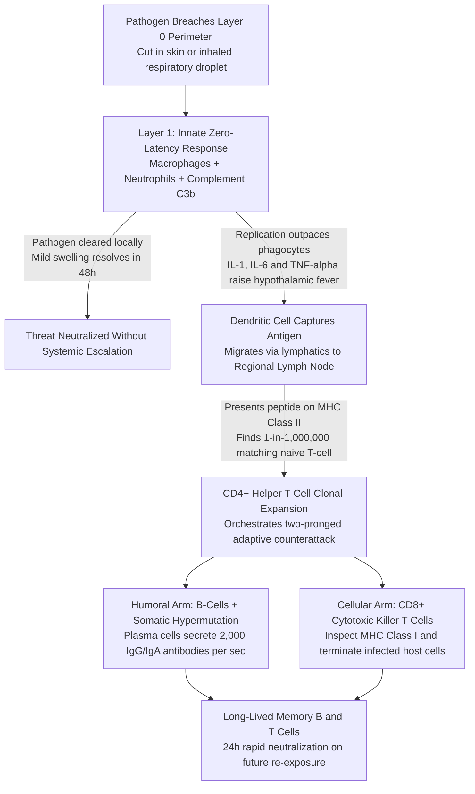
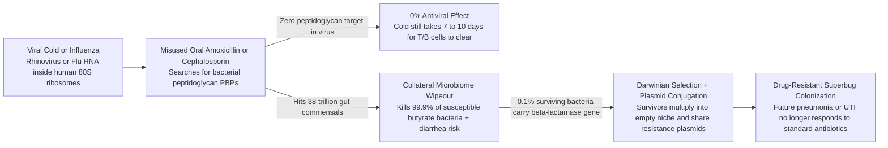

# How Your Immune System Fights Invaders: Viruses, Bacteria, Antibiotics & Vaccines

> **Module Scope**: Your body sits in a soup of billions of opportunistic microbes, fungi, and viruses eager to metabolize your carbon and hijack your ribosomes. Here is the defense-in-depth security architecture keeping you alive—why innate macrophages/NK cells and adaptive B/T cells split the workload, why popping amoxicillin or cephalosporins for a viral cold does **literally zero antiviral work** while breeding drug-resistant superbugs, and how modern subunit and mRNA vaccines pre-compile immunological memory.

---

## 1. Defense-in-Depth: Three Security Tiers of Human Immunity

If an enterprise cluster relied solely on deep behavioral ML anomaly inspection for every incoming TCP packet, latency and CPU burn would bring the network to its knees; conversely, if it relied solely on static port-blocking rules, a novel zero-day exploit would own the entire fleet. Evolution converged on a **three-tier zero-trust architecture** balancing zero-latency perimeter blocking against combinatorial adaptive synthesis:

| Security Layer | Response Latency | Specificity & Pattern Matching | Memory Across Infections? | Core Biological Components |
| :--- | :---: | :--- | :---: | :--- |
| **Layer 0: Physical & Chemical Perimeter** | $0\text{ s}$ (Always on) | Non-specific bulk exclusion & chemical lysis | None | Keratinized dead-skin armor, tight junctions, mucociliary escalator in bronchi, stomach $\text{HCl}$ ($\text{pH } 1.5\text{ to }2.0$), **lysozyme** in tears/saliva cleaving bacterial walls |
| **Layer 1: Innate Immune Firewall** | Minutes to Hours | Hardcoded germline **PRRs** (`Toll-Like Receptors`) matching conserved microbial signatures (`PAMPs`) | Minimal (`Trained Immunity` epigenetic priming only) | **Macrophages**, **Neutrophils**, **Dendritic scouts**, **Natural Killer (NK) cells**, **Complement cascade** (`C3b` / MAC pores), Type I Interferons, Fever |
| **Layer 2: Adaptive Threat Intelligence** | $5\text{ to }14\text{ days}$ (1st hit); $24\text{ to }48\text{ h}$ (memory) | Combinatorial somatic DNA shuffling (**$10^{11}+$ unique receptors**) targeting exact 8–15 aa epitopes | **Yes — Decades to Lifelong** (Memory B & T cells) | **B Lymphocytes -> Plasma Cell Antibody Factories** (`IgM, IgG, IgA, IgE`); **$\text{CD4}^+$ Helper T-cells**; **$\text{CD8}^+$ Cytotoxic Killer T-cells** |

---

## 2. Layer 1 Deep Dive: Innate Effectors, MHC-I Certificates & Fever Physics

The moment splinters or respiratory virions breach an epithelial barrier, resident **Macrophages** ("big eaters" patrolling every tissue) detect conserved microbial structures called **PAMPs** (*Pathogen-Associated Molecular Patterns*)—such as Gram-negative bacterial lipopolysaccharide (`LPS` via `TLR4`), bacterial flagellin (`TLR5`), or viral double-stranded RNA (`TLR3` / `RIG-I`). Microbial enzymes cannot easily mutate these structures away without breaking their own survival machinery.

### The Four Frontline Innate Mechanisms

1. **Macrophages & Neutrophil Swarming (`Why Pus Forms`)**:
   - Macrophages engulf invaders into phagosomes, fuse them with acidic lysosomes, and blast them with **Reactive Oxygen Species** ($\text{O}_2^{\bullet -}$, $\text{H}_2\text{O}_2$) and **Hypochlorous Acid ($\text{HOCl}$)**—literally the active chemical ingredient in household bleach, synthesized inside white blood cells by **Myeloperoxidase**!
   - If outnumbered, macrophages broadcast **IL-8 chemokines** that recruit billions of short-lived **Neutrophils** ($50\%\text{ to }70\%$ of all circulating white blood cells) out of capillaries. Neutrophils fight until exhaustion and can even detonate their own chromatin outward as sticky **Neutrophil Extracellular Traps (`NETs`)** to ensnare bacteria—forming the whitish-yellow cellular debris known clinically as **pus**.
2. **The Complement System (`Autonomous Serum Mines`)**:
   - Over 30 inactive zymogen proteins synthesized by your liver circulate silently in every drop of blood. When **`C3`** contacts a microbial surface (lacking human `CD55/CD59` "don't-cleave-me" tags), a proteolytic amplification cascade coats the bacterium in **`C3b` opsonin ("eat-me" flags)** and self-assembles a **Membrane Attack Complex (`C5b-9` ring)**—punching a literal $10\text{ nm}$ physical hole through the bacterial membrane so water rushes in and pops the cell osmotically!
3. **Interferons & Natural Killer (`NK`) Cells Checking `MHC Class I` Certificates**:
   - Every nucleated cell in your body runs a continuous internal security audit: proteasomes chop up a random sample of *every protein currently being compiled inside that cell* and display $8\text{ to }10$ amino-acid peptide hashes on surface pedestals called **MHC Class I** (*Human Leukocyte Antigen, HLA*).
   - If a virus infects a cell, viral peptide hashes appear on `MHC Class I`, flagging the node for execution by $\text{CD8}^+$ Cytotoxic T-cells.
   - Clever viruses (like Herpesviruses or CMV) and mutated cancer cells try to evade T-cells by **shutting down `MHC Class I` surface display altogether**. Enter the **Natural Killer (`NK`) cell**: NK cells patrol tissues checking two signals—activating stress ligands (`MICA/B`) and inhibitory `MHC Class I` self-certificates. If a cell fails to present a valid `MHC Class I` certificate ("missing-self" detection), the NK cell injects **Perforin** pores and **Granzyme B** proteases, forcing the compromised cell into clean **apoptosis** before viral virions finish assembling!
4. **Inflammation & Hypothalamic Fever Setpoint**:
   - Macrophage pyrogens (**IL-1$\beta$, IL-6, TNF-$\alpha$**) stimulate endothelial cells in the hypothalamus to synthesize **Prostaglandin $\text{E}_2$ ($\text{PGE}_2$)**, shifting your thermoregulatory target setpoint upward from $37.0^\circ\text{C}$ to $38.5\text{ to }39.5^\circ\text{C}$.
   - Because your blood is still $37^\circ\text{C}$ when the target jumps to $39^\circ\text{C}$, you feel **freezing cold and shiver (`chills`)** to generate heat; once the infection clears and $\text{PGE}_2$ drops, the setpoint resets to $37^\circ\text{C}$ and you **break out in a drenching sweat** to dump the excess heat.
   - Moderate fever ($38.0\text{ to }39.0^\circ\text{C}$) is an evolved **adaptive defense**, not a malfunction: elevated temperature accelerates dendritic cell migration, boosts T-cell proliferation kinetics, and impairs viral polymerase replication while hepatic **hepcidin** sequesters free iron out of the bloodstream to starve iron-hungry bacteria. Antipyretics like **ibuprofen** (COX-1/2 inhibitor blocking $\text{PGE}_2$ synthesis) or **acetaminophen** relieve misery or tame dangerous hyperpyrexia ($> 40^\circ\text{C}$), though routine suppression of mild low-grade viral fevers is solely for comfort rather than speeding viral clearance.

---

## 3. Layer 2 Deep Dive: Adaptive Combinatorial Immunity & V(D)J Shuffling

Here is a profound mathematical puzzle solved by Susumu Tonegawa (1987 Nobel Prize): your entire haploid genome holds only **approx. $20,000$ protein-coding genes**, yet your adaptive immune system manufactures **$10^{11}$ to $10^{12}$ distinct antibody and T-cell receptor (`TCR`) binding shapes**—capable of locking onto a synthetic chemical molecule invented in a lab tomorrow morning that has never existed in Earth's history!

### How V(D)J Somatic Recombination Generates Billions of Keys

Developing B-cells (maturing in **B**one marrow) and T-cells (maturing in the **T**hymus) are the **only somatic cells in your body allowed to intentionally cut and splice their own genomic DNA**:

1. Instead of storing one finished antibody gene, chromosome 14 (heavy chain) stores arrays of modular gene segments: roughly $40$ **Variable (`V`)**, $23$ **Diversity (`D`)**, and $6$ **Joining (`J`)** cassettes, while light-chain chromosomes store `V` and `J` pools.
2. During lymphocyte maturation, **`RAG1/RAG2`** recombinase enzymes randomly pick one `V`, one `D`, and one `J` cassette, snip out the intervening DNA permanently, and invoke **`TdT`** (*Terminal deoxynucleotidyl Transferase*)—a deliberately sloppy polymerase that sprays random untemplated `N-nucleotides` into the hypervariable **CDR3 antigen-binding loop**!
3. Pairing heavy chains with light chains plus junctional randomness yields $> 10^{11}$ unique 3D binding pockets across your naive lymphocyte pool—each single B-cell or T-cell expressing **exactly one** receptor specificity (`Clonal Selection Theory`).

### Preventing Friendly Fire: Thymic Central Tolerance (`95%+ Rejection Rate`)

If you generate random antigen receptors combinatorially, millions of newly minted T-cells will inevitably bind **your own healthy insulin, myelin, or cardiac myosin**! Before any naive T-cell graduates from the thymus into your bloodstream, it must survive a brutal two-stage boot camp where **$95\%\text{ to }98\%$ of candidates are executed**:
- **Positive Selection**: Can your TCR weakly recognize the host's own `MHC Class I` or `MHC Class II` pedestal? If no -> useless -> apoptosis.
- **Negative Selection (`AIRE` Master Regulator)**: Medullary thymic cells express the **AIRE** (*Autoimmune Regulator*) transcription factor, which forces thymic cells to ectopically express snippets of tissue-specific proteins from *every organ in the body* (pancreas insulin, thyroid globulin, retinal antigens). If a developing T-cell binds strongly to *any* self-peptide -> **autoimmune traitor -> immediate apoptosis** (or conversion into a peacekeeping **$\text{FOXP3}^+$ Regulatory T-cell, `Treg`**). Breakdowns in central or peripheral tolerance cause **autoimmune diseases** (Type 1 diabetes, multiple sclerosis, Hashimoto's thyroiditis, rheumatoid arthritis).

### Two Coordinated Strike Arms: Humoral (`B-Cells`) vs. Cellular (`T-Cells`)

Why do you need *both* B-cell antibodies and T-cells? Because **antibodies are large soluble Y-shaped glycoproteins ($150\text{ kDa}$) that circulate exclusively in extracellular fluids**—they cannot cross intact lipid plasma membranes!
- **Extracellular Neutralization & Opsonization (`B-Cells -> Plasma Cells`)**: Once activated by antigen + $\text{CD4}^+$ Helper T-cell confirmation (`two-factor authentication`), matching B-cells enter lymph node **germinal centers**, run **Somatic Hypermutation** (intentionally mutating their receptor variable region $10^6\times$ faster than normal genomic DNA and Darwinian-selecting clones with tighter picomolar binding affinity!), and differentiate into **Plasma Cells** firing $2,000$ **IgM / IgG / mucosal IgA** antibodies per second to coat extracellular virions and bacterial toxins so they cannot dock onto host receptors (like `ACE2` or sialic acid).
- **Intracellular Container Termination (`CD8+ Cytotoxic T-Cells`)**: Once a virus is already *inside* a lung epithelial cell cranking out progeny, extracellular antibodies cannot reach it. $\text{CD8}^+$ Killer T-cells inspect `MHC Class I` peptide hashes on the infected cell's exterior and cleanly trigger apoptosis before thousands of new virions burst out.

### The Five Human Antibody Isotypes (`GAMED` — Class Switching for Specialized Deployment)

Notice on serology lab reports that doctors test **`IgM` vs. `IgG`** separately. During an immune response, an activated B-cell keeps the *exact same* variable antigen-binding tips (`Fab`) while splicing different constant heavy-chain stems (`Fc` **Class-Switch Recombination**) to deploy antibodies across specialized compartments:

| Antibody Isotype | Quaternary Assembly | Serum Share & Half-Life | Specialized Anatomical & Effector Role |
| :--- | :--- | :---: | :--- |
| **`IgM`** (`First Responder`) | Giant **5-unit Pentamer** ($10$ binding claws) | approx. $10\%$; $5\text{ days}$ | **First antibody secreted in acute primary infection** (`IgM+` on a blood test = recent active infection!); powerhouse activator of `Complement` lysis |
| **`IgG`** (`Systemic Workhorse`) | Compact Monomer ($150\text{ kDa}$) | **$75\%\text{ to }80\%$**; **$21\text{ days}$** | **Long-term blood & tissue memory** (`IgG+ / IgM-` = past immunity or vaccination!); **only antibody able to cross the placenta** (`FcRn`) to protect newborns for 6 months |
| **`IgA`** (`Mucosal Firewall`) | Secretory **Dimer** (`J-chain + secretory piece`) | $10\%\text{ to }15\%$ serum (highest total daily synthesis!) | Exported into **nasal mucus, tears, saliva, gut lumen, and breast milk** (`3 to 5 g/day`!)—neutralizing inhaled/ingested pathogens before they ever touch epithelium |
| **`IgE`** (`Parasite & Allergy Trigger`) | Monomer docked tightly on **Mast Cells** | $< 0.01\%$ serum; tissue-bound weeks | Expels macroscopic helminth worms via histamine **degranulation**; misfires against pollen/peanuts/venom in **allergies and anaphylaxis** |
| **`IgD`** (`Naive B-Cell Sensor`) | Membrane-bound Monomer | $< 1\%$ | Co-expressed with `IgM` on naive B-cells; helps regulate mucosal upper-respiratory immune activation |

---

## 4. Bacteria vs. Viruses: Complete Structural & Operational Comparison

Confusing a bacterium with a virus is the biological equivalent of confusing a **standalone bare-metal Linux server** with a **stateless 10-kilobyte binary buffer-overflow payload**:

| Architectural Property | Bacteria (Prokaryotic Living Cells) | Viruses (Acellular Obligate Hijackers) | Clinical & Therapeutic Implication |
| :--- | :--- | :--- | :--- |
| **Physical Diameter** | $500\text{ to }5,000\text{ nm}$ ($0.5\text{ to }5\text{ }\mu\text{m}$) | $20\text{ to }300\text{ nm}$ ($10\times\text{ to }100\times$ smaller) | Bacteria are visible under standard $1,000\times$ light microscopy; viruses require electron microscopy or PCR/antigen detection |
| **Genome Format** | Circular dsDNA chromosome ($1\text{ to }10\text{ Mb}$) + shareable **plasmids** | Tiny DNA **or** RNA (`ssRNA+`, `ssRNA-`, `dsRNA`, `ssDNA`, `dsDNA`; $3\text{ to }300\text{ kb}$) | RNA viruses (Influenza, SARS-CoV-2, HIV, HCV) mutate rapidly because viral RNA polymerases mostly lack exonuclease proofreading |
| **Outer Structural Shell** | Cross-linked **Peptidoglycan Cell Wall** (thick in Gram+; thin + LPS outer membrane in Gram-) | **Protein Capsid** $\pm$ stolen host **Lipid Envelope** (dissolved in seconds by 20s soap/water or $70\%$ ethanol!) | **$\beta$-lactam antibiotics** destroy peptidoglycan walls; viruses have zero peptidoglycan! Non-enveloped viruses (Norovirus) resist alcohol hand gel—wash with soap and water! |
| **Ribosomes & ATP Power** | Own **70S prokaryotic ribosomes** (30S + 50S) and autonomous $\text{ATP}$ metabolism | **Zero ribosomes, zero $\text{ATP}$ generation, zero metabolism** outside a host cell | Bacteria grow independently on agar nutrient plates; viruses are inert chemical crystals until they bind a specific host surface receptor |
| **Replication Method** | Autonomous **binary fission** ($1 \to 2 \to 4$ every $20\text{ min}$ in *E. coli*) | Host-hijack assembly (`1 virion -> 1,000 to 10,000 virions` in one lytic burst) | Antivirals are vastly harder to design than antibiotics because viruses run almost entirely on **your own human cellular machinery** |
| **Common Human Diseases** | Strep throat (*S. pyogenes*), bacterial pneumonia (*S. pneumoniae*), UTIs (*E. coli*), bacterial sepsis, tuberculosis, syphilis | Common cold (*Rhinovirus*, seasonal coronaviruses, *Adenovirus*), Influenza A/B, COVID-19, Norovirus, Measles, Herpes, HIV, Dengue | **$85\%\text{ to }95\%$ of acute adult colds, coughs, and acute sore throats are strictly VIRAL** |

### The 6-Stage Viral Hijack Kill-Chain & How True Antivirals Intervene

Because a virus brings almost zero machinery of its own, designing selective **antiviral** drugs without poisoning human cells requires targeting the handful of viral-specific enzymes or attachment locks along its six-stage execution pipeline:

1. **Receptor Docking (`Tissue Tropism`)**: Viral surface spikes match a specific host membrane protein—explaining why **SARS-CoV-2** (`Spike -> ACE2`) targets nasal/alveolar and vascular cells, **HIV-1** (`gp120 -> CD4 + CCR5`) wipes out Helper T-cells, **Hepatitis B** (`NTCP` bile transporter) infects only liver hepatocytes, and **Rabies** (`nicotinic AChR / NCAM`) climbs peripheral nerves into the brain. *(Target of neutralizing IgG antibodies and HIV entry blocker `Maraviroc`.)*
2. **Membrane Fusion / Endosomal Entry & Uncoating**: Enveloped viruses either fuse at the plasma membrane (cleaved by host `TMPRSS2` protease) or ride endosomes inward and spring open when endosomal $\text{pH}$ drops to $5.5$, dumping naked viral RNA/DNA into the cytosol.
3. **Viral Polymerase Replication (`Nucleoside Analog Traps`)**: RNA viruses must encode their own **RNA-dependent RNA Polymerase (`RdRp`)**—or **Reverse Transcriptase** in retroviruses—because healthy human cells never copy cytosolic RNA into RNA.
   - **Masterpiece of Prodrug Engineering — `Acyclovir` (1988 Nobel Prize, Gertrude Elion)**: How does `acyclovir` halt cold sores (`HSV-1`) and shingles (`VZV`) with almost zero human toxicity? Acyclovir enters all cells as an **inactive fake Guanosine nucleoside lacking a $3'\text{-OH}$ sugar hook**. Human cellular kinases ignore it completely—*only* **Herpesviral Thymidine Kinase** inside a virus-infected cell phosphorylates acyclovir, turning it into a live chain-terminator grenade exclusively inside infected nodes!
   - Similarly, **`Sofosbuvir`** jams Hepatitis C `NS5B` polymerase—transforming Hepatitis C from a chronic cause of liver cirrhosis and cancer into a **$98\%+$ curable infection in $8\text{ to }12\text{ weeks}$**—and triple-combination **Antiretroviral Therapy (`ART`)** suppresses HIV viral load to `< 20 copies/mL` (`Undetectable = Untransmittable, U=U`).
4. **Host `80S` Ribosome Translation into Giant Polyproteins**: Many positive-sense RNA viruses (`SARS-CoV-2`, `Rhinovirus`, `HCV`) translate their entire genome as one long concatenated polypeptide string that is non-functional until sliced apart.
5. **Viral Protease Cleavage (`Paxlovid` Mechanism)**: A dedicated viral enzyme—such as SARS-CoV-2 **Main Protease (`Mpro` / `3CLpro`)**—chops the giant polyprotein at glutamine-leucine junctions not used by human proteases. **`Nirmatrelvir`** (the active engine of **Paxlovid**, paired with low-dose `ritonavir` to slow liver `CYP3A4` clearance) locks covalently into `Mpro`'s catalytic cysteine, halting viral assembly if started within $5\text{ days}$ of symptom onset!
6. **Virion Assembly & Release (`Tamiflu / Oseltamivir` Mechanism)**: Newly assembled **Influenza A/B** virions bud off the host cell membrane, but remain tethered to sialic acid sugars on the dying cell's surface until viral **Neuraminidase (`N` in `H1N1`)** snips the tether. **`Oseltamivir` (`Tamiflu`)** blocks Neuraminidase, stranding newborn flu virions clumped helplessly on the outside of one cell—which explains why Tamiflu **must be taken within $24\text{ to }48\text{ hours}$ of symptom onset**, before exponentially replicated virions have already saturated your respiratory tract!

### Why Measles Immunity Lasts for Life While Influenza & Cold Viruses Re-Infect Us

Software engineers frequently ask: *Why did two childhood MMR shots grant $97\%$ lifelong sterilizing immunity against Measles, whereas Influenza requires an updated vaccine every autumn?* Three structural and evolutionary variables govern whether immunity is permanent or transient:

| Factor | Lifelong Sterilizing Immunity (e.g., Measles, Polio, Smallpox) | Recurrent Re-Infection / Annual Updates (e.g., Influenza A, Rhinovirus, SARS-CoV-2) |
| :--- | :--- | :--- |
| **Incubation Window vs. Memory Recall** | **Long systemic incubation ($10\text{ to }14\text{ days}$)** via bloodstream (`viremia`) before rash/illness -> gives Memory B & T cells **$48\text{ hours}$** to surge IgG and crush the virus long before symptoms ever start! | **Ultra-short mucosal incubation ($1\text{ to }3\text{ days}$)** right on surface nasal epithelium -> virus replicates locally and triggers runny nose/fever *before* systemic bone-marrow memory B-cells finish ramping mucosal IgA; memory still prevents severe ICU pneumonia! |
| **Receptor Binding Pocket Mutability** | Measles Hemagglutinin binds human `SLAM/Nectin-4` via rigid structural pockets: **almost any amino acid mutation that escapes human antibodies simultaneously breaks receptor binding** (`lethal fitness penalty` for the virus!) | Influenza Hemagglutinin (`HA`) head and SARS-CoV-2 Spike `RBD` tolerate dozens of surface substitutions without losing `sialic acid` or `ACE2` affinity (**`Antigenic Drift`**) |
| **Segmented Genome Reassortment & Animal Reservoirs** | **Human-only host** (`zero animal reservoir`—making global eradication possible for Smallpox & Polio) + single non-segmented genome | Influenza A carries **8 separate RNA segments** circulating across wild waterfowl, pigs, and humans; if an avian `H5N1` and human `H3N2` co-infect one pig lung cell, segments shuffle like a deck of cards into a brand-new pandemic subtype (**`Antigenic Shift`**) |

---

## 5. Why Antibiotics Do ZERO Good Against Viral Colds & Breed Superbugs

Walk into many households (or rushed clinics) with a scratchy throat, runny nose, and $38.2^\circ\text{C}$ fever, and someone will reach into a medicine cabinet for leftover **amoxicillin** (`阿莫西林`), **cephalosporin** (`头孢`), **azithromycin** (`阿奇霉素`), or **levofloxacin** (`左氧氟沙星`), thinking *"antibiotics are anti-inflammation medicine (`消炎药`) that will help me recover faster."*

That conflation between **anti-inflammatory drugs** (`NSAIDs` like ibuprofen that dial down $\text{PGE}_2$) and **antibiotics** (`antibacterial selective poisons`) is one of the costliest medical misconceptions on Earth. Look at the exact molecular lock-and-key targets of major antibiotic classes:

| Antibiotic Class & Examples | Exact Bacterial Molecular Target | Why Human Cells Survive It | Why Viruses Are 100% Immune to It |
| :--- | :--- | :--- | :--- |
| **$\beta$-Lactams** (`Amoxicillin`, `Penicillin`, `Cephalexin / Cefdinir`, `Meropenem`) | Suicidally acylates bacterial **Penicillin-Binding Proteins (`PBPs` / transpeptidases)** that cross-link **peptidoglycan cell walls**; bacteria burst osmotically | Human eukaryotic cells have lipid membranes and **zero peptidoglycan cell walls** | Viruses have **zero cell walls and zero PBPs** |
| **Macrolides & Tetracyclines** (`Azithromycin`, `Clarithromycin`, `Doxycycline`) | Binds the bacterial **50S or 30S ribosomal subunit** (`70S` prokaryotic ribosome), jamming bacterial protein translation | Human cytosolic ribosomes are structurally distinct **`80S` (`40S + 60S`)** *(though high doses can stress mitochondrial `55S` bacteria-like ribosomes!)* | Viruses carry **zero ribosomes**—they translate viral proteins on **your own human `80S` ribosomes**, which macrolides ignore! |
| **Fluoroquinolones** (`Levofloxacin`, `Ciprofloxacin`, `Moxifloxacin`) | Traps bacterial **DNA Gyrase (`Topoisomerase II/IV`)**, shattering circular bacterial chromosomes during replication | Human topoisomerases have divergent binding pockets *(though fluoroquinolones carry serious tendon-rupture & neuropathy risks!)* | Respiratory cold/flu RNA viruses replicate via viral **RNA-dependent RNA Polymerase (`RdRp`)**, never bacterial DNA gyrase |
| **Sulfonamides + Trimethoprim** (`TMP-SMX / Bactrim`) | Blocks bacterial **folic acid (`B9`) synthesis** enzymes (`DHPS` & `DHFR`) from para-aminobenzoic acid | Humans do not synthesize folate—we absorb dietary vitamin B9 directly | Viruses neither synthesize nor metabolize folate |

### How Antibiotic Misuse Breeds Superbugs (`Horizontal Gene Transfer`)

Notice a critical evolutionary trap: **your body does not "become resistant" to antibiotics; bacteria do—and they trade resistance code peer-to-peer like BitTorrent!**
1. Even when you are completely healthy, among the $3.8 \times 10^{13}$ bacteria in your colon and nasopharynx, a tiny fraction ($1\text{ in }10^7$) happens by random mutation to carry a circular **`R-plasmid`** encoding an enzyme like **Extended-Spectrum $\beta$-Lactamase (`ESBL`)** (which chemically slices open the $\beta$-lactam ring of amoxicillin and cephalosporins before it can touch the cell wall) or an **efflux pump** that spits drugs back out.
2. Under normal conditions, carrying extra resistance plasmids costs metabolic energy, so harmless drug-sensitive commensals outcompete those mutants and keep their population near zero.
3. When you swallow unneeded amoxicillin or cefdinir for a viral cold—or **quit a legitimate prescribed bacterial course halfway through** when symptoms ease—you carpet-bomb $99.9\%$ of your beneficial gut competitors, handing $100\%$ of the colonic nutrient niche to the resistant survivors!
4. Worse still, bacteria execute **Bacterial Conjugation**: extending a hollow sex pilus bridge to copy and transmit that `R-plasmid` horizontally **across entirely different bacterial species** (e.g., from a harmless gut *E. coli* straight into an invasive *Klebsiella pneumoniae* or *Salmonella* strain!). Globally, antimicrobial resistance (`AMR`—MRSA, VRE, carbapenem-resistant *Acinetobacter* and *Enterobacterales*) already contributes to millions of deaths annually.

> **Safety Note — Cephalosporins + Alcohol (`Disulfiram Reaction`)**: Never drink alcohol within 7 days before or after taking cephalosporins (`头孢`) or metronidazole (`甲硝唑`)! Several cephalosporin side chains (`MTT` ring) potently inhibit liver **Aldehyde Dehydrogenase (`ALDH2`)**, causing toxic **acetaldehyde** to skyrocket within minutes—triggering violent flushing, tachycardia, hypotension, and potentially fatal shock.

### Practical Clinical Triage: Viral URI vs. Bacterial Infection vs. Targeted Antivirals

*(Always consult a licensed physician for diagnosis; use these mechanistic principles to ask sharp clinical questions rather than demanding empirical antibiotics on Day 2 of a runny nose.)*

| Clinical Presentation | Classic Viral Pattern (Antibiotics Useless) | Classic Bacterial Red Flags (Physician Lab / Antibiotic Eval) | Appropriate Evidence-Based Action |
| :--- | :--- | :--- | :--- |
| **Common Cold (`Viral Rhinitis`)** | Sneezing, watery -> thick yellow/green nasal mucus *(green color comes from neutrophil myeloperoxidase enzyme, NOT proof of bacteria!)*, scratchy throat, mild cough peaking Days 3–5 and fading by Day 10 | **"Double Sickening"**: improving around Day 6, then sudden relapse with $> 39^\circ\text{C}$ fever, severe unilateral facial/maxillary tooth pain, or symptoms $> 10\text{ to }14\text{ days}$ without improvement | Rest, hydration, saline nasal irrigation, honey/lozenges, ibuprofen/acetaminophen for discomfort |
| **Acute Pharyngitis (`Sore Throat`)** | Sore throat **accompanied by cough, hoarseness, runny nose, or conjunctivitis** ($80\%+$ viral) | Sudden severe sore throat **WITHOUT cough**, high fever, tender anterior neck lymph nodes, tonsillar exudates (`Centor Criteria`) | Confirm *Group A Streptococcus* with a **10-minute Rapid Strep Antigen Swab** before starting narrow-spectrum penicillin/amoxicillin |
| **Influenza A / B & COVID-19** | Abrupt high fever, severe whole-body myalgia (muscle aches from systemic Type I interferon!), dry cough, exhaustion | Secondary bacterial pneumonia days later (new focal lobar crackles on chest exam/X-ray, spiking neutrophils & procalcitonin) | Rapid multiplex nasal swab within **24–48h of symptom onset** -> **Targeted Antivirals** (`Oseltamivir / Baloxavir` for Flu; `Paxlovid` Mpro protease inhibitor for high-risk COVID-19)—never antibiotics unless secondary bacterial infection is confirmed |

---

## 6. How Vaccines Pre-Compile Immunological Memory (`Subunit` vs. `mRNA-LNP`)

Why did wild smallpox kill $30\%$ of infected humans for millennia, whereas vaccination eradicated variola virus from Earth by 1980? Look at the **latency race** between pathogen doubling time and naive adaptive immunity:
- **Primary Exposure (Unvaccinated)**: Finding the 1-in-$1,000,000$ matching naive B- and T-cell, clonally dividing $15\text{ to }20$ times, and running germinal-center affinity maturation takes **$7\text{ to }14\text{ days}$**. Fast pathogens (measles, meningococcus, rabies, SARS-CoV-2 in older adults) can cause irreversible organ destruction during that two-week compilation window.
- **Secondary Memory Response (Vaccinated)**: Memory B-cells and tissue-resident Memory T-cells exist at $100\times\text{ to }1,000\times$ higher baseline frequency with pre-matured high-affinity **IgG/IgA** receptors, launching full-scale neutralization in **$24\text{ to }48\text{ hours}$**—often wiping out the invader before you even feel sick (`sterilizing` or disease-attenuating immunity).

### Five Major Vaccine Engineering Platforms

| Platform Modality | What Enters Your Arm | How It Triggers Both Arms of Immunity | Real-World Examples |
| :--- | :--- | :--- | :--- |
| **1. Live-Attenuated** | Weakened live virus passaged in non-human cells so it replicates slowly without causing virulence | Infects host cells mildly -> presents on **both `MHC-I` and `MHC-II`** -> ultra-durable decades-long antibody + $\text{CD8}^+$ T-cell memory *(contraindicated in severe pregnancy/immunodeficiency)* | MMR (Measles, Mumps, Rubella), Varicella, Yellow Fever |
| **2. Whole-Inactivated** | Real virus grown in culture and chemically cross-linked (`killed`) with $\beta$-propiolactone or formalin | Cannot replicate inside cells -> presents primarily via **`MHC-II`** -> strong **humoral IgG**, weaker $\text{CD8}^+$ killer T-cell induction; requires periodic boosters | Salk Polio (`IPV`), Rabies, Hepatitis A, CoronaVac |
| **3. Recombinant Protein Subunit / VLP** | Purified viral surface protein (or self-assembled Virus-Like Particle shell) brewed in yeast/insect bioreactors + **Adjuvant** (`Alum` or `AS01B` innate danger signal) | Zero viral genetic material; **adjuvant** wakes up innate dendritic `TLRs` so purified protein isn't ignored as harmless food debris -> super-high neutralizing IgG titers | **Hepatitis B**, **HPV 9-valent** (cervical/head-neck cancer prevention!), **Shingrix** (shingles, $>90\%$ efficacy even at age $70+$) |
| **4. Replication-Deficient Viral Vector** | Harmless gutted Chimpanzee/Human Adenovirus shell carrying dsDNA gene for target antigen | Enters cell once (`cannot copy itself`), expresses antigen internally -> triggers **both `MHC-I` ($\text{CD8}^+$ T-cell) and `MHC-II` (Antibody)** responses; anti-vector immunity limits repeat dosing | Ebola (`Ervebo`), Oxford/AstraZeneca |
| **5. Modified mRNA-LNP** | Synthetic `mRNA` wrapped in a $80\text{ nm}$ **Lipid Nanoparticle (`LNP`)** bubble | Fuses into muscle/dendritic cell **cytosol**, host `80S` ribosomes compile transient antigen protein -> presents on **both `MHC-I` and `MHC-II`**, then mRNA degrades completely in hours to days | Pfizer-BioNTech & Moderna COVID-19, RSV, personalized **cancer neoantigen mRNA vaccines** in Phase III trials |

### Under the Hood of mRNA-LNP Engineering (2023 Nobel Prize)

For 20 years, injecting naked synthetic `mRNA` failed in animals for two reasons: extracellular RNases shredded it in seconds, and intracellular innate **`TLR7` / `TLR8`** sensors mistook unmodified `Uracil (U)` in synthetic RNA for an invading RNA virus—triggering violent systemic interferon inflammation that shut down host ribosome translation before any antigen could be made!

Biochemists **Katalin Karikó and Drew Weissman** solved the innate-sensor bug by swapping standard Uracil for **`N1-methylpseudouridine` ($\text{m}^1\Psi$)**—a natural RNA nucleoside tweak present in human tRNAs/rRNAs. That chemical stealth flag lets synthetic mRNA slip cleanly past `TLR7/8` without triggering innate panic while boosting ribosomal translation output $10\times$! Paired with ionizable **Lipid Nanoparticles** (neutral at blood $\text{pH } 7.4$, positively charged inside acidic endosomes at $\text{pH } 5.5$ to pop the payload into the cytosol), `mRNA-LNP` became a true **plug-and-play software deployment pipeline**:
- **Why mRNA Vaccines Cannot Alter Your Genomic DNA**:
  1. Synthetic vaccine mRNA stays strictly in the **cytosol**—it lacks the Nuclear Localization Signal required to pass through the Nuclear Pore Complex into the nucleus.
  2. Even if an mRNA strand floated near DNA, dsDNA cannot splice single-stranded RNA into itself without both a **Reverse Transcriptase** (`RNA -> cDNA`) and an **Integrase** enzyme (tools carried by retroviruses like HIV, completely absent from vaccine mRNA and healthy somatic translation).
  3. Cytosolic exonucleases chop the mRNA back into ordinary ribonucleotides within days, leaving behind **zero foreign nucleic acid**—only trained **Memory B and T lymphocytes**.

---

## 7. False Positives & Evasion: Allergies, Autoimmunity & Cancer Immunotherapy

Any security detector faces a fundamental **Precision-Recall (`ROC` Curve) Trade-Off**: crank sensitivity too high and you suffer crippling **False Positives** (allergies and autoimmune disease); crank sensitivity too low and stealthy mutated nodes slip past as **False Negatives** (metastatic cancer).

### 1. Allergies & Anaphylaxis: An Idle Anti-Parasite Subsystem (`IgE` + Mast Cells)
Why do millions of urban engineers sneeze violently around cedar pollen or dust mites, or go into life-threatening shock from a single peanut?
- Antibody class **`IgE`** evolved specifically to expel macroscopic **parasitic helminth worms** (hookworms, tapeworms, schistosomes) too large for a macrophage to swallow: **`IgE`** cross-links receptors on tissue **Mast Cells** and **Basophils**, triggering instantaneous **degranulation** of **Histamine** and leukotrienes—causing violent sneezing, mucus flood, coughing, smooth-muscle contraction, and gut peristalsis to physically flush the worm out!
- Under the **"Old Friends" / Hygiene Hypothesis**, modern chlorinated water, shoes, and urban indoor life eliminated helminth and diverse soil-microbe exposure during early childhood immune calibration. Left under-calibrated with insufficient peacekeeping `Treg` inhibition, the `Th2 / IgE` arm misclassifies harmless airborne pollen or food proteins as parasitic invaders:
  - **Mild Local False Positive (`Allergic Rhinitis / Hives`)**: Controlled cleanly with second-generation non-drowsy **$H_1$-antihistamines** (`cetirizine`, `loratadine`, `fexofenadine`—which do not cross the blood-brain barrier) and intranasal corticosteroid sprays (`fluticasone`).
  - **Systemic False Positive (`Anaphylaxis`)**: Whole-body mast cell degranulation dilates every capillary simultaneously (catastrophic blood-pressure crash) while constricting bronchial airways. Antihistamines are **too slow** to stop anaphylaxis; the immediate life-saving hardware override is intramuscular **Epinephrine (`EpiPen` into the outer thigh)**, activating $\alpha_1$ vasoconstriction and $\beta_2$ bronchodilation within seconds!

### 2. Cancer Immunotherapy: Releasing the `PD-1` Brakes (`2018 Nobel Prize`)
Your body's cells accumulate somatic mutations daily, and **Immunosurveillance** (`NK` cells + $\text{CD8}^+$ Killer T-cells) quietly executes incipient pre-cancerous cells throughout your life before you ever know they existed. How does a clinically detectable tumor escape?
- Healthy T-cells carry built-in inhibitory "brake pedals"—most famously **`CTLA-4`** and **`PD-1`** (*Programmed Cell Death Protein 1*)—so activated killer T-cells eventually stand down instead of burning an organ to the ground after clearing a virus.
- Successful tumors evolve through somatic Darwinian selection to plaster their outer membranes with **`PD-L1`** ("stand-down" ligands), pressing the `PD-1` brake on incoming $\text{CD8}^+$ T-cells to put them to sleep right inside the tumor!
- **Immune Checkpoint Inhibitors** (monoclonal antibodies like `pembrolizumab` / Keytruda and `nivolumab`, pioneered by James Allison and Tasuku Honjo) physically block the `PD-1 / PD-L1` or `CTLA-4` handshake—cutting the tumor's brake line so the patient's own $\text{CD8}^+$ T-cells wake up and eradicate metastatic melanoma, lung, and mismatch-repair-deficient tumors that were once uniformly fatal!

---

## 8. Actionable Immunological Maintenance Checklist for Engineers

1. **Audit Your Adult Vaccine Firmware**: Childhood immunity isn't the end of software updates. High-ROI adult immunizations worth discussing with your physician include **Tdap** booster every 10 years (pertussis/tetanus), **HPV 9-valent** (eliminates high-risk oncogenic strains), **Hepatitis B** surface antibody (`anti-HBs > 10 mIU/mL`) verification, annual updated **Influenza**, and **Recombinant Zoster (`Shingrix`)** at age $50+$ to prevent excruciating varicella-zoster nerve reactivation.
2. **Never Self-Prescribe Leftover Antibiotics**: Keep a rapid Influenza/COVID antigen kit and digital thermometer at home. Treat routine viral colds with sleep, hydration, and symptom relief; reserve antibiotics strictly for physician-confirmed bacterial infections—and when prescribed a legitimate course, **take the exact dose and duration** directed.
3. **Sleep & Micronutrient Adequacy Beat "Immune-Boosting" Supplements**: Mega-dose vitamin C gummies after a cold starts shorten symptoms by barely a few hours in clinical trials. By contrast, sleeping $< 6\text{ hours}$ per night for one week **drops Natural Killer (`NK`) cell cytotoxic activity by up to $50\%$** and cuts vaccine antibody titers in half, while correcting genuine **Vitamin D ($25\text{-OH-D}$)** insufficiency directly supports macrophage antimicrobial **cathelicidin** peptide synthesis.

---

### Continue the Curriculum

- **Previous**: [01-CELLS-DNA-RNA-AND-GENE-EXPRESSION.md](01-CELLS-DNA-RNA-AND-GENE-EXPRESSION.md) — *Cellular Architecture & Molecular Genetics: Organelles, ATP Synthase, Central Dogma & CRISPR*
- **Next**: [03-EVOLUTION-ECOLOGY-AND-NEUROBIOLOGY.md](03-EVOLUTION-ECOLOGY-AND-NEUROBIOLOGY.md) — *Evolutionary Biology, Microbiome Symbiosis & Neuroscience Foundations*
