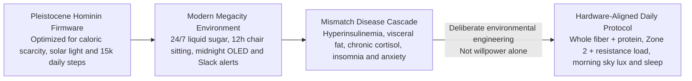
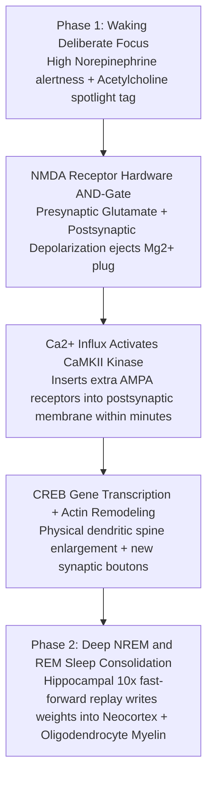

# Evolutionary Biology, Microbiome Symbiosis & Neuroscience Foundations

> **Module Scope**: Scaling up from single cells to whole organisms, ecosystems, and brains—how Darwinian natural selection optimizes wetware without a central designer, why modern urban engineers suffer predictable **evolutionary mismatch**, how $38\text{ trillion}$ gut microbes co-process your nutrition and immunity, and how action potentials plus **NMDA Hebbian plasticity (`LTP`)** physically wire habits and Staff-level engineering skills into your cortex.

---

## 1. Evolutionary Biology: Decentralized Stochastic Optimization

In 1859, Charles Darwin and Alfred Russel Wallace discovered arguably the most powerful algorithm in the universe: **adaptation without an architect**. Whenever *any* substrate—carbon organisms, RNA ribozymes in a test tube, viral variants, or neural-architecture search populations—satisfies three simple axioms, functional complexity emerges inevitably:

1. **Variation**: Individuals in a population differ in traits due to random point mutations, chromosomal crossovers (`meiotic recombination`), and gene duplications.
2. **Differential Reproductive Success (`Selection Filter`)**: Environmental constraints (predators, pathogens, famine, mate choice) are harsh enough that some trait variants leave more surviving offspring than others.
3. **Heritability**: Surviving parents pass their allele combinations down to the next generation, shifting population allele frequencies over time.

Crucially, **mutations are random with respect to need, whereas natural selection is ruthlessly non-random**. Giraffe ancestors did not grow longer necks *because* they stretched upward and wished for acacia leaves (Lamarckian fallacy); random genetic variance produced slightly longer- and shorter-necked calves, and during severe droughts, calves with $3\text{ cm}$ longer reach survived to breed while shorter-necked peers starved.

### Why Evolution Is a Tinkerer, Not a Clean-Slate Architect

As French Nobel laureate François Jacob famously observed, **evolution cannot shut down production for six months to rewrite legacy architecture from scratch**. Every intermediate mutation must boot, survive childhood, and reproduce in real time—meaning natural selection gets trapped on **local maxima** of the fitness landscape and carries hilarious legacy technical debt inside your own body:

| Human Anatomical Quirk | What a Clean-Slate Engineer Would Build | What Path-Dependent Evolution Actually Built | Root Legacy History |
| :--- | :--- | :--- | :--- |
| **Recurrent Laryngeal Nerve (`RLN`)** | A direct $5\text{ cm}$ nerve wire from the brainstem straight across to the vocal cords in the throat | Leaves the skull via the vagus nerve, **drops all the way down into the chest, loops underneath the aortic arch near the heart, and climbs back up the neck** ($4.5\text{ meters}$ of detour in giraffes!) | In our Devonian fish ancestors ($375\text{ Mya}$), that nerve took a direct path behind an arterial gill arch to a gill slit; as necks elongated and the heart migrated into the chest, the nerve could never "jump across" the aorta without breaking embryogenesis |
| **Inverted Vertebrate Retina (`Blind Spot`)** | Photoreceptor sensors facing *forward* toward incoming photons, with wiring cables tucked neatly behind them (like a Sony back-illuminated CMOS sensor—or an **octopus eye**!) | Human rods and cones sit **backwards at the very rear**, forcing photons through layers of blood capillaries and ganglion axons, which must punch *back through* the retina to reach the brain—creating a literal **blind spot** in each eye (masked in software by your visual cortex!) | Vertebrate eyes folded outward as neural-tube pouches, locking cable routing on the inner surface; cephalopod mollusks evolved camera eyes independently from skin infoldings (`Convergent Evolution`) without the wiring bug |
| **Lumbar Spine (`L4–L5`) & Sinus Drainage** | A wide, reinforced vertical compression pillar + gravity-assisted bottom-draining maxillary sinuses | A horizontal quadruped suspension bridge tilted $90^\circ$ upright in just $5\text{ million}$ years -> epidemic **L4–L5 / L5–S1 disc herniation**; maxillary sinuses drain *uphill* from an ostium near the ceiling of the cavity -> chronic human sinusitis | Rapid hominin shift to bipedalism to free hands for tools/carrying outpaced structural refactoring of vertebrae and reshaped facial skulls |

### Selfish-Gene Logic & Hamilton's Rule of Inclusive Fitness (`rB > C`)

For decades, biologists puzzled over **altruism**: if natural selection rewards reproductive output, why do sterile worker honeybees kamikaze-sting intruders to defend their hive, and why do ground squirrels bark alarm calls that draw a hawk's attention onto themselves?

In 1964, W. D. Hamilton proved mathematically—and Richard Dawkins popularized in *The Selfish Gene* (1976)—that **the fundamental unit of natural selection is not the species, the group, or even the individual organism; it is the replicator allele (the gene)**. Individual bodies are mortal, single-generation runtime containers ("vehicles"); genes are potentially immortal information strings copied across millennia. An allele programming altruistic behavior spreads in a gene pool whenever **Hamilton's Rule** holds:

$$r \cdot B > C$$

Where:
- $r \in [0, 1]$: **Coefficient of Genetic Relatedness**—the probability above population baseline that actor and recipient share an identical-by-descent copy of the allele ($r = 0.5$ for parents, offspring, and full siblings; $r = 0.25$ for grandparents, grandchildren, aunts/uncles, nieces/nephews; $r = 0.125$ for first cousins; $r = 0.75$ among haplodiploid sister bees!).
- $B$: **Fitness Benefit** gained by the recipient (measured in expected surviving offspring).
- $C$: **Fitness Cost** paid by the altruist.

As population geneticist J. B. S. Haldane joked in a pub: *"Would I lay down my life to save one brother? No—but I would to save two brothers ($2 \times 0.5 = 1.0$) or eight first cousins ($8 \times 0.125 = 1.0$)!"* Beyond blood kin, game theorist Robert Axelrod demonstrated that **Reciprocal Altruism** among unrelated individuals evolves robustly in repeated interactions via **Generous Tit-for-Tat** (`cooperate on Move 1, mirror partner's previous move to punish defectors immediately, forgive occasional noise`)—the biological foundation of human trust, reputation, contracts, and guilt.

### Population Genetics: Hardy-Weinberg Math, Balancing Selection & Genetic Drift

Before Darwin's theory was fused with Gregor Mendel's discrete inheritance in the 1930s **Modern Synthesis** (R. A. Fisher, J. B. S. Haldane, Sewall Wright), critics worried that sexual reproduction would "blend away" beneficial mutations like mixing black and white paint into uniform gray. **Hardy-Weinberg Equilibrium (1908)** proved mathematically that diploid particulate inheritance **conserves genetic variance indefinitely** in the absence of evolutionary forces:

For a locus with two alleles **$A$** (frequency $p$) and **$a$** (frequency $q$, where $p + q = 1$), random mating yields steady-state diploid genotype frequencies in a single generation:

$$p^2\text{ }(AA) + 2pq\text{ }(Aa\text{ heterozygotes}) + q^2\text{ }(aa) = (p + q)^2 = 1$$

- **Worked Clinical Example — Why Lethal Recessive Alleles Persist (`Heterozygote Advantage`)**:
  - Suppose a recessive disease allele has frequency $q = 0.02$ ($2\%$ of chromosomes; $p = 0.98$). Homozygous affected individuals occur at only $q^2 = 0.0004$ (**$1\text{ in }2,500$ births**—roughly the incidence of Cystic Fibrosis in Europeans), yet **asymptomatic heterozygous carriers** walk around at $2pq = 2(0.98)(0.02) \approx 0.0392$ (**nearly $1\text{ in }25$ people**—$98\times$ more common than patients!).
  - Why didn't natural selection purge the Sickle-Cell $\beta$-globin allele (`HbS`) to zero? In malaria-endemic West and Central Africa, `HbS` reaches $q \approx 0.12$: while $q^2 \approx 1.4\%$ of births suffer severe `HbSS` sickle-cell disease, **$2pq \approx 21\%$ of the entire population are healthy `HbAS` carriers** whose red blood cells abort *Plasmodium falciparum* parasite replication before lethal childhood cerebral malaria develops (**Balancing Selection**)!
- **Natural Selection vs. Random Genetic Drift ($N_e \cdot s$)**:
  - Natural selection is deterministic; **Genetic Drift** is finite-sample Monte Carlo quantization noise ($\text{variance} = \frac{pq}{2N_e}$, where $N_e$ is effective breeding population size). Whenever $|s| \ll \frac{1}{2N_e}$, random sampling noise overpowers natural selection (**Motoo Kimura's Neutral Theory of Molecular Evolution**—which allows geneticists to use neutral mutation accumulation as a calibrated **Molecular Clock**!).
  - Around $60,000\text{ to }70,000\text{ years ago}$, a small band of several thousand *Homo sapiens* migrated out of East Africa to populate Eurasia, Oceania, and the Americas (**Serial Founder Bottleneck**). Consequently, **$85\%+$ of all human genetic variation exists within any single population**, and **two individuals from different regions of sub-Saharan Africa are on average more genetically diverse from each other than a European is from an East Asian!**

---

## 2. Evolutionary Mismatch: Running Pleistocene Firmware in a 2027 Megacity

Compress the entire $300,000\text{-year}$ history of *Homo sapiens* (and $2.5\text{ million}$ years of genus *Homo*) into a **24-hour clock**:
- From `00:00:00` to `23:02:00`, humans lived as **mobile hunter-gatherers** in tight egalitarian bands of $50\text{ to }150$ people, walking/jogging $12\text{ to }18\text{ km}$ daily outdoors under solar light, eating fibrous tubers, game, nuts, and rare seasonal wild fruit, facing intermittent caloric scarcity and acute infectious/predator threats.
- Agriculture arrived around `23:02:00` ($12,000$ years ago—only approx. $450$ human generations, enough for tiny tweaks like adult **lactase persistence** in pastoralist populations or high-altitude *EPAS1* adaptation in Tibetans).
- The Industrial Revolution hit at `23:59:00`; smartphones, food-delivery apps, refined seed/sugar snack chemistry, and 12-hour desk work arrived in the **final $0.5\text{ seconds}$ before midnight**.

**Evolutionary Mismatch** occurs when traits that were life-saving optimizations in ancestral scarcity become **chronic self-destructive bugs** inside an engineered environment of supernormal abundance:

### The 5 High-Impact Urban Mismatch Domains & Engineering Countermeasures

| Physiological Subsystem | Ancestral Design Assumption | 2027 Megacity Trigger (`Supernormal Stimulus`) | Resulting Chronic Pathology | Practical Engineering Patch |
| :--- | :--- | :--- | :--- | :--- |
| **1. Fuel & Insulin Signaling** | Sweet taste = rare, seasonal ripe fruit packed in tough fibrous matrices; hoard every surplus calorie as fat before winter famine | Ultra-processed foods engineered at the **salt-sugar-fat "bliss point"** + liquid sucrose/fructose beverages lacking fiber | Skeletal muscle **insulin resistance**, fatty liver (`MASLD`), elevated ApoB & triglycerides, Type 2 diabetes | Eliminate liquid sugar; default to $1.4\text{ to }1.8\text{ g/kg}$ whole protein + $30\text{ g/day}$ fibrous plants; take a **10-minute brisk walk right after meals** (`contraction-mediated GLUT4` clears glucose without extra insulin!) |
| **2. Musculoskeletal & Myokine Load** | Daily $12\text{k+}$ steps, heavy carrying, squatting; conserve scarce $\text{ATP}$ by **atrophying unused muscle & bone** ("use it or lose it") | $10\text{ to }14\text{ hours/day}$ motionless in ergonomic chairs + elevators + car/metro door-to-door | **Sarcopenia** ($3\%\text{ to }8\%$ muscle loss per decade after age 30), L4–L5 disc creep, low **BDNF** brain growth factor | $2\text{ to }3\times/\text{wk}$ compound resistance training (squat/hinge/push/pull) + $150\text{ min/wk}$ **Zone 2 aerobic** work (conversational pace building mitochondrial density) |
| **3. HPA Stress Axis (`Cortisol`)** | Stress = a **90-second physical emergency** (lion or rival raid); spike adrenaline & cortisol to dump glucose into leg muscles, then sleep under stars | Unresolved chronic cognitive threats (on-call alerts, reorgs, mortgages, newsfeeds) firing the **amygdala** for months without physical discharge | Sustained cortisol blunts prefrontal executive focus, shrinks **hippocampal** memory neurons, deposits visceral belly fat, suppresses NK cells | Hard async notification boundaries; **physiological sighs** (double nasal inhale + slow extended exhale activating vagal brake); physical exercise to close the stress loop |
| **4. Master Circadian Clock (`SCN`)** | $10,000\text{ to }100,000\text{ lux}$ outdoor morning sky blue light hits retinal **ipRGCs**; $0\text{ lux}$ darkness (or amber firelight) after sunset | Dim $200\text{ lux}$ indoor mornings -> clock drifts late; bright $460\text{ nm}$ blue OLED screens at `23:30` trick the **Suprachiasmatic Nucleus** into thinking it is noon | $50\%+$ suppression of pineal **melatonin**, delayed sleep onset, fragmented slow-wave NREM repair | Get **$10\text{ to }15\text{ min}$ of direct outdoor sky light** (not through window glass) within $45\text{ min}$ of waking; dim overhead LEDs and shift warm after `21:30`; keep bedroom cool ($18\text{ to }20^\circ\text{C}$) |
| **5. Social & Dopamine Circuitry** | **Dunbar's Number ($\approx 150$)** known tribe members; dopamine rewards effortful foraging & tangible craft mastery | Variable-ratio algorithmic short-video feeds (`TikTok / Reels / X`) + status comparison against the top $0.001\%$ of $8\text{ billion}$ humans | Tonic **dopamine baseline depletion** (anhedonia, inability to sustain 60-minute deep code reading), chronic status anxiety | Keep phone physically outside the bedroom & workspace during morning deep-work blocks; anchor identity in craft output and real-world friendships |

---

## 3. Ecological Systems & The Human Microbiome (`38-Trillion-Node Co-Processor`)

Zooming outward, no organism exists as a standalone monolith. Every ecosystem obeys strict thermodynamic and population-dynamic laws:
- **Trophic Pyramid (`10% Ecological Efficiency Rule`)**: Solar photons captured by photosynthetic autotrophs (`primary producers`) lose approx. **$85\%\text{ to }90\%$ of free energy as metabolic heat at every trophic hop** (`Plants -> Herbivores -> Primary Carnivores -> Apex Predators`), which is why Earth supports trillions of tons of plant biomass, far fewer herbivores, and sparse populations of tigers or eagles—and why persistent fat-soluble toxins like methylmercury **biomagnify** $10^5\times$ in apex ocean fish like swordfish vs small sardines!
- **Logistic Growth & Carrying Capacity ($K$)**: Exponential growth ($\frac{dN}{dt} = rN$) is always transient; real populations hit resource depletion, waste accumulation, or infectious density limits governed by the Verhulst logistic equation:
  $$\frac{dN}{dt} = rN\left(1 - \frac{N}{K}\right)$$
- **Keystone Species & Trophic Cascades**: Removing a single low-headcount **keystone node** (such as gray wolves in Yellowstone or sea otters in kelp forests) triggers nonlinear runaway cascades—exploding elk/urchin herbivore populations that strip riverbanks or wipe out entire underwater kelp forests.

### Your Gut Microbiome: Symbiotic Biochemical Co-Processing

You are not a single species; biologically, you are a **holobiont**—a symbiotic consortium of approx. $3.7 \times 10^{13}$ human cells co-inhabiting with approx. **$3.8 \times 10^{13}$ bacteria, archaea, and fungi**, concentrated overwhelmingly in the anaerobic bioreactor of your **large intestine (colon)**. While your human genome encodes only $20,000$ protein genes, your gut microbiome collectively expresses **$2,000,000+$ unique microbial genes**—a massive biochemical plugin library performing tasks human enzymes cannot execute:

1. **Fermenting Soluble Fiber into Short-Chain Fatty Acids (`Butyrate`)**:
   - Human digestive enzymes (`amylase`, `sucrase`) cleave simple starches and sugars in the small intestine, leaving complex plant polysaccharides (**soluble fermentable fibers** in oats, beans, lentils, apples, onions, broccoli, berries, and cooled retrograded potatoes/rice) completely untouched.
   - Beneficial colonic anaerobes (*Faecalibacterium prausnitzii*, *Roseburia*, *Bifidobacterium*) ferment those fibers into **Short-Chain Fatty Acids (`SCFAs`)—Butyrate, Propionate, and Acetate**:
     - **Butyrate** provides **$70\%$ of the cellular $\text{ATP}$** consumed by your colonic epithelial cells!
     - Butyrate acts as a natural **histone deacetylase (`HDAC`) inhibitor**, strengthening intestinal **tight junctions** (blocking bacterial `LPS` endotoxin from leaking into portal blood), inducing anti-inflammatory **`FOXP3+` Regulatory T-cells** (`70%` of your entire immune system sits in gut-associated lymphoid tissue, `GALT`!), and triggering intestinal L-cells to secrete **endogenous `GLP-1` and `PYY` satiety hormones**!
2. **What Happens on a Low-Fiber Ultra-Processed Diet (`Mucus Barrier Erosion`)**:
   - Most urban adults eat barely $10\text{ to }14\text{ g/day}$ of fiber (vs ancestral intakes $> 50\text{ g/day}$ and clinical targets of **$30\text{ to }38\text{ g/day}$**).
   - Starved of dietary plant polysaccharides, opportunistic gut microbes pivot to digesting the glycoprotein **mucin layer** coating your colon wall—thinning the physical firewall separating $38\text{ trillion}$ bacteria from your immune system and driving chronic systemic `hs-CRP` inflammation.
3. **The Bidirectional Gut-Brain Axis (`Vagus Nerve` & Neuroactive Metabolites)**:
   - Over $80\%$ of fibers in your **Vagus Nerve** (`Cranial Nerve X`) are **afferent**—carrying real-time chemical telemetry *upward* from gut enterochromaffin and immune cells to your brainstem! Gut enterochromaffin cells synthesize roughly **$90\%\text{ to }95\%$ of the body's peripheral serotonin** (regulating gut motility—which is why SSRIs often cause transient GI nausea in Week 1, and why acute interview anxiety triggers immediate "butterflies" or gut urgency!).

---

## 4. Neuroscience Foundations: How 86 Billion Neurons Compute & Wire Skills

Your brain weighs approx. $1.4\text{ kg}$ ($2\%$ of body mass) yet burns **$20\%$ of your total resting oxygen and glucose ($20\text{ W}$)**—almost entirely to power billions of $\text{Na}^+/\text{K}^+$-ATPase ion pumps resetting electrochemical membrane voltages after neural spikes.

### Macro-Architecture of the Human Brain (`Evolutionary Stack from Kernel to Executive Simulator`)

Just like an operating system evolved by layering user-space planners atop ancient real-time kernel daemons, human neuroanatomy stacks four hundred million years of conserved modules:

| Brain Structure | Neuron Share / Evolutionary Age | Core Systems Responsibility | What Breaks When Damaged or Disrupted |
| :--- | :--- | :--- | :--- |
| **Brainstem (`Medulla, Pons, Midbrain`)** | Ancient vertebrate kernel ($500\text{ Mya}$) | Non-negotiable life-support daemons: **respiratory rhythm ($\text{CO}_2/\text{pH}$ sensor)**, blood-pressure baroreflex, arousal (`Locus Coeruleus` / `VTA`) | Instant fatal respiratory/cardiac arrest (why opioid overdose depressing medullary $\mu$-receptors stops breathing!) |
| **Cerebellum (`"Little Brain"`)** | **$69\text{ billion}$ neurons ($80\%$ of all brain neurons in $10\%$ of volume!)** | High-frequency **feed-forward inverse kinematics, motor error correction, and sub-millisecond timing** | `Ataxia` (jerky, uncalibrated movement—exactly what ethanol induces by impairing cerebellar Purkinje cells!) |
| **Thalamus** | Deep diencephalic relay hub | **Central Ingress API Gateway**: routes all sight, sound, touch, and taste streams to cortex; gates consciousness during NREM sleep | Sensory loss or coma |
| **Hypothalamus & Pituitary** | Tiny $4\text{ g}$ master controller | **Homeostatic PID & Endocrine Master**: clamps core temp ($37^\circ\text{C}$), thirst/osmolarity, hunger (`Leptin/Ghrelin`), circadian `SCN` clock, and `HPA` stress hormone axis | Thermoregulatory failure, severe obesity/anorexia, diabetes insipidus |
| **Amygdala** | Mammalian limbic alarm | **Low-latency threat & emotional salience interrupt controller** (`fires in 12 ms` before visual cortex finishes rendering a snake!) | PTSD hypervigilance (`false alarms`) vs. complete absence of fear |
| **Hippocampus** | Medial temporal archicortex | **Spatial GPS (`place/grid cells`, 2014 Nobel Prize) + Episodic Write-Ahead Log (`WAL`)** indexing new declarative memories prior to neocortical sleep flush | **Anterograde Amnesia** (Patient H.M.: intact childhood memories & motor skills, zero ability to commit new facts $> 2\text{ minutes}$!) |
| **Basal Ganglia (`Striatum`)** | Subcortical action-selection loop | **Reinforcement-learning policy network (`Go` vs `No-Go` pathways)** + compiled **habit & procedural macro execution** | Parkinson's Disease (loss of Substantia Nigra dopamine leaves `No-Go` brake stuck on -> tremor/rigidity) |
| **Prefrontal Cortex (`dlPFC / vmPFC`)** | Latest primate expansion ($16\text{ billion}$ cortical neurons total; matures around age $25$) | **Counterfactual simulation, $4 \pm 1$ slot working memory, long-horizon planning, and top-down inhibitory veto** over limbic impulses | Impulsivity, inability to hold complex software system invariants in head (acutely degraded by sleep debt or chronic cortisol!) |

### Hybrid Analog-Digital Architecture of a Biological Neuron

Unlike artificial neural networks where a "neuron" is a single static `dot_product + ReLU` float, a cortical pyramidal neuron is a complex **hybrid analog-digital processor**:
1. **Dendritic Tree (`Analog Weighted Input Integration`)**: Receives $1,000\text{ to }10,000$ incoming synapses; excitatory inputs (`EPSPs`, mostly $\text{Na}^+ / \text{Ca}^{2+}$ influx) push local voltage upward toward threshold, while inhibitory inputs (`IPSPs`, mostly $\text{Cl}^-$ influx via **GABA**) clamp voltage downward (`veto gates`).
2. **Axon Hillock (`Digital Threshold Comparator at -55 mV`)**: Sums graded analog potentials arriving at the cell body (`soma`). If net voltage stays at $-60\text{ mV}$, nothing fires (`0`); the instant voltage crosses **$-55\text{ mV}$**, an all-or-nothing digital **Action Potential** fires down the axon with zero amplitude decay!
3. **Myelin Sheath & Nodes of Ranvier (`High-Speed Repeater Line`)**: Glial **Oligodendrocytes** wrap axons in up to $100$ concentric layers of insulating lipid **myelin**, leaving tiny bare $1\text{ }\mu\text{m}$ gaps (**Nodes of Ranvier**) packed with voltage-gated $\text{Na}^+$ channels. Instead of creeping continuously at $1\text{ m/s}$, the electric field leaps node-to-node (**Saltatory Conduction**) at **$70\text{ to }120\text{ m/s}$** while slashing $\text{ATP}$ ion-pumping cost $100\text{-fold}$! (Autoimmune destruction of myelin causes the signal-drop symptoms of **Multiple Sclerosis**.)
4. **Chemical Synapse (`Probabilistic Analog-to-Chemical DAC`)**: Because electrical spikes cannot jump the $20\text{ nm}$ fluid **synaptic cleft**, arriving spikes open presynaptic **voltage-gated $\text{Ca}^{2+}$ channels**, triggering **SNARE** proteins to fuse neurotransmitter vesicles with the membrane in $< 1\text{ ms}$, diffusing chemical ligands across to postsynaptic receptors.

### The Action Potential State Machine (`-70 mV -> +30 mV -> -80 mV -> -70 mV`)

1. **Resting State ($-70\text{ mV}$)**: $\text{Na}^+/\text{K}^+$-ATPase pumps $3\text{ Na}^+$ ions out and $2\text{ K}^+$ ions in per $\text{ATP}$, while constitutively open $\text{K}^+$ leak channels let $\text{K}^+$ trickle down its concentration gradient until electrostatic pull balances chemical diffusion (Nernst equilibrium).
2. **Rising Phase (`Depolarization` to $+30\text{ mV}$)**: Crossing $-55\text{ mV}$ flips open **voltage-gated $\text{Na}_v$ channels** in a positive-feedback avalanche—extracellular $\text{Na}^+$ rushes inward down *both* concentration and voltage gradients, flipping interior voltage to $+30\text{ mV}$ in $0.5\text{ ms}$. (Local anesthetics like **lidocaine** at the dentist work simply by plugging $\text{Na}_v$ channels in pain nerve fibers so nociceptive packets never leave your jaw!)
3. **Falling Phase & Refractory Period (`Repolarization` to $-80\text{ mV}$)**: Within $1\text{ ms}$, $\text{Na}_v$ channels snap shut via an intrinsic **inactivation gate** while delayed **voltage-gated $\text{K}_v$ channels** open wide, dumping $\text{K}^+$ outward to plunge voltage briefly to $-80\text{ mV}$ (**hyperpolarization**). Because inactivated $\text{Na}_v$ gates cannot reopen until voltage drops back below $-65\text{ mV}$, spikes **can never bounce backward** up an axon, and stimulus intensity is encoded strictly by **spike frequency (`Hz`, rate coding)** rather than spike height!

### Peripheral Autonomic Dual-Bus Control: Sympathetic vs. Parasympathetic (`What Smartwatch HRV Actually Measures`)

Outside your conscious somatic motor cortex, your brainstem and spinal cord regulate visceral organs via two opposing autonomic buses—neither of which requires conscious CPU cycles, yet **both can be hacked mechanically via breathing**:

| Target Organ / Metric | Sympathetic Bus (`Fight-or-Flight` — Thoracic/Lumbar Norepinephrine + Adrenal Epinephrine) | Parasympathetic Bus (`Rest-and-Digest` — Cranial Vagus Nerve `ACh`) | Engineering Readout |
| :--- | :--- | :--- | :--- |
| **Heart Sinoatrial (`SA`) Node** | Accelerates heart rate ($90\text{ to }180+\text{ bpm}$) and contractility via $\beta_1$-adrenergic receptors | Slows resting heart rate ($48\text{ to }65\text{ bpm}$) via muscarinic `M2` $\text{K}^+$ channels | **High `HRV` (`Heart Rate Variability`)** reflects crisp vagal parasympathetic tone! |
| **Lung Bronchioles** | Dilates airways via $\beta_2$ receptors to maximize $\text{O}_2$ intake *(mimicked by `albuterol` asthma inhalers)* | Mild baseline constriction + mucus hydration | Acute sympathetic surge opens airways instantly |
| **GI Tract & Splanchnic Blood** | Vasoconstricts gut arteries (`shunts blood to quads/lats`), halts peristalsis & digestive enzymes | Vasodilates gut capillaries, stimulates stomach acid, bile, pancreatic enzymes & peristalsis | Eating a heavy meal during acute PagerDuty stress causes indigestion because gut perfusion is throttled |
| **Liver & Adipose Fuel** | Mobilizes rapid glycogen -> glucose breakdown and lipolysis into free fatty acids | Promotes hepatic glycogen synthesis and nutrient storage | Chronic sympathetic activation raises fasting glucose even without eating carbs! |
| **Pupils & Ciliary Lens** | Dilates pupils (`mydriasis`) and flattens lens for **panoramic far-field threat scanning** | Constricts pupils and accommodates lens for calm near-field focus | Taking a 5-minute outdoor **panoramic horizon gaze** releases ciliary tension and lowers sympathetic arousal |

> **Why Smartwatch `HRV` Should Be High, Not Flat (`Respiratory Sinus Arrhythmia`)**: Intuitively, engineers assume a healthy heart beats like a quartz crystal (`exactly 1,000 ms, 1,000 ms, 1,000 ms` at $60\text{ bpm}$). Physically, the opposite is true! Every time you **inhale**, your diaphragm drops, thoracic pressure falls, and your heart speeds up slightly (vagus brake lifted); every time you **exhale**, thoracic pressure rises, arterial baroreceptors fire, and your **Vagus Nerve releases Acetylcholine onto the SA node**, slowing beat-to-beat intervals (`e.g., 920 ms on inhale -> 1,090 ms on exhale`). That healthy millisecond oscillation is **Heart Rate Variability (`RMSSD` in ms)**: when you are overtrained, sleep-deprived, dehydrated, fighting an early viral fever, or drank alcohol at dinner, sympathetic tone overrides the vagus nerve and **`HRV` plummets overnight**—giving you an objective early-warning dashboard metric! Moreover, performing $2\text{ to }3$ **extended-exhale breaths** (`4s nasal inhale -> 8s slow exhale`) before a high-stakes architecture review mechanically forces vagal `ACh` release, dropping your heart rate by $10\text{ to }15\text{ bpm}$ in under $30\text{ seconds}$.

---

## 5. Seven Core Neurotransmitters & Neuromodulators Decoded for Engineers

Purge simplified pop-psychology clichés; understand what each signaling molecule actually computes in neural circuits:

| Molecule | Circuit Class | Core Computational Function | Practical Levers & Pharmacology |
| :--- | :--- | :--- | :--- |
| **Glutamate** | Fast Excitatory (`1`) | Primary excitatory workhorse at $>80\%$ of cortical synapses; drives **AMPA** depolarization and **NMDA** synaptic learning | Excess uncontrolled glutamate release during stroke ischemia causes lethal $\text{Ca}^{2+}$ **excitotoxicity** |
| **GABA** ($\gamma$-Aminobutyric Acid) | Fast Inhibitory (`0` / Circuit Breaker) | Opens $\text{Cl}^-$ channels to hyperpolarize neurons; prevents runaway epileptic synchronization and quiets limbic threat circuits | **Ethanol**, **benzodiazepines**, and **zolpidem (`Ambien`)** allosterically boost $\text{GABA}_A$ currents—sedating the brain, *not* producing natural restorative sleep architecture! |
| **Dopamine** | Neuromodulator (`RL` Reward Prediction Error) | Computes **$\delta = R_{\text{actual}} - R_{\text{expected}}$** in the VTA -> Nucleus Accumbens pathway; drives **motivation, craving, vigor, and habit reinforcement** (*not* passive pleasure!) | Spikes *higher* on unexpected/uncertain rewards (`slot machines`, `scrolling`) than predictable ones, followed by a below-baseline dip that triggers craving |
| **Acetylcholine (`ACh`)** | Neuromodulator (`Attention Spotlight` + Motor) | Fires every skeletal neuromuscular junction; in cortex (from Nucleus Basalis), acts as a **"highlight & save" gate** tagging active synapses for later plasticity | **Nicotine** mimics ACh at nicotinic receptors; anticholinergic drugs (first-gen **diphenhydramine / Benadryl**) block muscarinic ACh receptors, causing acute brain fog! |
| **Norepinephrine (`Noradrenaline`)** | Neuromodulator (`Gain / Alertness`) | Broadcast from **Locus Coeruleus**; follows the **Yerkes-Dodson inverted-U curve**: moderate levels sharpen signal-to-noise focus; excessive levels trigger panic & prefrontal shutdown | Cold-water face splash, upright posture, brisk exercise, and focused deadlines raise locus coeruleus tone into the productive zone |
| **Serotonin (`5-HT`)** | Neuromodulator (`Patience, Satiety & Mood`) | Stabilizes impulse control, emotional resilience, and contentment with *what you already have* (counterbalancing forward-striving dopamine) | Morning sunlight, aerobic exercise, dietary tryptophan, and clinically prescribed **SSRIs** (blocking `SERT` reuptake) |
| **Adenosine** | Homeostatic **Sleep-Pressure Timer** | Byproduct of waking $\text{ATP}$ hydrolysis ($\text{ATP} \to \text{ADP} \to \text{AMP} \to \text{Adenosine}$); accumulates hourly while awake to drive sleepiness, cleared during deep NREM sleep via the **glymphatic system** | **Caffeine** is a competitive $A_{2A}$ antagonist (`half-life 5 to 7 hours`!): a `16:00` double espresso leaves $50\%$ of caffeine still blocking receptors at `22:00`, slashing restorative deep slow-wave sleep by $15\%\text{ to }30\%$ even if you fall asleep! |

---

## 6. How Neurons Wire Habits & Deep Engineering Skills (`Hebbian LTP` & Sleep Replay)

When you spend three weeks mastering Rust borrow-checking, distributed Raft consensus, or jazz piano voicings, *where* is that skill physically stored? Not in floating RAM variables—it is etched directly into **synaptic weights, dendritic spines, and axonal myelin** via **Long-Term Potentiation (`LTP`)**.

### The NMDA Hardware `AND`-Gate (`Why Passive Re-Reading Fails to Learn`)

In 1949, Donald Hebb proposed that when Neuron A repeatedly helps fire Neuron B, the metabolic coupling between A and B strengthens (*"cells that fire together wire together"*). Decades later, neuroscientists uncovered the exact nanoscale transistor implementing Hebb's rule—the **NMDA Glutamate Receptor**:
1. At resting voltage ($-70\text{ mV}$), even if Neuron A releases glutamate onto Neuron B, the **NMDA channel pore is physically corked shut by a positively charged Magnesium ion ($\text{Mg}^{2+}$)**. Only neighboring **AMPA** channels open briefly, producing a weak transient blip with **zero lasting memory**.
2. However, if Neuron A fires strongly/repeatedly—or fires *simultaneously* alongside focused contextual inputs so Neuron B depolarizes past $-40\text{ mV}$—the positive interior voltage **electrostatically pops the $\text{Mg}^{2+}$ cork out of the NMDA channel**!
3. Now **Calcium ($\text{Ca}^{2+}$)** floods into the dendritic spine, activating **CaMKII** (*Calcium/Calmodulin-dependent Protein Kinase II*), which:
   - Immediately traffics **extra AMPA receptors** onto the postsynaptic surface (doubling or tripling synaptic weight $w_{ij}$ within minutes—**Early LTP**).
   - Signals to the nucleus (`CREB` transcription factor) to compile structural proteins that physically widen the dendritic spine head (**Late LTP**), while active firing stimulates neighboring **oligodendrocytes** to wrap thicker **myelin insulation** around that exact axonal pathway!

### Why Active Recall + Error Signals + Sleep Beat Passive Tutorials 10x

Look directly at the NMDA + Neuromodulator mechanism above to see why most engineers study inefficiently:
1. **Passive Watching / Re-Reading Doesn't Open Acetylcholine/Norepinephrine Gates**: Watching a 2x-speed system-design video while half-checking Slack produces near-zero locus coeruleus norepinephrine and nucleus basalis **acetylcholine**. Without the `ACh` "tag-for-plasticity" signal after age 25, adult brains treat passive sensory streams as background noise and discard them!
2. **Productive Frustration (`Error Signals`) Triggers Plasticity**: Attempting to reconstruct an architecture diagram from a blank page, hitting a subtle bug, and feeling mild frustration **spikes norepinephrine + acetylcholine simultaneously**, chemically marking the exact miswired synapses that need updating.
3. **Sleep Is When the Database Commits (`Hippocampal-Neocortical Replay`)**: Waking focus only *tags* candidate synapses in your fast, limited-capacity **Hippocampus** (`write-ahead log`). During **Deep NREM Slow-Wave Sleep** and **Sleep Spindles**, the hippocampus replays the day's neural firing trajectories at **$10\times\text{ to }20\times$ compressed speed**, transferring permanent weights into long-term **Neocortical** storage while pruning noisy weak synapses (`synaptic homeostasis`) and pumping cerebrospinal fluid through **glymphatic channels** ($60\%$ wider during sleep!) to flush metabolic $\beta$-amyloid and adenosine waste.
4. **Basal Ganglia Habit Automation (`Dorsomedial -> Dorsolateral Striatum`)**: Repeating a `Cue -> Routine -> Outcome` loop $30\text{ to }90$ times shifts execution out of the $\text{ATP}$-hungry **Prefrontal Cortex** into chunked procedural circuits in the **Dorsolateral Striatum**—freeing your conscious working memory ($4 \pm 1$ slots) to reason about higher-level architecture while your hands type Vim motions or guitar chords effortlessly!

---

## 7. Complete Bio-Maintenance Protocol for High-Output Software Engineers

Synthesizing all four files of this curriculum yields seven non-negotiable, mechanism-backed operating rules for your own carbon hardware:

1. **Protect the $7.5\text{ to }8.5\text{ h}$ Sleep Commit Window**: Cut all caffeine $8\text{ to }10\text{ hours}$ before bedtime (`hard cutoff 13:00 to 14:00`); view outdoor morning sky light within $45\text{ min}$ of waking; never sacrifice NREM/REM replay for late-night cramming.
2. **Train Both Mitochondrial Turbines & Structural Muscle Weekly**: Combine $150+\text{ min/week}$ of **Zone 2 aerobic cardio** (stimulating `PGC-1alpha` mitochondrial biogenesis and $F_O F_1$-ATP synthase density) with $2\text{ to }3$ sessions/week of **progressive resistance training** (preserving insulin-sensitive GLUT4 muscle mass, bone density, and brain-derived neurotrophic factor `BDNF`).
3. **Feed Both Genomes (`Human + 38T Gut Holobiont`)**: Anchor meals around whole protein ($1.4\text{ to }1.8\text{ g/kg/day}$ supplying all 9 essential amino acids for translation/neurotransmitters) + **$30+\text{ g/day}$ diverse plant fibers** + fermented foods (unsweetened yogurt, kimchi, sauerkraut) to fuel colonic **butyrate** production and seal gut `GALT` immunity; eliminate liquid sucrose/fructose spikes.
4. **Engineer Dopamine & Attention Deliberately**: Guard the first $90\text{ minutes}$ of your workday for effortful creation **before** opening variable-reward feeds; study new technical domains via **active recall + blank-sheet error generation** rather than passive highlighting.
5. **Respect Pathogen Biology & Antibiotic Stewardship**: Wash hands with soap and water ($20\text{ s}$ lyses viral lipid envelopes and flushes non-enveloped virions); keep adult subunit/mRNA/flu vaccines current; **never take amoxicillin, cephalosporins, or macrolides for viral colds**—test first and preserve microbiome commensals.

---

### Curriculum Navigation

- **Previous**: [02-IMMUNE-SYSTEM-VIRUSES-AND-ANTIBIOTICS.md](02-IMMUNE-SYSTEM-VIRUSES-AND-ANTIBIOTICS.md) — *How Your Immune System Fights Invaders: Viruses, Bacteria, Antibiotics & Vaccines*
- **Back to Vault Index**: [00-README.md](00-README.md) — *Modern Biology for Engineers: Carbon-Based Distributed Systems, Code & Evolution*
