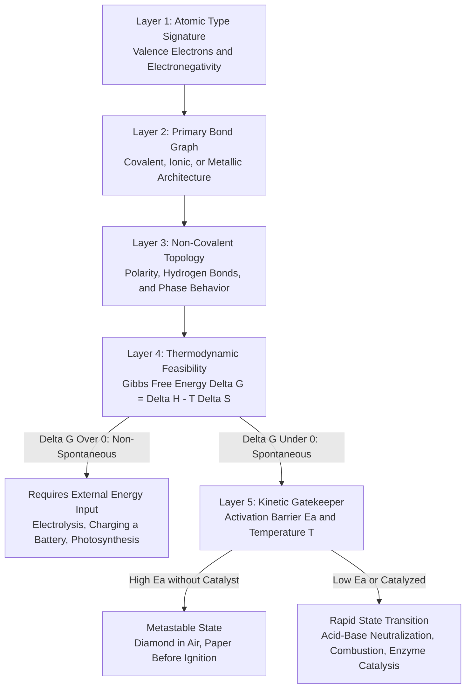
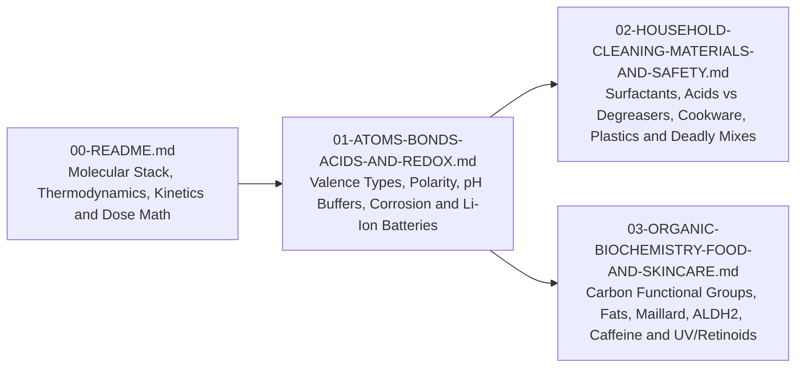

# Chemistry as Molecular Engineering: How Atoms Bond, React & Build the Material World

> **Target Reader**: Software, Systems, and AI Engineers who want a rigorous, first-principles mental model of how matter actually works—bridging quantum physics to smartphone batteries, cookware metallurgy, household safety, food flavor, and human biochemistry without rote high-school memorization.

---

## 1. Why Software Engineers Need Molecular Literacy

Most people leave high-school chemistry with fragmented trivia—balancing artificial stoichiometry worksheets or memorizing orbital mnemonics—without ever grasping the underlying architecture. For a software engineer, that is like learning regular-expression edge cases without ever understanding how CPUs, memory allocators, or type systems work.

In the hierarchy of the natural sciences, **chemistry is the systems-engineering and API layer between quantum physics and macroscopic reality**:

- **Physics** defines the bare-metal instruction set: Coulomb electrostatics, quantum spin, Pauli exclusion, and conservation of energy.
- **Chemistry** is the **type system, memory model, and state-machine runtime** built on top of those instructions: valence shells dictate which atoms can link ("compile-time arity"), bond energies determine structural durability ("pointer lifetimes"), and activation energies control transition throughput ("mutexes and rate limiters").
- **Materials Science & Biology** are the large-scale distributed applications compiled from that molecular runtime—from the $\text{LiNi}_x\text{Mn}_y\text{Co}_z\text{O}_2$ cathode powering your laptop to the hepatic `ALDH2` enzyme detoxifying ethanol after dinner.

When you internalize five or six core molecular invariants, hundreds of seemingly unrelated daily decisions snap into focus:

1. **Hardware Longevity**: Why holding a lithium-ion battery at $100\%$ charge inside a $40\,^\circ\text{C}$ car permanently degrades capacity via parasitic Solid Electrolyte Interphase (SEI) growth, whereas fast-charging at $0\,^\circ\text{C}$ plates dangerous metallic lithium dendrites.
2. **Material Selection & Maintenance**: Why $18/10$ stainless steel self-heals a $2\text{ nm}$ passive $\text{Cr}_2\text{O}_3$ ceramic shield in air, why PTFE non-stick pans are chemically inert at $180\,^\circ\text{C}$ yet release toxic pyrolysis fumes above $260\,^\circ\text{C}$, and why microwaving oily food in disposable plastic sheds millions of microplastic particles.
3. **Cleaning & Safety**: Why scrubbing shower limescale with alkaline dish soap is chemically futile while $5\%$ citric acid dissolves it effortlessly—and why mixing chlorine bleach with toilet acid synthesizes lethal World War I chlorine gas ($\text{Cl}_2$) in seconds.
4. **Culinary & Metabolic Control**: Why patting a steak dry unlocks $150\,^\circ\text{C}$ Maillard aroma synthesis, why caffeine blocks adenosine receptors without actually clearing sleep debt, and why East Asian alcohol flushing signals accumulation of a Group 1 DNA-crosslinking carcinogen (acetaldehyde).

---

## 2. The Software Engineer's Mental Model: The 5-Layer Molecular Stack

Every chemical phenomenon you encounter can be debugged by asking which layer of the molecular stack is governing the behavior:

| Computing Stack Layer | Molecular Equivalent | Governing Physical Quantity | Everyday Engineering Manifestation |
| :--- | :--- | :--- | :--- |
| **1. Static Type System & Arity** | **Valence Shells & Electronegativity ($\chi$)** | Outer $s/p$ electron slots; Pauling scale ($0.7\text{ to }3.98$) | Carbon always takes 4 covalent links (`struct` with 4 fields); Noble gases have full shells (`final` immutable singletons); Sodium donates 1 electron to Chlorine. |
| **2. Strong Ownership Pointers** | **Intramolecular Bonds** (Covalent, Ionic, Metallic) | Bond dissociation energy ($150\text{ to }1000\text{ kJ/mol}$) | Determines whether a molecule survives boiling, UV photons, or stomach acid. The $\text{C-F}$ bond ($485\text{ kJ/mol}$) makes PTFE nearly indestructible below $260\,^\circ\text{C}$. |
| **3. Weak References & Topology** | **Intermolecular Forces** (Hydrogen Bonds, Dipole, Van der Waals) | Non-covalent interaction energy ($1\text{ to }40\text{ kJ/mol}$) | Governs boiling points, viscosity, solubility ("like dissolves like"), DNA base-pairing, protein folding, and how soap micelles lift grease off skin. |
| **4. Target State & Equilibrium** | **Thermodynamics ($\Delta G, \Delta H, \Delta S$)** | Gibbs Free Energy ($\Delta G = \Delta H - T\Delta S$) | Dictates *whether* State A wants to transition to State B spontaneously ($\Delta G < 0$), and where dynamic equilibrium ($K_{\text{eq}}$) settles. |
| **5. Execution Throughput & Acceleration** | **Kinetics ($E_a$) & Catalysis** | Activation barrier $E_a$; Arrhenius rate $k$ | Dictates *how fast* a thermodynamically valid reaction runs. Enzymes and platinum catalysts act like database indexes—slashing $E_a$ without altering $\Delta G$. |

---

## 3. Thermodynamics vs. Kinetics: Why Diamonds Do Not Turn Into Pencil Lead

The single biggest conceptual bug in amateur chemistry is confusing **thermodynamic stability** (*where the system wants to go*) with **kinetic speed** (*how long it takes to get there*).

### Gibbs Free Energy: The Master Feasibility Function

At constant temperature $T$ (in Kelvin) and pressure, every chemical transformation is governed by the **Gibbs Free Energy** equation:

$$\Delta G = \Delta H - T\Delta S$$

Where:
- **$\Delta H$ (Enthalpy Change, $\text{kJ/mol}$)**: Net bond energy accounting. Breaking existing bonds *costs* energy ($+$); forming stronger new bonds *releases* energy ($-$). If $\Delta H < 0$, the reaction is **exothermic** (releases heat to surroundings, like burning methane or neutralizing lye with acid). If $\Delta H > 0$, it is **endothermic** (absorbs ambient heat, like dissolving ammonium nitrate in an instant cold pack, or melting ice).
- **$\Delta S$ (Entropy Change, $\text{J/(mol}\cdot\text{K)}$)**: Change in the number of accessible microscopic configurations ($S = k_B \ln \Omega$). Turning 1 mole of liquid or solid into gas—such as baking soda reacting with acid to release $\text{CO}_2\uparrow$—creates a massive positive $\Delta S > 0$.
- **$\Delta G$ (Gibbs Free Energy Change)**:
  - $\Delta G < 0$: **Exergonic (Spontaneous)**—can proceed forward without continuous external work, and can be harnessed to do work (e.g., discharging a battery).
  - $\Delta G > 0$: **Endergonic (Non-spontaneous)**—will not happen on its own; requires external energy injection (e.g., plugging in your phone charger to drive $\text{Li}^+$ ions uphill back into the graphite anode).
  - $\Delta G = 0$: **Dynamic Equilibrium**—forward and reverse reaction rates match exactly.

Here is the classic paradox: at room temperature ($298\text{ K}$) and $1\text{ atm}$, converting crystalline **diamond** into ordinary **graphite** (pencil lead) has $\Delta G^\circ = -2.9\text{ kJ/mol} < 0$. Thermodynamically, graphite is the true ground state of carbon at surface pressure; every diamond ring is technically metastable! Why doesn't a diamond crumble into black powder in your drawer?

### Activation Energy ($E_a$) & The Arrhenius Rate Law

To rearrange tetrahedral $sp^3$ carbon atoms in diamond into planar $sp^2$ graphene sheets, you must simultaneously sever multiple $348\text{ kJ/mol}$ covalent $\text{C-C}$ bonds before the new bonds can form. That intermediate transition peak is the **Activation Energy ($E_a$)**—for diamond to graphite, $E_a \approx 730\text{ kJ/mol}$, an insurmountable wall at room temperature.

Reaction throughput follows the **Arrhenius Equation**:

$$k = A \cdot \exp\!\left(-\frac{E_a}{RT}\right)$$

Where $k$ is the rate constant, $A$ is the collision-frequency & orientation prefactor, $R = 8.314\text{ J/(mol}\cdot\text{K)}$ is the universal gas constant, and $T$ is absolute temperature in Kelvin.

Because $T$ sits inside the denominator of a negative exponential, **modest temperature changes trigger exponential rate shifts**:
- For typical everyday activation energies ($E_a \approx 50\text{ to }80\text{ kJ/mol}$), **raising temperature by $10\,^\circ\text{C}$ roughly doubles to triples the reaction rate** ($Q_{10} \approx 2\text{ to }3$).
- Dropping milk from a $25\,^\circ\text{C}$ kitchen counter into a $4\,^\circ\text{C}$ refrigerator slows bacterial metabolic chemistry by roughly $4\times\text{ to }6\times$; dropping it into a $-18\,^\circ\text{C}$ freezer slows degradation by $>30\times$ while locking liquid water into solid ice (halting diffusion).
- Conversely, fast-charging a smartphone under a pillow at $45\,^\circ\text{C}$ instead of $25\,^\circ\text{C}$ accelerates unwanted parasitic electrolyte decomposition roughly $4\times$.
- **Catalysts and Biological Enzymes** do *not* alter $\Delta G$; instead, they stabilize the transition-state geometry via precise active-site pockets, slashing $E_a$ so reactions that would take centuries in neutral water complete in milliseconds at $37\,^\circ\text{C}$ body temperature.

### Dynamic Equilibrium & Le Chatelier's Principle (Chemical Backpressure)

Reversible reactions ($a\text{A} + b\text{B} \rightleftharpoons c\text{C} + d\text{D}$) act like closed-loop control systems governed by the equilibrium constant $K_{\text{eq}}$:

$$K_{\text{eq}} = \frac{[\text{C}]^c [\text{D}]^d}{[\text{A}]^a [\text{B}]^b} = \exp\!\left(-\frac{\Delta G^\circ}{RT}\right)$$

**Le Chatelier's Principle** states that if you perturb a system at equilibrium—by adding reactant, removing product, changing pressure, or adding heat—the system shifts to counteract the perturbation:
- **Opening a carbonated soda bottle**: Inside the sealed bottle, $P_{\text{CO}_2} \approx 3\text{ to }4\text{ atm}$ holds dissolved carbonic acid in equilibrium ($\text{CO}_2\text{(g)} + \text{H}_2\text{O} \rightleftharpoons \text{H}_2\text{CO}_3\text{(aq)}$). Uncapping drops headspace $\text{CO}_2$ partial pressure by $99.9\%$, driving the equilibrium sharply leftward—degassing bubbles and making flat soda measurably *less acidic* over hours.
- **Hyperventilation & Blood pH**: Breathing too rapidly blows off $\text{CO}_2$ from the lungs, pulling $\text{H}^+ + \text{HCO}_3^- \to \text{H}_2\text{CO}_3 \to \text{H}_2\text{O} + \text{CO}_2\uparrow$ and raising blood pH above $7.45$ (respiratory alkalosis, causing tingling fingers and lightheadedness).

---

## 4. The Six Core Reaction Archetypes of Everyday Life

Nearly $99\%$ of domestic, material, culinary, and physiological chemistry reduces to six recurring reaction patterns:

| Reaction Archetype | Core Particle / Bond Operation | Canonical Daily Examples | Primary Control Lever |
| :--- | :--- | :--- | :--- |
| **1. Acid-Base (Proton Transfer)** | $\text{H}^+$ donor neutralizes $\text{H}^+$ acceptor | Citric acid dissolving kettle $\text{CaCO}_3$ limescale; antacids neutralizing stomach $\text{HCl}$; baking powder leavening | Solution $\text{pH}$ relative to target $\text{p}K_a$ |
| **2. Redox (Electron Transfer)** | Oxidation loses $e^-$; Reduction gains $e^-$ | Iron rusting; lithium-ion battery charge/discharge; chlorine/oxygen bleach cleaving stain chromophores; Vitamin C scavenging radicals | Electrochemical potential $E$ (Volts) & oxidizer concentration |
| **3. Solvation & Micellization** | Non-covalent polarity matching & amphiphilic encapsulation | Soap/SLES micelles lifting skin sebum into rinse water; $70\%$ isopropanol dissolving flux residue; espresso lipid emulsification | Surfactant CMC, HLB balance, mechanical agitation & warm water |
| **4. Chelation (Metal Complexation)** | Polydentate ligand wraps multivalent metal cations ($\text{Ca}^{2+}, \text{Mg}^{2+}, \text{Fe}^{3+}$) | Citric acid & EDTA softening hard water so detergent works; hemoglobin heme binding $\text{O}_2$ via $\text{Fe}^{2+}$ | Chelator molar ratio & $\text{pH}$ (deprotonating carboxylate claws) |
| **5. Hydrolysis & Saponification** | Water (assisted by $\text{OH}^-$ or hydrolase enzymes) cleaves ester/amide/glycosidic bonds | Alkaline oven degreaser turning baked grease into water-soluble soap; protease laundry enzymes digesting blood/sweat stains; human digestion | Alkali strength ($\text{pH } 11\text{ to }13$) or enzyme optimal temp ($30\text{ to }40\,^\circ\text{C}$) |
| **6. Thermal Condensation & Radical Polymerization** | Heat/UV drives covalent cross-linking or aromatic ring synthesis | Maillard steak crust ($150\,^\circ\text{C}$); polymerizing flax/canola oil onto cast iron; UV-cured dental fillings & gel nail polish | Surface dryness, temperature threshold ($140\text{ to }230\,^\circ\text{C}$), oxygen/radical access |

---

## 5. Quantitative Scale, Concentration & Dose Literacy

Chemophobia in consumer marketing thrives on binary thinking ("contains chemical X = toxic"). Real toxicology and materials engineering operate strictly on **molar quantity and concentration**. Paraclesus's 500-year-old axiom—*sola dosis facit venenum* ("the dose alone makes the poison")—is quantitative:

- **Water ($\text{H}_2\text{O}$)** is essential at $2\text{ to }3\text{ L/day}$, yet drinking $6\text{ to }7\text{ L}$ rapidly without electrolytes causes fatal dilutional hyponatremia (cerebral edema).
- **Formaldehyde ($\text{CH}_2\text{O}$)** is an industrial indoor-air hazard above $0.08\text{ mg/m}^3$, yet a single fresh pear naturally synthesizes $\approx 6\text{ to }10\text{ mg}$ of endogenous formaldehyde as part of normal one-carbon amino-acid metabolism—which your liver oxidizes to harmless formate in minutes.
- **Botulinum toxin** has an intravenous $\text{LD}_{50} \approx 1\text{ ng/kg}$ (lethal in micrograms), yet localized picogram injections safely treat muscle spasms and wrinkles (Botox).

### Essential Concentration Units Decoded

Avogadro's constant ($N_A = 6.02214076 \times 10^{23}\text{ mol}^{-1}$) is simply the scaling factor converting atomic mass units ($\text{Da}$ or $\text{u}$) into macroscopic grams: because one $\text{H}_2\text{O}$ molecule weighs $18.015\text{ Da}$, $1\text{ mole}$ ($6.022 \times 10^{23}$ molecules) of water weighs $18.015\text{ g}$ ($\approx 18\text{ mL}$, or roughly one tablespoon).

| Unit Notation | Exact Definition | Intuitive Physical Scale | Common Real-World Context |
| :--- | :--- | :--- | :--- |
| **Molarity ($\text{M}$ or $\text{mol/L}$)** | Moles of solute per liter of solution | Molecular count density for stoichiometric math | Stomach acid $\approx 0.03\text{ to }0.1\text{ M HCl}$; household white vinegar ($5\%$) $\approx 0.83\text{ M}$ acetic acid |
| **Weight/Volume ($\%\text{ w/v}$ or $\%\text{ w/w}$)** | Grams per $100\text{ mL}$ (or $100\text{ g}$) | $1\% = 10\text{ g/L} = 10{,}000\text{ ppm}$ | $75\%\text{ v/v}$ ethanol sanitizer; $5\%$ niacinamide serum; $0.9\%\text{ NaCl}$ isotonic saline |
| **ppm (Parts Per Million)** | $1\text{ mg}$ per $\text{kg}$ (or $1\text{ mg/L}$ in dilute water) | **1 drop ($0.05\text{ mL}$) in a $50\text{ L}$ bathtub**; or $1\text{ second}$ in $11.6\text{ days}$ | Municipal tap-water free chlorine ($0.5\text{ to }2\text{ ppm}$); hard water $\text{CaCO}_3$ ($>120\text{ ppm}$); indoor $\text{CO}_2$ ($420\text{ to }1000\text{ ppm}$) |
| **ppb (Parts Per Billion)** | $1\,\mu\text{g}$ per $\text{kg}$ (or $1\,\mu\text{g/L}$ in water) | **1 drop in an Olympic-sized tanker truck ($50{,}000\text{ L}$)**; or $1\text{ second}$ in $31.7\text{ years}$ | EPA lead action level in drinking water ($15\text{ ppb}$); human nose detecting geosmin petrichor rain scent ($0.005\text{ ppb}$!) |

### Practical Dilution Engineering: The $C_1 V_1 = C_2 V_2$ Conservation Invariant

Whenever you dilute a concentrated stock solution—whether mixing $84$ Bleach ($\approx 5\%\text{ NaOCl}$, or $50{,}000\text{ ppm}$ available chlorine) for bathroom disinfection, diluting $70\%$ citric acid powder into descaling liquid, or cutting espresso concentrate—the total moles of solute remain invariant before and after adding solvent:

$$C_1 \cdot V_1 = C_2 \cdot V_2 \quad \Longrightarrow \quad V_1 = \frac{C_2 \cdot V_2}{C_1}$$

**Worked Everyday Example (Sanitizing Surfaces Without Corroding Metal)**:
- **Goal**: Prepare $V_2 = 1000\text{ mL}$ ($1\text{ L}$) of $C_2 = 500\text{ ppm}$ ($0.05\%$) sodium hypochlorite surface disinfectant from a standard bottle of $C_1 = 5\%\text{ w/v}$ ($50{,}000\text{ ppm}$) household bleach.
- **Calculation**:
  $$V_1 = \frac{500\text{ ppm} \times 1000\text{ mL}}{50{,}000\text{ ppm}} = 10\text{ mL}$$
- **Execution**: Add $10\text{ mL}$ (roughly 1 standard bottle cap) of $5\%$ bleach into $990\text{ mL}$ of **cold tap water** ($1:99$ dilution). Using $10\times$ too much ($100\text{ mL}$, or $5000\text{ ppm}$) does not make your countertop "ten times cleaner"—it pits $304$ stainless steel, yellows silicone seals, and irritates bronchial tissue.

---

## 6. Reading Ingredient Lists & Safety Data Sheets (SDS) Like an Engineer

Consumer marketing copy on the *front* of a bottle is unregulated storytelling ("natural plant-powered oxy-shield," "dermatologist-inspired"). The *back* ingredient panel and industrial **Safety Data Sheet (SDS)** are legally standardized schemas that expose the exact chemistry inside.

### Decoding INCI & Consumer Formulation Panels

Under international **INCI (International Nomenclature of Cosmetic Ingredients)** and food labeling regulations, ingredients follow strict ordering invariants:

1. **Descending Mass Order Above the $1\%$ Threshold**: Every ingredient present at $>1\%\text{ w/w}$ MUST be listed strictly from highest mass fraction to lowest. In $80\%$ of shampoos, lotions, and liquid detergents, item `#1` is `Aqua (Water)` ($65\%\text{ to }85\%$ of the bottle), followed by primary surfactants, humectants (`Glycerin`), or emollients (`Caprylic/Capric Triglyceride`).
2. **The $1\%$ Permutation Boundary**: Any ingredient present at $\le 1\%\text{ w/w}$ can be listed in **arbitrary order** after the $1\%$ cutoff! Brands exploit this by placing trendy "hero" extracts (peptides, ceramides, argan oil) right after the $1\%$ line while burying preservatives (`Phenoxyethanol`, typically $0.5\%\text{ to }1.0\%$) or `Fragrance / Parfum` at the very bottom—even when the expensive active sits at a homeopathic $0.001\%$ ("fairy dusting").
3. **Locate the $1\%$ Anchor**: Memorize common $0.5\%\text{ to }1.0\%$ boundary markers—`Phenoxyethanol`, `Xanthan Gum`, `Carbomer`, `Sodium Hyaluronate`, `Disodium EDTA`, `Tocopherol` (Vitamin E stabilizer), and `Parfum`. Everything printed *below* `Phenoxyethanol` in a skincare serum is almost certainly $\le 1\%$.

### Five Critical Physical Numbers on Any Material or Solvent Datasheet

Before using an unfamiliar solvent, adhesive, 3D-printing resin, or workshop cleaner, check five physical parameters on its SDS (identifiable unambiguously via its **CAS Registry Number**, e.g., `67-63-0` for Isopropanol, `67-64-1` for Acetone):

| SDS Parameter | Physical Meaning | Low vs. High Thresholds | Practical Safety Implication |
| :--- | :--- | :--- | :--- |
| **Vapor Pressure ($P_{\text{vap}}$ at $20\,^\circ\text{C}$)** | Equilibrium gas pressure above liquid; measures evaporation & inhalation load | Water $= 2.3\text{ kPa}$; IPA $= 4.4\text{ kPa}$; Acetone $= 24.7\text{ kPa}$ | Acetone evaporates $>10\times$ faster than water, rapidly saturating small unventilated rooms with breathable vapor. |
| **Flash Point ($T_{\text{flash}}$)** | Lowest liquid temperature at which vapor above the surface ignites from a spark | Acetone $= -20\,^\circ\text{C}$; $75\%$ Ethanol $\approx 21\,^\circ\text{C}$; Mineral oil $> 130\,^\circ\text{C}$ | Never spray $75\%$ ethanol sanitizer near open gas stoves, static sparks, or hot hair dryers—at $22\,^\circ\text{C}$ room temp it sits *above* its flash point! |
| **Vapor Density ($\text{Air} = 1.0$)** | Molecular weight of vapor relative to dry air ($\approx 29\text{ g/mol}$) | Methane $= 0.55$ (rises); Propane $= 1.55$; $\text{Cl}_2$ gas $= 2.45$ (sinks) | Heavy vapors (butane, gasoline fumes, chlorine gas, $\text{CO}_2$) pool along floors and shower drains, igniting from distant floor-level pilot lights or suffocating pets first. |
| **$\log K_{\text{ow}}$ (Octanol-Water Partition)** | Base-10 log of solubility in nonpolar octanol vs polar water | $\log K_{\text{ow}} < 0$: hydrophilic; $\log K_{\text{ow}} > 3$: lipophilic/bioaccumulative | High-$\log K_{\text{ow}}$ compounds (PFAS, PCBs, fat-soluble vitamins A/D/E/K, permethrin) partition into adipose fat and cell membranes rather than flushing out in urine. |
| **PEL / TLV-TWA ($8\text{-hr}$ ppm)** | Occupational maximum safe airborne concentration over an 8-hour workday | IPA $= 400\text{ ppm}$; Ammonia $= 25\text{ ppm}$; Chlorine $\text{Cl}_2 = 0.5\text{ ppm}$ | Gives an instant objective toxicity comparison: chlorine gas is $800\times$ more acutely hazardous per inhaled molecule than rubbing alcohol vapor. |

---

## 7. Curriculum Navigation & Study Order

This vault is organized from foundational atomic and electrochemical principles up to applied material safety, culinary reactions, and human biochemistry. You can read sequentially from `01` to `03` or jump directly to a practical problem using the quick-index below.

### Complete Vault Table of Contents

1. **[00-README.md](00-README.md) — Chemistry as Molecular Engineering: How Atoms Bond, React & Build the Material World** *(Current Document)*
   - The 5-layer molecular stack for engineers, Gibbs free energy ($\Delta G$) vs activation barriers ($E_a$), Arrhenius temperature scaling, Le Chatelier's principle, the 6 everyday reaction archetypes, and concentration/toxicology unit literacy.
2. **[01-ATOMS-BONDS-ACIDS-AND-REDOX.md](01-ATOMS-BONDS-ACIDS-AND-REDOX.md) — Atoms, Bonds, Polarity, pH & Electrochemistry (From Rust to Lithium-Ion Batteries)**
   - Periodic table intuition via valence shells and electronegativity, covalent/ionic/metallic/hydrogen bond energies, the entropic truth behind "like dissolves like," logarithmic pH and Henderson-Hasselbalch buffers, iron rust vs aluminum/chromium oxide passivation, and a deep dive into NMC vs LFP lithium-ion battery degradation and charging protocols.
3. **[02-HOUSEHOLD-CLEANING-MATERIALS-AND-SAFETY.md](02-HOUSEHOLD-CLEANING-MATERIALS-AND-SAFETY.md) — Household Cleaning, Everyday Materials & Chemical Safety**
   - Matching dirt chemistry to reagents (alkaline saponification for kitchen grease vs citric acid chelation for limescale vs surfactants/enzymes for laundry), cookware metallurgy and polymer engineering ($304/316$ stainless steel, cast-iron polymerization, PTFE pyrolysis thresholds, silicone), plastics `#1`–`#7` leaching profiles, and deadly household chemical mixes never to combine ($\text{NaOCl}$ bleach + toilet acid = $\text{Cl}_2$ gas; bleach + ammonia; bleach + rubbing alcohol).
4. **[03-ORGANIC-BIOCHEMISTRY-FOOD-AND-SKINCARE.md](03-ORGANIC-BIOCHEMISTRY-FOOD-AND-SKINCARE.md) — Organic & Biochemistry in Food, Drink & Skincare**
   - Carbon's valence-4 composability and functional groups, saturated vs cis-unsaturated vs omega-3 vs trans fatty acid geometry and smoke-point oxidation, Maillard reaction vs caramelization vs charring, hepatic ethanol $\to$ acetaldehyde `ALDH2*2` ("Asian flush") carcinogenesis, caffeine adenosine-receptor antagonism, and evidence-based skincare chemistry (sunscreen UV filters, retinoid enzymatic conversion, Vitamin C, and barrier lipids).

### Everyday Molecular Troubleshooting Quick-Index

| Real-World Engineering Question | Governing Chemical Principle | Reference Module |
| :--- | :--- | :--- |
| Why does keeping a phone or EV at $100\%$ charge in summer ruin battery health? | Parasitic anode SEI growth & cathode lattice oxidation accelerated by Arrhenius kinetics | [01-ATOMS-BONDS-ACIDS-AND-REDOX.md](01-ATOMS-BONDS-ACIDS-AND-REDOX.md) |
| Why does $70\%$ rubbing alcohol kill bacteria far better than $99\%$ pure IPA? | $99\%$ IPA coagulates surface proteins instantly into a protective shell; $30\%$ water slows evaporation and enables osmotic transmembrane penetration | [01-ATOMS-BONDS-ACIDS-AND-REDOX.md](01-ATOMS-BONDS-ACIDS-AND-REDOX.md) |
| How do I dissolve white kettle crust and cloudy shower glass in 10 minutes without scrubbing? | Protonation + calcium chelation of insoluble $\text{CaCO}_3$ via warm $5\%$ citric acid | [02-HOUSEHOLD-CLEANING-MATERIALS-AND-SAFETY.md](02-HOUSEHOLD-CLEANING-MATERIALS-AND-SAFETY.md) |
| Which takeout plastics are safe to microwave, and when do PTFE pans become hazardous? | `#5 PP` thermal limits + lipid microplastic shedding; PTFE $\text{C-F}$ pyrolysis above $260\,^\circ\text{C}$ | [02-HOUSEHOLD-CLEANING-MATERIALS-AND-SAFETY.md](02-HOUSEHOLD-CLEANING-MATERIALS-AND-SAFETY.md) |
| Why did pouring 84 Bleach after toilet cleaner send someone to the ICU? | Acid shifts hypochlorite equilibrium ($\text{OCl}^- + \text{Cl}^- + 2\text{H}^+ \to \text{Cl}_2\uparrow + \text{H}_2\text{O}$) into pulmonary chlorine gas | [02-HOUSEHOLD-CLEANING-MATERIALS-AND-SAFETY.md](02-HOUSEHOLD-CLEANING-MATERIALS-AND-SAFETY.md) |
| Why does olive oil beat seed oils for sauteing, and why must wet steaks be patted dry? | Monounsaturated vs bis-allylic PUFA peroxidation; water's $2260\text{ kJ/kg}$ vaporization clamp blocking $150\,^\circ\text{C}$ Maillard browning | [03-ORGANIC-BIOCHEMISTRY-FOOD-AND-SKINCARE.md](03-ORGANIC-BIOCHEMISTRY-FOOD-AND-SKINCARE.md) |
| Why can't someone with East Asian alcohol flush "train" tolerance, and how do retinoids + SPF actually work? | Genetic `ALDH2*2` acetaldehyde bottleneck; UV band-gap/$\pi$-conjugation photochemistry + nuclear `RAR` conversion | [03-ORGANIC-BIOCHEMISTRY-FOOD-AND-SKINCARE.md](03-ORGANIC-BIOCHEMISTRY-FOOD-AND-SKINCARE.md) |
