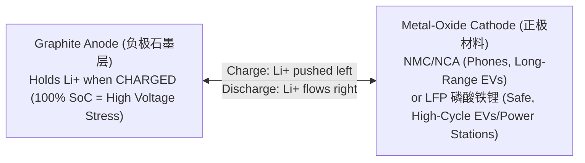

# Atoms, Bonds, Polarity, pH & Electrochemistry: From Rust to Lithium-Ion Batteries

Once you read the Periodic Table as a **valence-slot type system** (`1` to `8` outer electrons) paired with **electronegativity** (how greedily an atom pulls shared electrons), bonding, solubility, acids/bases, corrosion, and lithium-ion battery care become intuitive first-principles engineering.

---

## Table of Contents

1. [The Periodic Table as a Valence Type System](#1-the-periodic-table-as-a-valence-type-system)
2. [Primary vs Secondary Bonds & Why "Like Dissolves Like"](#2-primary-vs-secondary-bonds--why-like-dissolves-like)
3. [Logarithmic pH, Buffers & Why `70%` Alcohol Beats `99%` Alcohol](#3-logarithmic-ph-buffers--why-70-alcohol-beats-99-alcohol)
4. [Redox & Corrosion: Why Iron Flakes Into Rust While Aluminum & Stainless Self-Heal](#4-redox--corrosion-why-iron-flakes-into-rust-while-aluminum--stainless-self-heal)
5. [Lithium-Ion Battery Chemistry (`NMC` vs `LFP`) & Longevity Rules](#5-lithium-ion-battery-chemistry-nmc-vs-lfp--longevity-rules)

---

## 1. The Periodic Table as a Valence Type System

Ignore the middle transition metals for a moment and look at the **8 main columns**: every main-group atom wants to reach the **8-electron full outer shell (`Octet Invariant`)** of a Noble Gas:

| Column / Group | Outer Valence Electrons | Electron Strategy ("Type Signature") | Everyday Examples |
| :--- | :---: | :--- | :--- |
| **Group 1 (Alkali Metals)** | `1` (`H, Li, Na, K`) | Eagerly **donates `1e-`** to become `+1` cation ($\text{Na}^+, \text{Li}^+$) | Table salt ($\text{NaCl}$), nerve action potentials, Li-ion batteries |
| **Group 14 (Carbon / Silicon)** | `4` (`C, Si`) | Shares **4 directional covalent bonds** (`struct` with 4 composable pointers!) | Organic life, plastics, fats, crystalline silicon chips |
| **Group 15 / 16 (`N, O, S`)** | `5` / `6` | High electronegativity ($\chi_{\text{O}} = 3.44$); pulls shared electrons unevenly, creating **polar dipoles** | Water ($\text{H}_2\text{O}$), proteins, oxidation/combustion |
| **Group 17 (Halogens)** | `7` (`F, Cl, Br, I`) | Aggressively **grabs `1e-`** to complete its octet ($\chi_{\text{F}} = 3.98$, strongest in nature!) | Bleach ($\text{OCl}^-$), stomach acid ($\text{HCl}$), indestructible $\text{C-F}$ Teflon bonds |
| **Group 18 (Noble Gases)** | `8` (`He, Ne, Ar`) | Shell already `100%` full (`immutable singleton`)—chemically inert | Argon welding/wine preservation, double-pane insulated windows |

---

## 2. Primary vs Secondary Bonds & Why "Like Dissolves Like"

- **Primary Intramolecular Bonds (`150–1000 kJ/mol`)**: Covalent (shared electrons), Ionic ($\text{Na}^+\text{Cl}^-$ crystal lattice), Metallic ("sea" of delocalized electrons—explaining why metals conduct both electricity and heat and bend without shattering like ceramic!).
- **Hydrogen Bonds (`~20 kJ/mol` — Nature's Velcro)**: Because Oxygen in $\text{H-O-H}$ hogs electrons, each water molecule is a bent V-shaped electric magnet (`δ-` oxygen nose, two `δ+` hydrogen ears).
- **The Real Reason Oil & Water Separate ("Like Dissolves Like / 相似相溶")**:
  - Contrary to myth, oil and water do **not** "hate/repel" each other—water actually attracts oil weakly via Van der Waals forces!
  - Instead, water molecules **love hydrogen-bonding with *each other* (`20 kJ/mol`)** so strongly that surrounding non-polar oil chains forces water into rigid, low-entropy cages (**Hydrophobic Effect**, $\Delta S < 0$). Squeezing oil droplets out into a separate layer frees water molecules to maximize entropy and hydrogen bonds!
  - **Practical Payoff**: Water alone will never wash chili oil off your shirt or capsaicin (`脂溶性辣椒素`) off a burning tongue—drink **whole milk or yogurt** (casein + fat micelles dissolve non-polar capsaicin!), never ice water!

---

## 3. Logarithmic pH, Buffers & Why `70%` Alcohol Beats `99%` Alcohol

1. **pH Is Base-10 Logarithmic ($\text{pH} = -\log_{10}[\text{H}^+]$)**:
   - Pure water at $25^\circ\text{C}$ sits at $\text{pH } 7.0$. Every **1 unit drop** means **$10\times$ higher proton concentration**: cola ($\text{pH } 2.5$) is **$31,600\times$ more acidic** than pure water (rinse mouth with plain water after soda/lemon water—never brush softened tooth enamel immediately for 30 minutes!).
   - **Human Blood Is Tightly Buffered at $\text{pH } 7.35\text{--}7.45$** via bicarbonate ($\text{HCO}_3^- / \text{H}_2\text{CO}_3$) and kidneys—which immediately exposes **"alkaline water / 弱碱性水改变酸碱体质"** marketing as 100% pseudoscience (your $\text{pH } 1.5$ stomach acid neutralizes alkaline water on contact!).
2. **Why `70%–75%` Medical Alcohol Disinfects Better Than `99%` Pure Alcohol**:
   - `99%` anhydrous alcohol (`无水乙醇/异丙醇`) dehydrates and coagulates outer bacterial wall proteins **so violently fast** that it forms a hardened protective crust around the bacterium, preventing alcohol from entering the core—and evaporates off surfaces in 3 seconds!
   - Adding `25%–30%` water slows evaporation and uses osmotic pressure to carry alcohol straight across the lipid membrane to denature internal enzymes completely. Use `99%` IPA strictly for cleaning electronics/camera sensors, and **`75%` ethanol** for skin/package disinfection!

---

## 4. Redox & Corrosion: Why Iron Flakes Into Rust While Aluminum & Stainless Self-Heal

Oxidation (`失去电子`) happens to almost every metal in oxygen—why does an iron bicycle rust through completely while an anodized aluminum MacBook or `304` stainless steel sink stays bright for 30 years?

- **Iron Oxide ($\text{Fe}_2\text{O}_3\cdot n\text{H}_2\text{O}$)**: Has a **larger molar volume** than underlying iron (**Pilling-Bedworth Ratio $> 2$**), so rust swells, cracks, flakes off, and exposes fresh bare iron underneath until the entire beam dissolves!
- **Aluminum ($\text{Al}_2\text{O}_3$) & `304 / 316` Stainless Steel ($\ge 18\%$ Chromium $\to \text{Cr}_2\text{O}_3$)**: Within milliseconds of scratching the surface in air, chromium or aluminum reacts with oxygen to form an **impermeable, transparent `2–4 nm` ceramic oxide skin** with the exact right crystal volume (**Passivation `钝化膜`**) that seals out oxygen and water automatically! *(Note: Prolonged salt/chloride `Cl-` ions pit `304` stainless—which is why coastal architecture and premium thermos flasks upgrade to molybdenum-alloyed **`316` medical/marine stainless steel**!)*

---

## 5. Lithium-Ion Battery Chemistry (`NMC` vs `LFP`) & Longevity Rules

Inside your iPhone, MacBook, Osmo Pocket 3, and EV, **zero metallic lithium** should ever exist—instead, $\text{Li}^+$ ions shuttle back and forth ("rocking-chair intercalation") between two crystal bookshelves:

### Four Evidence-Based Rules That Double Battery Lifespan
1. **Heat + `100%` State-of-Charge (`满电高温`) Is Enemy #1**: At `100%` charge (`4.20–4.45V`), the graphite anode sits near `0.05V` vs Li, continuously decomposing liquid electrolyte into a thickening resistive crust (**SEI film growth**), accelerated exponentially by temperature (leaving a `100%` charged laptop or power bank on a $50^\circ\text{C}$ summer dashboard ages it by 6 months in a single week!). Enable **`80%` Charge Limit** on iPhone/MacBook when plugged into a desk monitor all day.
2. **Never Fast-Charge Below $0^\circ\text{C}$ (`严禁零下低温快充`)**: In freezing weather, $\text{Li}^+$ diffusion into graphite slows dramatically; forcing high charging current causes $\text{Li}^+$ ions to pile up on the surface as sharp **metallic lithium needles (`锂枝晶`)** that can pierce the separator and cause internal short circuits! Warm cold camera/drone/phone batteries inside an inner coat pocket before charging.
3. **`NMC` (`三元锂`) vs `LFP` (`磷酸铁锂`) Calibration Difference**:
   - **Phones / Laptops / `NMC` EVs**: Happiest living between **`20%` and `80%`** daily.
   - **`LFP` (`磷酸铁锂` EVs & portable power stations)**: Flatter voltage curve requires charging to **`100%` once every 1–2 weeks** solely so the BMS (`电池管理系统`) can recalibrate its `100%` top voltage anchor—while durable olivine $\text{LiFePO}_4$ bonds shrug off `3,000+` cycles!
4. **Swollen Spicy-Pillow Battery = Immediate Disposal (`鼓包电池严禁挤压穿刺`)**: Gas inside a puffed pouch cell is flammable decomposed electrolyte (`CO, CH4, H2`). Stop using immediately, discharge gently if safe, and hand over to an official Apple Store / e-waste dropoff—never puncture or toss down an apartment trash chute!
