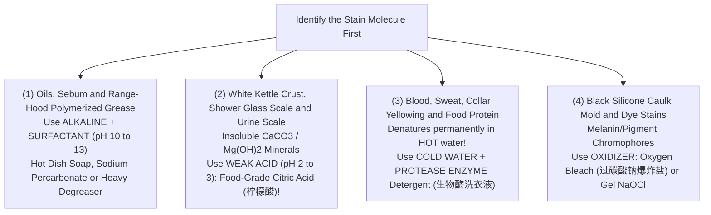

# Everyday Household Cleaning, Materials & Deadly Chemical Safety (居家清洁化学、材质避坑与毒理红线)

Walk down a supermarket cleaning aisle and 50 colorful bottles claim miracle grease-and-stain removal. Once you categorize every household stain into **four molecular classes**, you only need **four cheap core reagents**—and you will never accidentally mix two cleaners into a hospital-grade toxic gas emergency.

---

## Table of Contents

1. [The 4-Stain Matrix: Matching Dirt Chemistry to the Exact Right Cleaner](#1-the-4-stain-matrix-matching-dirt-chemistry-to-the-exact-right-cleaner)
2. [DEADLY Household Mixes: Never Combine Bleach (`84消毒液`) With Anything!](#2-deadly-household-mixes-never-combine-bleach-84消毒液-with-anything)
3. [Cookware & Food-Contact Material Engineering (`不锈钢 / 特氟龙 / 硅胶`)](#3-cookware--food-contact-material-engineering-不锈钢--特氟龙--硅胶)
4. [Decoding Plastic Recycling Codes `#1` to `#7` (Microwave & Hot-Soup Safety)](#4-decoding-plastic-recycling-codes-1-to-7-microwave--hot-soup-safety)

---

## 1. The 4-Stain Matrix: Matching Dirt Chemistry to the Exact Right Cleaner

Scrubbing white bathroom faucet crust with alkaline dish soap for 30 minutes does nothing because **mineral carbonate salts require acid, whereas polymerized kitchen grease requires base + surfactants**!

### Three Game-Changing Household Chemistry Hacks
1. **Food-Grade Citric Acid Powder (`食品级一水柠檬酸`, RMB 12/kg) = Descaling Miracle**:
   - Boil `1 L` water + `1.5 tbsp` (`20 g`) citric acid in your crusty electric kettle, let sit `15 minutes`, and pour out—insoluble $\text{CaCO}_3$ dissolves silently into crystal-clear calcium citrate with **zero pungent vinegar smell**! Spray `5%` citric acid solution on cloudy glass shower doors (`水垢`), wait 10 minutes, and rinse sparkling clean. *(Never use acid on natural marble `天然大理石`, which *is* $\text{CaCO}_3$!)*
2. **Never Wash Fresh Blood or Protein Stains in Hot Water (`血迹千万别用热水洗`)**:
   - Hemoglobin and egg/milk proteins coagulate irreversibly above $55^\circ\text{C}$—cooking the stain permanently into cotton fibers! Rinse immediately from the **back side** of the fabric with **cold tap water** + enzyme laundry liquid (or `3%` hydrogen peroxide $\text{H}_2\text{O}_2$ for white sheets, which foams away blood heme instantly!).
3. **Sodium Percarbonate ("Explosive Salt" `过碳酸钠 / 彩漂粉`) for Yellowed White Tees**:
   - Dissolving $\text{2Na}_2\text{CO}_3 \cdot \text{3H}_2\text{O}_2$ in **$50^\circ\text{C}$ warm water** releases soda ash + active oxygen ($\text{H}_2\text{O}_2$)—stripping oxidized collar sebum (`白T领口发黄`) back to brand-new brightness in a 40-minute soak **without weakening cotton or yellowing spandex like chlorine `84` bleach does!**

---

## 2. DEADLY Household Mixes: Never Combine Bleach (`84消毒液`) With Anything!

Every single year, healthy adults land in respiratory ICUs from bathroom cleaning accidents. Memorize this **One Absolute Rule**: **Sodium Hypochlorite (`次氯酸钠 / 84消毒液`) is used ALONE with cold water ONLY—never before, during, or right after another bottle!**

| Dangerous Combination | Exact Chemical Reaction | Toxic Product & Immediate Danger |
| :--- | :--- | :--- |
| **`84消毒液` (Bleach) + `洁厕灵` / Vinegar / Citric Acid (ANY Acid!)** | $\text{NaOCl} + 2\text{HCl} \to \text{NaCl} + \text{H}_2\text{O} + \mathbf{\text{Cl}_2\uparrow}$ | **Lethal Yellow-Green Chlorine Gas (`剧毒氯气`)** — reacts with wet lung alveoli to form hydrochloric acid inside your lungs (`chemical pulmonary edema`) within 2 breaths! |
| **`84消毒液` (Bleach) + Ammonia / Window Cleaner / Urine (`氨水/玻璃水`)** | $\text{OCl}^- + \text{NH}_3 \to \mathbf{\text{NH}_2\text{Cl}\uparrow} + \text{OH}^-$ | **Toxic Chloramine Vapors (`氯胺毒气`)** — acute airway burns, chest pain, and severe ocular damage |
| **`84消毒液` (Bleach) + `75%` Rubbing Alcohol (`医用酒精`)** | Haloform oxidation reaction | **Chloroform (`三氯甲烷/哥罗芳`) + HCl + Organochlorines** — liver toxicity and CNS dizziness in closed bathrooms |

> **Emergency Action**: If you ever smell a sharp swimming-pool/pungent choking odor while cleaning, **hold your breath, leave the bathroom immediately, shut the door behind you, open exterior apartment windows**, and seek medical evaluation if coughing/chest tightness develops!

---

## 3. Cookware & Food-Contact Material Engineering (`不锈钢 / 特氟龙 / 硅胶`)

- **`304` (`18/8`) & `316` (`18/10 + 2% Mo`) Austenitic Stainless Steel**: Non-magnetic (or weakly magnetic after cold-stamping—so "testing `304` with a fridge magnet" is unreliable; look for `GB 4806.9` `06Cr19Ni10` / `022Cr17Ni12Mo2` markings!). Completely safe with vinegar, tomatoes, dishwashers, and `250°C` searing.
- **PTFE Non-Stick Coatings (`特氟龙聚四氟乙烯`)**:
  - **Harmless if swallowed as a cold solid flake**? Surprisingly **yes**—Because $\text{C-F}$ bonds (`485 kJ/mol`) are completely inert to $\text{pH } 1.5$ stomach acid, an accidentally swallowed cold scratch flake passes straight through the GI tract unchanged!
  - **The REAL PTFE Hazard Is Dry Overheating (`> 260°C–300°C` 空烧热解)**: Heating an empty PTFE skillet on high for 3 minutes exceeds $280^\circ\text{C}$, pyrolyzing fluoropolymer chains into toxic gas fumes (**polymer fume fever `聚合物烟雾热`**—flu-like chills and lung irritation). **Never preheat a non-stick pan empty!** *(Note: Beware PFOA/PFAS marketing tricks—PFOA was banned globally years ago, so "PFOA-free non-stick" is still PTFE with the exact same $260^\circ\text{C}$ thermal ceiling!)*
- **Platinum-Cured Food-Grade Silicone (`铂金硫化食品级硅胶`)**: Cross-linked $\text{-Si-O-Si-}$ quartz-like backbone safe from $-40^\circ\text{C}$ to **$220^\circ\text{C}$** (great for spatulas and steamer mats; pinch-twist test: if silicone turns chalky white when pinched hard, it's padded with cheap filler—buy pure platinum silicone that stays uniform color when twisted!).

---

## 4. Decoding Plastic Recycling Codes `#1` to `#7` (Microwave & Hot-Soup Safety)

Flip over any takeout box or water bottle and check the triangle number **`1` through `7`** on the bottom:

| Code | Polymer Name | Common Use | Heat / Oil / Reuse Safety Rule |
| :---: | :--- | :--- | :--- |
| **`#1`** | **PET (`聚对苯二甲酸乙二醇酯`)** | Mineral water & soda bottles (`农夫山泉/可乐瓶`) | **Single-use cold/room-temp ONLY** (`<= 65°C`); warps and leaches antimony/oligomers if refilled with boiling water or kept as an oil/soy-sauce bottle for months! |
| **`#2`** | **HDPE (`高密度聚乙烯`)** | Milk jugs, shampoo/detergent bottles | Safe chemically, opaque; do not microwave |
| **`#3`** | **PVC (`聚氯乙烯`)** | Pipes, cheap non-food cling wraps | **Keep away from hot/oily food!** Plasticizers (`phthalates`) migrate rapidly into hot meat fat |
| **`#4`** | **LDPE (`低密度聚乙烯`)** | Household PE cling wrap (`普通保鲜膜`) | Fine for cold fridge cover; melts/leaches above `110°C`—don't touch oily food directly inside a microwave! |
| **`#5`** | **PP (`聚丙烯` — THE ONLY MICROWAVE-SAFE PLASTIC)** | Clear/white takeout soup bowls (`餐盒盖与盒体需同时确认#5!`), baby bottles | Heat-resistant to **`120°C–130°C`**. **CRITICAL TRAP**: Many takeout bowls have a **`#5 PP` tub paired with a cheap `#1 PET` or `#6 PS` clear lid**—**ALWAYS take the plastic lid OFF** before microwaving, or even better: **transfer oily takeout onto a ceramic/Borosilicate glass plate (`高硼硅玻璃碗`)** before microwaving to cut microplastic intake by `95%`! |
| **`#6`** | **PS (`聚苯乙烯`)** | Foam instant-noodle cups, brittle clear disposable lids | Releases styrene monomer in boiling oil (`> 90°C`); **never microwave!** |
| **`#7`** | **Other (`PC 聚碳酸酯 / Tritan`)** | Old `PC` water cooler barrels (may contain **BPA `双酚A`**) vs modern BPA-free **Eastman Tritan** sports bottles | Only use `#7` for hot liquids if explicitly stamped **`Tritan / BPA-Free`**! |
