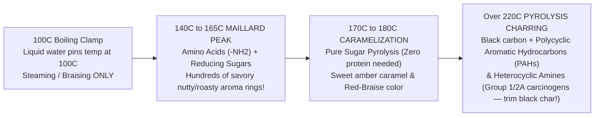

# Organic & Biochemistry in Food, Drink & Skincare (饮食、酒精咖啡因与护肤分子化学)

Carbon (`4` covalent bonds, able to form rings, chains, and double bonds) is nature's universal programming language. Understanding **five everyday organic pathways** demystifies dietary fats, browning flavor, alcohol flushing, caffeine crashes, and dermatologist skincare ingredients.

---

## Table of Contents

1. [Dietary Fats Decoded: Saturated, Cis-Unsaturated, Omega-3 & Trans Fats](#1-dietary-fats-decoded-saturated-cis-unsaturated-omega-3--trans-fats)
2. [Maillard Reaction vs Caramelization vs Acrylamide/PAH Charring](#2-maillard-reaction-vs-caramelization-vs-acrylamidepah-charring)
3. [Alcohol Metabolism & Why "Asian Flush" (`ALDH2*2`) Cannot Be Trained](#3-alcohol-metabolism--why-asian-flush-aldh22-cannot-be-trained)
4. [How Caffeine Actually Works: Competitive Adenosine Receptor Blockade](#4-how-caffeine-actually-works-competitive-adenosine-receptor-blockade)
5. [Molecular Skincare Chemistry: UV Filters, Vitamin C, Retinoids & Ceramides](#5-molecular-skincare-chemistry-uv-filters-vitamin-c-retinoids--ceramides)

---

## 1. Dietary Fats Decoded: Saturated, Cis-Unsaturated, Omega-3 & Trans Fats

Why is butter solid at $20^\circ\text{C}$, olive oil liquid, flaxseed/fish oil prone to rancidity in heat, and industrial trans fat (`人造反式脂肪`) toxic to arteries? **Pure 3D bond geometry!**

| Fat Class | Carbon Chain Geometry | Room-Temp State & Heat Stability | Cardiovascular Impact |
| :--- | :--- | :--- | :--- |
| **Saturated Fat (`饱和脂肪`: Butter, Lard, Coconut Oil)** | Zero `C=C` double bonds -> straight rigid rods that pack tightly via Van der Waals forces | Solid/semi-solid; **high heat oxidation stability** | Fine in moderate culinary amounts; excess raises `LDL / ApoB` |
| **Monounsaturated (`单不饱和 Cis`: Olive, Avocado, High-Oleic Canola/Peanut)** | **One `cis` (`顺式`) `C=C` double bond** creates a permanent $30^\circ$ kink -> molecules cannot pack flat | Liquid; **sweet spot of good heat stability + heart health** | Lowers `ApoB` and vascular inflammation (**#1 daily oil choice**) |
| **Polyunsaturated (`多不饱和 PUFA`: Omega-3 EPA/DHA Fish Oil, Soybean/Sunflower)** | `2 to 6` `cis` double bonds -> coiled liquid springs; `bis-allylic` $\text{-CH}_2\text{-}$ groups between double bonds oxidize rapidly at high heat! | Liquid even in fridge; **fragile at deep-fry temps** | Essential cell-membrane fluidity (**Omega-3 EPA/DHA** strongly anti-inflammatory; avoid repeatedly reheated deep-fry seed oil!) |
| **Industrial Trans Fat (`反式脂肪`: Partially Hydrogenated Oil `氢化植物油/起酥油`)** | Artificial **`trans` (`反式`) `C=C` bond** straightens the kink back into a rigid unnatural rod! | High-melting solid for cheap shelf-stable bakery | **Worst fat in biochemistry**—simultaneously spikes `LDL`, drops `HDL`, and inflames endothelium (`check pastry labels for 植脂末/代可可脂/人造奶油!`) |

---

## 2. Maillard Reaction vs Caramelization vs Acrylamide/PAH Charring

- **Why Boiled Meat Never Tastes Roasted**: Maillard condensation between nucleophilic amine groups ($-\text{NH}_2$) on proteins and carbonyl groups ($=\text{O}$) on sugars has a high activation barrier requiring **$140^\circ\text{C}\text{--}165^\circ\text{C}$** and low water activity. Golden-brown crust = flavor heaven; **charcoal-black burnt crust on BBQ skewers** = carcinogenic **benzopyrene (`苯并芘`)** and heterocyclic amines—enjoy golden sear, scrape off black char!

---

## 3. Alcohol Metabolism & Why "Asian Flush" (`ALDH2*2`) Cannot Be Trained

When ethanol ($\text{CH}_3\text{CH}_2\text{OH}$) enters your liver, a **two-stage enzymatic pipeline** clears it:

$$\text{Ethanol } (\text{CH}_3\text{CH}_2\text{OH}) \xrightarrow{\text{Step 1: ADH (乙醇脱氢酶)}} \mathbf{\text{Acetaldehyde } (\text{CH}_3\text{CHO} \text{ — Toxic Group 1 Carcinogen!})} \xrightarrow{\text{Step 2: ALDH2 (乙醛脱氢酶2)}} \text{Harmless Acetate } (\text{CH}_3\text{COO}^-)$$

- **The Critical Genetic Fact (`喝酒脸红不是能喝，是乙醛中毒警报!`)**:
  - Roughly **`35%–45%` of East Asians** carry a dominant-negative mutation in the mitochondrial **`ALDH2*2`** gene. Their Step 1 enzyme (`ADH`) converts ethanol into toxic **acetaldehyde (`乙醛`)** rapidly, while their Step 2 enzyme (`ALDH2`) runs at **$< 10\%$ normal throughput**!
  - Acetaldehyde floods the bloodstream, dilating facial capillaries (**bright red flush `上脸`**), spiking heart rate to `110+ BPM`, causing pounding headaches, and **covalently cross-linking DNA strands**!
  - **You CANNOT "train up (`练酒量`)" missing `ALDH2` enzyme**—drinking regularly with `ALDH2` deficiency only trains brain tolerance to dizziness while multiplying esophageal/gastric cancer risk by **`10x to 40x`**! If you or a friend flushes bright red after half a beer, politely ordering **0%-ABV mocktails / sparkling tea** is pure biochemical wisdom, never weakness.

---

## 4. How Caffeine Actually Works: Competitive Adenosine Receptor Blockade

- **Caffeine Does NOT Give You Energy—It Tapes Over Your Brain's Fuel-Empty Warning Light**:
  - Every waking hour your neurons burn `ATP`, leaving behind **Adenosine (`腺苷`)** as metabolic exhaust. As adenosine docks into $A_1 / A_{2A}$ receptors, sleep pressure rises.
  - Caffeine's purine ring looks molecularly almost identical to adenosine: it parks inside the receptor **without activating it (`competitive antagonist`)**, blocking adenosine from binding!
  - **Why the 3 PM Crash Hits**: Your brain keeps manufacturing adenosine behind the dam! With an average adult `CYP1A2` **half-life of $5\text{ to }6\text{ hours}$** (quarter-life = $10\text{--}12\text{ hours}$!), drinking a `200 mg` iced Americano at **`16:00`** leaves **`100 mg` active at `22:00`** and **`50 mg` (half an espresso!) still blocking deep slow-wave NREM sleep at `03:00 AM`**—even if you fall asleep! Cut off caffeine **8–10 hours before bedtime** (`~13:30–14:00`).

---

## 5. Molecular Skincare Chemistry: UV Filters, Vitamin C, Retinoids & Ceramides

Dermatologists joke that **80% of visible "skin aging" (`photoaging 光老化`: deep wrinkles, coarse pores, sunspots) comes from `320–400 nm` UV-A photons generating reactive oxygen species (`ROS`) that chew up dermal collagen via `MMP` enzymes**—not chronological birthdays!

| Active Molecule | Exact Biochemical Mechanism | Evidence Grade & Usage Rule |
| :--- | :--- | :--- |
| **1. Broad-Spectrum Sunscreen (`SPF 30–50+, PA++++`)** | Inorganic $\text{ZnO}/\text{TiO}_2$ semiconductors + organic conjugated $\pi$-ring filters (*Tinosorb S/M, Uvinul A Plus*) absorb `3.1–4.0 eV` UV photons and dissipate them harmlessly as picosecond infrared warmth | **Tier S (#1 Anti-Aging Molecule)** — apply `~1 g` (`two-finger rule`) on sunny/high-UV days |
| **2. Ceramides, Cholesterol & Fatty Acids (`神经酰胺保湿霜`)** | Replaces intercellular lipid mortar (`3:1:1` physiological ratio) between stratum corneum corneocytes to stop transepidermal water loss (`TEWL`) | **Tier S (Daily Barrier Base)** — apply within 3 minutes after washing face while skin is slightly damp |
| **3. Retinoids (`维A醇 Retinol` $\to$ Retinal $\to$ Retinoic Acid)** | Binds nuclear **Retinoic Acid Receptors (`RAR`)**, directly upregulating **Type I/III collagen synthesis** and accelerating epidermal cell turnover | **Tier A (Night Only — Photolabile!)** — start low (`0.1%` 2x/week at night, pea-sized amount, always pair with daytime SPF; **strictly contraindicated during pregnancy** for women!) |
| **4. L-Ascorbic Acid / Niacinamide (`原型维C / 烟酰胺 VB3`)** | Donates electrons to neutralize UV-induced free radicals (`Vit C`) or inhibits melanosome transfer & excess sebum (`2%–5%` Niacinamide) | **Tier A (Morning Antioxidant Shield)** — store pure L-Ascorbic Acid away from heat/air; discard if oxidized dark orange-brown! |
| **5. Salicylic Acid (`2% 水杨酸 BHA` — Oil-Soluble!)** | Unlike water-soluble AHAs, **lipid-soluble** salicylic acid dives deep inside oily sebaceous pores to dissolve oxidized blackhead plugs (`黑头/闭口`) | **Tier A for Oily T-Zone / Nose** — swipe gently 2–3x/week; never stack with retinol on the exact same night! |
