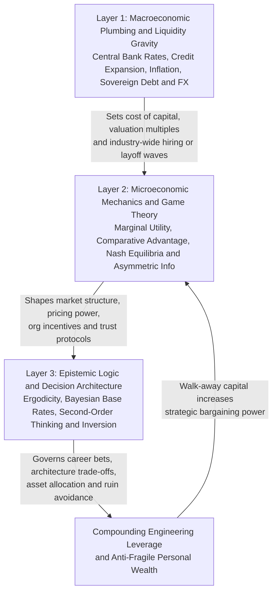

# Macroeconomics, Game Theory & World Mental Models Every Engineer Should Know

> **Purpose**: Software engineers spend years mastering deterministic formal systems—compilers, consensus protocols, type systems, and ACID transactions—yet routinely get blindsided by layoffs, equity dilution, currency devaluation, failed startups, and organizational dysfunction. This vault equips you with the foundational operating models of the non-deterministic world: **monetary plumbing, macroeconomic cycles, microeconomic incentives, strategic game theory, and multidisciplinary decision logic**.

---

## 1. Why Brilliant Engineers Misread the World: Deterministic Code vs. Reflexive Systems

Inside an IDE, identical inputs fed into a pure function produce identical outputs. If a database query is slow, adding the right composite index deterministically drops latency from `420 ms` to `3 ms`. Because engineering rewards linear cause-and-effect rigor, experienced developers unconsciously project three false assumptions onto markets, careers, and organizations:

1. **The Conservation Myth ("Money Is a Fixed Counter in Postgres")**: Engineers intuitively assume banks hold a finite pool of cash deposited by savers and lend out slices of it, or that wealth is a zero-sum pie. In reality, commercial credit expands and contracts endogenously, and asset valuations can evaporate by trillions of USD overnight without a single dollar "moving" into someone else's account.
2. **The Meritocratic Determinism Myth ("Best Architecture Wins")**: Engineers assume the cleanest codebase or highest-accuracy model naturally captures the market. In practice, products live inside **network effects, switching costs, asymmetric information, and CAC-to-LTV unit economics**. Superior technology priced with broken incentives loses to mediocre technology backed by superior distribution and game-theoretic lock-in.
3. **The Stationary Environment Myth ("Observing the Metric Does Not Mutate the System")**: In physics and software benchmarks, measuring CPU temperature does not rewrite the silicon. In human systems, **George Soros's Law of Reflexivity** rules: participants' beliefs alter their actions, which mutate the underlying fundamentals, which feed back into beliefs.

### John Maynard Keynes's Beauty Contest (Higher-Order Belief Loops)

Keynes compared financial markets and strategic competition to a newspaper contest where readers pick the 6 prettiest faces from 100 photographs, and the prize goes to whoever picks the choices closest to **the average preference of all other competitors**:

- **Level-0 Naive Thinker**: "Which face (or tech stack, or stock, or product) do *I* personally like best?"
- **Level-1 Analytical Thinker**: "What does the average participant think is best?"
- **Level-2 Strategic Thinker**: "What does the average participant think the *average participant* thinks?"

When you evaluate startup fundraising, B2B enterprise procurement, real estate, or equity multiples, Level-0 engineering analysis ("our Rust engine uses 40% less RAM") fails whenever buyers are optimizing for Level-2 institutional safety ("nobody gets fired for buying the vendor with SOC2, SLA guarantees, and market-leader signaling").

---

## 2. The Three-Layer World Operating Stack

Just as modern computing separates hardware physics, distributed kernel primitives, and application business logic, real-world outcomes emerge from three interacting layers. Optimizing Layer 3 (personal execution) while ignoring a regime shift in Layer 1 (macro liquidity) is like micro-optimizing a loop inside a pod whose Kubernetes node is being terminated.

### Rosetta Stone: Translating Software Systems to Economic Reality

Software engineers already understand feedback loops, bottlenecks, and adversarial protocols. Use this translation matrix to map familiar distributed-systems primitives onto economic reality:

| Distributed Systems Concept | Economic & World-Model Equivalent | Real-World Mechanism |
| :--- | :--- | :--- |
| **Global Backpressure / Rate Limiter** | **Central Bank Policy Interest Rate ($r_f$)** | Raising the risk-free rate increases the discount penalty on distant cash flows, throttling speculative capital and speculative hiring across the entire economy. |
| **Connection Pool Exhaustion & Cascading Timeout** | **Liquidity Crisis / Bank Run / Deleveraging** | A solvent institution with illiquid long-duration assets fails instantly if short-term creditors simultaneously demand redemption (e.g., Silicon Valley Bank in 2023). |
| **Write-Ahead Log Double-Entry State** | **Endogenous Commercial Bank Money Creation** | Issuing a loan simultaneously appends an asset (`Loan`) and a liability (`Deposit`) to the banking ledger; repaying debt deletes broad money supply. |
| **Byzantine Fault Tolerance (BFT)** | **Mechanism Design & Incentive Compatibility** | Assume rational actors optimize their own payoff; design rules where selfish optimization produces globally desirable system state without relying on benevolence. |
| **RL Reward Hacking / Overfitting** | **Goodhart's Law & Cobra Effects** | Optimizing a proxy metric (lines of code, sprint velocity, test coverage, click-through rate) destroys its correlation with true business value. |
| **Cryptographic Attestation / Strict Type Schema** | **Costly Signaling in Lemon Markets** | When buyers cannot verify quality cheaply, unverified claims ("cheap talk") collapse trust; costly, hard-to-fake proofs separate Plums from Lemons. |
| **Amdahl's Law / Diminishing Speedup** | **Diminishing Marginal Utility & Marginal Return** | The tenth unit of optimization on a non-bottleneck subsystem yields near-zero value while consuming full engineering opportunity cost. |
| **P99.9 Cascading Outage / Unhandled Panic** | **Non-Ergodic Ruin (Absorbing Barrier)** | A single catastrophic tail event (`wealth = 0`, legal breach, burnout collapse) permanently terminates future compounding regardless of high historical average returns. |

---

## 3. Expected Value vs. Ergodicity: The Most Important Math Outside Computer Science

In university probability courses, engineers are taught to maximize **Expected Value** ($E[X]$):

$$E[X] = \sum_{i=1}^{n} p_i x_i$$

If Bet A offers a $50\%$ chance to gain $+80\%$ and a $50\%$ chance to lose $-60\%$, its arithmetic expected return per round is:

$$E[r] = 0.5(+0.80) + 0.5(-0.60) = +0.10 \text{ (+10\% per round)}$$

A naive expected-value optimizer joyfully commits $100\%$ of net worth to this bet repeatedly. **What actually happens over time?**

### Ensemble Average vs. Time Average (Ole Peters's Ergodicity Insight)

- **Ensemble Average (Parallel Universes)**: Imagine $10,000$ clones of you each play 100 rounds independently. A tiny handful of ultra-lucky clones win 80 times and become trillionaires, pulling the *cross-sectional mean* upward by $+10\%$ per round.
- **Time Average (Your Single Actual Life)**: You do not get to average your bank account with lucky clones in parallel universes. You live sequentially along **one single timeline**, where returns multiply rather than add!

After one win ($+80\%$) and one loss ($-60\%$):

$$W_2 = W_0 \times (1 + 0.80) \times (1 - 0.60) = W_0 \times 1.80 \times 0.40 = 0.72 \, W_0$$

Despite a $+10\%$ arithmetic expected value per round, **two balanced rounds wiped out $28\%$ of your wealth!** Over $2N$ balanced rounds, your wealth converges deterministically toward zero: $(0.72)^N \to 0$.

A system is **ergodic** only when the average across many parallel actors at one snapshot equals the sequential time-average of a single actor over time. **Wealth, career reputation, startup runway, and physical health are strictly non-ergodic** because they contain **absorbing barriers** (bankruptcy, career-ending ethical breaches, irreversible health collapse) from which $0 \times \text{anything} = 0$.

### Volatility Drag & Geometric Compounding Formula

For any sequential compounding process with arithmetic mean return $\mu$ and standard deviation (volatility) $\sigma$, the realized long-run geometric growth rate $g$ is governed by:

$$g \approx \mu - \frac{\sigma^2}{2}$$

Notice the $-\frac{\sigma^2}{2}$ penalty (**volatility drag**): variance enters *squared*. Cutting catastrophic drawdowns adds more to your 20-year terminal wealth than chasing speculative upside spikes:

| Scenario | Odd Year Return | Even Year Return | Arithmetic Mean ($\mu$) | 2-Year Multiplier | 20-Year Terminal Wealth on USD 100k |
| :--- | :---: | :---: | :---: | :---: | :---: |
| **Steady Compounder** | `+10%` | `+10%` | `+10.0%` | `1.210x` | **USD 672,750** |
| **Moderate Swing** | `+30%` | `-10%` | `+10.0%` | `1.170x` | **USD 480,683** |
| **Boom-and-Bust Speculator** | `+60%` | `-40%` | `+10.0%` | `0.960x` | **USD 66,483** (Lost 33.5%!) |
| **Leveraged Wipeout** | `+100%` | `-100%` | `0.0%` | `0.000x` | **USD 0** (Game Over in Year 2) |

### The Kelly Criterion for Optimal Bet Sizing

Claude Shannon and John Kelly proved at Bell Labs (using information theory) how to turn a positive-EV non-ergodic game into maximum long-run geometric growth without risking ruin. If a bet wins net odds $b$ (gain $b$ per unit risked) with probability $p$ and loses the stake with probability $q = 1 - p$, the optimal fraction $f^*$ of capital to risk is:

$$f^* = \frac{bp - q}{b} = p - \frac{q}{b}$$

In our earlier game ($p = 0.5$, gain $+80\%$ vs. loss $-60\%$), generalized Kelly sizing ($f^* = \frac{p}{a} - \frac{q}{b} = \frac{0.5}{0.6} - \frac{0.5}{0.8} \approx 20.8\%$ of bankroll, or continuous Kelly $f^* = \frac{\mu}{\sigma^2}$) turns two balanced rounds from a $-28\%$ loss into a $+2.08\%$ compounding gain ($1.1667 \times 0.875 = 1.0208$) while mathematically guaranteeing zero probability of hitting zero. In engineering and life, **never bet 100% of your liquidity, reputation, or database availability on a single unhedged rollout**—even when $E[X] > 0$. Always use canary deployments, cash reserves, and fractional sizing (practitioners typically use **Half-Kelly**, $0.5 f^*$, to buffer estimation error in $p$).

---

## 4. Epistemic Hygiene: Logic, Base Rates & High-Cost Cognitive Bugs

Before applying economic or game-theoretic models, an engineer must debug how evidence itself is filtered. Most bad architectural and financial decisions stem from eight recurring logical errors:

### 1. Necessary vs. Sufficient Conditions ($A \implies B \not\equiv B \implies A$)
- **Formal Structure**: "Every enduring USD 10B SaaS company obsessed over customer experience ($S \implies C$)" does **not** imply "Obsessing over customer experience guarantees a USD 10B company ($C \implies S$)."
- **Engineering Trap**: Copying Google's microservices monorepo tooling (`B`) expecting Google's engineering velocity (`A`), when Google adopted `B` only as a necessary survival tax *because* it already had 30,000 engineers and USD 200B in search monopoly cash flow.

### 2. Survivorship Bias (Abraham Wald's Bullet-Hole Inversion)
During WWII, Allied analysts mapped bullet holes on returning bombers—concentrated on the fuselage and wings—and proposed armoring those heavily hit areas. Statistician Abraham Wald inverted the dataset: **the missing data was the planes that never returned**. Planes hit in the cockpit or engines crashed into the ocean; returning with wing holes proved wings could *survive* hits.
- **Career & Startup Application**: Never study only the habits of college-dropout billionaires or startups that "bet the company on a rewrite and won." Query the denominator—the graveyard of 95% of companies that took the exact same risk and died silently.

### 3. Bayesian Base-Rate Anchoring
Whenever a vivid anecdote or flashy demo tempts you, anchor on the prior base rate $P(H)$ before updating on new evidence $E$:

$$P(H \mid E) = \frac{P(E \mid H) \, P(H)}{P(E \mid H) \, P(H) + P(E \mid \neg H) \, P(\neg H)}$$

- **Concrete Example**: Suppose $2\%$ of Series-A startups eventually yield life-changing employee equity ($P(H) = 0.02$). A charismatic founder has Tier-1 VC backing—a trait shared by $80\%$ of eventual winners ($P(E \mid H) = 0.80$), yet also shared by $15\%$ of startups whose common stock still ends up worth zero after liquidation preferences ($P(E \mid \neg H) = 0.15$). Your true posterior probability is:

$$P(H \mid E) = \frac{0.80 \times 0.02}{(0.80 \times 0.02) + (0.15 \times 0.98)} = \frac{0.016}{0.016 + 0.147} \approx 9.8\%$$

It improved $5\times$ over random chance, yet **common-stock failure remains over 90% likely**. Price your base salary vs. illiquid options accordingly!

### 4. Chesterton's Fence (Respecting Legacy Constraints)
G. K. Chesterton's rule: *Never tear down a fence blocking a road until you can state clearly why the original builders erected it.*
- **Engineering & Policy Equivalent**: That "ugly 80-line regex parser" in your billing service or a seemingly bureaucratic central-bank reserve requirement is almost always scar tissue from an expensive historical outage. Understand the historical failure mode *first*; only then replace the mechanism safely.

### Summary Matrix of Epistemic Traps

| Cognitive / Logical Bug | Typical Engineering Symptom | Financial / Career Symptom | Algorithmic Fix |
| :--- | :--- | :--- | :--- |
| **Zero-Sum Fallacy** | Hoarding internal knowledge so peers do not look stronger | Viewing trade, delegation, or co-founding as fixed-pie | Optimize total surplus expansion via Comparative Advantage |
| **Nominal Money Illusion** | Celebrating a 4% raise during 6% inflation (`-2%` real pay cut) | Holding idle cash at 2% interest while real purchasing power erodes | Convert every figure to after-tax, inflation-adjusted real units |
| **Lucretius Problem** | Sizing connection pools for *yesterday's* peak QPS + 5% | Assuming worst historical drawdown is the worst *possible* drawdown | Stress-test for 3x historical peak and structural regime breaks |
| **Narrative Fallacy** | Post-hoc rationalizing a lucky race-condition dodge as "clean design" | Confusing a bull-market beta tailwind (2020–2021) with personal genius | Separate decision quality ex-ante from outcome luck ex-post |
| **Hyperbolic Discounting** | Skipping schema migrations to ship 2 days faster, creating 6 months of tech debt | Trading long-term equity/skills compounding for short-term title vanity | Apply explicit multi-year discount factor to recurring maintenance costs |

---

## 5. Gaussian Worlds vs. Power-Law Worlds (Mediocristan vs. Extremistan)

Engineers frequently apply Gaussian (normal distribution) intuition—means, standard deviations, and `3-sigma` assumptions—to domains governed by **Pareto Power Laws**:

$$P(X > x) \propto x^{-\alpha}$$

Understanding which probability distribution governs the game you are playing changes every strategic choice:

| Property | Gaussian / Thin-Tailed Domain (*Mediocristan*) | Power-Law / Fat-Tailed Domain (*Extremistan*) |
| :--- | :--- | :--- |
| **Mathematical Tail Decay** | Exponential decay $e^{-x^2/2\sigma^2}$; `6-sigma` events essentially never occur | Polynomial decay $x^{-\alpha}$; extreme outliers dominate the entire cumulative sum |
| **Impact of Largest Sample** | Adding the tallest human on Earth to a room of 1,000 people barely moves the average height | Adding one billionaire or one viral open-source repo to a sample of 1,000 accounts for 95%+ of the total |
| **Classic Examples** | Caloric intake, human height, hourly consulting billings, CRUD ticket throughput | Venture capital returns, SaaS category market share, open-source stars, distributed outage blast radii, equity wealth |
| **Optimal Payoff Structure** | Concave / bounded upside: optimize consistency, utilization rate, and variance reduction | Convex / asymmetric upside (**Barbell Strategy**): cap maximum downside strictly while taking many low-cost shots at uncapped upside |
| **Fatal Engineering Error** | Taking wild unhedged gambles on core database durability | Capping your upside via hourly billing while absorbing uncapped liability or burnout |

### Nassim Taleb's Barbell Strategy for Software Engineers

Instead of sitting in the "fragile middle" (100% net worth and income tied to one mid-tier employer in a single currency with mediocre growth and non-zero layoff risk), split your exposure across two extremes:

1. **85%–90% Hyper-Conservative Foundation**: Multi-currency liquid emergency reserves, low-cost broad global equity/short-term sovereign treasury allocation, rock-solid core distributed-systems reliability skills, and protected physiological health.
2. **10%–15% Convex Uncapped Optionality**: Shipping proprietary B2B Micro-SaaS software, publishing high-leverage technical writing/open-source infrastructure, or negotiating liquid/low-strike equity in high-conviction technical platforms—where the **maximum loss is capped at bounded time/capital**, while the upside scales via power laws without linear labor hours.

---

## 6. Charlie Munger's Latticework: The 5-Gate Decision Checklist & Case Study

Single-model specialists suffer from Abraham Maslow's hammer syndrome: to a database engineer, an organizational trust problem looks like a missing schema; to a pure macro trader, every company looks like an interest-rate derivative; to a naive developer, pricing power looks like feature count.

Before committing to a major decision—**accepting an employment offer, launching a B2B SaaS, investing savings, buying real estate, or leading a 6-month platform architecture migration**—pass it through all five multidisciplinary lenses:

1. **Macro Gate (Layer 1)**: Where are we in the interest-rate and credit cycle? Is capital cheap and expanding, or expensive and contracting? Which currency am I earning in vs. spending in?
2. **Micro Unit-Economics Gate (Layer 2A)**: What is the true opportunity cost (including foregone alternatives)? Does marginal benefit exceed marginal cost at current scale, or am I trapped in sunk-cost defense?
3. **Game-Theoretic & Incentive Gate (Layer 2B)**: Who are the other players, and what are *their* payoff matrices? Is this a one-shot zero-sum extraction game (avoid or demand upfront collateral) or an iterated positive-sum trust game? Which metrics will get Goodhart-gamed?
4. **Information Asymmetry Gate (Layer 2C)**: What does my counterparty know that I do not (adverse selection, liquidation preferences, hidden tech debt)? Am I relying on "cheap talk" promises or costly, verifiable signals?
5. **Ergodicity & Inversion Gate (Layer 3)**: Does a worst-case outcome introduce an irreversible absorbing barrier? If this decision fails catastrophically 24 months from now, what 3 causes killed it—and can I eliminate them today?

### Worked Synthesis Example: Evaluating Two Competing Senior Engineering Offers

Suppose an engineer in a `4.5%` interest-rate regime receives two offers:
- **Offer A (Hype Series-B AI Wrapper Startup)**: Base `USD 135,000` + nominal paper options quoted at `"USD 120,000/yr"` based on a 2021-style `45x ARR` valuation (`USD 900M` post-money on `USD 20M` ARR with `35%` gross margin and `2x` preferred liquidation overhang).
- **Offer B (Profitable Global Infrastructure MNC / Series-D Platform)**: Base `USD 175,000` + `USD 55,000/yr` in liquid public RSUs (or tender-verified secondary liquidity), `78%` gross margins, positive free cash flow.

| Evaluation Lens | Offer A (Overvalued Wrapper Startup) | Offer B (Cash-Flow Infrastructure Platform) |
| :--- | :--- | :--- |
| **Layer 1: Macro DCF Gravity** | At `4.5%` risk-free rates, public SaaS peers trade at `6x–10x` ARR; company must grow `4.5x` just to grow into its last private valuation before common options go in-the-money. | Priced on real free cash flow yield; resilient to sovereign yield-curve tightening and venture funding freezes. |
| **Layer 2A: Micro Gross Margin** | Variable LLM token inference costs eat `65%` of revenue; scaling users scales compute burn almost linearly. | High software operating leverage; incremental enterprise tenants carry `approx. 80%` gross contribution margin. |
| **Layer 2C: Asymmetric Info** | Investors hold `1x–2x` senior preferred liquidation preference; in a `USD 400M` acquisition, VCs get paid first and common employee options can clear near `USD 0`. | Public quarterly filings or audited liquid RSUs eliminate hidden cap-table seniority traps (**costly verified signal**). |
| **Layer 3: Ergodic Decision** | Accepting `USD 40k/yr` lower cash salary essentially buys overpriced out-of-the-money lottery tickets in a single illiquid employer. | Captures `USD 230k/yr` liquid capital to fund a personal Barbell Strategy while compounding Staff infrastructure credentials. |

### Fast Diagnostic Routing: Which World Model Solves Your Current Bottleneck?

When facing a concrete engineering, product, or financial dilemma, jump straight to the governing model:

| Real-World Symptom You Observe | Governing Economic / Logical Model | Where to Dive Deep |
| :--- | :--- | :--- |
| Profitable tech firm freezes headcount or slashes SaaS multiples despite `25%` YoY revenue growth | **DCF Duration Gravity & Risk-Free Yield Shift ($r_f$)** | [01-MONEY-INTEREST-RATES-INFLATION-AND-FX.md](01-MONEY-INTEREST-RATES-INFLATION-AND-FX.md) (Sec. 2) |
| Salary rose `15%` over 3 years yet international travel, GPUs, or housing feel harder to afford | **Fisher Real Return Equation & FX Impossible Trinity** | [01-MONEY-INTEREST-RATES-INFLATION-AND-FX.md](01-MONEY-INTEREST-RATES-INFLATION-AND-FX.md) (Sec. 4 & 5) |
| AI agent product gains thousands of active users while cloud GPU gross margins turn negative | **Positive Marginal Cost vs. Flat-Seat Adverse Selection** | [02-MICROECONOMICS-GAME-THEORY-AND-MENTAL-MODELS.md](02-MICROECONOMICS-GAME-THEORY-AND-MENTAL-MODELS.md) (Sec. 1 & 5) |
| Staff engineer works `65h/week` reviewing every script because juniors code slower | **David Ricardo's Law of Comparative Advantage** | [02-MICROECONOMICS-GAME-THEORY-AND-MENTAL-MODELS.md](02-MICROECONOMICS-GAME-THEORY-AND-MENTAL-MODELS.md) (Sec. 2) |
| Shared monorepo CI degrades, teams hoard resources, or a client keeps expanding unpaid scope | **Iterated Prisoner's Dilemma, Generous Tit-for-Tat & Mechanism Design** | [02-MICROECONOMICS-GAME-THEORY-AND-MENTAL-MODELS.md](02-MICROECONOMICS-GAME-THEORY-AND-MENTAL-MODELS.md) (Sec. 3) |
| Engineering KPIs (`95%` coverage, high velocity, zero Sev-1s) look green while customers churn | **Goodhart's Law & Paired Tension Metrics** | [02-MICROECONOMICS-GAME-THEORY-AND-MENTAL-MODELS.md](02-MICROECONOMICS-GAME-THEORY-AND-MENTAL-MODELS.md) (Sec. 4) |
| Strong resume or enterprise B2B product gets ignored amid a flood of AI-generated competitors | **Akerlof's Lemon Market & Spence's Costly Signaling** | [02-MICROECONOMICS-GAME-THEORY-AND-MENTAL-MODELS.md](02-MICROECONOMICS-GAME-THEORY-AND-MENTAL-MODELS.md) (Sec. 5) |

---

## 7. Curriculum Navigation & Complete Vault Index

Work through this vault in order. Each module builds directly on the primitives introduced before it:

### Clickable Table of Contents

1. **[00-README.md](00-README.md) — Macroeconomics, Game Theory & World Mental Models Every Engineer Should Know** *(Current Document)*
   - Deterministic code vs. George Soros's Reflexivity and Keynes's Beauty Contest; the 3-Layer World Operating Stack; Distributed-Systems-to-Economics Rosetta Stone; Expected Value vs. Non-Ergodic Time Averages, Volatility Drag ($g \approx \mu - \sigma^2/2$), and the Kelly Criterion; Gaussian vs. Pareto Power-Law regimes and Taleb's Barbell Strategy; Wald's Survivorship Bias, Bayesian Base Rates, Chesterton's Fence, and a 5-Gate Offer Evaluation Case Study.
2. **[01-MONEY-INTEREST-RATES-INFLATION-AND-FX.md](01-MONEY-INTEREST-RATES-INFLATION-AND-FX.md) — How Money, Banking & Macro Cycles Actually Work**
   - Double-entry endogenous money creation by commercial banks vs. Central Bank base reserves ($M_0$ vs. $M_2$); Central Bank interest rates as DCF valuation gravity ($PV = \sum \text{FCF}_t / (1+r)^t$) and why ZIRP-to-tightening shifts trigger SaaS multiple compression and tech layoffs; Equation of Exchange ($MV = PY$), Inflation vs. Fisher's Debt-Deflation Spiral; Mundell-Fleming's Impossible Trinity in FX markets (USD vs. HKD peg vs. RMB managed regime); Bond duration mechanics (the SVB duration mismatch autopsy), Equity total-return decomposition, and Fisher's after-tax real compounding math.
3. **[02-MICROECONOMICS-GAME-THEORY-AND-MENTAL-MODELS.md](02-MICROECONOMICS-GAME-THEORY-AND-MENTAL-MODELS.md) — Microeconomics, Game Theory & Multidisciplinary Thinking**
   - Marginal utility, zero-marginal-cost software vs. positive-marginal-cost AI token economics, Opportunity Cost, and defeating the Sunk-Cost Fallacy; David Ricardo's Comparative Advantage with a worked Staff-vs-Mid-Level engineering delegation proof; One-Shot Prisoner's Dilemma, Nash Equilibrium, Axelrod's Iterated Generous Tit-for-Tat trust protocol, and Mechanism Design; Goodhart's Law and paired counter-metric architecture; Akerlof's Market for Lemons, Adverse Selection, Moral Hazard, and Spence's Costly Signaling; Second-Order Consequence Tracing and Jacobi's Inversion (*Via Negativa* pre-mortems).

### Foundational Primary Reading Stack (High-Signal Originals)

- **Monetary Mechanics & Debt Cycles**: Michael McLeay, Amar Radia & Ryland Thomas (*Money Creation in the Modern Economy*, Bank of England Quarterly Bulletin); Ray Dalio (*Principles for Navigating Big Debt Crises*); Richard Koo (*The Holy Grail of Macroeconomics: Lessons from Japan's Great Recession*).
- **Game Theory & Information Economics**: Robert Axelrod (*The Evolution of Cooperation*); Thomas Schelling (*The Strategy of Conflict*); George Akerlof (*The Market for "Lemons"*).
- **Ergodicity, Risk & Multidisciplinary Thinking**: Charlie Munger (*Poor Charlie's Almanack*); Howard Marks (*The Most Important Thing*); Ole Peters (*The Ergodicity Problem in Economics*, Nature Physics); Nassim Nicholas Taleb (*Fooled by Randomness* and *Antifragile*).
