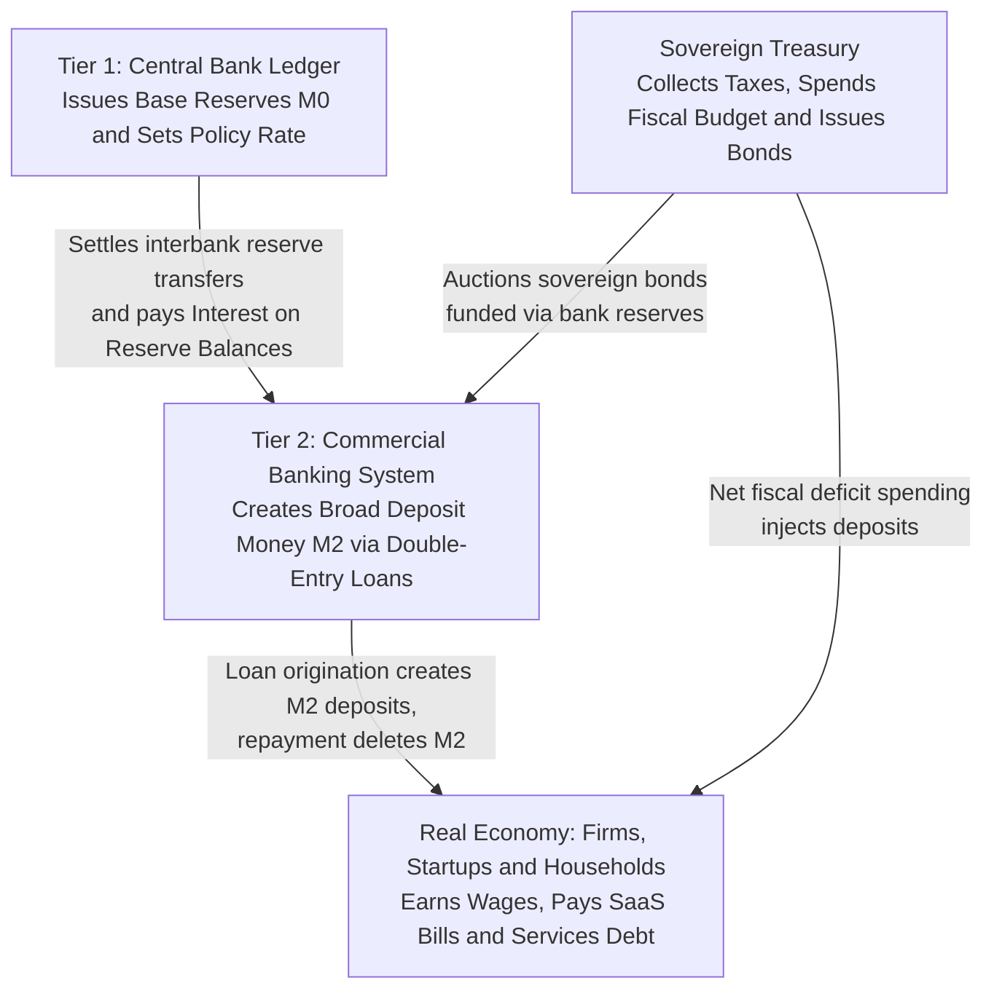
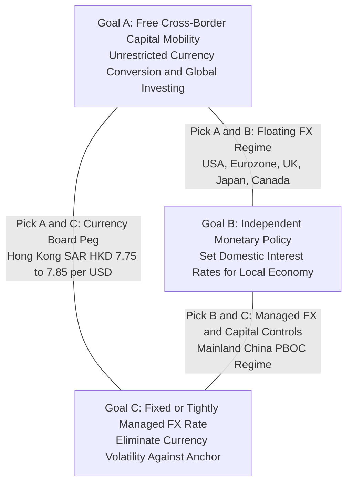

# How Money, Banking & Macro Cycles Actually Work

> **Core Premise**: Most software engineers spend 40+ hours a week earning, saving, and pricing equity in fiat currencies without ever inspecting the source code of the monetary system. Money is not a static pile of digital gold; it is a **dynamic, two-tier credit ledger** whose expansion and contraction dictate startup valuations, tech hiring booms, layoffs, exchange rates, and real life-time wealth.

---

## 1. What Money Actually Is: Endogenous Credit & The Two-Tier Ledger

Economics 101 textbooks often teach a comforting fairy tale: *savers deposit physical cash into a bank vault, the bank keeps 10% in reserve, and lends out the remaining 90% to borrowers*. As the Bank of England formally clarified in its landmark paper *Money Creation in the Modern Economy*, **commercial banking actually operates in exact reverse**.

### Commercial Banks Create Deposits by Issuing Loans

When you sign a `USD 500,000` mortgage at a commercial bank, no clerk walks into a vault and moves `USD 500,000` out of a retiree's savings account into yours. Instead, the bank executes an **atomic double-entry database transaction**, expanding both sides of its balance sheet simultaneously:

| Entity | Asset Entry (`+ Debit`) | Liability / Equity Entry (`+ Credit`) | Net Wealth Change | New Spendable Money Created |
| :--- | :--- | :--- | :---: | :---: |
| **Commercial Bank** | `+USD 500,000` Mortgage Receivable | `+USD 500,000` Borrower Checking Deposit | `USD 0` | **`+USD 500,000` (`M2`)** |
| **Home Buyer** | `+USD 500,000` Checking Balance | `+USD 500,000` Mortgage Debt Obligation | `USD 0` | Spent to Home Seller |

Notice the profound system consequence:
- **Issuing bank credit creates brand-new broad money (`M2`) out of thin air.** In modern economies, **85% to 92%** of all circulating money consists of commercial bank ledger deposits created via lending—not physical paper bills printed by the government.
- **Repaying debt or defaulting destroys broad money.** When you pay back `USD 10,000` of mortgage principal, both the bank's loan asset and your deposit balance vanish from the ledger, shrinking the total money supply.

### The Two-Tier Monetary Architecture ($M_0$ vs. $M_2$)

Just as distributed databases distinguish kernel-level consensus state from application-layer tenant tables, modern fiat money runs on two strictly separated ledgers:

1. **Tier 1 — Base Money ($M_0$, Central Bank Ledger)**: Consists of physical banknotes plus **Central Bank Reserves**—digital checking accounts held *exclusively* by commercial banks and the Sovereign Treasury at the Central Bank (Federal Reserve, ECB, PBOC, Bank of Japan). Neither individuals nor non-bank corporations hold reserve accounts at the Fed. When you wire `USD 50,000` from Chase to Bank of America, your commercial deposit at Chase is deleted, a commercial deposit at Bank of America is created, and the Fed settles the interbank difference by shifting `USD 50,000` of **Tier-1 Reserves** from Chase's Fed account to Bank of America's Fed account.
2. **Tier 2 — Broad Money ($M_2$, Commercial Banking Ledger)**: Consists of retail and corporate checking deposits, savings deposits, small time deposits, and retail money-market funds. This is the money that actually buys SaaS subscriptions, pays engineering salaries, and bids up housing prices.

### If Banks Create Deposits, Why Don't They Create Infinite Money?

Three hard constraints act as backpressure on commercial bank credit creation:

1. **Regulatory Capital Adequacy (Basel III Equity Buffers)**: While deposits are liabilities, **shareholder equity (`CET1 Capital`)** must absorb loan losses. Under Basel III, a bank must hold equity exceeding a minimum percentage of its Risk-Weighted Assets ($\text{CET1 Ratio} = \frac{\text{Common Equity}}{\text{Risk-Weighted Assets}} \ge 8\%\text{ to }12\%$). If commercial real-estate defaults wipe out `USD 5B` of bank equity, the bank must freeze or shrink lending by `USD 50B+` to stay solvent—triggering a **credit crunch**.
2. **Interbank Settlement & Liquidity Coverage**: If Bank A originates reckless loans far faster than rival banks, borrowers spend those deposits elsewhere, draining Bank A's Tier-1 Central Bank reserves. Bank A must borrow reserves at the Central Bank's policy rate or pay higher deposit rates to attract funding, squeezing its Net Interest Margin.
3. **Creditworthy Loan Demand**: Banks cannot force solvent households or profitable enterprises to borrow at `7%` interest if expected investment returns are `4%`. Economists call cutting rates during a debt hangover **"pushing on a string."**

---

## 2. Central Bank Interest Rates: Valuation Gravity & Tech Hiring Cycles

Warren Buffett summarized financial physics in one sentence: *"Interest rates are to asset prices what gravity is to the apple. When interest rates are near zero, asset values can be almost infinite; when interest rates are high, they exert an enormous gravitational pull downward."*

Many engineers watched in confusion as tech companies hired aggressively at `30x–50x ARR` valuations in 2021, then executed mass layoffs across 2022–2024 **even while revenues and cloud usage were still growing**. The culprit was not sudden engineering incompetence—it was **Discounted Cash Flow (DCF) duration math**.

### The Universal Asset Pricing Equation

Every productive financial asset—whether a US Treasury bond, a rental apartment in Shanghai, or shares of Nvidia or a Series-B SaaS startup—is worth the **Present Value ($PV$)** of all future **Free Cash Flows ($\text{FCF}_t$)** it will generate from today until judgment day, discounted by the risk-free sovereign rate ($r_f$) plus an Equity Risk Premium ($\text{ERP}$):

$$PV = \sum_{t=1}^{N} \frac{\text{FCF}_t}{(1 + r_f + \text{ERP})^t} + \frac{\text{TV}_N}{(1 + r_f + \text{ERP})^N}$$

Where the **Terminal Value ($\text{TV}_N$)** assuming steady perpetual growth $g$ beyond Year $N$ (for $r > g$, the Gordon Growth Model) is:

$$\text{TV}_N = \frac{\text{FCF}_N (1 + g)}{(r_f + \text{ERP}) - g}$$

### Worked Proof: Why Rate Hikes Crush Growth Tech Harder Than Cash Cows

Compare two companies, keeping the Equity Risk Premium fixed at $\text{ERP} = 4.5\%$ while the Central Bank raises the risk-free policy rate $r_f$ from **`0.5%` (Zero-Interest-Rate Policy, ZIRP)** to **`4.5%` (Normalized Tightening)**—moving the total discount rate $r = r_f + \text{ERP}$ from `5.0%` to `9.0%`:

- **Company V (Short-Duration Value Business)**: Generates `USD 100M` in steady annual cash flow starting immediately in Year 1, growing slowly at $g = 1.5\%$ forever:
  - At $r = 5.0\%$ (`ZIRP`): $PV = \frac{100}{0.05 - 0.015} = \text{USD } 2,857\text{M}$.
  - At $r = 9.0\%$ (`4.5% Rate`): $PV = \frac{100}{0.09 - 0.015} = \text{USD } 1,333\text{M}$ (**`-53.3%` valuation compression**).
- **Company G (Long-Duration Hyper-Growth Tech / AI Platform)**: Reinvests every dollar into R&D and GPU clusters for Years 1–9 ($\text{FCF}_{1..9} = 0$), reaching `USD 100M` free cash flow in Year 10 and growing at $g = 3.0\%$ thereafter:
  - At $r = 5.0\%$ (`ZIRP`): $\text{TV}_{10} = \frac{100 \times 1.03}{0.05 - 0.03} = \text{USD } 5,150\text{M}$. Discounting $\text{FCF}_{10} + \text{TV}_{10} = \text{USD } 5,250\text{M}$ back 10 years by $(1.05)^{-10} = 0.6139$:
    $$PV_{\text{ZIRP}} = \text{USD } 3,223\text{M}$$
  - At $r = 9.0\%$ (`4.5% Rate`): $\text{TV}_{10} = \frac{100 \times 1.03}{0.09 - 0.03} = \text{USD } 1,717\text{M}$. Discounting $\text{FCF}_{10} + \text{TV}_{10} = \text{USD } 1,817\text{M}$ back 10 years by $(1.09)^{-10} = 0.4224$:
    $$PV_{\text{Tight}} = \text{USD } 767\text{M}$$

**Result**: Without losing a single customer or missing a single product roadmap milestone, **a `400 bps` rise in central bank interest rates mathematically vaporizes `76.2%` (`USD 3.22B -> USD 767M`) of the growth tech company's rational valuation!**

### How Yield Curves Translate Directly Into Engineering Headcount

- **Low-Rate Regime ($r_f \approx 0\% - 1.5\%$)**: Distant cash flows in Year 10 are nearly as valuable as cash today. Capital markets reward **top-line revenue growth at any cost**; startups raise cheap equity, over-hire speculative R&D pods, subsidize unprofitable unit economics, and tolerate bloated cloud bills.
- **High-Rate Regime ($r_f \approx 4.0\% - 5.5\%$)**: Investors can earn `4.5%+` completely risk-free in short-term Treasury bills (`T-Bills`). Why fund a burn-heavy startup promising uncertain profits in 2034? Public markets immediately punish low free-cash-flow margins, forcing CEOs to freeze headcount, cut middle management, cancel moonshots, and reward **infrastructure efficiency, gross-margin protection, and revenue-per-engineer**.
- **Yield Curve Inversion (`2-Year Yield > 10-Year Yield`)**: Normally, lending for 10 years pays higher interest than lending for 2 years. When short-term policy rates exceed 10-year yields, bond markets are signaling that current policy is tight enough to slow growth and force future rate cuts—historically preceding recessions by 6 to 18 months.

---

## 3. Inflation, Disinflation, Stagflation & Debt-Deflation Spirals

Why does printing money sometimes cause `9%` consumer inflation within 18 months and other times barely move grocery prices for a decade? Start with Irving Fisher's **Equation of Exchange**:

$$M \times V = P \times Y$$

Where:
- $M$: Broad Money Supply (`M2` spendable deposits in the real economy).
- $V$: **Velocity of Money**—how many times per year the average currency unit changes hands in transactions.
- $P$: Aggregate Price Level (Consumer Price Index / GDP Deflator).
- $Y$: Real Economic Output (actual physical goods, energy, silicon chips, housing, and software services produced).

Rewriting for the price level: $P = \frac{M \times V}{Y}$. Inflation ($\pi = \frac{\Delta P}{P}$) erupts **only when nominal spending ($M \times V$) grows faster than real supply capacity ($Y$)**.

- **Why 2008–2014 Quantitative Easing (QE) Did Not Spike Grocery CPI**: The Fed created trillions in *Tier-1 bank reserves ($M_0$)*, which stayed trapped on bank balance sheets repairing mortgage losses while traumatized households paid down debt ($V$ plunged). Asset prices (stocks, prime real estate) rose, while consumer CPI stayed near `1.5%`.
- **Why 2020–2022 Stimulus Ignited `8%–9%` Inflation**: Governments mailed trillions in fiscal stimulus checks directly into household *Tier-2 checking accounts ($M_2$)* while pandemic lockdowns, shipping bottlenecks, and energy shocks throttled real supply ($Y$). Too much spendable money chased constrained physical goods.

### Why Central Banks Fear Deflation Far More Than `2%` Inflation

Engineers often ask: *"Technology naturally gets cheaper every year via Moore's Law and AI productivity—why shouldn't the whole economy run at `-2%` deflation so my cash savings gain purchasing power?"*

There is a critical difference between **benign supply-side productivity deflation** in specific tech goods (GPUs delivering `2x` FLOPs per dollar) and **economy-wide monetary debt deflation**:

1. **Irving Fisher's Debt-Deflation Spiral**: Assets, revenues, and wages adjust downward, **but debt contracts (mortgages, corporate bonds, sovereign debt) are hardcoded in fixed nominal numbers**. If economy-wide prices and incomes fall `15%`, your nominal `USD 600,000` mortgage does not shrink—its *real burden relative to your income jumps `17.6%`*! Underwater borrowers dump assets in fire sales -> asset prices fall further -> collateral values breach bank loan covenants -> banks suffer defaults and halt credit -> `M2` contracts -> deeper deflation. This feedback loop turned the 1929 crash into the Great Depression and trapped post-1990 Japan in a two-decade **Balance-Sheet Recession** (documented by economist Richard Koo).
2. **Deferred Consumption Deadlock**: If apartments, cars, and enterprise contracts are guaranteed to cost `5%` less next year, every rational household and CFO delays non-urgent purchases and hoards cash, collapsing velocity $V$ and triggering mass unemployment.
3. **Downward Nominal Wage Rigidity**: Cutting every employee's nominal paycheck from `USD 150k` to `USD 141k` causes immediate outrage and resignations; keeping nominal pay flat at `USD 150k` during `3%` inflation achieves a mild real wage adjustment smoothly without destroying organizational cohesion.

### The Four Macro Regimes (Ray Dalio's All-Weather Matrix)

| Macro Regime | Real Growth ($Y$) | Inflation ($\pi$) | Central Bank Stance | Tech Career & Equity Impact | Resilient Asset Classes |
| :--- | :---: | :---: | :--- | :--- | :--- |
| **1. Goldilocks Expansion** | Rising | Low / Stable (`approx. 2%`) | Neutral / Gradual | Healthy hiring, strong equity compounding, rational RSU growth | Broad Global Equities; Quality Growth Tech; Corporate Credit |
| **2. Inflationary Boom** | Rising | Accelerating (`Over 4%`) | Hiking Aggressively | High nominal salaries, followed by valuation multiple compression on unprofitable SaaS | Short-Duration Value Equities; Commodities; TIPS; Floating-Rate T-Bills |
| **3. Stagflation** | Stagnant / Falling | High (`Over 4%`) | Trapped (Hiking into weakness) | Brutal real pay erosion, IT budget freezes, both long bonds and growth stocks fall together (`2022`) | Short-Term Cash/T-Bills; Energy/Hard Assets; High-Pricing-Power Monopolies |
| **4. Deflationary Bust / Deleveraging** | Contracting | Falling (`Under 1%` or negative) | Slashing Rates to `0%` + QE | Layoffs, hiring freezes, balance-sheet repair, high cash purchasing power for survivors | Long-Duration Sovereign Bonds (Treasuries); Cash in Strong Reserve Currencies |

---

## 4. Foreign Exchange (FX) & Mundell-Fleming's Impossible Trinity

For an engineer working across global tech hubs—earning RMB in Shanghai, HKD in Hong Kong, SGD in Singapore, JPY in Tokyo, EUR in Amsterdam, or USD via remote contracts—exchange rates determine whether ten years of disciplined saving compounds globally or silently loses `30%` of its international purchasing power.

### Interest Rate Parity & Carry Trades

In liquid global currency markets, capital flows toward higher **real risk-adjusted yields**. **Covered Interest Rate Parity** links the spot exchange rate ($S$), forward exchange rate ($F$), and interest rates of two currencies:

$$\frac{F}{S} = \frac{1 + r_{\text{quote}}}{1 + r_{\text{base}}}$$

When the US Federal Reserve pays `5.0%` while the Bank of Japan holds rates near `0.25%`, global macro funds borrow cheap JPY, sell JPY for USD, and pocket the `4.75%` yield spread (**the Yen Carry Trade**)—pushing USD stronger and JPY weaker (e.g., USD/JPY rising from `110` to `155+`). However, if Japan suddenly hikes rates while the US cuts, leveraged funds are forced to buy back JPY simultaneously to close loans—triggering violent multi-sigma FX spikes and global tech stock liquidations within 48 hours.

### Mundell-Fleming's Impossible Trinity (The FX Trilemma)

Nobel laureate Robert Mundell and Marcus Fleming proved mathematically that **a country can achieve at most TWO of the following three macroeconomic goals at the same time—never all three**:

1. **Free Capital Mobility**: Citizens, corporations, and foreign investors can freely convert and wire unlimited money across borders.
2. **Fixed / Stable Exchange Rate**: Locking the national currency's value to an external anchor (like the USD).
3. **Independent Monetary Policy**: Setting domestic interest rates freely to fight local unemployment, property slumps, or domestic inflation.

*Why is all three impossible?* Proof by arbitrage: Suppose Country X pegs its currency `1:1` to USD, allows unlimited cross-border capital transfers, and tries to cut its local interest rate to `1.5%` to rescue a local recession while the US Fed pays `5.0%`. Within minutes, rational citizens and hedge funds convert trillions of local currency into USD to earn risk-free `5.0%`, draining Country X's Central Bank foreign-exchange reserves until either (a) the peg breaks, (b) capital controls are imposed, or (c) Country X abandons its `1.5%` rate and hikes straight to `5.0%`!

### Real-World FX Regimes Every Global Engineer Encounters

| Jurisdiction | Chosen 2 Vertices | Sacrificed Vertex | Direct Impact on Engineers & Investors |
| :--- | :--- | :--- | :--- |
| **United States / Eurozone / Japan** | Free Capital + Independent Rates | **Exchange Rate Stability** (Free-floating FX) | Zero friction moving capital globally; currency can swing `15%–30%` over rate cycles (e.g., weak JPY creating massive cost-of-living arbitrage in Tokyo for USD earners). |
| **Hong Kong SAR (HKMA)** | Free Capital + Fixed USD Peg (`7.75–7.85`) | **Independent Interest Rates** | HKD is effectively a proxy USD with unrestricted global banking; however, Hong Kong *must* import US Fed rate hikes even if local HK property/retail is in recession. |
| **Mainland China (PBOC)** | Independent Domestic Rates + Managed RMB Band | **Free Capital Account** (`USD 50k/yr` individual FX quota) | PBOC can cut domestic mortgage/LPR rates to `approx. 3%` even when US Fed is at `5%`; cross-border diversification requires compliant channels (QDII ETFs, overseas MNC RSUs, or offshore employment). |
| **Singapore (MAS)** | Free Capital + Managed SGD NEER Currency Basket | **Domestic Interest Rate Targeting** (MAS uses FX band *as* its primary inflation tool!) | Historically strong currency appreciation against high-inflation peers, acting as a hard-currency wealth preservation hub in APAC. |

### Purchasing Power Parity (PPP) & The Balassa-Samuelson Effect (Why Geo-Arbitrage Works)

Market exchange rates are set by **tradable capital and goods** (semiconductors, crude oil, cloud compute, cross-border bond flows), *not* by the local price of a bowl of noodles or a haircut. Economists Bela Balassa and Paul Samuelson explained why identical non-tradable services cost `3x–4x` more in San Francisco or Zurich than in Shanghai, Kuala Lumpur, or Lisbon:

1. **Tradable Sector Sets Local Wage Floors**: In San Francisco, a local barber or dentist must earn enough to afford Bay Area rent bid up by `USD 400k/yr` Nvidia and OpenAI engineers—even though a San Francisco barber does not cut hair `4x` faster than a barber in Chengdu or Valencia.
2. **Tradable Tech Inputs Are Priced Globally, While Local Living Is Priced Locally**: An independent B2B SaaS founder or remote Staff engineer earning `USD 180,000` in a high-infrastructure, moderate-cost hub pays global USD prices for MacBooks and AWS (`approx. 5%` of budget) while paying PPP-discounted local prices for housing, fresh food, childcare, and healthcare (`approx. 95%` of household consumption). That structural gap between **Nominal FX** and **PPP Exchange Rate** is the mathematical engine of global engineering geo-arbitrage.

---

## 5. Bonds, Equities & The Mathematics of Real Compounding

Saving `40%` of your engineering paycheck accomplishes nothing if inflation and poor asset allocation quietly tax away half your purchasing power over 20 years. You only need to master two core liquid asset classes—**Bonds (Contractual Debt)** and **Equities (Residual Ownership)**—plus the **Fisher Real Return Equation**.

### 1. Bonds & Duration Risk (Why "Safe" Long Bonds Lost `30%+` in 2022)

A bond is an IOU with a fixed maturity date and fixed nominal coupon payments. Because its future cash payments are fixed in stone, **bond prices and market interest rates move on an exact mechanical seesaw**. If you hold a `10-year` bond paying a `1.5%` annual coupon and newly issued `10-year` bonds suddenly pay `4.5%`, nobody will buy your old `1.5%` bond unless you slash its price until the buyer's effective **Yield to Maturity (YTM)** equals `4.5%`.

The sensitivity of a bond's market price ($P$) to a change in interest rates ($\Delta y$) is governed by **Modified Duration ($D_{\text{mod}}$)**:

$$\frac{\Delta P}{P} \approx -D_{\text{mod}} \times \Delta y$$

- **3-Month Treasury Bill ($D_{\text{mod}} \approx 0.25$)**: A `+3.0%` (`+300 bps`) rate shock moves its price by $-0.25 \times 3.0\% = -0.75\%$, and it matures at par in 90 days. Virtually zero interest-rate price risk!
- **20-Year Treasury Bond ($D_{\text{mod}} \approx 15.0$)**: A `+3.0%` rate shock crashes its market price by $-15.0 \times 3.0\% \approx -45\%$!
- **The Silicon Valley Bank (SVB) Autopsy (2023)**: SVB took billions in uninsured venture-startup checking deposits (duration = `0 days`, withdrawable via API in seconds) and locked them into `10-year` fixed-rate Treasuries and Mortgage-Backed Securities yielding `approx. 1.6%`. When the Fed hiked rates `+450 bps`, SVB's bond portfolio suffered over `USD 15B` in unrealized duration losses—wiping out its entire equity buffer and triggering a fatal 36-hour digital bank run. **Lesson: Never mismatch short-term liabilities against illiquid or long-duration assets.**

### 2. Equities: John Bogle's Total Return Equation & The SBC Dilution Trap

Owning shares of productive global enterprises is the single highest-returning passive wealth engine in modern capitalism because corporations **pass inflation through to customers via pricing power** and compound retained earnings. Vanguard founder John Bogle showed that long-run equity returns decompose cleanly into two fundamental engines plus one speculative pendulum:

$$R_{\text{equity}} \approx \underbrace{\text{Net Shareholder Yield} + g_{\text{EPS}}}_{\text{Fundamental Compounding (90\%+ of 20-Yr Return)}} + \underbrace{\Delta \ln(\text{P/E Multiple})}_{\text{Valuation Sentiment}}$$

- **Engineering Investor Warning — Stock-Based Compensation (SBC) Dilution**: Net Shareholder Yield equals $\text{Dividend Yield} + \text{Share Buyback Yield} - \text{Share Issuance Dilution}$. Many high-profile SaaS companies tout `"25% Non-GAAP Free Cash Flow Margin"` while issuing `8%–12%` of their market cap every year in new employee RSUs. Always evaluate **GAAP Free Cash Flow minus SBC** (or **FCF per diluted share**); otherwise, revenue grows while your ownership slice shrinks!

### 3. The Fisher Equation: After-Tax Real Purchasing-Power Compounding

Never compute wealth in nominal currency. If your bank pays $r_{\text{nom}} = 3.0\%$ taxed at $\tau = 20\%$ while real cost-of-living inflation runs at $\pi = 3.5\%$, the exact **After-Tax Fisher Equation** reveals your true real return:

$$r_{\text{real}} = \frac{1 + r_{\text{nom}}(1 - \tau)}{1 + \pi} - 1 = \frac{1 + 0.03(0.80)}{1.035} - 1 = \frac{1.024}{1.035} - 1 \approx -1.06\%\text{ per year}$$

Over $T$ years, initial purchasing power $W_0$ compounds to $W_T = W_0 (1 + r_{\text{real}})^T$, and the **Rule of 72** estimates real doubling time as $T_{2\times} \approx \frac{72}{r_{\text{real}\%}}$:

| Asset Allocation Strategy | Typical Nominal Return | Assumed Inflation ($\pi$) | Real Return ($r_{\text{real}}$) | 20-Year Real Purchasing Power of `USD 100,000` | Primary Structural Risk |
| :--- | :---: | :---: | :---: | :---: | :--- |
| **Idle Demand Checking Cash** | `0.2%` | `3.0%` | **`-2.72%`** | **`USD 57,600`** (`-42.4%` real loss!) | Guaranteed silent confiscation via inflation |
| **Short-Term Sovereign T-Bills / MMF** | `3.5%` | `3.0%` | **`+0.49%`** | **`USD 110,200`** | Preserves liquidity; zero long-term wealth multiplication |
| **Long-Term Sovereign Bonds** | `4.2%` | `3.0%` | **`+1.17%`** | **`USD 126,100`** | Vulnerable to unexpected inflation / fiscal deficits |
| **Broad Low-Cost Global Equity Index** | `8.5%–9.5%` | `3.0%` | **`+5.34% to +6.31%`** | **`USD 283,000 to USD 340,000`** | `30%–50%` interim drawdowns requiring emotional discipline |
| **100% Unhedged Employer Stock + Job** | Highly Skewed | `3.0%` | **Bimodal** | `USD 0` to `USD 1M+` | **Correlated ruin**: a company crisis wipes out paycheck *and* savings simultaneously |

---

## 6. Actionable Macro Playbook for Software Engineers

1. **Match Emergency Liquidity to Short Duration (`6–12 Months` in T-Bills / Money Market)**: Keep your emergency runway in liquid, sovereign-backed short-duration instruments (`0–3 month` maturity) matching the currency of your monthly rent and living expenses—never in 20-year bonds, volatile crypto, or illiquid options.
2. **Eliminate Double-Exposure Concentration Risk**: Your human capital (salary, bonus, unvested RSUs, promotion pipeline) is *already* `100%` long your current employer and tech sub-sector. Unless you have asymmetric founder control, systematically diversify vested RSUs into broad global productive equities (`e.g., FTSE All-World / S&P 500 + global ex-US`) so one corporate downturn cannot destroy both your income and your net worth.
3. **Price Compensation Differently in ZIRP vs. High-Rate Regimes**: When risk-free rates sit above `4%`, discount pre-IPO paper valuations aggressively (ask for the **409A common valuation**, total diluted share count, and **preferred liquidation preference stack**). Demand higher base cash or liquid public RSUs unless the startup's growth and gross margins justify its last private round under current public SaaS multiples.
4. **Currency-Match Your Liabilities and Diversify Your Assets**: Never borrow in a strong, appreciating foreign currency to fund assets earning a weaker domestic currency. Conversely, holding income streams or liquid ETFs denominated across major reserve currencies (USD, EUR, SGD/HKD, RMB) insulates your lifetime purchasing power against single-country macro shocks.
5. **Respect Fixed-Rate Debt in Reflation vs. Variable Debt in Tightening**: A low fixed-rate 30-year mortgage (`e.g., 3.0%`) locked before an inflationary cycle is an asset—inflation erodes the real principal while nominal wages rise. By contrast, high-interest floating debt during deflationary or stagnant wage regimes is a wealth-destroying trap; pay down high real-rate debt immediately.

### The 10-Minute Monthly Macro Telemetry Dashboard

Never waste hours watching daily financial television. Check these six public numbers once per quarter—just like checking cluster Prometheus metrics—to know the exact macroeconomic weather:

| Macro Metric | What It Measures | Expansion / Risk-On Signal | Tightening / Defensive Signal |
| :--- | :--- | :--- | :--- |
| **US 10-Year Treasury Real Yield (`TIPS`)** | True global real cost of long-duration capital | `Under 1.0%` (Tailwind for SaaS & tech multiples) | `Over 2.0%` (Heavy DCF gravity on unprofitable tech) |
| **`10Y minus 2Y` Sovereign Yield Spread** | Bond market growth & policy expectation | Positive upward slope (`+50 to +150 bps`) | Deep inversion (`-50 bps` or lower) followed by rapid steepening |
| **High-Yield Credit Spread (`HY OAS`)** | Corporate default stress & credit availability | Tight (`300 to 400 bps`); healthy debt refinancing | Blowing out (`Over 550 bps`); credit crunch & layoff risk rising |
| **Broad Money (`M2`) YoY Growth** | Commercial bank credit creation velocity | Steady `4% to 6%` aligned with real GDP + `2%` CPI | Negative contraction (deflationary drag) or `Over 12%` (inflation wave) |
| **US – Domestic `2Y` Rate Differential** | FX capital flow pressure (`USD/RMB`, `USD/JPY`) | Narrowing spread stabilizes non-USD currencies | Widening USD rate premium drives capital outflow & local FX weakness |
| **Public Cloud / B2B SaaS `EV / NTM Rev`** | Real-time venture & tech hiring thermometer | `Over 8x–10x` median; Series A–C fundraising open | `Under 5x` median; focus strictly on profitable FCF platforms |

---

### Continue the Curriculum

- **Previous Module**: Return to **[00-README.md](00-README.md)** for Reflexivity, Ergodicity, Volatility Drag, Power Laws, and the 5-Gate Decision Checklist.
- **Next Module**: Proceed to **[02-MICROECONOMICS-GAME-THEORY-AND-MENTAL-MODELS.md](02-MICROECONOMICS-GAME-THEORY-AND-MENTAL-MODELS.md)** to master Marginal Utility, Comparative Advantage, Prisoner's Dilemma & Iterated Trust, Goodhart's Law, Lemon Markets, Second-Order Thinking, and Inversion.
