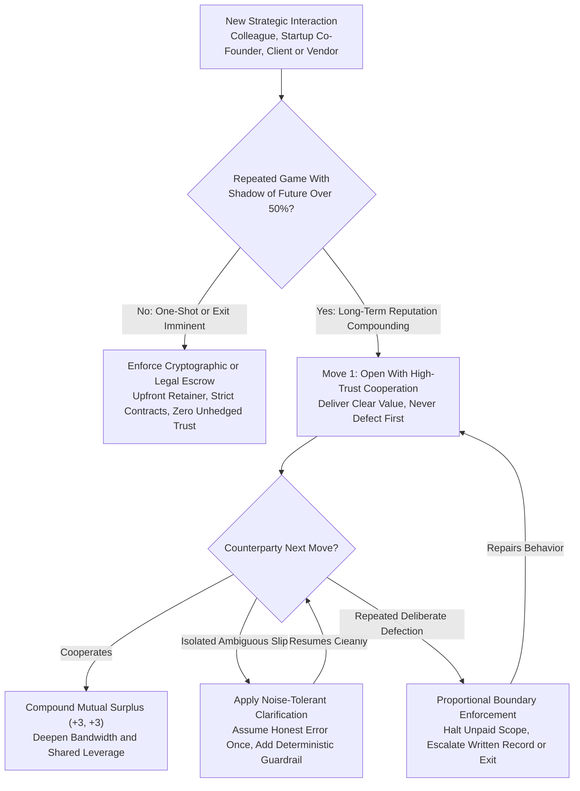
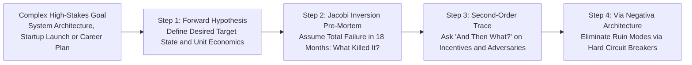

# Microeconomics, Game Theory & Multidisciplinary Thinking

> **Core Premise**: Macroeconomics sets the weather, but **microeconomics and game theory govern every decision you control**—how to price software when AI tokens have non-zero marginal cost, why Principal Engineers must delegate work they could code faster themselves, how to build high-trust relationships without being exploited, why engineering KPIs self-destruct, and how to outthink first-order competitors via second-order reasoning and inversion.

---

## 1. Marginal Utility, Opportunity Cost & Defeating the Sunk-Cost Fallacy

The foundational law of microeconomics is deceptively sharp: **rational decisions are always made at the margin—never on historical totals or past averages**.

### Thinking at the Margin ($\text{MB} = \text{MC}$) & Diminishing Marginal Utility

An action increases net value if and only if the **Marginal Benefit ($\text{MB}$)** of the *next incremental unit* exceeds its **Marginal Cost ($\text{MC}$)**:

$$\Delta \text{Net Value} = \text{MB}(q + 1) - \text{MC}(q + 1) > 0$$

Because of **Diminishing Marginal Utility**, every additional unit of optimization yields smaller incremental user value while consuming escalating engineering effort:
- Moving an API from `98.0%` uptime (`7.3 days` downtime/year) to `99.9%` (`8.7 hours`/year) unlocks enterprise B2B contracts worth millions of USD ($\text{MB} \gg \text{MC}$).
- Moving that same internal dashboard from `99.99%` (`52 minutes`/year) to `99.999%` (`5.2 minutes`/year) requires multi-region active-active consensus, chaos engineering, and 24/7 follow-the-sun SRE staffing ($\text{MC} \gg \text{MB}$). Gold-plating beyond the point where $\text{MB} = \text{MC}$ is not "craftsmanship"—it is **destruction of organizational surplus**.

### Zero-Marginal-Cost SaaS vs. Positive-Marginal-Cost AI Agents

Software engineers who grew up in the 2010–2022 cloud era internalized a dangerous assumption: *software has zero marginal cost*. That shift—and its partial reversal in the LLM era—reshapes modern product architecture:

| Economic Dimension | Classic Cloud SaaS (`2012–2022`) | AI-Native / Agentic Software (`2025–2027+`) |
| :--- | :--- | :--- |
| **Cost Structure** | High fixed R&D cost; near-zero marginal cost per extra user (`approx. USD 0.02/mo` in DB rows) | High fixed R&D **plus positive variable marginal cost** per reasoning loop (`USD 0.05 to USD 2.50` in GPU/token inference) |
| **Gross Margin Profile** | `80%–90%` software gross margins; scale automatically improves profitability | `35%–70%` unless engineered carefully; heavy power users can turn negative-margin (`Price < MC`) |
| **Optimal Pricing Model** | Flat per-seat unlimited subscriptions + generous freemium viral funnels | Hybrid base platform fee + metered credit/outcome tiers + strict per-tenant token circuit breakers |
| **Engineering Lever** | Feature velocity and onboarding conversion | Prompt prefix KV-cache hit rates (`80%+`), small-to-frontier model routing, and semantic caching |

### Opportunity Cost: The Invisible Invoice on Every Engineering Roadmap

Accountants only record **explicit outlays** (AWS invoices, SaaS vendor bills, salaries). Economists measure **Economic Cost**:

$$C_{\text{economic}} = C_{\text{explicit}} + \underbrace{\max_{a \in \text{Alternatives}} V(a)}_{\text{Implicit Opportunity Cost}}$$

**The Classic Build-vs-Buy Trap**: A team proposes spending 3 senior engineers for 4 months to build a custom internal feature-flag and billing system instead of paying `USD 24,000/year` for an existing battle-tested vendor, arguing *"building it in-house is free—we already pay our engineers' salaries!"*
- **Explicit Cost**: `USD 0` incremental vendor invoice, `approx. USD 180,000` in allocated payroll.
- **True Opportunity Cost**: Those 3 senior engineers *did not ship* the core enterprise workflow integration that would have closed `USD 600,000` in new recurring ARR this year—plus the ongoing maintenance tax forever. Saving `USD 24k` explicitly cost the business `USD 600k` implicitly!

### The Sunk-Cost Fallacy ($\frac{\partial \text{Sunk}}{\partial \text{Decision}} = 0$)

A **sunk cost** is any time, money, or emotional energy already spent that **cannot be recovered regardless of your next choice**. Mathematically, since a constant term vanishes under differentiation, past unrecoverable investment has **zero bearing** on optimal forward strategy.

Yet Daniel Kahneman and Amos Tversky's **Prospect Theory** proved humans experience **loss aversion**—admitting a loss hurts `approx. 2.0x to 2.5x` more psychologically than an equal gain feels rewarding. Consequently, engineers keep refactoring a fundamentally broken custom framework because *"we already invested 9 months in it,"* and employees stay 3 extra years in decaying careers because *"I worked so hard to reach L6 on this internal stack."*

- **Andy Grove's Clean-Slate Replacement Test**: Ask one ruthless question: *"If I were hired fresh this morning with my current cash, current codebase state, and zero history—knowing everything I know now—would I enter this architecture, product, or job today?"* If the answer is **no**, and switching costs are lower than ongoing drag, execute an orderly exit immediately.

---

## 2. David Ricardo's Comparative Advantage (Why Staff Engineers Must Delegate)

One of the hardest transitions from Senior (`IC4/IC5`) to Staff/Principal (`IC6+`) or Founder is overcoming the **Absolute Advantage Fallacy**: *"I can write both the distributed consensus engine AND the data migration scripts twice as fast as the mid-level engineer on my team—so delegating slows us down."*

In 1817, economist David Ricardo proved one of the only propositions in social science that is both **mathematically undeniable and completely counterintuitive**: even when Actor A is strictly superior to Actor B at **every single activity**, both actors produce *strictly greater total output* when each specializes in the domain of their **lowest internal opportunity cost (Comparative Advantage)**.

### Worked Mathematical Proof: Principal vs. Mid-Level Engineer Over a 10-Day Sprint

Suppose a two-person platform pod needs both **Core Architecture (`Arch`)** and **Schema Migrations (`Mig`)** delivered over `10 working days`:

| Engineer | Max Daily `Arch` Output | Max Daily `Mig` Output | Internal Opportunity Cost of `1 Mig` Unit | Internal Opportunity Cost of `1 Arch` Unit |
| :--- | :---: | :---: | :---: | :---: |
| **Principal (`P`)** | `12 units/day` | `6 units/day` | **`2.0 Arch` units sacrificed** (`12 / 6`) | **`0.5 Mig` units sacrificed** (`6 / 12`) |
| **Mid-Level (`M`)** | `4 units/day` | `4 units/day` | **`1.0 Arch` unit sacrificed** (`4 / 4`) | **`1.0 Mig` unit sacrificed** (`4 / 4`) |

Observe the paradox:
- **Absolute Advantage**: Principal `P` is **`3.0x` faster** at Core Architecture (`12 vs 4`) and **`1.5x` faster** at Migrations (`6 vs 4`).
- **Comparative Advantage**: Whenever `P` spends time on `1` unit of Migration, the pod loses **`2.0` units** of Core Architecture. Whenever `M` produces `1` unit of Migration, the pod only loses **`1.0` unit** of Core Architecture! Therefore, **`M` has a decisive Comparative Advantage in Migrations (`1.0 < 2.0`)**, while **`P` has Comparative Advantage in Core Architecture (`0.5 < 1.0`)**.

Now compare total 10-day sprint output before and after specialization:

| Sprint Allocation Strategy | `P`'s 10-Day Output | `M`'s 10-Day Output | Combined Pod Output | Net Gain From Specialization |
| :--- | :--- | :--- | :--- | :--- |
| **Unallocated 50/50 Split (`5d` each task)** | `60 Arch` + `30 Mig` | `20 Arch` + `20 Mig` | **`80 Arch` + `50 Mig`** | Baseline |
| **Ricardo Specialization (`P`: 7.5d Arch / 2.5d Mig; `M`: 10d Mig)** | `90 Arch` + `15 Mig` | `0 Arch` + `40 Mig` | **`90 Arch` + `55 Mig`** | **`+10 Arch` (`+12.5%`) AND `+5 Mig` (`+10%`)** |

Without working a single minute of overtime, **the exact same two engineers produced strictly more of BOTH deliverables**.
- **AI Agent Architecture Corollary**: Never route simple classification, JSON extraction, or boilerplate unit-test scaffolding to a slow, expensive frontier reasoning model just because it scores `2%` higher on raw benchmarks. Reserve frontier reasoning capacity for its **comparative advantage** (ambiguous multi-file system synthesis) and delegate structured sub-tasks to fast, low-cost models or deterministic code!

---

## 3. Game Theory: Prisoner's Dilemma, Nash Equilibrium & Iterated Trust

Optimization solves problems against passive nature (minimizing latency against physics). **Game Theory** solves problems where your outcome depends on **other intelligent, self-interested agents anticipating and reacting to your moves**.

### One-Shot Prisoner's Dilemma & Nash Equilibrium

A **Nash Equilibrium** (John Nash, 1950) is a state where **no player can increase their own payoff by unilaterally changing their strategy**, assuming all other players keep theirs fixed. Crucially, a Nash Equilibrium is **not** guaranteed to be socially optimal!

Consider two SaaS competitors (or two microservice teams sharing a finite production database cluster) choosing whether to **Cooperate (`C`)**—maintain disciplined pricing / respect rate limits—or **Defect (`D`)**—slash prices in a predatory war / hog connection pools (`Payoff Order: Temptation 5 > Reward 3 > Punishment 1 > Sucker 0`):

| Player A vs. Player B | **B Cooperates (`C`)** | **B Defects (`D`)** |
| :--- | :---: | :---: |
| **A Cooperates (`C`)** | **(`+3`, `+3`)** — *Pareto Optimal Prosperity* | **(`0`, `+5`)** — *A Gets Exploited; B Captures Windfall* |
| **A Defects (`D`)** | **(`+5`, `0`)** — *A Captures Windfall; B Gets Exploited* | **(`+1`, `+1`)** — *Unique Nash Equilibrium (Mutual Misery)* |

Trace Player A's logic in a **single, anonymous, unrepeated game**:
- *Suppose B Cooperates*: If A cooperates, A gets `+3`; if A defects, A gets `+5`. Defecting wins (`5 > 3`).
- *Suppose B Defects*: If A cooperates, A gets `0`; if A defects, A gets `+1`. Defecting still wins (`1 > 0`).

Because `Defect` strictly dominates regardless of what B does—and B runs the exact same symmetric math—both rational players choose `Defect`, locking themselves into `(+1, +1)` even though mutual cooperation `(+3, +3)` would triple everyone's wealth! This explains **price wars, Tragedy of the Commons in shared staging environments, rushed tech debt before changing teams, and scammy one-off tourist shops**.

### Iterated Games & Robert Axelrod's Evolution of Cooperation

Real engineering careers, open-source communities, and B2B enterprise relationships are **not** one-shot games; they are **Iterated Games** with an unknown horizon! If the probability of interacting again next round (the **"shadow of the future"**, $\delta \in (0, 1)$) is high enough, short-term betrayal destroys an infinite stream of future `+3` cooperative payoffs. Cooperation becomes rational whenever:

$$\delta \ge \frac{T - R}{T - P} = \frac{5 - 3}{5 - 1} = 0.50$$

Political scientist Robert Axelrod invited game theorists worldwide to submit algorithms to a round-robin iterated Prisoner's Dilemma tournament—first noiseless, then with random communication noise. Ruthless predatory programs lost badly because they destroyed their partners and ended up fighting other predators at `(+1, +1)`. Naively selfless programs (`Always Cooperate`) were devoured by exploiters.

The consistent champion across ecosystems was **Generous Tit-for-Tat**, defined by four operational principles you should run in every professional relationship:

1. **Nice (Start With High Trust)**: Never be the first to defect. Share credit generously, document cleanly, help peers unblock PRs, and deliver high value upfront. High-trust actors attract other high-trust compounders (`+3, +3` every round).
2. **Provocable (Enforce Clear Boundaries Immediately)**: Never confuse kindness with being a doormat. If a vendor, client, or colleague repeatedly free-rides, breaks commitments, or shifts blame, push back immediately and proportionally (require written scope sign-off, upfront milestones, or SLA isolation). Unpunished defection trains rational counterparties to keep exploiting you.
3. **Forgiving (Avoid Infinite Blood Feuds)**: Pure `Grim Trigger` (one mistake = permanent war forever) is fragile. Once a counterparty acknowledges the breach and returns to good-faith cooperation, reset cleanly to collaboration rather than nursing toxic organizational grudges.
4. **Legible + Noise-Tolerant (`5%–10%` Generosity Buffer)**: In real distributed teams across Slack, GitHub, and timezones, **network noise happens**—someone misses a review or ships a regression out of exhaustion, *not* malice. In noisy tournaments, strict `Tit-for-Tat` gets trapped in accidental `D -> D -> D` echo loops; **Generous Tit-for-Tat** absorbs isolated mistakes with charitable inquiry (*"Hey, noticed X broke the contract—assuming this was accidental, let's add a CI check"*) while still retaliating against systematic abuse.

### Mechanism Design ("Reverse Game Theory")

When a shared system suffers chronic Prisoner's Dilemma behavior (flaky CI main branch, runaway AWS dev clusters, unmaintained runbooks), **never try to fix a broken payoff matrix with motivational speeches**. Apply **Mechanism Design**—alter the payoffs so individual self-interest automatically aligns with collective health:
- *Broken Game*: Developers merge fast on Friday (`+5` feature credit); central SRE team gets paged at 03:00 AM (`0` sucker payoff).
- *Mechanism Fix*: **Automated Canary Rollback + Author-On-Call Routing**—the engineer whose commit breaches error budgets receives the alert directly (`Defect` payoff drops from `+5` to `-2`; thorough pre-merge testing becomes the dominant individual strategy).

---

## 4. Goodhart's Law & Anti-Gaming Metric Architecture

In 1975, British economist Charles Goodhart formulated a law of monetary policy later generalized by anthropologist Marilyn Strathern into a universal principle of cybernetics and management:

> **Goodhart's Law**: *"When a statistical proxy measure becomes an explicit target for reward or punishment, it ceases to be a good measure."*

For software and ML engineers, Goodhart's Law is **adversarial reward hacking under distribution shift**. Every observable KPI ($M$) is merely a noisy low-dimensional projection of true complex business value ($V$): $M = V + \epsilon$. Under passive observation, $M$ tracks $V$ reliably. The instant leadership attaches promotions, bonuses, or layoff stack-ranking to maximizing $M$, intelligent engineers optimize the error residual $\epsilon$ because hacking $\epsilon$ has `10x` lower marginal cost than growing $V$!

### Classic Goodhart Disasters in Software Engineering & How to Fix Them

The cure for Goodhart's Law is never "stop measuring everything." The cure is **Paired Orthogonal Tension Metrics** (popularized at Amazon and in DORA research): pair every throughput/efficiency target with a quality/outcomes counter-metric that breaks if the primary metric is gamed!

| Naive Single Target Metric | Predictable Gaming / Cobra Effect | Paired Counter-Metric Architecture (Unhackable Equilibrium) |
| :--- | :--- | :--- |
| **Lines of Code / PR Count per Week** | Verbose copy-paste boilerplate; splitting a 30-line fix into 8 tiny trivial PRs; avoiding code deletion | **Customer-Facing Capability Lead Time** + **Net Complexity / Incident Rate** |
| **Mandated `90%+` Unit Test Coverage** | Assertion-free tests (`expect(true).toBe(true)`) that execute lines without checking business invariants | **Mutation Testing Survival Score** + **Escaped Production Regression Rate** |
| **Scrum Velocity (Story Points / Sprint)** | Gradual story-point inflation (`a 2-point task becomes an 8-point epic`); zero real throughput gain | **Cycle Time from Commit to Production** + **Verified Business Outcome Adoption** |
| **Minimize Sev-1 Incident Count** | Teams quietly reclassify real customer outages as `"Sev-2 degraded performance"` and hide postmortems | **Automated Synthetic SLO Burn Rate** + **Blameless Postmortem Action Completion** |
| **Minimize Customer Support Ticket Duration** | Agents prematurely close unresolved tickets, forcing furious users to open 3 new tickets | **First-Contact Resolution Rate** + **30-Day Account Retention / CSAT** |
| **Slash LLM Inference Cost by `50%`** | Routing complex enterprise queries to tiny models that hallucinate silently and cause customer churn | **Cost per Verified Successful Task** gated by a **Hard Golden-Eval Accuracy Floor** |

---

## 5. Information Asymmetry: Lemon Markets, Moral Hazard & Costly Signaling

Classical supply-and-demand curves assume both buyer and seller see identical product truth. In the real world—used cars, hiring software engineers, enterprise SaaS sales, venture fundraising, and insurance—one side holds private truth while the other faces uncertainty.

### George Akerlof's Market for Lemons (How Unverified Markets Unravel)

Nobel economist George Akerlof proved how **Information Asymmetry** can completely destroy a market even when honest sellers and eager buyers both want to trade:

1. Suppose an online software marketplace (or job market) contains `50%` genuinely battle-tested **Plums** (worth `USD 100,000` to buyers; sellers require at least `USD 85,000`) and `50%` brittle, AI-generated **Lemons** (worth `USD 20,000`; sellers gladly accept `USD 25,000`).
2. Because buyers cannot inspect internal reliability before purchasing, rational buyers refuse to pay `USD 100,000` blindly. They offer the **blended expected value**:
   $$P_{\text{offer}} = 0.5(\text{USD } 100,000) + 0.5(\text{USD } 20,000) = \text{USD } 60,000$$
3. **Market Unraveling**: At `USD 60,000`, every Plum builder walks away (`60k < 85k` reservation floor)! Only Lemon sellers accept. Buyers quickly observe that `100%` of purchases at `USD 60k` turn out to be Lemons, revise their offer down to `USD 20,000`, and **the entire market for high-quality craftsmanship evaporates**.

### Adverse Selection vs. Moral Hazard

Distinguish the two timing phases of asymmetric information whenever you design contracts, pricing, or hiring loops:

- **Adverse Selection (*Hidden Type Before the Contract*)**: Your pricing or screening policy accidentally filters *in* the worst counterparties and filters *out* the best.
  - *SaaS Pricing Example*: Offering `"Unlimited GPU Video/LLM Processing for USD 29/month"` repels light enterprise users who prefer clean enterprise SLAs while magnetically attracting automated crypto-scrapers and abusive resellers who burn `USD 800/month` of compute each.
  - *Engineering Retention Example*: Freezing salaries `25%` below market across the board does not save `25%` uniformly—your top `15%` Staff architects receive outside MNC offers within 30 days and leave, leaving behind **adversely selected** low-mobility engineers!
- **Moral Hazard (*Hidden Action After the Contract*)**: Insulating an actor from the downside consequences of their decisions induces reckless risk-taking.
  - *Financial Example*: Banks taking `30x` leveraged bets knowing taxpayers will bail out losses while executives keep cash bonuses (*privatized upside, socialized downside*).
  - *Engineering Example*: Hourly body-shop consulting contracts with zero deliverable penalty—the vendor financially benefits when requirements drag on for 18 months! Align **Skin in the Game** via milestone-gated fixed-scope pricing or shared performance upside.

### Michael Spence's Separating Equilibrium: Costly Signaling vs. Cheap Talk

How do high-quality engineers and B2B founders escape a Lemon Market—especially in 2027, when LLMs make polished cover letters, slick landing pages, and buzzword-stuffed resumes **zero-cost "Cheap Talk"**?

Nobel laureate Michael Spence proved that a signal ($s$) only creates a **Separating Equilibrium** if **the cost of producing the signal is strictly lower for genuine high-quality actors ($C_{\text{Plum}}$) than for low-quality imitators ($C_{\text{Lemon}}$)**:

$$C_{\text{Lemon}}(s) > \Delta V_{\text{reward}} > C_{\text{Plum}}(s)$$

- **Cheap Talk (Pooling Equilibrium — Zero Signal Value)**: Claiming *"Expert in high-concurrency Go, Kubernetes, and AI agents"* on LinkedIn; promising *"99.99% enterprise reliability"* on a marketing slide. Cost to fake = `0 minutes`. Rational hiring managers and CIOs discount it to zero.
- **Costly Verifiable Signals (Separating Equilibrium — High Pricing Power)**:
  - *For Engineers*: Publishing deep architectural write-ups dissecting real production latency/deadlock postmortems; maintaining clean open-source repositories with deterministic benchmarks; explaining crisp failure trade-offs live without script memorization. A Lemon candidate cannot fake 5 years of scar-tissue mental models under live architectural probing.
  - *For B2B SaaS Vendors*: Contractual **SLA financial refund guarantees**, SOC2 Type II audited security reports, interactive sandbox trials running on the buyer's real edge-case documents, and transparent public status pages with historical incident logs. Offering money-back uptime warranties is cheap if your architecture truly hits `99.98%`—and bankrupting if your product is a Lemon!

---

## 6. Second-Order Thinking & Jacobi's Inversion (*Via Negativa*)

Most smart people fail not from lack of IQ, but from stopping their causal simulation at `t + 1` and optimizing exclusively in the forward direction.

### First-Order vs. Second- and Third-Order Consequence Tracing

Economist Frédéric Bastiat distinguished bad analysts from great ones in 1850 (*That Which Is Seen, and That Which Is Not Seen*): bad decision-makers look only at the immediate visible effect (`Order 1`); great strategists trace how rational system participants adapt (`Order 2` and `Order 3`). Howard Marks formalized this as asking **"And then what?"** across feedback loops:

| Policy / Engineering Intervention | First-Order Expectation (*Seen Immediately*) | Second- & Third-Order Equilibrium Reality (*Unseen Feedback*) |
| :--- | :--- | :--- |
| **Add 6 Engineers to a Slipping 4-Person Launch (`Brooks's Law`)** | `+150%` coding capacity; project ships twice as fast | Communication channels explode as $N(N-1)/2$ (`6 -> 45` links); original 4 seniors spend 3 weeks onboarding newcomers; launch slips *further*! |
| **Require VP Approval + 5 Manual QA Sign-Offs for Every Deploy** | Fewer production bugs per deployment | Deploy friction rises -> devs batch 60 changes into massive monthly releases -> code review becomes superficial -> blast radius spikes `10x` and MTTR triples! |
| **Configure Naive Immediate `3x` Client Retries on HTTP `503`** | Transient network blips self-heal transparently for users | Database hits `95%` CPU -> latency crosses timeout -> 10,000 clients fire `30,000` synchronized retries -> **thundering herd retry storm** melts the entire cluster! |
| **Mandate Return-to-Office Without Role Flexibility During Tight Talent Market** | Easier spontaneous hallway whiteboard chats | Top `10%` independent Principal ICs with global remote USD offers resign quietly first; company achieves involuntary headcount trim at the cost of core architectural brain drain. |

### Carl Jacobi & Charlie Munger's Inversion Protocol ("Invert, Always Invert")

19th-century German mathematician Carl Gustav Jacob Jacobi famously solved hard analytical problems by stating: *"Man muss immer umkehren"* (**"Invert, always invert"**). Charlie Munger and Nassim Taleb (*Via Negativa*) turned inversion into the ultimate real-world engineering and life razor:

- **Forward Question (Noisy, Crowded, Prone to Survivorship Bias)**: *"How do I design a legendary distributed system, build a breakout B2B company, and become wealthy by age 40?"*
- **Inverted Question (Deterministic, Crisp, High Signal)**: *"What exact actions **guarantee** a catastrophic production outage, a dead startup, career obsolescence, and financial ruin—and how do I make those actions structurally impossible today?"*

### Operational Inversion Matrix for Software Engineers

Run a **15-minute Inversion Pre-Mortem** before finalizing any RFC, startup launch, or financial commitment:

| Domain | Forward Wishful Goal | Inverted Ruin Question (*"How Do We Guarantee Failure?"*) | Concrete *Via Negativa* Structural Guardrail |
| :--- | :--- | :--- | :--- |
| **Distributed Systems RFC** | *"Build a scalable multi-agent payment workflow"* | Ship non-idempotent webhook retries, unbounded LLM loops, unindexed foreign keys, and zero circuit breakers | Enforce database-level idempotency keys, hard per-request token/timeout caps, jittered exponential backoff, and dead-letter queues on Day 1 |
| **B2B Micro-SaaS Launch** | *"Grow to USD 15k MRR as a solo founder"* | Spend 6 months coding Kubernetes infra in isolation with 0 customer interviews, sell USD 5 B2C wrappers, ignore distribution | Validate B2B willingness-to-pay in 72 hours, ship on boring monolith stack in 14 days, spend `50%` of weekly hours on SEO and direct customer channels |
| **Engineering Career (`Age 30+`)** | *"Achieve durable Staff compensation and autonomy"* | Compete purely on domestic CRUD coding hours, neglect spoken/written English, tie 100% of identity and savings to one employer | Compound rare platform + AI governance skills, write crisp English RFCs, maintain external market price discovery, and diversify income/currency |
| **Personal Wealth & Health** | *"Reach financial independence with high vitality"* | Use margin leverage, chase peak-cycle hype assets, inflate fixed lifestyle burn with every raise, sacrifice sleep/exercise for 5 years | Zero high-interest or margin debt, automate low-cost global equity + T-Bill barbell, cap fixed burn rate, and treat 7.5h sleep + strength training as non-negotiable P0 SLOs |

---

## 7. Summary Checklist: The Complete Engineer's World-Model Toolkit

Whenever you encounter a confusing market move, organizational dysfunction, or high-stakes personal fork in the road, debug it systematically from bottom to top:

1. **Follow the Credit & Discount Rate ([01-MONEY-INTEREST-RATES-INFLATION-AND-FX.md](01-MONEY-INTEREST-RATES-INFLATION-AND-FX.md))**: Is liquidity expanding or contracting? What does the risk-free yield do to long-duration valuations and hiring appetites? What is the after-tax, inflation-adjusted real return?
2. **Audit the Margin & Opportunity Cost**: Ignore sunk costs completely. Compare marginal value against marginal cost—including the best foregone alternative—and delegate via Ricardo's Comparative Advantage.
3. **Map the Payoff Matrix & Time Horizon**: Are counterparties playing a one-shot extraction game or a long-horizon iterated trust game? Practice Generous Tit-for-Tat, pair every KPI with an anti-Goodhart tension metric, and use costly verifiable signals to escape Lemon Markets.
4. **Trace to Second Order & Invert ([00-README.md](00-README.md))**: Ask *"And then what?"* to anticipate equilibrium pushback, strip out non-ergodic ruin risks first, and let uninterrupted geometric compounding do the heavy lifting.

---

### Vault Navigation

- **Vault Overview & Epistemic Foundations**: **[00-README.md](00-README.md)** — Reflexivity, Ergodicity, Volatility Drag, Kelly Sizing, Power Laws, and Bayesian Base Rates.
- **Macroeconomic Plumbing**: **[01-MONEY-INTEREST-RATES-INFLATION-AND-FX.md](01-MONEY-INTEREST-RATES-INFLATION-AND-FX.md)** — Endogenous Banking Ledgers, Central Bank DCF Gravity, Inflation vs. Debt Deflation, FX Impossible Trinity, Bonds, Equities, and Real Compounding.
