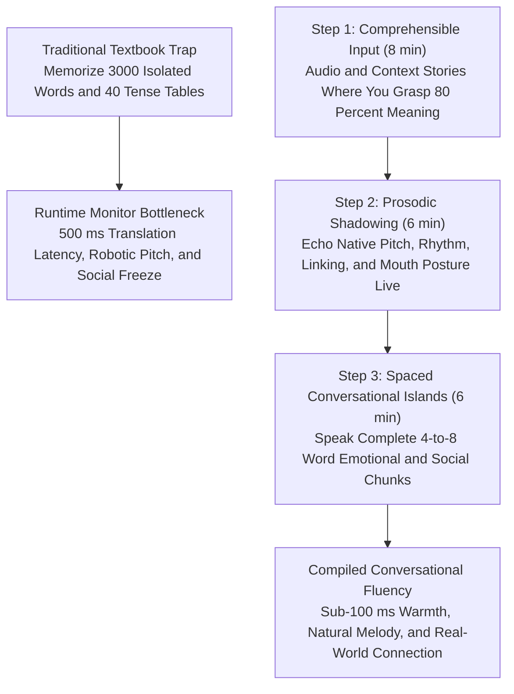
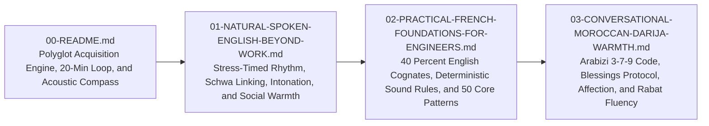

# The Polyglot Engineer Playbook: Acquiring English, French & Darija in 20 Minutes a Day

> **Target Profile**: Mandarin-native Software, Systems, and AI Engineers who already read and write technical English fluently, and want a neuroscience-backed, zero-fluff protocol to upgrade spoken English into warm natural rhythm, unlock high-ROI conversational French, and speak heartfelt Moroccan Darija—in 20 focused minutes a day without textbook grammar misery.

---

## 1. Why Adult Language Classes Fail Engineers (Acquisition vs. Conscious Learning)

Most engineers approach a new human language the exact way they study a programming language: buy a grammar reference, memorize syntax rules, drill 3,000 isolated flashcards, and attempt to assemble sentences at runtime. Six months later, they can pass multiple-choice quizzes on Duolingo yet freeze completely when a Parisian waiter asks a fast follow-up question or a group laughs at a dinner table.

Linguist Stephen Krashen identified the root architectural bug decades ago in his **Acquisition-Learning & Monitor Hypothesis**: the adult brain has **two physically distinct language engines**, and traditional schooling trains the wrong one for real-time speech.

| Architectural Dimension | Conscious Learning (`The Monitor`) | Subconscious Acquisition (`Compiled Weights`) |
| :--- | :--- | :--- |
| **Systems Analogy** | Single-threaded Python rule interpreter doing runtime table lookups | Pre-compiled C++/Rust neural weights firing via L1 audio-motor cache |
| **Execution Latency** | `400 to 1,200 ms` per grammar check (`subject -> tense -> gender -> word order`) | `Under 80 ms` instinctive chunk retrieval; keeps pace with `150+ WPM` human speech |
| **How It Is Built** | Studying verb tables, grammar rules, isolated word translations, written tests | High-context **Comprehensible Input (`i + 1`)**, **Prosodic Shadowing**, and **Spaced Islands** |
| **Valid Production Use** | Editing an asynchronous RFC, legal email, or formal essay where latency is irrelevant | Live dinner-table banter, humor, café ordering, emotional warmth, and street navigation |

When you try to speak by running **Conscious Grammar Rules** in your head (`"Wait, is table masculine or feminine? Past participle agreement?"`), your `400+ ms` lookup latency collides with live human conversation—causing awkward pauses, flat robotic pitch, and social exhaustion. Fluent adults do **not** compute grammar faster than beginners; they bypass runtime rule computation altogether by firing pre-compiled acoustic-motor chunks (**Conversational Islands**).

### Zipf's Law & Why Isolated 5,000-Word Cramming Wastes 90% of Your Time

Natural spoken word frequencies follow **Zipf's power-law distribution**, where the frequency of the $r$-th most common word scales inversely with its rank:

$$f(r) \propto \frac{1}{r^s}, \qquad s \approx 1.0$$

Because of this steep power law, **spoken daily conversation is extraordinarily top-heavy**:

- Your **top `100` functional words and glue phrases** account for **approx. `50%`** of every spoken sentence you will ever hear.
- Your **top `500 to 800` high-frequency words + `60` multi-word conversational chunks** cover **`80% to 85%`** of everyday social, café, travel, and family interaction!
- Memorizing word `#4,200` (*"jurisprudence"*, *"chandelier"*) yields less than `0.001%` conversational return while starving your ear and mouth of prosodic muscle memory.

---

## 2. Why Your `English + French + Darija` Stack Unlocks Both the Globe and Home

Learning random languages out of vague curiosity rarely survives a busy engineering quarter. Your specific three-language stack—**Natural Spoken English + Practical French + Moroccan Darija**—forms one of the highest-leverage linguistic combinations on earth, seamlessly bridging global career mobility, European/Mediterranean travel, and deep cross-cultural partnership in Morocco:

| Layer in Your Stack | Current Baseline -> Target | Geographic & Career Reach | Social & Emotional Superpower |
| :--- | :--- | :--- | :--- |
| **1. Natural Spoken English** | Strong technical L2 -> **Warm, rhythmic, idiomatic fluency** | Global tech hubs (US, UK, Singapore, Europe, remote Staff+ leadership) | Moves you from "competent engineer in standup" to effortless dinner host, storyteller, and witty partner |
| **2. Practical French** | Zero -> **High-ROI B1 conversational & reading fluency** | France, Switzerland, Belgium, Canada, West/North Africa, plus **Rabat's professional, café, menu, rail & pharmacy layer** | **40%+ lexical overlap already pre-installed via English**; lets you navigate Europe and urban Morocco independently with poise |
| **3. Moroccan Darija** | Zero -> **Warm family, table, blessing & street fluency** | All of Morocco (Rabat, Casablanca, Tangier, Fes, Marrakech) + Moroccan diaspora across Europe | Speaking French in Rabat earns polite service; dropping authentic Darija blessings (*Bssa7a*, *Allah y7fdek*) melts walls and makes you **family** |

### Why French + Darija Reinforce Rather Than Compete

In educated urban Morocco—especially **Rabat and Casablanca**—French and Darija do not live in separate silos; Moroccans weave them together inside the **exact same sentence**! A totally normal Rabati sentence at a café or family living room sounds like:

> *"Safi, on prend un café daba, w men b3d on passe chez ma mère inshallah !"*
> *(All set [Darija], let's grab a coffee [French] right now [Darija], and afterward [Darija] we'll stop by my mom's place [French] God willing [Darija]!)*

That code-switching architecture is a massive gift for a beginner: whenever a Darija noun slips your mind mid-sentence, **plugging in the French word (or an English-French cognate pronounced the French way) works 100% naturally** in Rabat!

---

## 3. The 20-Minute Daily Protocol (Zero Willpower, Commute & Coffee Friendly)

Willpower is a depleting resource after 8 hours of debugging distributed systems. Never schedule "2-hour weekend textbook blocks"—your motor cortex and auditory cortex rewire through **short, daily, high-emotion acoustic loops** right before sleep or with morning coffee.

### The 3-Block 20-Minute Micro-Session

1. **Minutes `00–08` — Ear-First Comprehensible Input (`i + 1` Listening)**:
   - Listen to a short, real-voice dialogue, vlog, podcast clip, or WhatsApp voice exchange where you already understand **`75% to 85%`** of the context (via transcript, bilingual subtitles, or situational context).
   - **Rule**: Hear every new phrase **at least 3 times with your ears** before analyzing its spelling. Your ears capture true vowel reduction and melody; your eyes hallucinate L1/English pronunciation bugs.
2. **Minutes `08–14` — Prosodic Motor Shadowing (`150 ms` Lag Echo)**:
   - Pick **30 to 45 seconds** of warm, charismatic native audio. Play it on headphones (keep **one AirPod out** so you hear your own acoustic output!) and speak **simultaneously `0.2 seconds` behind the speaker** like a musical instrument matching lead vocals.
   - Copy **music first, words second**: exaggerate their pitch rises, schwa reductions, French nasal resonance, or Darija throat warmth. Record a 20-second Voice Memo once a week and A/B test your waveform rhythm against theirs.
3. **Minutes `14–20` — Spaced Output via "Conversational Islands"**:
   - Instead of drilling single words (`"hungry"`, `"menu"`, `"health"`), speak **complete, high-frequency 5-to-10 word social islands** out loud while walking around your room—imagining a specific human face (your partner, a Rabat taxi driver, a colleague at a bar).
   - Send one **20-second real voice note** (or say 3 fresh sentences aloud at dinner) to lock the neural pathway through emotional reward.

### Smart Weekly Multiplexing (Never Split 20 Minutes 3 Ways on the Same Day!)

Context-switching between three languages inside a single 20-minute window thrashes working memory. Instead, run **dedicated daily focus slots** across the week:

| Day of Week | 20-Minute Primary Focus | Passive Zero-Effort Background Habit |
| :--- | :--- | :--- |
| **Mon & Wed** | **Natural Spoken English** (Prosody shadowing, linking, humor & storytelling chunks) | 15-min casual English podcast (*Conan*, *Modern Wisdom*, travel/food shows) during walk/gym |
| **Tue & Thu** | **Practical French** (Deterministic sound rules, café/travel/Rabat survival frames) | Read French menus, product labels, or 3-minute *InnerFrench* / *Easy French* street clips |
| **Fri & Sat** | **Moroccan Darija** (`Arabizi` chat decoding, blessings call-and-response, affectionate & table phrases) | Drop 2 real Darija phrases/voice notes on WhatsApp or around food (*Bismillah*, *Bssa7a!*) |
| **Sunday** | **Light Review & Playful Integration** (5-min Anki audio-sentence review; zero heavy study) | Watch a French/Moroccan film clip, music video, or travel vlog purely for fun |

---

## 4. Five Linguistic Anti-Patterns Engineers Must Drop Immediately

1. **Reading Before Listening (Visual Phonetic Poisoning)**: If your eyes see French `beaucoup` or `quatre` before your ears hear `/boku/` and `/katʁ/`, your English reading brain compiles `"bow-coop"` and `"kwat-er"` into permanent memory. **Audio first, text second—always.**
2. **Word-by-Word Mandarin-to-Target Translation**: Mandarin uses invariant verb stems plus aspect particles (`我昨天去了` = `I yesterday go-LE`) and sentence-final softening particles (`吧 / 呢 / 一下`). Translating token-by-token produces stiff English (`"Wait me a moment"`) and broken French/Darija. Always memorize and fire **pre-assembled phrase frames** as atomic units.
3. **Treating Prosody (Melody & Rhythm) as Optional Decoration**: Native speakers effortlessly forgive a wrong gender (`le table` instead of `la table`) or tense slip, because context resolves meaning. What causes native listeners to squint or feel subtle tension is **broken rhythm and flat intonation** (stressing every syllable equally like a telegraph machine). Spend **40% of your practice** on melody and mouth posture!
4. **Studying Modern Standard Arabic (*Fusha*) to Speak with Moroccans**: Opening Duolingo Arabic or an MSA textbook to talk with family in Rabat is like studying **5th-century Ecclesiastical Latin** to chat with your girlfriend's family in Rome! Moroccans understand formal news Arabic passively, but nobody speaks *Fusha* at the dinner table—go straight to **Moroccan Darija** ([03-CONVERSATIONAL-MOROCCAN-DARIJA-WARMTH.md](03-CONVERSATIONAL-MOROCCAN-DARIJA-WARMTH.md)).
5. **Waiting Until You Feel "Ready" Before Speaking Imperfectly**: Language is not an exam; it is a **physical signal of care and vulnerability**. Saying three warm, slightly accented Darija or French phrases with a genuine smile builds 100x more human connection than staying silent until your grammar reaches 99% accuracy.

---

## 5. Cross-Language Acoustic Compass: Mandarin vs. English vs. French vs. Darija

Before diving into Modules `01` through `03`, calibrate your physical mouth and rhythmic clock to how each language treats **time, pitch, and resonance**:

| Acoustic Dimension | Mandarin Chinese (Your Native OS) | Spoken English ([Module 01](01-NATURAL-SPOKEN-ENGLISH-BEYOND-WORK.md)) | Spoken French ([Module 02](02-PRACTICAL-FRENCH-FOUNDATIONS-FOR-ENGINEERS.md)) | Moroccan Darija ([Module 03](03-CONVERSATIONAL-MOROCCAN-DARIJA-WARMTH.md)) |
| :--- | :--- | :--- | :--- | :--- |
| **Rhythmic Clock** | **Syllable-timed**: each character gets crisp, equal beat length | **Stress-timed**: content words hit heavy beats; function words crush to `/ə/` | **Phrase-timed**: smooth, even syllables rising gently to the **final syllable of a group** | **Consonant-clustered**: short unstressed vowels drop out, creating brisk, punchy rhythm |
| **Role of Pitch** | **Lexical**: 4 tones change word dictionary meaning (`mā / má / mǎ / mà`) | **Pragmatic & Emotional**: sentence pitch curve signals warmth, curiosity, irony, or focus | **Structural**: gentle upward arc at phrase boundaries; downward drop at sentence end | **Expressive**: warm rising-falling musicality on blessings, questions, and affection |
| **Mouth & Throat Posture** | Mid-mouth crisp consonants; open vowels; retroflex `zh/ch/sh/r` | Relaxed jaw; linked consonant-to-vowel flow; soft American flap-T (`water`) | **Forward rounded lips** (`u`, `eu`, `ou`); nasal resonance (`on`, `an`, `in`); soft throat `R` | **Deep pharyngeal warmth** (`3` ع, `7` ح, `9` ق) paired with crisp front consonants & French vowels |
| **Politeness Encoding** | Sentence-final particles (`吧`, `呢`, `啦`) + `请 / 麻烦 / 一下` | Modal past buffers (`Could / Would you...`), pitch-glide upward tails, and softeners (`kind of`, `a bit`) | Mandatory **`Bonjour / Bonsoir`** gatekeeper + `vous` vs. `tu` + conditional `Je voudrais` | **Reciprocal blessing pairs** (*Bssa7a -> Allah y3tik ssa7a*, *Allah y7fdek*, *Barakallahu fik*) |

---

## 6. Building "Conversational Islands" & Graceful Latency Buffers

Russian-American linguist Boris Shekhtman (who trained U.S. Foreign Service diplomats) coined the concept of **Conversational Islands**: small, rock-solid territory where you can swim effortlessly because you have pre-compiled 5 to 8 natural sentences until they require **zero conscious CPU**. Whenever deep water threatens to drown you in French or Darija, you swim from one island to the next using **Graceful Latency Buffers**.

### Your First 5 Cross-Stack Conversational Islands (English / French / Darija)

| Real-Life Moment | Natural Warm English | Practical Spoken French | Moroccan Darija (`Arabizi`) |
| :--- | :--- | :--- | :--- |
| **1. Warm Self-Intro** | `"I'm a software engineer—mostly working on AI systems, though off the clock I'm way more into music and good food."` | `"Je suis ingénieur logiciel dans l'IA, mais en dehors du boulot j'adore la musique et la bonne cuisine."` | `"Ana mohandis d-l'informatique, w kan-7ma9 3la l-makla zwina w l-mousiqa."` |
| **2. Buying 3 Seconds of Thinking Time** | `"Ooh, let me think how to put this—"` / `"What's the word I'm looking for..."` | `"Attends, comment dire ça..."` / `"C'est quoi le mot déjà ?"` | `"Blati chwiya..."` *(Wait a tiny bit)* / `"Kifach kay-gulu...?"` *(How do they say...?)* |
| **3. Asking Speaker to Slow Down Warmly** | `"Sorry, I missed that last bit—mind saying that one more time?"` | `"Pardon, tu peux répéter un tout petit peu plus lentement ?"` | `"Sme7 liya, 3awd b-chwiya 3afak, ba9i kan-t3llem d-darija!"` *(Sorry, repeat slowly please, I'm still learning Darija!)* |
| **4. Praising Food / Tea at the Table** | `"Oh man, this is unreal—seriously, best I've had in ages."` | `"Franchement, c'est incroyable—un vrai régal !"` | `"Tbarkallah 3lik, hadchi bnin bzzaf! Allah y3tik ssa7a!"` *(Blessings on you, this is super delicious!)* |
| **5. Passing the Mic Back (Curiosity)** | `"What about you—what's been the highlight of your week so far?"` | `"Et toi, comment se passe ta semaine jusqu'ici ?"` | `"W nta / nti, ki dayra s-simana dyalk?"` *(And you [m/f], how's your week going?)* |

### The Golden Rule of Spaced Repetition & Card Engineering

Hermann Ebbinghaus showed that unreviewed memory trace retention decays exponentially over time $t$ relative to memory stability $S$:

$$R(t) = e^{-t / S}$$

Every well-timed retrieval right before $R(t)$ drops below `80%` multiplies $S$ by roughly **`2.2x to 2.5x`** (`1 day -> 3 days -> 7 days -> 18 days -> 45 days`). However, **bad Anki cards destroy motivation**. Follow three strict card-engineering rules:

- **Never create `Word -> Word` dictionary cards** (`Front: "bzzaf" -> Back: "a lot"`). Without prosody and context, your brain stores dead strings it cannot fire in live speech.
- **Only mine sentences you actually heard or needed in real life** (`Max 3 new cards per day` -> caps daily review load under `4 minutes`).
- **Card Format = Situation Prompt -> Spoken Audio Chunk**:
  - *Front*: `[Situation] Someone in Rabat just poured you hot mint tea—how do you thank their hands warmly?`
  - *Back*: **`Allah y3tik ssa7a!`** *(Audio recording + literal feel: "May God give health to your hands")*

---

## 7. Curriculum Architecture & Complete Vault Table of Contents

Each guide in this folder is designed to be immediately actionable today—combining first-principles linguistic rules with real-life café, dinner-table, travel, and partner-world scripts:

### Clickable Module Directory

1. **[00-README.md](00-README.md) — The Polyglot Engineer Playbook: Acquiring English, French & Darija in 20 Minutes a Day** *(Current Document)*
   - Krashen's Acquisition vs. Monitor latency model; Zipf's Law and why 500 words + 60 islands unlock 80%+ of conversation; why the `English + French + Darija` tri-stack bridges global career and Rabat family life; the 20-minute daily Input-Shadow-Island loop; and the 4-language acoustic compass.
2. **[01-NATURAL-SPOKEN-ENGLISH-BEYOND-WORK.md](01-NATURAL-SPOKEN-ENGLISH-BEYOND-WORK.md) — Natural Spoken English Beyond Work: Prosody, Rhythm & Social Warmth**
   - Why Mandarin syllable-timing makes correct English sentences sound robotic or abrupt; stress-timed rhythm, schwa (`/ə/`) vowel reduction, consonant-to-vowel linking, and flap-T; replacing bare imperatives with modal softeners and pitch contours; the "Ping-Pong + 1 Sensory Hook" small-talk formula; active listening backchannels; playful understatement humor; and bar, restaurant, and relationship nuance scripts.
3. **[02-PRACTICAL-FRENCH-FOUNDATIONS-FOR-ENGINEERS.md](02-PRACTICAL-FRENCH-FOUNDATIONS-FOR-ENGINEERS.md) — Practical French Foundations for Engineers: Deterministic Phonetics, Cognates & Rabat/Europe Fluency**
   - How the 1066 Norman Conquest pre-installed 40%+ of French vocabulary into your existing English brain (plus the 6 *Faux Amis* traps to avoid); the 5 deterministic French spelling-to-sound rules (`CaReFuL` silent endings, vowel digraphs where Mandarin `ü` gives you French `u` for free, 3 nasal vowels, liaison, and soft `R`); street spoken French vs. textbook French; 6 Lego verb frames that replace 40 conjugation tables; and 50 survival, café, ONCF train, and Rabat patterns.
4. **[03-CONVERSATIONAL-MOROCCAN-DARIJA-WARMTH.md](03-CONVERSATIONAL-MOROCCAN-DARIJA-WARMTH.md) — Conversational Moroccan Darija (الدارجة المغربية): Sound, Logic & Family Warmth**
   - How Darija blends Arabic roots, Amazigh (`ma-...-ch`) grammar, and French loanwords; cracking the WhatsApp `Arabizi` numeral alphabet (`3 = ع`, `7 = ح`, `9 = ق`, `5 = خ`, `gh = غ`); the Day-1 Darija grammar micro-kernel; the Moroccan Blessing & Call-and-Response Protocol (*Bssa7a*, *Allah y3tik ssa7a*, *Tbarkallah*, *Bismillah*); affectionate partner/family words (*7biba*, *kbida*, *ghzal*); and Rabat taxi, mint tea, and family table scripts.

---

## 8. Zero-Friction Tooling & 90-Day Calibration Roadmap

Keep your phone and laptop friction near zero—if an app takes 4 taps to start, you won't use it consistently:

| Tool | Cost | Exact Role in Your 20-Minute Loop |
| :--- | :---: | :--- |
| **AirPods Pro (One-Ear or Transparency Mode)** | Owned | Lets you hear native audio in one ear while monitoring your **own real acoustic resonance** in the room during 6-minute shadowing |
| **iOS Voice Memos** | Free | Record 20 seconds of yourself shadowing a native clip once a week; listening back reveals rhythm bugs instantly |
| **YouTube / Podcasts (`0.9x` to `1.0x` Speed)** | Free | *Easy French* (street interviews with dual FR/EN subtitles), *InnerFrench*, *Learn Darija with Kawtar / Moroccan Darija channels*, and conversational English podcasts |
| **Anki Mobile / Desktop (Audio-Chunk Cards Only)** | Free (Desktop) | Never make isolated 1-word cards; put a **complete 5-word real-life situation** on front and **native audio + phrase** on back (`Max 10 reviews/day`) |
| **WhatsApp Voice Notes & Chat** | Free | Your ultimate live sandbox—read `Arabizi` (`3, 7, 9`) texts in the wild and drop warm 10-second French/Darija voice notes into daily life |

### What Realistic 20-Minute/Day Consistency Looks Like Over 90 Days

| Horizon | Spoken English Milestone | Practical French Milestone | Moroccan Darija Milestone |
| :--- | :--- | :--- | :--- |
| **Day 30** | Noticeable drop in staccato word-stress; automatic schwa linking (`gonna`, `kinda`, `che-ki-dout`) and natural active-listening reactions | Read any French menu, sign, or pharmacy label aloud accurately using the 5 sound rules; order at cafés and greet with effortless poise | Decode 100% of `3 / 7 / 9` WhatsApp messages; nail the core greetings, *Bssa7a / Allah y3tik ssa7a* tea reflexes, and affectionate terms |
| **Day 60** | Smooth storytelling arcs with modal softeners, pitch-glide warmth, and light self-deprecating humor at dinners or bars | Assemble spontaneous past/present/future thoughts via the 6 Lego verb frames (`Je vais...`, `Je voudrais...`, `J'ai pris...`) | Direct a blue Rabat *petit taxi*, order custom mint tea, use `bghit / kayn / ma-...-ch` sentences, and charm elders with table blessings |
| **Day 90** | English feels like an emotionally expressive second skin rather than a work tool | Hold 10-minute relaxed travel/social chats and catch the gist of Rabat/Paris daily speech | Flow naturally inside bilingual French-Darija family living-room banter with warmth, humor, and zero shyness |

---

## 9. Quick-Reference Diagnostic Matrix: Debugging Adult Language Plateaus

Whenever your progress feels stalled, match the exact symptom below to the underlying neuro-acoustic bottleneck and apply the surgical fix—never respond to a plateau by blindly adding more textbook hours:

| Symptom in Real Life | True Root Cause | Exact 5-Minute Surgical Fix |
| :--- | :--- | :--- |
| **"I understand 95% of written subtitles, but native speech sounds like one blurred, high-speed stream."** | Your brain indexed **orthographic word boundaries** instead of **connected-speech liaison/reduction rules** (`whatcha`, `les_amis`, `ma-fhemt-ch`) | Re-listen to the *exact same* 45-second clip 5 times at `0.9x` then `1.0x` with eyes closed until your auditory cortex hears where words glue together |
| **"People understand my English, yet I feel stiff, overly serious, or less witty than I am in Mandarin."** | Flat syllable-timed rhythm + missing **emotional softeners and active backchannels** (`honestly`, `kinda`, `no way!`, `fair enough`) | Shadow 5 minutes of relaxed conversational banter ([Module 01](01-NATURAL-SPOKEN-ENGLISH-BEYOND-WORK.md)) and adopt 4 go-to emotional reaction chunks this week |
| **"I know the French or Darija words in my head, but my mouth freezes for 3 seconds before anything comes out."** | Assembling individual tokens via the `500 ms` Conscious Monitor instead of firing pre-compiled **Conversational Islands** | Drill 5 complete `Subject + Modal Frame + Verb` chunks aloud at full walk-around speed (`Je vais prendre...`, `Bghit n-mchi...`) until sub-vocal latency hits zero |
| **"My jaw or throat feels tired after 10 minutes of speaking French or Darija."** | Using L1 tongue tension instead of target **articulatory setting** (lip rounding in French; relaxed open pharynx in Darija) | Exaggerate native mouth posture by `130%` in private for 3 minutes—puff lips forward for French `u / eu`; yawn gently to open your throat for Darija `3 / 7` |
| **"I feel self-conscious making beginner mistakes in front of my partner's friends or family."** | Treating conversation as a performance evaluation rather than **affective bonding** | Open proactively with a warm smile and a self-aware island (`"Ba9i kan-t3llem chwiya b-chwiya!"` / `"J'apprends petit à petit !"`)—people immediately root for you |

### How to Use This Curriculum Starting Tonight

1. **Tonight (15 minutes)**: Read **[01-NATURAL-SPOKEN-ENGLISH-BEYOND-WORK.md](01-NATURAL-SPOKEN-ENGLISH-BEYOND-WORK.md)** and test the **Stress-Timed Rhythm & Schwa Reduction** sentences aloud—you will literally hear your English warm up within three tries.
2. **This Week**: Pick **3 English social softeners**, **5 French café/politeness frames** from **[02-PRACTICAL-FRENCH-FOUNDATIONS-FOR-ENGINEERS.md](02-PRACTICAL-FRENCH-FOUNDATIONS-FOR-ENGINEERS.md)**, and **5 Darija heart-blessings** (*Salam*, *Labas 3lik*, *Bssa7a*, *Allah y3tik ssa7a*, *Allah y7fdek*) from **[03-CONVERSATIONAL-MOROCCAN-DARIJA-WARMTH.md](03-CONVERSATIONAL-MOROCCAN-DARIJA-WARMTH.md)**.
3. **Every Day**: Protect your **20-minute ear-and-mouth slot** like brushing your teeth. Small daily acoustic compounding beats heroic weekend cramming 100 times out of 100.
