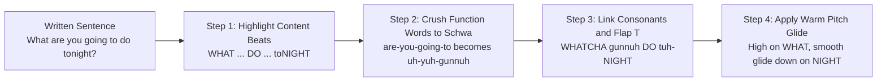
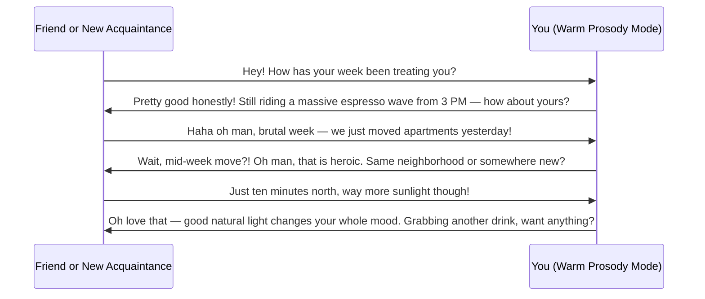

# Natural Spoken English Beyond Work: Prosody, Rhythm & Social Warmth

> **Target Profile**: Mandarin-native engineers who already communicate clearly in technical meetings, design docs, and interviews, yet want to upgrade their off-the-clock spoken English—transforming staccato, textbook-correct sentences into warm, rhythmic, witty, emotionally nuanced speech at cafés, bars, dinner tables, and in close relationships.

---

## 1. The Hidden Acoustic Bug: Syllable-Timed vs. Stress-Timed Rhythm

Have you ever spoken a grammatically flawless English sentence at a noisy café or bar, only to see a native speaker lean in and ask, *"Sorry, what was that?"*—or felt that your English sounds slightly colder, stiffer, or more serious than your real personality in Mandarin?

The root cause is almost never your vocabulary or individual consonant accuracy (`th` or `r`). It is a **clock-architecture mismatch** between how Mandarin and English allocate time across syllables:

- **Mandarin Is Syllable-Timed (Isochronous Syllables)**: Every character occupies roughly the **same acoustic duration** ($\Delta t \approx 180\text{ to }220\text{ ms}$) and carries a distinct vowel and lexical tone: `我` · `今` · `天` · `下` · `班` · `想` · `去` · `喝` · `一` · `杯` (`10 syllables = 10 crisp beats`).
- **English Is Stress-Timed (Isochronous Beats)**: Only **stressed content syllables** (nouns, main verbs, adjectives, adverbs, negatives) land on a regular musical metronome beat. Every **grammar/function word** sitting between two stressed beats (`the`, `to`, `for`, `of`, `can`, `have`, `been`, `and`, `you`) gets **ruthlessly compressed in time and crushed into a neutral murmur** so the main beats stay evenly spaced!

### The Classic Metronome Proof (Say All Three Sentences at `90 BPM`)

Clap a steady slow `1 - 2 - 3` beat with your hands. Native speakers take **almost the exact same total clock time (`approx. 1.8 seconds`)** to speak all three sentences below—even though word count nearly triples from `3` words to `8` words:

1. **`DOGS`** · **`CHASE`** · **`CATS.`** *(3 syllables, 3 claps)*
2. *The* **`DOGS`** · *will* **`CHASE`** · *the* **`CATS.`** *(6 syllables, still 3 claps!)*
3. *The* **`DOGS`** · *will-uv-bin* **`CHAS`**-*ing-the* · **`CATS.`** *(8 words / 9 syllables, **still 3 claps!**)*

When a Mandarin speaker transfers syllable-timing into English—pronouncing `The` · `dogs` · `will` · `have` · `been` · `chas-ing` · `the` · `cats` with equal weight and crisp vowels—two glitches happen simultaneously in a native listener's brain:

1. **Signal-to-Noise Collapse**: Native English ears scan purely for **pitch-elevated, lengthened content words** to extract meaning. When `will`, `have`, `to`, and `the` receive full stress, every word shouts *"URGENT CONTRAST!"* (`"I WILL HAVE..."` sounds like an argument!), exhausting the listener's parser.
2. **Perceived Emotional Stiffness**: Evenly spaced, unlinked syllables trigger the acoustic signature native speakers associate with military commands, automated voice menus, or irritation—even when your heart feels warm and relaxed!

---

## 2. Schwa (`/ə/`), Linking & Flap-T: Compiling Real-Speed Spoken English

To make space for stressed content beats, native English collapses unstressed vowels into the **Schwa (`/ə/`)**—the laziest, shortest sound the human vocal tract can produce (mouth barely open, tongue completely relaxed at neutral center, `40 to 60 ms`: *"uh"*). Alongside schwa, spoken English **deletes word boundaries** so an entire phrase flows out on one continuous breath stream.

### The 12 High-ROI Reduction & Linking Rules

| Phenomenon | Textbook Spelling | Stiff Word-by-Word Bug | Real Spoken Acoustic Stream | Everyday Example in Context |
| :--- | :--- | :--- | :--- | :--- |
| **1. `to` -> `/tə/` or `/də/`** | `going to / want to` | `go-ing TOO / want TOO` | **`gonna`** / **`wanna`** | `"What're you gonna get?"` / `"Wanna grab a table outside?"` |
| **2. `have` (helper) -> `/əv/` or `/ə/`** | `should have / could have` | `should HAVE` | **`shoulda`** / **`coulda`** | `"Oh man, I totally shoulda brought a jacket."` |
| **3. `of` -> `/ə/`** | `kind of / a lot of / out of` | `kind OF / lot OF` | **`kinda`** / **`a lotta`** / **`outta`** | `"It's kinda loud in here—wanna step outside?"` |
| **4. `you` + `t/d` Palatalization** | `what are you / did you` | `what ARE YOU / did YOU` | **`whatcha`** / **`didja`** / **`gotcha`** | `"Whatcha been up to lately?"` / `"Didja end up liking it?"` |
| **5. Unstressed `for` & `or`** | `for you / two or three` | `FOR you / two OR three` | **`fer ya`** / **`two-er three`** | `"I grabbed a coffee fer ya."` |
| **6. Dropped `h` on Pronouns** | `tell him / ask her / did he` | `tell HIM / ask HER` | **`tell-im`** / **`ask-er`** / **`did-ee`** | `"Text-im when we're five minutes out."` |
| **7. `and` -> `/ən/` or `'n'`** | `fish and chips / pros and cons` | `pros AND cons` | **`pros-'n'-cons`** | `"Let's play it by ear 'n' see how we feel."` |
| **8. Consonant-to-Vowel Linking** | `check it out / hold on` | `check · it · out` | **`che-ki-dout`** / **`hol-don`** | `"Ooh, che-ki-dout—they have live jazz tonight!"` |
| **9. American Flap-T (`/ɾ/`)** | `water / better / get it / a lot of` | Crisp aspirated `t` (`get-it`) | Soft rapid `d` tap: **`wa-der`**, **`ge-dit`**, **`a la-duh`** | `"Lemme ge-dit!"` *(when reaching for the dinner bill)* |
| **10. Unreleased Stop-T (`/t̚/`)** | `right now / not really / hot tea` | `righ-Tuh now` (extra puff!) | Tongue freezes silently on roof: **`righ' now`**, **`no' really`** | `"Honestly, no' really my thing, bu' I'm down to try."` |
| **11. Same-Consonant Fusion** | `good day / black coffee` | `good-uh day` (double release) | Hold consonant `1.5x` once: **`goo_day`**, **`blac_coffee`** | `"Can I just do a blac_coffee, please?"` |
| **12. Vowel-to-Vowel `/w/` & `/j/` Glide** | `go out / see it / do it` | Hard glottal chop (`go · out`) | Hidden glide: **`go-wout`**, **`see-yit`**, **`do-wit`** | `"Are you guys gonna go-wout after dinner?"` |

### Practice Lab: Read Each Pair Aloud (Bold CAPS = Long Pitch Peak; Lowercase = Fast Reduced Flow)

- **Stiff**: `"What · do · you · want · to · eat · for · din-ner · to-night?"`
  **Natural**: "Whatcha wanna **EAT** fer **DIN**ner tuh-**NIGHT**?"
- **Stiff**: `"I · have · been · try-ing · to · fig-ure · it · out · all · week."`
  **Natural**: "I've-bin **TRY**ing tuh **FIG**yer-i-**DOUT** all **WEEK**."
- **Stiff**: `"Let · me · know · if · you · need · a · ride · back · home."`
  **Natural**: "Lemme **KNOW** if-ya **NEED**-uh **RIDE** back **HOME**."
- **Stiff**: `"Did · you · end · up · go-ing · to · that · new · place · down-town?"`
  **Natural**: "Didja **END** up **GO**-wing tuh that **NEW** place down-**TOWN**?"

### Contrastive Pitch Stress: How Moving One Pitch Peak Rewrites Subtext

Because Mandarin uses pitch contours (`mā / má / mǎ / mà`) to distinguish dictionary words, Mandarin speakers often keep sentence-level pitch relatively flat in English. In English, **sliding the primary pitch peak across the exact same 7 words creates 6 completely different hidden meanings**:

| Which Word Gets the High Pitch Glide | Hidden Subtext Native Listeners Instantly Hear |
| :--- | :--- |
| "**I** didn't say he stole the money." | *Someone else* said it—don't pin that rumor on me. |
| "I **DIDN'T** say he stole the money." | Strong pushback—you're putting words in my mouth! |
| "I didn't **SAY** he stole the money." | I may have *implied* it or raised an eyebrow, sure, never said it aloud. |
| "I didn't say **HE** stole the money." | Somebody definitely took it, just not *him*. |
| "I didn't say he **STOLE** the money." | He borrowed it and forgot to pay it back—he's not a thief. |
| "I didn't say he stole the **MONEY**." | He took the *credit* or the *idea*, not the cash! |

---

## 3. Intonation Contours & Softeners: Fixing the "Accidental Bossiness" Bug

In Mandarin, politeness and warmth live inside lightweight **lexical particles** (`吧 ba`, `呢 ne`, `啦 la`, `一下 yīxià`, `麻烦 máfan`). When you translate `给我拿一下菜单吧` or `我不太想去` straight into English words, those softening particles evaporate—leaving behind bare imperatives (`"Give me the menu"`) or blunt rejections (`"I don't want to go"`).

Native English compensates for lacking `吧/一下` through **two acoustic-syntactic mechanisms**:

1. **Pitch-Glide Melody**:
   - **Flat or Sharp Falling Pitch (`\`)** on a request sounds annoyed or transactional.
   - **Warm Step-Up on Key Word + Gentle Glide (`/\`)** signals friendliness, curiosity, and openness.
   - **Slight Upward Tail (`/`)** on tag checks (`"...if that works?"`, `"...right?"`) invites collaboration rather than issuing an order.
2. **Past-Modal Cushions & Conversational Hedges**: Shifting `can -> could`, `will -> would`, and sprinkling softeners (`actually`, `honestly`, `kinda`, `a bit`, `by any chance`, `no worries if not`) gives the other person psychological breathing room.

### 8 Everyday Upgrades: From Literal Translation to Warm Native Nuance

| Real-Life Scenario | Blunt / Textbook Translation | Warm, Natural Spoken Upgrade | Why It Lands So Much Better |
| :--- | :--- | :--- | :--- |
| **Ordering at a Café / Bar** | `"I want an iced latte."` / `"Give me the menu."` | `"Could I grab an iced latte whenever you get a sec?"` / `"Mind if we take a peek at the menu?"` | `grab` + `whenever you get a sec` feels relaxed, unhurried, and respectful of busy staff |
| **Asking a Small Favor** | `"Help me take a photo."` | `"Hey, any chance you could snap a quick photo for us?"` | `any chance you could...` gives an effortless, zero-pressure opening |
| **Declining an Invitation** | `"No, I am too tired tonight."` | `"Ah man, I'd love to, but I'm completely wiped tonight—rain check for this weekend?"` | Validates warmth first (`I'd love to`), uses vivid `wiped`, and proposes next connection (`rain check`) |
| **Disagreeing in Casual Chat** | `"No, you are wrong about that."` | `"Hmm, I see where you're coming from, though I kinda feel like..."` | Acknowledge-then-pivot avoids triggering social defensiveness |
| **Asking Someone to Repeat** | `"Speak slower, I didn't hear."` | `"Sorry, it's a bit loud in here—missed that last part!"` | Blames the room noise rather than your ear or their voice; keeps vibe effortless |
| **Expressing Food Preference** | `"I don't care, anything is okay."` | `"I'm super easy honestly—though tacos or Thai both sound amazing right now."` | `"I don't care"` sounds indifferent/bored! `"I'm easy"` + 2 options helps the group decide |
| **Leaving a Party / Gathering** | `"I have to go home now. Bye."` | `"Alright guys, I'm gonna head out before I turn into a pumpkin—so good catching up!"` | Light playful idiom + explicit appreciation leaves a warm final impression |
| **Offering to Pay / Split** | `"I pay this time."` | `"I got this one—you can grab the next round!"` | Short, confident, zero-awkwardness reciprocity |

---

## 4. Effortless Small Talk, Active Backchanneling & Playful Humor

Many engineers dread small talk because they treat it as **low-bandwidth data transfer** (`"Weather is hot" == 0 bytes of novel information`). Linguists call small talk **Phatic Communion**—its job is not exchanging facts; it is a **TCP 3-way handshake** establishing *"I am relaxed, warm, safe, and genuinely present with you."*

### The `Answer + 1 Sensory Hook + Bounce` Formula

Never reply to `"How's your week going?"` or `"How was your weekend?"` with `"Good, thanks, you?"`—that hands the other person a smooth glass wall with zero handholds. Always attach **one tiny, concrete sensory detail** they can grab onto:

- **Dead End**: `"Pretty good, just worked and rested. You?"`
- **Warm Hook**: `"Pretty solid! Finally tried making hand-pulled chili oil noodles on Sunday and nearly smoked out my kitchen, haha—worth it though. What about you, get up to anything fun?"`

### Active-Listening Backchannels (Never Sit in Silent Examination Mode!)

In Mandarin or technical interviews, listening quietly with a nod shows respect. In casual Western social settings, **total silence while someone tells a personal story makes them feel like they are bombing a presentation**. Drop brief, melodic 2-word reactions on pauses:

| Emotional Vibe | Natural Spoken Micro-Reactions (Rotate Naturally—Don't Spam One!) |
| :--- | :--- |
| **Surprise / Intrigue** | `"No way!"` · `"Wait, seriously?!"` · `"Get outta here!"` · `"Hold on—what happened next?"` |
| **Empathy / Commiseration** | `"Oh man, that's rough."` · `"Ugh, brutal."` · `"I don't blame you at all."` · `"Honestly, fair enough."` |
| **Warm Validation & Hype** | `"Oh, love that!"` · `"Good call."` · `"That makes total sense."` · `"Huge congrats, well deserved!"` |
| **Playful Teasing / Agreement** | `"Classic."` · `"Story of my life, haha."` · `"100 percent."` · `"Couldn't agree more."` |

### How Native English Humor Actually Works (Zero Comedian Pressure)

You never need memorized jokes to be funny in English. `90%` of warm everyday wit comes from **two effortless mechanics**:

1. **Calm Understatement & Contrast**: Describing something chaotic in deadpan mild words (`"Yeah, deploying on Friday at 5 PM was... slightly optimistic on my part"`, or looking at pouring rain: `"Lovely beach weather today"`).
2. **Confident Self-Deprecation (Never Insecure Apologizing)**: Poking light fun at a relatable human quirk (`"My French currently peaks at ordering two croissants and hoping nobody asks a follow-up question"`). It instantly relaxes everyone at the table because you aren't trying to look invincible.

---

## 5. Upgrading Emotional Vocabulary for Deep Friendships & Partnership

At work, six adjectives cover everything (`good`, `bad`, `fast`, `slow`, `blocked`, `done`). In close friendships and cross-cultural romance, relying on `"I'm tired"`, `"I'm fine"`, or `"That's nice"` flattens emotional intimacy. Swap flat grayscale words for high-resolution emotional texture:

| Flat Default Word | High-Warmth Nuanced Upgrades (With Real Context) |
| :--- | :--- |
| **`"I'm tired"`** | **`"Socially battery-drained"`** *(need quiet cozy time, not mad at you)*; **`"Pleasantly wiped"`** *(after gym/travel)*; **`"Mentally fried"`** *(too many context switches today)* |
| **`"I'm happy / It's good"`** | **`"Genuinely touched"`** *(moved by care)*; **`"Super energized"`**; **`"Feeling really grounded / cozy right now"`**; **`"Over the moon"`** |
| **`"I'm stressed / worried"`** | **`"Feeling a bit stretched thin"`**; **`"Torn between two options"`**; **`"A little overwhelmed—just need 20 minutes to decompress"`** |
| **`"I like being with you"`** | **`"Being around you feels like exhaling."`**; **`"You make ordinary Tuesdays feel fun."`**; **`"I really admire how warm you are with people."`** |

### Swapping Formal "RFC Latinate Verbs" for Everyday Phrasal Verbs

Engineers read technical docs all day (`investigate`, `postpone`, `tolerate`, `comprehend`, `accumulate`), so those formal Latinate verbs slip into casual speech and sound slightly academic. At dinner or with friends, native speakers reach for **Anglo-Saxon phrasal verbs** (`verb + preposition`):

| Sounds Like a Jira Ticket / RFC | Sounds Warm & Native at Dinner | Natural Spoken Sentence |
| :--- | :--- | :--- |
| `postpone / reschedule` | **`push back / rain check`** | `"Want to push dinner back to 7:30 so nobody's rushing?"` |
| `investigate / verify` | **`look into / check out`** | `"Ooh, I haven't heard of that spot—definitely gonna check-i-dout."` |
| `comprehend / understand` | **`wrap my head around`** | `"I still can't wrap my head around how cheap flights to Lisbon were."` |
| `tolerate / endure` | **`put up with`** | `"Honestly don't know how you put up with that 6 AM commute."` |
| `recover (from illness/jetlag)` | **`bounce back / shake off`** | `"Took me three days to shake off the jet lag, haha."` |
| `encounter unexpectedly` | **`bump into / stumble across`** | `"We stumbled across this tiny family bakery tucked in an alley."` |
| `cancel / abandon` | **`call off / bail on`** | `"Sorry to bail last minute—let me make it up to you Friday!"` |
| `arrive / appear` | **`show up / swing by`** | `"Feel free to swing by around 8—super casual, no need to bring anything."` |

### Telling a Captivating 45-Second Story (`Conversational Present Tense`)

Watch any charismatic native storyteller at a bar and notice a subtle tense trick: as soon as the action heats up, they switch from past tense (`walked`, `said`) into **Conversational Historical Present (`walk`, `looks`, `goes`)**, pulling listeners right inside the room:

1. **The Setup Hook (`Past`)**: *"Dude, funniest thing happened at the airport yesterday—"*
2. **Zoom Into Live Action (`Present + "goes" instead of "said"`)**: *"So I **walk** up to the gate totally half-asleep, right? And the agent **looks** at my boarding pass, **pauses** for three full seconds, and **goes**, 'Sir... your flight is tomorrow.'"*
3. **Quick Self-Roast Landing**: *"Turns out reading dates before coffee is still above my pay grade, haha."*

### Real-World Restaurant & Cocktail Bar Quick-Script

- **Host**: *"Hey folks, welcome in! Just the two of you tonight?"*
  **You**: *"Hey! Yep, just the two of us—any chance you have a cozy booth or patio spot open?"*
- **Bartender**: *"What can I get started for you guys?"*
  **You**: *"Hey! I'm torn between the smoked old fashioned and the yuzu gin sour—which one's your personal favorite?"* *(Bartenders and servers love quick `A vs B` taste questions!)*
- **Server (checking in mid-meal)**: *"How's everything tasting over here?"*
  **You**: *"Phenomenal honestly—that crispy octopus is unreal. Could we grab a little more water whenever you have a chance? Thank you!"*
- **Wrapping Up**: *"Excuse me—no rush at all, could we grab the check whenever you're ready?"*

---

## 6. The 10-Minute "Echo & Waveform" Prosody Upgrade Protocol

Run this twice a week (`Mon & Wed` in your 20-minute loop from **[00-README.md](00-README.md)**):

1. **Pick Warm, Unscripted Conversational Audio** (never news anchors or TED talks—TED speakers use theatrical stage cadence!). Best sources: *Conan O'Brien Needs a Friend* (intro banter), Anthony Bourdain *Parts Unknown* dinner scenes, or relaxed podcast chats.
2. **Mark the Beats & Reductions on 3 Sentences (`2 min`)**: Underline only the `2 to 4` stressed content peaks per sentence and cross out silent `h` / schwa vowels (`fer`, `kinda`, `gonna`).
3. **Hum the Melody First Without Words (`2 min`)**: Hum the sentence on `"mm-MMM-mm-mm-MMM"`—stripping words forces your Mandarin tone system to step aside so your vocal cords feel English sentence-level melody!
4. **Live One-Ear Shadow + 20-Second Voice Memo Check (`6 min`)**: Shadow right on top of the speaker's voice, record one take on iPhone Voice Memos, and verify two things: **(a)** your stressed vowels stretch `2x` longer than unstressed words, and **(b)** words flow together without choppy micro-gaps.

### Bonus Rosetta Table: Translating Untranslatable Mandarin Warmth Into Natural English

Certain warm Mandarin instincts sound unintentionally strange or patronizing when translated word-for-word. Swap in the idiomatic cultural equivalent:

| Warm Mandarin Instinct | Awkward Literal Translation | True Idiomatic English Equivalent |
| :--- | :--- | :--- |
| **`辛苦了！` (*Xīnkǔ le*)** | `"You worked very hard!"` *(sounds like a boss grading a child)* | **`"Really appreciate you handling all that!"`** / **`"Thanks for grinding through that—you're a lifesaver."`** |
| **`慢走 / 路上小心` (*Màn zǒu*)** | `"Walk slowly! Be careful!"` *(sounds like danger is outside)* | **`"Get home safe—text me when you're back!"`** / **`"Drive safe!"`** |
| **`多穿点 / 多喝热水`** | `"Wear more clothes / Drink hot water."` *(can feel lecturing instead of comforting)* | **`"Aw, I'm sorry you're feeling under the weather—can I bring you soup or tea?"`** |
| **`不好意思，麻烦你了`** | `"Sorry to trouble you so much."` *(over-apologizing creates distance)* | **`"Thank you so much—really appreciate the help!"`** *(Gratitude beats apology in English!)* |
| **`随便 / 都行，看你`** | `"Whatever, I don't care."` *(sounds annoyed or checked out)* | **`"Honestly I'm down for either—which one are you craving more?"`** |
| **`加油！` (*Jiāyóu!*)** | `"Add oil!"` / `"Fighting!"` | **`"You've totally got this!"`** / **`"Go crush it!"`** / **`"Rooting for you!"`** |

Once your English prosody relaxes into stress-timed rhythm and warm softeners, head to **[02-PRACTICAL-FRENCH-FOUNDATIONS-FOR-ENGINEERS.md](02-PRACTICAL-FRENCH-FOUNDATIONS-FOR-ENGINEERS.md)**—where your existing English vocabulary immediately unlocks `40%+` of spoken and written French for free.
