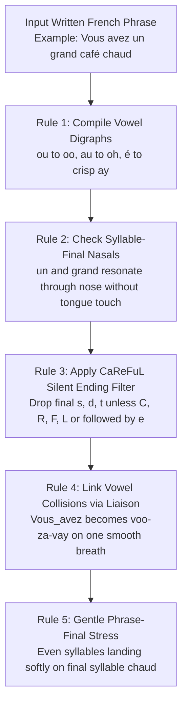
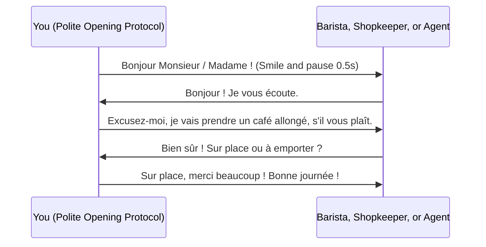

# Practical French Foundations for Engineers: Deterministic Phonetics, Cognates & Rabat/Europe Fluency

> **Target Profile**: Zero-background learners who already speak English and Mandarin, and want the highest-ROI path to reading any French menu or sign aloud accurately, navigating Paris, Geneva, or Brussels with poise, and flowing effortlessly through Rabat's bilingual French-Darija cafés, trains, pharmacies, and social circles.

---

## 1. The 40% Free-Vocabulary Hack: Why You Already Know 4,000+ French Words

Starting French from zero as an English-speaking software engineer is **nothing like starting Japanese or Russian from zero**. Because of a single historical event—the **1066 Norman Conquest of England**—French was the official language of England's courts, science, law, cuisine, and literature for three centuries. Over **`10,000` French words were copied directly into English**, making modern English roughly **`40% to 45%` French in vocabulary**!

Even better: your daily engineering vocabulary is almost pure French (`architecture`, `système`, `interface`, `base de données`, `solution`, `optimiser`, `authentification`, `performance`, `mémoire`, `erreur`, `différence`, `préférence`, `impossible`). You do not need to memorize those words from scratch—you only need **8 deterministic suffix transformation rules** and a **phonetic re-compiler**.

### The 8 Lossless English-to-French Lexical Compiler Rules

| Pattern Rule | English Suffix / Form | French Equivalent | Instant Vocabulary Unlocks (Spelled Nearly Identically!) |
| :--- | :--- | :--- | :--- |
| **1. Identical `-tion`** | `-tion` (over `1,200` words!) | **`-tion`** *(feminine: `la`)* | `la réservation`, `l'information`, `la station`, `la situation`, `la connexion`, `l'attention` |
| **2. Abstract `-ty -> -té`** | `-ty` | **`-té`** *(feminine: `la`)* | `la qualité`, `l'université`, `la sécurité`, `la liberté`, `la priorité`, `la spécialité` |
| **3. Adverb `-ly -> -ment`** | `-ly` | **`-ment`** | `exactement`, `normalement`, `absolument`, `directement`, `finalement`, `probablement` |
| **4. Adjective `-ous -> -eux`** | `-ous` | **`-eux`** (m) / **`-euse`** (f) | `curieux`, `sérieux`, `délicieux`, `généreux`, `nerveux`, `dangereux` |
| **5. Technical `-ic -> -ique`** | `-ic` / `-ical` | **`-ique`** | `logique`, `magique`, `automatique`, `romantique`, `pratique`, `la musique`, `électrique` |
| **6. Capable `-able / -ible`** | `-able` / `-ible` | **`-able` / `-ible`** | `possible`, `incroyable` *(incredible)*, `confortable`, `adorable`, `responsable`, `flexible` |
| **7. State `-ance / -ence`** | `-ance` / `-ence` | **`-ance` / `-ence`** *(fem.)* | `la différence`, `l'expérience`, `la préférence`, `l'importance`, `la patience`, `la distance` |
| **8. Circumflex `^` = Deleted `s`** | Old French `s` kept in English! | **`ê / ô / î / û`** | `la forêt` *(forest)*, `l'hôpital` *(hospital)*, `l'hôtel` *(hotel, cf. hostel)*, `l'île` *(island)*, `la fête` *(feast)*, `le coût` *(cost)* |

### Warning: The 6 High-Risk *Faux Amis* (False Friends) to Memorize Today

| French Word | What English Brain Guesses (WRONG!) | True French Meaning | How to Actually Say the English Word in French |
| :--- | :--- | :--- | :--- |
| **`Je suis excité(e)`** | `"I am excited!"` *(Danger: sexual meaning!)* | **Sexually aroused!** *(Never say at dinner!)* | **`J'ai trop hâte !`** *(I can't wait!)* or **`Je suis super content !`** |
| **`actuellement`** | `"actually"` | **Currently / Right now** | `"Actually"` = **`en fait`** *(used in every 3rd sentence!)* |
| **`attendre`** | `"to attend"` | **To wait for** (`Attends !` = Wait!) | `"To attend"` = **`assister à`** (`assister à une réunion`) |
| **`la librairie`** | `"the library"` | **The bookstore** | `"The library"` = **`la bibliothèque`** |
| **`sensible`** | `"sensible / logical"` | **Sensitive / Emotional** | `"Sensible / Reasonable"` = **`raisonnable`** |
| **`le préservatif`** | `"food preservative"` | **Condom!** *(Classic pharmacy trap)* | `"Food preservative"` = **`le conservateur`** |

---

## 2. Deterministic French Pronunciation: Compiling Spelling to Sound

English spelling is notoriously non-deterministic (`though`, `through`, `rough`, `thought` map `ough` to 4 unrelated sounds). **French spelling-to-sound is `95%` deterministic.** Once you load five clean phonetic rules into RAM, you can pronounce virtually any French word on a Paris boulevard or Rabat menu accurately on sight.

### Rule 1: Silent Final Consonants & The `CaReFuL` Exception

- **Default Rule**: Consonant letters at the very end of a French word (`-s`, `-t`, `-d`, `-x`, `-z`, `-p`, `-g`) are **100% SILENT**:
  - `Paris` -> **`pa-ree`**; `petit` -> **`puh-tee`**; `beaucoup` -> **`bo-koo`**; `froid` *(cold)* -> **`frwa`**; `prix` *(price)* -> **`pree`**.
- **The `CaReFuL` Exception**: Final **`C`**, **`R`**, **`F`**, and **`L`** are **USUALLY PRONOUNCED** (except `-er` verb endings like `parler` -> `par-lay`):
  - `le parc` -> **`park`**; `bonjour` -> **`bon-zhoor`**; `actif` -> **`ak-teef`**; `l'hôtel` -> **`lo-tel`**.
- **The Wake-Up `-e` Switch**: Adding a feminine `-e` at the end stays silent itself, **but wakes up the sleeping consonant right before it**:
  - Masc. `petit` (**`puh-tee`**) -> Fem. `petite` (**`puh-teet`**); Masc. `grand` (**`grahn`**) -> Fem. `grande` (**`grahnd`**); Masc. `français` (**`frahn-seh`**) -> Fem. `française` (**`frahn-sehz`**).

### Rule 2: Deterministic Vowel & Consonant Digraph Table (With Your Mandarin Superpower!)

| French Spelling | IPA | Exact Mouth Instruction & Native Shortcut | High-Frequency Examples |
| :--- | :---: | :--- | :--- |
| **`ou` / `où`** | `/u/` | Pure tight **"oo"** (`boot` with rounded lips) | `bonjour`, `vous`, `tout` *(all)*, `où` *(where)* |
| **`u`** *(alone)* | `/y/` | **Mandarin Superpower**: Identical to Pinyin **`ü`** in **`鱼 yú`** / **`去 qù`**! Say `"ee"` then round lips tight | `tu` *(you)*, `la rue` *(street)*, `super`, `bien sûr` *(of course)* |
| **`oi`** | `/wa/` | Crisp **"wah"** (like Mandarin `蛙 wā`) | `moi` *(me)*, `toi`, `bonsoir` *(good evening)*, `trois` *(3)* |
| **`au` / `eau`** | `/o/` | Pure rounded **"oh"** (never glide into `"oh-oo"`!) | `l'eau` *(water = **`lo`**!)*, `beau` *(beautiful = **`bo`**)*, `chaud` *(hot)* |
| **`é` / `-er` / `-ez`** | `/e/` | Crisp, smiling **"ay"** (no `"ee"` tail) | `un café`, `manger` *(to eat)*, `allez` *(go)*, `enchanté` |
| **`è` / `ê` / `ai` / `ei`** | `/ɛ/` | Open **"eh"** as in `bed` | `très` *(very)*, `le lait` *(milk = **`leh`**)*, `la fête`, `merci` |
| **`eu` / `œu`** | `/ø/` | Say `"eh"` (`bed`) while rounding your lips forward | `un peu` *(a little)*, `deux` *(2)*, `le cœur` *(heart)*, `je veux` |
| **`ch`** | `/ʃ/` | Always soft **"sh"** as in `shoe` (**never** English `"tch"`!) | `chaud` (**`sho`**), `le chat` *(cat = **`shah`**)*, `dimanche` |
| **`qu`** | `/k/` | Always plain **"k"** (**never** `"kw"`!): drop the `u` completely | `quatre` (**`katr`**), `qui` (**`kee`**), `quoi` (**`kwa`**), `quel` (**`kel`**) |
| **`gn`** | `/ɲ/` | Soft **"ny"** as in `canyon` | `la montagne`, `magnifique` (**`ma-nyee-feek`**) |
| **`h`** | — | **100% Silent Always**—pretend the letter does not exist | `l'hôtel` (**`lo-tel`**), `habiter` (**`a-bee-tay`**), `l'heure` (**`luhr`**) |

### Rule 3: The 3 Nasal Vowels + Liaison + Soft Throat `R`

1. **The 3 Nasal Vowels (`an/en`, `on`, `in/ain`)**: Whenever `n` or `m` ends a syllable (`bon`, `sans`, `vin`, `temps`), **do NOT lift your tongue tip to touch the roof of your mouth**! Keep your tongue flat on the floor of your mouth and let air resonate simultaneously through nose and mouth:
   - **`on / om` (`/ɔ̃/`)**: Nasalized `"oh"` -> `bon`, `non`, `pardon`, `combien`.
   - **`an / en / am / em` (`/ɑ̃/`)**: Nasalized open `"ah"` -> `sans` *(without)*, `dans` *(in)*, `le temps` *(time/weather)*, `en France`.
   - **`in / ain / ein / im` (`/ɛ̃/`)**: Nasalized `"eh"` -> `le vin` *(wine)*, `le pain` *(bread)*, `demain` *(tomorrow)*, `important`.
   - **De-Nasalization Switch**: If that `n/m` is followed by a vowel or doubled (`nn/mm`), nasalization turns OFF and you pronounce a normal `n`: `bon` (**`bohn`**) -> `bonne` (**`bun`**); `vin` -> `vinaigre`!
2. **Elision & Liaison (Why French Sounds Like One Liquid Word)**:
   - **Elision**: `je / le / la / de / ne / que` drop their vowel before another vowel: `je aime` -> **`j'aime`**; `le ami` -> **`l'ami`**; `ce est` -> **`c'est`**.
   - **Liaison**: Normally silent `-s / -x` wakes up as **`/z/`** before a vowel (`les_amis` -> **`lay-za-mee`**; `vous_avez` -> **`voo-za-vay`**; `deux_euros` -> **`duh-zuh-ro`**), and `-n` links across (`un_ami` -> **`uh-na-mee`**).
3. **The Effortless French `R` (`/ʁ/`)**: Keep your **tongue tip glued gently behind your bottom front teeth**! Never curl your tongue back like American `r`. Instead, lightly vibrate the back of your throat—like the soft friction of Mandarin **`喝 hē`** with vocal cords turned on (`merci`, `Rabat`, `très`).

---

## 3. Real Spoken French vs. Textbook French + The 6-Frame Grammar Engine

Textbooks teach 19th-century literary French (`"Nous ne savons pas"`). On the streets of Paris, Lyon, or Rabat, native speakers use three universal shortcuts and six conversational glue words:

- **Shortcut 1 — `On` Replaces `Nous` (`95%` of Spoken "We")**: Nobody says `"Nous allons au café"` among friends/family—everyone says **`"On va au café !"`** (`On` uses the super-simple singular `il/elle` verb form!).
- **Shortcut 2 — Spoken Negation Drops `ne`**: Written `Je ne sais pas` -> Spoken **`Je sais pas`** (or fast **`Chais pas`**); Written `Ce n'est pas grave` -> Spoken **`C'est pas grave`** *(No big deal)*.
- **Shortcut 3 — Fast Contractions & Glue**: `Tu as` -> **`T'as`** (`T'as faim ?` = Hungry?); `Il y a` -> **`Y'a`** (`Y'a du monde` = It's crowded). Sprinkle **`En fait`** *(Actually)*, **`Du coup`** *(So / As a result)*, **`Carrément !`** *(Totally / Definitely!)*, and **`Pas de souci`** *(No worries)*.

### The 6 Lego Verb Frames (Express Past, Present & Future Without Verb Tables!)

Master these **6 starter frames** + any base dictionary verb (`manger` = eat, `prendre` = take/order, `partir` = leave, `voir` = see, `payer` = pay, `aller` = go), and you bypass months of conjugation drills:

| Lego Frame | Pronunciation | Meaning & Power | Plug-and-Play Real Examples |
| :--- | :--- | :--- | :--- |
| **`Je voudrais + [noun / verb]`** | `zhuh voo-dreh` | **I would like...** *(Universal polite gold)* | `Je voudrais un café allongé.` / `Je voudrais réserver une table.` |
| **`Je vais / On va + [verb]`** | `zhuh veh / ohn vah` | **I'm going to / Let's...** *(100% of future!)* | `Je vais prendre le tajine.` *(I'll have the tagine.)* / `On va partir.` |
| **`Je peux / On peut + [verb] ?`** | `zhuh puh / ohn puh` | **Can I / Could we...?** | `On peut s'asseoir en terrasse ?` / `Je peux payer par carte ?` |
| **`Il faut + [verb]`** | `eel fo` | **We need to / Have to...** | `Il faut acheter un billet.` *(We need to buy a ticket.)* |
| **`Je viens de + [verb]`** | `zhuh vyehn duh` | **I just [did X]!** *(Instant recent past)* | `Je viens d'arriver à Rabat !` *(I just arrived in Rabat!)* |
| **`J'ai + [past token]`** | `zheh ...` | **I did / ate / saw...** (`pris / vu / mangé / adoré`) | `J'ai adoré ce plat !` *(I loved this dish!)* / `J'ai pas compris.` |

### Two Rapid Lookup Cheats: 85%-Accurate Noun Gender & Base-20 French Numbers

1. **Predict `le` (masc.) vs. `la` (fem.) From the Word's Suffix (Never Memorize Blindly)**:
   - **Almost Always Feminine (`la` / `une`)**: `-tion` (`la station`), `-té` (`la liberté`), `-ure` (`la voiture` = car, `la nature`), `-ette` (`la baguette`), `-ance / -ence` (`la différence`).
   - **Almost Always Masculine (`le` / `un`)**: `-ment` (`le bâtiment`, `le paiement`), `-age` (`le voyage`, `le fromage` — *only major exception: `la plage` = beach, `la page`*), `-eau` (`le château`, `le gâteau` — *exception: `l'eau`*), `-isme`, and borrowed English words (`le week-end`, `le parking`, `le café`).
2. **Surviving French Prices & Train Announcements (`Base-20` Arithmetic Above `69`)**:
   - Standard `1–10`: `un (1)`, `deux (2)`, `trois (3)`, `quatre (4)`, `cinq (5)`, `six (6)`, `sept (7 — silent p: "set"!)`, `huit (8 — "weet")`, `neuf (9)`, `dix (10 — "dees")`.
   - Tens `20–60`: `vingt (20 — "vehn")`, `trente (30)`, `quarante (40)`, `cinquante (50)`, `soixante (60)`.
   - **The Celtic Vigesimal Quirk (`70, 80, 90`)**: French switches to `base-20` arithmetic at `70`!
     - **`70`** = `soixante-dix` ($60 + 10$); **`75`** = `soixante-quinze` ($60 + 15$).
     - **`80`** = `quatre-vingts` ($4 \times 20$); **`85`** = `quatre-vingt-cinq` ($4 \times 20 + 5$).
     - **`90`** = `quatre-vingt-dix` ($4 \times 20 + 10$); **`99`** = `quatre-vingt-dix-neuf` ($4 \times 20 + 19$); **`100`** = `cent` (`sahn`). *(Fun fact: in Switzerland and Belgium, speakers sensibly say `septante (70)` and `nonante (90)`, while France and Morocco use the `base-20` forms above!)*

---

## 4. The 50 Core Survival, Café, Rabat & Social Patterns

In France and Francophone settings, **one cultural law overrides everything else**: **NEVER** launch into a question, order, or request without saying **`Bonjour`** (daytime) or **`Bonsoir`** (after 6 PM) first! Skipping `Bonjour`—even to ask `"Excuse me, where is platform 2?"`—feels to French ears like walking into someone's house without knocking.

### A. The Politeness Shield & Everyday Openers (`#01–#12`)

| # | French Pattern | Phonetic Guide | Real-Life Meaning & Context (`vous` = polite/stranger; `tu` = friend/family) |
| :---: | :--- | :--- | :--- |
| **01** | **`Bonjour ! / Bonsoir !`** | `bohn-zhoor / bohn-swahr` | Mandatory human handshake before *every* shop, taxi, elevator, or counter chat |
| **02** | **`Excusez-moi de vous déranger...`** | `ex-kü-zay mwa duh voo day-rahn-zhay` | `"Sorry to bother you..."` — magically unlocks helpfulness from any stranger |
| **03** | **`S'il vous plaît` / `S'il te plaît`** | `seel voo pleh / seel tuh pleh` | Please (formal/plural vs. close friend/partner) |
| **04** | **`Merci beaucoup !` -> `Je vous en prie`** | `mehr-see bo-koo -> zhuh voo-zahn pree` | Thank you very much! -> You're very welcome (polite reply; casual: **`De rien`**) |
| **05** | **`Pardon !`** | `par-dohn` | Excuse me (squeezing past people on the metro/street, or `"Sorry, what?"`) |
| **06** | **`Comment ça va ?` -> `Ça va super, et toi ?`** | `koh-mahn sa va -> sa va sü-pehr, ay twa` | How's it going? -> Going great, and you? |
| **07** | **`Enchanté !`** | `ahn-shahn-tay` | Nice to meet you! (Warm, classy, universal—used in both formal and casual intros) |
| **08** | **`C'est pas grave / Pas de souci !`** | `seh pa grahv / pa duh soo-see` | No big deal / No worries at all! |
| **09** | **`D'accord !` / `Ça marche !`** | `da-kor / sa marsh` | Got it / Sounds good! (*`D'accord`* & *`Ça marche`* are used non-stop in Rabat!) |
| **10** | **`Bien sûr !` / `Avec plaisir !`** | `byehn sür / a-vek pleh-zeer` | Of course! / With pleasure! |
| **11** | **`Bonne journée !` / `Bonne soirée !`** | `bun zhoor-nay / bun swah-ray` | Have a lovely day / evening! (Always drop this as you walk out of any shop/café) |
| **12** | **`À tout à l'heure !` / `À demain !`** | `ah too-ta luhr / ah duh-mehn` | See you later today! / See you tomorrow! |

### B. Café, Bakery, Restaurant & Rabat Terrace Mastery (`#13–#26`)

| # | French Pattern | Phonetic Guide | Real-Life Meaning & Ordering Pro-Tip |
| :---: | :--- | :--- | :--- |
| **13** | **`Une table pour deux, s'il vous plaît.`** | `ün tabl poor duh, seel voo pleh` | A table for two, please (`en terrasse` = outside; `à l'intérieur` = inside) |
| **14** | **`On peut voir la carte ?`** | `ohn puh vwahr la kart` | Could we see the menu? (*Note*: `le menu` means fixed-price set meal; `la carte` = full menu!) |
| **15** | **`Un café` vs. `Un café allongé`** | `uhn ka-fay / ka-fay a-lohn-zhay` | Warning: ordering `"un café"` brings a tiny strong espresso shot! Ask for **`allongé`** for an Americano |
| **16** | **`Un café crème` / `Un thé à la menthe`** | `ka-fay krem / tay a la mahnt` | Espresso with steamed milk / Moroccan fresh mint tea |
| **17** | **`Je vais prendre...`** | `zhuh veh prahndr...` | `"I'll have..."` — the #1 native restaurant ordering phrase (never say `"Je veux"` = I want!) |
| **18** | **`Qu'est-ce que vous me conseillez ?`** | `kes-kuh voo muh kohn-seh-yay` | What do you recommend? |
| **19** | **`Sur place ou à emporter ?`** | `sür plas oo a ahm-por-tay` | For here or to go? (Every bakery/coffee counter will ask you this!) |
| **20** | **`Une carafe d'eau, s'il vous plaît.`** | `ün ka-raf do, seel voo pleh` | Free tap water pitcher in France! (*In Morocco, ask for bottled mineral water*: **`Une bouteille d'eau minérale plate`**, e.g., *Sidi Ali*, or sparkling *Oulmès*!) |
| **21** | **`Sans sucre / Peu sucré, s'il vous plaît.`** | `sahn sükr / puh sü-kray` | Without sugar / Lightly sweetened, please (essential for mint tea or juice!) |
| **22** | **`C'était vraiment délicieux !`** | `seh-teh vreh-mahn day-lee-syuh` | That was truly delicious! |
| **23** | **`L'addition, s'il vous plaît.`** | `la-dee-syohn, seel voo pleh` | The check, please (servers will never bring the bill until you ask—sitting is never rushed!) |
| **24** | **`Je peux payer par carte / sans contact ?`** | `zhuh puh peh-yay par kart / sahn kohn-takt` | Can I pay by card / Apple Pay tap? (Note: keep cash `MAD` handy for small Rabat cafés/taxis) |
| **25** | **`Gardez la monnaie, merci !`** | `gar-day la moh-neh, mehr-see` | Keep the change, thank you! |
| **26** | **`Santé !` / `Bon appétit !`** | `sahn-tay / bohn-na-pay-tee` | Cheers! / Enjoy your meal! |

### C. Rabat/Europe Rail (*ONCF Al Boraq*), Pharmacy & Navigation (`#27–#38`)

| # | French Pattern | Phonetic Guide | Real-Life Meaning & Context |
| :---: | :--- | :--- | :--- |
| **27** | **`Où se trouve... ?` / `Où sont les toilettes ?`** | `oo suh troov / oo sohn lay twa-let` | Where is...? / Where are the restrooms? |
| **28** | **`Un billet aller-retour pour Rabat-Agdal.`** | `uhn bee-yeh a-lay ruh-toor...` | A round-trip ticket to Rabat-Agdal (*`aller simple`* = one-way; works on *Al Boraq* & *SNCF*) |
| **29** | **`C'est sur quelle voie / quel quai ?`** | `seh sür kel vwa / kel kay` | Which track / platform is it on? |
| **30** | **`C'est loin à pied ?`** | `seh lwehn a pyay` | Is it far on foot? (`Tout droit` = straight; `à droite` = right; `à gauche` = left) |
| **31** | **`Combien ça coûte ?` / `C'est combien ?`** | `kohm-byehn sa koot / seh kohm-byehn` | How much does that cost? / How much is it? |
| **32** | **`Je regarde juste, merci !`** | `zhuh ruh-gard zhüst, mehr-see` | I'm just browsing, thank you! |
| **33** | **`Vous avez quelque chose pour le mal de tête / l'estomac ?`** | `voo-za-vay kel-kuh shoz poor...` | Do you have something for a headache / stomach? (*Moroccan & French pharmacists are clinical pros—ask the green-cross `Pharmacie` first for minor ailments!*) |
| **34** | **`J'ai une réservation au nom de...`** | `zheh ün ray-zehr-va-syohn o nohn duh` | I have a reservation under the name... |
| **35** | **`Quel est le mot de passe du Wi-Fi ?`** | `kel eh luh mo duh pas dü wee-fee` | What's the Wi-Fi password? (Pronounced **`wee-fee`** in French!) |
| **36** | **`Mon téléphone n'a plus de batterie.`** | `mohn tay-lay-fon na plü duh ba-tree` | My phone battery is dead (`un chargeur` = a charger) |
| **37** | **`Vous parlez anglais ?`** | `voo par-lay ahn-gleh` | Do you speak English? (Always ask *after* `Bonjour, excusez-moi`!) |
| **38** | **`Pouvez-vous l'écrire, s'il vous plaît ?`** | `poo-vay voo lay-kreer, seel voo pleh` | Could you write it down, please? |

### D. Warm Social, Family & Partner-World Connection (`#39–#50`)

| # | French Pattern | Phonetic Guide | Real-Life Meaning & Emotional Nuance |
| :---: | :--- | :--- | :--- |
| **39** | **`J'apprends le français petit à petit.`** | `zha-prahn luh frahn-seh puh-tee-ta puh-tee` | I'm learning French little by little (instantly wins smiles and patience!) |
| **40** | **`Tu peux parler un peu plus lentement ?`** | `tü puh par-lay uhn puh plü lahnt-mahn` | Could you speak a tiny bit slower? |
| **41** | **`Comment on dit [...] en français ?`** | `koh-mahn ohn dee [...] ahn frahn-seh` | How do you say [...] in French? |
| **42** | **`C'est super gentil de ta / votre part !`** | `seh sü-pehr zhahn-tee duh ta / votr par` | That is so kind of you! (*Note*: `gentil` has a silent `l` -> **`zhahn-tee`**!) |
| **43** | **`J'adore cet endroit / cette ville !`** | `zha-dor set ahn-drwa / set veel` | I love this place / this city! (Rabat's ocean breeze, Oudayas kasbah, cafés) |
| **44** | **`J'ai trop hâte !`** | `zheh tro aht` | I'm so excited / I can't wait! (Your safe, idiomatic replacement for `"I'm excited!"`) |
| **45** | **`Ça me fait super plaisir d'être ici.`** | `sa muh feh sü-pehr pleh-zeer detr ee-see` | It makes me so happy to be here! (Warm line when welcomed into someone's home) |
| **46** | **`C'est magnifique / génial / incroyable !`** | `ma-nyee-feek / zhay-nyal / ehn-krwa-yabl` | That's gorgeous / awesome / incredible! |
| **47** | **`Qu'est-ce que tu en penses ?`** | `kes-kuh tü ahn pahns` | What do you think about it? |
| **48** | **`Franchement, tout à fait d'accord.`** | `frahnsh-mahn, too-ta feh da-kor` | Honestly, I completely agree. |
| **49** | **`Tu me manques !`** | `tü muh mahnk` | **I miss you!** *(Literally "You are missing from me"—note the reversed subject-object!)* |
| **50** | **`Merci pour l'accueil chaleureux !`** | `mehr-see poor la-kuhy sha-luh-ruh` | Thank you for the warm welcome! |

---

## 5. Paris French vs. Rabat French & Your 10-Minute Practice Loop

When you travel between Europe and Morocco, you will notice a pleasant acoustic bonus: **educated Rabat French is often easier for learners to catch than fast Parisian street slang!**

- **Parisian Youth Slang (*Verlan*)**: Young Parisians sometimes invert syllables backwards (`bizarre -> zarbi`, `fou` [crazy] -> `ouf`, `louche` [shady] -> `chelou`, `femme -> meuf`). Know them passively so Netflix shows (*Call My Agent / Dix pour cent*, *Lupin*) make sense, no need to force them yourself.
- **Rabat & Casablanca Bilingual Rhythm**: Moroccan French speaks with clear, melodic vowels and naturally weaves warm Darija punctuation right into French sentences (`"Ça marche, on se voit demain inshallah !"`, `"Hamdullah, tout s'est bien passé"`, `"Yallah, on y va !"`).
- **Your `Tue & Thu` 20-Minute French Loop**:
  1. **Ear Input (`8 min`)**: Watch half an episode of *Easy French* (street interviews with dual FR/EN subtitles) or listen to *InnerFrench* podcast (clear, intelligent topics spoken at comfortable `B1` cadence).
  2. **Read-Aloud Compiler Check (`6 min`)**: Pick 6 sentences, apply the `CaReFuL` + Nasal + Liaison pipeline out loud, then play native audio to verify zero visual English bugs crept in.
  3. **Live Café / Social Island Drill (`6 min`)**: Speak 5 patterns from Section 4 (`Je vais prendre...`, `On peut s'asseoir en terrasse ?`, `J'ai trop hâte !`) out loud at natural conversational speed.

Next, step into the language of warmth, humor, and family belonging in Morocco: **[03-CONVERSATIONAL-MOROCCAN-DARIJA-WARMTH.md](03-CONVERSATIONAL-MOROCCAN-DARIJA-WARMTH.md)**.
