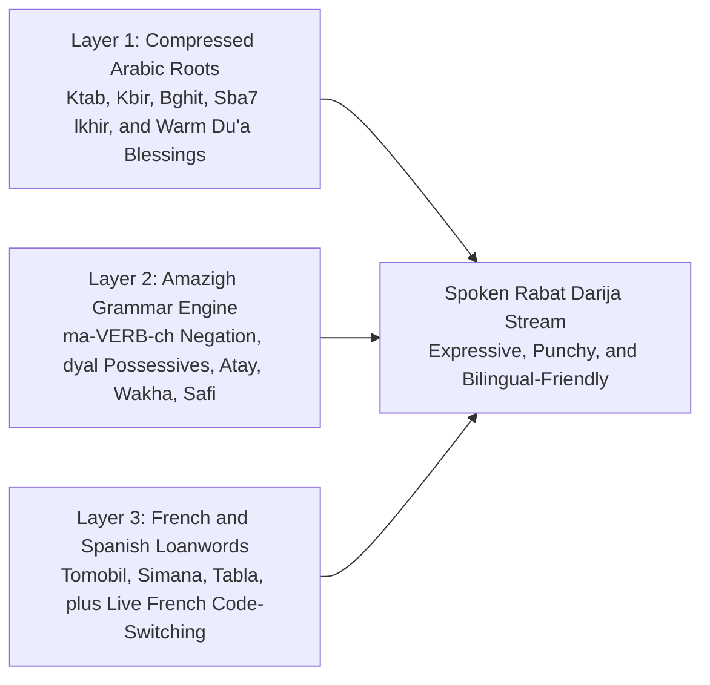
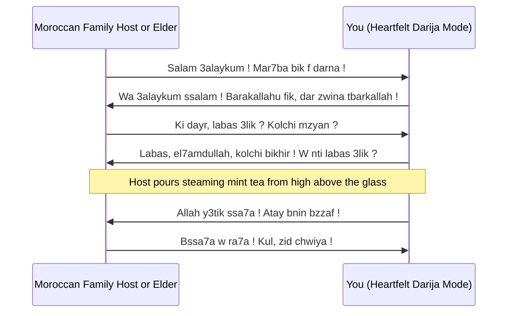

# Conversational Moroccan Darija (الدارجة المغربية): Sound, Logic & Family Warmth

> **Target Profile**: Complete beginners stepping into Moroccan life, Rabat cafés, and a Moroccan partner and family world—who want to crack WhatsApp's `3 / 7 / 9` numeral alphabet in 10 minutes, understand how Darija works under the hood, and speak the authentic blessings, humor, and affectionate phrases that go straight to a Moroccan heart.

---

## 1. What Moroccan Darija Actually Is: A Living Tri-Layer Language

If you download a generic "Learn Arabic" app (which teaches **Modern Standard Arabic / *Fusha***) and try speaking it at a family dinner in Rabat or Casablanca, everyone will smile politely—because you will sound like someone ordering pizza in **14th-century Shakespearean English or Classical Latin**.

In Morocco, *Fusha* is reserved for news broadcasts, mosque sermons, and formal government paperwork. **100% of daily home warmth, street banter, humor, music, romance, and family table life happens in Moroccan Darija (`الدارجة`, "the everyday language")**—a vibrant, expressive spoken language built from three historical layers:

1. **Compressed Arabic Root Core**: Darija inherits most of its core verbs and roots from Arabic, **but strips out short unstressed vowels** to create fast, punchy consonant clusters: Classical *Kitāb* (book) -> Darija **`Ktab`**; *Kabīr* (big) -> **`Kbir`**; *Sabāh al-khayr* (good morning) -> **`Sba7 lkhir`**.
2. **Amazigh (Berber / Tamazight) Structural Substrate**: Morocco's indigenous Amazigh heritage shaped Darija's brisk rhythm, its analytic possessive word **`dyal`** (`"of"`—eliminating complex Arabic case endings!), its signature **`ma-...-ch`** negation sandwich, and beloved everyday words like **`atay`** (mint tea), **`wakha`** (okay), **`bzzaf`** (a lot), and **`safi`** (done/enough).
3. **French (& Spanish) Everyday Loanwords**: Urban Darija absorbs French nouns natively (`la voiture` / **`tomobil`** = car, **`kuzina`** = kitchen, **`fermaj`** = cheese, **`serbita`** = napkin, **`blasa`** = spot/place, **`chargeur`** = charger) plus Spanish gems (**`simana`** = week, **`tabla`** = table).

### The Rabat Advantage: Clean Urban Darija + Effortless French Code-Switching

Across Morocco, northern cities (Tangier/Tetouan) lean slightly Spanish, Marrakech has a melodic southern cadence, and **Rabat–Casablanca forms the central standard urban accent** understood everywhere in the country. Even better: in Rabat, educated speakers blend Darija and French seamlessly inside a single breath—meaning your **[Practical French Foundations](02-PRACTICAL-FRENCH-FOUNDATIONS-FOR-ENGINEERS.md)** plug straight into any vocabulary gap!

---

## 2. Cracking the WhatsApp `Arabizi` Numeral Code (`2, 3, 5, 7, 9`)

Open any Moroccan WhatsApp group or Instagram comment section and you will see Latin text sprinkled with numbers: `"Salam 7biba, labas 3lik? Ntla9aw f 9ahwa daba?"`

During the early SMS era before Arabic smartphone keyboards existed, North African engineers and students mapped **6 throat/uvular Arabic letters that don't exist in Latin script onto numerals that visually resemble the mirrored Arabic letter shapes**. Today, **`Arabizi`** is the universal texting alphabet of Morocco—learn these 6 rows and you can read every WhatsApp text instantly:

| Chat Number / Digraph | Arabic Letter | Sound Name | Exact Physical Mouth & Throat Instruction (Zero Mystery!) | High-Frequency Darija Words |
| :---: | :---: | :--- | :--- | :--- |
| **`3`** | **`ع`** | *'Ayn* | Open your mouth to say `"ah"`, then gently **engage the deep throat muscles you feel mid-swallow**—produces a warm, rich, voiced resonance | **`3afak`** *(please)*; **`labas 3lik`** *(how are you)*; **`n3am`** *(yes)*; **`3ndi`** *(I have)* |
| **`7`** | **`ح`** | *Hā'* | Crisp, unvoiced **deep-throat breath**—exact sound you make **fogging up sunglasses** with hot air (`"hhhh"`), stronger than English `h` | **`7bibi / 7biba`** *(my love)*; **`bssa7a`** *(enjoy/health)*; **`el7amdullah`**; **`sba7`** *(morning)* |
| **`9`** *(or `q`)* | **`ق`** | *Qāf* | Say `"k"`, now slide the back of your tongue **one inch deeper** to click softly against your uvula | **`9ahwa`** *(coffee)*; **`ba9i`** *(still)*; **`sou9`** *(market)*; **`wa9ila`** *(maybe)* |
| **`5`** *(or **`kh`**)* | **`خ`** | *Khā'* | Unvoiced velar friction at the soft palate—like German *Bach* or **a firmer Mandarin `喝 hē`**! | **`khoya`** *(my brother)*; **`khti`** *(my sister)*; **`wakha`** *(okay)*; **`khobz`** *(bread)* |
| **`gh`** *(or `8`)* | **`غ`** | *Ghayn* | Turn your vocal cords ON during `kh`—**100% identical to the French soft throat `R` (`/ʁ/`)** or gargling a drop of water! | **`l-Meghrib`** *(Morocco)*; **`ghzal(a)`** *(gorgeous)*; **`bghit`** *(I want)*; **`ghali`** *(expensive)* |
| **`2`** | **`ء`** | *Hamza* | Clean glottal pause right in the middle of English **`"uh-oh"`** | **`insha2allah`**; **`l-3a2ila`** *(the family)*; **`su2al`** *(question)* |

### Two Quick Bonus Sound Tips

- **Rolled / Tapped `R`**: Unlike French throat `R` (which maps to Darija `gh`!), Darija's regular `r` (`kbir`, `شكرا chokran`, `ra7a`) is a crisp **tongue-tip tap** against the ridge behind your upper teeth (like Spanish *pero*).
- **Emphatic ("Sun-Warm") Consonants (`S, D, T, Z`)**: In words like **`Safi`** or **`Dar`** (house), dropping the middle of your tongue slightly lower makes the `a` vowel sound deeper and rounder (`"Sah-fee"` rather than nasal American `"Saa-fee"`).

---

## 3. The Darija Grammar Micro-Kernel: Speak Real Sentences on Day 1

Darija strips away nearly all the intimidating inflectional complexity of Classical Arabic. Load these **four tiny Lego rules** and you can assemble hundreds of natural daily thoughts immediately:

### 3.1 Always Match Male vs. Female Address (`nta` vs. `nti`!)

When speaking directly to one person, Darija distinguishes masculine vs. feminine—getting the `-a` / `-i` ending right when talking to a female partner, mother, or sister makes your Darija sound ten times more attentive:

| Meaning | Speaking to a Man (`m.`) | Speaking to a Woman (`f.`) | Speaking to a Group (`pl.`) |
| :--- | :--- | :--- | :--- |
| **"You"** | **`nta`** | **`nti`** | **`ntuma`** |
| **"How are you doing?"** | **`Ki dayr?`** (`kee da-yer`) | **`Ki dayra?`** (`kee day-ra`) | **`Ki dayrin?`** |
| **"Sweet / Good / Pretty"** | **`zwin` / `mzyan`** | **`zwina` / `mzyana`** | **`zwinin` / `mzyanin`** |
| **"Handsome / Gorgeous"** | **`ghzal`** | **`ghzala`** *(lit. "gazelle"!)* | **`ghzalin`** |
| **"Come here! / Look!"** | **`Aji! / Chouf!`** | **`Aji! / Choufi!`** | **`Ajiw! / Choufu!`** |

### 3.2 Effortless Ownership With `dyal` ("Of")

Instead of mutating noun endings, attach **`dyal`** right after any noun (even a French noun!):

- **`dyali`** = mine (`l-qahwa dyali` = my coffee; `l-portable dyali` = my phone)
- **`dyalk`** = yours (`l-madina dyalk zwina bzzaf` = your city is super pretty!)
- **`dyalna`** = ours (`d-dar dyalna` = our home)
- *(For closest heart/family nouns, direct `-i` suffix is extra warm: **`7bib-i` / `7bibt-i`** = my love; **`khoy-a`** = my brother; **`mam-a`**)*

### 3.3 The `ma-...-ch` Negation Sandwich & Core Verb Frames

Wrap **`ma-`** in front of a verb and **`-ch`** ("sh") at the end to negate **anything** (`fhemt` = I understood -> **`ma-fhemt-ch`** = I didn't understand!):

| High-ROI Verb Frame | Affirmative Example | Negative (`ma-...-ch`) Example |
| :--- | :--- | :--- |
| **`Bghit...`** *(I want / would like)* | **`Bghit kas d-atay, 3afak.`** *(I'd like a glass of mint tea, please.)* | **`Ma-bghit-ch s-skar bzzaf.`** *(I don't want a lot of sugar.)* |
| **`3ndi...`** *(I have)* | **`3ndi l-we9t daba.`** *(I have time right now.)* | **`Ma-3ndi-ch s-srf.`** *(I don't have small change/coins.)* |
| **`Kayn...`** *(There is / Available)* | **`Wach kayn l-wifi?`** *(Is there Wi-Fi?)* | **`Machi mochkil!`** *(Not a problem! — noun negation uses **`machi`**)* |
| **`Kan-[verb]`** *(Present / Habit)* | **`Kan-hdar chwiya d-darija.`** *(I speak a little Darija.)* | **`Ma-kan-3ref-ch n-3um.`** *(I don't know how to swim.)* |
| **`Ghadi n-[verb]`** *(Future)* | **`Ghadi n-mchiw l-Rabat ghdda.`** *(We're going to Rabat tomorrow.)* | **`Ma-ghadi-ch n-t3ttel.`** *(I won't be late.)* |

---

## 4. The Moroccan Blessing Call-and-Response Protocol (Cultural Superpower)

Here is the deepest cultural secret of Morocco: **politeness in Darija is not dry formulas like `"Thank you -> You're welcome"`—it is an improvised duet of warm, poetic blessings (`du'a`) wishing health, light, and protection onto the other person and their parents.**

When someone says **`Bssa7a!`** to you and you fire back **`Allah y3tik ssa7a!`** without missing a beat, the entire room lights up! Memorize these **8 golden call-and-response pairs**:

| Exact Social Trigger Moment | What Is Said First (`The Call`) | Exact Matching Reply (`The Return Volley`) | Cultural Nuance & Literal Warmth |
| :--- | :--- | :--- | :--- |
| **1. Entering a Home, Shop, or Family Room** | **`Salam 3alaykum!`** *(Peace be upon you!)* | **`Wa 3alaykum ssalam!`** *(And upon you peace!)* | Immediately follow with the warm rapid-fire check-in: **`Labas 3lik? Bikhir? Hani(ya)?`** -> **`Labas, el7amdullah!`** *(All good, praise God!)* |
| **2. Host Welcomes You (`"Welcome!"`)** | **`Mar7ba bik!`** *(Welcome to you!)* | **`Barakallahu fik!`** or **`Allah ykbbér bik!`** | Literally *"May God bless you / honor you!"*—infinitely warmer than a bare `"chokran"` |
| **3. You Eat, Drink Tea, Shower, or Wear a Fresh Haircut / Outfit** | **`Bssa7a!`** (`b-ssa-ha` — *To your health / Enjoy it!*) | **`Allah y3tik ssa7a!`** (`al-lah ya-teek ssa-ha`) | *May God give YOU health!* Moroccans say `Bssa7a` constantly—even when a friend buys new shoes or finishes a workout! |
| **4. Someone Cooks for You, Pours Tea, or Helps With Their Hands** | *You initiate!* **`Allah y3tik ssa7a!`** | **`Bssa7a w ra7a!`** *(With health and peace of mind!)* | Saying `Allah y3tik ssa7a` directly to the person who cooked dinner or poured tea is the **#1 compliment in Morocco** |
| **5. Admiring Anything Good (Home, Baby, Cooking, Partner's News)** | **`Tbarkallah!`** or **`Masha'Allah!`** | **`Allah ybarek fik!`** *(May God bless you!)* | Protects good fortune from the "evil eye" (*l-3in*)—always attach `Tbarkallah` when praising someone's child, home, or talent! |
| **6. Warmest Everyday "Thank You"** | **`Allah y7fdek!`** *(May God protect you!)* or **`Chokran bzzaf`** | **`Amin, w iyyak!`** or **`Bla jmil!`** *(No favor at all / My pleasure)* | Taxi drivers, shopkeepers, and elders melt when a foreigner thanks them with `Allah y7fdek` (`al-lah yahf-dek`) |
| **7. Starting & Finishing a Shared Meal** | Before first bite: **`Bismillah`** | After finishing: **`El7amdullah!`** + **`Allah ykhllef!`** *(to host)* | `Allah ykhllef` wishes that God replenish the host's table tenfold for their generosity |
| **8. Talking About Any Future Plan** | **`Ntla9aw ghdda, inshallah!`** *(See you tomorrow...)* | **`Inshallah!`** *(God willing!)* | Note: usually sincere hope; occasionally a gentle Moroccan `"maybe/we'll see"` when kids ask parents for something! |

---

## 5. Affectionate Terms, Magic Glue Words & Rabat Street Survival

### 5.1 Partner Tenderness & Respectful Family Titles

In Moroccan culture, while Classical poetry talks about the heart (*9elb*), the **deepest, most protective family and romantic tenderness lives in the liver (*kbida*)**!

- **Romantic & Affectionate Gems**:
  - **`7biba` / `7bibti`** *(to her)* · **`7bibi`** *(to him)*: My love / darling.
  - **`Kbida dyali`** (`kbee-da dya-lee`): *"My little liver"* — the ultimate Moroccan term of adoration for a partner or cherished loved one!
  - **`Ghzala`** *(to her)* / **`Ghzal`** *(to him)*: Gorgeous / handsome.
  - **`3mri`** (`am-ree` = my life) · **`Ro7i`** (`ro-hee` = my soul).
  - **`Kan-bghik bzzaf`** (`kan-bgheek bz-zaf`): I love you so much!
  - **`Tw7chtek bzzaf!`** (`twah-sh-tek bz-zaf`): I missed you so much!
- **Warm Respect Titles for Family & Strangers**:
  - **`Mama / L-walida`** & **`Baba / L-walid`**: Mom & Dad.
  - **`Khalto`** (auntie) & **`3mmi`** (uncle): Warm, affectionate respect for elders or shopkeepers your parents' age; **`Lalla`** (Madam) & **`Sidi`** (Sir) for formal grace.
  - **`Khoya`** (my brother) & **`Khti`** (my sister): Friendly peer warmth with any taxi driver, barista, or shopkeeper around your age!

### 5.2 The 12 Everyday Single-Word Power Tools

| Darija Word | Pronunciation | Meaning & Why You Will Hear It 50 Times a Day |
| :--- | :--- | :--- |
| **`Safi!`** | `sah-fee` | **The Swiss Army Knife of Morocco**: `"Got it!"` / `"Done!"` / `"That's enough tea!"` / `"All set!"` |
| **`Wakha`** | `wa-kha` | **Okay / Sounds good / Deal!** (`Safi, wakha!` = Alright, sounds great!) |
| **`Yallah!`** | `yal-lah` | **Let's go! / Come on!** |
| **`Daba`** | `da-ba` | **Right now** (`Daba nit` = this very second!) |
| **`Blati`** | `bla-tee` | **Hold on / Wait a sec** (`Blati chwiya` = wait just a moment) |
| **`Bzzaf`** / **`Chwiya`** | `bz-zaf / shwee-ya` | **A lot** vs. **A little / Slowly** (`Ghir b-chwiya` = take it easy, no rush!) |
| **`3afak`** | `aa-fak` | **Please** (warm, polite, works everywhere) |
| **`Hanya!` / `Machi mochkil`** | `han-ya / ma-shee mosh-keel` | **Chill, all good! / No problem at all!** (`Dnya hanya` = life is easy, don't stress!) |
| **`Wach...?`** | `wash` | **Turns any statement into a Yes/No question**: `Mzyan` *(Good)* -> **`Wach mzyan?`** *(Is it good?)* |
| **`Nichan`** | `nee-shan` | **Straight ahead** (in a taxi) OR **"Exactly right / Spot on!"** (in conversation) |
| **`B-ss7?!` -> `Wallah!`** | `bs-sah -> wal-lah` | **"Seriously / For real?!"** -> **"I swear / Truly!"** |
| **`Bnin` / `Zwin`** | `bneen / zween` | **Delicious** (food/tea) / **Sweet, nice, beautiful** (anything else!) |

### 5.3 Family Tagine Etiquette & Blue Rabat *Petit Taxi* Script

- **Three Unwritten Moroccan Family Table Rules**:
  1. **Right Hand Only**: When scooping warm tagine or olive oil with pieces of crusty round bread (`khobz`), always hold and eat with your **right hand** (`Bismillah` before first bite).
  2. **Eat From Your Own Triangle (`Kul men 9ddamek`)**: A shared tagine or Friday *couscous* platter isn't a free-for-all across the dish—eat respectfully from the wedge directly in front of you, while the host places prime pieces of meat or caramelized onion toward you!
  3. **Surviving Loving Food Pushers (`"Kul! Zid chwiya!"`)**: Moroccan moms and hosts express love by insisting you eat three helpings (`"Ma-kliti walo!"` = *"You haven't eaten anything!"* after you ate a pound of lamb!). Smile, take one small appreciative bite, touch your hand to your chest, and say: **`"Wallah chbe3t, el7amdullah—hadchi bnin bzzaf, Allah y3tik ssa7a!"`** *(Truly I'm full, thank God—this is so delicious, bless your hands!)*
- **Rabat Blue *Petit Taxi* 20-Second Script**:
  - **Hailing & Meter**: *"Salam khoya, labas? Wach ghadi l-Agdal / l-Oudaya? Khddem l-compteur, 3afak."* *(Hi brother, doing well? Going to Agdal / Oudayas? Turn on the meter, please.)*
  - **Directions**: *"Sir nichan... dur 3la limen / 3la lissar."* *(Go straight... turn right / turn left.)*
  - **Dropping Off**: *"Ghir hna baraka, 3afak! Hak, chokran bzzaf, Allah y7fdek!"* *(Right here is great, please! Here you go, thanks so much, may God protect you!)*

---

## 6. Question Starters, Numbers & The Moroccan "Ryal vs. Dirham" Price Secret

### 6.1 The 7 Essential Question Words

| Darija | Pronunciation | English | Everyday Rabat Question |
| :--- | :--- | :--- | :--- |
| **`Chnu / Ach`** | `sh-noo / ash` | **What?** | **`Chnu hada?`** *(What is this?)* · **`Chnu bghiti takli?`** *(What do you [f] want to eat?)* |
| **`Fin`** | `feen` | **Where?** | **`Fin kayn...?`** *(Where is...?)* · **`Fin ghadi?`** *(Where are you going?)* |
| **`Ch7al`** | `sh-hal` | **How much / How many?** | **`B-ch7al hada, 3afak?`** *(How much is this, please?)* · **`Ch7al f s-sa3a?`** *(What time is it?)* |
| **`Imta / Fu9ach`** | `eem-ta / foo-kash` | **When?** | **`Fu9ach ghadi n-tla9aw?`** *(When are we meeting up?)* |
| **`3lach`** | `aa-lash` | **Why?** | **`3lach la?`** *(Why not?!)* |
| **`Kifach`** | `kee-fash` | **How? / Wait, what?!** | **`Kifach kay-gulu hada b d-darija?`** *(How do they say this in Darija?)* |
| **`Chkoun`** | `sh-koon` | **Who?** | **`Chkoun m3aya?`** *(Who's speaking? — on phone)* |

### 6.2 Numbers `1–10` & Avoiding the `20x` *Ryal* Market Confusion

- **Numbers `1–10`**: `wa7ed (1)`, `jouj (2 — "zhoozh" with soft French j!)`, `tlata (3)`, `rb3a (4)`, `khmsa (5)`, `stta (6)`, `sb3a (7)`, `tmnya (8)`, `ts3ud (9)`, `3chra (10)`; **`3chrin (20)`**, **`khmsin (50)`**, **`miya (100)`**.
- **The Street Market Unit Trap (`Dirham` vs. `Ryal`)**: Morocco's official currency is the **Dirham (`MAD`)**, where `MAD 10` is roughly `USD 1`. However, in medina markets, fruit stalls, and casual speech across Rabat and Casablanca, vendors often quote prices in **`Ryal`**, where **`1 Dirham = 20 Ryal`**!
  - If a vendor holds up fresh mint or strawberries and says **`"Miya!"` (`100`)**, they do **NOT** mean `MAD 100` (`USD 10`)—they mean **`100 Ryal = MAD 5`** (`USD 0.50`)!
  - **`Alf ryal` (`1,000 ryal`)** = **`MAD 50`** (`1000 / 20`). Whenever a number sounds suspiciously huge, smile and clarify: **`"B d-derhem wlla b r-ryal?"`** *(In dirhams or in ryals?)*—vendors will respect your street smarts immediately!

---

## 7. Rabat Café Culture, Playful Market Humor & Your Weekly Loop

### 7.1 Ordering Like a Local at a Rabat Café

Walk into any sunny terrace café in Agdal, Hassan, or Hay Riad and skip tourist menus with three iconic local orders:

1. **`"Wa7ed nous-nous, 3afak!"`** (`noos-noos`, literally *"half-half"*): Morocco's beloved signature coffee—half rich espresso, half frothy hot milk served in a small glass!
2. **`"Atay b-n3na3 w chiba, 9lil s-skar 3afak"`**: Fresh green tea brewed with spearmint (`n3na3`)—or warming wormwood (`chiba`) in winter—with light sugar on the side.
3. **`"3assir l-limoun / l-avocat"`**: Fresh-squeezed Moroccan orange juice (*note*: in Darija, **`l-limoun` means orange**, while lemon is **`l-7amed`**—a classic playful mix-up!).

### 7.2 Gentle Medina Bargaining & Warm Moroccan Humor

Bargaining in a traditional *sou9* (like Rabat's *Rue des Consuls* or *Souika*) is never an angry confrontation—it is **friendly theater with a smile**:

- When quoted a tourist opening price: Smile warmly and say **`"Ghali chwiya a khoya—sawb m3aya, 7na khout!"`** *(A little pricey my brother—make me a good price, we're family/brothers!)*
- Know the cultural word **`7chouma`** (`h-shoo-ma` = shameful / socially awkward / bad manners—like showing up empty-handed to a family home; always bring pastries from a *pâtisserie* or fruit when visiting!).
- Favorite encouraging Moroccan proverb when practicing Darija: **`"N9ta b-n9ta kay-7mel l-wad"`** *(Drop by drop, the river overflows)*—exactly how your **[20-Minute Daily Loop](00-README.md)** compounds!

### 7.3 Your `Fri & Sat` 20-Minute Darija Heart Protocol

1. **WhatsApp `Arabizi` Ear & Eye Warmup (`6 min`)**: Read 5 real `Arabizi` (`3, 7, 9`) lines out loud, focusing on relaxed throat warmth for `3` (`ع`) and breathy sunglasses-fogging `7` (`ح`).
2. **Blessing Reflex Drill (`7 min`)**: Have your partner (or an audio clip) fire random triggers at you (*"Bssa7a!"*, *"Mar7ba!"*, *"Salam 3alaykum!"*, *"Tbarkallah!"*) until your mouth fires the matching blessing back (`Allah y3tik ssa7a!`, `Barakallahu fik!`, `Allah ybarek fik!`) in **under `0.5 seconds`** with a smile.
3. **Live Warmth Output (`7 min`)**: Send one affectionate voice note or drop two fresh Darija chunks into real dinner or tea conversation—imperfect grammar paired with genuine warmth wins every Moroccan room on earth.

### Pocket Cheat-Card: 8 Phrases Before Walking Into a Rabat Family Gathering

| Moment | Exact Phrase to Say With a Warm Smile |
| :--- | :--- |
| **Walking Through the Door** | **`Salam 3alaykum! Ki dayrin, labas 3likum?`** *(Peace be upon you! How is everyone doing?)* |
| **Handing Pastries / Gift to Host** | **`Tfdlli a khalto, ghir 7aja bssita!`** *(Here you go auntie, just a small token!)* |
| **Complimenting Their Home** | **`Tbarkallah, dar zwina w mdawwya!`** *(Blessings, such a lovely, bright home!)* |
| **When Handed Hot Mint Tea** | **`Allah y3tik ssa7a! Chokran bzzaf.`** *(May God give health to your hands! Thank you so much.)* |
| **First Bite Together at the Table** | **`Bismillah!`** *(Right hand on warm bread!)* |
| **Praising the Tagine / Couscous** | **`Tbarkallah 3lik—hadchi bnin bzzaf!`** *(Blessings on you—this is super delicious!)* |
| **Humbly Owning Your Darija** | **`Ba9i kan-t3llem d-darija chwiya b-chwiya!`** *(I'm still learning Darija little by little!)* |
| **Saying Warm Goodbyes** | **`Chokran 3la kolchi, Allah y7fdkum—bsslama!`** *(Thanks for everything, may God protect you all—goodbye!)* |
