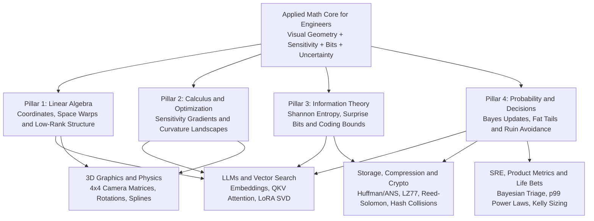
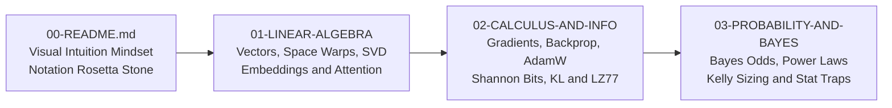

# Applied Mathematics for Software Engineers: Visual Intuition Over Exam Memorization

> **Core Premise**: Most software engineers are not "bad at math"—they are survivors of an industrial exam curriculum that taught hand-cranked symbol manipulation while hiding the geometric and physical machinery underneath. When you re-learn Linear Algebra, Calculus, Information Theory, and Probability as **typed data transformations, sensitivity probes, bit budgets, and belief updates**, the hardest parts of modern computing suddenly become transparent.

---

## 1. Why School Math Broke Your Intuition (And Why It Matters Now)

In school and university exams, mathematics was graded on how fast a human could act like a slow, error-prone pocket calculator: inverting $3 \times 3$ matrices by hand, memorizing twenty trigonometric integration tricks, or plugging numbers into a normal distribution Z-table without asking whether the underlying phenomenon even had a finite variance. Because computers execute arithmetic billions of times per second, **manual symbol-pushing is the single least useful part of mathematics for a practicing software engineer**.

Yet in the era of AI coding agents, syntax memorization and CRUD boilerplate have been commoditized, while **mathematical modeling intuition** has become one of the highest-leverage moats in software architecture:

- Any developer can call an embedding API and store vectors in `pgvector`; an engineer with **Linear Algebra** intuition immediately diagnoses why chunking 4,000-token documents collapses cosine similarity into an anisotropic cone, or why LoRA rank $r = 16$ captures fine-tuning deltas in 0.1% of the memory.
- Any developer can import PyTorch or tune a retry timeout; an engineer with **Calculus & Information Theory** intuition understands why $\sqrt{d_k}$ prevents attention gradient saturation, why cross-entropy loss directly measures wasted compression bits, and why `zstd` cannot compress encrypted payloads below Shannon entropy.
- Any developer can read a dashboard average; an engineer with **Probability & Tail-Risk** intuition spots why "mean latency = 38 ms" masks a $p99.9$ queuing cascade, why a 99%-accurate anomaly detector still produces 90% false alarms on rare events, and why positive expected value can still guarantee financial ruin.

### Exam Memorization vs. Engineering Mental Models

| Topic | How School Taught It (Dead Memorization) | What It Actually Is (Visual & Systems Intuition) | Where You Meet It in Production |
| :--- | :--- | :--- | :--- |
| **Linear Algebra** | Row-reducing grids of numbers; memorizing $\det(\mathbf{A}) = ad - bc$ | **Space Warping**: Vectors are feature coordinates; matrices are functions that rotate, stretch, and project high-dimensional space | LLM embeddings, Transformer `Q/K/V` projections, LoRA adapters, 3D WebGL/GPU shaders, PCA/SVD compression |
| **Calculus** | Memorizing derivative rules for $\sec(x)\tan(x)$ and integration by parts | **Local Sensitivity**: Nudging input knob $x$ by $\epsilon$ and tracing how fast output loss $\mathcal{L}$ responds across a DAG | Backpropagation, AdamW optimization, PID/autoscaling control loops, spline UI animations, physics engines |
| **Information Theory** | Rarely taught outside electrical engineering | **Irreducible Surprise**: Quantifying exact uncertainty in bits and measuring the penalty of wrong predictions | Tokenization (BPE), Cross-Entropy & KL Divergence in LLMs, Huffman/LZ77/`zstd` compression, TLS entropy |
| **Probability & Statistics** | Counting colored balls in urns; plugging into Gaussian bell-curve formulas | **Epistemic Updating & Tail Geometry**: Revising beliefs under noisy evidence and surviving fat-tailed power laws | SRE root-cause debugging, A/B testing traps, $p99$ latency SLAs, fraud detection, career & capital sizing (Kelly) |

---

## 2. How Four Mathematical Pillars Secretly Power Modern Software

Almost every "magical" algorithm in modern software is built from just four interlocking mathematical lenses. Once you see the map, unfamiliar research papers and systems specifications stop looking like walls of Greek letters and start reading like architecture diagrams.



### Cross-Domain Engineering Matrix

| Production Domain | Linear Algebra Mechanism | Calculus & Optimization Mechanism | Information Theory Mechanism | Probability & Tail-Risk Mechanism |
| :--- | :--- | :--- | :--- | :--- |
| **LLMs & RAG Pipelines** | Token embeddings $\mathbf{x} \in \mathbb{R}^d$; $\mathbf{Q}\mathbf{K}^\top$ inner products; SVD low-rank adapters | Reverse-mode autodiff across billions of weights; AdamW diagonal curvature scaling | Cross-entropy training objective; Perplexity $= 2^H$; KV-cache quantization bit budgets | Temperature/top-$p$ token sampling; hallucination calibration; eval confidence intervals |
| **3D Graphics, Games & UI** | Homogeneous $4 \times 4$ model-view-projection matrices; surface normals via cross/dot products | Spring-damper differential equations; Bezier tangent continuity; ray-marching SDF gradients | Texture block compression (ASTC/BC7); mesh delta encoding; perceptual chroma subsampling | Monte Carlo path-tracing ray sampling; procedural noise; anti-aliasing jitter |
| **Storage, Networking & Compression** | Erasure coding Vandermonde/Cauchy matrices (Reed-Solomon RAID/S3 durability) | TCP congestion window control loops (BBR bandwidth-delay derivative estimation) | Shannon source coding limit $H(X)$; noisy-channel capacity $C = B \log_2(1 + \text{SNR})$ | Packet-loss burst modeling; Bloom filter false-positive rates; consistent hashing |
| **Cryptography & Security** | Lattice cryptography (Learning With Errors); elliptic-curve group operations; finite fields | Side-channel power trace correlation; differential cryptanalysis sensitivity | True RNG min-entropy estimation; key-stretching bit security; one-time pad perfect secrecy | Birthday paradox hash collisions ($2^{n/2}$); prime-testing error bounds ($4^{-k}$ Miller-Rabin) |
| **Distributed Systems & SRE** | Spectral graph partitioning; PageRank eigenvector centrality; metric dimensionality reduction | Queue drain rates; autoscaler derivative damping to prevent thrashing | Log/trace cardinality explosion (high-entropy tags wrecking columnar TSDB compression) | Little's Law ($L = \lambda W$); Bayesian root-cause isolation; correlated retry storms |
| **Career, Startups & Investing** | Portfolio covariance matrix & orthogonal income streams (uncorrelated risk vectors) | Marginal diminishing returns; compounding growth rates $e^{rt}$; convex payoff curves | Signal-to-noise filtering in market validation; high-surprise customer insights | Pareto power laws in startup outcomes; survivorship bias; Kelly Criterion bet sizing |

---

## 3. Reading Math Notation Like Typed Source Code (The Rosetta Stone)

Mathematicians optimize notation for **chalkboard compactness** (single-letter variables, implicit loops, overloaded operators), whereas software engineers optimize for **explicit types and readability**. Whenever an equation looks intimidating, compile it mentally into typed array code:

| Mathematical Symbol | Pronounced As | Typed Engineering Equivalent (Python / NumPy Mental Model) | Complexity & Edge-Case Intuition |
| :--- | :--- | :--- | :--- |
| $x \in \mathbb{R}$ | "$x$ in real numbers" | `x: float` (IEEE-754 scalar) | Watch underflow/overflow in `fp16` vs `bf16` |
| $\mathbf{v} \in \mathbb{R}^d$ | "vector $\mathbf{v}$ in $d$-space" | `v: Float32Array` of length `d` (`shape=(d,)`) | Point/direction in `d`-dimensional feature space |
| $\mathbf{W} \in \mathbb{R}^{m \times n}$ | "$m$-by-$n$ matrix" | Linear map `fn(x: float[n]) -> float[m]` (`shape=(m, n)`) | Maps `n` input features into `m` output features in $O(mn)$ ops |
| $\mathbf{a} \cdot \mathbf{b}$ or $\mathbf{a}^\top \mathbf{b}$ | "dot / inner product" | `sum(a[i] * b[i] for i in range(d))` (`np.dot(a, b)`) | Directional alignment: positive = aligned, $0$ = orthogonal, negative = opposed |
| $\lVert \mathbf{v} \rVert_2$ | "L2 / Euclidean norm" | `math.sqrt(sum(x * x for x in v))` (`np.linalg.norm(v)`) | Geometric length of arrow; normalizing `v / norm(v)` projects onto unit sphere |
| $\sum_{i=1}^{n} f(x_i)$ | "sum over $i$" | `sum(f(x) for x in items)` | Accumulator `for`-loop; linear $O(n)$ reduction |
| $\prod_{i=1}^{n} p_i$ | "product over $i$" | `math.prod(p for p in probs)` | Underflows to `0.0` fast! Always compute $\sum \log(p_i)$ in log-space instead |
| $\arg\max_{x \in \mathcal{X}} f(x)$ | "argmax of $f$" | `max(candidates, key=f)` (returns *which* `x` won, not the score) | Greedy decoding in LLMs picks `argmax(logits)` |
| $\nabla_{\mathbf{x}} f(\mathbf{x})$ | "gradient of $f$ at $\mathbf{x}$" | Vector `[df/dx_0, ..., df/dx_{d-1}]` (`x.grad` in PyTorch) | Points in direction of steepest *increase*; step $-\eta \nabla f$ to minimize loss |
| $\mathbb{E}_{x \sim P}[g(x)]$ | "expected value of $g$" | Weighted average `sum(P(x) * g(x) for x in support)` | Long-run ensemble mean; misleading under fat tails or ruin barriers! |
| $P(A \mid B)$ | "probability of $A$ given $B$" | Filter universe down to rows where `B == True`, then measure fraction `A == True` | Never confuse $P(A \mid B)$ with $P(B \mid A)$ (prosecutor's / medical test fallacy) |
| $D_{\text{KL}}(P \parallel Q)$ | "KL divergence $P$ from $Q$" | `sum(P[i] * math.log2(P[i] / Q[i]))` | Extra wasted bits per event when reality is $P$ but your code assumes $Q$ |

### The Log-Space Survival Trick (Why Math Uses $\log$ Everywhere)

In production code, multiplying 500 token probabilities of $0.05$ each computes $0.05^{500} \approx 3 \times 10^{-651}$, which silently underflows 64-bit IEEE-754 floating point (`min normal` $\approx 2.2 \times 10^{-308}$) directly to `0.0`. Logarithm turns **fragile multiplication into stable addition**:

$$\log \!\left(\prod_{t=1}^{T} P(w_t \mid w_{<t})\right) = \sum_{t=1}^{T} \log P(w_t \mid w_{<t})$$

Whenever you see $\log$ inside Likelihoods, Shannon Entropy, Cross-Entropy, or the Kelly Criterion, remember: **$\log$ is the isomorphism that converts multiplicative compounding worlds into additive linear worlds.**

---

## 4. Three Classic Systems Mysteries Solved by Five Lines of Math

Before diving into neural networks, notice how three everyday infrastructure questions—3D rendering, cryptographic key security, and database ID collisions—snap into focus once you view them mathematically:

### A. Why 3D Graphics Engines Use $4 \times 4$ Matrices for 3D Worlds

In `Three.js`, `WebGPU`, and `Unreal Engine`, every 3D vertex $(x, y, z)$ is stored with a fourth coordinate $w = 1$ as $[x, y, z, 1]^\top$ (**Homogeneous Coordinates**). Why waste 25% more floats?
- Because in 3D space, **moving the camera** ($\mathbf{p}' = \mathbf{p} + \mathbf{t}$) moves the origin $\mathbf{0} \mapsto \mathbf{t}$, which violates linearity ($\mathbf{M}\mathbf{0}$ must always equal $\mathbf{0}$)! No $3 \times 3$ matrix can ever translate an object.
- Lifting 3D space onto the slice $w = 1$ inside 4D space turns **3D translation into a 4D linear shear**:

$$\begin{bmatrix} 1 & 0 & 0 & t_x \\ 0 & 1 & 0 & t_y \\ 0 & 0 & 1 & t_z \\ 0 & 0 & 0 & 1 \end{bmatrix} \begin{bmatrix} x \\ y \\ z \\ 1 \end{bmatrix} = \begin{bmatrix} x + t_x \\ y + t_y \\ z + t_z \\ 1 \end{bmatrix}$$

Now rotation, scaling, camera translation, **and** perspective depth foreshortening (dividing $x, y$ by depth $z$ after setting $w = z$) fuse into a **single $4 \times 4$ Model-View-Projection (`MVP`) matrix** multiplied across millions of GPU vertices in parallel!

### B. Why Post-Quantum Cryptography (`ML-KEM` / Kyber) Returned to Linear Algebra

Classical TLS (`RSA`, `ECDH`) relies on number-theoretic trapdoors (factoring $p \times q$ or elliptic-curve discrete logarithms), which Peter Shor's quantum Fourier algorithm breaks in polynomial time. Modern post-quantum TLS replaces prime factoring with **Learning With Errors (LWE)**—pure high-dimensional linear algebra:
- Solving an exact clean linear system $\mathbf{A}\mathbf{s} = \mathbf{b} \pmod q$ over $n = 1024$ variables takes milliseconds via Gaussian elimination.
- Adding a tiny secret random noise vector $\mathbf{e}$ ($\mathbf{b} = \mathbf{A}\mathbf{s} + \mathbf{e} \pmod q$) turns finding $\mathbf{s}$ into searching for the closest lattice point in $\mathbb{Z}^{1024}$—a geometric problem so exponentially hard that neither classical supercomputers nor quantum computers can crack it!

### C. The Birthday Paradox Formula: When Do Random IDs Collide?

Engineers routinely assume that 32-bit random IDs ($2^{32} \approx 4.29 \times 10^9$ possibilities) are safe up to hundreds of millions of rows. In reality, you are not testing whether a new ID hits *one specific* row—you are testing whether **any pair** among $\binom{k}{2} = \frac{k(k-1)}{2}$ pairs collides! Using the Taylor approximation $1 - x \approx e^{-x}$:

$$P(\text{collision among } k \text{ items in space } N) \approx 1 - e^{-k^2 / (2N)} \implies k_{50\%} \approx 1.177\sqrt{N}$$

| Identifier Type | Effective Random Bits | Total Space $N$ | $50\%$ Collision Threshold ($1.177\sqrt{N}$) | $10^{-9}$ Collision Safe Limit |
| :--- | :---: | :---: | :---: | :---: |
| **Calendar Birthdays** | $8.5\text{ bits}$ | $365$ | **$23\text{ people}$** | $1$ person |
| **32-Bit Random Hash / CRC32** | $32\text{ bits}$ | $4.29 \times 10^9$ | **$77,163\text{ items}$** | $\approx 3\text{ items}$ (Never use as DB ID!) |
| **64-Bit Random Snowflake / ShortID** | $64\text{ bits}$ | $1.84 \times 10^{19}$ | **$5.06 \times 10^9\text{ items}$** | $\approx 192,000\text{ items}$ |
| **UUIDv4 Random ID (RFC 9562)** | $122\text{ bits}$ | $5.32 \times 10^{36}$ | **$2.71 \times 10^{18}\text{ items}$** | $\approx 1.03 \times 10^{14}\text{ items}$ (Astronomically safe) |

---

## 5. End-to-End Walkthrough: All Four Pillars Inside One LLM Step

To see how these subjects are not isolated silos, trace what happens in a **single forward and backward training step** when an LLM reads the context `"The database transaction rolled"` and tries to predict the next token `"back"`:

1. **Linear Algebra (Geometry of Meaning & Routing)**:
   - Each input token ID is looked up as a vector $\mathbf{x}_t \in \mathbb{R}^{4096}$.
   - Matrices $\mathbf{W}_Q, \mathbf{W}_K, \mathbf{W}_V$ project $\mathbf{x}_t$ into specialized subspaces. Dot products $\mathbf{q}_{\text{rolled}} \cdot \mathbf{k}_{\text{transaction}}$ compute high geometric alignment, pulling semantic context forward into a final hidden vector $\mathbf{h} \in \mathbb{R}^{4096}$, which multiplies the vocabulary unembedding matrix $\mathbf{W}_{\text{vocab}} \in \mathbb{R}^{100000 \times 4096}$ to emit raw scores (logits) $\mathbf{z} \in \mathbb{R}^{100000}$.
2. **Probability (Calibrated Belief Distribution)**:
   - Raw logits $\mathbf{z}$ have arbitrary positive and negative values. Exponentiating and normalizing via Softmax turns unconstrained geometry into a valid probability simplex ($p_i > 0, \sum_i p_i = 1$):
     $$Q(\text{token}_i \mid \text{context}) = \frac{e^{z_i / T}}{\sum_{j=1}^{V} e^{z_j / T}}$$
   - Suppose the model assigns $Q(\text{"back"}) = 0.25$, $Q(\text{"out"}) = 0.50$, and $0.25$ across all other words.
3. **Information Theory (Measuring Surprise in Bits)**:
   - Ground-truth distribution $P$ puts $1.0$ mass on `"back"`. How surprised was our model $Q$?
   - Cross-entropy loss measures the exact coding cost:
     $$\mathcal{L} = -\log_2 Q(\text{"back"}) = -\log_2(0.25) = 2.0\text{ bits}$$
   - If the model had predicted $Q(\text{"back"}) = 0.99$, surprise would drop to $-\log_2(0.99) \approx 0.0145\text{ bits}$. Training an LLM is literally **compressing human text toward its Shannon entropy limit**.
4. **Calculus (Propagating Sensitivity Backward)**:
   - Differentiating Softmax + Cross-Entropy yields a remarkably clean error vector at the logits: $\frac{\partial \mathcal{L}}{\partial z_i} = Q(i) - P(i)$ (for `"back"`, $0.25 - 1.0 = -0.75$; for `"out"`, $0.50 - 0.0 = +0.50$).
   - The **Chain Rule** relays that sensitivity backward through every matrix multiply and residual block, nudging weights $\theta \leftarrow \theta - \eta \nabla_\theta \mathcal{L}$ so `"transaction"` + `"rolled"` aligns slightly closer to `"back"` next time.

```python
import numpy as np

# 1. LINEAR ALGEBRA: Hidden state h in R^4 projected onto 3-token vocabulary
h = np.array([0.8, -0.4, 1.2, 0.5])
W_vocab = np.array([
    [ 1.1, -0.5,  0.9,  0.2],  # Token 0: "back" (true next token)
    [ 1.3,  0.2,  1.1,  0.4],  # Token 1: "out"
    [-0.7,  0.8, -0.3,  0.1],  # Token 2: "up"
])
logits = W_vocab @ h  # Matrix-vector product -> raw geometric alignment scores

# 2. PROBABILITY: Numerically stable Softmax (shift by max to prevent exp overflow)
shifted = logits - np.max(logits)
probs = np.exp(shifted) / np.sum(np.exp(shifted))

# 3. INFORMATION THEORY: Surprise (Cross-Entropy) in bits and nats for target=0
target_idx = 0
loss_bits = -np.log2(probs[target_idx])
loss_nats = -np.log(probs[target_idx])

# 4. CALCULUS: Exact analytical gradient d(Loss_nats)/d(W_vocab) via Chain Rule
one_hot = np.array([1.0, 0.0, 0.0])
d_logits = probs - one_hot               # Shape (3,): prediction minus truth
d_W_vocab = np.outer(d_logits, h)        # Shape (3, 4): outer product sensitivity

# Apply one gradient descent step (eta = 0.1) and verify loss drops
W_updated = W_vocab - 0.1 * d_W_vocab
new_logits = W_updated @ h
new_probs = np.exp(new_logits - np.max(new_logits))
new_probs /= np.sum(new_probs)
print(f"P('back'): {probs[0]:.4f} -> {new_probs[0]:.4f} | Surprise: {loss_bits:.3f} bits")
```

---

## 6. How to Re-Learn Math Without Falling Into Textbook Purgatory

Engineers who decide to "brush up on math" often buy an 800-page proof-heavy graduate textbook, spend three weeks reading axioms about $\sigma$-algebras or Jordan normal forms, burn out on Chapter 2, and conclude they lack talent. **Avoid the bottom-up Bourbaki trap.** Follow a four-step engineering feedback loop instead:

1. **Anchor the Geometric Picture First (Zero Formulas Allowed for 15 Minutes)**:
   - Before touching a derivation, ask: *What shape is the input? What shape is the output? What geometric invariant is being preserved or minimized?* If you cannot sketch a 2D or 3D cartoon of a high-dimensional concept (two arrows on a unit circle for cosine similarity; a hiker in fog on a curved valley for gradient descent), you do not own the concept yet.
2. **Translate Every Equation into 20 Lines of Pure NumPy**:
   - Code does not tolerate ambiguity. When an equation has subscript indices like $A_{ij} = \sum_k Q_{ik} K_{jk}$, writing `A = Q @ K.T` and asserting `A.shape == (seq_len, seq_len)` immediately locks in tensor dimensions and exposes silent broadcast bugs.
3. **Test Degenerate & Extreme Boundary Cases**:
   - Professional mathematicians verify formulas the exact same way senior engineers write unit tests—by probing edge cases:
     - What happens when two vectors are identical ($\theta = 0$), orthogonal ($\theta = 90^\circ$), or opposite ($\theta = 180^\circ$)?
     - What happens to Shannon entropy when one outcome has $P = 1.0$ (zero surprise $\implies 0\text{ bits}$) versus when all $N$ outcomes are uniform $1/N$ (maximum uncertainty $\implies \log_2 N\text{ bits}$)?
     - What happens to Bayes' theorem when prior probability $P(H) \to 0$?
4. **Connect Immediately to a Production Failure Mode**:
   - Every mathematical theorem corresponds to a real production bug when violated. Rank deficiency is collinear features blowing up regression weights; high Hessian condition number is training loss NaN/oscillation; fat-tailed Pareto distributions are retry storms taking down a cluster despite low CPU averages; base-rate neglect is pager fatigue from noisy alerts.

### Common Engineering Math Anti-Patterns to Retire

| Anti-Pattern | Why It Fails in Practice | Upgraded Mathematical Habit |
| :--- | :--- | :--- |
| **Reporting mean + standard deviation on latency or revenue** | Latency and wealth follow skewed log-normal or Pareto power laws; sample standard deviation assumes symmetric thin Gaussian tails | Report percentiles ($p50, p95, p99, p99.9$) and tail exponents; design circuit breakers for worst-case bursts |
| **Treating Cosine Similarity as universal "semantic truth"** | Cosine discards vector magnitude $\lVert \mathbf{v} \rVert_2$ and suffers hubness/anisotropy when embeddings cluster in a narrow cone | Inspect score distributions, center/whiten embeddings if needed, and combine dense cosine with lexical BM25 (`RRF`) |
| **Maximizing raw Expected Value ($\mathbb{E}[X]$) on sequential bets** | Ignores variance drag ($\mu - \sigma^2/2$) and absorbing ruin barriers; one $-100\%$ wipeout permanently ends compounding | Maximize expected *log-wealth* ($\mathbb{E}[\ln W]$) via Fractional Kelly sizing; cap downside first |
| **Trusting $p < 0.05$ across 30 sliced dashboard metrics** | Slicing an A/B test 30 ways guarantees $1 - 0.95^{30} \approx 78.5\%$ probability of at least one false discovery | Pre-register one primary metric or apply Benjamini-Hochberg False Discovery Rate (FDR) correction |
| **Tuning hyperparameters blindly when training diverges** | Guessing learning rates without checking gradient norms or loss scale wastes GPU days | Monitor layer-wise $\lVert \nabla W \rVert_2$, activation variance, and softmax logit magnitudes |

---

## 7. Curriculum Learning Path & Vault Table of Contents

Work through the three deep-dive guides in sequence. Each module builds directly on the geometric and probabilistic vocabulary of the previous one while remaining self-contained as a desk reference:



### Complete Curriculum Index

1. **[00-README.md](00-README.md) — Applied Mathematics for Software Engineers: Visual Intuition Over Exam Memorization** *(Current Document)*
   - Why exam-hall symbol pushing obscures geometric intuition, how the four pillars map to LLMs, 3D graphics, compression, cryptography, and SRE, the Math-to-Code Rosetta Stone, an end-to-end Transformer token walkthrough, and the anti-textbook study protocol.
2. **[01-LINEAR-ALGEBRA-VECTORS-AND-EMBEDDINGS.md](01-LINEAR-ALGEBRA-VECTORS-AND-EMBEDDINGS.md) — Linear Algebra Intuition: Vectors, Space Transformations, SVD & LLM Embeddings**
   - Vectors as arrows/arrays/features, matrices as space-warping functions where columns show where basis vectors land, determinant & rank as volume/information preservation, dot product vs cosine similarity vs $\ell_2$ distance (and RAG anisotropy traps), eigenvectors, PCA, Singular Value Decomposition ($\mathbf{U}\boldsymbol{\Sigma}\mathbf{V}^\top$), LoRA low-rank math, and why Transformer `Q/K/V` projections + $1/\sqrt{d_k}$ scaling actually work.
3. **[02-CALCULUS-OPTIMIZATION-AND-INFORMATION-THEORY.md](02-CALCULUS-OPTIMIZATION-AND-INFORMATION-THEORY.md) — Calculus, Optimization Landscapes & Shannon Information Theory**
   - Derivatives, gradients, Jacobians, and Hessians as sensitivity probes, why reverse-mode backpropagation beats finite differences by $10^9\times$, momentum & AdamW on ill-conditioned ravines, Taylor series linearizations, Shannon entropy in bits, Cross-Entropy, Perplexity, asymmetric KL Divergence, and practical lossless compression limits (Huffman, ANS/`zstd`, and LZ77).
4. **[03-PROBABILITY-BAYES-AND-REAL-LIFE-DECISIONS.md](03-PROBABILITY-BAYES-AND-REAL-LIFE-DECISIONS.md) — Probability, Bayesian Thinking, Power Laws & Spotting Statistical Traps**
   - Bayes' theorem in mental-math odds form (medical screening false-positive shock & SRE debugging), Gaussian Mediocristan vs Pareto Power-Law Extremistan, non-ergodicity, variance drag, and the Kelly Criterion for ruin avoidance, plus concrete numeric proofs of Survivorship Bias, Simpson's Paradox, Berkson's Paradox, Regression to the Mean, and $p$-hacking.
