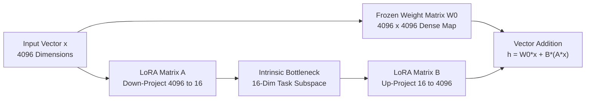
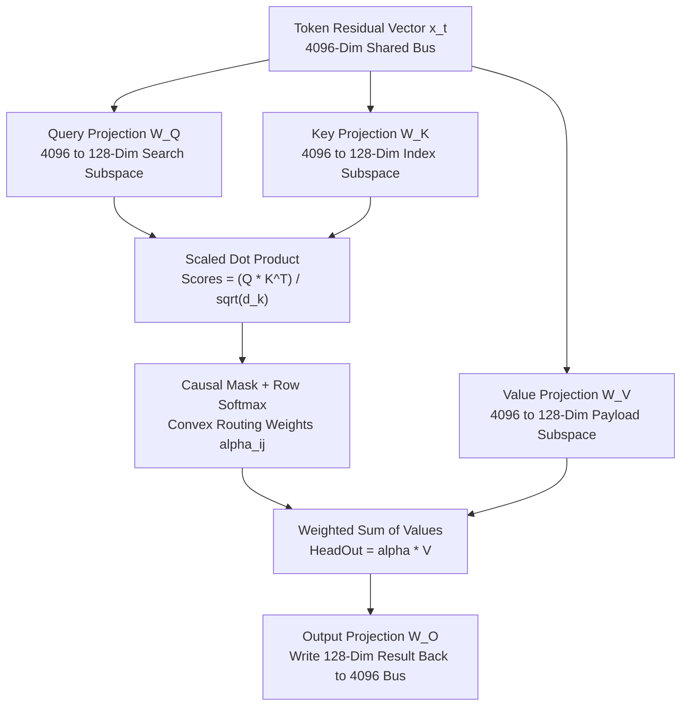

# Linear Algebra Intuition: Vectors, Space Transformations, SVD & LLM Embeddings

> **The Single Unlock**: Stop viewing a matrix as a spreadsheet of numbers with arbitrary row-by-column multiplication rules. A vector is a **coordinate in feature space**, and a matrix is a **serialized function that warps, rotates, squashes, or projects that space**. Once you see where the basis vectors land, everything from 3D WebGL shaders to LoRA fine-tuning and Transformer `Q/K/V` attention becomes geometric common sense.

---

## 1. Vectors, Basis Coordinates & Norms: Three Faces of One Object

Depending on who you ask, a vector $\mathbf{v} \in \mathbb{R}^d$ wears three disguises that turn out to be mathematically identical:

1. **The Physicist's Arrow**: An arrow anchored at the origin $\mathbf{0}$ with a **length** (magnitude) and a **direction** in space.
2. **The Computer Scientist's Typed Struct**: An ordered `float32[d]` array where each slot stores an independent measurement—for example, `[house_sqft, bedrooms, age_years]` in $\mathbb{R}^3$, or $1536$ learned semantic coordinates in an OpenAI/voyage text embedding.
3. **The Mathematician's Linear Combination**: Anything you can add ($\mathbf{u} + \mathbf{v}$) and scale ($c\mathbf{v}$) while obeying associative and distributive laws—including polynomials, audio waveforms, and quantum states.

### Basis Vectors: The Coordinate System's Secret Contract

When you write $\mathbf{v} = \begin{bmatrix} 3 \\ -2 \end{bmatrix}$, those two numbers are meaningless until you agree on **unit basis vectors**—by default $\hat{\imath} = \begin{bmatrix} 1 \\ 0 \end{bmatrix}$ ($x$-step) and $\hat{\jmath} = \begin{bmatrix} 0 \\ 1 \end{bmatrix}$ ($y$-step). Writing $\begin{bmatrix} 3 \\ -2 \end{bmatrix}$ is shorthand for a recipe:

$$\mathbf{v} = 3\hat{\imath} + (-2)\hat{\jmath}$$

- **Span**: The set of *all* points reachable by scaling and adding a collection of vectors. Two non-parallel arrows in $\mathbb{R}^3$ span a flat 2D sheet slicing through 3D space.
- **Linear Independence**: A set of vectors has **no redundant directions**—none of them can be built as a weighted sum of the others. In machine learning, if feature column $3$ equals $2 \times \text{col}_1 + 0.5 \times \text{col}_2$ (for example, storing `price_usd`, `tax_usd`, and `total_usd`), your feature matrix is **linearly dependent** (collinear), collapsing space onto a lower-dimensional hyperplane and blowing up naive linear regression inverses $(\mathbf{X}^\top \mathbf{X})^{-1}$.

### Vector Norms: Different Ways to Measure "Size"

How "long" is a vector $\mathbf{v} = [v_1, v_2, \dots, v_d]$? Engineers choose different **norms** depending on whether they want sparsity, rotational invariance, or worst-case bounds:

| Norm | Formula | Unit-Ball Geometry (2D) | Primary Software & ML Use Cases |
| :--- | :--- | :--- | :--- |
| **$\ell_0$ ("Pseudo-norm")** | Count of non-zero entries $\#\{i : v_i \neq 0\}$ | Axes crosshairs | Exact feature selection, sparse autoencoders, model pruning (NP-hard to optimize directly) |
| **$\ell_1$ (Manhattan / Taxicab)** | $\lVert \mathbf{v} \rVert_1 = \sum_{i=1}^{d} \lvert v_i \rvert$ | Diamond with sharp corners on axes | **Lasso regularization** (sharp corners force noisy weights to *exact* `0.0`), compressed sensing, grid pathfinding |
| **$\ell_2$ (Euclidean)** | $\lVert \mathbf{v} \rVert_2 = \sqrt{\sum_{i=1}^{d} v_i^2}$ | Smooth rotationally invariant circle | **Ridge (`weight_decay`) regularization**, physical distance, unit-sphere embedding normalization, gradient clipping |
| **$\ell_\infty$ (Max / Chebyshev)** | $\lVert \mathbf{v} \rVert_\infty = \max_{i} \lvert v_i \rvert$ | Axis-aligned square | Adversarial robustness ($\epsilon$-ball perturbations), quantization clipping (`absmax` in `int8` / `fp8` LLM weights) |

---

## 2. Matrices as Space-Warping Functions

Suppose a linear transformation maps 2D space to 2D space such that:
- Grid lines remain **parallel** and **evenly spaced**, and
- The origin $\mathbf{0}$ stays fixed at $\mathbf{0}$.

Because $\mathbf{v} = x\hat{\imath} + y\hat{\jmath}$ and the map $L$ is linear, $L(\mathbf{v}) = x L(\hat{\imath}) + y L(\hat{\jmath})$. That means **you do not need a formula for millions of points—you ONLY need to record the new coordinates where $\hat{\imath}$ and $\hat{\jmath}$ land!** Pack those landing coordinates as the **columns** of a matrix $\mathbf{M}$:

$$\mathbf{M} = \underbrace{\begin{bmatrix} \uparrow & \uparrow \\ L(\hat{\imath}) & L(\hat{\jmath}) \\ \downarrow & \downarrow \end{bmatrix}}_{\text{Where basis vectors land}} \implies \mathbf{M}\begin{bmatrix} x \\ y \end{bmatrix} = x\,L(\hat{\imath}) + y\,L(\hat{\jmath})$$

Read concrete $2 \times 2$ matrices visually without memorizing a single trigonometry table:
- **90-Degree Counterclockwise Rotation**: $\hat{\imath} = [1, 0]^\top$ rotates up to $[0, 1]^\top$; $\hat{\jmath} = [0, 1]^\top$ rotates left to $[-1, 0]^\top$. Instant matrix: $\begin{bmatrix} 0 & -1 \\ 1 & 0 \end{bmatrix}$.
- **Horizontal Shear (Italicizing Text)**: $\hat{\imath}$ stays at $[1, 0]^\top$; $\hat{\jmath}$ leans right to $[0.5, 1]^\top$. Instant matrix: $\begin{bmatrix} 1 & 0.5 \\ 0 & 1 \end{bmatrix}$.

### Why Matrix Multiplication Works That Way (Composition & Associativity)

Writing $\mathbf{C} = \mathbf{A}\mathbf{B}$ is **not** an arbitrary row-dot-column ritual—it is **function composition**: *"First apply transformation $\mathbf{B}$ to space, then apply transformation $\mathbf{A}$ to the result"* (`C(x) = A(B(x))`, read right-to-left just like nested function calls!).

1. **Why $\mathbf{A}\mathbf{B} \neq \mathbf{B}\mathbf{A}$ (Non-Commutativity)**: Hold your phone face-up. Rotate $90^\circ$ clockwise, then flip horizontal—compare that with flipping horizontal first, then rotating $90^\circ$ clockwise. Physical space transformations depend on order!
2. **Why $(\mathbf{B}\mathbf{A})\mathbf{x} = \mathbf{B}(\mathbf{A}\mathbf{x})$ Saves Billions of FLOPs**: Mathematically, parenthesizing does not change the result—but **computationally**, grouping changes runtime by orders of magnitude!
   - Consider a **LoRA adapter** $\Delta\mathbf{W} = \mathbf{B}\mathbf{A}$ where $\mathbf{B} \in \mathbb{R}^{4096 \times 16}$ and $\mathbf{A} \in \mathbb{R}^{16 \times 4096}$, applied to an activation vector $\mathbf{x} \in \mathbb{R}^{4096}$:
     - Materializing $(\mathbf{B}\mathbf{A})\mathbf{x}$ builds a dense $4096 \times 4096$ matrix ($16.78\text{M}$ entries, $\approx 2.68 \times 10^8$ multiply-adds) and then multiplies $\mathbf{x}$ ($1.68 \times 10^7$ multiply-adds).
     - Grouping as $\mathbf{B}(\mathbf{A}\mathbf{x})$ first projects $\mathbf{x}$ down to $\mathbb{R}^{16}$ ($65,536$ multiply-adds) and then projects back up to $\mathbb{R}^{4096}$ ($65,536$ multiply-adds)—**$128\times$ fewer operations than a single dense $4096 \times 4096$ matrix-vector multiply, with $128\times$ less adapter RAM!**



### Determinant, Rank & Null Space: Did We Crush Information?

- **Determinant $\det(\mathbf{M})$**: The **signed factor by which a transformation scales $n$-dimensional volume** (area in 2D, volume in 3D).
  - $\lvert \det(\mathbf{M}) \rvert = 3$: Every unit square gets stretched to area $3$.
  - $\det(\mathbf{M}) < 0$: Orientation flipped (like looking in a mirror—left hand becomes right hand).
  - $\det(\mathbf{M}) = 0$: Space was **squashed flat** into a lower dimension (a 3D cube flattened into a 2D sheet or 1D line, which has zero 3D volume!). Once space is flattened, infinitely many distinct input vectors land on the exact same output point—so **no inverse matrix $\mathbf{M}^{-1}$ can ever undo it**. That is lossy compression in geometric form.
- **Rank $\text{rank}(\mathbf{M})$**: The number of true dimensions surviving in the output after the transformation. A $4096 \times 4096$ matrix of rank $16$ looks huge in RAM, but its outputs all live inside a tiny 16-dimensional subspace.
- **Null Space (Kernel)**: The set of non-zero input vectors $\mathbf{v}$ that get completely annihilated to $\mathbf{0}$ ($\mathbf{M}\mathbf{v} = \mathbf{0}$)—the exact blind spot of the linear transformation.

---

## 3. Dot Products, Cosine Similarity & Production RAG Traps

Given two vectors $\mathbf{a}, \mathbf{b} \in \mathbb{R}^d$, their **dot product** has an algebraic definition and a geometric identity that match exactly:

$$\mathbf{a} \cdot \mathbf{b} = \sum_{i=1}^{d} a_i b_i = \lVert \mathbf{a} \rVert_2 \, \lVert \mathbf{b} \rVert_2 \cos\theta$$

Why do multiplying coordinates pairwise and summing them know anything about the angle $\theta$? Because projecting $\mathbf{b}$ orthogonally onto the line of $\mathbf{a}$ is a linear operation ($1\text{D}$ output from $d\text{D}$ input), and by symmetry its $1 \times d$ matrix is simply $\hat{\mathbf{a}}^\top$!

### Choosing the Right Vector Database Metric (`IP` vs `Cosine` vs `L2`)

Every vector index (`FAISS`, `pgvector`, `Qdrant`, `Milvus`) asks you to choose a distance metric at index creation time. Here is the exact mathematical relationship:

| Metric | Formula | Sensitive to Vector Length $\lVert \mathbf{v} \rVert_2$? | Best Engineering Scenario |
| :--- | :--- | :--- | :--- |
| **Inner / Dot Product (`IP`)** | $\mathbf{a}^\top \mathbf{b}$ | **Yes** (longer vectors score higher) | Maximum Inner Product Search (MIPS), recommender systems (item popularity encoded in norm), LLM logit unembedding, pre-normalized unit vectors (fastest SIMD kernel!) |
| **Cosine Similarity** | $\frac{\mathbf{a}^\top \mathbf{b}}{\lVert \mathbf{a} \rVert_2 \lVert \mathbf{b} \rVert_2}$ | **No** (purely directional angle $\theta$) | Text/code semantic search where passage confidence or repetition inflates raw vector norm without changing topic |
| **Squared Euclidean (`L2`)** | $\lVert \mathbf{a} - \mathbf{b} \rVert_2^2 = \lVert \mathbf{a} \rVert_2^2 + \lVert \mathbf{b} \rVert_2^2 - 2\mathbf{a}^\top \mathbf{b}$ | **Yes** (measures absolute spatial gap) | Geospatial coordinates, physical sensor clustering (`k-means`), image patch matching |

**Crucial Equivalence Identity**: If you normalize every vector to unit length ($\lVert \mathbf{a} \rVert_2 = \lVert \mathbf{b} \rVert_2 = 1$) at ingestion time:

$$\lVert \mathbf{a} - \mathbf{b} \rVert_2^2 = 1 + 1 - 2\cos\theta = 2(1 - \cos\theta)$$

Because $2(1 - \cos\theta)$ is strictly monotonic decreasing with $\cos\theta$, **Inner Product, Cosine Similarity, and Euclidean L2 produce the EXACT same top-$k$ neighbor ranking on unit-normalized vectors**—except Inner Product skips two square-root divisions per comparison!

### Four Production Embedding Traps Engineers Hit in RAG

1. **The Anisotropy ("Narrow Cone") Trap**: Pre-trained language embeddings rarely spread uniformly around the hypersphere. Instead, token/chunk vectors often crowd into a narrow forward-pointing cone where *two completely unrelated sentences still show cosine similarity of $0.65$ to $0.78$*! Never hardcode a naive threshold like `if cosine > 0.7:` without inspecting your specific embedding model's negative-pair score distribution; subtracting the corpus mean vector ($\tilde{\mathbf{v}} = \mathbf{v} - \boldsymbol{\mu}$) or whitening often restores angular discrimination.
2. **Chunk-Length Dilution (Mean Pooling Averaging)**: Embedding a 3,000-word runbook averages dozens of distinct sub-topics into one blurry centroid vector ($\frac{1}{N}\sum \mathbf{v}_i$) that sits halfway between everything and matches nothing sharply. Keep retrieval chunks focused (200 to 500 tokens) with parent-document context expansion.
3. **High-Dimensional Orthogonality & Superposition**: In $\mathbb{R}^2$, you can only fit $2$ mutually perpendicular axes. In $\mathbb{R}^{1536}$, how many *nearly orthogonal* vectors ($\lvert \cos\theta \rvert < 0.05$) can exist? By the **Johnson-Lindenstrauss Lemma**, the answer grows *exponentially* with dimension $d$! Two random unit vectors in $\mathbb{R}^d$ have expected inner product $0$ and standard deviation $1/\sqrt{d}$ ($\approx 0.025$ for $d = 1536$). Neural networks exploit this to pack tens of thousands of sparse features into $d$ neurons via **superposition**.
4. **Matryoshka Embeddings (Prefix Slicing)**: Modern Matryoshka-trained models (`text-embedding-3-large`, `nomic-embed`) train nested losses on the first $64, 128, 256, 512, \dots, d$ coordinates—similar to PCA ordering—allowing you to slice `vec[:256]`, re-normalize to unit $\ell_2$ norm, and cut vector RAM by $6\times$ while retaining over $95\%$ recall.

---

## 4. Eigenvectors, PCA & Singular Value Decomposition (SVD)

### Eigenvectors: The Invariant Axes of a Transformation

When a square matrix $\mathbf{A}$ warps space, almost every vector gets knocked off its original line. An **eigenvector** $\mathbf{v} \neq \mathbf{0}$ is a special axis that **refuses to rotate**—it only gets stretched or flipped by a scalar **eigenvalue** $\lambda$:

$$\mathbf{A}\mathbf{v} = \lambda \mathbf{v}$$

- **3D Rotation Matrix**: Every point spins around in circles *except* points sitting directly on the **axis of rotation**, which satisfy $\mathbf{R}\mathbf{v} = 1 \cdot \mathbf{v}$ (eigenvector with $\lambda = 1$!).
- **Google PageRank / Markov Chains**: A web surfer's transition matrix $\mathbf{P}$ updates probability distribution $\boldsymbol{\pi}_{t+1} = \mathbf{P}\boldsymbol{\pi}_t$. Steady-state equilibrium $\mathbf{P}\boldsymbol{\pi}^* = 1 \cdot \boldsymbol{\pi}^*$ is literally the dominant eigenvector with $\lambda = 1$.
- **Repeated Matrix Powers ($\mathbf{A}^{100}\mathbf{x}$)**: Expressing $\mathbf{x} = \sum c_i \mathbf{v}_i$ in the eigenbasis immediately gives $\mathbf{A}^k \mathbf{x} = \sum c_i \lambda_i^k \mathbf{v}_i$. If $\lvert \lambda_{\max} \rvert > 1$, recurrent state explodes; if $\lvert \lambda_{\max} \rvert < 1$, recurrent state vanishes! That single eigenvalue equation explains why classic RNNs failed on long sequences and why State Space Models (Mamba / S4) carefully initialize diagonal eigenvalues near the unit circle.

### PCA & SVD: Rotating the Camera to Find True Signal

Eigendecomposition only works on nice square matrices, whereas real engineering matrices (users $\times$ movies, documents $\times$ terms, layer input $d_{\text{in}} \times d_{\text{out}}$) are rectangular. **Singular Value Decomposition (SVD)** works on **every matrix in existence** ($\mathbf{A} \in \mathbb{R}^{m \times n}$):

$$\mathbf{A} = \mathbf{U} \boldsymbol{\Sigma} \mathbf{V}^\top = \sum_{i=1}^{r} \sigma_i \, \mathbf{u}_i \mathbf{v}_i^\top$$

Read $\mathbf{U}\boldsymbol{\Sigma}\mathbf{V}^\top$ geometrically from right to left on any input vector $\mathbf{x}$:
1. $\mathbf{V}^\top$ (orthogonal $n \times n$): **Rotate** input space to align with perpendicular input principal axes (no stretching, preserves lengths!).
2. $\boldsymbol{\Sigma}$ (diagonal $m \times n$ with $\sigma_1 \ge \sigma_2 \ge \dots \ge 0$): **Stretch** each axis independently by singular value $\sigma_i$ (dropping or adding zero-padded dimensions).
3. $\mathbf{U}$ (orthogonal $m \times m$): **Rotate** into the final output coordinate frame.

By the **Eckart-Young-Mirsky Theorem**, keeping only the largest $k$ singular values ($\mathbf{A}_k = \sum_{i=1}^k \sigma_i \mathbf{u}_i \mathbf{v}_i^\top$) gives the **mathematically best possible rank-$k$ approximation** to $\mathbf{A}$ in both Frobenius ($\ell_2$ elementwise) and spectral error!

| Technique | Matrix Requirement | Core Equation | Engineering Superpower |
| :--- | :--- | :--- | :--- |
| **Eigendecomposition** | Square, diagonalizable ($n \times n$) | $\mathbf{A} = \mathbf{V}\boldsymbol{\Lambda}\mathbf{V}^{-1}$ | Graph Laplacians, Markov stationary states, dynamical system stability ($\lvert \lambda \rvert < 1$), closed-form matrix powers |
| **PCA (Principal Component Analysis)** | Centered data $\mathbf{X} \in \mathbb{R}^{N \times d}$ (covariance $\mathbf{C} = \frac{1}{N-1}\mathbf{X}^\top\mathbf{X}$) | Eigenvectors of symmetric $\mathbf{C}$ (computed stably via SVD of $\mathbf{X}$!) | Denoising correlated telemetry, compressing $1536\text{D}$ embeddings to $2\text{D}/3\text{D}$ plots, decorrelating features |
| **Truncated SVD** | Any rectangular $m \times n$ | $\mathbf{A}_k = \mathbf{U}_k \boldsymbol{\Sigma}_k \mathbf{V}_k^\top$ | Collaborative filtering (Netflix latent factors), compressing LLM weight layers / KV-caches, pseudo-inverse $\mathbf{A}^+$ |

---

## 5. How Transformer Self-Attention Works Geometrically

In a Transformer, every token $t$ in the sequence sits on a shared communication bus called the **residual stream** ($\mathbf{x}_t \in \mathbb{R}^{d_{\text{model}}}$, e.g., $d_{\text{model}} = 4096$). Why doesn't self-attention just compute raw dot products $\mathbf{x}_i^\top \mathbf{x}_j$ directly between token embeddings? Why invent three separate matrices $\mathbf{W}_Q, \mathbf{W}_K, \mathbf{W}_V \in \mathbb{R}^{d_{\text{model}} \times d_k}$ per head?



$$\text{Attention}(\mathbf{Q}, \mathbf{K}, \mathbf{V}) = \text{softmax}\!\left(\frac{\mathbf{Q}\mathbf{K}^\top}{\sqrt{d_k}}\right)\mathbf{V}$$

Three deep linear-algebraic reasons make this architecture work:

1. **Asymmetry Requires Distinct $\mathbf{W}_Q$ and $\mathbf{W}_K$**: Raw dot product is symmetric ($\mathbf{x}_i^\top \mathbf{x}_j = \mathbf{x}_j^\top \mathbf{x}_i$), and $\mathbf{x}_i^\top \mathbf{x}_i = \lVert \mathbf{x}_i \rVert_2^2$ is largest with *itself*! In language, attention must be **asymmetric**: the pronoun `"it"` needs to attend strongly backward to `"server"`, without `"server"` attending to `"it"`. Projecting $\mathbf{q}_i = \mathbf{W}_Q^\top \mathbf{x}_i$ and $\mathbf{k}_j = \mathbf{W}_K^\top \mathbf{x}_j$ computes bilinear form $\mathbf{x}_i^\top (\mathbf{W}_Q \mathbf{W}_K^\top) \mathbf{x}_j$, breaking symmetry completely.
2. **Decoupling Routing Address ($\mathbf{Q}, \mathbf{K}$) from Transferred Payload ($\mathbf{V}, \mathbf{W}_O$)**: A token's *lookup address* ("I am a plural noun at clause start") is completely different from the *payload* an adjective wants to copy when it finds that noun ("copy gender/number tense into my verb prediction slot"). Note that $\mathbf{W}_V$ followed by $\mathbf{W}_O$ forms a rank-$d_k$ linear circuit ($\mathbb{R}^{4096} \to \mathbb{R}^{128} \to \mathbb{R}^{4096}$) writing into a dedicated subspace of the residual stream without overwriting unrelated features!
3. **Why Divide by $\sqrt{d_k}$? (Variance Stabilization)**: Suppose entries of $\mathbf{q}$ and $\mathbf{k}$ are independent random variables with mean $0$ and variance $1$. Each product $q_m k_m$ has mean $0$ and variance $1$. Summing $d_k = 128$ independent terms gives $\text{Var}(\mathbf{q} \cdot \mathbf{k}) = d_k = 128$, so standard deviation jumps to $\sqrt{128} \approx 11.3$! Feeding logits like $[+22.6, -11.3, +3.1]$ into $\text{softmax}(z_i) = e^{z_i}/\sum e^{z_j}$ pushes the winner to $0.9999999$ and losers to $10^{-14}$, where the softmax Jacobian $\approx 0$ (**dead vanishing gradients**). Dividing by $\sqrt{d_k}$ restores $\text{Var} = 1$ regardless of head dimension.

### Bonus Unlock: How `RoPE` Encodes Word Order Using Pure 2D Rotation Matrices

Raw dot-product attention is **permutation-invariant**—without position encoding, `"dog bites man"` and `"man bites dog"` produce the exact same attention scores! Almost every modern frontier LLM (`Llama`, `Qwen`, `DeepSeek`, `Mistral`) solves this with **Rotary Position Embeddings (`RoPE`)**, which is a direct application of $2 \times 2$ rotation matrices from Section 2:

1. Group each 128-dim query $\mathbf{q}$ and key $\mathbf{k}$ into $64$ independent 2D coordinate pairs $(x_{2m}, x_{2m+1})$.
2. For a token sitting at sequence index $p \in \{0, 1, 2, \dots\}$, rotate pair $m$ by angle $p \theta_m$ (where $\theta_m = 10000^{-2m/d}$ spans fast second-hands to slow hour-hands):

$$\mathbf{R}(p\theta_m) = \begin{bmatrix} \cos(p\theta_m) & -\sin(p\theta_m) \\ \sin(p\theta_m) & \cos(p\theta_m) \end{bmatrix}$$

3. Now take the attention dot product between query at position $p$ and key at position $t$. Because $\mathbf{R}(\alpha)^\top = \mathbf{R}(-\alpha)$ and composing two rotations adds their angles:

$$\big(\mathbf{R}(p\theta_m)\mathbf{q}_m\big)^\top \big(\mathbf{R}(t\theta_m)\mathbf{k}_m\big) = \mathbf{q}_m^\top \mathbf{R}(-p\theta_m)\mathbf{R}(t\theta_m)\mathbf{k}_m = \mathbf{q}_m^\top \mathbf{R}\big((t - p)\theta_m\big) \mathbf{k}_m$$

Look at what linear algebra just gave us for free:
- **Exact Relative Distance**: Absolute indices $p$ and $t$ cancel out—attention depends *exclusively* on relative token offset $(t - p)$, whether the sentence appears at token $10$ or token $80,000$!
- **Norm Preservation**: Because $\det(\mathbf{R}) = \cos^2 + \sin^2 = 1$ and $\mathbf{R}^\top \mathbf{R} = \mathbf{I}$, rotating queries and keys never distorts semantic vector magnitudes $\lVert \mathbf{q} \rVert_2$ or $\lVert \mathbf{k} \rVert_2$.

### Minimal NumPy Lab: SVD Rank Compression + Scaled Dot-Product Attention

```python
import numpy as np

rng = np.random.default_rng(42)

# --- Part A: SVD Low-Rank Compression (Eckart-Young in action) ---
# Construct a 512x512 matrix whose true underlying structure has rank 8 + small noise
true_U = rng.standard_normal((512, 8))
true_V = rng.standard_normal((8, 512))
W = true_U @ true_V + 0.05 * rng.standard_normal((512, 512))

U, s, Vt = np.linalg.svd(W, full_matrices=False)
k = 8
W_rank_k = (U[:, :k] * s[:k]) @ Vt[:k, :]

rel_error = np.linalg.norm(W - W_rank_k, "fro") / np.linalg.norm(W, "fro")
storage_ratio = (512 * k + k + k * 512) / (512 * 512)
print(f"Rank-{k} storage: {storage_ratio:.1%} of dense | Relative error: {rel_error:.4f}")

# --- Part B: Causal Scaled Dot-Product Attention ---
def causal_self_attention(X: np.ndarray, W_Q: np.ndarray, W_K: np.ndarray, W_V: np.ndarray) -> np.ndarray:
    """X: (seq_len, d_model), W_*: (d_model, d_k) -> returns (seq_len, d_k)."""
    seq_len, _ = X.shape
    d_k = W_K.shape[1]
    Q, K, V = X @ W_Q, X @ W_K, X @ W_V

    scores = (Q @ K.T) / np.sqrt(d_k)                      # Variance-stabilized alignment
    causal_mask = np.triu(np.ones((seq_len, seq_len), dtype=bool), k=1)
    scores = np.where(causal_mask, -1e9, scores)           # Prevent peeking into future tokens

    scores_shifted = scores - np.max(scores, axis=-1, keepdims=True)
    weights = np.exp(scores_shifted)
    weights /= np.sum(weights, axis=-1, keepdims=True)     # Convex combination per query row
    return weights @ V                                     # Weighted blend of Value vectors
```

---

## 6. Actionable Linear Algebra Checklist for Software Engineers

- **Always Annotate Tensor Shapes in Comments**: Before debugging any ML, graphics, or analytics pipeline, write explicit shapes (`# X: (B, T, D), W_Q: (D, H, d_k)`). Roughly 80% of linear algebra bugs are silent unintended broadcasting or transposed axes.
- **Never Compute `np.linalg.inv(A) @ b` in Production**: Explicitly inverting a matrix is slower ($3\times$ FLOPs) and catastrophically unstable when condition number $\kappa(\mathbf{A}) = \sigma_{\max}/\sigma_{\min}$ is large. Always solve linear systems via LU/Cholesky/QR factorization (`np.linalg.solve(A, b)` or `lstsq`).
- **Normalize Embeddings Before Indexing**: Unit-normalizing embeddings at write time (`v / np.linalg.norm(v)`) lets you use raw SIMD inner-product kernels (`IP`), catches zero-norm NaN bugs on empty strings early, and makes cosine scores directly comparable.
- **Exploit Low-Rank Factorizations Whenever $m \times n$ Bottlenecks Memory**: Whether compressing KV-caches (DeepSeek Multi-Head Latent Attention `MLA` projecting keys/values into a low-rank latent vector!), fine-tuning via LoRA, or building recommendation engines, check the singular value spectrum $\sigma_i$—real-world matrices almost always have rapid singular-value decay.

---

### Continue the Curriculum

- **Previous**: [00-README.md](00-README.md) — Visual Intuition Mindset & Notation Rosetta Stone
- **Next**: [02-CALCULUS-OPTIMIZATION-AND-INFORMATION-THEORY.md](02-CALCULUS-OPTIMIZATION-AND-INFORMATION-THEORY.md) — Calculus, Gradients, Backpropagation & Shannon Information Theory
- **Also in This Vault**: [03-PROBABILITY-BAYES-AND-REAL-LIFE-DECISIONS.md](03-PROBABILITY-BAYES-AND-REAL-LIFE-DECISIONS.md) — Bayesian Thinking, Power Laws, Kelly Criterion & Statistical Traps
