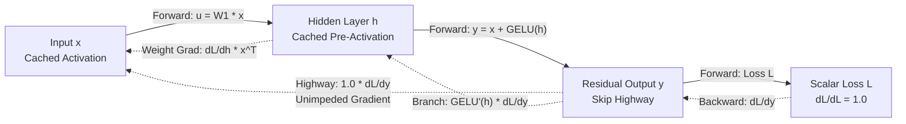
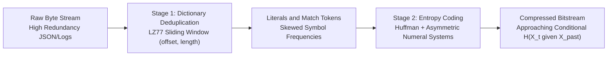

# Calculus, Optimization Landscapes & Shannon Information Theory

> **Core Mental Model**: Calculus answers one engineering question—*"If I wiggle this input parameter by a tiny $\epsilon$, how much does my system's output move?"* Information Theory answers its twin—*"How many irreducible bits of surprise remain in a data stream, and how many extra bits do we waste when our model of reality is wrong?"* Put those two ideas together and you get backpropagation, AdamW, `zstd` compression, and Large Language Models.

---

## 1. Derivatives, Gradients & Hessians as Sensitivity Probes

Forget memorizing tables of derivatives for $\arctan(x)$ or $\csc(x)$. For a software engineer, the derivative of $f(x)$ at a point $x$ is simply a **local linear multiplier** (a sensitivity probe):

$$f'(x) = \lim_{h \to 0} \frac{f(x + h) - f(x)}{h} \iff f(x + \epsilon) \approx f(x) + \underbrace{f'(x)}_{\text{knob gain}} \epsilon$$

If $f'(\text{timeout}) = -4.2\text{ errors/sec per ms}$, nudging `timeout` up by $+0.5\text{ ms}$ changes the error rate by approximately $(-4.2)(0.5) = -2.1\text{ errors/sec}$. Every higher-dimensional operator in multivariable calculus is just organizing these partial knob sensitivities into the right array shape:

| Operator | Input $\to$ Output Types | Array Shape | Geometric & Systems Intuition | Compute Reality ($d = 10^9$ LLM Weights) |
| :--- | :--- | :--- | :--- | :--- |
| **Derivative** $f'(x)$ | $\mathbb{R} \to \mathbb{R}$ | Scalar `float` | Local slope of curve; gain between 1 knob and 1 metric | $O(1)$ ops |
| **Gradient** $\nabla f(\mathbf{x})$ | $\mathbb{R}^d \to \mathbb{R}$ | Vector `(d,)` | Direction of steepest uphill ascent; perpendicular to level-set contours | **Tractable!** 1 backward pass $\approx 2\times$ forward pass |
| **Jacobian** $\mathbf{J}_f(\mathbf{x})$ | $\mathbb{R}^d \to \mathbb{R}^m$ | Matrix `(m, d)` | Entry $J_{ij} = \frac{\partial y_i}{\partial x_j}$; local linear matrix warp of nonlinear layer $f$ | Never materialized densely; chained via vector-Jacobian products (`vJP`) |
| **Hessian** $\mathbf{H}_f(\mathbf{x})$ | $\mathbb{R}^d \to \mathbb{R}$ (2nd deriv.) | Matrix `(d, d)` | Local **curvature** ($H_{ij} = \frac{\partial^2 f}{\partial x_i \partial x_j}$): distinguishes bowls, flat plateaus, and saddle points | **Impossible densely** ($10^{18}$ floats!); approximated diagonally by AdamW |

### Why the Gradient Points Perpendicular to Contour Lines

Imagine standing on a mountainside where altitude is loss $\mathcal{L}(w_1, w_2)$. Walking *along* a constant-altitude contour line changes loss by zero ($\Delta \mathcal{L} \approx \nabla \mathcal{L} \cdot \Delta \mathbf{w} = 0$). Since the dot product is zero, **$\nabla \mathcal{L}$ must be strictly orthogonal ($90^\circ$) to the contour line**, pointing straight uphill. Stepping in the opposite direction ($\mathbf{w}_{\text{new}} = \mathbf{w} - \eta \nabla \mathcal{L}$) is therefore the steepest local downhill step per unit of Euclidean parameter movement.

---

## 2. The Chain Rule & Why Backpropagation Is a Billion-Fold Miracle

Suppose you are training a small $7\text{B}$-parameter model ($\theta \in \mathbb{R}^{7 \times 10^9}$) to minimize a scalar loss $\mathcal{L}(\theta) \in \mathbb{R}$. Why not estimate the gradient the obvious software-testing way—perturbing one weight at a time by $\epsilon = 10^{-5}$ (**Finite Differences**)?

$$\frac{\partial \mathcal{L}}{\partial \theta_i} \approx \frac{\mathcal{L}(\theta + \epsilon \mathbf{e}_i) - \mathcal{L}(\theta)}{\epsilon}$$

- **Finite Differences**: Requires $7,000,000,001$ separate forward passes *for a single training batch*! If one forward pass takes $50\text{ ms}$, **one single gradient step would take $11\text{ years}$**.
- **Reverse-Mode Automatic Differentiation (Backpropagation)**: Computes the **exact** analytical partial derivative for *all $7\text{ billion}$ parameters simultaneously* in roughly $100\text{ ms}$ ($\approx 2\times$ the cost of one forward pass)!

### How Reverse-Mode Chain Rule Achieves This

Any program composed of elementary operations (`+`, `*`, `matmul`, `exp`, `sin`, `max`) forms a Directed Acyclic Graph (DAG). If $z = g(w)$ and $\mathcal{L} = f(z)$, nudging $w$ by $\Delta w$ nudges $z$ by $\frac{\partial z}{\partial w}\Delta w$, which nudges $\mathcal{L}$ by:

$$\frac{\partial \mathcal{L}}{\partial w} = \frac{\partial \mathcal{L}}{\partial z} \cdot \frac{\partial z}{\partial w}$$

Notice the asymmetry of matrix chain multiplication (the exact associativity trick from [01-LINEAR-ALGEBRA-VECTORS-AND-EMBEDDINGS.md](01-LINEAR-ALGEBRA-VECTORS-AND-EMBEDDINGS.md)):
- **Forward-Mode AD** propagates a vector from $1$ input toward $m$ outputs ($\mathbf{J}_L \cdots (\mathbf{J}_2 (\mathbf{J}_1 \mathbf{v}))$)—fast when inputs are few and outputs are millions.
- **Reverse-Mode AD (Backprop)** starts at the single scalar output $\frac{\partial \mathcal{L}}{\partial \mathcal{L}} = 1.0$ and multiplies **left-to-right** from output back to inputs: $((\mathbf{1}^\top \mathbf{J}_L) \mathbf{J}_{L-1}) \cdots \mathbf{J}_1$. Every step is a cheap **vector-Jacobian product** (`row_vector @ matrix`), never forming huge intermediate matrices—trading **activation memory** (caching forward intermediate tensors for the backward pass) for a $10^9\times$ compute speedup!



### Why Residual Connections (`y = x + F(x)`) Saved Deep Learning

In a plain 100-layer stack $y = f_{100}(f_{99}(\dots f_1(x)))$, the Chain Rule multiplies 100 Jacobians together: $\prod_{l=1}^{100} f'_l$. If each layer's average derivative is $0.7$, then $0.7^{100} \approx 3.2 \times 10^{-16}$ (**vanishing gradients**—early layers freeze completely). If each derivative is $1.3$, then $1.3^{100} \approx 2.5 \times 10^{11}$ (**exploding `NaN` gradients**).

Adding a simple **residual skip connection** $y = x + F(x)$ transforms the derivative via the sum rule:

$$\frac{\partial y}{\partial x} = \mathbf{I} + \frac{\partial F(x)}{\partial x}$$

Even if $\frac{\partial F}{\partial x} \approx 0$ inside 90 blocks, the identity term $\mathbf{I}$ acts as a **lossless superconductor**, carrying upstream error signals $\frac{\partial \mathcal{L}}{\partial y_{\text{top}}}$ directly back to layer 1!

---

## 3. Optimization Landscapes, Ill-Conditioned Ravines & AdamW

Why doesn't plain Stochastic Gradient Descent ($\theta_{t+1} = \theta_t - \eta \nabla \mathcal{L}$) train Transformers cleanly? Because high-dimensional loss landscapes are **ill-conditioned narrow canyons**, not round cereal bowls.

Suppose loss is $\mathcal{L}(w_1, w_2) = 50 w_1^2 + 0.5 w_2^2$. Its Hessian eigenvalues are $\lambda_1 = 100$ (steep cliff walls across $w_1$) and $\lambda_2 = 1$ (gentle valley floor along $w_2$), giving **condition number** $\kappa = \lambda_{\max}/\lambda_{\min} = 100$:
- Pick large learning rate $\eta = 0.025$: Along steep axis $w_1$, step size overshoots the valley walls ($1 - \eta \lambda_1 = -1.5$), violently bouncing to $\infty$.
- Pick safe small learning rate $\eta = 0.005$: Along gentle axis $w_2$, progress crawls at $0.5\%$ per step!

Modern optimizers solve both pathologies without ever forming the $d \times d$ Hessian:

| Optimizer | Update Mechanism | Core Geometric Fix | Production Default? |
| :--- | :--- | :--- | :--- |
| **Vanilla SGD** | $\theta \leftarrow \theta - \eta \mathbf{g}_t$ | Follows raw noisy local slope; oscillates across steep canyon walls | Rare alone; needs heavy LR scheduling |
| **SGD + Momentum** | $\mathbf{m}_t = \beta_1 \mathbf{m}_{t-1} + (1 - \beta_1)\mathbf{g}_t$ | Physics bowling ball: opposite-sign cross-canyon bounces **cancel out**, while consistent downhill gradients **accelerate** | Strong for CNNs / vision generalization |
| **RMSProp / Adam** | Divides $\hat{\mathbf{m}}_t$ by $\sqrt{\hat{\mathbf{v}}_t} + \epsilon$ where $\mathbf{v}_t$ tracks $\mathbb{E}[\mathbf{g}_t^2]$ | Per-parameter adaptive scaling: steep noisy parameters get shrunk; flat rare-token embeddings get boosted | Standard baseline, but L2 coupling warps weight decay |
| **AdamW** | $\theta \leftarrow (1 - \eta\lambda)\theta - \eta \frac{\hat{\mathbf{m}}_t}{\sqrt{\hat{\mathbf{v}}_t} + \epsilon}$ | **Decouples** weight shrinkage ($\lambda$) from adaptive gradient normalization | **Universal default** for LLMs, ViTs, and Diffusion |
| **Muon / Shampoo / L-BFGS** | Orthogonalizes momentum matrix via Newton-Schulz or Kronecker blocks | Captures off-diagonal cross-parameter curvature rather than diagonal-only scaling | Frontier LLM pre-training throughput speedups |

---

## 4. Taylor Series: Why Everything Nonlinear Is Locally Linear

Taylor's Theorem states that any smooth function $f(x)$ around an operating point $x_0$ can be expanded as a polynomial stack of derivatives at $x_0$:

$$f(x_0 + \Delta x) = \underbrace{f(x_0)}_{\text{0th: constant}} + \underbrace{f'(x_0)\Delta x}_{\text{1st: tangent line}} + \underbrace{\frac{1}{2}f''(x_0)(\Delta x)^2}_{\text{2nd: curvature bowl}} + O\!\left((\Delta x)^3\right)$$

When perturbation $\Delta x$ is small (e.g., $\Delta x = 0.01$), $(\Delta x)^2 = 0.0001$ and $(\Delta x)^3 = 0.000001$ vanish rapidly. Four Taylor approximations show up constantly in systems and finance mental math:

1. **Compound Growth & Small Percentages**: $\ln(1 + x) \approx x - \frac{x^2}{2}$ and $e^x \approx 1 + x$ for $\lvert x \rvert \ll 1$.
   - *Rule of 70*: How many years $T$ to double at $r = 7\%$ annual return? $(1 + r)^T = 2 \implies T \ln(1 + r) = \ln 2 \approx 0.693 \implies T \approx \frac{0.693}{r} \approx \frac{70}{\text{percent}}$.
2. **Variance Drag Proof**: Up $+x$ then down $-x$ multiplies wealth by $(1 + x)(1 - x) = 1 - x^2 \approx e^{-x^2}$ (second-order Taylor term eats capital—detailed in [03-PROBABILITY-BAYES-AND-REAL-LIFE-DECISIONS.md](03-PROBABILITY-BAYES-AND-REAL-LIFE-DECISIONS.md)).
3. **Physics & Game Engine Time-Stepping**: Forward Euler integration (`pos += vel * dt`) truncates Taylor at $O(\Delta t)$, leaking energy so orbiting planets spiral outward! Symplectic / Runge-Kutta (`RK4`) cancels error up to $O(\Delta t^4)$.
4. **Model Pruning & Quantization (`GPTQ` / `AWQ`)**: At a converged local minimum, $\nabla \mathcal{L}(\mathbf{w}^*) \approx \mathbf{0}$, so first-order error vanishes and quantization damage $\Delta \mathcal{L} \approx \frac{1}{2} \Delta \mathbf{w}^\top \mathbf{H} \Delta \mathbf{w}$ is governed purely by the **second-order Hessian**! That is literally how `GPTQ` quantizes $70\text{B}$ LLMs to 4-bit integers without retraining.

---

## 5. Claude Shannon's Information Theory: Measuring Surprise in Bits

In 1948, Claude Shannon published *A Mathematical Theory of Communication* and separated **meaning** from **information**. A 1-megabyte file of `'A'` repeated a million times takes $8,000,000$ physical RAM bits, yet carries almost **zero information** because once you know the pattern, subsequent bytes contain zero surprise.

### Axioms of Surprisal: Why $-\log_2 P(x)$ Is the Only Possible Formula

How should we measure the information (surprise) $I(x)$ gained when event $x$ occurs with probability $P(x)$?
1. Certain events ($P(x) = 1$) carry zero surprise: $I(1) = 0$.
2. Rarer events carry strictly more surprise: if $P(x) < P(y)$, then $I(x) > I(y)$.
3. **Independent events add**: Learning the outcome of *two* independent fair coin flips ($P = \frac{1}{2} \times \frac{1}{2} = \frac{1}{4}$) must yield **twice** the information of one coin flip: $I(P(x) \cdot P(y)) = I(P(x)) + I(P(y))$.

The **only** continuous mathematical function turning multiplication into addition is the **logarithm**! Choosing base $2$ defines the unit **bit** (also called a **shannon**); choosing base $e$ defines the **nat** ($1\text{ nat} = \log_2 e \approx 1.4427\text{ bits}$):

$$I(x) = \log_2\!\left(\frac{1}{P(x)}\right) = -\log_2 P(x)\text{ bits}$$

- Fair coin flip ($P = 0.5$): $-\log_2(0.5) = 1\text{ bit}$ (halves uncertainty by $2\times$).
- Fair 8-sided die ($P = 1/8$): $-\log_2(1/8) = 3\text{ bits}$ (three yes/no binary search questions).
- Guessing a random 4-letter lowercase word ($P = 26^{-4}$): $4 \log_2(26) \approx 18.8\text{ bits}$.

### Shannon Entropy $H(X)$: The Fundamental Speed Limit of Compression

**Shannon Entropy** $H(X)$ is simply the **expected surprise** per symbol across distribution $P$:

$$H(X) = \mathbb{E}_{x \sim P}\big[-\log_2 P(x)\big] = -\sum_{x \in \mathcal{X}} P(x) \log_2 P(x)$$

> **Shannon's Source Coding Theorem**: No lossless compression algorithm—no matter how clever—can encode independent draws from $P$ using fewer than $H(X)$ bits per symbol on average, and codes exist that come arbitrarily close to $H(X)$.

#### Worked Engineering Example: Beating Fixed 2-Bit Encoding

Suppose an IoT telemetry stream emits four status codes with skewed probabilities:
- `OK`: $P = 0.50 \implies \text{surprisal} = -\log_2(0.50) = 1\text{ bit}$
- `WARN`: $P = 0.25 \implies \text{surprisal} = -\log_2(0.25) = 2\text{ bits}$
- `RETRY`: $P = 0.125 \implies \text{surprisal} = -\log_2(0.125) = 3\text{ bits}$
- `FATAL`: $P = 0.125 \implies \text{surprisal} = -\log_2(0.125) = 3\text{ bits}$

Naive fixed-width binary (`00`, `01`, `10`, `11`) spends **$2.00\text{ bits/event}$**. What is the Shannon limit?

$$H(X) = 0.50(1) + 0.25(2) + 0.125(3) + 0.125(3) = 1.75\text{ bits/event}$$

Assign prefix-free **Huffman codes** matching each symbol's exact surprisal length: `OK -> 0` ($1\text{ bit}$), `WARN -> 10` ($2\text{ bits}$), `RETRY -> 110` ($3\text{ bits}$), `FATAL -> 111` ($3\text{ bits}$). Average length $= 1.75\text{ bits/event}$—achieving the theoretical physical limit with zero ambiguity (because no codeword is a prefix of another)!

---

## 6. Cross-Entropy, KL Divergence & Perplexity

What happens if the true real-world telemetry follows distribution $P$, **but we designed our compressor (or neural network) assuming wrong probabilities $Q$**? We assign each event $x$ a codeword of length $-\log_2 Q(x)$, while $x$ actually arrives at frequency $P(x)$:

| Quantity | Formula (in bits, base 2) | Intuitive Meaning |
| :--- | :--- | :--- |
| **Shannon Entropy** $H(P)$ | $-\sum_x P(x) \log_2 P(x)$ | **Irreducible uncertainty** of reality $P$; minimum possible bits/symbol |
| **Cross-Entropy** $H(P, Q)$ | $-\sum_x P(x) \log_2 Q(x)$ | **Actual bits/symbol spent** when reality is $P$ but your code/model uses $Q$ |
| **KL Divergence** $D_{\text{KL}}(P \parallel Q)$ | $H(P, Q) - H(P) = \sum_x P(x) \log_2 \frac{P(x)}{Q(x)}$ | **Extra wasted bits/symbol** (inefficiency penalty) due to mismatch $Q \neq P$; always $\ge 0$ |
| **Perplexity** $\text{PPL}(P, Q)$ | $2^{H(P, Q)}$ (or $e^{H_{\text{nats}}(P, Q)}$) | **Effective branching factor**: $\text{PPL} = 12$ means the model is as uncertain as rolling a fair 12-sided die per token |

### Two Crucial Insights Every ML & Systems Engineer Must Know

1. **Minimizing Cross-Entropy Equals Minimizing KL Divergence**: In supervised training or LLM pre-training, the empirical dataset distribution $P$ is fixed ($H(P)$ is an unknowable constant with $\nabla_\theta H(P) = \mathbf{0}$). Since $H(P, Q_\theta) = H(P) + D_{\text{KL}}(P \parallel Q_\theta)$, **gradient descent on Cross-Entropy loss literally squeezes $D_{\text{KL}}(P \parallel Q_\theta) \to 0$**!
2. **KL Divergence Is Asymmetric ($D_{\text{KL}}(P \parallel Q) \neq D_{\text{KL}}(Q \parallel P)$)**:
   - **Forward KL** $D_{\text{KL}}(P \parallel Q) = \sum P(x)\log\frac{P(x)}{Q(x)}$ (**Mode-Covering / Zero-Avoiding**): Wherever reality $P(x) > 0$, if your model predicts $Q(x) \to 0$, $-\log Q(x) \to +\infty$! Forward KL forces $Q$ to spread probability mass everywhere $P$ can occur (explaining why standard MLE language models slightly over-hedge across plausible phrasing).
   - **Reverse KL** $D_{\text{KL}}(Q \parallel P) = \sum Q(x)\log\frac{Q(x)}{P(x)}$ (**Mode-Seeking / Zero-Forcing**): Used in RLHF (`PPO` / `GRPO`) and on-policy distillation. If $Q(x) = 0$ on one mode of $P$, $0 \log 0 = 0$ pays *zero penalty*—so $Q$ locks sharply onto a single high-reward behavior instead of averaging incompatible answers!

### Why Softmax + Cross-Entropy Beat Mean Squared Error (The Miracle Cancellation)

Beginner engineers often ask: *"Why not train a classifier with simple Mean Squared Error $\frac{1}{2}(\hat{y} - 1)^2$ after Sigmoid/Softmax?"* Watch what Calculus reveals when your model is **confidently wrong** ($z = -10 \implies \hat{y} = \sigma(-10) \approx 0.000045$ when true label $y = 1$):

- **Under Squared Error**: Chain rule multiplies $(\hat{y} - y)$ by the flat Sigmoid derivative $\hat{y}(1 - \hat{y}) \approx 0.000045$. Gradient $\approx -0.000045$—**the more wrong the model is, the slower it learns!**
- **Under Cross-Entropy ($\mathcal{L} = -\sum_k y_k \ln \hat{y}_k$)**: Writing $\ln \hat{y}_k = z_k - \ln \sum_j e^{z_j}$ and differentiating with respect to logit $z_i$ cancels the flat exponential tail completely:

$$\frac{\partial \mathcal{L}}{\partial z_i} = -\sum_{k} y_k \left(\delta_{ik} - \frac{e^{z_i}}{\sum_j e^{z_j}}\right) = \hat{y}_i \underbrace{\left(\sum_k y_k\right)}_{= 1} - y_i = \hat{y}_i - y_i$$

When $\hat{y}_i = 0.000045$ and $y_i = 1$, gradient is $-0.999955$ (**full linear restoring force**)! Information Theory's $-\ln \hat{y}$ was specifically shaped to invert Softmax's $e^z$ saturation.

### Mutual Information & Shannon-Hartley Channel Capacity

Beyond lossless file compression, Shannon also solved **noisy physical communication** (Wi-Fi, 5G, PCIe lanes, optical fiber):
- **Mutual Information** $I(X; Y) = H(X) - H(X \mid Y) = D_{\text{KL}}\big(P(X, Y) \parallel P(X)P(Y)\big)$: How many bits of uncertainty about $X$ vanish once you observe $Y$. Unlike Pearson correlation (which equals $0$ on $Y = X^2$), $I(X; Y) = 0$ **if and only if $X$ and $Y$ are statistically independent**.
- **Shannon-Hartley Theorem**: Over an analog channel of bandwidth $B\text{ Hz}$ with Gaussian thermal noise power $N$ and signal power $S$, maximum error-free data rate $C$ (bits/sec) is bounded by:

$$C = B \log_2\!\left(1 + \frac{S}{N}\right)$$

Bandwidth $B$ scales throughput **linearly**, whereas transmit power $S$ sits inside $\log_2$ (**exponentially diminishing returns**)—explaining why modern Wi-Fi 7 and NVLink widen spectrum/lanes and use multi-antenna spatial matrices (`MIMO`, Linear Algebra!) rather than cranking radio wattage $1000\times$.

---

## 7. Real-World Compression Architecture: LZ77, Huffman & ANS (`zstd`)

Why can `zstd` or `gzip` compress a 10 MB JSON log file down to 400 KB when single-character English entropy is around $4.5\text{ bits/char}$? Because characters in JSON are **not independent**—after seeing `"timestamp": "2026-`, the conditional entropy $H(X_t \mid X_{<t})$ of `"1"` is tiny! Practical compressors combine two distinct mathematical stages:



| Algorithm / Tool | Core Mathematical Mechanism | Fractional-Bit Support? | Speed vs Ratio Trade-off |
| :--- | :--- | :---: | :--- |
| **Huffman Coding** | Greedy binary prefix tree; assigns integer bit lengths $\lceil -\log_2 P(x) \rceil$ | **No** (minimum $1\text{ bit/symbol}$ floor!) | Ultra-fast decoding, but wastes up to $< 1\text{ bit/symbol}$ when $P(x) = 0.99$ (true surprise $0.014\text{ bits}$, Huffman still spends $1\text{ bit}$) |
| **Arithmetic Coding** | Encodes entire message as a single sub-interval $[l, r) \subset [0, 1)$ narrowed by $P(x_t)$ | **Yes** (exact fractional bits) | Optimal compression ratio (used in `H.264/HEVC` CABAC & LLM compression), CPU-heavy division |
| **ANS / FSE (`zstd`, Apple `LZFSE`)** | Jarek Duda's **Asymmetric Numeral Systems**: encodes fractional-bit entropy in a single state integer via table lookups | **Yes** (Arithmetic accuracy at Huffman speed!) | **Modern production king**: powers Facebook `zstd`, Linux kernel squashfs, Parquet/ClickHouse |
| **LZ77 / LZ4** | Replaces repeated substrings with `(backward_offset, match_length)` pointers | N/A (structural deduplication) | `LZ4` skips heavy entropy coding for $> 4\text{ GB/s}$ RAM-speed decompression; `gzip`/`zstd` chain LZ77 $\to$ Huffman/ANS |

### Compact Python Lab: Micro-Autograd Sensitivity + Exact Entropy & KL Check

```python
import math

# --- Part A: Why Reverse-Mode Gradients Match Finite-Difference Sensitivity ---
def loss_fn(w1: float, x: float) -> float:
    h = w1 * x
    y = x + math.tanh(h)          # Residual block: y = x + F(x)
    return 0.5 * (y - 2.0) ** 2   # Squared error target = 2.0

w1, x = 0.6, 1.2
h = w1 * x
y = x + math.tanh(h)
dL_dy = y - 2.0
dy_dh = 1.0 - math.tanh(h) ** 2   # Local derivative of tanh(h)
dL_dw1_exact = dL_dy * dy_dh * x  # Chain rule: dL/dy * dy/dh * dh/dw1

eps = 1e-6
dL_dw1_fd = (loss_fn(w1 + eps, x) - loss_fn(w1 - eps, x)) / (2 * eps)
assert abs(dL_dw1_exact - dL_dw1_fd) < 1e-10

# --- Part B: Shannon Entropy, Cross-Entropy, and Wasted Bits (KL Divergence) ---
P = [0.50, 0.25, 0.125, 0.125]    # True telemetry distribution
Q = [0.25, 0.25, 0.25, 0.25]      # Naive uniform model (2.00 bits fixed code)

H_P = -sum(p * math.log2(p) for p in P)
H_PQ = -sum(p * math.log2(q) for p, q in zip(P, Q))
KL_PQ = sum(p * math.log2(p / q) for p, q in zip(P, Q))
print(f"H(P)={H_P:.2f}b | Cross-Entropy H(P,Q)={H_PQ:.2f}b | Wasted KL={KL_PQ:.2f}b")
```

**Production Compression Sanity Rule**: High-entropy data (**encrypted ciphertexts, cryptographic hashes, UUIDv4 strings, already-compressed JPEG/MP4 bytes**) has $P(\text{byte}) = 1/256 \implies H = 8.00\text{ bits/byte}$. Enabling `gzip`/`zstd` middleware on encrypted payloads or random UUID primary keys burns CPU cycles for **zero** (or slightly negative header-overhead) size reduction—switch to time-ordered **UUIDv7** so shared timestamp prefixes drop conditional entropy dramatically!

---

### Continue the Curriculum

- **Previous**: [01-LINEAR-ALGEBRA-VECTORS-AND-EMBEDDINGS.md](01-LINEAR-ALGEBRA-VECTORS-AND-EMBEDDINGS.md) — Vectors, Space Transformations, SVD & LLM Embeddings
- **Next**: [03-PROBABILITY-BAYES-AND-REAL-LIFE-DECISIONS.md](03-PROBABILITY-BAYES-AND-REAL-LIFE-DECISIONS.md) — Probability, Bayesian Thinking, Power Laws, Kelly Criterion & Statistical Traps
- **Curriculum Overview**: [00-README.md](00-README.md) — Applied Mathematics Visual Intuition Map
