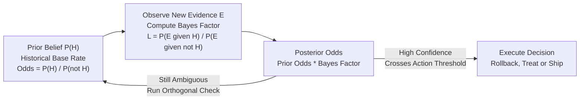
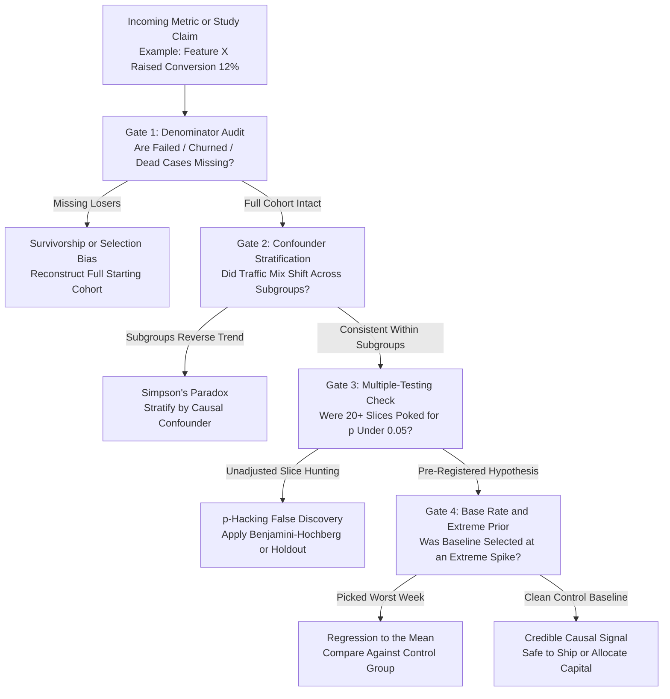

# Probability, Bayesian Thinking, Power Laws & Spotting Statistical Traps

> **Why Smart Engineers Still Get Fooled by Randomness**: Software engineers spend all day inside deterministic compilers where `2 + 2 == 4` every time, yet deploy systems and make career/capital bets inside a stochastic world governed by conditional probabilities, fat-tailed cascades, and selection biases. Human intuition evolved on the savanna for small-sample Gaussian averages—meaning your gut instinct systematically fails on **rare base rates**, **multiplicative compounding**, and **power-law extremes**.

---

## 1. Bayesian Thinking: Updating Beliefs Without Falling for Base-Rate Neglect

In university statistics, Bayes' Theorem is usually taught as an algebraic fraction you memorize for one midterm and immediately forget:

$$P(H \mid E) = \frac{P(E \mid H)\,P(H)}{P(E)} = \frac{P(E \mid H)\,P(H)}{P(E \mid H)\,P(H) + P(E \mid \neg H)\,P(\neg H)}$$

Where $H$ is your **Hypothesis** and $E$ is newly observed **Evidence**. The secret that professional diagnosticians, poker players, and Principal SREs use to compute Bayes in their heads in five seconds is **Bayes' Rule in Odds Form**:

$$\underbrace{\frac{P(H \mid E)}{P(\neg H \mid E)}}_{\text{Posterior Odds}} = \underbrace{\frac{P(H)}{P(\neg H)}}_{\text{Prior Odds}} \times \underbrace{\frac{P(E \mid H)}{P(E \mid \neg H)}}_{\text{Bayes Factor (Likelihood Ratio)}}$$

Read this equation as an operational state machine: **Never judge evidence in a vacuum. Start with how common the hypothesis is in the wild (Prior Odds), and multiply by how much more often that evidence appears when the hypothesis is true versus false (Bayes Factor).**



### Worked Case A: The 99%-Accurate Medical Screening Shock (Base-Rate Neglect)

Suppose you take a routine screening test for a serious condition that affects **$1$ in $1,000$** asymptomatic 32-year-olds ($P(H) = 0.001$):
- **Sensitivity** $P(+\text{test} \mid \text{sick}) = 99\%$ ($0.99$ true-positive rate).
- **Specificity** $P(-\text{test} \mid \text{healthy}) = 99\%$, meaning **false-positive rate** $P(+\text{test} \mid \text{healthy}) = 1\%$ ($0.01$).

Your test comes back **Positive**. Most people—and alarmingly, a majority of physicians in classic clinical studies—guess their probability of having the disease is *"around 99%, or at least 90%."* Let us run **Bayes Odds** in three lines of mental math (or picture $10,000$ people):

1. **Prior Odds**: $1 : 999$.
2. **Bayes Factor**: $\frac{P(+ \mid \text{sick})}{P(+ \mid \text{healthy})} = \frac{0.99}{0.01} = 99$.
3. **Posterior Odds**: $(1 : 999) \times 99 = 99 : 999 \approx 1 : 10.09 \implies P(\text{sick} \mid +) = \frac{99}{99 + 999} \approx \mathbf{9.02\%}$!

Why is a "99% accurate" test wrong **91% of the time** on a positive result? Because out of $10,000$ healthy-looking people, only **$10$ are genuinely sick** ($\approx 10$ true positives), while **$9,990$ are healthy**—and $1\%$ of $9,990$ generates **$\approx 100$ false positives**! The rare base rate ($1 : 999$) swamped a single $99\times$ test.

Now watch **sequential Bayesian updating**: you immediately take a *second, biochemically independent* test with the same $99\%$ sensitivity and $1\%$ false-positive rate, and it ALSO comes back positive. Your **new Prior Odds** are $99 : 999$; multiply by $99$ again $\implies 9801 : 999 \approx 9.81 : 1 \implies \mathbf{90.75\%}$! One noisy signal on a rare event is an alert; **two orthogonal signals** are a diagnosis.

### Worked Case B: Bayesian Production Incident Debugging

At 02:15 AM, checkout `502 Bad Gateway` errors spike. Two engineers react differently:
- **Junior Engineer (Likelihood-Only Thinking)**: *"Wait—could cosmic-ray memory corruption or a Linux kernel epoll bug cause 502s? Yes, $P(\text{502} \mid \text{kernel bug}) = 0.8$! Let me strace the kernel!"* They forgot **Base Rate**: $P(\text{kernel bug}) \approx 10^{-5}$, whereas $P(\text{recent config/deploy or DB pool exhaustion}) \approx 0.85$!
- **Staff SRE (Bayes-Factor Triage)**: Lists hypotheses ordered by `Prior * BlastRadius`, then picks the fastest command (`git log -1` / deploy timeline, RDS connection saturation metric) whose **Bayes Factor** cleanly crushes false branches toward zero in under 30 seconds.

> **Security & Anomaly Detection Corollary**: If your enterprise AI guardrail or fraud detector scans $10,000,000$ benign API calls per day where real attacks are $1$ in $100,000$ ($100$ real attacks/day), even a "world-class" $99.9\%$ specificity ($0.1\%$ false-positive rate) fires **$10,000$ false alarms every single day** ($99\%$ noise!), causing instant SOC/SRE alert fatigue unless chained through a multi-stage classifier.

---

## 2. Normal Bell Curves vs. Fat-Tailed Power Laws (Mediocristan vs. Extremistan)

Nassim Taleb divided quantitative reality into two mathematically incompatible provinces. Applying tools built for Province 1 inside Province 2 causes catastrophic engineering outages and financial wipeouts:

| Dimension | Mediocristan: Thin-Tailed (Gaussian / Normal) | Intermediate: Skewed Log-Normal | Extremistan: Fat-Tailed Power Law (Pareto) |
| :--- | :--- | :--- | :--- |
| **Generative Physics** | **Additive** sum of independent bounded variables ($X = \sum \epsilon_i$, Central Limit Theorem) | **Multiplicative** product of independent positive shocks ($\ln X$ is Normal) | **Preferential attachment / self-reinforcing cascades** ("rich get richer", queuing retry avalanches) |
| **Tail Decay Formula** | $P(X > x) \propto e^{-x^2 / (2\sigma^2)}$ (exponential cliff) | $P(X > x) \propto e^{-(\ln x - \mu)^2 / (2\sigma^2)}$ | $P(X > x) \propto x^{-\alpha}$ (polynomial decay; tail exponent $\alpha$) |
| **Impact of Largest Sample** | Negligible: heaviest human on Earth barely moves average weight of $10,000$ people | Moderate-to-heavy right skew | **Dominates total**: richest $1$ person in $10,000$ easily exceeds combined net worth of the other $9,999$! |
| **Sample Mean & $\sigma$ Stability** | Converges rapidly as $1/\sqrt{N}$; $6\sigma$ happens once in $5 \times 10^8$ draws | Finite moments, but arithmetic mean sits far above median | If $\alpha \le 2$, **theoretical variance $\sigma^2 = \infty$**; if $\alpha \le 1$, **even the theoretical mean $=\infty$**! |
| **Real Examples** | Human height, blood pressure, thermal ADC resistor noise, fair coin tosses | Normal microservice RPC latency, biological cell sizes, city populations | Cloud outage durations, multi-tenant LLM token spend, VC startup returns, open-source stars, market crashes |

### Three Direct Consequences for Software Architecture & Life

1. **Never Put `AVG(latency)` on an Executive Dashboard**: Suppose $990$ requests finish in $10\text{ ms}$ and $10$ requests hit a GC/lock stall of $4,000\text{ ms}$. The arithmetic mean is $49.9\text{ ms}$—looking completely healthy—while every multi-RPC page rendering 15 parallel microservice calls has probability $1 - 0.99^{15} \approx \mathbf{14\%}$ of hitting a 4-second freeze (**Tail Amplification**)! Always monitor `p50`, `p95`, `p99`, and `p99.9` using HDR Histograms / DDSketch.
2. **Isolate "Whale" Tenants from Shared Queues**: In B2B SaaS and AI gateways, tenant traffic follows a Pareto power law ($1\%$ of tenants often generate $50\%+$ of tokens or database writes). Putting all tenants into one FIFO queue lets a single power-law burst starve $99\%$ of normal customers—use **shuffle sharding**, per-tenant token-bucket rate limits, and weighted fair queuing.
3. **Why Retries Turn Thin Tails into Power-Law Outages**: If downstream service $B$ slows down slightly and $50$ upstream callers retry $3\times$ immediately without **exponential backoff + jitter + circuit breakers**, load multiplies $4\times$ precisely at $B$'s saturation point—creating multiplicative feedback that flips latency from log-normal into an unbounded power-law meltdown.

### Queueing Math: Little's Law & The $1 / (1 - \rho)$ Utilization Cliff

Why do microservices—and human Scrum teams—collapse when pushed from $70\%$ utilization to $95\%$ utilization? Two stochastic laws govern every queue in the universe (CPU runqueues, Postgres connection pools, LLM GPU batching, and Jira sprints):

1. **Little's Law ($L = \lambda W$)**: Average items in flight ($L$, concurrency) equals average arrival rate ($\lambda$, QPS) times average residency time ($W$, latency). Notably, this holds **regardless of probability distribution**! If an LLM gateway handles $\lambda = 200\text{ req/s}$ and each streaming response takes $W = 6\text{ s}$, you *must* hold $L = 200 \times 6 = 1,200$ concurrent open sockets/KV slots.
2. **Kingman's Formula (The $M/G/1$ Queueing Hockey Stick)**: When arrivals or service times have random variance ($c_a^2, c_s^2 > 0$) and server utilization is $\rho = \lambda / \mu \in [0, 1)$, expected queue wait time explodes hyperbolically as $\rho \to 1$:

$$\mathbb{E}[W_{\text{queue}}] \approx \left(\frac{\rho}{1 - \rho}\right) \left(\frac{c_a^2 + c_s^2}{2}\right) \tau_{\text{service}}$$

- At $\rho = 50\%$ utilization: $\frac{\rho}{1 - \rho} = \mathbf{1\times}$ base service time.
- At $\rho = 80\%$ utilization: $\frac{0.8}{0.2} = \mathbf{4\times}$ wait multiplier.
- At $\rho = 95\%$ utilization: $\frac{0.95}{0.05} = \mathbf{19\times}$ wait multiplier!
- At $\rho = 99\%$ utilization: $\frac{0.99}{0.01} = \mathbf{99\times}$ wait multiplier!

Because random bursts arrive before earlier bursts finish draining, **targeting 95% resource or calendar utilization does not mean "5% slack"—it mathematically guarantees $19\times$ queuing latency!** That is why Staff architects cap steady-state synchronous pool utilization around $60\%$ to $70\%$ and protect $20\%+$ slack in their own weekly engineering schedules.

---

## 3. Expected Value, Non-Ergodicity & The Kelly Criterion

In probability class, you learned to always pick the option with the highest **Expected Value**: $\mathbb{E}[X] = \sum p_i x_i$. **In sequential real life, blindly maximizing Expected Value can bankrupt you with 100% certainty.**

### The Ergodicity Trap: Ensemble Average $\neq$ Time Average

Compare two thought experiments:
- **Ensemble Average (Parallel Universes)**: $100$ strangers each play Russian Roulette *once* ($5/6$ chance to win USD 1,000,000; $1/6$ chance of death/ruin). Looking across the room afterward, approx. $83$ survivors walk away millionaires. Naive spreadsheet "Expected Monetary Value" looks huge.
- **Time Average (Your Single Sequential Life)**: *One* person plays that exact same game $100$ times in a row. Survival probability is $(5/6)^{100} \approx 1.2 \times 10^{-8}$ (**guaranteed ruin**).

Whenever a game is **multiplicative over time** and contains an **absorbing barrier** (zero capital, career reputation destruction, burnout health collapse, production data deletion), **time average diverges violently from ensemble average**—a property physicists call **non-ergodicity**.

### Volatility Drag: Why $+50\%$ Then $-50\%$ Loses $25\%$

Start with USD 100,000. Year 1 you gain $+50\%$ ($\to$ USD 150,000). Year 2 you lose $-50\%$ ($\to$ USD 75,000). Your **arithmetic average return** is $\frac{+50\% + (-50\%)}{2} = \mathbf{0\%}$, yet you lost **25% of your money**! For sequential returns with arithmetic mean $\mu$ and variance $\sigma^2$, Taylor expansion of $\mathbb{E}[\ln(1 + R)]$ reveals your true **compounding geometric growth rate** $g$:

$$g \approx \mu - \frac{\sigma^2}{2}$$

Notice the $-\frac{\sigma^2}{2}$ penalty (**volatility drag**): doubling risk $\sigma$ **quadruples** the drag eating your compounding wealth!

### The Kelly Criterion: Exact Bet Sizing to Maximize Compounding Without Ruin

In 1956 at Bell Labs, Claude Shannon's colleague **John Kelly Jr.** asked: *Suppose you have a genuine positive-EV edge—probability $p$ of winning $+b$ times your wager, and probability $q = 1 - p$ of losing $1\times$ your wager. What fraction $f \in [0, 1]$ of your bankroll should you risk per round to maximize long-run compounding wealth?*

After $N$ rounds with $W$ wins and $L$ losses, wealth is $V_N = V_0 (1 + bf)^W (1 - f)^L$. Maximizing expected log-growth $G(f) = p \ln(1 + bf) + q \ln(1 - f)$ by setting Calculus derivative $G'(f) = \frac{pb}{1 + bf} - \frac{q}{1 - f} = 0$ yields the famous **Kelly Formula**:

$$f^* = \frac{bp - q}{b} = p - \frac{q}{b}$$

#### Concrete Table: A Heavily Rigged Coin ($p = 0.60$ Win $+100\%$, $q = 0.40$ Lose $-100\%$, $b = 1$)

Here arithmetic EV per dollar bet is $+20\%$! Optimal Kelly fraction is $f^* = 0.60 - 0.40 = \mathbf{20\%}$ of bankroll per flip. Watch what happens to different bettors over $200$ flips of the *exact same favorable coin*:

| Strategy | Bet Fraction $f$ | Expected Log-Growth $G(f)$ per Flip | Median Bankroll Multiplier After $200$ Flips | Engineering & Capital Lesson |
| :--- | :---: | :---: | :---: | :--- |
| **Conservative (Half-Kelly)** | **$10\%$** | $+0.0150$ | **$\approx 20.3\times$** | **Sweet spot in real life**: captures $75\%$ of peak log-growth with $4\times$ smoother drawdowns! |
| **Full Kelly Optimal** | **$20\%$** | **$+0.0201$ (Peak)** | **$\approx 56.1\times$** | Theoretical maximum compounding, but endures gut-wrenching $50\%+$ temporary drawdowns |
| **Aggressive Over-Bet ($2\times$ Kelly)** | **$40\%$** | **$-0.0024$ (Negative!)** | **$\approx 0.61\times$ (Shrinking!)** | **Shocking**: Betting $2\times$ Kelly turns a $+20\%$ EV edge into a *money-losing* machine! |
| **YOLO "High Conviction"** | **$70\%$** | **$-0.1632$** | **$\approx 6.7 \times 10^{-15}\times$ (Total Ruin)** | Positive Expected Value + oversized position = **mathematical certainty of bankruptcy** |

> **The Half-Kelly Rule for Engineers & Founders**: In the real world (startups, equities, angel bets, architecture rewrites), you *never* know exact win probability $p$ to two decimal places—humans systematically overestimate $p$. Because the Kelly curve drops gently on the left of $f^*$ and plunges off a cliff into negative ruin on the right ($f > 2f^*$), professionals almost universally run **Quarter-Kelly to Half-Kelly** ($0.25 f^*$ to $0.5 f^*$). Never risk your survival runway on a single roll, no matter how high the pitch deck's Expected Value looks.

---

## 4. Field Guide to Statistical Paradoxes & Cognitive Traps

Before trusting any A/B test readout, benchmark paper, medical study, or startup advice blog, run it through this four-gate causal audit:



### 1. Survivorship Bias (The Invisible Graveyard)

During WWII, the US military wanted to armor bombers precisely where returning planes had the most bullet holes (wings and fuselage). Statistician **Abraham Wald** reversed their conclusion: *armor the engines and cockpit—where returning planes have ZERO bullet holes!* Planes hit in the engines never made it home to enter the dataset.
- **Software & Career Manifestation**: Reading *"10 Habits of Billion-Dollar Solo Founders: Why We Dropped Tests and Rewrote in Custom C"* ignores the $9,990$ startups that dropped tests, rewrote in custom C, and died silently in six months. Always ask: **What does the denominator of failed attempts using this exact strategy look like?**

### 2. Simpson's Paradox (When Aggregate Data Lies Backwards)

A trend that holds inside **every single subgroup** can **completely reverse sign** when the subgroups are combined! Suppose you benchmark **Search Engine v2** against **v1** on user click-through success:

| Traffic Segment | Engine v1 Success Rate | Engine v2 Success Rate | Segment Winner |
| :--- | :--- | :--- | :---: |
| **Easy Desktop Queries** | $810 / 900 = \mathbf{90.0\%}$ | $190 / 200 = \mathbf{95.0\%}$ | **v2 Wins ($+5.0\%$)** |
| **Hard Mobile Voice Queries** | $40 / 100 = \mathbf{40.0\%}$ | $360 / 800 = \mathbf{45.0\%}$ | **v2 Wins ($+5.0\%$)** |
| **Combined Global Dashboard** | $850 / 1000 = \mathbf{85.0\%}$ | $550 / 1000 = \mathbf{55.0\%}$ | **v1 Appears to Crush v2 ($+30\%$)!** |

How did **v2** beat **v1** by $+5\%$ on Desktop *and* beat **v1** by $+5\%$ on Mobile, yet look $30\%$ worse overall? Because a routing flag sent $80\%$ of **v2**'s traffic to the much harder Mobile segment, while $90\%$ of **v1**'s traffic enjoyed easy Desktop queries! Here `Platform Difficulty` is a **confounding variable**. Never aggregate conversion, latency, or mortality rates across heterogeneous tiers without stratifying by causal confounders.

### 3. Berkson's Paradox (Collider Selection Illusion)

In the general applicant pool, coding speed and architectural cleanliness are *positively* correlated. Yet inside your selective company, you might notice that the fastest-shipping engineers seem messier, while the cleanest architects ship slower! Why? Because your hiring bar filtered on `Speed + Cleanliness >= Threshold` (**conditioning on a collider**): anyone low on *both* was rejected, carving off the bottom-left triangle of the scatter plot and inducing an **artificial negative correlation** among hires. (The exact same collider math explains why "great-looking + kind" sometimes feels negatively correlated inside your dating pool!)

### 4. Regression to the Mean

Whenever an outcome combines `True Skill + Random Luck`, picking an extreme outlier guarantees the next measurement will drift back toward average:
- Latency spikes to an all-time bad peak on Tuesday due to three simultaneous rare noisy neighbors; Wednesday morning a manager mandates a daily status spreadsheet; Thursday latency returns to normal. Management declares the spreadsheet a triumph and keeps it forever—**pure cargo-cult superstition caused by regression to the mean**. Without an untreated control group, interventions triggered by extreme spikes always look magically effective.

### 5. Multiple Comparisons ($p$-Hacking) & Goodhart's Law

- **The $p < 0.05$ Slice-Hunting Trap**: A $p$-value is $P(\text{data this extreme} \mid \text{Null Hypothesis is true})$—**NOT** $P(\text{Null Hypothesis is true} \mid \text{data})$! If a feature does literally nothing, slicing your A/B test across $20$ user cohorts (`iOS + Chrome + Germany`, `Android + Dark Mode`, etc.) gives $1 - (1 - 0.05)^{20} = \mathbf{64.2\%}$ chance of finding at least one "statistically significant ($p < 0.05$)" winner by pure luck! Fix with a pre-registered primary metric or **Benjamini-Hochberg False Discovery Rate (FDR)**.
- **Goodhart's Law**: *"When a measure becomes a target, it ceases to be a good measure."* Rewarding PR count produces 1-line PR splits; rewarding line coverage produces assertion-free tests; training an LLM directly on a leaked static benchmark collapses real-world generalization. Pair every optimization metric with an orthogonal **guardrail metric** (e.g., optimize conversion *subject to* $p99$ latency and refund rate staying flat).

### Summary Reference Matrix: Spotting Statistical Illusions Under Pressure

| Statistical Trap | Mathematical Mechanism | Classic Engineering / Life Trap | Immediate Countermeasure |
| :--- | :--- | :--- | :--- |
| **Base-Rate Neglect** | Confusing $P(E \mid H)$ with $P(H \mid E)$ when prior $P(H) \ll 1$ | Panicking over a positive rare-disease test; noisy fraud/LLM security alerts | Compute **Bayes Odds**: $\text{Prior Odds} \times \text{Bayes Factor}$; require a 2nd orthogonal check |
| **Survivorship Bias** | Conditioning dataset on $S = 1$ (`survived == True`), erasing failed denominator | Copying reckless habits of YC unicorns or billionaire college dropouts | Reconstruct the **graveyard cohort** that used the identical playbook and went to zero |
| **Simpson's Paradox** | Unobserved confounder $Z$ shifts both group weights and baseline difficulty | New API v2 wins in both Mobile and Desktop yet looks slower in global average | **Stratify** metrics by causal confounders (device, region, tenant tier) before aggregating |
| **Berkson's Collider** | Filtering sample on $A + B \ge c$ induces fake negative correlation between $A$ and $B$ | Assuming fast shippers cannot write clean architecture inside a selective org | Recognize post-selection boundaries; evaluate unconditional population distributions |
| **Regression to Mean** | Selecting $X_t = \mu + \epsilon_t$ at extreme $\epsilon_t \gg 0$ guarantees $\mathbb{E}[X_{t+1}] < X_t$ | Crediting a new status meeting for fixing last Tuesday's freak outage spike | Compare against an **untreated control group** before institutionalizing emergency rituals |
| **$p$-Hacking & Goodhart** | $1 - (1 - \alpha)^m$ family-wise false-positive inflation; gaming proxy metrics | Slicing an A/B test 25 ways until one cohort hits $p < 0.05$; gaming PR counts | Pre-register 1 primary metric + Benjamini-Hochberg FDR + orthogonal guardrail metrics |

### Compact Python Lab: Simulating Kelly vs. Over-Betting & Bayesian Updating

```python
import random

def simulate_kelly(bet_fraction: float, flips: int = 200, trials: int = 5000) -> float:
    """Favorable coin: 60% win (+1x wager), 40% loss (-1x wager). Returns median wealth."""
    rng = random.Random(2027)
    ending_wealths = []
    for _ in range(trials):
        wealth = 1.0
        for _ in range(flips):
            if rng.random() < 0.60:
                wealth *= (1.0 + bet_fraction)
            else:
                wealth *= (1.0 - bet_fraction)
        ending_wealths.append(wealth)
    ending_wealths.sort()
    return ending_wealths[trials // 2]

for name, f in [("Half-Kelly (10%)", 0.10), ("Full Kelly (20%)", 0.20), ("2x Overbet (40%)", 0.40), ("YOLO (70%)", 0.70)]:
    print(f"{name:18s} -> Median 200-flip wealth multiplier: {simulate_kelly(f):.4f}x")
```

---

## 5. The Barbell Playbook: Applying Probabilistic Math to Engineering & Life

Combine all four modules of this curriculum into four permanent operating rules:

1. **Hunt Convex Asymmetry (Taleb's Barbell Strategy)**: Avoid "medium-risk, capped-upside, hidden-ruin" bets. Keep $85\%$ to $90\%$ of your capital, infrastructure, and career base ultra-conservative (proven Postgres, strong cash runway, reliable core income) so **ruin probability $= 0$**, and deploy $10\%$ to $15\%$ into **capped-downside, power-law-upside experiments** (shipping a B2B Micro-SaaS, publishing deep technical work, angel/equity optionality) where worst case loses a weekend and best case scales $100\times$.
2. **Think in Calibration & Brier Scores, Not Binary Predictions**: Instead of saying *"This migration will definitely finish Friday"* or *"That startup won't work"*, assign explicit probabilities ($70\%$, $15\%$) and score yourself with $\text{Brier} = \frac{1}{N}\sum (p_i - o_i)^2$. Calibrated engineers earn immense executive trust.
3. **Demand Base Rates & Stratified Controls Before Acting**: Whenever someone pitches a medical panic, an A/B slice win, or a viral architecture fad, ask three questions: *What is the prior base rate? What does the failed denominator look like? Could a traffic-mix confounder explain this aggregate number?*
4. **Size Every Bet Below Full Kelly**: Compounding only works if you stay in the game. Cutting volatility and eliminating single-point ruin barriers often grows long-term wealth, uptime, and career output faster than chasing higher raw expected returns.

---

### Curriculum Navigation

- **Previous**: [02-CALCULUS-OPTIMIZATION-AND-INFORMATION-THEORY.md](02-CALCULUS-OPTIMIZATION-AND-INFORMATION-THEORY.md) — Calculus, Optimization Landscapes & Shannon Information Theory
- **Earlier Module**: [01-LINEAR-ALGEBRA-VECTORS-AND-EMBEDDINGS.md](01-LINEAR-ALGEBRA-VECTORS-AND-EMBEDDINGS.md) — Vectors, Space Transformations, SVD & LLM Embeddings
- **Back to Overview**: [00-README.md](00-README.md) — Applied Mathematics Visual Intuition Map & Rosetta Stone
