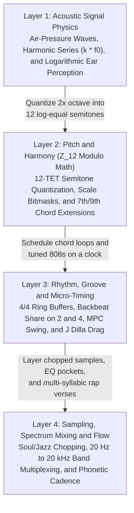
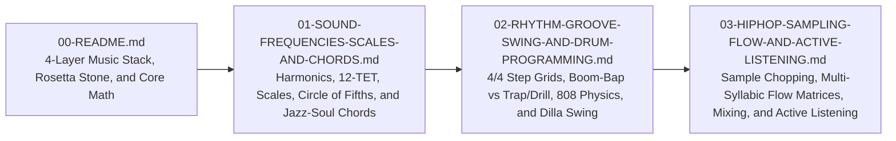

# Music Theory & Hip-Hop Science for Software Engineers

> **Target Profile**: Software, Systems, and AI Engineers starting from **zero formal music training** who want a rigorous, first-principles mental model of how pitch, scales, jazz-soul harmony, drum grooves, micro-timing swing, sampling, and rap cadence actually work under the hood.

---

## 1. Why Music Theory Feels Cryptic (And How Engineers Decode It in Hours)

Most software engineers bounce off traditional music lessons within two weeks—not because music is mathematically hard, but because **18th-century conservatory notation is a terrible API**.

Classical pedagogy forces beginners to memorize five-line staffs, treble vs. bass clefs, key-signature sharp/flat tables, Italian tempo adjectives (*allegro*, *adagio*), and **1-indexed interval names** where adding two "thirds" somehow equals a "fifth" ($3 + 3 = 5$), and "fourth" vs. "fifth" skips inconsistent numbers of physical piano keys depending on which white key you start on. To an engineer, that feels like learning x86 assembly through medieval Roman numerals before anyone tells you memory is just a linear byte array.

Strip away that historical serialization format, and **all modern music reduces to four clean, orthogonal engineering layers**:

1. **The Acoustic Signal Layer (Physics & Psychoacoustics)**: Musical sound is a sum of air-pressure sine waves $p(t) = \sum_k A_k \sin(2\pi k f_0 t + \phi_k)$. Human ears perceive both frequency and amplitude **logarithmically**—doubling frequency ($2\times f_0$) sounds like the "same note one octave higher," while simple integer frequency ratios ($3:2$, $5:4$) align upper harmonics without harsh amplitude beating on the inner ear's basilar membrane.
2. **The Pitch & Harmony Layer ($\mathbb{Z}_{12}$ Modular Arithmetic)**: Modern instruments quantize each $2\times$ frequency octave into **12 logarithmically equal semitone buckets** (`0` through `11`, modulo `12`). Every scale is simply a 5-element or 7-element index subset of $\mathbb{Z}_{12}$; every chord is a stacked offset vector whose internal semitone distances control **emotional tension vs. warmth**.
3. **The Rhythm & Groove Layer (Discrete Step Grids + Micro-Timing Jitter)**: A bar of `4/4` music at a given BPM is a **16-slot circular ring buffer** (`16th notes`). Genre identity comes from which slots trigger kicks, snares, and hi-hats; **human groove** comes from intentional sub-grid phase shifts ($\pm 8\text{ to }35\text{ ms}$)—delayed off-beats (*swing*) and laid-back snares (*pocket*) that trick the human motor cortex into physically nodding along.
4. **The Spectral Arrangement & Phonetic Flow Layer (Multiplexing & Prosody)**: Two headphone drivers (`L` and `R`) only offer $20\text{ Hz}\text{ to }20\text{ kHz}$ of bandwidth. Great production allocates non-overlapping frequency bands across 808 sub-bass, kick punch, Rhodes chords, vocal presence, and vinyl air, while elite MCs compile multi-syllabic vowel chains and percussive consonants directly onto the 16-slot drum grid.



---

## 2. The Rosetta Stone: Music Jargon Translated into Systems Engineering

Keep this lookup table nearby whenever producers, musicians, or DAW (Digital Audio Workstation) interfaces throw studio terminology at you:

| Musical Term | Exact Math / CS Equivalent | Physical & Emotional Effect on the Listener |
| :--- | :--- | :--- |
| **Pitch ($f_0$)** | Fundamental oscillation frequency in $\text{Hz}$ (cycles/sec) | Perceived "highness" or "lowness" of a note (`A4 = 440 Hz`) |
| **Octave** | Frequency bit-shift left/right ($2\times f$ or $0.5\times f$; $+12$ semitones) | Sounds like the **exact same note identity** in a higher or deeper register |
| **Semitone (Half-Step)** | Minimum discrete grid unit in 12-TET: $f \times 2^{1/12}$ ($\approx +5.946\%$) | Adjacent keys on a piano (white-to-black or `E->F`, `B->C`) or 1 guitar fret |
| **Cent** | $1/100\text{th}$ of a semitone ($f \times 2^{1/1200}$); fine-tuning float offset | Sub-pixel pitch resolution; humans notice detuning around $\pm 8\text{ to }15\text{ cents}$ |
| **Pitch Class ($\mathbb{Z}_{12}$)** | `midi_note % 12` $\in \{0, 1, \dots, 11\}$ (`C=0, C#=1 ... B=11`) | Collapses all octaves into 12 canonical note classes |
| **Scale / Key** | A 5- or 7-element index array anchored at a root offset `r` | Defines the "in-bounds palette" of notes that sound cohesive together |
| **Interval** | Unsigned/signed modular delta `(n2 - n1) % 12` between two notes | Controls consonance (`+7` smooth fifth) vs. sharp friction (`+1` or `+6` tritone) |
| **Triad vs. 7th/9th Chord** | 3-element vector `[0, 4, 7]` vs. 4/5-element vector `[0, 3, 7, 10, 14]` | Triads sound primary-colored (pop/rock); 7ths/9ths sound lush, warm, nostalgic (jazz/hip-hop) |
| **`ii - V - I` Progression** | State-machine transition sequence (`Dm9 -> G13 -> Cmaj9`) | Builds gentle yearning -> unstable tritone pull -> warm home-base resolution |
| **BPM & `4/4` Bar** | Clock frequency (Beats/Min) & 4-beat frame (`16` sixteenth-note ticks) | Establishes predictable temporal framing so the brain can anticipate drops |
| **Backbeat (`2` & `4`)** | Snare/clap interrupt firing on ticks `4` and `12` of a `0..15` bar | Creates kinetic neck-snap and forward bounce (foundation of funk, R&B, hip-hop) |
| **Swing & Pocket** | Systematic phase-delay $\Delta t$ (in $\text{ms}$) applied off the rigid clock | Transforms sterile machine ticks into a human, head-nodding groove |
| **Timbre / Overtones** | Fourier magnitude envelope $\{A_1, A_2, A_3 \dots\}$ + attack transient | Why a dusty Rhodes piano, brass horn, and synth playing `440 Hz` feel distinct |
| **808 Sub-Bass** | Pitch-enveloped low sine wave ($35\text{ to }65\text{ Hz}$) + harmonic saturation | Delivers visceral chest pressure on club subs while remaining audible on phone speakers |
| **Rap Flow / Cadence** | Syllable onset bitmap + vowel phoneme matrix mapped onto `0..15` ticks | Turns spoken language into a syncopated percussive lead instrument |

---

## 3. Why Hip-Hop Is the Ultimate Laboratory for Applied Music Science

If you want to understand modern music production deeply, **hip-hop is the highest-signal genre on earth to study**. Classical symphonies hide structure across 80 orchestral instruments and continuous tempo changes; pop songs often mask simple 4-chord loops behind glossy vocal stacks. Hip-hop exposes the raw machinery in crystal clarity because it was engineered by **producers treating recorded music history as an open-source DSP library**.

Starting in the Bronx in 1973 (DJ Kool Herc isolating drum "breaks" across twin turntables) and evolving through the 1980s–2020s via hardware samplers and drum machines (E-mu SP-1200, Akai MPC60/MPC3000, Roland TR-808), hip-hop distilled **four distinct pillars of acoustic brilliance**:

1. **Borrowed Jazz & Soul Extended Harmony**: Because Golden-Era and Neo-Soul producers sampled 1960s–1970s Blue Note jazz, Motown, Stax, Curtis Mayfield, Roy Ayers, and Bill Evans records, hip-hop inherited sophisticated **minor 9th (`m9`), major 9th (`Maj9`), dominant 13th (`13`), and altered turnaround chords** that mainstream 3-chord pop/rock had abandoned. One 4-bar Rhodes loop on a Nujabes, J Dilla, Kanye West, or Kendrick Lamar record often packs more harmonic color than an entire top-40 album.
2. **Hyper-Focused Rhythmic Architecture**: Strip a track down to Kick, Snare, Hi-Hat, and Bass, and every millisecond matters. Hip-hop pioneered two revolutionary rhythmic paradigms:
   - **Unquantized Micro-Timing ("Dilla Time")**: Proving that intentionally decoupling kick, snare, and hi-hat by $10\text{ to }30\text{ ms}$ off a quantized grid creates deeper physical groove than mathematical perfection.
   - **Half-Time Trap & Drill Subdivision**: Running the project clock at `140 BPM` so the snare hits at a slow, heavy `70 BPM` half-time stride while hi-hats subdivide into `1/16T` triplets, `1/32` rolls, and `3+3+2` tresillo bounces.
3. **Psychoacoustic Low-End Engineering**: Hip-hop pushed sub-bass ($30\text{ to }65\text{ Hz}$) to the limits of vinyl grooves, car subwoofers, and smartphone transducers—forcing mix engineers to master phase alignment, sidechain compression, and missing-fundamental harmonic saturation.
4. **Algorithmic Phonetics & Prosody**: From Rakim and Nas to MF DOOM, André 3000, Eminem, and Kendrick Lamar, hip-hop turned English phonetics into high-density vowel-matching matrices, polyrhythmic syllable groupings, and cross-bar enjambment.

---

## 4. Core Equations & Reference Constants to Keep in RAM

Every quantitative rule across this vault derives from four compact physical formulas:

### 4.1 Pitch Frequency & 12-Tone Equal Temperament (MIDI Mapping)

Concert pitch anchors **`A4` (MIDI note `69`) at exactly $440\text{ Hz}$**. Every semitone step multiplies frequency by $\sqrt[12]{2} \approx 1.059463$:

$$f(m) = 440 \times 2^{\frac{m - 69}{12}} \text{ Hz}, \qquad m = 69 + 12 \log_2\left(\frac{f}{440}\right)$$

- **Middle C (`C4`, MIDI `60`)**: $440 \times 2^{-9/12} \approx 261.63\text{ Hz}$.
- **Club 808 Sub Root (`F1`, MIDI `29`)**: $440 \times 2^{-40/12} \approx 43.65\text{ Hz}$ (right in the sweet spot of chest resonance!).
- **Cent Deviation** between any two frequencies $f_1$ and $f_2$:
  $$\Delta c = 1200 \log_2\left(\frac{f_2}{f_1}\right) \text{ cents}$$

### 4.2 Tempo (BPM) to Millisecond Grid Resolution

Given tempo $B$ in Beats Per Minute (where 1 beat = 1 quarter note in `4/4`):

$$T_{\text{beat}} = \frac{60,000}{B}\text{ ms}, \qquad T_{1/16} = \frac{15,000}{B}\text{ ms}, \qquad T_{1/16\text{T}} = \frac{10,000}{B}\text{ ms}$$

- **Haas Fusion Threshold ($\approx 1\text{ to }30\text{ ms}$)**: Two sounds arriving within $30\text{ ms}$ fuse into a **single wider/thicker perceptual event** rather than two separate echoes. That is the exact window (`8 to 28 ms`) where micro-timing pocket and snare layering operate!
- **Audible Echo / Flam Boundary ($> 35\text{ to }50\text{ ms}$)**: Beyond roughly $35\text{ ms}$, the human ear begins resolving two distinct attacks (a rhythmic *flam* or slapback delay).

### 4.3 Acoustic Wavelength & Why Sub-Bass Travels Through Walls

With speed of sound in room-temperature air $v \approx 343\text{ m/s}$:

$$\lambda = \frac{v}{f} = \frac{343}{f}\text{ meters}$$

- At **`50 Hz` (808 sub-bass)**: $\lambda = \frac{343}{50} = 6.86\text{ meters}$ ($22.5\text{ feet}$)! Drywall and apartment doors are thin fractions of a wavelength, so `50 Hz` diffracts right around obstacles and passes through walls effortlessly.
- At **`10,000 Hz` (hi-hat sizzle)**: $\lambda = 3.43\text{ centimeters}$! High frequencies behave almost like directional light beams—easily absorbed by curtains, couches, or turning a speaker $30^\circ$ off-axis.

### 4.4 Decibels ($\text{dB}$) — Power vs. Amplitude Ratios

In digital audio (`dBFS`, where `0.0 dBFS` is the maximum sample clipping ceiling before integer/float clamping) and sound pressure (`dB SPL`):

$$\Delta L_{\text{dB}} = 20 \log_{10}\left(\frac{A_2}{A_1}\right)$$

- **`-6.02 dB`**: Amplitude cut in half ($0.5\times$ signal voltage/float amplitude).
- **`+3 dB`**: Roughly double acoustic energy; **`+10 dB`** is perceived by human ears as **approximately $2\times$ louder**!

---

## 5. How Five Hardware Machines Shaped the Sound of Hip-Hop & Modern Music

In software engineering, hardware constraints define idiomatic architecture—just as 64 KB RAM shaped early game engines and GPU tensor cores shaped Transformer architectures. Practically every sonic signature you love in hip-hop, R&B, neo-soul, and electronic music emerged directly from **the physical limitations and happy accidents of five iconic instruments**:

| Iconic Machine (Year) | Original Engineering Spec & Constraint | Intended Market Use | How Hip-Hop & Soul Engineers Hacked It |
| :--- | :--- | :--- | :--- |
| **Technics SL-1200 Direct-Drive Turntable (`1972`)** | High-torque brushless DC motor reaching `33.3 RPM` in `0.7 s` with $\pm 8\%$ analog quartz pitch slider | Hi-fi audiophile living-room playback without belt wobble | DJ Kool Herc, Grandmaster Flash, and Grand Wizard Theodore back-cued two copies of funk records to loop 4-bar drum "breaks" infinitely and invented **scratching** as percussive phase-scrubbing |
| **Roland TR-808 Rhythm Composer (`1980`)** | Pure analog bridged-T transistor oscillators (no digital drum recordings); commercial flop at launch because it sounded "fake" | Cheap backing-band accompaniment for lounge organists & demo songwriters | Afrika Bambaataa (*Planet Rock*), Rick Rubin, OutKast, Three 6 Mafia, Kanye West (*808s & Heartbreak*), and Metro Boomin turned its decaying `45 Hz` sine kick into the **defining sub-bass instrument of the 21st century** |
| **Fender Rhodes Mark I Electric Piano (`1969`)** | Felt hammers striking tuned metal tines (*asymmetric tuning forks*) over electromagnetic pickups | Portable, road-durable piano substitute for touring jazz/rock players | Its bell-like attack transient followed by warm, low-overtone sine sustain prevents harmonic mud when stacking dense 5-note `m9` and `Maj9` chords—the signature keyboard sound of Herbie Hancock, Stevie Wonder, The Roots, J Dilla, and Nujabes |
| **E-mu SP-1200 Sampling Drum Machine (`1987`)** | Only **`10.0 seconds`** total sample RAM across 4 banks at **`12-bit`, `26.04 kHz`** (`13.02 kHz` Nyquist limit) | Studio drum-hit replacement trigger | To save precious RAM, Pete Rock, Marley Marl, and RZA recorded 45 RPM or 33 RPM vinyl sped up to `+8` on the turntable, then pitched it *down* inside the SP-1200—injecting crunchy aliasing harmonics and gritty 90s East Coast warmth |
| **Akai MPC60 / MPC3000 (`1988` / `1994`)** | Designed by Roger Linn with 16 velocity-sensitive rubber pads, **`96 PPQN`** (Pulses Per Quarter Note) timing resolution, and proprietary swing curves | Precision MIDI sequencer for studio pop producers | DJ Premier, Q-Tip, and J Dilla used the 4x4 pad matrix as a tactile instrument—slicing jazz records into 16 rhythmic fragments and disabling quantization to invent modern humanized groove |

### Why Knowing These Constraints Sharpens Your Ear Today

Even though modern producers work inside 64-bit floating-point DAWs (Ableton Live, FL Studio, Logic Pro) with terabytes of NVMe storage, **almost every modern plugin and production technique emulates those five hardware behaviors**:

- Lo-fi bitcrusher and sample-rate reducer plugins mathematically recreate the `26.04 kHz` Nyquist foldback of the SP-1200.
- Ableton Groove Pools and FL Studio's Swing slider directly model Roger Linn's MPC `96 PPQN` timing shifts.
- Choke groups (`Cut Self` in FL Studio; `Choke Group 1` in Ableton Drum Rack) replicate single-voice monophonic mute channels on vintage samplers so consecutive sample chops never bleed into muddy chord collisions.
- Soft-clippers and tape saturators on modern Trap 808s replicate pushing analog mixing-desk preamps into smooth odd/even harmonic clipping.

---

## 6. Curriculum Architecture & Recommended Study Order

Work through the three core modules sequentially. Each module builds directly on the mental models and notation introduced in the previous one:



### Complete Vault Table of Contents

1. **[00-README.md](00-README.md) — Music Theory & Hip-Hop Science for Software Engineers** *(Current Document)*
   - Why traditional notation obscures simple modular math; the 4-layer acoustic/harmonic/rhythmic/spectral stack; the Music-to-CS Rosetta Stone; core pitch/BPM/wavelength/dB equations; and zero-hardware sandbox setup.
2. **[01-SOUND-FREQUENCIES-SCALES-AND-CHORDS.md](01-SOUND-FREQUENCIES-SCALES-AND-CHORDS.md) — Sound Physics, 12-Tone Scales & Jazz-Soul Harmony**
   - Standing waves, Fourier overtones, and why major/7th chords exist inside a single vibrating string; why $2^{7/12} \approx 3/2$ yielded 12 notes per octave; Major, Natural Minor, Dorian, Phrygian, and Blues Pentatonic scales as $\mathbb{Z}_{12}$ bitmasks; the Circle of Fifths as a cyclic group generator ($\gcd(7,12)=1$); and why `m9`, `Maj9`, rootless voice leading, and `ii-V-I` progressions give hip-hop and neo-soul their unmistakable warmth.
3. **[02-RHYTHM-GROOVE-SWING-AND-DRUM-PROGRAMMING.md](02-RHYTHM-GROOVE-SWING-AND-DRUM-PROGRAMMING.md) — Rhythm Engineering, Groove, Swing & Drum Programming**
   - `4/4` bars, BPM timing math, and the `1 e & a` 16-slot ring buffer; why the backbeat snare on `2` & `4` drives modern music; bit-exact step-sequencer blueprints for 90s Boom-Bap, Half-Time Atlanta Trap (with triplet hi-hat rolls), and UK/NY Drill (`3+3+2` tresillo + sliding 808s); Roland TR-808 sub-bass physics and missing-fundamental saturation; and MPC swing math vs. J Dilla / D'Angelo unquantized micro-timing ("drunk drums").
4. **[03-HIPHOP-SAMPLING-FLOW-AND-ACTIVE-LISTENING.md](03-HIPHOP-SAMPLING-FLOW-AND-ACTIVE-LISTENING.md) — Hip-Hop Sampling, Flow Cadence & Active Listening**
   - Crate-digging and sample-flip DSP ($f' = \alpha f$ pitch/tempo coupling, SP-1200 12-bit aliasing grit, choke groups, high-pass bass replacement); producer style case studies (DJ Premier, Kanye West, J Dilla, Nujabes, The Alchemist, Metro Boomin); rap flow decoded via phonetic IPA vowel matrices, syncopated 16th-note syllable grids, and cross-bar enjambment (Nas, MF DOOM, Kendrick Lamar, André 3000); 3D frequency-spectrum mixing; and a 4-pass headphone dissection protocol with a 10-track listening lab.

---

## 7. Zero-Cost Interactive Sandbox: Hear Every Equation in 15 Minutes

Reading about music without hearing it is like reading SQL query plans without ever running a database. You do **not** need a USD 2,000 studio or MIDI keyboard to train your ears—set up a frictionless browser/laptop audio loop while reading Modules `01` through `03`:

| Tool / Environment | Cost | Best Used For While Reading This Vault |
| :--- | :---: | :--- |
| **Good Headphones (Wired Closed/Open-Back or AirPods Pro)** | Owned | Hearing `40 to 65 Hz` 808 sub-bass fundamentals, stereo `L/R` panning, and `15 ms` hi-hat/snare offsets that laptop speakers smear or drop |
| **Ableton "Learning Music" & "Learning Synths" (Web)** | Free (Browser) | Interactive browser step-sequencers, piano-roll chord builders, and filter/envelope playgrounds with zero install |
| **Strudel REPL (`strudel.cc` — Live-Coding TidalCycles in JS)** | Free (Browser) | Writing drum grids, `ii-V-I` jazz chords, MPC swing, and sample chops as **live functional JavaScript one-liners** right in a browser tab |
| **Koala Sampler (iOS / Android / Desktop)** | USD 5 to 15 | Pocket SP-404/MPC-style pad sampler—record any 4-second clip, slice into 16 choke-grouped pads, pitch `-3` or `+5` semitones, and tap unquantized beats |
| **Python (`numpy` + `scipy` / `soundfile`)** | Free (Local) | Generating exact pure vs. 12-TET chords, visualizing spectrograms, and testing millisecond snare shifts mathematically |

### Quick-Start Strudel Code Snippet (Paste into `strudel.cc` and Hit Play)

Even before opening Module `01`, you can hear how 6 lines of declarative code assemble a `92 BPM` jazz-hop loop—a `Dm9 -> G13 -> Cmaj9 -> A7b13` Rhodes progression over a swung Boom-Bap drum pattern:

```javascript
// Paste at https://strudel.cc and press Ctrl+Enter:
setcps(92 / 60 / 4) // 92 BPM in 4-beat bars

stack(
  // 1. Swung Boom-Bap Drums (Kick on 1 & 3-and, Snare backbeat on 2 & 4)
  s("bd ~ ~ bd:1 sd ~ ~ ~ bd ~ bd ~ sd ~ [~ bd:1] ~").bank("RolandTR909").swing(2),
  s("hh*8").gain("0.7 0.35 0.65 0.35 0.75 0.35 0.65 0.4").swing(2),

  // 2. Warm ii9 -> V13 -> Imaj9 -> VI7alt Jazz-Soul Rhodes Loop
  note("<[d3,f4,a4,c5,e5] [g2,f4,a4,b4,e5] [c3,e4,g4,b4,d5] [a2,g4,bb4,c#5,f5]>")
    .s("gm_epiano1")
    .room(0.35)
    .lpf(2800)
    .gain(0.55)
)
```

### The 4-Week Engineer's Ear Calibration Plan

1. **Week 1 — Pitch & Chord Color ([01-SOUND-FREQUENCIES-SCALES-AND-CHORDS.md](01-SOUND-FREQUENCIES-SCALES-AND-CHORDS.md))**: Play a plain Major triad `[0, 4, 7]` vs. Major 7th `[0, 4, 7, 11]` vs. Minor 9th `[0, 3, 7, 10, 14]`. Train yourself to instantly recognize the "nostalgic neo-soul shimmer" of a `m9` / `Maj9` chord in wild tracks.
2. **Week 2 — Drum Grid & Pocket ([02-RHYTHM-GROOVE-SWING-AND-DRUM-PROGRAMMING.md](02-RHYTHM-GROOVE-SWING-AND-DRUM-PROGRAMMING.md))**: Program a 1-bar Boom-Bap loop and a 2-bar `140 BPM` Trap loop. Sweep swing from `50%` to `66%`, then manually delay only the snare by `+20 ms` to feel the exact physical click of a laid-back pocket.
3. **Week 3 — Sample Flipping & Bassline Ear ([03-HIPHOP-SAMPLING-FLOW-AND-ACTIVE-LISTENING.md](03-HIPHOP-SAMPLING-FLOW-AND-ACTIVE-LISTENING.md))**: Take any 4-bar 1970s soul intro, slice it on quarter notes (`4` or `8` chops), high-pass filter below `150 Hz`, and tap a custom chop order over your Week 2 drums.
4. **Week 4 — Active Headphone Dissection ([03-HIPHOP-SAMPLING-FLOW-AND-ACTIVE-LISTENING.md](03-HIPHOP-SAMPLING-FLOW-AND-ACTIVE-LISTENING.md))**: Run the 4-Pass Active Listening Protocol across the 10 reference tracks. You will never hear music as a flat wall of sound again—every song splits cleanly into an interactive 3D architecture of rhythms, frequencies, and pockets.

---

## 8. Five Cognitive Anti-Patterns Engineers Should Drop Immediately

When technically minded adults study music or production, they consistently fall into five predictable traps:

1. **Memorizing Sight-Reading Staff Notation Before Hearing Intervals**: Standard sheet music was designed in medieval Europe for diatonic C-major vocal choirs—it treats sharps and flats as second-class "accidentals" even though all 12 semitones in 12-TET are physically symmetric. Learn **piano-roll / MIDI semitone grids (`0..11`) and scale-degree numbers (`1, 2, b3, 4, 5, b6, b7`)** first; staff notation is optional unless you play in a symphony orchestra.
2. **Confusing Complexity with Emotional Impact**: Stacking 14 synth layers and 11th-chord modulations every beat creates cognitive soup. Almost every timeless hip-hop, soul, or R&B classic (*Shook Ones Pt. II*, *Still D.R.E.*, *Don't Cry*, *Alright*) relies on **3 to 5 surgical elements**—each owning an undisputed pocket in both time and frequency.
3. **Treating Quantization (`0 ms` Error) as "Correct" Timing**: In distributed systems, clock skew is a bug; in acoustic groove, **coupled micro-timing skew is the entire feature**. If a drum loop you program feels stiff or amateurish, the fix is almost never another plugin—it is velocity dynamics (`ghost notes`) and shifting your hi-hats and snare `10 to 25 ms` off the robotic grid.
4. **Judging Low-End on Laptop Speakers**: MacBook speakers do impressive DSP psychoacoustics above `120 Hz`, but physical `38 to 60 Hz` sub-bass pressure does not exist without headphone drivers or a subwoofer. Always check bass pitch and kick-808 headroom on headphones.
5. **Listening Passively to Lyrics Without Hearing Phonetics as Drums**: Great rap is not poetry pasted over an MP3 backing track. Listen to the **stressed vowel formants as horn riffs** and **consonant plosives as snare/hi-hat hits**—once that clicks, artists like Nas, MF DOOM, André 3000, and Kendrick Lamar reveal deep rhythmic structures hiding in plain sight.

---

## 9. Quick-Reference Diagnostic Matrix: "Why Does Track X Feel Like That?"

Whenever a song gives you chills or makes your neck snap involuntarily, trace the sensation directly back to its underlying acoustic or mathematical cause:

| Listener Sensation ("Vibe") | Underlying Physical / Mathematical Mechanism | Where It Is Explained in Depth |
| :--- | :--- | :--- |
| **"Warm, nostalgic, golden-hour soul"** | Simultaneous Major + Minor internal triads inside `m9` & `Maj9` chords (`[0,3,7,10,14]`) + smooth `1-semitone` voice leading + rolled-off highs above `6 kHz` | [01-SOUND-FREQUENCIES-SCALES-AND-CHORDS.md](01-SOUND-FREQUENCIES-SCALES-AND-CHORDS.md) |
| **"Dark, menacing, cinematic tension"** | Half-step (`1-semitone`) Phrygian rub (`0 <-> 1`) or unresolved tritone (`+6` semitones) + pitched-down sample formants ($\alpha < 1$) | [01-SOUND-FREQUENCIES-SCALES-AND-CHORDS.md](01-SOUND-FREQUENCIES-SCALES-AND-CHORDS.md) |
| **"Irresistible, lazy head-nod bounce"** | Unquantized micro-timing: snare dragged `+18 to +30 ms` behind Beats `2` & `4` against `58%-62%` swung kicks and ghost notes | [02-RHYTHM-GROOVE-SWING-AND-DRUM-PROGRAMMING.md](02-RHYTHM-GROOVE-SWING-AND-DRUM-PROGRAMMING.md) |
| **"Explosive modern club energy"** | Half-time `140 BPM` Beat-3 clap + `42-50 Hz` monophonic 808 with `35 ms` pitch-drop knock + `1/16T` triplet hi-hat rolls | [02-RHYTHM-GROOVE-SWING-AND-DRUM-PROGRAMMING.md](02-RHYTHM-GROOVE-SWING-AND-DRUM-PROGRAMMING.md) |
| **"Hypnotic, effortless rap authority"** | `4-to-6`-syllable internal vowel assonance chains spilling across Beat `4` (*bar-line enjambment*) + `+15 ms` laid-back vocal pocket | [03-HIPHOP-SAMPLING-FLOW-AND-ACTIVE-LISTENING.md](03-HIPHOP-SAMPLING-FLOW-AND-ACTIVE-LISTENING.md) |
| **"Crystal-clear, 3D headphone immersion"** | Strict Mono sub-bass (`<120 Hz`), `-2.5 dB` dynamic EQ pocket at `2.5 kHz` for lead vocal clarity, and wide stereo panning (`25%-80% L/R`) on chords & ad-libs | [03-HIPHOP-SAMPLING-FLOW-AND-ACTIVE-LISTENING.md](03-HIPHOP-SAMPLING-FLOW-AND-ACTIVE-LISTENING.md) |

### Ready to Begin?

Open **[01-SOUND-FREQUENCIES-SCALES-AND-CHORDS.md](01-SOUND-FREQUENCIES-SCALES-AND-CHORDS.md)** to start from a single vibrating string at `65.41 Hz` and build all of 12-tone harmony and jazz-soul chord voicings from scratch.

