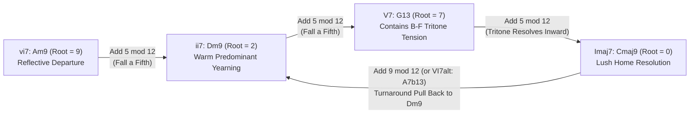
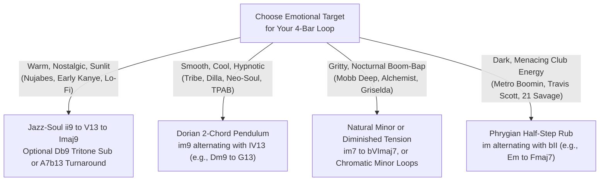

# Sound Physics, 12-Tone Scales & Jazz-Soul Harmony

> **Module Goal**: Derive Western and modern hip-hop harmony from physical wave mechanics and $\mathbb{Z}_{12}$ modular arithmetic—moving from air-pressure sine waves and the harmonic overtone series to 12-Tone Equal Temperament ($f_n = 440 \times 2^{n/12}$), scale bitmasks, the Circle of Fifths, and the lush 7th/9th `ii-V-I` chord voicings that give jazz-rap, R&B, and neo-soul their warmth.

---

## 1. Physics of Sound, Overtones & Why Chords Live Inside a Single String

When a speaker cone, vocal cord, or guitar string vibrates, it compresses and rarefies surrounding air molecules into longitudinal pressure waves propagating at $v \approx 343\text{ m/s}$ ($20^\circ\text{C}$). A pure tone—like an unclipped digital sine oscillator—follows:

$$p(t) = A \sin(2\pi f_0 t + \phi)$$

- **Frequency $f_0$ ($\text{Hz}$)**: Cycles per second. The healthy human cochlea resolves **$20\text{ Hz}$ to $20,000\text{ Hz}$**, perceiving frequency **logarithmically** (from `55 Hz` to `110 Hz` sounds like the exact same pitch jump as `440 Hz` to `880 Hz`).
- **Amplitude $A$**: Peak pressure deviation, perceived logarithmically as **loudness**.
- **Harmonic Spectrum $\{A_k\}$ (Timbre)**: Real physical instruments never emit a lone sine wave. Clamped at both ends (length $L$), a vibrating string or air column supports standing waves at **every integer multiple** of its fundamental frequency $f_0$:

$$p_{\text{instrument}}(t) = \sum_{k=1}^{\infty} A_k \sin(2\pi (k f_0) t + \phi_k), \qquad f_k = k \cdot f_0$$

### The Harmonic Overtone Series: Nature's Built-In Chord

Strike a low **`C2`** string ($f_0 = 65.41\text{ Hz}$) on an acoustic piano or Fender Rhodes and run an FFT (Fast Fourier Transform) on the recording. Before anyone invents "music theory," physics automatically generates the following frequencies simultaneously:

| Harmonic $k$ | Exact Frequency ($k \cdot f_0$) | Ratio to Nearest Lower Octave | Closest Note Name | Interval Above Root | Musical Significance |
| :---: | :---: | :---: | :---: | :--- | :--- |
| **$k = 1$** | $65.41\text{ Hz}$ | $1 : 1$ ($1.000$) | `C2` | Fundamental (Root) | Anchors the perceived pitch identity of the note |
| **$k = 2$** | $130.81\text{ Hz}$ | $2 : 1$ ($2.000$) | `C3` | Octave | Perfect waveform alignment every 2 cycles; sounds like the "same note" |
| **$k = 3$** | $196.22\text{ Hz}$ | $3 : 2$ ($1.500$) | `G3` (`+2 cents`) | **Perfect Fifth** | Strongest non-octave harmonic; rock-solid structural stability |
| **$k = 4$** | $261.63\text{ Hz}$ | $4 : 2 = 2 : 1$ | `C4` | 2 Octaves | Reinforces the root `C` two octaves up |
| **$k = 5$** | $327.03\text{ Hz}$ | $5 : 4$ ($1.250$) | `E4` (`-14 cents`) | **Major Third** | Injects bright, warm major tonality (`C - E - G` = $4 : 5 : 6$!) |
| **$k = 6$** | $392.44\text{ Hz}$ | $6 : 4 = 3 : 2$ | `G4` | 2 Octaves + Fifth | Doubles the fifth cleanly |
| **$k = 7$** | $457.84\text{ Hz}$ | $7 : 4$ ($1.750$) | `Bb4` (`-31 cents`) | **Harmonic Minor 7th** | Adds bluesy dominant-7th soul (`C - E - G - Bb` = $4 : 5 : 6 : 7$!) |
| **$k = 8$** | $523.25\text{ Hz}$ | $8 : 4 = 2 : 1$ | `C5` | 3 Octaves | High octave shimmer |
| **$k = 9$** | $588.66\text{ Hz}$ | $9 : 8$ ($1.125$) | `D5` | **Major Ninth (2nd)** | Births the lush **9th extension** prized in jazz and hip-hop |

> **First-Principles Insight**: Look at harmonics $k = 4, 5, 6$ (`C - E - G`): **a Major Triad is literally the 4th, 5th, and 6th harmonics of a single vibrating string**. Add $k = 7$ and $k = 9$, and you get a Dominant 9th chord (`C9`). Chords feel natural to human brains because playing those notes together reconstructs the coherent harmonic fingerprint of a single resonant physical object!

### Consonance vs. Dissonance as Cochlear Signal Interference

Why do two notes at a $3:2$ ratio (`C` + `G`) sound smooth and resolved (**consonant**), while two adjacent piano keys like `C` + `C#` ($16:15$ ratio) sound tense and abrasive (**dissonant**)?

By trigonometric identity, summing two nearby frequencies $f_1$ and $f_2$ produces a carrier wave at their average frequency modulated by an **amplitude-beating envelope** at $f_{\text{beat}} = \lvert f_2 - f_1 \rvert$:

$$\sin(2\pi f_1 t) + \sin(2\pi f_2 t) = 2 \cos\left(2\pi \frac{f_2 - f_1}{2} t\right) \sin\left(2\pi \frac{f_1 + f_2}{2} t\right)$$

Inside the inner ear, the basilar membrane acts as a physical bank of overlapping bandpass filters (**critical bands**, roughly $15\%\text{ to }20\%$ of center frequency wide).
- When two notes share a **low-integer ratio** ($2:1$, $3:2$, $4:3$, $5:4$), their lower harmonics either **coincide exactly** or sit wide enough apart to land in separate critical bands—zero harsh amplitude roughness.
- When two notes form a **high-integer or irrational ratio** (such as a minor 2nd `1 semitone` or a tritone `6 semitones`), both fundamentals or their dense upper harmonics fall inside the *same* critical band separated by $15\text{ to }40\text{ Hz}$—triggering rapid **acoustic roughness** that our nervous system interprets as **harmonic tension begging to resolve**.
- Great music is **tension management**: pure consonance (`100%` octaves and fifths) sounds sterile and boring; pure dissonance sounds chaotic; **jazz and hip-hop live in the delicious middle zone** (7ths, 9ths, and 11ths) where mild critical-band rub feels warm, human, and bittersweet.

---

## 2. Why 12 Notes? The Math of 12-Tone Equal Temperament (12-TET)

If physics gives us pure ratios like $2:1$ (octave) and $3:2$ (perfect fifth), why does a modern keyboard divide each octave into **12 irrational steps** powered by $2^{1/12}$?

### The Tuning Bug That Haunted Physics for 2,000 Years (Pythagorean Comma)

Suppose you tune a piano using pure $3:2$ fifths starting from `C`. Stack 12 pure fifths upward, and compare the result to stacking 7 pure $2:1$ octaves:

$$\left(\frac{3}{2}\right)^{12} = \frac{531,441}{4,096} \approx 129.7463 \neq 2^7 = 128.0000$$

The stacked fifths overshoot the 7th octave by roughly **$+1.364\%$** ($+23.46\text{ cents}$, known as the **Pythagorean comma**)! If you tune an instrument purely to the key of `C` (*Just Intonation*), chords in `C` shimmer purely, but shifting your song to `F#` or `Ab` makes intervals howl horribly out of tune ("wolf intervals").

### How Number Theory Chose $N = 12$

To achieve **transposition invariance**—where any song, sample, or chord progression can be shifted up or down by any number of semitones without breaking—engineers sought an integer $N$ that slices the $2\times$ octave into $N$ logarithmically equal steps ($r = 2^{1/N}$) such that some step $m$ closely hits the pure Perfect Fifth ($3/2 = 1.5$):

$$2^{m/N} \approx \frac{3}{2} \implies \frac{m}{N} \approx \log_2(1.5) \approx 0.5849625$$

Test candidate denominators $N$ via rational continued-fraction approximations of $0.5849625$:
- $N = 5$: $3/5 = 0.6000$ (Pentatonic granularity—misses the fifth by $+18.0\text{ cents}$ and the major third by $+93.7\text{ cents}$, too coarse for rich harmony).
- $N = 7$: $4/7 \approx 0.5714$ (Misses the fifth by $-16.2\text{ cents}$ and the major third by $-43.5\text{ cents}$).
- **$N = 12$**: $7/12 = 0.583333\dots$! That yields $2^{7/12} \approx 1.498307$, missing the pure $1.5000$ fifth by **only $-0.113\%$ (`-1.955 cents`)**—virtually indistinguishable to human ears—while simultaneously approximating the $5:4$ Major Third at step $4/12$ ($2^{4/12} \approx 1.2599$, `+13.7 cents` bright) and the $4:3$ Perfect Fourth at step $5/12$ ($2^{5/12} \approx 1.3348$, `+1.955 cents`)! (The next noticeably better denominator is $N = 53$ keys per octave—ergonomically unplayable on a piano!)

### The Master 12-TET Equation

Anchoring concert **`A4` (MIDI `69`) at $440\text{ Hz}$**, any note $n$ semitones away from `A4` has exact frequency:

$$f_n = 440 \times 2^{n/12} \text{ Hz}$$

Each semitone is subdivided into **$100\text{ cents}$** ($1\text{ octave} = 12\text{ semitones} = 1200\text{ cents}$). Here is a compact Python reference script verifying 12-TET frequencies and cent deviations against pure physical harmonics:

```python
import math

NOTE_NAMES = ["C", "C#", "D", "D#", "E", "F", "F#", "G", "G#", "A", "A#", "B"]

def midi_to_freq(midi_note: int) -> float:
    return 440.0 * (2.0 ** ((midi_note - 69) / 12.0))

def midi_to_name(midi_note: int) -> str:
    octave = (midi_note // 12) - 1
    return f"{NOTE_NAMES[midi_note % 12]}{octave}"

def cents_error(actual_ratio: float, pure_ratio: float) -> float:
    return 1200.0 * math.log2(actual_ratio / pure_ratio)

# Compare 12-TET intervals against pure harmonic ratios:
for semitones, label, pure in [(4, "Major 3rd", 5/4), (5, "Perfect 4th", 4/3), (7, "Perfect 5th", 3/2)]:
    tet_ratio = 2.0 ** (semitones / 12.0)
    print(f"{label:12s} | 12-TET={tet_ratio:.5f} | Pure={pure:.5f} | Error={cents_error(tet_ratio, pure):+.2f} cents")
# Major 3rd    | 12-TET=1.25992 | Pure=1.25000 | Error=+13.69 cents
# Perfect 4th  | 12-TET=1.33484 | Pure=1.33333 | Error=+1.96 cents
# Perfect 5th  | 12-TET=1.49831 | Pure=1.50000 | Error=-1.96 cents
```

---

## 3. Intervals & Scales as $\mathbb{Z}_{12}$ Offset Vectors

Forget counting white vs. black piano keys as special cases. Treat the 12 pitch classes as integers `0..11` in $\mathbb{Z}_{12}$ (`C=0, C#=1, D=2, D#=3, E=4, F=5, F#=6, G=7, G#=8, A=9, Bb=10, B=11`).

### 3.1 Complete $\mathbb{Z}_{12}$ Interval Reference Table

Every harmonic mood in music comes from combining these **12 fundamental semitone distances**:

| Semitones $d$ | Standard Interval Name | Scale Degree Symbol | 12-TET Ratio ($2^{d/12}$) | Nearest Pure Ratio | Consonance / Tension Profile & Hip-Hop Ear Cue |
| :---: | :--- | :---: | :---: | :---: | :--- |
| **`0`** | Unison | `1` | $1.0000$ | $1 : 1$ | Pure identity; vocal doubling or kick + bass root lock |
| **`1`** | Minor Second (Half-Step) | `b2` | $1.0595$ | $16 : 15$ | Maximum dark friction; *Jaws* theme; sinister Phrygian Trap melodies (Metro Boomin, 21 Savage) |
| **`2`** | Major Second (Whole-Step) | `2` or `9` | $1.1225$ | $9 : 8$ | Suspended openness; becomes the **9th (`+14`)** one octave up for dreamy neo-soul shimmer |
| **`3`** | Minor Third | `b3` | $1.1892$ | $6 : 5$ | Cool, introspective, nocturnal sadness; core DNA of minor hip-hop & blues |
| **`4`** | Major Third | `3` | $1.2599$ | $5 : 4$ | Warm, bright, sunny confidence; uplift in gospel & soul choruses |
| **`5`** | Perfect Fourth | `4` or `11` | $1.3348$ | $4 : 3$ | Open, suspended, majestic; `sus4` chords & quartal modal jazz (*So What*) |
| **`6`** | **Tritone** (`Aug 4` / `Dim 5`) | `#4` / `b5` | $1.4142$ ($\sqrt{2}$) | $45 : 32$ | Symmetric midpoint of the octave ($6 + 6 \equiv 0 \pmod{12}$); blues "blue note" grit & dominant-7th pull |
| **`7`** | **Perfect Fifth** | `5` | $1.4983$ | $3 : 2$ | Rock-solid pillar; power chords; bass-line root-to-fifth bounce |
| **`8`** | Minor Sixth | `b6` | $1.5874$ | $8 : 5$ | Cinematic heartbreak and dramatic tension (`7` -> `8` half-step rub in natural minor) |
| **`9`** | Major Sixth | `6` or `13` | $1.6818$ | $5 : 3$ | Sweet, nostalgic warmth; signature flavor note of **Dorian jazz-rap** and **`G13`** chords |
| **`10`** | Minor Seventh | `b7` | $1.7818$ | $9 : 5$ / $7 : 4$ | Funky, soulful, relaxed cool; backbone of `m7` and `Dom7` grooves |
| **`11`** | Major Seventh | `7` | $1.8877$ | $15 : 8$ | Lush, bittersweet floating beauty (`1` semitone below octave); lo-fi & `Maj7` magic |
| **`12`** | Octave | `8` | $2.0000$ | $2 : 1$ | Reset to Pitch Class `0` at $2\times$ frequency |

### 3.2 Essential Scales as $\mathbb{Z}_{12}$ Index Masks

Playing all 12 notes randomly (*chromaticism*) destroys tonal gravity. A **scale** selects 5 or 7 semitone offsets from a chosen root `r` (`note = (r + offset) % 12`) to lock an unmistakable emotional atmosphere:

| Scale / Mode | Semitone Offset Vector | Step Formula (`+1` = H, `+2` = W) | Example in `C` (`r=0`) or `A` (`r=9`) | Signature Genre & Hip-Hop Sonic Palette |
| :--- | :--- | :--- | :--- | :--- |
| **Major (Ionian)** | `[0, 2, 4, 5, 7, 9, 11]` | `+2, +2, +1, +2, +2, +2, +1` | `C D E F G A B` | Uplifting gospel-rap, celebratory soul (*Good Life*, Chance the Rapper, Stevie Wonder) |
| **Natural Minor (Aeolian)** | `[0, 2, 3, 5, 7, 8, 10]` | `+2, +1, +2, +2, +1, +2, +2` | `A B C D E F G` | Gritty, nocturnal, reflective; **over 70% of hip-hop** (*Still D.R.E.*, Mobb Deep, Drake) |
| **Dorian Mode** | `[0, 2, 3, 5, 7, 9, 10]` | `+2, +1, +2, +2, +2, +1, +2` | `D E F G A B C` | Natural minor with a **bright raised `6th` (`+9`)**; smooth jazz-rap & neo-soul (A Tribe Called Quest, Kendrick's *TPAB*, Robert Glasper) |
| **Phrygian Mode** | `[0, 1, 3, 5, 7, 8, 10]` | `+1, +2, +2, +2, +1, +2, +2` | `E F G A B C D` | Natural minor with a **menacing `b2` (`+1`)**; dark cinematic Trap & Drill (Metro Boomin, Travis Scott) |
| **Minor Pentatonic** | `[0, 3, 5, 7, 10]` | `+3, +2, +2, +3, +2` | `A C D E G` | Strips both half-step clashes (`2` and `b6`) out of Minor—**zero wrong notes** for basslines, hooks, & solos |
| **Blues Scale** | `[0, 3, 5, 6, 7, 10]` | `+3, +2, +1, +1, +3, +2` | `A C D Eb E G` | Minor Pentatonic + chromatic **`b5` (`+6`) passing note**; raw grit in boom-bap basslines, brass stabs, & R&B vocal runs |

> **Relative Major / Minor Duality (Zero New Keys to Memorize)**: Look closely at `C Major` (`C D E F G A B`) and `A Natural Minor` (`A B C D E F G`). They contain the **exact same 7 pitch classes**—`A Minor` simply rotates the circular array to index `-3` (`+9 mod 12`) so `A` acts as the gravitational home root! Every Major key `R` shares its exact 7 notes with its Relative Minor `(R - 3) % 12` (and its Relative Dorian `(R + 2) % 12`!).

---

## 4. The Circle of Fifths: Group Generator Math on $\mathbb{Z}_{12}$

Why does every studio wall hang a **Circle of Fifths** diagram? Because in modular arithmetic $\mathbb{Z}_{12}$, the only non-trivial step size coprime to `12` ($\gcd(k, 12) = 1$, besides $\pm 1$ chromatic steps) is **$k = 7$ (Perfect Fifth up) and its inverse $k = 5 \equiv -7 \pmod{12}$ (Perfect Fourth up / Fifth down)**!

Because $\gcd(7, 12) = 1$, repeatedly adding `+7 mod 12` (`C -> G -> D -> A -> E -> B -> F# -> Db -> Ab -> Eb -> Bb -> F -> C`) generates a **Hamiltonian cycle visiting all 12 keys exactly once** before returning to `0`:

1. **Minimum Edit Distance Between Keys**: Stepping one slot clockwise (`+7`) or counter-clockwise (`+5`) changes **only 1 note out of 7** in the entire Major/Minor scale (Hamming distance $= 1$!). That is why DJs use the **Camelot Wheel** (a numbered Circle of Fifths, e.g., `8A = A minor`, `9A = E minor`, `7A = D minor`, `8B = C major`) to blend two songs seamlessly without clashing notes.
2. **Harmonic Gravity Flows Counter-Clockwise (`+5` Semitones = Falling Fifths)**: In jazz, soul, and hip-hop, chords naturally want to fall down by fifths (or equivalently step **up by fourths**, `+5 mod 12`). Watch the pitch roots of the most famous progression in jazz and hip-hop (`vi -> ii -> V -> I` in `C Major`):
   - `A (9)` $\xrightarrow{+5}$ `D (2)` $\xrightarrow{+5}$ `G (7)` $\xrightarrow{+5}$ `C (0)`! Every single chord transition is the exact same `(root + 5) % 12` modular step!



---

## 5. Why 7th, 9th & 13th Jazz-Soul Chords Give Hip-Hop Its Warmth

If you sit at a keyboard and play basic **3-note triads** (`C - E - G` -> `F - A - C` -> `G - B - D`), it sounds like folk, punk rock, or a children's nursery rhyme—never like J Dilla, Nujabes, Erykah Badu, Kanye West, Tyler, The Creator, or Kendrick Lamar.

Hip-hop, R&B, and Neo-Soul sound warm, smoky, and emotionally three-dimensional because they **stack extra thirds above the triad** (`1 - 3 - 5 - 7 - 9 - 11 - 13`), unlocking **simultaneous Major + Minor poly-triads** inside every single chord!

### 5.1 Anatomy of Triads vs. Extended Jazz-Soul Chords

Look at the hidden internal triads inside a `Cmaj9` and a `Dm9`:
- **`Cmaj9` (`[0, 4, 7, 11, 14] = C - E - G - B - D`)**:
  - Bottom 3 notes (`C - E - G`) = **C Major triad** (bright, grounded).
  - Middle 3 notes (`E - G - B`) = **E Minor triad** (wistful, introspective).
  - Top 3 notes (`G - B - D`) = **G Major triad** (open, shimmering).
  - *Result*: Instead of one blunt emotion ("happy" or "sad"), your brain hears bright joy and wistful nostalgia braided together—like golden late-afternoon sunlight!
- **`Dm9` (`[0, 3, 7, 10, 14] = D - F - A - C - E`)**:
  - Bottom (`D - F - A`) = **D Minor**; Middle (`F - A - C`) = **F Major**; Top (`A - C - E`) = **A Minor**.
  - *Result*: Takes the sting out of tragic minor sadness and turns it into velvet, head-nodding midnight cool.

| Chord Type | Symbol (`C` Root) | Semitone Stack | Example Notes | Emotional & Sonic Signature in Hip-Hop / Soul |
| :--- | :---: | :--- | :--- | :--- |
| **Major Triad** | `C` | `[0, 4, 7]` | `C - E - G` | Plain, bright, primary-colored; rare un-extended in hip-hop |
| **Minor Triad** | `Cm` | `[0, 3, 7]` | `C - Eb - G` | Stark, serious, cold Boom-Bap or dark orchestral stabs (*Still D.R.E.*) |
| **Major 7th** | `Cmaj7` | `[0, 4, 7, 11]` | `C - E - G - B` | Dreamy, nostalgic, sunlit warmth; staple of Lo-Fi & Neo-Soul |
| **Minor 7th** | `Cm7` | `[0, 3, 7, 10]` | `C - Eb - G - Bb` | Smooth, effortless cool; foundational chord of 90s jazz-rap & G-Funk |
| **Dominant 7th** | `C7` | `[0, 4, 7, 10]` | `C - E - G - Bb` | Funky, bluesy tension (`E` to `Bb` = `6`-semitone tritone!); James Brown funk vamp or `V7` pull |
| **Minor 9th** | `Cm9` | `[0, 3, 7, 10, 14]` | `C - Eb - G - Bb - D` | **The #1 Neo-Soul / Jazz-Hop Chord** (Dilla, Nujabes, Robert Glasper, Drake nocturnal pads) |
| **Major 9th** | `Cmaj9` | `[0, 4, 7, 11, 14]` | `C - E - G - B - D` | Weightless, lush luxury (Pharrell / Neptunes bridges, Kanye soul intros, Tyler, The Creator) |
| **Dominant 13th** | `G13` | `[0, 4, 7, 10, 14, 21]` | `G - F - A - B - E` *(omit 5)* | Rich, soulful turnaround tension right before dropping back onto chord `I` |
| **Altered Dom 7** | `A7b13` / `A7#9` | `[0, 4, 10, 15, 20]` | `A - C# - G - C - F` | Spicy, smoky jazz crunch (the "Jimi Hendrix `#9` chord" / turnaround pull into `Dm9`) |

*(Note: When playing 5-note or 6-note chords like `G13`, pianists routinely **omit the Perfect 5th (`+7`)** because the 5th is already present in the root's natural overtone series and adds zero harmonic flavor—freeing fingers and preventing low-mid mud!)*

### 5.2 Smooth Voice Leading & Rootless Voicings (Minimizing $L_1$ Semitone Distance)

Amateur producers program chords by copy-pasting `[0, 3, 7, 10]` blocks up and down the piano roll—forcing every voice to jump `5` or `7` semitones at once, which sounds clunky and mechanical.

Jazz and neo-soul keyboardists separate **Bass Root duty** (left hand or electric/808 bass) from **Upper Chord Color (`3rd, 7th, 9th, 13th`)**, choosing chord inversions that minimize total finger movement $\sum_i \lvert v_i^{(t+1)} - v_i^{(t)} \rvert$:

```text
Classic Jazz-Hop ii9 -> V13 -> Imaj9 -> VI7b13 Loop (Key of C Major / D Dorian):

Chord:        Dm9              G13              Cmaj9            A7b13 (Turnaround)
-----------------------------------------------------------------------------------
Top Voice:    E5  (MIDI 76) -> E5  (MIDI 76) -> D5  (MIDI 74) -> C5  (MIDI 72)
Voice 3:      C5  (MIDI 72) -> B4  (MIDI 71) -> B4  (MIDI 71) -> Bb4 (MIDI 70) / G4
Voice 2:      A4  (MIDI 69) -> A4  (MIDI 69) -> G4  (MIDI 67) -> F4  (MIDI 65)
Guide Bottom: F4  (MIDI 65) -> F4  (MIDI 65) -> E4  (MIDI 64) -> C#4 (MIDI 61)
-----------------------------------------------------------------------------------
Bass Root:    D2  (MIDI 38) -> G2  (MIDI 43) -> C2  (MIDI 36) -> A1  (MIDI 33)
```

Look at that upper-voice diff from **`Dm9` to `G13`**: three out of four right-hand keys (`F4`, `A4`, `E5`) **do not move at all (`0 semitones`)**, and **only one finger drops by 1 single semitone** (`C5 -> B4`) while the bass jumps `+5` (`D2 -> G2`)! Then from **`G13` to `Cmaj9`**, `B4` stays stationary while the other three voices glide smoothly downward by `1` or `2` semitones! That ultra-minimal $L_1$ voice movement is why jazz-soul Rhodes progressions feel like liquid silk rather than disconnected blocks.

### 5.3 Three Harmonic Cheat Codes Producers Use Constantly

1. **Tritone Substitution (`bII9` replacing `V7`, e.g., `Db9` instead of `G13`)**:
   - Inside `G7`, the unstable tritone sits on `B` (`11`) and `F` (`5`). Because a tritone is `6` semitones and $6 + 6 \equiv 0 \pmod{12}$, shifting `G7` by `+6` semitones to **`Db7`** swaps `B -> F` and `F -> Cb (B)`—preserving the **exact same two guide-tone tritone notes**! Now your progression becomes `Dm9 -> Db9 -> Cmaj9`: the bass slides chromatically down by 1 semitone (`D -> Db -> C`) with irresistible neo-soul swagger.
2. **Modal Interchange / The Minor Plagal Cadence (`IVmaj7 -> ivm7 -> Imaj7`, e.g., `Fmaj7 -> Fm7 -> Cmaj7`)**:
   - Borrowing the minor `iv` chord (`Fm7` or `Fm9`, containing `Ab`) inside a bright Major key creates an instant lump-in-the-throat nostalgic ache (heard across Stevie Wonder, Kanye West, Frank Ocean, and Pharrell bridges).
3. **2-Chord Dorian Pendulum Loops (`im9 <-> IV13`, e.g., `Em9 <-> A13` or `Fm9 <-> Bb13`)**:
   - Instead of resolving all the way home to `I`, many iconic hip-hop and neo-soul beats oscillate endlessly between `ii9` and `V13` (equivalently `im9` and `IV13` in Dorian)—suspending the listener in an infinite, hypnotic floating groove without ever closing the harmonic sentence.



---

## 6. Engineer's Takeaways & Next Step

- **Pitch is $\log_2(f)$, Harmony is $\mathbb{Z}_{12}$**: Once you map note names to `0..11`, intervals, scales, transpositions, and Circle-of-Fifths modulations become trivial modular array operations.
- **Warmth = 7ths + 9ths + Minimal Voice Movement**: Triads state simple facts; `m9`, `Maj9`, and `13` chords layer Major and Minor triads simultaneously while gliding `1` to `2` semitones between chord changes.
- **Next Module**: A gorgeous `Dm9 -> G13 -> Cmaj9` progression still sounds lifeless if snapped rigidly to a quantized clock. Proceed to **[02-RHYTHM-GROOVE-SWING-AND-DRUM-PROGRAMMING.md](02-RHYTHM-GROOVE-SWING-AND-DRUM-PROGRAMMING.md)** to master `4/4` step grids, Boom-Bap vs. Trap/Drill drum engineering, 808 sub-bass physics, and J Dilla's unquantized micro-timing swing.
