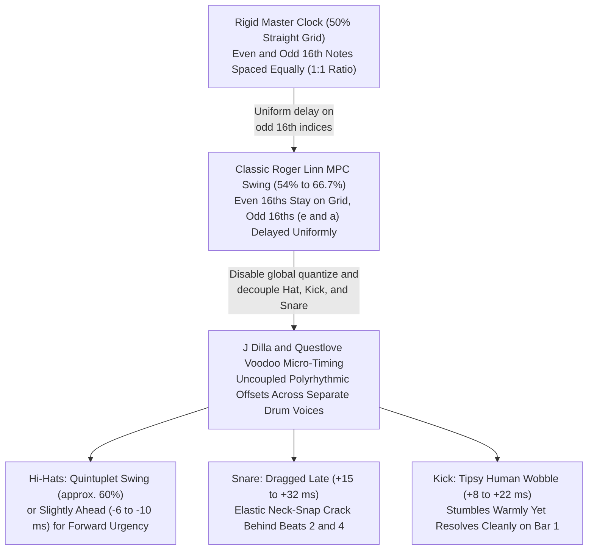
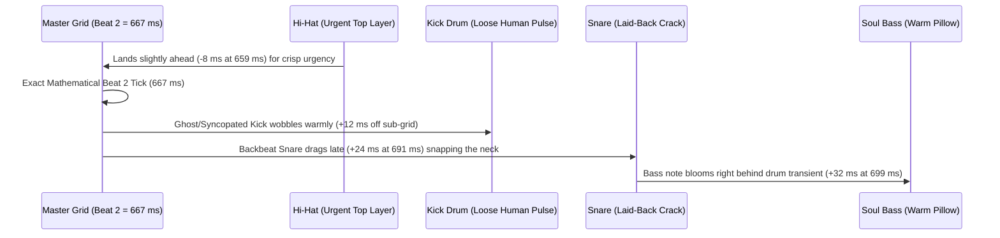

# Rhythm Engineering, Groove, Swing & Drum Programming

> **Module Goal**: Master the temporal engine of modern music—from `4/4` ring buffers, BPM millisecond math, and the `2 & 4` backbeat snare to Boom-Bap, Trap triplet hi-hats, UK Drill `3+3+2` bounce, Roland TR-808 sub-bass physics, and the J Dilla / D'Angelo micro-timing revolution ("drunk drums" and playing behind the beat).

---

## 1. Discrete Time Architecture: Bars, BPM & the 16-Slot Ring Buffer

Harmony colors the room, **rhythm moves the body**. As legendary bassist Victor Wooten teaches: if you play a "wrong" pitch with rock-solid rhythmic pocket, listeners hear bold jazz tension; if you play the "right" pitch `60 ms` out of pocket, the band falls apart.

### 1.1 `4/4` Time, BPM & Pulses Per Quarter Note (`PPQN`)

Over `95%` of hip-hop, R&B, funk, soul, house, and pop runs in **`4/4` time** (*common time*):
- Each **Bar (Measure)** contains **4 quarter-note beats** (`Beat 1, Beat 2, Beat 3, Beat 4`).
- Subdividing each quarter note by `4` yields a **16-slot circular ring buffer per bar** (**16th notes**), counted aloud by musicians and studio producers as:
  $$\texttt{| 1  e  \&  a | 2  e  \&  a | 3  e  \&  a | 4  e  \&  a |}$$
  *(0-indexed slots `0..15`: Quarter-note downbeats sit at `0, 4, 8, 12`; Eighth-note off-beats `"&"` sit at `2, 6, 10, 14`; Sixteenth-note subdivisions `"e"` and `"a"` sit at odd indices `1, 3, 5, 7, 9, 11, 13, 15`.)*
- Under the hood, hardware sequencers and DAWs subdivide each quarter note even further into **ticks** measured in **`PPQN` (Pulses Per Quarter Note)**:
  - **Vintage Akai MPC60 / MPC3000**: `96 PPQN` (`24` discrete ticks per 16th note; at `90 BPM`, `1 tick` $\approx 6.94\text{ ms}$).
  - **Modern DAWs (Ableton, Logic, FL Studio)**: `96` to `960 PPQN` (sub-millisecond resolution).

### 1.2 Exact Tempo-to-Millisecond Equations

Given tempo $B$ in **Beats Per Minute (`BPM`)**, every rhythmic subdivision converts directly into milliseconds (which is also how mix engineers set exact compressor release times and delay throws!):

$$T_{1/4} = \frac{60,000}{B}\text{ ms}, \qquad T_{1/8} = \frac{30,000}{B}\text{ ms}, \qquad T_{1/16} = \frac{15,000}{B}\text{ ms}, \qquad T_{\text{bar}} = \frac{240,000}{B}\text{ ms}$$

When dividing a beat by **`3` instead of `2` (Triplets)**, three triplet notes occupy the exact duration of two straight notes ($T_{\text{triplet}} = \frac{2}{3} T_{\text{straight}}$):

$$T_{1/8\text{T}} = \frac{20,000}{B}\text{ ms} \quad (\text{3 per beat}), \qquad T_{1/16\text{T}} = \frac{10,000}{B}\text{ ms} \quad (\text{6 per beat})$$

| Genre / Subgenre | Typical BPM Window | Snare / Clap Anchor | $1\text{ Beat}$ ($T_{1/4}$) | $1\text{ Sixteenth}$ ($T_{1/16}$) | Signature Rhythmic Feel |
| :--- | :---: | :---: | :---: | :---: | :--- |
| **Lo-Fi / Chillhop** | `70 - 85 BPM` | Beats `2` & `4` | `706 - 857 ms` | `176 - 214 ms` | Lazy, dusty, heavy swing + late snare drag |
| **90s East Coast Boom-Bap** | `86 - 96 BPM` | Beats `2` & `4` | `625 - 698 ms` | `156 - 174 ms` | Optimal human neck-nod resonant frequency (`approx. 1.5 Hz`) |
| **West Coast G-Funk / Neo-Soul** | `90 - 102 BPM` | Beats `2` & `4` | `588 - 667 ms` | `147 - 167 ms` | Deep laid-back pocket behind the beat |
| **House / Four-on-the-Floor** | `120 - 128 BPM` | Kick `1,2,3,4`; Clap `2,4` | `469 - 500 ms` | `117 - 125 ms` | Continuous hypnotic dancefloor propulsion |
| **Modern Atlanta Trap** | `130 - 160 BPM` *(Half-Time)* | **Beat `3`** (`70 BPM` feel) | `375 - 462 ms` | `94 - 115 ms` | Slow `65-80 BPM` body bounce + rapid `1/16T` & `1/32` hi-hat rolls |
| **UK / Brooklyn Drill** | `140 - 145 BPM` *(Half-Time)* | **Beat `3` (Bar 2: `3-&` / `4`)** | `414 - 429 ms` | `103 - 107 ms` | Syncopated `3+3+2` hi-hat skip + sliding 808 glides |

### 1.3 Why the Backbeat Snare on Beats `2` & `4` Changed World Music

If you play a traditional European military march or classical waltz to a room of untrained listeners, people clap on **Beats `1` and `3`**—reinforcing the heavy gravitational downbeat, which feels square, formal, and stationary.

Black American gospel, blues, jazz, R&B, funk, rock, and hip-hop flipped gravity upside down by locking a loud, cracking **backbeat snare or handclap onto Beats `2` and `4`** (indices `4` and `12` of `0..15`):
1. **Beat `1` (Kick Drum)** drops physical weight into your chest/feet.
2. **Beat `2` (Snare Crack)** snaps your head forward and resets tension.
3. **Around Beat `3` (`2-a`, `3`, or `3-&`)**, the Kick Drum is now liberated from marching rigidly on `3`—it can jump onto **syncopated off-beats** (`syncopation` = stressing weak off-beat slots while leaving strong beats empty!), surprising the ear before **Beat `4` (Snare Crack)** catches you cleanly!

---

## 2. Step-Sequencer Blueprints: Boom-Bap vs. Trap vs. UK Drill

Read the grids below like 16-bit bitmasks (`X` = hard velocity `105-127`; `o` = medium velocity `70-85`; `g` = quiet **ghost note** `25-45`; `.` = silent rest).

### 2.1 Golden-Era 90s Boom-Bap (`90 BPM` — DJ Premier / Pete Rock / J Dilla DNA)

Notice two secrets that separate real Boom-Bap ("**Boom**" = Kick, "**Bap**" = Snare) from flat beginner loops:
- **Velocity-Alternating Hi-Hats (`X . o .`)**: Real drummers strike downbeats harder with the shoulder of the stick (`X`) and off-beats softer with the tip (`o`). Uniform `100%-100%-100%` velocity instantly screams "cheap MIDI."
- **Ghost Kicks (`g`) & Syncopated `3-&` Kick**: A quiet ghost kick right before the snare (`slot 3` = `1-a`) or right before Bar 2 (`slot 15` = `4-a`) acts like a coiled spring launching into the main hit (`ba-BOOM` / `ba-BAP`)!

```text
90 BPM Boom-Bap (1 Bar = 16 Sixteenth-Note Slots, Swing = 58%-62%):
Slot Index:   00 01 02 03 | 04 05 06 07 | 08 09 10 11 | 12 13 14 15
Count:         1  e  &  a |  2  e  &  a |  3  e  &  a |  4  e  &  a
--------------------------------------------------------------------
Closed Hat:    X  .  o  . |  X  .  o  . |  X  .  o  . |  X  .  o  .
Snare:         .  .  .  . |  X  .  .  g |  .  g  .  . |  X  .  .  .
Kick Drum:     X  .  .  g |  .  .  .  . |  o  .  X  . |  .  .  .  g
```

### 2.2 Modern Half-Time Atlanta Trap (`140 BPM` — Metro Boomin / Southside DNA)

Why do Trap producers set FL Studio to **`140 BPM`** when rappers nod their heads at **`70 BPM`**?
- In **Half-Time**, 2 bars of `140 BPM` (`32` grid slots) function like 1 slow bar of `70 BPM`: instead of snares on `2` & `4`, the razor-sharp clap/snare lands on **Beat `3` of each bar** (`slot 08` and `slot 24`).
- Meanwhile, the `140 BPM` clock gives you crisp grid lines for **steady 8th-note hi-hats** interrupted by **triplet rolls (`[ttt]`, 3 hits in the space of 2 slots)** and **32nd-note ratchets (`r`, 2 hits inside 1 slot)**—often pitched down by `2` to `5` semitones right before the clap hits!

```text
140 BPM Half-Time Trap (2 Bars = 32 Slots; [ttt] = 1/16-Triplet Roll, r = 1/32 Roll):
Bar 1 Count:   1  e  &  a |  2  e  &  a |  3  e  &  a |  4  e  &  a
--------------------------------------------------------------------
Hi-Hat:        X  .  o  . |  X  .[ttt]  |  X  .  o  . |  X  r  o  .
Clap/Snare:    .  .  .  . |  .  .  .  . |  X  .  .  . |  .  .  .  o
808 + Kick:    X  .  .  . |  .  .  X  . |  .  .  .  . |  .  .  X  .

Bar 2 Count:   1  e  &  a |  2  e  &  a |  3  e  &  a |  4  e  &  a
--------------------------------------------------------------------
Hi-Hat:        X  .  o  . |  X  .  o  . |  X  .[ttt]  |  X  r  r  .
Clap/Snare:    .  .  .  . |  .  .  .  g |  X  .  .  . |  .  o  .  .
808 + Kick:    X  .  .  . |  .  X  .  . |  .  .  .  X |  .  .  .  .
```

### 2.3 UK / Brooklyn Drill (`142 BPM` — 808 Melo / Pop Smoke DNA)

Drill looks identical to Trap in BPM (`140-145 BPM`), yet feels completely different because of two structural mutations:
1. **The `3 + 3 + 2` ("Tresillo") Hi-Hat Bounce**: Instead of steady `+2` eighth-note hi-hats (`0, 2, 4, 6`), Drill accents step offsets **`+3, +3, +2`** (`slots 0, 3, 6` in the first half-bar, repeating `8, 11, 14` in the second half-bar)—an ancient Afro-Cuban / dancehall polyrhythm (`3 + 3 + 2 = 8`) wired into dark London hi-hats!
2. **Shifted Bar-2 Snare (`Beat 3` -> `Beat 3-&` or `Beat 4`)**: While Trap anchors snares reliably on Beat `3` of both bars, Drill frequently delays the second snare to **slot `10` (`3-&`) or slot `12` (`Beat 4`)**, creating a lurching, off-balance adrenaline rush beneath pitch-gliding 808s.

```text
142 BPM UK/NY Drill (1 Bar = 16 Slots; Notice 3+3+2 Hat Spacing: 0 -> 3 -> 6 | 8 -> 11 -> 14):
Slot Index:   00 01 02 03 | 04 05 06 07 | 08 09 10 11 | 12 13 14 15
Count:         1  e  &  a |  2  e  &  a |  3  e  &  a |  4  e  &  a
--------------------------------------------------------------------
Drill Hat:     X  .  g  X |  .  .  X  . |  X  .  g  X |  .  .  X  g
Rim / Snare:   .  .  .  . |  .  .  .  . |  X  .  .  . |  .  .  o  .   (Bar 2 shifts X -> slot 10/12!)
Sliding 808:   X  .  .  . |  .  .  .  . |  .  .  X  . |  .  /G \F .   (/G \F = Octave Glide!)
```

---

## 3. Physics & Mix Engineering of the Roland TR-808 Sub-Bass

In modern hip-hop and R&B, the **808** is simultaneously a percussion drum AND the lead bass instrument. Understanding its three-stage acoustic envelope explains why amateur 808s either clip into muddy distortion or vanish completely on AirPods and iPhones:

1. **Stage 1 — Exponential Pitch-Drop Transient (`0 to 35 ms`)**: A real TR-808 circuit (and modern Spinz/Zay 808 samples) does not start at `45 Hz`. Its oscillator starts `1.5` to `2` octaves higher (`140 to 220 Hz`) and sweeps exponentially down to the target bass note inside `25 to 35 ms`. That rapid downward frequency chirp creates a crisp mid-bass "knock" that cuts through the mix before the sub-wave settles.
2. **Stage 2 — Sub-Bass Fundamental (`35 to 65 Hz`, `40 to 1,200 ms`)**: A nearly pure low-frequency wave carrying `70%+` of the track's total electrical voltage/headroom.
   - **The Producer's Sweet-Spot Key Window (`D#1` to `A1`, `38.9 Hz` to `55.0 Hz`)**: Below `35 Hz` (`C1 = 32.7 Hz`), club and car subwoofers lose efficiency and waste headroom on inaudible air movement; above `65 Hz` (`C2 = 65.4 Hz`), the bass sounds boxy and loses deep chest rumble. That is why so many hip-hop hits are written or transposed into **`E minor`, `F minor`, `F# minor`, or `G minor`**—their root `1` sits right between **`41.2 Hz` and `49.0 Hz`**!
3. **Stage 3 — Harmonic Saturation & the "Missing Fundamental" Illusion (`100 to 350 Hz`)**: Phone speakers physically cannot reproduce `45 Hz`. Yet when you play a Kendrick Lamar or Metro Boomin track on a phone, your brain still hears the exact `45 Hz` pitch! Why? Applying subtle **soft-clipping or tube/tape saturation** ($y = \tanh(g \cdot x)$) adds $2f_0, 3f_0, 4f_0$ harmonics (`90 Hz, 135 Hz, 180 Hz`). The human auditory cortex measures the **`45 Hz` spacing** between those upper harmonics and psychoacoustically synthesizes the missing `45 Hz` fundamental inside your perception!

### Three Mandatory 808 Hygiene Rules

- **Rule 1 — Tune Every 808 Sample to Pitch Class**: Not all 808 `.wav` samples are recorded on `C`! Check the sample's fundamental via a spectrum analyzer/tuner first, calibrate root key in your sampler, and play notes strictly from the song's scale (usually chord roots + fifths + octave jumps).
- **Rule 2 — Monophonic Voice + Legato Portamento (`Glide`)**: Set your 808 sampler to **`Mono / Polyphony = 1`**. If two `45 Hz` 808 tails overlap at different pitches (`F1` + `G1`), they beat violently at $\lvert 49.0 - 43.65 \rvert = 5.35\text{ Hz}$, turning your low end into mud. Enabling `50 to 90 ms` **Portamento/Glide** slides pitch smoothly when notes overlap—creating the signature UK Drill octave swoop!
- **Rule 3 — Kick vs. 808 Phase Separation**: When a punchy Kick (`55-90 Hz`) fires at the exact millisecond as an 808 (`45 Hz`), their waveforms can sum past `0 dBFS` (clipping) or cancel out (`180°` out of phase, making the bass *quieter* when the kick hits!). Fix it with **Sidechain Ducking** (ducking the 808 volume by `-4 to -8 dB` for `35 ms` only while the kick transient punches through) or choosing a short `60 ms` kick paired with a slightly softened `15 ms` 808 attack.

---

## 4. Swing, Pocket & the J Dilla / D'Angelo "Drunk Drums" Revolution

Program the Boom-Bap grid from Section 2.1 with `0.0 ms` timing error (`100%` straight quantization), and it sounds polite, flat, and lifeless. Why? Because **groove lives in the micro-timing deviations between `5 ms` and `35 ms`**.



### 4.1 Exact Math of MPC Swing Percentage (`50%` to `75%`)

On an Akai MPC (and inside Ableton / Logic groove templates), **16th-Note Swing $S\%$** pairs every two consecutive 16th notes inside an 8th-note window ($T_{1/8} = 2 \cdot T_{1/16}$):
- The **first (even) 16th note** (`1, &, 2, & ...`, indices `0, 2, 4, 6...`) remains **pinned at $0\text{ ms}$**.
- The **second (odd) 16th note** (`e` and `a`, indices `1, 3, 5, 7...`) is **delayed** so it occurs $S\%$ of the way through the 8th-note pair:

$$t_{\text{odd}}(S) = \frac{S}{100} \cdot T_{1/8}, \qquad \Delta t_{\text{delay}}(S) = \left(\frac{S - 50}{100}\right) \cdot \frac{30,000}{\text{BPM}} \text{ ms}$$

| Swing Setting $S\%$ | Long : Short Ratio | Delay $\Delta t$ at `90 BPM` | Perceptual Groove Character |
| :---: | :---: | :---: | :--- |
| **`50.0%`** | $1.00 : 1$ (`1:1`) | `0.0 ms` | Dead-straight binary machine grid (Kraftwerk, straight Trap 8ths) |
| **`54% - 57%`** | $\approx 1.25 : 1$ | `+13.3 to +23.3 ms` | Subtle "human pocket"—feels tight yet organic without sounding "swung" |
| **`60.0%`** | **$3 : 2$ (`Quintuplet`)** | **`+33.3 ms`** | **"Golden In-Between" Quintuplet Bounce**—neither straight nor triplet shuffle! |
| **`62% - 64%`** | $\approx 1.70 : 1$ | `+40.0 to +46.7 ms` | Classic 90s MPC Boom-Bap & House head-nod sweet spot |
| **`66.7%`** | **$2 : 1$ (`Triplet`)** | **`+55.6 ms`** | Pure jazz shuffle / blues triplet swing (`hum-pty dump-ty` gallop) |

### 4.2 How J Dilla, Questlove & D'Angelo Broke the Grid ("Dilla Time")

Standard MPC swing still has a telltale mechanical flaw: **every instrument shares the exact same swing percentage**, so when an odd 16th kick and hi-hat fire together, they still land with `0 ms` delta.

In the late 1990s and 2000—across Slum Village's *Fantastic, Vol. 2*, Common's *Like Water for Chocolate*, D'Angelo's masterpiece ***Voodoo*** (co-piloted by drummer **Questlove** and bassist **Pino Palladino** studying Dilla's tapes at Electric Lady Studios), and Dilla's *Donuts*—**J Dilla** turned MPC3000 quantization **completely OFF** and engineered **layered micro-timing friction** (analyzed extensively in Dan Charnas's *Dilla Time*):

1. **Conflicting Subdivision Feels Running in Parallel**: Dilla would play straight or subtly rushed hi-hats (`50%-54%`) **on top of** deeply swung kicks (`60%-64%`), forcing straight binary time and swung quintuplet/triplet time to rub against each other inside the same `667 ms` beat!
2. **The Laid-Back Snare Drag (`+15 to +35 ms` Behind `2` & `4`)**: When your brain predicts a snare on Beat `2` at `666.7 ms` and the snare arrives **`24 ms` late** at `691 ms` (sometimes layered with an early `-8 ms` rimshot or finger-snap creating a crunchy *flam*), your motor cortex leans forward into that tiny vacuum—making the snare hit feel twice as heavy without turning up the volume!
3. **Pino Palladino's Pillow Bass Delay**: On D'Angelo's *Untitled (How Does It Feel)* and *Playa Playa*, bassist Pino Palladino intentionally plucked bass notes **`+20 to +40 ms` behind Questlove's already laid-back kick drum**—turning kick + bass into a wide, warm rolling wave (`KICK-uh-BASS`) rather than a sharp transient spike.



### 4.3 Python Micro-Timing Lab: Computing Straight vs. MPC Swing vs. Dilla Pocket

You can model and inspect exact millisecond onset schedules for a 1-bar `90 BPM` groove in 25 lines of Python:

```python
def bar_pocket_schedule(bpm: float = 90.0, swing_pct: float = 60.0):
    t_16th = 15_000.0 / bpm          # 166.67 ms at 90 BPM
    t_8th = 2.0 * t_16th             # 333.33 ms at 90 BPM
    swing_delay = ((swing_pct - 50.0) / 100.0) * t_8th

    events = []
    for slot in range(16):
        grid_ms = slot * t_16th
        is_odd = (slot % 2 == 1)

        # 1. 8th-note Hi-Hats: pushed -6 ms ahead of the grid for crisp urgency
        if slot % 2 == 0:
            events.append(("Hi-Hat", slot, round(grid_ms - 6.0, 1)))
        # 2. Snare on Beats 2 & 4 (slots 4 and 12): dragged +24 ms behind grid
        if slot in (4, 12):
            events.append(("Snare ", slot, round(grid_ms + 24.0, 1)))
        # 3. Kick on 1 (0), ghost 1-a (3), syncopated 3-& (10) with 60% quintuplet swing
        if slot in (0, 3, 10):
            kick_ms = grid_ms + (swing_delay if is_odd else 4.0)
            events.append(("Kick  ", slot, round(kick_ms, 1)))
    return events

for voice, slot, ms in bar_pocket_schedule(90.0, 60.0):
    print(f"Slot {slot:02d} | {voice} | Onset = {ms:6.1f} ms (Grid = {slot * 166.67:6.1f} ms)")
```

---

## 5. Drum Sound Design: Breakbeat Layering & Polyrhythmic Cross-Rhythms

Even with great timing, thin stock drum samples sound like toy keyboards unless you understand **acoustic transient layering** and **cross-rhythmic tension**.

### 5.1 Breakbeat DNA & `Transient + Body + Tail` Drum Layering

Before drum machines dominated, hip-hop's drums came from slicing 4-bar solo drum breaks off 1968–1974 funk vinyl—above all Clyde Stubblefield on James Brown's ***Funky Drummer*** (`1970`), Gregory Coleman on The Winstons' ***Amen, Brother*** (`1969`), The Honey Drippers' ***Impeach the President*** (`1973`), and Led Zeppelin's ***When the Levee Breaks*** (`1971`).

Modern producers fuse the **room grit of vintage breakbeats** with the **sub-weight of clean synthetic drums** by splitting a drum hit into three non-overlapping temporal stages:

| Drum Stage | Time Window | Frequency Focus | Layering Recipe Used by Pro Producers |
| :--- | :---: | :---: | :--- |
| **1. Attack Transient ("Click / Crack")** | `0 - 15 ms` | `2.5 - 8 kHz` | Vinyl breakbeat snare rimshot, acoustic kick beater click, or foley finger-snap/clavé layered `-8 ms` early |
| **2. Tonal Body ("Punch / Knock")** | `15 - 90 ms` | `70 - 220 Hz` | Punchy MPC kick (`85 Hz`) or thick `200 Hz` snare fundamental giving physical chest/throat impact |
| **3. Room / Noise Tail ("Air & Glue")** | `90 - 450 ms` | `400 Hz - 12 kHz` | Dusty vinyl room ambience, snare wire buzz, open hi-hat bleed, or subtle gated plate reverb |

> **Anti-Flabbiness Rule**: Never stack two full-spectrum kicks on top of each other without filtering—two `70 Hz` sine waves will phase-cancel or boom uncontrollably. High-pass the vintage breakbeat kick at `140 Hz` (keeping only its crunchy `1970` tape transient and room air) and layer it over a clean synthetic sub-kick owning `50-110 Hz`!

### 5.2 Polyrhythms (`3:2` and `4:3`) & Metric Modulation

When a track feels hypnotic yet impossible to pin down, the producer or MC is usually running a **polyrhythm** (*cross-rhythm*): spacing accents every **$3$ sixteenth-note slots** across a **`16`-slot binary bar**!
- Since $\gcd(3, 16) = 1$, accenting every `3rd` slot (`0, 3, 6, 9, 12, 15`) fits `5` groupings of `3` (`15` slots) plus a `1`-slot remainder (`3 + 3 + 3 + 3 + 3 + 1 = 16`), or truncates cleanly after `8` slots as the **`3 + 3 + 2` Tresillo** we saw in UK Drill!
- Whenever a synth pluck, piano chop, or rap cadence loops every **`3` sixteenth notes** over a `4/4` drum beat, each repetition lands on a *different* part of the beat (`1` -> `1-a` -> `2-&` -> `3-e` -> `4`), pulling the ear forward until both cycles realign on Bar `2` or Bar `4`!

---

## 6. Engineer's Takeaways & Next Step

- **Rhythm = Ring Buffer Indices + Velocity Dynamics + Millisecond Phase Shifts**: A drum beat is defined by *where* hits sit (`2 & 4` backbeat vs. Beat `3` half-time Trap vs. `3+3+2` Drill), *how softly* ghost notes whisper (`velocity 30`), and *how many milliseconds* each drum voice leans ahead of or behind the master clock.
- **808s Win Through Physics, Not Just Volume**: Keep sub roots in the `40 to 55 Hz` chest-resonance zone (`E1-A1`), strictly monophonic with clean kick ducking, and add subtle harmonic saturation so upper partials translate on small speakers.
- **Next Module**: Now that you own the harmonic engine (Module `01`) and the rhythmic pocket (Module `02`), proceed to **[03-HIPHOP-SAMPLING-FLOW-AND-ACTIVE-LISTENING.md](03-HIPHOP-SAMPLING-FLOW-AND-ACTIVE-LISTENING.md)** to see how legendary producers chop vinyl soul/jazz samples, how elite MCs engineer multi-syllabic internal flows, how mix engineers carve 3D headphone space, and how to dissect any song actively in 4 passes.
