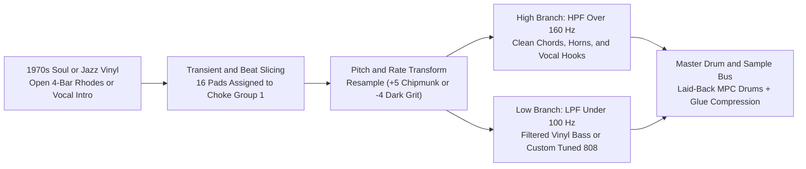
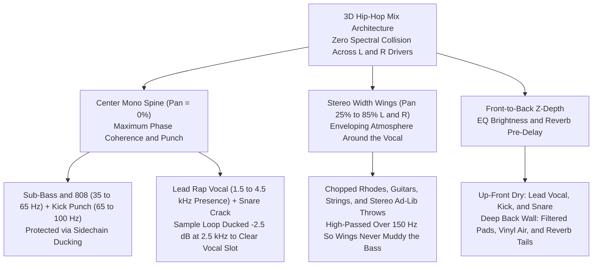

# Hip-Hop Sampling, Flow Cadence & Active Listening

> **Module Goal**: Synthesize harmony (Module `01`) and rhythm (Module `02`) to reverse-engineer finished records—covering the DSP and artistry of soul/jazz sample chopping, multi-syllabic rhyme compilation and cadence architecture, 3D frequency-spectrum mixing, and a 4-pass headphone protocol to dissect any track like a veteran producer.

---

## 1. Crate-Digging & Sample Chopping: DSP Math and Producer Archetypes

To an outsider, sampling sounds like "copy-pasting an old song." To an engineer who has actually sat in front of an MPC or DAW with a raw 1973 soul vinyl rip, **sample flipping is constraint-driven signal reconstruction**—more akin to disassembling a compiled binary into basic blocks and re-linking them into a brand-new program.

### 1.1 What Crate-Diggers Listen For in 3 Seconds of Vinyl

Producers digging through dusty crates of 1965–1982 Soul, Jazz-Fusion, Japanese City Pop, Brazilian Bossa Nova, Library Music, and Italian Film Scores hunt for **four specific acoustic properties**:
1. **"Open" Instrumental Breaks (`2` to `4` Bars Without Drums)**: An intro, bridge, or outro where Fender Rhodes, strings, horns, guitar, or vocals play *without* the original drummer's snare—allowing clean re-chopping without fighting colliding drum transients.
2. **Pre-Loudness-War Dynamic Headroom & Tape Warmth**: Analog 1970s records passed through Neve/API consoles onto 2-inch magnetic tape, saturating harmonics smoothly while preserving `12 to 18 dB` of dynamic range.
3. **Unresolved Extended Chords (`m9`, `Maj9`, `dim7`, `7#9`)**: Rich chords where even a `400 ms` slice carries unmistakable cinematic mood.
4. **Hard Stereo Separation (`1960s/70s Panning`)**: Early stereo mixes frequently panned drums `100% Left` and piano/horns/vocals `100% Right`! Dropping the Left channel instantly hands a hip-hop producer a drumless studio stem without AI stem-separation artifacts!

### 1.2 The Physics of Resampling vs. Modern Time-Stretching

When classic turntable/sampler workflows (SP-1200, MPC60/3000) speed up or slow down a sample by playback rate factor $\alpha$, **pitch and tempo scale together in lockstep**:

$$f' = \alpha \cdot f, \qquad \text{BPM}' = \alpha \cdot \text{BPM}, \qquad \Delta n = 12 \log_2(\alpha)\text{ semitones}$$

- **Pitched-Up "Chipmunk Soul" ($\alpha > 1$, Early Kanye West / Just Blaze / RZA)**:
  - Take Chaka Khan's 1984 ballad *Through the Fire* (`approx. 79 BPM` in `Ab Major`) and pitch it up **`+5` semitones** ($\alpha = 2^{5/12} \approx 1.3348$) to `Db Major`.
  - Automatically, the sluggish ballad tempo accelerates to $79 \times 1.3348 \approx 105.5\text{ BPM}$, AND the human vocal tract resonances (**formants**, normally anchored around `500 Hz` and `1,500 Hz` regardless of sung note) shift upward by $+33.5\%$, creating Kanye West's *Through the Wire*—urgent, nostalgic, high-voltage soul!
- **Pitched-Down Subterranean Grit ($\alpha < 1$, Havoc / DJ Screw / Alchemist)**:
  - Pitching a sample **down `-3` to `-7` semitones** ($\alpha = 2^{-4/12} \approx 0.7937$) stretches transients, darkens room reverb into cavernous fog, and lowers bright jazz pianos into menacing minor registers. On Mobb Deep's ***Shook Ones, Pt. II*** (`1995`), producer Havoc took a cheerful acoustic piano run from Herbie Hancock's *Jessica*, slowed it down drastically, and layered two pitched-down slices—turning sunny jazz into the coldest anthem in New York rap history.
- **12-Bit / `26.04 kHz` Aliasing Crunch (The E-mu SP-1200 Trick)**:
  - By the Nyquist-Shannon sampling theorem, a `26.04 kHz` sampler can only represent frequencies below $f_{\text{Nyquist}} = 13.02\text{ kHz}$. Producers recorded `33.3 RPM` records spinning at **`45 RPM`** ($\alpha = 45 / 33.33 = 1.35$, saving $26\%$ of the SP-1200's tiny `10-second` RAM!), then pitched them back down inside the 12-bit DAC. Upper harmonics folded across Nyquist as **musical aliasing grit** while `12-bit` integer quantization (`4,096` levels vs. `65,536` in 16-bit CD audio) added warm background hiss to quiet sample tails.
- **The Dual-Filter "Low-End Theory" Split & Choke Groups**:
  - How did Q-Tip, Pete Rock, and J Dilla extract booming basslines from jazz samples when they lacked a bass player? Duplicate the chopped sample onto **two parallel tracks**:
    1. **High Track**: Apply a **High-Pass Filter (`HPF @ 150-200 Hz`)** to strip muddy low frequencies out of the Rhodes/horns, placing all 16 slices in **`Choke / Mute Group 1`** (`Polyphony = 1`) so triggering Pad `5` cleanly truncates Pad `4` with zero chord bleed.
    2. **Sub Track**: Apply a steep **Low-Pass Filter (`LPF @ 90-110 Hz`)** + mono boost—isolating *only* the muffled acoustic upright bassline from the original 1970 record to rumble underneath crisp MPC drums!



### 1.3 Modern Time-Stretching (STFT Phase Vocoders) & Neural Stem Separation

While vintage hardware coupled pitch and tempo ($f' = \alpha f$), 21st-century DAWs unlocked two DSP superpowers that transformed modern crate-digging:
1. **Granular & Phase-Vocoder Time-Stretching (Ableton Warp `Complex Pro`, Serato Sample)**:
   - Slices audio into overlapping `20-50 ms` Hann-windowed frames via Short-Time Fourier Transform (**STFT**), rescales hop spacing in time to match any target BPM *without* altering bin frequencies, and preserves vocal throat **formant envelopes** so a sample shifted `-4` semitones sounds like a deeper human singer rather than a slowed-down tape monster.
   - *Trade-Off*: Extreme time-stretching (`>20%` delta) smears sharp drum transients (*phasiness*). Veteran producers still prefer classic variable-rate resampling (`Repitch` mode) whenever they want crisp, punchy vintage transients!
2. **Demucs / Hybrid-Transformer Neural Stem Separation (`2020s`)**:
   - U-Net and Spectrogram-Waveform Transformer models (such as open-source `htdemucs` built into Serato Sample, FL Studio, and Logic Pro) decompose a stereo 1974 vinyl master into four isolated stems (**Vocals, Drums, Bass, Other/Keys**)—allowing producers to mute a busy original jazz drummer while keeping the upright bass and Rhodes intact.

### 1.4 Six Master Producer Blueprints Compared

| Producer | Signature Era & Classics | Chopping Granularity | Harmonic & Drum Signature |
| :--- | :--- | :--- | :--- |
| **DJ Premier** | 90s NYC (*NY State of Mind*, *Mass Appeal*, *Mathematics*) | **Staccato `1-Beat` / `Half-Beat` Micro-Chops** rearranged out of original order | Chromatic/dissonant jazz piano & string stabs; hard quantized/lightly swung boom-bap; scratched vocal hooks |
| **J Dilla** | Late 90s–2006 (*Don't Cry*, *Fall in Love*, *Lightworks*) | **Sub-Second `200-500 ms` Vocal & Chord Fragments** flipped into rhythmic melodies | Lush `m9`/`Maj9` soul; zero-quantize "drunk" drums; warm sub-heavy Moog/filtered bass |
| **Kanye West** | 2000s–2010s (*Spaceship*, *Through the Wire*, *Power*, *Otis*) | **Phrase-Level Vocal Hooks (`+4` to `+6` Semitones)** woven directly as a duet partner | Gospel/soul emotional uplift -> maximalist prog-rock choirs & distorted `808s` |
| **Nujabes** | 2000s Tokyo Jazz-Hop (*Feather*, *Luv(sic) Pt. 1-6*, *Aruarian Dance*) | **Flowing `2-Bar` Acoustic Jazz Loops** (flute, piano, nylon guitar) | Sunlit Dorian / `ii9-V13-Imaj9` melancholy paired with crisp, rolling acoustic breakbeats |
| **The Alchemist** | 2000s–2020s (*Keep It Thoro*, *Alfredo*, *1985*) | **Hypnotic `2-to-4-Bar` Cinematic Loops** (often **drumless** or ultra-sparse) | Haunting Soviet/Italian film scores & prog-rock guitars leaving vast oxygen for storytelling |
| **Metro Boomin** | 2015–Present (*Ric Flair Drip*, *Father Stretch My Hands*, *Superhero*) | **Half-Speed (`0.5x`) Dark Vintage Intros** + Dramatic Mid-Song Beat Switches | Phrygian/minor orchestral tension + Prophet analog synths + surgical `140 BPM` 808/triplet bounce |

---

## 2. Rap Flow as Phonetic Compilation & Rhythmic Cadence Engineering

Reading rap lyrics as plain text on a screen is like inspecting HTML without CSS or JavaScript: you see semantic meaning, **but miss the entire rhythmic and acoustic engine**. Great MCs treat the human vocal tract as a **tuned polyrhythmic drum kit** governed by three engineering principles:

### 2.1 Vowel Assonance Matrices (Why Rap Compiles IPA Phonemes, Not Spelling)

Beginners rhyme single final words by spelling (`cat / hat / bat`). Elite MCs ignore English spelling completely and lock **3-to-6-syllable stressed vowel arrays** across entire bars!

Notice how English words with totally different consonants (`p, t, k, s, m`) still rhyme powerfully in audio whenever their **vowel formants** match (**Assonance**). Compare a basic 1980s end-rhyme against a dense 4-syllable internal rhyme matrix:

```text
1. Basic Single-Syllable End-Rhyme (1979-1983 Archetype — Only Slot 14/15 Rhymes):
   "I stepped up to the MIC  [AY],  and got the crowd HYPE [AY]"

2. 4-Syllable Compound + Internal Cross-Bar Vowel Matrix ([EH - UH - OH - UH]):
   Bar 1: "Every    METH - OD   SPO - KEN,   every  WEAP - ON   CHO - SEN"
                    [EH]  [UH]  [OH]  [UH]          [EH]  [UH]  [OH]  [UH]
   Bar 2: "Kept the SEV  - EN   TO  - KENS,  left   SEC  - OND  MO  - MENTS..."
                    [EH]  [UH]  [OH]  [UH]          [EH]  [UH]  [OH]  [UH]
```

Every stressed and unstressed vowel (`[EH]`, `[UH]`, `[OH]`) fires like a recurring pitched tom-tom hit while hard plosive consonants (`p, b, t, d, k, g`) act as **hi-hat and snare transients**!

### 2.2 Mapping Flow onto the 16-Slot Grid & Bar-Line Enjambment

Now overlay vocal syllables onto the `1 e & a 2 e & a 3 e & a 4 e & a` drum grid from Module `02`:
- **Amateur "Nursery-Rhyme" Cadence**: Starts every line on Beat `1`, lands the rhyme word squarely on Snare `4` (slot `12`), and stops to breathe on `4 e & a`. Within 4 bars, the listener can predict every rhythm before the rapper opens their mouth.
- **Elite Enjambment & Syncopated Rests**: Rather than stopping at the bar boundary after Beat `4`, the MC **spills the rhyme phrase across the bar line** (*enjambment*), landing the final punch-word on **`Beat 1-&` (`slot 02`) or `Beat 2` (`slot 04`, right on the Snare!) of Bar 2**, pauses for a dramatic breath on `2 e &`, and launches the next multi-syllabic burst from an unexpected off-beat (`3-a`)!

```text
Bar-Line Enjambment Blueprint (Rhyme Chain Spills Past Beat 4 to Snap onto Bar 2 Beat 1-&):
Count:    |  1   e   &   a |  2   e   &   a |  3   e   &   a |  4   e   &   a |
Drums:    |  K   .   .   g |  S   .   .   . |  K   .   K   . |  S   .   .   . |
Bar 1 MC: |  .  vi - vid   | PIC-tures in the| DARK, city    | SPARKS flicker | -> (No pause on 4!)
Bar 2 MC: | PAST mid -     | NIGHT (Snare!)  | [breath rest] | .  SHARP wit...|
```

### 2.3 Four Master Flow Architects Decoded

1. **Nas (*Illmatic*: *N.Y. State of Mind*, *It Ain't Hard to Tell*) — Seamless Street-Cinema Pocket**:
   - *Mechanism*: Nas chains internal rhymes on Beats `1-&`, `2`, `3-e`, and `4` while keeping his vocal tone calm, conversational, and `+10 to +20 ms` relaxed inside DJ Premier's boom-bap pocket—never straining or shouting to force a rhyme, yet achieving staggering syllable-per-bar information density.
2. **MF DOOM (*Madvillainy*: *Figaro*, *Meat Grinder*, *Accordion*) — Exhaustive Multi-Syllabic Combinatorics**:
   - *Mechanism*: DOOM treats English like a brute-force constraint solver—holding a single 4-to-5-syllable vowel pattern across `8` consecutive bars, rhyming proper nouns, slang, hyphenated compound words, and split syllables across bar lines with a gruff, tipsy behind-the-beat swing that mirrors J Dilla and Madlib's unquantized drums.
3. **Kendrick Lamar (*To Pimp a Butterfly*, *good kid, m.A.A.d city*, *DAMN.*) — Polymetric Gear-Shifts & Vocal Timbre Acting**:
   - *Mechanism*: Within a single 16-bar verse (*DNA.*, *Rigamortus*, *Alright*, *Momma*), Kendrick shifts clock subdivisions like a manual transmission—moving from sparse `8th`-note syncopation to breathless `16th`-note double-time sprints to `3-against-4` polymetric phrases, while dynamically modulating nasal resonance, pitch height, and rasp to voice distinct internal characters.
4. **André 3000 (*Aquemini*, *ATLiens*, *Int'l Players Anthem*) — Asymmetric Melodic Phrases & Negative Space**:
   - *Mechanism*: Trained by Atlanta bounce and funk, André 3000 breaks symmetric `4-bar` phrasing into odd `5-beat` and `7-beat` arcs, stretches vowels into sung pentatonic melodies, and uses sudden `2-beat` silences (*musical rests*) so that when his next off-beat internal rhyme lands, it hits like a horn stab.

| Flow Archetype | Benchmark MCs | Grid Timing Placement | Primary Structural Innovation |
| :--- | :--- | :--- | :--- |
| **Golden-Era Internal Architect** | Rakim, Nas, Black Thought | Relaxed `+10 to +20 ms` pocket | Replaced `1980s` end-rhymes with internal mid-bar rhyme webs & bar-line spillover |
| **Dense Phonetic Combinatorist** | MF DOOM, Eminem, Big Pun | Fluid behind-beat (DOOM) or razor on-grid (Em) | `80%+` of syllables in a bar participate in `4-to-6`-syllable vowel stacks |
| **Laid-Back West/East Authority** | Snoop Dogg, Jay-Z, Notorious B.I.G. | Deep `+20 to +35 ms` behind the beat | Effortless conversational drag + micro-pauses that command total attention |
| **Polymetric / Double-Time Virtuoso** | Kendrick Lamar, JID, Busta Rhymes | Dynamic shifts (`-5 ms` attack to `+15 ms` swing) | Rapid gear-changes across `1/8`, `1/16`, and `1/16T` subdivisions mid-verse |
| **Melodic Syncopated Bounce** | André 3000, Lauryn Hill, Anderson .Paak | Elastic Southern / Neo-Soul swing | Blends rapped percussion with sung Dorian/Pentatonic pitch contours & bold rests |

---

## 3. Frequency Spectrum Mixing: Carving 3D Space Inside Two Speakers

Put on headphones and listen to Dr. Dre's *2001* (*Still D.R.E.*, *Xxplosive*), Kendrick Lamar's *Wesley's Theory* (mixed by Derek "MixedByAli" Ali), or Kanye West's *My Beautiful Dark Twisted Fantasy*. Why does every instrument sound gigantic, wide, and crystal clear without turning into mud—even though a stereo file is literally just **two 1D voltage arrays (`L[t]` and `R[t]`)**?

Because mix engineers treat audio as a **3D Coordinate Space (`X`, `Y`, `Z`)** with strict **non-overlapping bandwidth allocation**:

- **X-Axis (Left-to-Right Width = Panning & Stereo Phase)**:
  - **Mono Spine (`Center = 0% Pan`)**: **Sub-Bass (`<120 Hz`), Kick, Main Snare, and Lead Rap Vocal** MUST sit dead-center (`L == R`) so both headphone/club drivers push in phase together for maximum physical punch.
  - **Stereo Wings (`25% to 85% L/R`)**: Rhodes chords, sample guitars/strings, hi-hat/shaker layers, and vocal ad-libs ("*Yeah!*", "*Uh!*") fan out Left and Right, leaving a wide open corridor in the center for the MC's voice!
- **Y-Axis (Vertical Height = Frequency Spectrum `20 Hz to 20 kHz`)**: High frequencies psychoacoustically sound physically "higher up" near your forehead; `45 Hz` sub-bass feels physically "low" in your chest.
- **Z-Axis (Front-to-Back Depth = High-Frequency Roll-Off + Reverb Pre-Delay)**: Air naturally attenuates high frequencies over distance. A **dry, bright signal** (`3-8 kHz` intact, minimal reverb) sits inches from your face (**Lead Vocal & Snare**); rolling off highs above `5 kHz` (`LPF`) + adding `25 ms` pre-delay room reverb pushes a choir or pad `15 feet` behind the rapper!



### Complete 7-Band Spectral Allocation & Anti-Masking Reference

| Frequency Band | Acoustic Name | Primary Owners in Hip-Hop | Classic Beginner Collision & Pro Mix Fix |
| :--- | :--- | :--- | :--- |
| **`20 - 60 Hz`** | **Sub-Bass** | 808 Fundamental (`E1-A1`), Sub-Synth | *Bug*: Sample rumble steals headroom. *Fix*: Hard `HPF` everything except 808 & Kick; keep `100%` Mono. |
| **`60 - 120 Hz`** | **Upper Bass / Thump** | Kick Drum Chest Punch (`65-95 Hz`), Acoustic Bass | *Bug*: Kick + 808 cancel or clip. *Fix*: Sidechain-duck 808 `35 ms` on kick hit; cut `-3 dB @ 80 Hz` on bass if kick owns `80 Hz`. |
| **`120 - 350 Hz`** | **Warmth vs. Mud Zone** | Rhodes Body, Snare Weight (`180-220 Hz`), Vocal Chest | *Bug*: Stacking piano + guitar + bass turns `250 Hz` into muddy soup. *Fix*: Cut `-3 dB` around `220-300 Hz` on dense sample loops. |
| **`350 - 900 Hz`** | **Midrange / Boxiness** | Sample Fundamentals, Horns, Drum Room Tone | *Bug*: Sounds like a cardboard box at `450-600 Hz`. *Fix*: Narrow surgical EQ dip on boxy snares/samples. |
| **`1 - 4 kHz`** | **Vocal Presence & Crack** | **Consonant Intelligibility (`2-3.5 kHz`)**, Snare Snap | *Bug*: Loud sample horns drown out lyrics (*masking*). *Fix*: Dynamic/Trackspacer `-2.5 dB` dip at `2.5 kHz` on the instrumental bus triggered by the lead vocal! |
| **`4 - 10 kHz`** | **Crispness & Sibilance** | Hi-Hat Tick, Vocal `"S"` / `"T"` (`5-8 kHz`) | *Bug*: Piercing `"S"` sounds fatigue ears on headphones. *Fix*: De-esser on vocals (`6-8 kHz`); gentle tape roll-off on harsh digital hi-hats. |
| **`10 - 20 kHz`** | **Air & Vinyl Shimmer** | Vocal Breath Sheen, Cymbal Air, Vinyl Dust | *Bug*: Dull/stuffy top end or harsh MP3 artifacts. *Fix*: Subtle `+1.5 dB` high-shelf boost at `12 kHz` ONLY on lead vocal & main hi-hat. |

### 3.2 Dynamics, Bus "Glue" Compression, Sidechain Pumping & Mastering (`LUFS`)

EQ carves static frequency pockets; **dynamics processing** shapes amplitude over millisecond timescales so separate recordings breathe together as one physical band:

- **VCA Drum & Mix-Bus "Glue" Compression (`SSL G-Bus` Archetype)**:
  - Placing a gentle compressor (`2:1` or `4:1` ratio, **slow `30 ms` attack** so kick/snare transients punch through untouched, **fast `100 ms` or `Auto` release**, shaving only `1.5 to 3 dB` of gain reduction) across the combined Drum + Sample bus forces every element to share a unified dynamic envelope—making a 1972 Rhodes sample and 2026 MPC drums sound recorded in the exact same room.
- **Rhythmic Sidechain "Breathing" (Flying Lotus / J Dilla / Lo-Fi Pump)**:
  - Routing the Kick Drum into the sidechain detector of a compressor on the Sample Pad (`-5 to -8 dB` ducking with a musical `150-220 ms` release timed to a `1/8` or `1/16` note) causes the vinyl chords and vinyl crackle to **inhale and exhale** in sync with the kick drum—creating an intoxicating, waves-on-the-shore bounce.
- **Loudness Normalization (`LUFS`) vs. Crest Factor Punch**:
  - Streaming platforms (Spotify, Apple Music, YouTube) normalize playback around **`-14 LUFS`** (Loudness Units relative to Full Scale, K-weighted for human ear sensitivity).
  - Crushing a hip-hop beat with a brickwall limiter to `-5 LUFS` flattens the **`Crest Factor`** (peak-to-RMS ratio), squashing kick and snare transients into lifeless distortion—and streaming normalization turns the track *down* by `-9 dB` anyway! World-class hip-hop masters (`-8 to -10 LUFS` integrated, `-1.0 dBTP` true-peak ceiling) preserve transient dynamic contrast via **soft-clipping** (`shaving 1-2 dB` off sharp snare spikes cleanly) before final limiting so drums hit harder at *every* playback volume.

---

## 4. The 4-Pass Active Listening Protocol (Dissect Any Track Tonight)

Passive listeners hear "a cool song." Engineers run **selective auditory attention passes**—focusing `100%` of working memory on one layer per `45-second` listen. Put on good headphones tonight, pick a track from the Reference Lab below, and run these four passes:

1. **Pass 1 — Master Clock, Drum Skeleton & Micro-Timing (`Bars 1-16`)**:
   - Tap `1 - 2 - 3 - 4` with your finger. Does the snare crack on `2 & 4` (`85-100 BPM` Boom-Bap/Neo-Soul) or Half-Time Beat `3` (`130-150 BPM` Trap/Drill)?
   - Zoom into the **Hi-Hat vs. Snare relationship**: Are the hats straight, `3+3+2` Drill-spaced, triplet-rolled, or subtly swung? Does the snare crack slightly *late* behind your finger tap (Dilla/Questlove pocket)?
2. **Pass 2 — Sub-Bass Trajectory & Harmonic Loop Architecture**:
   - Ignore the lyrics and hum **only the lowest bass note**. Count how many bars pass before the chord/bass cycle repeats (`2 bars`, `4 bars`, or `8 bars`).
   - Listen to the chord color: Is it stark 3-note minor grit, a warm 2-chord Dorian neo-soul pendulum (`m9 <-> 13`), or a pitched-up soul vocal sample? Listen closely to **Bar `4` or Bar `8`**—producers almost always swap in a variation chop or turnaround chord right at the end of the 4-bar phrase!
3. **Pass 3 — Vocal Pocket, Phonetic Vowel Chains & Stereo Ad-Libs**:
   - Track where the MC's stressed words hit relative to Snare `2` and Snare `4`. Do lines stop cleanly on Beat `4`, or spill across the bar line (*enjambment*)?
   - Count how many consecutive syllables share matching vowel sounds inside each bar, and notice panned vocal doubles/ad-libs bouncing Left and Right.
4. **Pass 4 — Subtractive Arrangement & Transitions ("How a 4-Bar Loop Stays Fresh for 4 Minutes")**:
   - Great hip-hop rarely adds 20 new melodies; instead, it **mutates energy by subtracting elements**! Listen for the producer **dropping all drums out on Beat `4`** right as the rapper delivers a devastating punchline, muting the 808 for the first `2` bars of Verse 2 before slamming it back in on Bar `3`, or sweeping a low-pass filter (`muffled underwater effect`) across a bridge.

### 4.1 Macro Arrangement Blueprint: Turning One 4-Bar Loop into a 3.5-Minute Record

Beginners get stuck in "8-Bar Loop Purgatory"—making an incredible 10-second loop and not knowing how to arrange a complete track. Nearly `85%` of classic and modern hip-hop records follow a clean **Subtractive Energy-Curve State Machine**:

| Song Section | Bar Count (`90 BPM` / `140 Half-Time`) | Active Spectral Layers | Producer Transition / Ear-Candy Trick |
| :--- | :---: | :--- | :--- |
| **1. Intro** | `4` or `8` Bars | Filtered sample loop (`LPF @ 900 Hz` or `HPF @ 300 Hz`) + vinyl crackle + vocal tag; **zero drums/808** | Filter sweeps wide open on Beat `4` of the final intro bar + reverse cymbal or drum fill |
| **2. Verse 1 (Entry -> Build)** | `16` Bars (`4 x 4`) | **Bars `1-8`**: Kick + Snare + Sample + Bass (hold back open hats/counter-melody); **Bars `9-16`**: Add hi-hat rolls & percussive ear candy | Drop Kick & Snare completely on **Bar `8` Beat `4`** (`1-beat silence`) to spotlight the MC's bar-8 punchline |
| **3. Hook / Chorus 1** | `8` Bars (`2 x 4`) | **Peak Spectral Density**: Full drums + 808 + main sample + pitched vocal chop / wide stereo synth layer + stacked chorus vocals | Widen stereo field (`L/R` vocal doubles) so the Chorus physically expands outside the Verse's mono focus |
| **4. Verse 2 (Reset & Mutate)** | `16` Bars (`4 x 4`) | **Bars `1-2` ("Bass Drop-Out")**: Mute drums or mute 808 so MC raps bare over chords, then slam full drums back in on **Bar `3` Beat `1`**! | Introduce a subtle `B-chop` sample variation or octave-shifted melody in Bars `9-12` to defeat ear fatigue |
| **5. Bridge / Beat Switch + Outro** | `8` to `16` Bars | Strip drums away; engage half-speed (`0.5x`) underwater filter or switch to a contrasting soul coda | Let the raw un-chopped vinyl sample or Rhodes chords ring out and fade naturally |

### 4.2 10-Track Reference Listening Lab (Apply Modules `01`, `02`, and `03`)

| Track & Artist (Year) | Producer | Exact Engineering Mechanism to Isolate on Headphones |
| :--- | :--- | :--- |
| **1. *N.Y. State of Mind* — Nas (`1994`)** | DJ Premier | Chromatic `1-beat` acoustic bass + piano micro-chops; `84 BPM` boom-bap; Nas spilling multi-syllabic internal rhymes effortlessly across bar lines. |
| **2. *Shook Ones, Pt. II* — Mobb Deep (`1995`)** | Havoc | Herbie Hancock jazz piano pitched drastically down into dark minor tension; filtered vinyl low-end bassline + high-frequency hi-hat/stove-igniter sizzle. |
| **3. *Untitled (How Does It Feel)* / *Playa Playa* — D'Angelo (`2000`)** | D'Angelo & Questlove | Peak **Voodoo Micro-Timing**: Questlove's dragged snare + Pino Palladino's bass blooming `+25 ms` behind the kick drum over lush `Maj9`/`m9` harmony. |
| **4. *Feather* — Nujabes feat. Cise Starr & Akin (`2005`)** | Nujabes | Feather-light `2-bar` acoustic piano + flute modal jazz loop (*Love Theme from Spartacus*) floating over crisp, rolling `90 BPM` breakbeats. |
| **5. *Don't Cry* — J Dilla (`2006`)** | J Dilla | Masterclass in `300 ms` micro-chopping: Dilla slices 1973 soul harmonies (*The Escorts*) into stuttering, breathing rhythmic pads over unquantized MPC3000 drums. |
| **6. *Spaceship* / *Through the Wire* — Kanye West (`2004`)** | Kanye West | Pitched-up **Chipmunk Soul** (`6/8` gospel waltz in *Spaceship*; `+5` semitone Chaka Khan flip in *Through the Wire*) acting as an emotional duet chorus. |
| **7. *Figaro* — Madvillain (MF DOOM & Madlib, `2004`)** | Madlib | Walking jazz upright bass + dusty dual-filter chops while MF DOOM executes continuous `4-to-5-syllable` internal vowel chains without pausing at bar lines. |
| **8. *Aquemini* — OutKast (`1998`)** | Organized Noize / OutKast | Live Southern soul-funk bass & Rhodes; André 3000's Final Verse showcasing asymmetric phrase lengths, internal vowel cascades, and dramatic off-beat rests. |
| **9. *Wesley's Theory* / *Alright* — Kendrick Lamar (`2015`)** | Flying Lotus, Thundercat, Pharrell | Dense extended jazz-funk chords (`m9`, `13`, chromatic bass); MixedByAli's crystal-clear 3D stereo panning + Kendrick's polymetric triplet cadence gear-shifts. |
| **10. *Ric Flair Drip* / *Superhero* — Metro Boomin (`2017` / `2022`)** | Metro Boomin | Ultra-clean `140+ BPM` Half-Time Trap: surgical `50 Hz` monophonic 808s with zero mud, pitched `1/16T` & `1/32` hi-hat rolls, and dramatic mid-track beat switch. |

---

## 5. Final Vault Synthesis

Return to **[00-README.md](00-README.md)** whenever you want the top-level equations or Strudel sandbox code. Across these four documents, you now hold the complete end-to-end mental model:
1. **Physics & $\mathbb{Z}_{12}$ Harmony ([01-SOUND-FREQUENCIES-SCALES-AND-CHORDS.md](01-SOUND-FREQUENCIES-SCALES-AND-CHORDS.md))**: Overtones (`4:5:6:7:9`), $f_n = 440 \times 2^{n/12}$, scale masks, Circle-of-Fifths `+5 mod 12` gravity, and rootless `ii9 -> V13 -> Imaj9` voice leading.
2. **Time Grids & Micro-Timing ([02-RHYTHM-GROOVE-SWING-AND-DRUM-PROGRAMMING.md](02-RHYTHM-GROOVE-SWING-AND-DRUM-PROGRAMMING.md))**: `4/4` 16-slot sequencers, `2 & 4` backbeat snares, Boom-Bap vs. Trap triplets vs. Drill `3+3+2`, `40-55 Hz` 808 physics, and J Dilla's uncoupled millisecond pocket.
3. **Sampling, Flow & 3D Mixing ([03-HIPHOP-SAMPLING-FLOW-AND-ACTIVE-LISTENING.md](03-HIPHOP-SAMPLING-FLOW-AND-ACTIVE-LISTENING.md))**: Pitch/tempo resampling ($f' = \alpha f$), phonetic vowel compilation, bar-line enjambment, `20 Hz to 20 kHz` anti-masking mix allocation, and 4-pass active headphone dissection.
