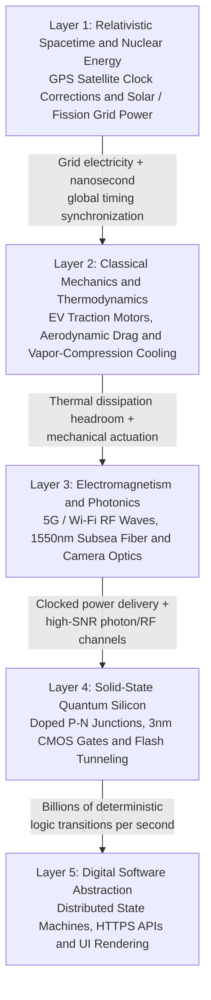
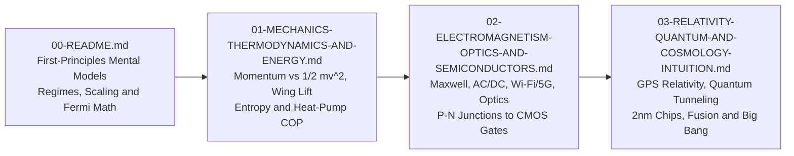

# First-Principles Physics for Software Engineers: Decoding the Physical Hardware Universe Around You

> **Scope & Philosophy**: Software engineers spend forty hours a week inside deterministic abstractions—virtual memory, TCP sockets, cloud regions, and tensor APIs—that deliberately hide the messy physical world. Yet every instruction your code executes, every packet crossing an ocean, every watt cooled out of a datacenter, and every machine you use in daily life (electric vehicles, commercial airliners, inverter heat pumps, smartphone cameras, Wi-Fi routers, and GPS satellites) obeys an unyielding set of physical laws. This reference vault rebuilds classical, electromagnetic, thermal, relativistic, quantum, and cosmological physics from first principles—zero rote exam memorization, zero pop-science mysticism, and maximum engineering intuition.

---

## 1. Why Software Engineers Should Think in Physical Laws

In pure software, almost any constraint is negotiable. If an API schema is awkward, you refactor it. If a state transition fails, you roll back the transaction and retry. That flexibility breeds a subtle cognitive blind spot: **software engineers routinely forget that abstractions sit atop physical matter governed by non-negotiable conservation laws, quadratic scaling penalties, thermodynamic entropy, and a finite speed of light.**

Understanding first-principles physics upgrades both your engineering judgment and how you perceive the everyday world:

1. **Hardware-Sympathetic Systems Architecture**: You stop treating `us-east-1` to `ap-northeast-1` latency as a "cloud networking issue" when you know silica optical fiber slows light to $v \approx 2.0 \times 10^8\text{ m/s}$ ($20\text{ cm/ns}$), imposing an unbreakable $\approx 108\text{ ms}$ round-trip floor across $10,800\text{ km}$ of great-circle cable. You immediately grasp why CPU clock frequencies hit a wall around $4\text{--}5\text{ GHz}$ in 2005 ($P_{\text{dyn}} = \alpha C V^2 f$), why 2 nm chips battle quantum tunneling leakage, and why AI training clusters are fundamentally constrained by transformer substations and liquid-cooling heat rejection.
2. **Immunity to Marketing Hype & Everyday Myths**: Whether evaluating residential heat-pump dryers, GaN USB-C chargers, EV winter range loss, camera lens apertures, or 5G wall attenuation, first-principles conservation and scaling equations let you verify claims on the back of a napkin in sixty seconds.
3. **Reasoning From First Principles vs. Reasoning by Analogy**: Reasoning by analogy copies existing designs with incremental tweaks ("batteries have always cost USD X per kWh"). First-principles reasoning decomposes a system down to its irreducible physical truths—mass, energy, momentum, charge, band gaps, and Carnot limits—and asks what the laws of nature actually permit vs. what is merely a temporary manufacturing bottleneck.

---

## 2. The Four Regimes of Physical Reality

Physics is not a grab bag of disconnected formulas. Every theory in modern physics occupies a well-defined coordinate on a 2D map parameterized by **Characteristic Length Scale ($L$)** and **Characteristic Velocity ($v / c$)** (or gravitational potential $\Phi / c^2$). Just as you choose between an L1 CPU cache lock, an OS mutex, or multi-region Paxos depending on distance and concurrency, physicists choose the simplest effective model whose approximations hold within the target regime.

| Physical Regime | Scale & Speed Condition | Governing Equations | Everyday & Computing Manifestations |
| :--- | :--- | :--- | :--- |
| **1. Classical Mechanics & Continuum Thermodynamics** | Macroscopic ($L \gg 10^{-9}\text{ m}$); Slow ($v \ll c$) | Newton's $\mathbf{F} = \frac{d\mathbf{p}}{dt}$; Navier-Stokes fluid equations; Laws of Thermodynamics | Highway braking distances, EV vs. ICE powertrains, airplane wing lift, datacenter cooling, refrigerators & heat pumps |
| **2. Electromagnetism & Wave Optics** | Macroscopic to sub-micron; Field propagation at $v = c$ | Maxwell's 4 Equations; Lorentz Force $\mathbf{F} = q(\mathbf{E} + \mathbf{v} \times \mathbf{B})$; Snell & Rayleigh optics | AC/DC power grids, transformers, brushless motors, Wi-Fi / 5G antennas, fiber-optic cables, camera lenses |
| **3. Special & General Relativity** | Any size; High speed ($v \to c$), ultra-precise timing, or strong gravity ($\Phi / c^2$) | Lorentz transformations ($\gamma$); Einstein Field Equations ($G_{\mu\nu} \propto T_{\mu\nu}$) | Smartphone GPS atomic clock corrections ($+38.5\text{ }\mu\text{s/day}$), particle accelerators, black holes, expanding cosmos |
| **4. Quantum & Statistical Mechanics** | Atomic / nanoscale ($L \le 10^{-8}\text{ m}$); Action comparable to $\hbar$ | Schrodinger / Dirac equations; Fermi-Dirac & Bose-Einstein statistics; Boltzmann $S = k_B \ln \Omega$ | Silicon band gaps, MOSFET logic gates, NVMe SSD flash tunneling, LEDs, solar panels, lasers, stellar nuclear fusion |

### The Physical Substrate Stack Beneath Software

Every digital action—say, requesting a ride on your smartphone—traverses all four regimes of physics simultaneously within milliseconds:

---

## 3. Five Universal Mental Models: Physics-to-Software Isomorphisms

If you already think fluently about algorithmic complexity, distributed queues, and information theory, you already possess half the mathematical machinery of physics. Master these five structural bridges to map software intuition directly onto physical hardware:

### 3.1 Quadratic & Cubic Scaling Walls ($O(N^2)$ and $O(N^3)$ in Hardware)

In software, an $O(N^2)$ loop looks harmless at $N = 10$ and melts production servers at $N = 100,000$. Nature enforces the exact same nonlinear exponents on velocity, voltage, and current:

- **Kinetic Energy & Braking Distance ($E_k = \frac{1}{2} m v^2$)**: Doubling vehicle speed from $50\text{ km/h}$ to $100\text{ km/h}$ quadruples the thermal energy your brake rotors must dissipate and quadruples tire stopping distance.
- **Aerodynamic Drag Power ($P_{\text{drag}} = \frac{1}{2} \rho C_d A v^3$)**: Drag *force* scales with $v^2$, so the *power* required to push air aside ($P = F \cdot v$) scales with **$v^3$**. Driving an electric car at $130\text{ km/h}$ instead of $90\text{ km/h}$ increases speed by $1.44\times$, yet demands $(1.44)^3 \approx 3.0\times$ more aerodynamic power—explaining why highway EV range drops noticeably at high cruising speeds.
- **Electrical Line Loss ($P_{\text{loss}} = I^2 R$)**: Doubling current quadruples waste heat in cables and PCB traces, which is why utility grids step transmission up to $500\text{ kV}$ and datacenters are migrating rack busbars from $12\text{ V}$ to $48\text{ V}$ (cutting current $4\times$ and resistive copper losses $16\times$).
- **CMOS Dynamic Chip Power ($P_{\text{dyn}} = \alpha C V^2 f$)**: Because maximum stable transistor switching frequency $f$ scales roughly linearly with supply voltage $V$ near operating limits, overclocking frequency by $20\%$ requires raising $V$ by $\approx 20\%$, driving chip heat up by $(1.2)^3 \approx 1.73\times$. Conversely, underclocking and undervolting efficiency cores on Apple Silicon yields massive battery life gains.

### 3.2 Conservation Laws as Double-Entry Ledger Invariants

In financial backend engineering, money never vanishes; every debit must match an equal credit across accounts. Physics runs on strict conservation invariants (rooted via **Noether's Theorem** in the symmetries of spacetime):

- Time-translation symmetry $\implies$ **Conservation of Energy**
- Space-translation symmetry $\implies$ **Conservation of Linear Momentum**
- Rotational symmetry $\implies$ **Conservation of Angular Momentum**
- Gauge symmetry of electromagnetism $\implies$ **Conservation of Electric Charge**

Whenever a product claims to "eliminate" energy or momentum—an "energy-saving plug-in box," a "reactionless space thruster," or a portable AC unit with **no exhaust hose** sitting inside a closed room—audit the ledger boundary. A hose-less AC cools air at its front grille only by dumping *more* heat ($Q_C + W_{\text{compressor}}$) out of its back grille into the exact same room, raising net room temperature!

### 3.3 Impedance Matching & Boundary Reflections

Whenever any wave—mechanical sound, ocean swell, optical light, or a $10\text{ GHz}$ PCIe / DDR5 electrical clock edge—travels through Medium 1 (characteristic impedance $Z_1$) and hits an abrupt boundary with Medium 2 ($Z_2$), part of the wave reflects backward instead of transmitting forward:

$$\Gamma_{\text{reflection}} = \frac{Z_2 - Z_1}{Z_2 + Z_1}$$

- **Software Analog**: Backpressure at a mismatched producer-consumer queue boundary.
- **Everyday Physics**:
  - Uncoated glass ($n \approx 1.5$) vs. air ($n \approx 1.0$) reflects $\approx 4\%$ of light per surface; multi-element camera lenses deposit quarter-wavelength anti-reflective coatings ($n_{\text{coat}} \approx \sqrt{n_{\text{air}} n_{\text{glass}}}$) so reflected waves cancel via destructive interference.
  - Medical ultrasound gel eliminates the huge acoustic impedance mismatch between air and human skin—without the gel, $99.9\%$ of ultrasound bounces straight off your skin!
  - High-speed PCB traces and coaxial cables terminate in matched $50\text{ }\Omega$ or $100\text{ }\Omega$ differential impedances so gigahertz digital edges do not bounce back and corrupt logic levels.

### 3.4 Entropy, State-Space Volume & Information Erasure

Thermodynamic entropy ($S = k_B \ln \Omega$) and Claude Shannon's information entropy ($H = -\sum p_i \log_2 p_i$) share the same mathematical soul. $\Omega$ counts how many microscopic particle arrangements produce the same macroscopic appearance. Because messy, uniform thermal equilibrium corresponds to trillions of orders of magnitude more microstates than an ordered battery or hot-vs-cold gradient, random microscopic collisions overwhelmingly drift toward higher entropy.

Even computation is bound to thermodynamics via **Landauer's Principle**: any logically irreversible operation that erases 1 bit of information (like `x = 0`, collapsing two possible prior states into one) must compress computational state space and dump at least:

$$E_{\min} = k_B T \ln 2 \approx 2.87 \times 10^{-21}\text{ J} \quad (\text{at } T = 300\text{ K})$$

of heat into the surrounding environment. Modern 3 nm CMOS transistors still dissipate roughly $10^3\text{--}10^4 \times k_B T \ln 2$ per switching event, setting the long-term physical horizon of computing efficiency.

### 3.5 Bandwidth, Attenuation & the Carrier-Frequency Trade-Off

Across acoustics, optics, and radio engineering, **higher carrier frequencies unlock wider data bandwidth and finer spatial resolution, but suffer steeper obstacle diffraction penalties and material absorption**:

| Physical Property | Low Frequency / Long Wavelength | High Frequency / Short Wavelength | Everyday Consequence |
| :--- | :--- | :--- | :--- |
| **Obstacle Diffraction** | Bends easily around corners & walls ($\lambda \ge$ obstacle size) | Travels in near-straight rays; blocked by walls, trees, hands | You hear booming bass ($60\text{ Hz}$, $\lambda \approx 5.7\text{ m}$) from a neighbor's party through walls while crisp hi-hats ($10\text{ kHz}$, $\lambda \approx 3.4\text{ cm}$) are muffled; $2.4\text{ GHz}$ Wi-Fi reaches bedrooms where $6\text{ GHz}$ Wi-Fi drops |
| **Channel Bandwidth** | Narrow spectrum slice (low Mbps ceiling) | Huge contiguous spectrum (multi-Gbps capacity) | $6\text{ GHz}$ Wi-Fi 7 and $28\text{ GHz}$ mmWave 5G deliver fiber-like speeds inside a single room or stadium |
| **Imaging / Lithography Resolution** | Coarse ($\Delta x_{\min} \sim \lambda / 2$) | Atomic / nanometer precision | Optical microscopes stall around $200\text{ nm}$; EUV chip lithography uses $13.5\text{ nm}$ light; electron microscopes use picometer matter waves |

---

## 4. Back-of-the-Envelope Fermi Estimation Toolkit

Keep this compact table of physical constants and reference magnitudes in mental RAM—equivalent to Jeff Dean's *"Latency Numbers Every Programmer Should Know"*, extended to the physical world:

| Quantity | Value to Remember | Rapid Engineering Anchor |
| :--- | :--- | :--- |
| **Speed of Light (Vacuum / Air)** | $c \approx 3.0 \times 10^8\text{ m/s} = 30\text{ cm/ns}$ | Light travels roughly **1 foot per nanosecond** ($300\text{ m/}\mu\text{s}$, $300\text{ km/ms}$) |
| **Speed of Light (Fiber / Copper Trace)** | $v \approx 2.0 \times 10^8\text{ m/s} = 20\text{ cm/ns}$ | Refractive index $n \approx 1.47$: add **$5\text{ }\mu\text{s}$ per km** one-way ($1\text{ ms}$ per $100\text{ km}$ RTT) |
| **Speed of Sound (Room Air vs. Water)** | $343\text{ m/s}$ (air); $1,480\text{ m/s}$ (water) | Thunder lag: $3\text{ seconds} \approx 1\text{ km}$ distance to lightning strike |
| **Standard Earth Gravity ($g$)** | $9.81\text{ m/s}^2 \approx 10\text{ m/s}^2$ | Falling from rest for $1\text{ s}$ reaches $10\text{ m/s}$ ($36\text{ km/h}$) and drops $5\text{ m}$ |
| **Atmospheric Pressure ($1\text{ atm}$)** | $101.3\text{ kPa} \approx 10\text{ N/cm}^2$ ($1\text{ kgf/cm}^2$) | Equivalent to a $10\text{ m}$ column of water or $760\text{ mm}$ of mercury |
| **Specific Heat of Liquid Water ($c_p$)** | $4,184\text{ J/(kg}\cdot\text{K)} \approx 4.2\text{ kJ/(L}\cdot^\circ\text{C)}$ | Water stores $4\times$ more heat per kg than air or aluminum (ideal liquid coolant!) |
| **Latent Heat of Water Vaporization** | $2,260\text{ kJ/kg}$ (at $100^\circ\text{C}$) | Boiling $1\text{ kg}$ of water takes **$5.4\times$ more energy** than heating it from $0^\circ\text{C}$ to $100^\circ\text{C}$! |
| **Household Wall Outlet Ceiling** | $1.8\text{ kW}$ ($120\text{ V}\times 15\text{ A}$ US); $2.2\text{ kW}$ ($220\text{ V}\times 10\text{ A}$ CN/EU) | Why hair dryers, kettles, space heaters, and toaster ovens all cap out at $1,500\text{--}2,200\text{ W}$ |
| **Energy Density: Gasoline vs. Li-Ion** | $\approx 46\text{ MJ/kg}$ ($12.8\text{ kWh/kg}$) vs. $\approx 0.9\text{ MJ/kg}$ ($0.25\text{ kWh/kg}$) | Gasoline packs **$\approx 50\times$ more raw energy per kg**, partially offset by EV motor efficiency ($90\%$ vs. $30\%$ ICE) |
| **Smartphone vs. EV Battery Capacity** | $\approx 15\text{--}20\text{ Wh}$ (phone) vs. $60\text{--}100\text{ kWh}$ (EV) | One $75\text{ kWh}$ EV battery holds the energy of **$\approx 4,200$ iPhones** |

### Worked Fermi Sanity Check: Why Can't a 100 W USB-C Charger Boil Tea Quickly?

Suppose you want to heat $1.0\text{ L}$ ($1.0\text{ kg}$) of tap water from $20^\circ\text{C}$ to $100^\circ\text{C}$ ($\Delta T = 80\text{ K}$):

1. **Minimum Thermal Energy Required**:
   $$Q = m c_p \Delta T = 1.0\text{ kg} \times 4,184\text{ J/(kg}\cdot\text{K)} \times 80\text{ K} \approx 335,000\text{ J} = 335\text{ kJ}$$
2. **On a $1,800\text{ W}$ Countertop Electric Kettle** ($\approx 90\%$ thermal transfer efficiency $\implies 1,620\text{ J/s}$):
   $$t = \frac{335,000\text{ J}}{1,620\text{ J/s}} \approx 207\text{ s} \approx 3.5\text{ minutes}$$
3. **On a $100\text{ W}$ USB-C PD Laptop Brick** (assuming $85\%$ insulated vessel efficiency $\implies 85\text{ J/s}$):
   $$t = \frac{335,000\text{ J}}{85\text{ J/s}} \approx 3,940\text{ s} \approx 66\text{ minutes!}$$

No clever firmware or "graphene heating element" can bypass $Q = m c_p \Delta T$. Whenever a crowdfunding gadget promises instant espresso or space heating from a small battery or USB port, multiply watts by seconds and compare against $4.2\text{ kJ/(L}\cdot\text{K)}$.

### Worked Fermi Sanity Check 2: Why AI Server Racks Must Switch From Air to Liquid Cooling

Modern frontier AI training racks (such as dense multi-GPU NVLink cabinets) dissipate $P = 120\text{ kW}$ of continuous thermal power in a single $0.6\text{ m} \times 1.2\text{ m}$ footprint. Can datacenter fans cool $120\text{ kW}$ with air alone, or does physics force direct-to-chip water cooling?

Let us allow the coolant temperature to rise by $\Delta T = 15\text{ K}$ (from $25^\circ\text{C}$ inlet to $40^\circ\text{C}$ exhaust) and solve the mass-flow conservation equation $P = \dot{m} c_p \Delta T = \rho \dot{V} c_p \Delta T$ for volumetric flow rate $\dot{V}$:

1. **Air Cooling** ($\rho_{\text{air}} \approx 1.2\text{ kg/m}^3$, $c_{p,\text{air}} \approx 1,005\text{ J/(kg}\cdot\text{K)}$):
   - Volumetric heat capacity of air:
     $$\rho_{\text{air}} c_{p,\text{air}} \approx 1.2 \times 1,005 \approx 1,206\text{ J/(m}^3\cdot\text{K)}$$
   - Required airflow rate at $\Delta T = 15\text{ K}$:
     $$\dot{V}_{\text{air}} = \frac{120,000\text{ W}}{1,206\text{ J/(m}^3\cdot\text{K)} \times 15\text{ K}} \approx 6.63\text{ m}^3\text{/s} \approx 14,050\text{ CFM}$$
   - Pushing $6.6\text{ cubic meters}$ of air *every single second* through a tightly packed server cabinet requires hurricane-force fan velocities, deafening acoustic levels, and consumes $15\text{--}25\text{ kW}$ of parasitic fan power alone!

2. **Direct-to-Chip Water Cooling** ($\rho_{\text{water}} \approx 1,000\text{ kg/m}^3$, $c_{p,\text{water}} \approx 4,184\text{ J/(kg}\cdot\text{K)}$):
   - Volumetric heat capacity of liquid water:
     $$\rho_{\text{water}} c_{p,\text{water}} \approx 4,184,000\text{ J/(m}^3\cdot\text{K)}$$
   - Water carries **$3,470\times$ more thermal energy per liter** than air!
   - Required water flow rate at $\Delta T = 15\text{ K}$:
     $$\dot{V}_{\text{water}} = \frac{120,000\text{ W}}{4.184 \times 10^6\text{ J/(m}^3\cdot\text{K)} \times 15\text{ K}} \approx 0.00191\text{ m}^3\text{/s} \approx 1.91\text{ L/s} \approx 115\text{ L/min}$$
   - Moving $1.9\text{ liters/second}$ through thumb-sized copper manifolds requires a quiet, fractional-kilowatt circulation pump. That $3,470\times$ volumetric density ratio is the exact first-principles reason every hyperscale AI datacenter transitioned to liquid cooling once rack power crossed $40\text{--}50\text{ kW}$.

### Dimensional Analysis: Compile-Time Type Checking for Physical Equations

In strongly typed languages like TypeScript or Rust, you cannot add `UserId` to `Milliseconds` or assign `BytesPerSecond` to a `Bytes` variable—the compiler rejects the expression before runtime. **Dimensional analysis** applies the exact same static type-checker to physical formulas using the International System of Units (SI) base dimensions:

- **Length** $[L]$ ($\text{m}$), **Mass** $[M]$ ($\text{kg}$), **Time** $[T]$ ($\text{s}$), **Electric Current** $[I]$ ($\text{A}$), **Thermodynamic Temperature** $[\Theta]$ ($\text{K}$), **Amount of Substance** $[N]$ ($\text{mol}$), and **Luminous Intensity** $[J]$ ($\text{cd}$).

Every derived unit decomposes into an algebraic product of base types:

| Physical Quantity | Common Unit | Base-Dimension Type Signature | Algebraic Equivalence Useful in Mental Math |
| :--- | :--- | :--- | :--- |
| **Force ($F$)** | Newton ($\text{N}$) | $[M][L][T]^{-2}$ | $1\text{ N} = 1\text{ kg}\cdot\text{m/s}^2$ |
| **Pressure / Stress ($p$)** | Pascal ($\text{Pa}$) | $[M][L]^{-1}[T]^{-2}$ | $1\text{ Pa} = 1\text{ N/m}^2 = 1\text{ J/m}^3$ (**pressure IS energy density!**) |
| **Energy / Work / Heat ($E$)** | Joule ($\text{J}$) | $[M][L]^2[T]^{-2}$ | $1\text{ J} = 1\text{ N}\cdot\text{m} = 1\text{ W}\cdot\text{s} = 1\text{ V}\cdot\text{C}$ |
| **Power ($P$)** | Watt ($\text{W}$) | $[M][L]^2[T]^{-3}$ | $1\text{ W} = 1\text{ J/s} = 1\text{ V}\cdot\text{A}$ |
| **Voltage ($V$)** | Volt ($\text{V}$) | $[M][L]^2[T]^{-3}[I]^{-1}$ | $1\text{ V} = 1\text{ J/C}$ (energy per unit charge) |
| **RC Time Constant ($R \cdot C$)** | Second ($\text{s}$) | $[T]$ | $\Omega \times \text{F} = (\text{V/A}) \times (\text{C/V}) = \text{C / (C/s)} = \text{s}$ |

**Three Type-Safety Rules of Nature**:
1. **Addition & Equality Require Identical Types**: In $d = v_0 t + \frac{1}{2} a t^2$, every term evaluates to $[L]$. If you misremember kinetic energy as $\frac{1}{2} m v$, checking $[M][L][T]^{-1}$ against Joule $[M][L]^2[T]^{-2}$ immediately flags a missing $[L][T]^{-1}$ velocity factor!
2. **Transcendental Functions Demand Dimensionless Inputs**: Arguments to $\exp(x)$, $\ln(x)$, $\sin(x)$, and $\cos(x)$ **must have unit type $[1]$** (pure numbers), because $\exp(x) = 1 + x + \frac{x^2}{2!} + \dots$ cannot add $[1] + [L] + [L]^2$. That is why Boltzmann factors always look like $e^{-E / (k_B T)}$ (energy divided by thermal energy) and radioactive/capacitor decay always looks like $e^{-t / \tau}$ (time divided by characteristic time constant).
3. **Deriving Unknown Laws Free of Charge (Buckingham $\Pi$ Intuition)**: Suppose you forget the formula for the swing period $T_{\text{pend}}$ of a grandfather clock pendulum. Could it depend on bob mass $m$ ($[M]$), string length $L$ ($[L]$), and gravity $g$ ($[L][T]^{-2}$)? Notice neither $L$ nor $g$ contains $[M]$, so mass **must cancel out** ($T_{\text{pend}}$ cannot depend on bob mass!). To produce units of $[T]$ from $L$ ($[L]$) and $g$ ($[L][T]^{-2}$), the unique algebraic combination is:
   $$T_{\text{pend}} = C \sqrt{\frac{L}{g}}$$
   where dimensionless constant $C = 2\pi$ for small angles. Simply type-checking the variables recovers 90% of the physics before solving a single differential equation!

---

## 5. Everyday Folklore vs. Physical Reality (Calibration Matrix)

Before diving into the three deep-dive modules, calibrate your intuition against eight of the most common misconceptions held even by technically trained adults:

| Common Everyday Belief | Physical Reality | Module Reference |
| :--- | :--- | :--- |
| *"Astronauts float on the ISS because space at 400 km has zero gravity."* | Gravity at $400\text{ km}$ altitude is still **$89\%$ as strong** as on Earth's surface ($8.7\text{ m/s}^2$). Astronauts float because the station hurtles sideways at $7.66\text{ km/s}$, falling around Earth's curvature in continuous free-fall. | [01-MECHANICS-THERMODYNAMICS-AND-ENERGY.md](01-MECHANICS-THERMODYNAMICS-AND-ENERGY.md) |
| *"Airplane wings lift because upper and lower air parcels must meet at the trailing edge."* | Wind-tunnel smoke proves upper air arrives **much earlier** than lower air. Lift arises from angle of attack + camber + sharp trailing-edge Kutta condition curving streamlines, creating intense upper-surface low pressure and deflecting air downward (downwash). | [01-MECHANICS-THERMODYNAMICS-AND-ENERGY.md](01-MECHANICS-THERMODYNAMICS-AND-ENERGY.md) |
| *"No machine can exceed 100% heating efficiency without violating energy conservation."* | Resistive heaters convert electricity to heat at $100\%$ ($\text{COP} = 1$). Heat pumps use $1\text{ kWh}$ of compressor work to **move** $2.5\text{--}3.5\text{ kWh}$ of outdoor ambient heat indoors, delivering $3.5\text{--}4.5\text{ kWh}$ of total heat ($\text{COP} = 3.5\text{--}4.5$) with all energy conserved. | [01-MECHANICS-THERMODYNAMICS-AND-ENERGY.md](01-MECHANICS-THERMODYNAMICS-AND-ENERGY.md) |
| *"Strong 5G or Wi-Fi routers emit low-dose ionizing radiation similar to X-rays."* | Ionizing DNA requires $\ge 3\text{--}5\text{ eV}$ **per single photon**. A $5\text{ GHz}$ Wi-Fi/5G photon carries $0.00002\text{ eV}$—$200,000\times$ below the quantum ionization threshold regardless of router count. | [02-ELECTROMAGNETISM-OPTICS-AND-SEMICONDUCTORS.md](02-ELECTROMAGNETISM-OPTICS-AND-SEMICONDUCTORS.md) |
| *"Closing a camera lens aperture to f/22 gives maximum sharpness across the frame."* | While smaller apertures widen depth of field, wave diffraction through a tiny pinhole spreads every point of light into a blurry **Airy disk** ($r \propto \lambda N$). Most lenses peak in sharpness around $f/4\text{--}f/8$. | [02-ELECTROMAGNETISM-OPTICS-AND-SEMICONDUCTORS.md](02-ELECTROMAGNETISM-OPTICS-AND-SEMICONDUCTORS.md) |
| *"Electrons race through household copper wires at nearly the speed of light."* | The **electromagnetic field** propagates down the wire near $c$, flipping lights on instantly, but individual conduction electrons drift at a glacial **snail's pace of $\approx 0.01\text{--}0.1\text{ mm/s}$** (and wiggle in place by microns under $60\text{ Hz}$ AC!). | [02-ELECTROMAGNETISM-OPTICS-AND-SEMICONDUCTORS.md](02-ELECTROMAGNETISM-OPTICS-AND-SEMICONDUCTORS.md) |
| *"Relativity only matters near light speed or black holes, never in consumer gadgets."* | GPS satellites experience $-7.2\text{ }\mu\text{s/day}$ kinematic slowing (Special Relativity) and $+45.7\text{ }\mu\text{s/day}$ gravitational speedup (General Relativity). Without correcting the $+38.5\text{ }\mu\text{s/day}$ net drift, smartphone maps would drift **$\approx 11.5\text{ km}$ per day**. | [03-RELATIVITY-QUANTUM-AND-COSMOLOGY-INTUITION.md](03-RELATIVITY-QUANTUM-AND-COSMOLOGY-INTUITION.md) |
| *"Quantum observation requires a conscious human mind, and entanglement sends FTL data."* | "Measurement" in physics means irreversible decoherence with a macroscopic thermal environment—zero consciousness required. Entanglement creates non-local correlations, but local outcomes remain random ($50/50$), strictly preserving $v_{\text{info}} \le c$. | [03-RELATIVITY-QUANTUM-AND-COSMOLOGY-INTUITION.md](03-RELATIVITY-QUANTUM-AND-COSMOLOGY-INTUITION.md) |

---

## 6. Curriculum Navigation & Study Order

The curriculum progresses deliberately from tangible macroscopic forces and heat engines, through electromagnetic fields and silicon transistors, to relativistic spacetime, quantum mechanics, and cosmic origins:

### Complete Vault Table of Contents

1. **[00-README.md](00-README.md) — First-Principles Physics for Software Engineers: Decoding the Physical Hardware Universe Around You** *(Current Document)*
   - Why software abstractions sit on non-negotiable hardware constraints, the 4 physical regimes mapped by length and velocity, 5 physics-to-software mental models ($v^2/v^3$ scaling, conservation ledgers, impedance matching, Landauer entropy, carrier-frequency trade-offs), the Fermi estimation constant table, and everyday myth calibration.
2. **[01-MECHANICS-THERMODYNAMICS-AND-ENERGY.md](01-MECHANICS-THERMODYNAMICS-AND-ENERGY.md) — Classical Mechanics, Fluid Lift & Thermodynamics in Daily Life**
   - Newtonian momentum ($mv$, time-integral impulse) vs. kinetic energy ($\frac{1}{2}mv^2$, space-integral work) in highway braking distances and crash crumple zones; torque vs. power and orbital free-fall; debunking the "equal transit time" wing myth via Navier-Stokes pressure gradients, trailing-edge Kutta circulation, and downwash; the 4 Laws of Thermodynamics, Boltzmann state-space entropy ($S = k_B \ln \Omega$), Carnot efficiency ceilings, and how refrigerators, inverter ACs, and heat-pump clothes dryers move $3\times\text{--}4\times$ more heat energy than the electricity they consume via Coefficient of Performance ($\text{COP}$).
3. **[02-ELECTROMAGNETISM-OPTICS-AND-SEMICONDUCTORS.md](02-ELECTROMAGNETISM-OPTICS-AND-SEMICONDUCTORS.md) — Electromagnetism, Light, Optics & How Silicon Chips/Wi-Fi Work**
   - State-machine intuition for Maxwell's 4 Equations; why utility grids use high-voltage AC transformers ($I^2R$ loss reduction) while chips need DC, and how high-frequency GaN switching shrinks USB-C chargers; the full electromagnetic spectrum from $2.4/5/6\text{ GHz}$ Wi-Fi & 5G wall attenuation to the hard quantum threshold of UV/X-ray ionization; Snell refraction, subsea fiber total internal reflection, camera $f$-stops, and Airy disk diffraction limits; and building computing from sand: silicon band gaps, N/P doping, P-N junctions (LEDs & solar cells), MOSFETs, and CMOS `NOT`/`NAND` logic gates.
4. **[03-RELATIVITY-QUANTUM-AND-COSMOLOGY-INTUITION.md](03-RELATIVITY-QUANTUM-AND-COSMOLOGY-INTUITION.md) — Special/General Relativity, Quantum Mechanics & Modern Cosmology Without Mysticism**
   - Deriving time dilation ($\gamma$) from a train light-clock; General Relativity spacetime curvature and the exact $+38.5\text{ }\mu\text{s/day}$ ($\approx 11.5\text{ km/day}$) GPS satellite clock budget; demystifying quantum mechanics—photoelectric photon quantization, complex probability-amplitude interference, Fourier-duality uncertainty ($\Delta x \Delta p \ge \hbar/2$), and quantum tunneling as both the leakage villain in 2 nm CPUs and the storage mechanism of NVMe Flash SSDs; nuclear binding energy, fission vs. quantum-tunneled solar fusion; and the 13.8-billion-year Big Bang cosmic timeline, CMB $2.725\text{ K}$ blackbody echo, and stellar nucleosynthesis.
