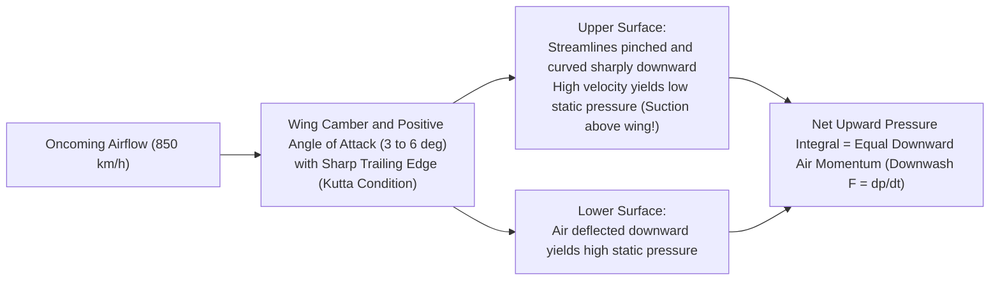
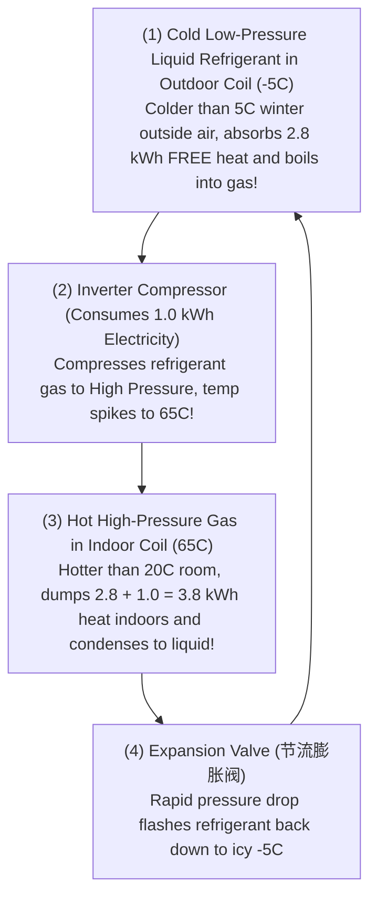

# Classical Mechanics, Fluid Lift & Thermodynamics in Daily Life

From highway braking distances and commercial Boeing/Airbus wing physics to inverter air conditioners and heat-pump clothes dryers, macroscopic everyday life runs on two twin pillars: **Newtonian Mechanics** and **Statistical Thermodynamics**.

---

## Table of Contents

1. [Momentum vs Kinetic Energy: Why Speed Kills Quadratically](#1-momentum-vs-kinetic-energy-why-speed-kills-quadratically)
2. [Torque, Power & Why Astronauts Actually Float in Orbit](#2-torque-power--why-astronauts-actually-float-in-orbit)
3. [How Airplane Wings Really Generate Lift (Debunking the Equal-Time Myth)](#3-how-airplane-wings-really-generate-lift-debunking-the-equal-time-myth)
4. [The Four Laws of Thermodynamics & Boltzmann Entropy](#4-the-four-laws-of-thermodynamics--boltzmann-entropy)
5. [Refrigerators, Air Conditioners & Heat-Pump Dryers (`COP = 3.5+` Magic)](#5-refrigerators-air-conditioners--heat-pump-dryers-cop--35-magic)

---

## 1. Momentum vs Kinetic Energy: Why Speed Kills Quadratically

Beginners often ask: *"If both momentum ($\mathbf{p} = m\mathbf{v}$) and kinetic energy ($E_k = \frac{1}{2}mv^2$) measure moving mass, why do we need two equations?"*

Because one integrates force over **time ($dt$)**, while the other integrates force over **distance ($dx$)**:

$$\Delta \mathbf{p} = \int \mathbf{F}\,dt \quad (\text{Impulse-Momentum}), \qquad \Delta E_k = \int \mathbf{F}\cdot d\mathbf{x} \quad (\text{Work-Energy})$$

| Real-World Scenario | Governed By | Practical Consequence |
| :--- | :--- | :--- |
| **Car Crumple Zones & Airbags** | **Impulse ($\Delta p = F_{\text{avg}} \cdot \Delta t$)** | Your momentum change from $100\text{ km/h} \to 0$ is fixed. Extending deceleration time $\Delta t$ from $10\text{ ms}$ (hitting rigid steel) to $120\text{ ms}$ (crumple zone + airbag) cuts peak lethal force $F$ on your organs by **$12\times$**! |
| **Highway Braking Distance** | **Work-Energy ($\frac{1}{2}mv^2 = \mu m g \cdot d$)** | Mass $m$ cancels out! Stopping distance $d = \frac{v^2}{2\mu g}$ scales with **$v^2$**: driving at $120\text{ km/h}$ vs $60\text{ km/h}$ requires **$4\times$ the stopping distance** (plus human reaction distance $v \cdot t_{\text{react}}$), and rain cuts tire friction $\mu$ in half, multiplying stopping distance to **$8\times$**! |
| **EV Highway Range Drop** | **Drag Power ($P = F_{\text{drag}} \cdot v = \frac{1}{2}\rho C_d A v^3$)** | Aerodynamic drag force scales as $v^2$, so power per second scales as **$v^3$**. Slowing an EV from $130\text{ km/h}$ down to $100\text{ km/h}$ cuts aerodynamic battery drain by **$54\%$**! |

---

## 2. Torque, Power & Why Astronauts Actually Float in Orbit

### 2.1 Torque ($\tau$) vs Power ($P = \tau \cdot \omega$)
- **Torque ($\tau$, measured in $\text{N}\cdot\text{m}$)** is rotational *force*—how hard the wheels twist right now (`shoving you back into your seat at 0 km/h`). Electric motors deliver **peak torque at $0\text{ RPM}$** via Lorentz magnetic force, whereas internal combustion engines (`ICE`) produce zero torque at $0\text{ RPM}$ and need multi-gear transmissions.
- **Power ($P = \tau \cdot \omega$, measured in $\text{kW}$ or horsepower)** is **work per unit time**—determining top speed and highway passing acceleration.

### 2.2 Why Astronauts Float on the Space Station (`400 km` Altitude)
- **Myth**: *"There is zero gravity in Low Earth Orbit."*
- **Physics**: By Newton's $g(r) = \frac{GM}{r^2}$, at $h = 400\text{ km}$ above Earth's $R = 6,371\text{ km}$ radius, gravitational pull is still $\left(\frac{6371}{6771}\right)^2 \approx \mathbf{88.5\%}$ of surface gravity!
- **Isaac Newton's Cannonball**: Why don't astronauts fall down? **They ARE falling down at $8.7\text{ m/s}^2$ every second**—while simultaneously moving sideways at **$v = \sqrt{GM/r} \approx 7.66\text{ km/s}$ ($27,600\text{ km/h}$)** so fast that Earth's curved surface drops away beneath them at the exact same rate! Weightlessness is **continuous horizontal free-fall**.

---

## 3. How Airplane Wings Really Generate Lift (Debunking the Equal-Time Myth)

Almost every children's textbook teaches the **"Equal Transit-Time Fallacy"**: *"Air splitting at the front of a curved wing must meet up at the back at the same time, so upper air travels farther and faster."* **Wind-tunnel smoke tests prove this is 100% false**—air over the top of a lifting wing races past the trailing edge *long before* the bottom parcel arrives (and stunt planes fly upside-down with symmetric wings!).

### How Real Aerodynamic Lift Works (Bernoulli + Newton Are Two Views of One Flow)

1. **Streamline Curvature & Pressure Gradient (Euler / Bernoulli View)**: Because air is viscous at the sharp trailing edge (**Kutta condition**), air cannot whip around the sharp rear edge from bottom to top. Instead, a positive **angle of attack (`迎角`)** + wing camber forces upper-surface air to accelerate dramatically around the leading curve, creating a strong **low-pressure suction zone across the top of the wing** (contributing ~2/3 of total lift!).
2. **Downwash Momentum Conservation (Newton's 3rd Law View)**: Integrating that pressure difference around the wing is mathematically equivalent to the wing deflecting tonnes of air **downward (`下洗气流`)** every second: $F_{\text{lift}} = \dot{m}_{\text{air}} \cdot v_{\text{downwash}}$.
3. **Why Stalls Happen (`失速`)**: Exceeding critical angle of attack (`~15°–18°`) causes the boundary layer to detach from the upper wing into chaotic turbulent eddies, collapsing upper-surface suction instantly regardless of airspeed.

---

## 4. The Four Laws of Thermodynamics & Boltzmann Entropy

| Law | Statement | Software / Hardware Isomorphism |
| :--- | :--- | :--- |
| **0th Law** | Thermal equilibrium is transitive ($A \equiv C$ and $B \equiv C \implies A \equiv B$) | Defines **Temperature ($T$)**—average kinetic energy per degree of freedom ($\frac{1}{2}k_B T$) |
| **1st Law** | $\Delta U = Q - W$ (Energy is strictly conserved) | **No Perpetual Motion of the 1st Kind**: You can convert electrical, kinetic, chemical, and thermal energy, never create it from `0` |
| **2nd Law** | $\Delta S_{\text{universe}} \ge 0$ (Total entropy never decreases in an isolated system) | **Boltzmann's $S = k_B \ln \Omega$**: Unordered thermal microstates ($\Omega$) outnumber ordered states by $10^{10^{23}}$ to $1$! Heat never flows spontaneously from cold to hot, and every heat engine wastes a fraction $\ge \frac{T_{\text{cold}}}{T_{\text{hot}}}$ (**Carnot Limit**) |
| **3rd Law** | Entropy of a perfect crystal approaches $0$ as $T \to 0\text{ K}$ ($-273.15^\circ\text{C}$) | Absolute zero ($0\text{ K}$) cannot be reached in a finite number of cooling operations |

---

## 5. Refrigerators, Air Conditioners & Heat-Pump Dryers (`COP = 3.5+` Magic)

How can an inverter air conditioner in heating mode—or a **heat-pump clothes dryer (`热泵烘干机`)**—consume **$1.0\text{ kWh}$ of electricity** while delivering **$3.8\text{ kWh}$ of heat** (`380%` apparent efficiency!) without violating the 1st Law of Thermodynamics?

Because a resistive space heater (`电暖器 / 冷凝烘干机`) **creates** heat from electricity ($1\text{ kWh}_{\text{elec}} \to 1\text{ kWh}_{\text{heat}}$, $\text{COP} = 1.0$), whereas a **Vapor-Compression Heat Pump (`热泵循环`)** uses electricity merely as a **freight elevator** to pump free ambient thermal energy uphill from outside air into your room!

### Coefficient of Performance ($\text{COP}$) Math for Smart Home Buying

$$\text{COP}_{\text{heating}} = \frac{Q_{\text{delivered}}}{W_{\text{elec}}} \le \frac{T_{\text{hot}}}{T_{\text{hot}} - T_{\text{cold}}} \quad (\text{in Kelvin!})$$

1. **Why Shanghai Winter AC Heating Beats Electric Space Heaters by $3.5\times$**:
   - Outdoor winter air at $5^\circ\text{C}$ ($278\text{ K}$) still contains enormous molecular thermal energy compared to $0\text{ K}$! Pumping heat from $278\text{ K}$ to $295\text{ K}$ ($22^\circ\text{C}$ indoors) achieves real-world **$\text{COP} \approx 3.2\text{--}4.0$**—cutting your winter heating electricity bill by **$70\%$** vs plug-in resistive oil/ceramic heaters!
2. **Why Heat-Pump Dryers (`热泵洗烘分体`) Protect Expensive Clothes**:
   - Old resistive dryers bake wool/cotton at $85^\circ\text{C}+$ (shrinking heavyweight tees and sweaters!) and vent humid heat. A closed-loop heat-pump dryer condenses moisture over its cold coil ($15^\circ\text{C}$) and recycles that latent heat on its warm coil ($50^\circ\text{C}$), using **$65\%$ less electricity** and keeping garment fibers fluffy and unshrunk!
