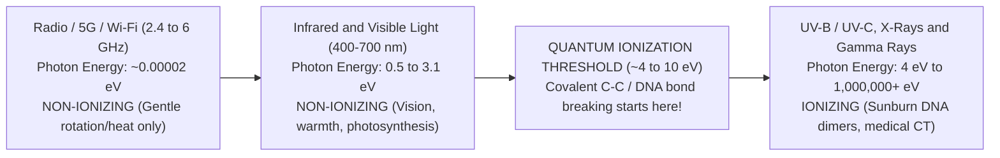
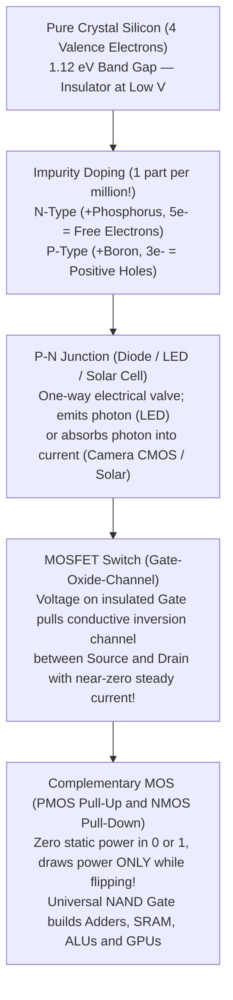

# Electromagnetism, Light, Optics & How Silicon Chips and Wi-Fi Work

Every bit stored in RAM, every pixel emitted by an OLED screen, every `5 GHz` Wi-Fi frame crossing your living room, and every ray focused onto your iPhone sensor is governed by **James Clerk Maxwell's unified theory of electromagnetism** and **solid-state semiconductor band theory**.

---

## Table of Contents

1. [Maxwell's Four Equations in Plain Engineer Intuition](#1-maxwells-four-equations-in-plain-engineer-intuition)
2. [AC Power Grids, Transformers & Why GaN USB-C Chargers Shrunk by 4x](#2-ac-power-grids-transformers--why-gan-usb-c-chargers-shrunk-by-4x)
3. [The Electromagnetic Spectrum: Wi-Fi/5G Attenuation vs Ionizing Radiation](#3-the-electromagnetic-spectrum-wi-fi5g-attenuation-vs-ionizing-radiation)
4. [Wave Optics: Fiber Total Internal Reflection, Lenses & Diffraction Limits](#4-wave-optics-fiber-total-internal-reflection-lenses--diffraction-limits)
5. [From Beach Sand to `NAND` Gates: Doping, P-N Junctions & CMOS Transistors](#5-from-beach-sand-to-nand-gates-doping-p-n-junctions--cmos-transistors)

---

## 1. Maxwell's Four Equations in Plain Engineer Intuition

Forget scary surface integrals—Maxwell's 4 equations are simply **4 state-transition rules** coupling electric fields ($\mathbf{E}$) and magnetic fields ($\mathbf{B}$):

| Equation | Mathematical Form | Plain-English Meaning & Everyday Device |
| :--- | :--- | :--- |
| **1. Gauss's Law (Electric)** | $\nabla \cdot \mathbf{E} = \frac{\rho}{\varepsilon_0}$ | Electric charges (`+` protons, `-` electrons) are sources/sinks of electric fields (**Capacitors, touchscreen capacitive sensing, static shocks**) |
| **2. Gauss's Law (Magnetic)** | $\nabla \cdot \mathbf{B} = 0$ | Magnetic field lines always form closed loops—there are **no isolated magnetic monopoles** (sawing a magnet in half gives two `N-S` magnets) |
| **3. Faraday's Law of Induction** | $\nabla \times \mathbf{E} = -\frac{\partial \mathbf{B}}{\partial t}$ | A **time-changing magnetic field** creates a curling electric voltage! (**Power-plant turbines, MagSafe wireless Qi charging, induction cooktops `电磁炉`, credit-card NFC**) |
| **4. Ampère-Maxwell Law** | $\nabla \times \mathbf{B} = \mu_0 \mathbf{J} + \mu_0 \varepsilon_0 \frac{\partial \mathbf{E}}{\partial t}$ | Moving electric current ($\mathbf{J}$) OR a **changing electric field** creates a curling magnetic field! (**Electromagnets, EV motors, speakers**) |

**The Leapfrog Wave**: Combine #3 and #4 in empty space ($\rho = 0, \mathbf{J} = 0$): an oscillating $\mathbf{E}$ creates an oscillating $\mathbf{B}$, which creates an oscillating $\mathbf{E}$, propagating outward forever at exact speed $c = \frac{1}{\sqrt{\mu_0 \varepsilon_0}} \approx 299,792,458\text{ m/s}$—that self-sustaining wave **IS** radio, Wi-Fi, infrared, visible light, UV, and X-rays!

---

## 2. AC Power Grids, Transformers & Why GaN USB-C Chargers Shrunk by 4x

1. **Why Grids Transmit High-Voltage AC ($500\text{ kV}$), While Chips Need Low-Voltage DC ($0.8\text{ V}$)**:
   - Power delivered is $P = V \cdot I$, while copper wire heat loss is $P_{\text{loss}} = I^2 R$. Raising transmission voltage $1,000\times$ drops current $I$ by $1,000\times$, slashing line heat loss by **$1,000,000\times$**!
   - Passive **transformers** rely on Faraday's $\frac{\partial \mathbf{B}}{\partial t}$, which only works with **Alternating Current (`50 Hz` AC in China/Europe, `60 Hz` in US/West Japan)**—steady DC has $\frac{\partial \mathbf{B}}{\partial t} = 0$!
2. **How Modern GaN (`氮化镓`) USB-C Chargers Pack `140W` into Your Palm**:
   - Old heavy "brick" adapters stepped down `50 Hz` AC directly using a giant iron-core transformer (low frequency = huge magnetic core required before saturating).
   - Modern **SMPS (`开关电源`)** chargers first rectify `220V 50Hz` AC into DC, then use **Gallium Nitride (`GaN`) wide-bandgap transistors** (`3.4 eV` bandgap vs `1.1 eV` silicon!) to chop that DC at **$300,000\text{--}1,000,000\text{ Hz}$**! Because transformer core volume shrinks inversely with switching frequency ($V_{\text{core}} \propto 1/f$), jumping from $50\text{ Hz}$ to $500\text{ kHz}$ shrinks the internal transformer to the size of a sugar cube!

---

## 3. The Electromagnetic Spectrum: Wi-Fi/5G Attenuation vs Ionizing Radiation

Every photon carries a discrete packet of energy dictated solely by its frequency $f$ (Planck's $E = h f = \frac{hc}{\lambda}$):

- **Why `2.4 GHz` Wi-Fi Goes Through Concrete Walls While `5 GHz / 6 GHz` Drops Off Fast**:
  - Longer wavelengths ($\lambda = 12.5\text{ cm}$ at `2.4 GHz` vs $5\text{ cm}$ at `6 GHz`) diffract better around corners and suffer lower dielectric absorption in reinforced concrete and water—at the cost of narrower channel bandwidth. Put smart-home IoT plugs on `2.4 GHz`, and keep your MacBook/phone within 1 room of a `5/6 GHz` Mesh node!
- **Why Router / Phone / Microwave Oven Radiation Cannot Mutate DNA**:
  - Severing a covalent bond in human DNA requires **at least $3.5\text{--}5\text{ eV}$ delivered by a SINGLE photon** (Einstein's photoelectric rule: throwing a billion ping-pong balls at a steel safe never cracks it; one cannonball does!).
  - Visible room light (`2.2 eV`) carries **$100,000\times$ more energy per photon** than `5 GHz` Wi-Fi or `2.45 GHz` microwave waves (`0.00001 eV`)! Direct midday summer **UV-B sunlight (`4.2 eV`)** *is* ionizing—which is why daily sunscreen prevents skin aging and melanoma while turning off your bedroom Wi-Fi router at night changes zero biology.

---

## 4. Wave Optics: Fiber Total Internal Reflection, Lenses & Diffraction Limits

1. **Subsea Optical Fiber (`全反射 Total Internal Reflection`)**:
   - Silica glass has refractive index $n_1 \approx 1.47$ ($v = c / 1.47 \approx 204,000\text{ km/s}$), clad in lower-index glass $n_2 \approx 1.45$. By **Snell's Law** ($n_1 \sin\theta_1 = n_2 \sin\theta_2$), shallow laser pulses (`1550 nm` infrared minimum-loss window) reflect **$100.000\%$ losslessly** off the inner boundary across $10,000\text{ km}$ of ocean floor, boosted every $80\text{ km}$ by **Erbium-Doped Fiber Amplifiers (`EDFA`)** without ever converting back to slow electrical signals!
2. **Why Stopping a Camera Lens Too Far Down (`f/16–f/22`) Makes Photos Blurry**:
   - Because light is a wave, squeezing light through a tiny aperture causes **Fraunhofer diffraction**, smearing every crisp point into a bullseye **Airy Disk** of diameter $d_{\text{Airy}} = 2.44 \lambda N$ (where $N$ is the $f$-number). On modern high-megapixel small-pixel sensors (like a 48MP iPhone sensor with `1.22 µm` pixels!), diffraction already exceeds pixel pitch past $f/2.8$—which is why smartphone lenses use fixed wide apertures ($f/1.78$) instead of mechanical $f/16$ irises!

---

## 5. From Beach Sand to `NAND` Gates: Doping, P-N Junctions & CMOS Transistors

How do you turn inert quartz sand ($\text{SiO}_2$) into an Apple M-series or NVIDIA GPU chip executing trillions of boolean operations per second?

- **Why CMOS Conquered Computing**: Pairing one **PMOS** transistor (conducts when Gate = `0`) on top to $V_{DD}$ with one **NMOS** transistor (conducts when Gate = `1`) on bottom to Ground guarantees that in steady state (`0` or `1`), **one switch is always OFF**—blocking direct current from power to ground! All heat ($P = \alpha C V^2 f$) comes strictly from charging/discharging tiny gate capacitances during `0 ↔ 1` clock edges (plus nanoscale quantum leakage, covered next in [03-RELATIVITY-QUANTUM-AND-COSMOLOGY-INTUITION.md](03-RELATIVITY-QUANTUM-AND-COSMOLOGY-INTUITION.md)).
