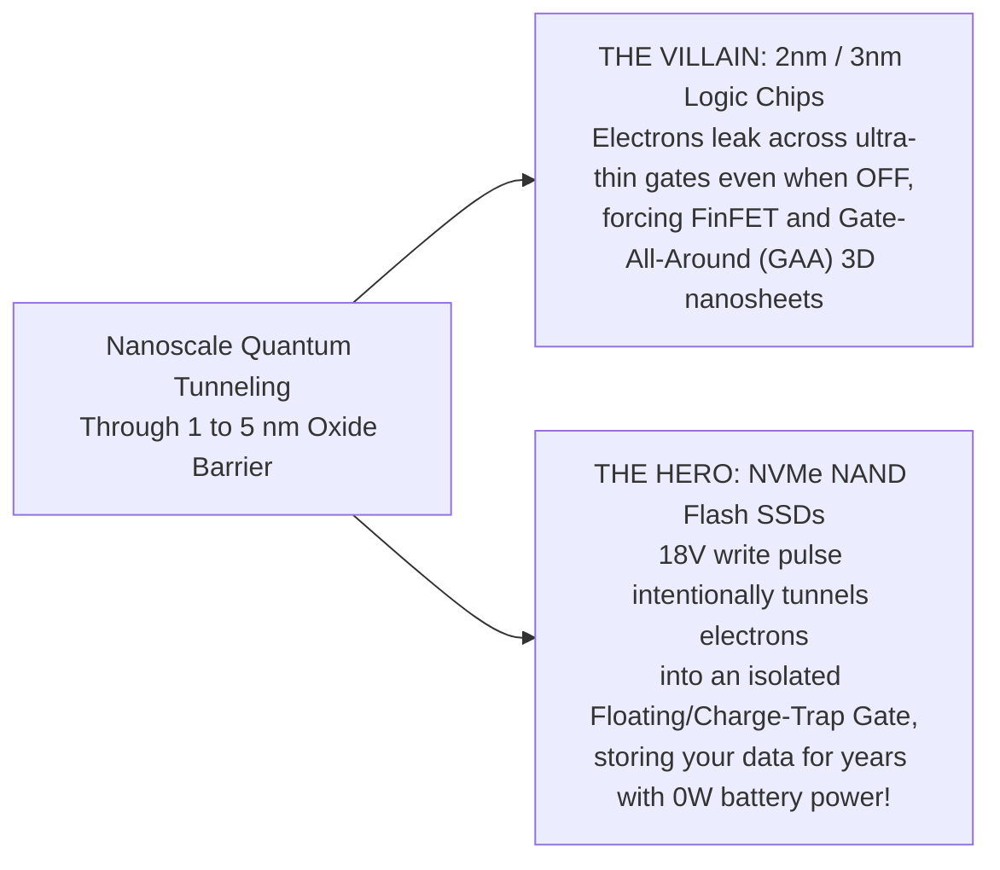

# Special & General Relativity, Quantum Mechanics & Cosmology Without Mysticism

Modern physics sounds weird only because human intuition evolved chasing antelopes at $5\text{ m/s}$ across $1\text{ m}$ savanna grass—never at $0.9c$ or $1\text{ nm}$. Strip away sci-fi jargon, and **Relativity** and **Quantum Mechanics** become two remarkably clean mathematical invariants that keep your smartphone GPS, NVMe SSD, and the Sun itself running.

---

## Table of Contents

1. [Special Relativity: Why Moving Clocks Tick Slower & $E = mc^2$](#1-special-relativity-why-moving-clocks-tick-slower--e--mc2)
2. [General Relativity & Why Your Phone's GPS Needs Einstein Every Day](#2-general-relativity--why-your-phones-gps-needs-einstein-every-day)
3. [Quantum Mechanics Without Woo: Amplitudes, Uncertainty & Decoherence](#3-quantum-mechanics-without-woo-amplitudes-uncertainty--decoherence)
4. [Quantum Tunneling in Your Pocket: `2 nm` CPU Leakage vs NVMe Flash SSDs](#4-quantum-tunneling-in-your-pocket-2-nm-cpu-leakage-vs-nvme-flash-ssds)
5. [Nuclear Binding Energy, Solar Fusion & The 13.8-Billion-Year Cosmic Arc](#5-nuclear-binding-energy-solar-fusion--the-138-billion-year-cosmic-arc)

---

## 1. Special Relativity: Why Moving Clocks Tick Slower & $E = mc^2$

In 1905, 26-year-old patent clerk **Albert Einstein** took Maxwell's constant speed of light $c$ seriously via one radical symmetry postulate: **Every inertial observer measures the exact same speed of light $c = 299,792,458\text{ m/s}$ in vacuum, regardless of how fast they or the flashlight are moving.**

If $c$ refuses to change, **space ($\Delta x$) and time ($\Delta t$) MUST flex** so every observer preserves the **Spacetime Interval**:

$$\Delta s^2 = (c\,\Delta t)^2 - \Delta x^2 - \Delta y^2 - \Delta z^2 = \text{invariant}$$

- **Time Dilation via a Simple Pythagorean Triangle**: Imagine a photon bouncing vertically up and down between two mirrors height $L$ apart inside a moving train ($v$). Inside the train, the photon travels vertical distance $2L$. From the station platform, the photon traces a longer **diagonal hypotenuse**! Since both observers measure identical photon speed $c$, the platform observer sees the train's clock tick slower by the **Lorentz Factor**:

$$\gamma = \frac{1}{\sqrt{1 - v^2/c^2}} \ge 1$$

- **$E = mc^2$ (Mass Is Concentrated Rest Energy)**: Mass is not "stuff"—99% of the mass of every proton and neutron in your body is actually the **kinetic and gluon-field binding energy of nearly massless quarks** trapped inside! Converting just $1\text{ gram}$ of mass-energy ($E = 0.001 \times (3 \times 10^8)^2 = 9 \times 10^{13}\text{ J}$) equals $25\text{ GWh}$ of electricity.

---

## 2. General Relativity & Why Your Phone's GPS Needs Einstein Every Day

In 1915, Einstein realized gravity is not an invisible tether pulling across empty space—**mass-energy curves the geometry of 4D spacetime itself**, and planets/photons simply follow the straightest possible paths (**geodesics**) through curved spacetime. Crucially, **clocks deeper inside a gravitational well tick SLOWER than clocks high in space**.

### Worked Engineering Proof: Smartphone GPS / BeiDou Satellite Clocks

GPS satellites orbit at altitude $h \approx 20,200\text{ km}$ at speed $v \approx 3.87\text{ km/s}$. To triangulate your street corner within $3\text{ meters}$, receiver timing must stay accurate to **$10\text{ nanoseconds}$** ($3\text{ m} / 0.3\text{ m/ns}$). Two opposite relativistic shifts hit satellite rubidium/cesium atomic clocks every single day:

| Effect | Physical Cause | Daily Clock Shift vs Earth Surface | Position Error After 24h If Ignored |
| :--- | :--- | :---: | :---: |
| **Special Relativity (Speed)** | Satellite moves at $3.87\text{ km/s}$ relative to ground | **$-7.2\text{ }\mu\text{s/day}$** (ticks slower) | $2.16\text{ km}$ |
| **General Relativity (Weaker Gravity)** | Satellite sits higher out of Earth's gravity well | **$+45.7\text{ }\mu\text{s/day}$** (ticks faster!) | $13.71\text{ km}$ |
| **Net Relativistic Drift** | $+45.7 - 7.2 = \mathbf{+38.5\text{ }\mu\text{s/day}}$ ($38,500\text{ ns/day}$!) | **$+38.5\text{ }\mu\text{s/day}$** | **$\approx 11.5\text{ km/day}$ cumulative drift!** |

Engineers physically detune satellite `10.23 MHz` master oscillators downward to `10.22999999543 MHz` before launch so orbit brings them onto exact Earth resonance! Every Didi pickup and Gaode turn-by-turn prompt is a live verification of Einstein's field equations.

---

## 3. Quantum Mechanics Without Woo: Amplitudes, Uncertainty & Decoherence

Strip away popular misunderstandings with three crisp software-engineering truths:

1. **Complex Probability Amplitudes ($\psi \in \mathbb{C}$, $P = |\psi|^2$)**:
   - Classical probability sums non-negative numbers ($P_A + P_B \ge 0$), so adding a second path can never produce zero. Quantum mechanics assigns each path a **complex number $\psi = r e^{i\theta}$** and computes $|\psi_1 + \psi_2|^2$—meaning two paths with opposite phase ($\theta_2 = \theta_1 + \pi$) **cancel to exact zero (`destructive interference`)**! Quantum computers (`qubits`) are linear-algebra engines choreographing constructive interference on correct answers and destructive cancellation on wrong ones.
2. **Heisenberg Uncertainty ($\Delta x \cdot \Delta p \ge \frac{\hbar}{2}$) Is Pure Fourier Duality**:
   - Uncertainty is **not** "clumsy instruments bumping the electron." Any audio engineer knows you cannot have a `1 ms` click with a single pure frequency `440 Hz`—a narrow spike in time requires a wide spread of frequencies (**Fourier Transform bandwidth theorem**). Because momentum *is* spatial wave frequency ($p = \hbar k$), localizing a particle tightly in space ($\Delta x \to 0$) mathematically requires superposing a wide spread of momenta ($\Delta p \to \infty$)!
3. **"Observation" Means Thermal Decoherence, Never Human Consciousness**:
   - Schrödinger's cat doesn't wait for a PhD student to open the box. The picosecond a quantum system entangles irreversibly with trillions of bouncing air molecules or photons, phase coherence leaks into the environment (**decoherence**), collapsing interference fringes into ordinary classical probabilities.

---

## 4. Quantum Tunneling in Your Pocket: `2 nm` CPU Leakage vs NVMe Flash SSDs

When a classical ball lacks energy to crest a hill ($E < V_0$), probability of crossing is `0%`. A quantum wavefunction $\psi(x)$ decays exponentially *inside* a thin potential barrier ($\propto e^{-\kappa d}$)—so if barrier thickness $d$ is only **`1–5 nanometers` (~10–25 silicon atoms wide)**, electrons **teleport straight through the solid insulator (`Quantum Tunneling 量子隧穿`)**!

---

## 5. Nuclear Binding Energy, Solar Fusion & The 13.8-Billion-Year Cosmic Arc

- **Why Both Splitting Uranium AND Fusing Hydrogen Release Energy**:
  - Plot nuclear binding energy per nucleon: it peaks at **Iron-56 ($^{56}\text{Fe}$)**—the most stable nuclear ash in the universe. Climbing *up* the curve from light Hydrogen $\to$ Helium (**Nuclear Fusion `核聚变`** in the Sun—enabled by **quantum tunneling** allowing protons at $1.5 \times 10^7\text{ K}$ to tunnel past Coulomb repulsion!) releases massive energy, AND sliding *down* toward Iron from heavy Uranium-235 (**Nuclear Fission `核裂变`** in power reactors) also releases massive energy!
- **Where the Atoms in Your Body Came From**:
  - **Minutes `0 to 20` (`13.8 Billion Years Ago` — Big Bang Nucleosynthesis)**: Forged virtually all **Hydrogen (`H`)** and **Helium (`He`)**—leaving behind the **Cosmic Microwave Background (`CMB`)**, cooled by cosmic expansion to **$2.725\text{ K}$** across the entire sky.
  - **Stellar Cores & Supernovae / Neutron-Star Mergers**: Every single atom of **Carbon** in your DNA, **Oxygen** in your lungs, **Calcium** in your bones, **Iron** in your hemoglobin, and **Silicon** in your MacBook was cooked inside the thermonuclear furnace of an ancient giant star that exploded billions of years before Earth formed. You are, quite literally, nuclear stardust that learned how to write code.
