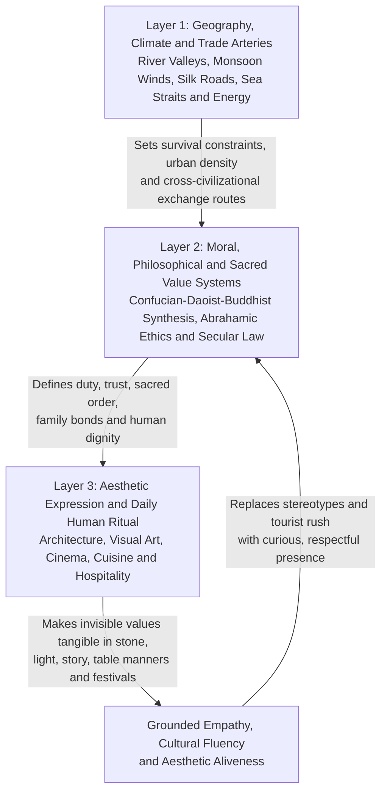
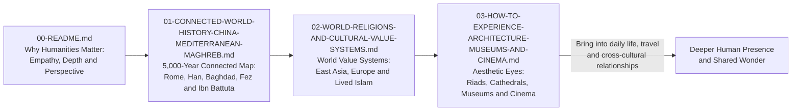

# Humanities & Cultural Literacy for Engineers: Why Understanding Civilizations, History & Art Makes You Deeper and More Empathetic

> **Purpose**: Technical mastery, financial prudence, and physical discipline build a resilient **vessel**—they pay the bills, protect your autonomy, and keep your body strong. Yet many accomplished engineers quietly notice an emptiness once those foundational problems are solved: conversations stall once work topics run out, historic cities blur into generic photo backdrops, and people from unfamiliar cultural or spiritual backgrounds feel opaque. This module builds the **inner life of that vessel**—equipping you with connected world history, respectful cross-cultural and religious literacy, and aesthetic eyes for architecture, painting, and cinema.

---

## 1. Why High-IQ Engineers Often Feel One-Dimensional Outside Work

Software engineering trains your brain to prize **stateless abstraction, present-tense utility, and deterministic optimization**. Those habits make you exceptional at debugging distributed systems, yet they create three subtle blind spots when you step into global friendships, cross-cultural relationships, travel, and civic life:

1. **The Presentism Fallacy ("History Compiled in 1995")**: Engineers naturally treat today's borders, languages, economic gaps, and social habits as static configuration files. Without reading the 3,000-year commit log—trade routes, imperial collapses, shared golden ages, and colonial shocks—modern societies look arbitrary rather than deeply intelligible.
2. **The Utility-Maximization Fallacy ("Humans Are Rational JSON Payloads")**: Economic and engineering models treat humans as isolated agents optimizing salary and convenience. Real human beings willingly sacrifice convenience for **filial gratitude, sacred devotion, hospitality honor, family solidarity, moral dignity, and beauty**. If you cannot read those deeper motivations, you miss `80%` of what moves human hearts.
3. **The Tourist Gaze ("Looking Without Reading")**: Walking through Paris, Suzhou, Florence, Granada, or Rabat without architectural and artistic literacy is like opening a C++ kernel source file when you do not read code—you recognize that something impressive is happening, snap a three-second photo of the famous facade, and leave unchanged.

### What True Cultural Depth Actually Looks Like

Cultural literacy has **nothing** to do with memorizing royal wedding dates or dropping pretentious French phrases at dinner. In real life, humanities depth shows up quietly in three ways:

- **Perspective Without Cynicism**: You recognize recurring long-wave human patterns—how open cosmopolitan hubs flourish, how hubris stiffens institutions, and how every civilization has taken turns holding and passing the torch of science.
- **Warmth Without Stereotypes**: When you meet someone raised in Shanghai, Lyon, Tangier, Rabat, or Boston, you neither flatten them into "everyone is just like me" nor box them into an internet cliché. You understand the water they swam in well enough to ask thoughtful, respectful questions and truly listen.
- **Aesthetic Aliveness**: A sunlit courtyard fountain, a 400-year-old oil painting, a timber pavilion in rain, or a quiet two-minute shot in a film gives you genuine emotional resonance because you can see *how* and *why* human hands made it.

---

## 2. The Three-Layer Civilizational Operating Stack

Just as computing stacks hardware physics underneath operating-system kernels and user interfaces, human civilizations evolve across three coupled layers. Reading any single layer in isolation distorts reality:

### Rosetta Stone: Translating Systems Engineering to Human Civilizations

Engineers already possess strong structural intuition. Map those instincts onto historical, cultural, and artistic systems using this translation table:

| Systems Engineering Primitive | Civilizational & Humanities Equivalent | How It Operates in the Real World |
| :--- | :--- | :--- |
| **`git blame` & Chesterton's Fence** | **Historical & Institutional Memory** | Before dismissing an unfamiliar social custom, border, or family norm as "irrational," trace the historical problem it originally solved. |
| **Consensus & Trust Protocol** | **World Religions & Moral Philosophies** | Shared ethical frameworks (*Ren* and *Li*, *Imago Dei* and human rights, *Tawhid* and *Adab*) enable millions of strangers to cooperate, grieve, and restrain ego. |
| **Open-Source Fork, Patch & Upstream Merge** | **Cross-Civilizational Knowledge Transmission** | Greek geometry, Indian positional numerals, and Chinese papermaking merged in Baghdad, Fez, and Cordoba before seeding Renaissance Europe. |
| **Implicit Shared Context vs. Explicit API Schema** | **High-Context vs. Low-Context Cultures** | East Asian and Maghrebi/Mediterranean cultures often carry warmth and respect through subtle context and hospitality; Northern European/Anglo cultures rely on explicit verbal contracts. |
| **Physics-Constrained Hardware Design** | **Vernacular & Sacred Architecture** | Pointed arches route gravity; Moroccan *riad* courtyards create passive evaporative cooling; Chinese *dougong* timber brackets absorb earthquake shear without nails. |
| **High-Density Perceptual Compression** | **Masterpiece Painting & World Cinema** | A great canvas by Vermeer or Monet, or a film by Kore-eda or Farhadi, compresses decades of unspoken human longing into a single visual frame. |
| **Network Topology & Chokepoint Re-Routing** | **Macro Trade & Geopolitical Shifts** | When overland Eurasian routes fractured or maritime wind gyres opened, wealth and scientific gravity shifted between land empires and ocean ports. |

---

## 3. Three Compounding Upgrades Humanities Literacy Gives Your Life

### Upgrade 1: Escaping Cultural Provincialism (Synchronized Horizontal Vision)

Most national school curricula teach history as an isolated vertical tunnel: one country's dynasties or republics from top to bottom, with the rest of humanity appearing only during wars. When you switch to a **synchronized horizontal map**, your sense of humanity expands immediately:

- While Western Europe struggled with post-Roman fragmentation in the 9th to 12th centuries, **Tang and Song China** ran million-person cities with paper currency and movable type, while **Baghdad, Cairo, Cordoba, and Fez** preserved Greek philosophy, invented algebra and experimental optics, and built the world's oldest continuously operating degree-granting university (Al-Qarawiyyin in Fez, founded in `859 CE`).
- In the 14th century, the Moroccan legal scholar **Ibn Battuta** set out from Tangier at age `21` and traveled roughly `120,000 km` across North Africa, the Middle East, East Africa, India, Southeast Asia, and all the way to **Quanzhou and Hangzhou** in China—proving that East Asia and the Maghreb were already linked in a vibrant medieval web of ports, scholars, and merchants.
- Seeing this full 5,000-year arc cures both Western triumphalism and defensive nationalism. No single region owns a permanent monopoly on reason, science, or human decency.

### Upgrade 2: Respectful Literacy Inside Unfamiliar Value Systems

In global engineering hubs and international friendships, you will share tables, projects, and lives with people shaped by Confucian-Daoist-Buddhist traditions, European Enlightenment secularism, Judaism, Christianity, and Islam. Ignorance breeds two opposite mistakes:

- **Cynical Dismissal**: Treating faith, dietary boundaries, filial obligation, or modesty norms as backward friction rather than meaningful moral commitments.
- **Awkward Walking-on-Eggshells**: Being so afraid of saying the wrong thing that you never ask genuine questions about someone's hometown, family festivals, or lived culture.

When you understand the inner logic of major value systems—how East Asian families express love through practical care and intergenerational duty, how Western secular ethics grew out of universal individual conscience, and how Islamic ethics in places like educated Moroccan families weave together personal accountability (*Tawhid*), moral courtesy (*Adab*), geometric beauty, generous hospitality, and Ramadan reflection—you show up with relaxed, natural respect.

### Upgrade 3: Turning Cities, Museums, and Screens Into Lifelong Joy

Engineers spend `8` to `10` hours a day staring at backlit rectangles of code and Slack messages. Learning how to **read physical space, light, pigment, and cinematic framing** reawakens sensory attention:

- A walk down a Parisian boulevard, an Andalusian or Rabat medina lane, or a Jiangnan canal town becomes an engaging puzzle of arches, stone, tilework, privacy, and light.
- Ninety unhurried minutes in the Louvre, Musée d'Orsay, or Uffizi transforms from exhausting foot pain into an intimate encounter with `10` extraordinary canvases.
- Watching world cinema shifts from passive dopamine scrolling to stepping inside the moral kitchen of a family in Tehran, Tokyo, Taipei, Paris, or Casablanca.

---

## 4. Real-World Scenarios: Flat Reflex vs. Culturally Literate Presence

Notice how cultural literacy changes concrete everyday moments without ever sounding academic or performative:

| Everyday Situation | The Flat Technocratic Reflex | Why It Disconnects | The Culturally Literate Move & Natural Script |
| :--- | :--- | :--- | :--- |
| **Friend or colleague mentions growing up in Rabat, Fez, or Tangier** | *"Oh cool, like Casablanca the movie? Is it super desert there?"* | Confuses lush Atlantic/Mediterranean coastal cities and imperial capitals with Sahara clichés. | *"Rabat on the Atlantic coast—I have always wanted to see the Kasbah of the Udayas and the contrast between the historic medina and the modern districts. What part of the city feels most like home to you?"* |
| **Hosting an international dinner with Muslim, Jewish, or vegetarian guests** | Ordering pork dishes or centering the whole evening on alcohol splits, then making a big awkward fuss when someone passes. | Puts guests on the spot to explain or defend personal boundaries in front of the group. | Quietly pick a great seafood, lamb, chicken, or Mediterranean spot with vibrant non-alcoholic drinks beforehand: *"Everything on the table is halal-friendly, please dig right in."* |
| **Walking through an art museum with a friend or partner** | Reading Wikipedia dates out loud at every plaque, or rushing past `200` paintings in `40` minutes saying *"Nice brushwork."* | Turns shared wonder into either a dry classroom lecture or an exhausting forced march. | Pick one striking painting, stand silently for `60` seconds together, then ask: *"Look at the light and the expression on her face—what do you think happened five seconds before this moment?"* |
| **Observing a colleague fasting during Ramadan** | *"Wait, not even water?! Isn't that unhealthy? Why do they make you do that?"* | Treats a cherished spiritual practice as a bizarre coercion rather than intentional self-mastery. | *"Ramadan Mubarak! Let us schedule our heavy design review in the morning when your energy is freshest—what does your family usually make first for ftour at sunset?"* |
| **Comparing East Asian, European, and North African family habits** | Judging close adult-parent ties as "lack of independence" or Western autonomy as "coldness." | Mistakes different languages of love for moral defects. | Recognize the shared human goal underneath different forms: East Asian and Moroccan families often show love through constant presence, food, and shared duty; Western families often show love by protecting autonomous choice. |

---

## 5. Four Epistemic Rules for Lifelong Cultural Depth

Keep these four guardrails active whenever you read history, discuss culture, or travel:

1. **Compare Ideals to Ideals, and Lived Reality to Lived Reality**: The oldest intellectual dishonesty in the world is comparing your own civilization's noblest philosophical ideals against another civilization's messy street-level politics or worst extremists. Compare Confucius, Aquinas, Spinoza, and Al-Ghazali on one plane; compare everyday urban life in Shenzhen, Lyon, and Rabat on another.
2. **Culture Is Context, Never a Deterministic Cage**: Knowing Moroccan, French, or Chinese cultural history helps you understand the heritage someone grew up around—it never entitles you to tell an individual what *they* think, believe, or practice. Every educated modern person negotiates their own relationship with tradition. Ask, listen, and let people define themselves.
3. **Curiosity Beats Performance Every Time**: Nobody falls in love with a walking encyclopedia trying to prove how worldly he is. Humanities knowledge is background illumination that helps you notice details, ask warm questions, and appreciate someone's world.
4. **Trace Connections Before Contrasts**: Borders look sharp on political maps; in kitchen spices, algebra, guitar lute ancestors (*al-'ud* to *lute*), cobalt-blue ceramics, and courtyard architecture, human civilizations have been borrowing from one another for millennia.

---

## 6. Conversation Architecture: How to Move From Small Talk to Real Cultural Depth

Many engineers stall in social and cross-cultural conversations because they oscillate between **safe surface trivia** (*"How was your flight? Busy sprint this week?"*) and **intrusive interrogation** (*"Why does your country do X?"*). Use the **Three-Rung Curiosity Ladder** to create warm, memorable exchanges at dinner tables, team offsites, or international dates:

### The Three-Rung Curiosity Ladder

1. **Rung 1 — Concrete Sensory Detail (Food, Street Rhythm, Landscape)**:
   - Start with lived sensory memory rather than abstract politics or religion. Everyone loves describing the smell, light, and rhythm of home.
   - *Natural Prompt*: *"When you land back home in Rabat (or Chengdu, or Lyon) after months abroad, what is the very first meal or evening walk that makes you feel you are truly back?"*
2. **Rung 2 — Family Ritual & Generational Texture (How People Care for Each Other)**:
   - Once sensory stories flow, invite the relational meaning behind them and share an honest parallel from your own upbringing so the exchange feels mutual rather than one-sided.
   - *Natural Prompt*: *"I love that your whole extended family gathers every Friday afternoon around one big couscous platter—growing up in China, Sunday round-table dinners with shared dishes played that exact role for us, where elders show love by putting the best piece in your bowl rather than giving big speeches."*
3. **Rung 3 — Values, History & Personal Perspective (How They See the World Today)**:
   - Only after warmth and mutual recognition exist, explore how living across languages or traditions shaped who they are as an individual.
   - *Natural Prompt*: *"Growing up speaking Darija at home, studying in French, and working in English—do you feel slightly different sides of your personality come out depending on which language you are thinking in?"*

### Four Conversation Anti-Patterns to Retire Permanently

- **The "Well, Actually" Historian**: Correcting someone's casual story about their own hometown or heritage with a textbook statistic you read last Tuesday. Even when technically accurate, pedantry kills warmth instantly.
- **The Monolithic Spokesperson Trap**: Asking *"What do Muslims / Chinese people / Europeans think about X?"* Nobody wants to serve as involuntary PR ambassador for `1.4 billion` or `2 billion` diverse human beings. Ask instead: *"How did people in your circle or family tend to view that?"*
- **The Exoticism Compliment**: Saying *"Wow, your English is so good!"* or *"You seem so modern for someone from [country]!"* Both phrases betray a patronizing mental baseline even when intended kindly.
- **Debate-Club Mode at the Dinner Table**: Treating someone's sacred holiday, family loyalty, or aesthetic taste like a pull-request architecture review that requires stress-testing for logical edge cases. Listen to understand what gives them peace or meaning.

---

## 7. A Sustainable Humanities Rhythm for Busy Engineers (Zero Academic Overwhelm)

You do not need a second university degree or `15` hours of dusty textbook reading per week to become genuinely well-read and aesthetically perceptive. Compounding works in the humanities just as it does in investing and strength training:

### The 90-Minute Weekly Compounding Loop

- **15 Minutes, Twice a Week — Connected Reading Instead of Doomscrolling**:
  - Replace two late-night social-media sessions with `15` focused minutes inside one primary narrative history or cultural essay (such as Ibn Battuta's travels, Gombrich's *The Story of Art*, or one module in this vault).
  - Keep a lightweight **3-Bullet Resonance Note** on your phone: one surprising historical link between regions, one cultural concept in its original term (like *Adab*, *Wuwei*, or *Chiaroscuro*), and one question it sparked.
- **One Intentional Film Every Two Weeks — Active Empathy Viewing**:
  - Pick one great film from outside Hollywood superhero franchises—Iranian, Japanese, French, Chinese, Italian, or Moroccan cinema—watched with original audio, phones in another room, and `10` minutes of unhurried conversation afterward.
- **One "Slow Hour" Whenever You Visit Any City**:
  - On business trips or vacations, trade racing across `7` tourist checkboxes for **one 60-minute slow walk** through an historic neighborhood or **one 8-painting visit** to a museum, looking first at how arches, courtyards, and light were engineered for human beings.

### Self-Assessment: Signs Your Inner World Is Expanding

| Dimension | Before Humanities Literacy | After 6 Months of Intentional Practice |
| :--- | :--- | :--- |
| **Global News & Geopolitics** | Reacting to sensational headlines with binary moralizing or tribal team-picking | Tracing 500-year geographic, trade, and institutional roots before forming calm judgments |
| **Cross-Cultural Relationships** | Sticking to safe tech/weather small talk or accidentally stepping on cultural landmines | Navigating family traditions, faith rhythms, and languages of care with natural warmth |
| **City Walks & Architecture** | Seeing generic "old pretty buildings" vs. "modern glass towers" | Reading structural load paths, thermal courtyards, *zellij* geometry, and civic ideals on sight |
| **Museums & Cinema** | Feeling bored, rushed, or intimidated by pretentious curator wall plaques | Experiencing direct emotional resonance with light, human micro-drama, and moral nuance |

### Case Study: Two Engineers on the Same International Evening

Imagine two equally talented senior software engineers invited to an evening dinner in Paris or Rabat with friends spanning French, Moroccan, and Chinese backgrounds:

- **Engineer A (Technically Brilliant, Culturally Unread)**:
  - Talks comfortably for the first `25` minutes about AI infrastructure, cloud costs, and flight delays.
  - Once conversation turns to Ramadan memories, Andalusian courtyard homes, a recent Iranian or Moroccan film, or why Tangier and Hangzhou were both historic maritime crossroads, Engineer A goes completely silent—or worse, drops a tone-deaf joke reducing complex traditions to internet memes.
  - Leaves thinking *"I am just an introvert,"* when the real bottleneck was simply lacking shared human vocabulary outside tech.
- **Engineer B (Technically Grounded + Culturally Literate)**:
  - Does not dominate the table or show off obscure dates.
  - Notices the geometric brass lantern light and asks warmly how the host's hometown in Rabat compares with older Fez medina neighborhoods.
  - Connects the host's pouring of Moroccan green tea with Nana mint to Chinese green tea leaves traveling by sea to Essaouira centuries ago—lighting up the entire table because both cultures suddenly see themselves inside one shared story.
  - Listens with genuine respect when friends describe family rituals, asks thoughtful Rung-2 and Rung-3 questions, and leaves everyone feeling genuinely *seen*.

### Five Self-Honesty Questions Before You Begin

Pause for sixty seconds and score yourself honestly across these five mirrors:

1. **Historical Horizon**: Can I explain how East Asia, the Islamic Mediterranean/Maghreb, and Europe shaped one another between `700 CE` and `1500 CE`, or is there a `1,000`-year blank space in my mental map?
2. **Religious & Moral Empathy**: Can I articulate what makes Confucianism, Enlightenment humanism, and lived Islam morally beautiful *to the thoughtful people who live inside them*—without caricatures?
3. **Architectural Vision**: When I stand in front of a cathedral, a Moroccan *riad*, or a classical Chinese pavilion, can I explain how its arches, courtyards, or timber brackets handle gravity, sunlight, and privacy?
4. **Visual & Cinematic Presence**: Can I stand in front of one painting for `60` seconds or watch a subtle two-hour foreign film without reaching for my phone?
5. **Conversational Warmth**: When I meet someone from a completely different culture, do my questions make them feel interrogated like a specimen, or welcomed as a full human being?

If two or more answers feel shaky today, that is completely normal—modern STEM education skipped almost all of this. Every single gap above is solvable and deeply enjoyable to close.

---

## 8. Quick-Jump Guide: Where to Dive Next

Jump directly to the guide matching the question on your mind:

| Question or Real-Life Context | Core Mental Model | Module & Section |
| :--- | :--- | :--- |
| How did China, the Mediterranean, Europe, and Morocco/North Africa actually interact before modern times? | **Synchronized 5,000-Year Eurasian-African Web & Ibn Battuta's Odyssey** | [01-CONNECTED-WORLD-HISTORY-CHINA-MEDITERRANEAN-MAGHREB.md](01-CONNECTED-WORLD-HISTORY-CHINA-MEDITERRANEAN-MAGHREB.md) (Sec. 1–4) |
| Why did Western Europe industrialize first after trailing Song China and the Islamic Golden Age for centuries? | **Geographic Fragmentation, Atlantic Gyres, Scientific Method & Coal** | [01-CONNECTED-WORLD-HISTORY-CHINA-MEDITERRANEAN-MAGHREB.md](01-CONNECTED-WORLD-HISTORY-CHINA-MEDITERRANEAN-MAGHREB.md) (Sec. 5–6) |
| How can one person in East Asia blend Confucian duty, Daoist flow, and Buddhist mindfulness without contradiction? | **The Three-Teachings Functional Synthesis (*Sanjiao*)** | [02-WORLD-RELIGIONS-AND-CULTURAL-VALUE-SYSTEMS.md](02-WORLD-RELIGIONS-AND-CULTURAL-VALUE-SYSTEMS.md) (Sec. 2) |
| What is the inner beauty, theology, ethic of hospitality, and Ramadan rhythm of Islam in educated Moroccan & global life? | ***Tawhid*, *Ihsan*, *Adab*, Geometric Order & Lived Warmth** | [02-WORLD-RELIGIONS-AND-CULTURAL-VALUE-SYSTEMS.md](02-WORLD-RELIGIONS-AND-CULTURAL-VALUE-SYSTEMS.md) (Sec. 4–5) |
| How do I read Classical, Gothic, Moorish-Moroccan *riad*/*zellij*, Jiangnan garden, and Modernist architecture on the street? | **Gravity Load Paths + Microclimate Physics + Sacred Space** | [03-HOW-TO-EXPERIENCE-ARCHITECTURE-MUSEUMS-AND-CINEMA.md](03-HOW-TO-EXPERIENCE-ARCHITECTURE-MUSEUMS-AND-CINEMA.md) (Sec. 1–2) |
| How do I enjoy paintings at the Louvre, Orsay, or Uffizi and watch world cinema with genuine emotional depth? | **The 3-Layer Canvas Method & Cinema Empathy Grammar** | [03-HOW-TO-EXPERIENCE-ARCHITECTURE-MUSEUMS-AND-CINEMA.md](03-HOW-TO-EXPERIENCE-ARCHITECTURE-MUSEUMS-AND-CINEMA.md) (Sec. 3–4) |

---

## 9. Curriculum Navigation & Complete Folder Index

Read through these four guides sequentially to move from macro historical context to inner moral worlds, and finally to direct sensory and aesthetic experience:

### Clickable Table of Contents

1. **[00-README.md](00-README.md) — Humanities & Cultural Literacy for Engineers: Why Understanding Civilizations, History & Art Makes You Deeper and More Empathetic** *(Current Document)*
   - Defeating Presentism, Utility Reductionism, and the Tourist Gaze; the 3-Layer Civilizational Operating Stack; Systems-Engineering-to-Humanities Rosetta Stone; concrete everyday conversation & etiquette scenarios; and four epistemic humility rules.
2. **[01-CONNECTED-WORLD-HISTORY-CHINA-MEDITERRANEAN-MAGHREB.md](01-CONNECTED-WORLD-HISTORY-CHINA-MEDITERRANEAN-MAGHREB.md) — The 5,000-Year Connected World Map: How East Asia, Europe, the Mediterranean & North Africa Shaped Each Other**
   - Synchronized horizontal macro timeline replacing isolated national silos; Classical Rome, Carthage, and Han China; Tang/Song technological breakthroughs alongside the Islamic Golden Age in Baghdad, Cordoba, and Fez (Al-Qarawiyyin, algebra, optics, paper transmission); the 14th-century Moroccan traveler Ibn Battuta's `120,000 km` journey from Tangier and Rabat to Quanzhou and Hangzhou plus Ibn Khaldun's institutional sociology; the Scientific/Industrial Great Divergence; and the modern multipolar world.
3. **[02-WORLD-RELIGIONS-AND-CULTURAL-VALUE-SYSTEMS.md](02-WORLD-RELIGIONS-AND-CULTURAL-VALUE-SYSTEMS.md) — Respectful Literacy Across Major World Value Systems**
   - Understanding civilizations from the inside without stereotypes; East Asia's Confucian-Daoist-Buddhist synthesis; Europe and the Americas' Judeo-Christian and Enlightenment secular roots; Islamic theology (*Tawhid*, *Ihsan*, *Adab*), geometric and calligraphic aesthetics, Ramadan reflection, family warmth, and modern diversity in educated Moroccan and global Muslim life; plus practical cross-cultural etiquette and conversation scripts.
4. **[03-HOW-TO-EXPERIENCE-ARCHITECTURE-MUSEUMS-AND-CINEMA.md](03-HOW-TO-EXPERIENCE-ARCHITECTURE-MUSEUMS-AND-CINEMA.md) — Walking Into Any City, Museum or Film With Aesthetic Eyes**
   - Decoding five great architectural languages on foot (Greco-Roman, Gothic cathedrals, Moorish-Andalusian and Moroccan *riad* courtyards/*zellij*/cedarwood in Rabat & Granada, Chinese Jiangnan gardens, and Bauhaus/Modernism); the 3-Layer Jargon-Free Method for experiencing paintings at the Louvre, Musée d'Orsay, or Uffizi without museum fatigue; and watching world cinema for human empathy.

### Foundational Reading & Viewing Stack

- **Connected World History**: Peter Frankopan (*The Silk Roads: A New History of the World*); Ross E. Dunn (*The Adventures of Ibn Battuta: A Muslim Traveler of the Fourteenth Century*); Valerie Hansen (*The Year 1000: When Explorers Connected the World*).
- **World Value Systems & Cultural Philosophy**: Huston Smith (*The World's Religions*); Fung Yu-lan (*A Short History of Chinese Philosophy*); Seyyed Hossein Nasr (*The Heart of Islam: Enduring Values for Humanity*); Charles Taylor (*A Secular Age* — or Sarah Bakewell's accessible *Humanly Possible*).
- **Architecture, Art & Cinema**: E. H. Gombrich (*The Story of Art* — the greatest jargon-free art introduction ever written); Steen Eiler Rasmussen (*Experiencing Architecture*); Sidney Lumet (*Making Movies*) and Roger Ebert (*The Great Movies*).
