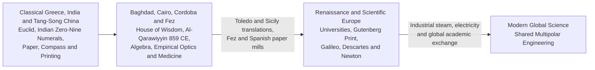
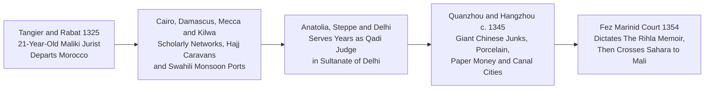

# The 5,000-Year Connected World Map: How East Asia, Europe, the Mediterranean & North Africa Shaped Each Other

> **Core Premise**: School history is almost universally taught as **isolated vertical silos**—Chinese students memorize sequential dynasties, European students march from Athens to Rome to Florence to London, and North African or Middle Eastern history appears only briefly at crossroads of war. Yet when you align the timestamps horizontally, **East Asia, the Mediterranean, Europe, and the Maghreb operated for millennia as a single coupled network** trading silk, algebra, paper, cobalt porcelain, astronomy, silver, and ideas. Reading that horizontal map cures both cultural arrogance and cultural insecurity.

---

## 1. Why Textbook Silos Distort Reality — And How to Read Horizontally

Standard national curricula create three systematic illusions that follow adults into global workplaces and cross-cultural friendships:

1. **The Self-Contained Dynasty Illusion**: Viewing Chinese civilization as a walled garden misses how deeply Tang Chang'an welcomed Persian and Arab merchants, how Indian Buddhism reshaped Chinese metaphysics, how Song-Yuan Quanzhou anchored Indian Ocean shipping, and how Latin American silver monetized the Ming economy.
2. **The Solo-Miracle Myth of "The West"**: Drawing a straight line from Plato to Newton erases the `600`-year scientific relay in **Baghdad, Cairo, Cordoba, and Fez**—where scholars rescued Greek texts, fused them with Indian positional mathematics and Chinese paper, invented algebra and experimental optics, and handed Renaissance Europe its intellectual toolkit.
3. **The Peripheral Myth of the Maghreb**: Treating Morocco and North Africa as quiet sidelines ignores Carthage's maritime brilliance, Roman Mauretania Tingitana (Volubilis), **Fez's Al-Qarawiyyin (`859 CE`)**—the world's oldest continuously operating degree-granting university—the unified Moroccan-Andalusian architectural golden age from Rabat and Marrakech to Seville and Granada, and **Ibn Battuta's** `120,000 km` 14th-century journey from Tangier all the way to Quanzhou and Hangzhou.

### Synchronized 5,000-Year Horizontal Timeline

Use this master synchronization matrix whenever you visit a museum, walk an old city, or read history so every era snaps onto one shared clock:

| Era & Timestamp | East Asia (China & Neighbors) | Maghreb, North Africa & Middle East | Mediterranean & Europe | Key Cross-Regional Connectors |
| :--- | :--- | :--- | :--- | :--- |
| **Bronze & Iron Foundations (`3000 – 500 BCE`)** | Shang oracle bones; Zhou bronze ritual order; Confucius (`551–479 BCE`) & Laozi | Egyptian Old-to-New Kingdoms; Mesopotamian law & astronomy; Phoenician Atlantic ports (Lixus, Essaouira) & Carthage (`814 BCE`) | Minoan-Mycenaean trade; Greek city-states, geometry, and Athenian philosophy | Phoenician phonetic alphabet seeds Greek, Latin, Arabic & Hebrew scripts; Eurasian bronze & horse diffusion |
| **Classical Twin Giants (`220 BCE – 220 CE`)** | Qin unification (`221 BCE`); Han Dynasty (`202 BCE – 220 CE`, about `58M` people); Zhang Qian opens Hexi Silk Road; paper invented (`c. 105 CE`) | Numidian & Mauretanian kingdoms (Juba II); Roman North Africa (Volubilis olive oil & grain); Alexandria library hub | Roman Republic to Roman Empire (`Pax Romana`, about `55M–60M` people); Mediterranean *Mare Nostrum* shipping | Silk flows west to Roman Senate; Roman blown glass reaches Han tombs; Kushan/Parthian relays carry Buddhism east; shared 2nd-century plagues |
| **Cosmopolitan Golden Relay (`600 – 1258 CE`)** | Tang (`618–907`) Chang'an hub; Song (`960–1279`) woodblock & movable print, compass, gunpowder, paper money, blast-furnace iron | Abbasid Baghdad (*House of Wisdom*); Umayyad Cordoba; Idrisid Fez & Al-Qarawiyyin (`859 CE`); Almoravid & Almohad Rabat-Marrakech-Seville empire | Post-Roman feudal fragmentation; Carolingian monasteries; Venice/Genoa ports; Toledo & Sicily translation schools (`12th c.`) | Chinese papermaking moves via Samarkand (`751`) to Baghdad, Fez & Spain; Arabic algebra (*al-jabr*), numerals & optics seed European universities |
| **Hemispheric Web & Travelers (`1250 – 1450 CE`)** | Yuan Dynasty (`1271–1368`) maritime boom at Quanzhou & Hangzhou; early Ming Admiral Zheng He treasure fleets (`1405–1433`) | Marinid Morocco (Fez madrasas); **Ibn Battuta** (`1304–1369`, Tangier to China & Mali); **Ibn Khaldun** (`1332–1406`, *Muqaddimah*); Mamluk Cairo | Italian city-state banking & early Renaissance; Black Death (`1347–1351`) reshapes labor; Gutenberg metal print (`c. 1450`) | *Pax Mongolica* & Indian Ocean monsoon trade link Tangier, Cairo, Calicut & Quanzhou; cobalt-blue *qinghua* porcelain fuses Persian ore with Jingdezhen clay |
| **Oceanic Shift & Great Divergence (`1450 – 1914`)** | Ming-Qing agrarian expansion; Ming Single Whip silver tax; 19th-century Opium Wars & reform struggles | Saadi & Alaouite Morocco (sovereign since `1666`; first state to recognize US in `1777`); Ottoman East Med; 19th-c. European encroachment (`1912` Protectorate) | Iberian Atlantic voyages (`1492–1498`); Scientific Revolution (Galileo, Newton); Enlightenment; British coal-steam Industrial Revolution | American silver flows via Europe & Manila into Ming China; Atlantic oceanic shipping bypasses old Silk & Red Sea chokepoints |
| **Decolonization & Multipolar Return (`1945 – Present`)** | Post-`1978` Chinese industrial, high-speed rail, digital & EV manufacturing ascent | Moroccan independence (`1956`); Tangier Med `#1` Med/African port; *Al Boraq* high-speed rail; solar, auto & battery hub | European Union integration; post-industrial research, luxury, aerospace & regulatory power | Tri-continental supply chains link East Asian battery/tech ecosystems, Moroccan Atlantic manufacturing & European markets |

---

## 2. Era I: Classical Twin Anchors — Rome, North Africa & Han China (220 BCE – 220 CE)

Around `100 CE`, nearly **half of all human beings alive on Earth** lived under just two political roofs at opposite ends of Eurasia: the **Roman Empire** circling the Mediterranean (including North Africa from Egypt across Tunisia and Algeria to Roman **Mauretania Tingitana** around Tangier, Sala/Rabat, and Volubilis) and the **Han Dynasty** across East Asia.

### Three Structural Parallels & Real Couplings

- **Infrastructure as Statecraft**: Rome built `80,000 km` of stone highways and Mediterranean grain fleets; Han China built imperial post roads, frontier walls, and canal networks uniting the Yellow and Yangtze basins. In North Africa, King **Juba II of Mauretania** and his queen **Cleopatra Selene** turned cities like Volubilis and Cherchell into bilingual Greek-Latin-Amazigh centers exporting purple dye (from Atlantic *murex* shells at Essaouira), olive oil, and grain to Rome.
- **Indirect Trade Without Direct Embassies**: Neither empire conquered the Parthian (Persian) middlemen between them, yet goods crossed continuously. After Han envoy **Zhang Qian** (`138 BCE`) mapped Central Asia, Chinese silk became such an obsession among Roman elites that the stoic writer Pliny the Elder complained Rome drained millions of sesterces eastward every year to dress aristocratic women in translucent silk (*Serica*), while Roman blown glass and Mediterranean coral prized by Han nobles traveled east.
- **Synchronized Biological Shock**: Trade arteries carry pathogens alongside luxury goods. The **Antonine Plague** (`165–180 CE`) struck Marcus Aurelius's Rome while major epidemics hit Late Han China in the exact same decades—hollowing tax bases and military recruitment on both coasts of Eurasia before both classical orders fractured.

---

## 3. Era II: Tang-Song Innovation & the Baghdad-Cordoba-Fez Scientific Bridge (600 – 1258 CE)

Ask an engineer where modern computing, optics, and printed books came from, and the honest answer requires tracing a **four-civilization open-source merge** across six centuries:

### Tang & Song China: The Medieval World's High-Output Engine

While post-Roman Western Europe operated largely as rural manors, **Tang (`618–907`)** and **Song (`960–1279`)** China ran urbanized commercial economies centuries ahead of their time:

- **Cosmopolitan Openness**: Tang Chang'an housed roughly `1 million` residents inside a planned grid welcoming Persian, Arab, Sogdian, Korean, and Japanese diplomats and students, while southern ports like Guangzhou and Quanzhou hosted permanent Arab-Persian merchant communities with their own mosques (such as Guangzhou's Huaisheng Mosque and Quanzhou's Qingjing Mosque, founded `1009 CE`).
- **Four World-Altering Technologies**: Woodblock and Bi Sheng's ceramic movable type (`c. 1040`), the maritime magnetic compass, gunpowder chemistry, and the world's first state-issued paper currency (*Jiaozi*), backed by blast-furnace coal-fired iron production exceeding `100,000 tons` annually by `1078`.

### How Baghdad, Cordoba, and Fez Built the Scientific Method

Across the same centuries, Arabic became the global language of mathematics, medicine, astronomy, and philosophy from Central Asia to the Atlantic coast of Morocco and Spain (*Al-Andalus*):

1. **The Paper Highway (`751 – 1150 CE`)**: Prior to paper, writing on sheepskin parchment made books astronomically expensive in Europe. Chinese papermaking reached **Samarkand** in the 8th century, spread to **Baghdad (`794`)**, Cairo, and **Fez** (which boasted hundreds of water-powered paper mills by the 11th–12th centuries), crossed the Strait of Gibraltar to **Xativa** in Spain, and finally entered Italy and France—enabling affordable libraries centuries before Gutenberg.
2. **Algorithms & Positional Math**: In Baghdad's *Bayt al-Hikma* (House of Wisdom), **Muhammad ibn Musa al-Khwarizmi** (`c. 780–850`) fused Indian positional decimals (including `0`) with geometric proof in *Kitab al-Jabr*—giving every modern language both **algebra** (*al-jabr*, "restoration/balancing") and **algorithm** (from his Latinized name *Algoritmi*). The Italian merchant Fibonacci learned these numerals directly in North Africa (Béjaïa) before publishing *Liber Abaci* (`1202`).
3. **Experimental Physics Before Galileo**: **Ibn al-Haytham** (*Alhazen*, `965–1040` in Cairo) refused to take Euclid and Ptolemy on authority; using dark-room pinhole (*camera obscura*) experiments, he proved light travels in straight lines *into* the eye rather than shooting out of it, establishing hypothesis-testing empiricism (`Kitab al-Manazir`, *Book of Optics*).
4. **Fez, Marrakech, Rabat & Cordoba as One Intellectual Circuit**:
   - In **`859 CE`**, an educated woman named **Fatima al-Fihri** used her inheritance to found **Al-Qarawiyyin** in **Fez**, Morocco—evolving into the world's oldest continuously operating degree-granting university, teaching grammar, rhetoric, logic, mathematics, astronomy, medicine, and Maliki law.
   - Under the Almohad dynasty uniting Morocco and Andalusia (leaving behind sibling architectural sister-towers: **Rabat's Hassan Tower**, **Marrakech's Koutoubia**, and **Seville's Giralda**), polymaths like **Ibn Tufayl** and **Ibn Rushd** (*Averroes*, `1126–1198`) wrote philosophical commentaries on Aristotle that ignited Thomas Aquinas and the universities of Paris, Padua, and Oxford.

### Everyday Artifact Case Study: How Blue-and-White Porcelain Married Iran and China

Even iconic "purely national" art is often a cross-civilizational child. Famous Ming **blue-and-white porcelain (*qinghua*)** emerged in the 14th century because Muslim merchants on the Indian Ocean imported prized **Persian cobalt ore** (*Su-ma-li qing* / "Mohammedan blue" from Kashan) to **Jingdezhen** kilns in Jiangxi, where Chinese masters painted dense geometric and floral motifs originally tailored for Middle Eastern and North African banquet platters—before Europeans and Chinese emperors alike fell in love with the aesthetic.

---

## 4. Era III: Ibn Battuta's 120,000-Kilometer Bridge From Tangier to Hangzhou (1304 – 1406 CE)

Western pop culture treats **Marco Polo** as the lone medieval bridge to China. Yet half a century later, a young legal scholar from northern Morocco dwarfed Polo's mileage and documented the entire Afro-Eurasian world firsthand.

### Abu Abdullah Muhammad Ibn Battuta (1304 – 1369)

Born in **Tangier** in `1304` into a scholarly Amazigh-descended family of Islamic jurists, Ibn Battuta rode out of Tangier alone in June `1325` at age `21` to make the pilgrimage to Mecca. He did not come home to stay until `29 years` later—having logged roughly **`120,000 km`** (three times Marco Polo's journey) across North Africa, Egypt, Syria, Arabia, Iraq, Persia, East Africa's Swahili coast (Kilwa), Anatolia, the Golden Horde steppes, Constantinople, Central Asia, India, the Maldives, Sri Lanka, Sumatra, **China**, Andalusia, and later across the Sahara to **Mali and Timbuktu**:

### What Ibn Battuta Saw When Morocco Met China

Stepping ashore at **Quanzhou** (*Zaytun* in Arabic, whose name gave English the word **satin**) and traveling inland up the water routes to **Hangzhou** (*Khansa*), Ibn Battuta left vivid eyewitness observations in his travelogue *The Rihla* (dictated in **Fez** in `1354–1355` to the Andalusian scribe Ibn Juzayy at the invitation of Marinid Sultan Abu Inan Faris):

- **Industrial Scale & Craftsmanship**: He marveled at multi-masted Chinese ocean junks with watertight bulkheads, onboard vegetable gardens in wooden tubs, and up to `1,000` crew; called Chinese painters the sharpest observers of human faces he had ever seen; and noted that fine Chinese porcelain was exported all the way back to his own homeland in **Morocco**.
- **Paper Money & Public Order**: Trained in gold dinars and silver dirhams, he was fascinated that Yuan-era Chinese merchants bought everything using stamped mulberry-bark paper notes, and remarked that a traveler could journey for nine months across China carrying wealth in greater safety than anywhere else he had visited.
- **Tangier-to-Hangzhou Human Surprise**: Inside Hangzhou—which he called the largest city he had ever laid eyes upon, divided into six walled quarters including a thriving Muslim merchant district—Ibn Battuta met **Qiwam al-Din al-Sabti**, whose family hailed from **Ceuta** right beside Tangier on the Moroccan coast! Seven centuries before aviation, two men from the Strait of Gibraltar dined together beside West Lake in Zhejiang.

### Ibn Khaldun (1332 – 1406): Founding Institutional Sociology Between Fez, Granada & Cairo

One generation after Ibn Battuta, the statesman-historian **Ibn Khaldun** (who studied and served at the Marinid royal court in **Fez**, negotiated diplomacy in **Granada**, and lectured in **Cairo**) wrote his masterpiece, the ***Muqaddimah*** (`1377`). Four centuries before Adam Smith, Khaldun modeled civilizations as dynamic systems driven by ***Asabiyyah*** (shared social solidarity and civic discipline) and discovered supply-side fiscal dynamics: *"At the beginning of a dynasty, taxation yields a large revenue from small assessments; at the end of a dynasty, taxation yields a small revenue from large assessments"* because bureaucratic luxury and predatory taxes choke productive incentives.

---

## 5. Era IV: Why Western Europe Industrialized First — And the Colonial Shock (1450 – 1914)

If Song/Ming China and the Islamic Mediterranean led global urbanization and science in `1100–1400`, why did Northwestern Europe pull dramatically ahead between `1500` and `1850`? Historians call this **The Great Divergence**, and its causes were structural rather than genetic or moral:

1. **Political Fragmentation vs. Single-Point Veto**: Between `1405` and `1433`, Ming Admiral **Zheng He**—himself a Muslim courtier from Yunnan—led seven massive treasure fleets (ships over `100 m` long) across Southeast Asia, India, Hormuz, Mecca's port of Jeddah, and East Africa. Yet because Ming China was unified under one imperial court facing resurgent Mongol cavalry in the north, mandarins cancelled ocean expeditions and burned fleet records with a single policy pivot. Europe's fractured map of rival states meant no single ruler could stop oceanic experimentation: when Portugal, Genoa, and England turned Columbus down, Spain funded him.
2. **Atlantic Wind Gyres & Global Silver Arbitrage**: Rounding Africa (`1498`) and crossing the Atlantic bypassed Venice, Cairo, and Ottoman toll gates. Spanish extraction of Andean and Mexican silver flowed both into Europe and across the Pacific via Manila (`1571`) directly into **Ming China**, whose *Single Whip Reform* required taxes paid in silver—knitting the Americas, Europe, Africa, and China into the first planet-wide monetary circuit while shifting capital accumulation to Atlantic ports (Lisbon, Amsterdam, London).
3. **Institutionalized Peer-Reviewed Science**: Fusing Gutenberg print, Greco-Arabic algebra and optics, lens grinding (telescopes and microscopes), and independent scientific societies (London's Royal Society, Paris's Académie des Sciences) turned isolated genius into cumulative, public mathematical law (`F = ma`, calculus, thermodynamics).
4. **Shallow Coal + Steam Engines Breaking the Muscle Ceiling**: Prior to `1750`, every civilization—however sophisticated—hit an organic energy ceiling bounded by firewood, wind, waterwheels, and human/animal muscle. Britain's shallow, waterlogged coal seams created direct economic payback for early steam pumps (Newcomen `1712`, Watt `1769`), multiplying mechanical energy and mass steel output.

### Navigating 19th–20th Century Historical Memory With Empathy

That industrial asymmetry produced a painful century (`1840–1956`) across both East Asia and North Africa: Qing China suffered the Opium Wars and unequal treaty ports, while European powers carved North Africa—placing Morocco under French and Spanish Protectorates (`1912–1956`), even though Morocco under the **Alaouite dynasty** (ruling continuously from `1666` to today) had preserved centuries of sovereign statehood and famously became the **very first country on Earth to recognize United States independence in December `1777`** under Sultan Mohammed III in Tangier. Remembering this era accurately—neither erasing colonial wounds nor remaining trapped in grievance—explains why sovereignty, dignity, educational modernization, and cultural pride matter so deeply in both modern China and modern Morocco.

---

## 6. Era V: The 21st-Century Multipolar Re-Convergence (1945 – Today)

Viewed on a `200`-year chart, China's rise or North Africa's modern infrastructure boom looks disruptive. Viewed on our **`5,000`-year chart**, the last `70` years represent a **re-convergence toward humanity's long-run multipolar norm**:

- **East Asia's Industrial & Technological Ascent**: Following `1978`, China rebuilt manufacturing scale, high-speed rail (`45,000+ km`), telecommunications, renewable solar/wind hardware, and EV ecosystems at unprecedented velocity.
- **Morocco's Strategic Tri-Continental Bridge**: Since regaining independence in `1956`, Morocco leveraged its unique position `14 km` from Europe across the Strait of Gibraltar—building **Tangier Med** into the largest container port in both the Mediterranean and Africa, launching **Al Boraq** (`320 km/h` high-speed rail linking Tangier, Kenitra, Rabat, and Casablanca), expanding solar megaprojects (*Noor Ouarzazate*), and becoming a premier automotive, aerospace, phosphate-fertilizer, and EV-battery cathode corridor connecting **Chinese and Asian tech investment**, **Moroccan talent and green energy**, and **European markets**.

### Conversational Bridges: Using Connected History Naturally in Real Life

| Topic That Comes Up Naturally | Pretentious Lecture (Avoid) | Warm, Memorable Connection (Use Instead) |
| :--- | :--- | :--- |
| **Walking through Tangier, Rabat, or Fez** | Reciting dynasty dates like a tour guide microphone. | *"It blows my mind that 700 years ago Ibn Battuta left right from Tangier at 21 and ended up walking the canals of Hangzhou—and ran into another guy from across the strait while he was in China."* |
| **Admiring blue-and-white ceramics or geometric tilework** | *"Actually, China invented porcelain first."* | *"I love how classic blue-and-white porcelain was actually a partnership—Chinese Jingdezhen clay painted with Persian cobalt blue brought by Muslim sea merchants for Mediterranean and Middle Eastern tables."* |
| **Talking about computer science & math history** | Treating CS as purely Silicon Valley (`1970+`). | *"Every time we write the word 'algorithm' in code, we are literally saying Al-Khwarizmi's name from 9th-century Baghdad—and Fez had Al-Qarawiyyin granting degrees centuries before Oxford."* |
| **Discussing Tangier Med, high-speed rail, or global trade** | Viewing emerging hubs through outdated 1990s clichés. | *"Looking at a 2,000-year map, the Strait of Gibraltar and East Asian ports being high-speed trade partners again feels like history reconnecting its oldest circuit."* |

---

## 7. Urban Case Study: Four Crossroads Cities That Shaped Global Civilization

Abstract macro-history comes alive when you walk actual streets. Compare how four historic urban centers across East Asia, Morocco, Iberia, and France each solved governance, beauty, and global exchange:

### 1. Hangzhou & Quanzhou (China's Southern Commercial-Poetic Twin Engine)
- **Peak Classical Role**: Capital of Southern Song (`1127–1279`) and maritime jewel of Yuan-Ming trade.
- **What Made Them Extraordinary**: While northern fortresses guarded land borders, Hangzhou fused Grand Canal grain logistics, tea and silk guilds, printing houses, and West Lake scholar-poet culture (Su Shi) into a city of `1.2 million+` people, while Quanzhou's docks welcomed Arab, Persian, Indian, and Southeast Asian vessels under an official Maritime Trade Superintendency (*Shibosi*).
- **Living Trace Today**: Walking West Lake at dawn alongside modern Alibaba/tech campuses in Hangzhou shows a `1,000`-year continuity between commercial dynamism and landscape aesthetics.

### 2. Fez & Rabat (Morocco's Spiritual-Scholarly & Imperial Atlantic Twins)
- **Peak Classical Role**: **Fez** (founded `789 CE`) anchored scholarship, craftsmanship, and jurisprudence around Al-Qarawiyyin (`859 CE`) and Marinid madrasas (*Bou Inania*, *Al-Attarine*); **Rabat** (expanded by Almohad Caliph Yaqub al-Mansur in the late 12th century as *Ribat al-Fath*) anchored Atlantic maritime strategy and later became modern Morocco's royal and administrative capital.
- **What Made Them Extraordinary**: Fez el-Bali preserved the world's largest car-free medieval urban fabric—organized around neighborhood *hammams*, bakeries, fountains of *zellij* tile, leather tanneries, and guild workshops—while Rabat blended the blue-and-white Atlantic cliffside **Kasbah of the Udayas**, the Roman-then-Marinid sanctuary of **Chellah**, spacious tree-lined avenues, and modern research universities.
- **Living Trace Today**: Moving between Fez's 1,100-year scholarly alleys and Rabat's clean tramways, embassies, and oceanfront corniche lets you watch Morocco harmonize deep Amazigh-Arab-Andalusian roots with calm institutional modernity.

### 3. Cordoba & Granada (Al-Andalus: Europe's Medieval Window Into Science & Grace)
- **Peak Classical Role**: 10th-century Umayyad **Cordoba** boasted street lighting, running water, public baths, and libraries of hundreds of thousands of manuscripts when London and Paris were muddy timber towns; 13th–15th century Nasrid **Granada** crystallized Moorish poetic-architectural perfection inside the **Alhambra**.
- **What Made Them Extraordinary**: Muslim, Jewish, and Christian translators, physicians, and artisans cross-pollinated philosophy, agronomy (citrus orchards, irrigation *acequias*), music, and geometric architecture—leaving an indelible DNA across Spain, Portugal, and Morocco (where thousands of Andalusian families resettled in Rabat, Salé, Tetouan, Chefchaouen, and Fez after `1492`, bringing Andalusian classical music *Al-Ala* and fine embroidery that still thrive in Moroccan homes today!).

### 4. Paris (From Medieval Cathedral Island to Enlightenment & Modern Cultural Salon)
- **Peak Classical Role**: University of Paris scholastic center (`12th–13th c.`, debating Latin translations of Ibn Rushd/Averroes!), 18th-century Enlightenment salon hub, and 19th–20th century capital of Impressionism, cinema, and urban boulevard planning.
- **What Made It Extraordinary**: Paris repeatedly absorbed ideas from across the Mediterranean, the Americas, Africa, and Asia—turning cafés, museums, and publishing houses into global testing grounds for civic law, literature, and modern art.

---

## 8. Five Everyday Objects on Your Desk & Table With Hidden Connected Pedigrees

Whenever someone imagines civilizations grew up apart, look around an ordinary café table:

1. **Your Morning Cup of Coffee & Mint Tea**: Coffee beans originated in **Ethiopia**, were brewed by Sufi mystics in **Yemen** (`15th c.`) to stay awake in night prayer, spread to Cairo, Istanbul, Fez, Venice, and Paris Enlightenment cafés (`Café Procope`). Meanwhile, **Moroccan *atay* (green gunpowder tea with fresh spearmint and sugar)** married **Chinese green tea** shipped into Atlantic ports (like Mogador/Essaouira in the 18th–19th centuries) with fragrant **Maghrebi Nana mint**—turning a Sino-Moroccan trade leaf into North Africa's universal ritual of warmth and friendship!
2. **Every `0`, `1`, and `algorithm` on Your Laptop**: Indian Brahmi-Gupta zero (`0`) + Al-Khwarizmi's Baghdad *Al-Jabr* + North African merchant accounting brought to Italy (`1202`) + Leibniz's fascination with binary hexagrams in the Chinese *I Ching* (`1703`).
3. **The Guitar & Lute Family**: The Arabic short-necked ***al-'ud*** traveled through Al-Andalus and North Africa into medieval Europe as the **lute** and **vihuela/guitarra**, while silk-string plucked instruments traveled eastward along the Silk Road as the Chinese ***pipa*** (`4th–7th c.`).
4. **Citrus Trees, Sugar & Irrigated Courtyards**: Oranges, lemons, and pomelos originated in **Southern China and Southeast Asia**, traveled westward via Indian Ocean and Arab agronomic manuals (*Filaha*) across Persia, Cairo, Sicily, Morocco, and Seville (*naranja* from Arabic *naranj*, from Sanskrit *naranga*).
5. **Paper Banknotes, Passports & Checks**: The English word **check / cheque** descends from Arabic ***sakk***—written letters of credit that let medieval merchants cash funds in Cairo or Fez without hauling gold sacks across bandit roads—running in parallel with Song-Yuan China's state paper currency (*Jiaozi* and *Chao*).

---

## 9. Six Common Historical Myths — Replaced With Primary Reality

Even well-educated professionals repeat simplified myths absorbed from movies or schoolbooks. Keep these six factual corrections handy:

| Common Myth | Primary Historical Reality |
| :--- | :--- |
| **"Science went dark for 1,000 years between Rome and the Renaissance."** | Only post-Roman Western Europe slowed down; simultaneously, **Tang-Song China** invented printing, compasses, and paper currency while **Baghdad, Cairo, Cordoba, and Fez** pioneered algebra, empirical optics, surgical instruments, and degree-granting universities (`859 CE`). |
| **"Medieval people lived and died within 10 km of their village."** | Millions of farmers stayed local, yet scholars, pilgrims, sailors, and merchants—like Tangier's **Ibn Battuta** (`120,000 km`), Moroccan-Andalusian jurists, Sogdian traders, and Fujian mariners—maintained brisk continental networks from the Atlantic to the China Sea. |
| **"North Africa was desert cut off from Europe and Asia."** | Coastal Morocco, Algeria, and Tunisia are fertile Mediterranean/Atlantic lands just `14 km` from Spain; Roman Volubilis fed Rome olive oil, Almohad Rabat-Marrakech-Seville formed a single empire, and Tangier/Essaouira linked Europe, Africa, the Americas, and China. |
| **"Andalusian civilization vanished completely after 1492."** | When Granada fell in `1492` (and through the early 1600s), hundreds of thousands of Muslim and Jewish Andalusians brought their architecture, *Al-Ala* orchestral music, culinary arts, and silk craftsmanship directly across the strait to **Rabat, Salé, Tetouan, Chefchaouen, and Fez**, where Andalusian culture remains alive today. |
| **"Imperial China was always inward-looking and anti-trade."** | For nearly eight centuries under **Tang, Song, Yuan, and early Ming**, Chinese ports like Guangzhou and Quanzhou were the busiest maritime hubs on Earth; inward sea bans only hardened after mid-Ming northern steppe crises (`1430s+`). |
| **"Globalization was invented in the 1990s with container ships and the internet."** | By `1340`, a Moroccan judge was dining in Hangzhou using Chinese paper notes; by `1580`, Bolivian silver paid taxes in Fujian while Chinese silk dressed Madrid and Mexican plazas. Modern fiber optics simply accelerated a `2,000`-year network. |

---

## 10. Hidden History Inside Everyday Words You Speak

Languages preserve `1,000`-year trade receipts right inside modern technical and daily vocabulary. Notice how Arabic, Chinese, and European tongues braided together:

### Arabic & Maghrebi Roots Inside English and French
- **`Algorithm` & `Algebra`**: From **Al-Khwarizmi** (*Algoritmi*) and his treatise *Al-Jabr* in 9th-century Baghdad.
- **`Zero` & `Cipher`**: Both derive from Arabic ***sifr*** ("empty / void," translating Sanskrit *sunya*)—entering Italian (*zefiro* to *zero*) and French (*chiffre*, meaning digit or secret code).
- **`Magazine` (and French *Magasin* for store)**: From Maghrebi/Arabic ***makhzan*** (plural *makhazin*, storehouse or treasury—also the historical root of Morocco's institutional state term *Makhzen*!).
- **`Admiral`**: From Arabic ***Amir al-Bahr*** ("Commander of the Sea"), adopted by Norman Sicily, Genoa, France, and Britain.
- **`Tariff`**: From Arabic ***ta'rifa*** ("official notification / schedule of port customs fees") across Mediterranean harbors.
- **`Coffee`, `Sugar`, `Syrup`, `Saffron`, `Lemon` & `Orange`**: Traced directly through Arabic trade networks (*qahwa*, *sukkar*, *sharab*, *za'faran*, *laymun*, *naranj*).

### Chinese & Silk-Road Roots Across Global Languages
- **`Tea` vs. `Cha` / `Atay` (Two Routes Recorded in One Leaf!)**:
  - Languages that received tea **overland** via the Silk Road and Persia use forms of northern Mandarin ***cha*** (Russian *chai*, Arabic *shay*, Turkish *çay*, Hindi *chai*).
  - Languages that received tea **by sea** from Fujian coastal ports (Amoy/Xiamen dialect ***te***) use *tea* / French ***thé*** / Spanish *té*—and Moroccan Darija ***atay*** echoes that coastal maritime trade!
- **`Satin`**: Derived directly from ***Zaytun***—the Arabic merchant name for China's great port of **Quanzhou**, where Ibn Battuta stepped ashore.
- **`Silk` & `Serendipity` / `Sericulture`**: From ancient Greek and Latin *Seres* (derived from Chinese ***si*** `丝` for silk).
- **`Kowtow`, `Typhoon` (*Tai feng*), `Gung-ho`, and `Zen` (from Sanskrit *Dhyana* via Chinese *Chan* `禅`)**: Everyday markers of maritime and philosophical exchange.

Whenever you order *thé* in Paris, pour *atay* in Rabat, drink *cha* in Hangzhou, or write an `algorithm` using `zero`-indexed arrays, five millennia of connected human civilization speak through a single sentence.

---

## 11. Three Timeless Laws of Civilizations for Engineers & Global Citizens

Stepping back from `5,000` years of data, three structural patterns hold true across every century and continent:

1. **Cosmopolitan Crossroads Outperform Walled Silos**:
   - Tang Chang'an, Song Quanzhou, Abbasid Baghdad, Umayyad Cordoba, Marinid Fez, Renaissance Venice, Enlightenment Paris, and modern hubs all surged when they welcomed outside scholars, translators, merchants, and artisans—and stagnated whenever fear or arrogance shut the gates.
   - *Personal Corollary*: Individual minds work the exact same way. Engineers who stay curious across languages, cuisines, histories, and arts keep compounding long after narrow specialists plateau.
2. **Ibn Khaldun's Institutional Complacency Warning**:
   - Prosperity built by disciplined, curious founders routinely breeds entitlement three generations later if institutions stop rewarding merit, honest craft, and fair taxation.
   - *Personal Corollary*: Comfort is delightful to visit and dangerous to worship; preserve physical vigor, intellectual humility, and respect for hard craft regardless of how comfortable your career becomes.
3. **Communication & Energy Substrates Redraw the Map**:
   - Alphabets, paper, oceanic sails, movable print, coal-steam, container ports (like Tangier Med), high-speed rail, and modern AI compute each rewired trade gravity. Never assume the last `50` years of geopolitical rankings are frozen forever.

---

## Navigation Across This Vault

- **Previous**: Return to **[00-README.md](00-README.md)** for the 3-Layer Civilizational Operating Stack and the Three-Rung Curiosity Ladder.
- **Next**: Macro trade routes and empires explain *how* regions connected externally; to understand how people inside East Asia, Europe, and the Muslim/Maghrebi world think about **family, duty, conscience, sacred beauty, and hospitality** from the inside, continue to **[02-WORLD-RELIGIONS-AND-CULTURAL-VALUE-SYSTEMS.md](02-WORLD-RELIGIONS-AND-CULTURAL-VALUE-SYSTEMS.md)**.
