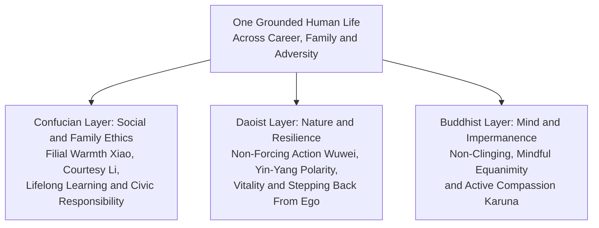
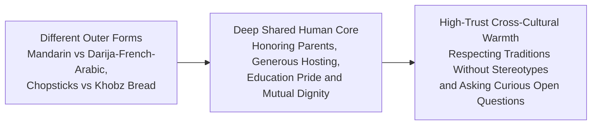

# Respectful Literacy Across Major World Value Systems

> **Core Premise**: Engineers raised in secular technical environments often make a quiet category error—treating world religions and moral philosophies as "pre-scientific hypotheses about physics" rather than **civilizational moral architectures**. Physics explains how electrons move; value systems answer how human beings restrain ego when nobody is watching, honor aging parents, welcome strangers, grieve loss, and build trust across generations. Understanding East Asian, European-Enlightenment, and Islamic value systems **from the inside** makes you calmer, warmer, and vastly harder to manipulate with stereotypes.

---

## 1. Three Rules for Understanding Any Culture From the Inside

Before stepping into specific traditions, anchor three habits of thought:

1. **Distinguish Cosmology From Moral & Relational Architecture**: You do not need to share someone's metaphysical creed to deeply respect how their tradition cultivates gratitude, self-restraint, family tenderness, charity, and inner peace.
2. **Understand Creedal Exclusivity vs. Functional Synthesis**:
   - **Abrahamic & Western Legal Frameworks** historically emphasize coherent first principles—one ultimate Creator or one universal charter of rights from which duties flow.
   - **East Asian Frameworks** historically emphasize **contextual complementarity**—applying Confucian ethics in family and career, Daoist flow in health and adversity, and Buddhist mindfulness when confronting impermanence.
3. **Never Turn Cultural Literacy Into a Box for an Individual**: Knowing the heritage of Shanghai, Paris, or Rabat gives you respectful context; it never tells you where the specific person across the café table stands personally. Educated people in every society span devout, quietly spiritual, philosophical, and secular outlooks while still cherishing their family's warmth, idioms, and festivals.

### Master Comparison Matrix: Three Major Value Architectures

| Dimension | East Asian Synthesis (Confucian-Daoist-Buddhist) | Judeo-Christian & Enlightenment West | Islamic Tradition (Maghreb & Global Communities) |
| :--- | :--- | :--- | :--- |
| **Ultimate Moral Frame** | Cosmic harmony (*Dao*), humane reciprocity (*Ren*), and compassionate awakening | Covenant moral law, *Imago Dei* (equal worth of every soul), and universal individual rights | *Tawhid* (unmediated Oneness of God), mercy (*Rahma*), justice, and direct personal accountability |
| **Primary Social Unit** | Multigenerational family & relational web of mutual duty | Autonomous moral individual choosing voluntary commitments & civic contracts | Individual soul directly accountable before God, embedded inside warm extended family & community (*Ummah*) |
| **Everyday Core Virtues** | Filial care (*Xiao*); courtesy (*Li*); diligence; resilience; non-forcing balance (*Wuwei*) | Personal honesty; explicit consent; civic fairness; individual conscience; charity | Sincerity (*Niyyah*); moral-aesthetic excellence (*Ihsan*); refined courtesy (*Adab*); generosity & hospitality |
| **Primary Language of Love** | Practical care, sacrifice, shared meals, and protecting mutual dignity ("face") | Explicit verbal affirmation (*"I love you"*), quality 1-on-1 time, and respecting personal space | Warm presence, generous hosting, honoring mothers/elders, protective loyalty, and spoken blessings (*Du'a*) |
| **Sacred & Artistic Expression** | Ink landscape scrolls (*shan shui*), scholar gardens, calligraphy, tea & temple quietude | Figurative stained glass, sacred polyphony/choral music, Renaissance painting & humanist literature | Infinite geometric *zellij* tessellations, Arabic calligraphy, botanical arabesques, poetic recitation & water courtyards |
| **Annual Reset & Family Peaks** | Lunar New Year reunion dinner; Qingming ancestor remembrance; Mid-Autumn harvest moon | Christmas & Easter family gatherings; Sabbath/weekend rest; Thanksgiving & secular civic holidays | **Ramadan** month of fasting, reflection & sunset *ftour* gatherings; **Eid al-Fitr** & **Eid al-Adha** family feasts |
| **Failure Mode If Unbalanced** | Unspoken family pressure, overwork, or suppressing personal feelings to preserve surface harmony | Atomized loneliness, transactional relationships, or rootless anxiety detached from community | Rigid formalism if stripped of mercy (*Rahma*), or outsiders mistaking cultural politics for lived spiritual ethics |

---

## 2. East Asia: How Confucianism, Daoism & Buddhism Work Together

Western surveys often get confused when people in China, Japan, Korea, or Singapore check "non-religious" on census forms while honoring ancestors at Qingming, admiring Daoist landscape poetry, and visiting quiet Buddhist temples on New Year's morning. Historically called ***Sanjiao He Yi*** ("Three Teachings Harmonious as One"), each tradition handles a distinct runtime layer of human life:

### 1. Confucianism — Relational Humanity & Mutual Dignity
- **Core Insight**: Confucius (`551–479 BCE`) lived through civil breakdown and asked how society stays humane without relying purely on harsh police punishments. His answer was ***Ren*** (benevolent empathy—literally written in Chinese `仁` as "two human beings" together) practiced through ***Li*** (everyday courtesy, proportion, and ritual respect) and ***Xiao*** (filial gratitude toward parents who raised you).
- **Lived Meaning Today**: Education is revered not merely as career credentialism, but as **moral self-cultivation** (*Junzi*). Love in East Asian families is rarely loud—it looks like parents peeling fruit for grown children, cooking favorite dishes at midnight, and adult children ensuring aging parents never feel forgotten.

### 2. Daoism — *Wuwei* When Brute Force Backfires
- **Core Insight**: *Dao De Jing* and *Zhuangzi* noticed that rigid Confucian duty alone can make people anxious and brittle. ***Wuwei*** ("effortless / non-coercive action") models wisdom on water: water looks soft and yields to every obstacle, yet carves canyons through granite by following natural gradients rather than forcing ego.
- **Lived Meaning Today**: Historically, scholars were **"Confucian in office, Daoist in setback or retirement."** Whenever a career pivot, market downturn, or health shock hits, Daoist intuition reminds you that *Yin* and *Yang* continuously invert (*Sai Weng Shi Ma*—apparent misfortune often plants the seed of your next breakthrough).

### 3. Buddhism — Impermanence & Compassionate Stillness
- **Core Insight**: Traveling from India along the Silk Road into China (`1st–7th c. CE`, flowering into Chan/Zen), Buddhism diagnosed emotional suffering (*Dukkha*) as the friction between our craving for permanent control and a universe where every state is impermanent (*Anicca*) and interdependent (*Pratityasamutpada*).
- **Lived Meaning Today**: Observing anxious or angry thoughts without letting them hijack your actions, letting go of status comparison, and extending quiet kindness (*Karuna*) to strangers.

---

## 3. Europe & the Americas: The Judeo-Christian DNA Inside Modern Secularism

Many educated Europeans and North Americans describe themselves as purely secular rationalists, assuming concepts like **universal human rights, individual autonomy, linear progress, and equality before the law** are self-evident laws of nature. As historians like Tom Holland and philosophers like Charles Taylor have shown, those secular convictions grew directly out of `2,500` years of Judeo-Christian soil:

1. **Jewish Ethical Monotheism & Prophetic Justice**: In the ancient Mediterranean world, might generally made right—gods favored powerful kings and aristocratic bloodlines. Hebrew scripture introduced a moral covenant where kings themselves stood under ethical law, time moved linearly toward justice, workers deserved a weekly Sabbath rest, and caring for widows, orphans, and foreigners (*Tzedakah*, rooted in *justice* rather than optional pity) was mandatory.
2. **Christian Universalism (*Imago Dei*) & Interior Conscience**: In status-stratified Rome, early Christianity proclaimed that every individual human being—patrician senator, artisan, woman, or enslaved laborer—carried equal sacred dignity (*imago Dei*, "image of God") and answered to an interior moral conscience (*Agape*, self-giving love even toward outsiders, as in the Good Samaritan).
3. **Reformation, Enlightenment & Secular Pluralism (`1517 – Present`)**:
   - Protestant emphasis on every individual reading and judging by personal conscience, followed by devastating European wars of religion (`1618–1648`), pushed Enlightenment thinkers (**John Locke, Voltaire, Montesquieu, Immanuel Kant**) to separate political citizenship from church authority.
   - Notice two distinct Western flavors today: **Anglo-American Pluralism** (freedom *of* visible religious expression in public life) versus **French *Laïcité*** (keeping state institutions strictly neutral while faith remains personal—a crucial context whenever conversing with anyone educated in French civic culture).
   - **Everyday Cultural Texture**: Direct verbal communication ("saying what you mean"), explicit boundaries around personal time and privacy, and expecting adult children and parents to relate as independent equals who choose closeness voluntarily.

---

## 4. Islamic Theology, Aesthetics & Lived Warmth (Morocco & Global Muslim Life)

Few civilizations suffer wider distortion in clickbait Western media than the Muslim world—spanning `1.9 billion` people from **Morocco** on the Atlantic to Indonesia, Turkey, Cairo, London, and Paris. Understanding Islam's actual intellectual, ethical, and aesthetic architecture—and how it breathes in **educated Moroccan and global families**—is transformative:

### 1. *Tawhid*: Radical Simplicity & Direct Personal Accountability
- At the center of Islam stands ***Tawhid***: the absolute, indivisible Oneness and transcendence of God (*Allah* is simply the Arabic word for the One God of Abraham, Moses, and Jesus—both Moses and Jesus are deeply revered prophets in the Quran, alongside Mary/*Maryam*, who has an entire Quranic chapter named in her honor).
- **Structural Insight for Engineers**: Unlike centralized ecclesiastical hierarchies, Sunni Islam has **no ordained priesthood, pope, or intermediary sacrament** required between a human soul and God. Scholars (*ulama*) study law and ethics, and an *imam* leads congregational prayer, yet every person stands in direct, unmediated accountability for their own intentions (*Niyyah*) and actions.

### 2. The Five Pillars as Daily & Annual Life Architecture
Rather than abstract philosophy locked in ivory towers, Islam embeds spiritual mindfulness into five concrete physical and social practices:
- ***Shahada***: Sincere conscious witness to the Oneness of God and the prophetic messengerhood of Muhammad.
- ***Salah***: Five brief daily prayer pauses aligned with the sun's arc (dawn, midday, afternoon, sunset, night)—stepping away from career ego and worldly rush to find stillness and humility.
- ***Zakat***: Annual sharing (traditionally `2.5%` of surplus accumulated wealth held for a year) directly supporting the poor, indebted, travelers, and vulnerable—treating social solidarity as an ethical duty rather than billionaire PR.
- ***Sawm* (Ramadan)**: Fasting from dawn to sunset during the ninth lunar month to cultivate self-mastery, gratitude for simple water and bread, and visceral empathy for anyone who goes hungry.
- ***Hajj***: Pilgrimage to Mecca once in a lifetime for those physically and financially able, where millions from every continent dress in two plain white cloths—visually erasing wealth, rank, and nationality.

### 3. *Rahma*, *Ihsan*, and *Adab*: Mercy, Excellence & Everyday Grace
- **Mercy First (*Rahma*)**: `113` of the `114` chapters of the Quran begin with *"In the name of God, the Most Gracious (*Ar-Rahman*), the Most Merciful (*Ar-Rahim*)"*—both words derived from the Arabic root *rahm* (a mother's protective womb).
- ***Ihsan* (Moral & Craft Excellence)**: Defined classically as acting with beauty and integrity as though God sees every detail—whether writing honest code, carving cedarwood, or keeping a promise when breaking it would be profitable.
- ***Adab* (Refined Courtesy & Warmth)**: Speaking gently, greeting people warmly with peace (*As-salamu alaykum* — "Peace be upon you"), standing to welcome elders, never humiliating someone in company, and treating guests as a blessing in your home.

### 4. Why Islamic Art Celebrates Infinite Geometry, Light & Calligraphy
Walk into Fez's *Al-Attarine Madrasa*, Rabat's *Mausoleum of Mohammed V*, or Granada's *Alhambra*, and you notice zero statues of saints or emperors. Because sacred spaces avoid figurative imagery (*aniconism*) to prevent worshiping finite human forms, Muslim artisans channeled human creativity into three breathtaking visual languages:
1. **Infinite Geometric Tessellations (*Zellij* & Star Polygons)**: Compass-and-straightedge symmetries repeating seamlessly past the edge of a wall—inviting the mind to contemplate mathematical order and infinity.
2. **Arabic Calligraphy**: Turning sacred verses and poetry into rhythmic architectural ribbons carved in stucco, cedar, and glazed tile.
3. **Arabesque Flora & Courtyard Water**: Interlacing vines and tranquil central fountains evoking paradise gardens (*Jannah*) of shade, proportion, and peace.

### 5. Lived Culture in Educated Moroccan Communities (*Tamaghrabit*)
Morocco holds a special place in the global cultural landscape. Rooted in **Maliki Sunni jurisprudence** (known historically for considering *Maslaha*—the practical public good and lived custom), enriched by indigenous **Amazigh** heritage, **Andalusian** refinement, historic **Moroccan Jewish** coexistence, and **Francophone/English** multilingualism, Moroccan culture (*Tamaghrabit*) embodies ***Wasatiyyah***—warmth, balance, and moderation:

- **Hospitality & the Table**: Guests are never an inconvenience. Mint tea (*atay*) is prepared attentively and poured from height to aerate the foam; Friday afternoons gather generations around fragrant couscous or slow-cooked *tagines* (lamb with prunes and almonds, chicken with preserved lemon and olives) shared with warm round bread (*khobz*).
- **Ramadan's Soulful Rhythm**: In Rabat, Tangier, Casablanca, or Fez, Ramadan feels deeply beloved—focused mornings, serene golden sunset skies, families breaking the fast (*ftour*) together with dates, rich *harira* tomato-lentil-herb soup, *msemen* flatbreads, and honey *chebakia*, followed by vibrant evening walks along the ocean corniche, late cafés full of laughter, and spiritual quietude.
- **Individual Nuance & Modernity**: Educated Moroccan professionals—engineers, doctors, architects, creatives, and students in Morocco, France, or global hubs—combine deep pride in Moroccan family warmth, courtesy, and heritage with thoroughly modern global careers. Some pray five times daily; some fast joyfully in Ramadan and cherish personal spirituality; others relate primarily through cultural ethics and family traditions. **Respect means listening to each person's lived truth without stereotyping in either direction.**

---

## 5. Surprising Kinship: Why East Asian & Moroccan/Mediterranean Values Click Naturally

Engineers raised in East Asia who spend real time with Moroccan, Mediterranean, or Middle Eastern friends and families are often surprised by how effortlessly core instincts align underneath different languages and scripts:

Notice five profound structural resonances:
1. **Reverence for Parents & Elders**: Both Confucian *Xiao* and the Quranic/Moroccan ethic of *Birr al-Walidayn* (kindness and tenderness toward parents, especially mothers—*"Paradise lies beneath the feet of mothers"*) treat caring for family elders as sacred honor rather than a burden.
2. **Food & Tea as the Universal Language of Care**: Neither Chinese hosts nor Moroccan hosts ever let a guest sit with an empty cup or leave hungry; insisting you eat one more piece (*"Kul! / Kuli!"* in Darija, *"Duo chi dian!"* in Mandarin) is literally spoken affection.
3. **High-Context Dignity & Modesty**: Both cultures value gracious manners (*Li* and *Adab*), reading emotional subtext gently rather than embarrassing people publicly, and dressing/carrying oneself with clean self-respect.
4. **Reverence for Scholarship & Craft**: From Song scholar-studios to Fez's 1,100-year Al-Qarawiyyin tradition, deep learning and patient artisanal craft command genuine respect.
5. **Pragmatic Social Harmony**: Both traditions prize steady, peaceful coexistence and practical warmth over ideological confrontation at the dinner table.

---

## 6. Practical Cross-Cultural Etiquette & Everyday Expressions

Small, unforced gestures of cultural mindfulness communicate more respect than a hundred speeches:

| Real-World Moment | Thoughtful Practice | Natural Phrase or Script |
| :--- | :--- | :--- |
| **Warm everyday greeting or thanking in Moroccan / Arabic context** | Pronounce simple everyday courtesies naturally without overdoing it. | *"Salam!"* (Peace / Hello); *"Labas?"* (How are you / All good?); *"Shukran bzzaf"* (Thank you very much); *"Bsaha!"* (To your health—said when someone enjoys food, tea, a haircut, or something new!). |
| **Wishing friends or family well on Ramadan or Eid** | Acknowledge sacred calendar peaks just as naturally as Lunar New Year or Christmas. | Start of Ramadan: *"Ramadan Mubarak — wishing you and your family a peaceful, blessed month."* At Eid: *"Eid Mubarak Said!"* |
| **Planning restaurants, travel meals, or dinner parties** | Check halal/pork-free options proactively when dining with Muslim friends so they never feel like an afterthought; keep alcohol completely optional and low-key without pressure. | *"I checked ahead—their grilled sea bass and lamb tagine are halal and zero pork in the kitchen, plus great fresh mint lemonade and mocktails."* |
| **Visiting a family home (East Asian, Moroccan, or European)** | Bring thoughtful consumables (fine pastries, boxed chocolates, premium dates, roasted nuts, fresh flowers, or specialty Chinese tea—never alcohol unless you know for sure the hosts drink); check at the entryway whether shoes come off (especially on Moroccan carpets/salons and East Asian floors). | *"Thank you so much for welcoming me into your home—I brought some specialty oolong tea from home to try alongside Moroccan mint tea!"* |
| **Navigating expressions like *Inshallah* and *Hamdullah*** | Recognize them as everyday expressions of humility and gratitude rather than fatalism: *Hamdullah* ("Praise/thanks be to God" — standard warm answer to *"How are you?"*) and *Inshallah* ("God willing" — acknowledging humans plan while tomorrow isn't owned by ego). | Hearing *"Hamdullah, everyone at home is doing well"* and receiving the gratitude warmly rather than looking puzzled. |
| **Discussing faith, philosophy, or secular upbringing honestly** | Share your own background transparently and respectfully—educated believers respect an honest, principled secular or philosophical person far more than cynical mockery or fake pretension. | *"I grew up in a pretty secular household in China focused on Confucian family ethics, so seeing the peace and family closeness around Ramadan is genuinely moving to learn about."* |

---

## 7. Worked Scenarios: Navigating Subtle Cross-Cultural Moments With Grace

Books explain doctrines; real relationships live in subtle micro-moments where tone, posture, and emotional intelligence build lifelong trust.

### Scenario A: Meeting Elders or Family Across Cultures for the First Time
- **The Context**: Whether stepping into an educated family salon in Rabat or Casablanca, an apartment in Paris, or a round-table family banquet in Shanghai, parents quietly ask the exact same universal question: *"Is this person kind, grounded, respectful of where our child comes from, and trustworthy under pressure?"*
- **What Signals Deep Character**:
  - **Unrushed Presence**: Put your phone away completely, greet elders first before sitting, stand slightly when a parent or grandparent enters the room, and compliment the home's warmth or a specific dish sincerely.
  - **Genuine Curiosity About Family Stories**: Ask parents how the city has changed since their youth, or the story behind a piece of calligraphy, carpet, or family recipe on the wall.
  - **Steady Authenticity**: Never pretend to be an expert on their culture; warm humility (*"I am still learning, please tell me how your family likes to do this"*) wins universal affection.

### Scenario B: Bridging High-Context Warmth and Francophone / Western Directness
- **The Context**: An educated person who grew up in Morocco or Europe often switches effortlessly between **warm Mediterranean/Maghrebi relational attentiveness** and **French analytical debate** (*thèse — antithèse — synthèse*, where spirited intellectual disagreement over dinner is a sign of engagement rather than anger!), whereas an engineer raised in East Asia may interpret animated debate as conflict or stay quiet when hurt to "preserve harmony."
- **How to Bridge Both Modes Smoothly**:
  - Do not mistake lively French/Mediterranean table debate about ideas or cinema for personal hostility—it is intellectual play.
  - Conversely, in personal feelings, do not rely silently on the other person "guessing" why you went quiet; combine East Asian gentleness of tone with clear, warm verbal honesty (*"When plans change last-minute I feel a little anxious—can we check in quickly earlier in the afternoon?"*).

### Scenario C: Showing Up During Illness, Grief, or Major Life Transitions
- **The Context**: Technical people often freeze when a friend or colleague loses a grandparent or faces family illness because there is no "bug fix" to offer.
- **How Each Tradition Teaches Us to Show Up**:
  - **Avoid Silver-Lining Platitudes**: Skip *"Everything happens for the best"* in raw grief.
  - **Combine Presence + Practical Care + Gentle Words**: In Islamic tradition, visiting the sick and offering quiet prayers of peace (*"Allah yirhamo / Allah yirhamha"* — "May God envelop him/her in mercy") carries immense comfort; in East Asian and Western traditions alike, sending warm food, handling a concrete errand without making them manage you, and checking in **three weeks later** after everyone else has moved on proves true depth of character.

---

## 8. Inside the Sacred & Family Calendar: What Major Holidays Feel Like at Home

Knowing what major holidays actually *feel* like inside a family home lets you share genuine joy with friends, colleagues, and loved ones:

### 1. Ramadan, *Laylat al-Qadr*, Eid al-Fitr & Eid al-Adha (Moroccan & Global Muslim Homes)
- **The Atmosphere of Ramadan**: Contrary to outsiders who imagine thirty days of grim hunger, Ramadan feels like a beloved annual spiritual and family embrace. Days move with calm intentionality—guarding speech against gossip or anger is considered even more important than abstaining from food and water.
- **Sunset *Ftour* (*Iftar*)**: Five minutes before sunset, streets in Rabat, Casablanca, and Fez grow completely hushed as baking aromas fill staircases. At the sound of the sunset *adhan* call, families break the fast following prophetic tradition with **odd-numbered dates and water or milk**, followed by steaming bowls of ***harira*** soup, boiled eggs with cumin, flaky ***msemen*** or ***baghrir*** honeycomb pancakes, savory *briouats*, honey-sesame ***chebakia***, and fresh mint tea.
- ***Laylat al-Qadr* (The Night of Decree, typically the 27th night of Ramadan)**: Families dress beautifully in traditional **caftans, takchitas, and djellabas**, gather at mosques or home, celebrate children's very first fast with joyful festivities, and share late-night couscous.
- **Eid al-Fitr & Eid al-Adha**:
  - **Eid al-Fitr** marks the joyous morning ending Ramadan—new clothes, morning prayer, platters of almond pastries (*kaab el ghazal*, *ghriba*), visiting grandparents, and giving *Zakat al-Fitr* beforehand so every low-income family in town can celebrate with dignity.
  - **Eid al-Adha** ("Festival of Sacrifice," about `70` days later during Hajj season) commemorates Abraham's (*Ibrahim's*) devotion—families gather across cities for multi-day reunions, sharing meat generously in thirds among immediate family, relatives/friends, and neighbors in need.

### 2. Lunar New Year (*Chunjie*) & Mid-Autumn Festival (East Asian Homes)
- **Lunar New Year's Eve Reunion Dinner (*Nianyefan*)**: The largest annual human migration on Earth happens for one moral reason—no matter how far career took you, you come home to sit at a round table with elders before midnight. Whole steamed fish (*nian nian you yu* — abundance), handmade dumplings shaped like silver ingots, red envelopes (*hongbao*) wishing health and growth to children and retiring parents, and sweeping away old grudges reset family bonds.
- **Mid-Autumn Harvest Moon (*Zhongqiu*)**: Celebrating wholeness (*tuanyuan*) under the brightest autumn full moon—sharing mooncakes and tea while remembering loved ones separated by oceans looking up at the exact same moon (immortalized in Su Shi's `1076` poem: *"May we live long and share the beauty of the moon together, though a thousand miles apart"*).

### 3. Christmas, Easter & Jewish High Holidays (European & North American Homes)
- Even in thoroughly secular French, British, or American households, **Christmas Eve / Christmas Day** anchors the emotional year around candlelight, generosity, evergreen warmth in midwinter darkness, choral music, and multi-generational homecoming.
- In Jewish heritage, **Passover (*Pesach*)** retells the liberation from Egyptian slavery around a question-driven *Seder* table where the youngest child asks *"Why is this night different?"*, while **Yom Kippur** sets aside `25` hours of fasting and honest moral amends (*Teshuvah*) with anyone you wronged during the year.

---

## 9. Stereotypes vs. Lived Reality: Rapid Calibration Table

Whenever media noise tries to flatten complex civilizations into caricatures, return to accurate ground truth:

| Widespread Stereotype | Lived Ground Reality |
| :--- | :--- |
| **"Islam is monolithic, rigid, and identical to Gulf desert politics."** | Only about `20%` of the world's Muslims are Arab; Indonesia, South Asia, Turkey, West Africa, and **Morocco's Atlantic-Mediterranean culture** have vastly distinct histories, cuisines, music, and moderate Maliki/customary traditions. |
| **"Educated Muslim women are voiceless or excluded from leadership."** | Remember it was a woman—**Fatima al-Fihri (`859 CE`)**—who founded Fez's Al-Qarawiyyin University! Across modern Morocco and global hubs, women are prominent engineers, physicians, professors, judges, filmmakers, and executives—some wearing hijab by personal conviction, many not, all expecting respect for their intellect and agency. |
| **"Confucian family culture means blind obedience to authoritarian parents."** | Healthy Confucian *Xiao* is **mutual lifelong care and counsel**, not blind servility; modern East Asian families intensely debate life choices while maintaining deep loyalty when hardship strikes. |
| **"Western secularism means people have zero moral compass or family warmth."** | Secular Europeans and North Americans typically hold fierce moral commitments around honesty, consent, fairness, environmental stewardship, and chosen lifelong loyalty. |
| **"Cross-cultural relationships inevitably clash over religion and background."** | Couples and friendships fail over **contempt, rigidity, and dishonesty**—not cultural difference. When two people share core character (kindness, family warmth, curiosity, mutual respect, and clear communication), cross-cultural heritage enriches a household rather than dividing it. |

---

## 10. Five Primary Voices Across Civilizations (Side-by-Side Moral Resonance)

When you read primary texts directly rather than secondhand arguments, you discover how strikingly humanity's wisest voices rhyme across millennia:

1. **On Why Human Cultures Are Diverse (*Quran 49:13* — *Li-ta'arafu*)**:
   - *"O humanity! Indeed, We created you from a male and a female, and made you into peoples and tribes **so that you may come to know one another** (*li-ta'arafu*). Surely the most noble of you in the sight of God is the most righteous in conduct."*
   - Notice the profound moral framing: cultural difference was not designed for tribal war or superiority, but **so human beings could delight in learning one another's worlds**, while true nobility rests strictly on character.
2. **On Ethical Reciprocity (*Confucius, Analects 15.24* & *Immanuel Kant*)**:
   - When Zigong asked if a single word could guide an entire life, Confucius answered: ***Shu* (reciprocity / empathy)** — *"What you do not wish done to yourself, do not impose upon others."* Two millennia later in Königsberg, Kant echoed that exact intuition: treat every person as a sacred end in themselves, never merely as a tool for your convenience.
3. **On Gentleness as True Strength (*Laozi, Dao De Jing Ch. 76 & 78* & *Hadith on Rifq*)**:
   - Laozi observed that living trees and living bodies are supple and warm, while only dead wood is brittle and hard. In Islamic ethics, a beloved prophetic teaching states: *"Gentleness (*rifq*) never enters anything without making it beautiful, and is never removed from anything without leaving it flawed."*
4. **On Humility in Seeking Knowledge (*Socrates*, *Confucius*, and *Arabic Wisdom*)**:
   - Confucius (`Analects 2.17`): *"To know what you know, and to know what you do not know—that is true knowledge."* Across classical Islamic scholarship, students copied the maxim: *"Seek knowledge from the cradle to the grave"*—even across distant lands like China.
5. **On Inner Calm Amid Uncertainty (*Zhuangzi* & *Marcus Aurelius, Meditations*)**:
   - Both the Roman Stoic emperor writing in frontier tents and the Chinese Daoist sage watching river currents reached the same peace: you do not control external fortune, wind, or other people's opinions—you only govern the integrity, kindness, and steadiness of your own mind right now.

---

## Navigation Across This Vault

- **Previous**: Review **[01-CONNECTED-WORLD-HISTORY-CHINA-MEDITERRANEAN-MAGHREB.md](01-CONNECTED-WORLD-HISTORY-CHINA-MEDITERRANEAN-MAGHREB.md)** for the synchronized 5,000-year historical map.
- **Next**: Step outside onto the street, into great museums, and into world cinema: continue to **[03-HOW-TO-EXPERIENCE-ARCHITECTURE-MUSEUMS-AND-CINEMA.md](03-HOW-TO-EXPERIENCE-ARCHITECTURE-MUSEUMS-AND-CINEMA.md)**.
