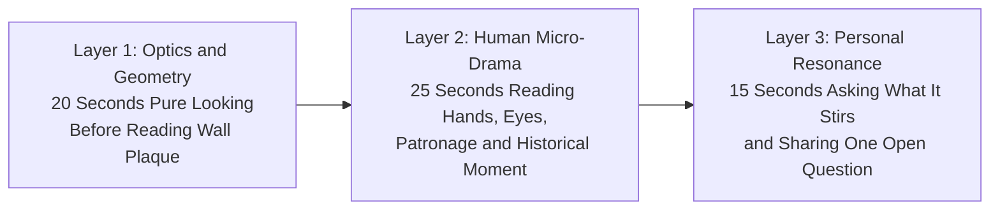
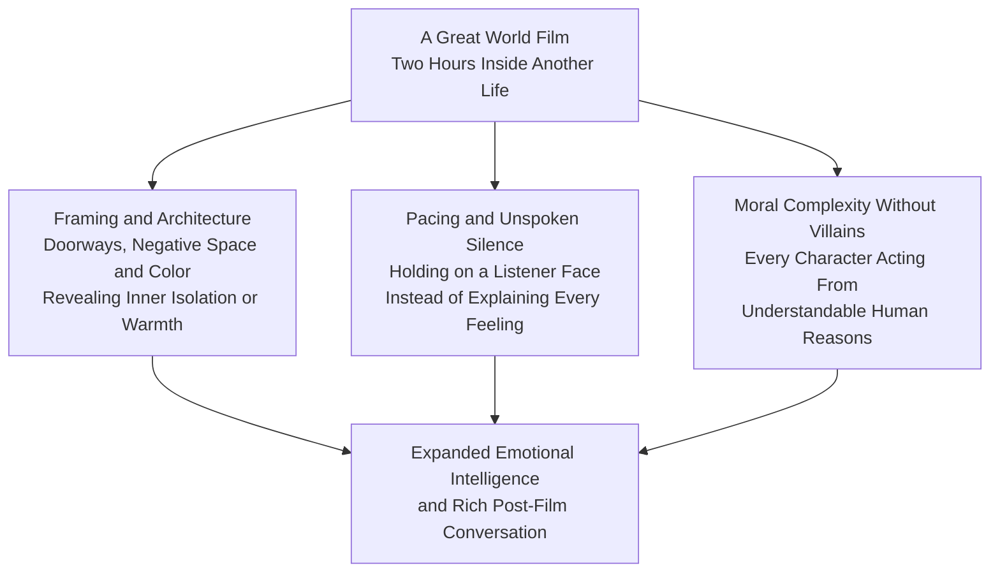

# Walking Into Any City, Museum or Film With Aesthetic Eyes

> **Core Premise**: Many engineers assume aesthetic appreciation belongs only to people born "artistic" or fluent in gallery jargon. In reality, **architecture, painting, and cinema are constraint-driven design systems**—solving problems of gravity, thermal physics, optical perception, framing, and human emotion. Once you learn to spot those underlying mechanics, walking an historic street in Rabat, Granada, Paris, or Suzhou, spending an hour in the Louvre or Musée d'Orsay, or watching an international film becomes deeply absorbing for the rest of your life.

---

## 1. Decoding Architecture on the Street: Gravity, Climate & Worldview

Every enduring building in human history solves three simultaneous equations:
1. **Structural Load Path**: How do you route roof weight safely into the earth while opening interior space?
2. **Passive Microclimate**: How do you manage blazing sun, winter wind, or monsoon rain without modern HVAC?
3. **Human & Sacred Psychology**: How should a human being *feel* the moment they step inside—awestruck, civic, sheltered, or contemplative?

### Street-Level Decoder Matrix: Five Great Architectural Languages

Use this five-second visual field guide anywhere your travels take you:

| Architectural Language | Iconic Places to See It | Structural & Climatic Engineering | 5-Second Street Clues | Inner Human Philosophy |
| :--- | :--- | :--- | :--- | :--- |
| **Classical Greco-Roman & Neoclassical** | Athens Parthenon; Rome Pantheon; Paris Panthéon, Madeleine & Place de la Concorde | Post-and-lintel columns plus Roman semicircular arches, barrel vaults & unreinforced pozzolanic concrete domes | Fluted columns (Doric sturdy, Ionic scroll, Corinthian acanthus leaf); triangular pediments; strict bilateral symmetry | Outward civic order, public reason, mathematical proportion & imperial permanence |
| **Gothic Cathedrals** | Paris Notre-Dame & Sainte-Chapelle; Chartres; Cologne; Milan | Pointed arches direct weight steeply down; ribbed vaults + external **flying buttresses** hold walls from outside | Soaring spires; spider-like exterior stone buttress arms; giant circular **rose windows** & towering stained glass | Vertical transcendence—dissolving heavy stone into colored sacred light (*Lux Nova*) |
| **Moorish-Andalusian & Moroccan** | Rabat Kasbah of the Udayas, Hassan Tower & Chellah; Fez Bou Inania & Attarine Madrasas; Granada Alhambra | Thick thermal-mass walls; inward **riad courtyards** with evaporative fountain cooling; horseshoe & multifoil arches | Modest plain outer walls opening into lush courtyards; **zellij** geometric tile below, carved **gebs** stucco middle, painted **cedarwood** above | Inward sanctuary, neighborhood humility, coolness, acoustic water peace & infinite mathematical harmony |
| **Chinese Classical & Jiangnan Gardens** | Suzhou Humble Administrator's & Master of Nets Gardens; Hangzhou West Lake; Beijing Forbidden City | Timber columns + interlocking **dougong** wooden brackets (nail-free seismic shock absorbers); upturned eaves shed rain while admitting low winter sun | Curved ceramic-tile roofs; circular **moon gates**; zig-zag water bridges; Taihu scholar rocks; white walls with dark grey tile | Harmonizing human life with flowing nature—unfolding sequential views rather than static conquest |
| **Haussmann, Bauhaus & Modernism** | Haussmann Paris boulevards; Dessau Bauhaus; Mies van der Rohe pavilions; Zaha Hadid's Grand Théâtre de Rabat | Reinforced concrete + structural steel skeleton frames carry all floor loads, freeing outer walls to become pure glass curtains | Haussmann: cream limestone, wrought-iron 2nd/5th-floor balconies & slate mansard roofs; Modernism: clean steel/glass grids or fluid parametric curves | Industrial honesty ("form follows function"), sunlight, hygiene, democratic openness & dynamic motion |

---

## 2. Three Architectural Deep Dives for Your Next City Walk

### 1. Moorish-Andalusian & Moroccan Spaces (Rabat, Fez, Marrakech & Granada)

First-time visitors walking a traditional Moroccan *medina* alley (*derb*) are often puzzled by quiet, nearly windowless earth-toned or blue-and-white exterior walls—until a host opens one studded cedar door. Everything in classic Moroccan-Andalusian architecture is engineered **from the inside out**:

- **Privacy & Social Equality on the Street**: By keeping outer walls modest and adding an L-shaped bent entryway (*skifa*) that blocks direct sightlines from the lane, a wealthy merchant's house and a modest artisan's house present equal dignity to neighbors while shielding family life inside.
- **Passive Thermal Chimney Physics**: A traditional ***riad*** centers on a square open-sky courtyard planted with citrus trees around a marble water basin. Cool night air pools inside the shaded courtyard each morning; as hot sun warms the surrounding rooftops by afternoon, rising warm air pulls a gentle convective breeze across the central fountain, cooling interior salons by `4 to 7 degrees Celsius` without a watt of electricity.
- **The Three-Zone Material Grammar**: Stand inside Fez's *Al-Attarine Madrasa*, Rabat's *Mausoleum of Mohammed V*, or Granada's *Palace of the Lions*, and read the walls from floor to sky:
  1. **Lower Zone (Earth & Touch)**: Hand-cut glazed ***zellij*** terracotta tessellations—cool against sitting shoulders, washable, and laid face-down from memory by master *maalems* in 8-, 12-, and 16-pointed geometric star fields.
  2. **Middle Zone (Light & Poetry)**: Breathable carved ***gebs*** gypsum stucco ribbons carrying Quranic or poetic calligraphy, framed by **horseshoe arches**, scalloped *lambrequin* arches, and 3D honeycomb ***muqarnas*** vaults that scatter harsh daylight into soft velvet gradients.
  3. **Upper Zone (Canopy & Scent)**: Hand-carved, richly painted **Middle Atlas cedarwood (*zouak*)** ceilings—naturally aromatic, rot-resistant, and structurally warm.
- **Rabat's Living Timeline in One Afternoon**: Few cities on Earth let you read `2,000` years of architectural evolution in a single `5 km` radius like **Rabat**—from Roman column ruins beside Marinid Islamic minarets and stork nests at **Chellah**, to the 12th-century Almohad **Kasbah of the Udayas** overlooking the Atlantic surf and **Hassan Tower**, through elegant 20th-century Art Deco tree-lined avenues downtown, right down to **Zaha Hadid's** sweeping futuristic **Grand Théâtre de Rabat** curving like the Bou Regreg river itself.

### 2. Gothic Cathedrals vs. Roman Vaults (Why Sainte-Chapelle Feels Weightless)

Walk into a Romanesque church (`10th–11th c.`) and it feels like a stone bunker with narrow slit windows—because semicircular arches push outward laterally, forcing builders to pile massive thick walls to stop collapse. Walk into **Sainte-Chapelle** or **Notre-Dame** in Paris (`12th–13th c.`), and you stand inside a `15-meter`-tall cage of glowing ruby and cobalt glass. How? Medieval engineers moved the structural skeleton **outside the building** via **flying buttresses**, catching outward roof thrust in mid-air so interior walls no longer carried the ceiling and could turn entirely into stained glass.

### 3. Suzhou Jiangnan Gardens vs. French Royal Gardens

Compare **Versailles** outside Paris with **Suzhou's Humble Administrator's Garden** (*Zhuozheng Yuan*):
- Versailles places the viewer at one central palace axis commanding geometric parterres to the horizon—celebrating **Cartesian human reason ordering nature**.
- A Jiangnan scholar garden hides `80%` of its space behind white walls, rockeries, bamboo screens, and winding corridors. Using **borrowed scenery (*jiejing*)** to frame a distant temple tower and **leak windows (*louchuang*)** to slice bamboo shadows into living paintings, it teaches **Daoist humility inside nature**—you only discover beauty by moving patiently through it.

---

## 3. The 3-Layer Method for Great Art Museums (Zero Jargon, Zero Fatigue)

Most intelligent adults secretly dislike giant museums (**the Louvre, Musée d'Orsay, Uffizi, Prado, Met**) for one simple reason: they try to consume `300` paintings in four hours, reading dense wall plaques first and glancing at the actual painting for four seconds. Within `90` minutes, **museum fatigue** shuts down visual pleasure completely.

### Rule Zero: The 90-Minute / 10-Masterpiece Cap

Never try to "finish" the Louvre (`35,000` works). Pick **one wing**, spend **75 to 90 unhurried minutes** truly experiencing **8 to 12 canvases**, and then walk straight out to a café terrace while your mind is still vivid!

### Layer 1: Optics, Light & Geometry (First 20 Seconds — Eyes Only!)

Stand two steps back and forbid yourself from reading the plaque for `20` full seconds. Ask your eyes three concrete questions:
1. **Where is the light coming from, and what does it spotlight?**
   - In **Caravaggio** or **Rembrandt** (Louvre), fierce *chiaroscuro* spotlights wrinkled hands and vulnerable eyes out of pitch-black shadow—inventing modern dramatic cinema lighting `300` years before film cameras.
   - In **Johannes Vermeer** (*The Lacemaker* at the Louvre, *Milkmaid* in Amsterdam), soft side-window daylight elevates quiet domestic work into sacred stillness.
2. **How is 3D space constructed?**
   - At Florence's **Uffizi** (**Botticelli, Leonardo da Vinci, Raphael**), trace the invisible perspective lines converging to a crisp focal point, and look closely at **Leonardo's *sfumato***—thirty ultra-thin translucent oil glazes softening jawlines and eye corners so skin seems alive rather than outlined.
   - In **Chinese *Shan Shui* ink scrolls** (Fan Kuan, Shen Zhou), notice there is *no single fixed camera tripod*—your eye climbs up mountain paths using shifting multi-point perspective (*Sanyuan*), while unpainted paper transforms into mist, river, and breathing room (*liubai*).
3. **What happens when you step close vs. step back?**
   - At Paris's **Musée d'Orsay** (**Monet, Renoir, Morisot, Cézanne, Van Gogh**), stand `40 cm` from Monet's *Rouen Cathedral* or *Water Lilies*: you see rough strokes of pure cobalt, orange, and violet. Step back `3 meters`, and those strokes fuse optically in your brain into shimmering sunlight! Once **photography (`1839`)** automated literal likeness, painters pivoted from copying objects to capturing **human sensory perception and inner emotion**.
   - **Hidden Franco-Moroccan Museum Gem**: At the Louvre and Musée d'Orsay, look for **Eugène Delacroix** (`1832` Tangier and Meknes travel paintings and watercolors) and later **Henri Matisse** (`1912–1913` Tangier works). Both masters explicitly credited **Moroccan sunlight, geometry, and textile color harmonies** with liberating modern French painting from drab studio browns!

### Layer 2: Human Micro-Drama & Historical Constraint (Next 25 Seconds)

Now glance briefly at the date and title on the plaque, then look right back at **hands, posture, and eye-lines**:
- Who commissioned this—a Pope asserting grandeur, a Dutch merchant celebrating quiet home life, or a broke rebel like Van Gogh painting starry cypress trees in Arles for sheer survival?
- **The Five-Second-Before Test**: Every great portrait or narrative canvas freezes an emotional inflection point. Look at the gap between two hands or the hesitation in someone's gaze and ask: *"What sentence was just spoken five seconds before this moment?"*

### Layer 3: Companion Dialogue (Sharing Museums Without Lecturing)

When visiting a gallery with a partner or friend, retire encyclopedia trivia and use open, playful prompts:
- *"Rule for this room: we have sixty seconds to pick one painting we are 'stealing' for our apartment—which one did you pick and why?"*
- *"Look at how calm the light on the wall behind her is—does this room feel peaceful or lonely to you?"*
- *"Notice how Delacroix painted Tangier's light after leaving grey Paris—you can practically feel the Atlantic air."*

---

## 4. Watching World Cinema as an Empathy & Aesthetic Simulator

Great cinema combines **architecture** (spatial staging), **painting** (light and color palette), **music** (pacing and acoustic texture), and **literature** (human moral dilemma) into two hours of lived empathy:

### Four Things Aesthetic Viewers Notice Effortlessly

1. **Architecture Framing Emotion**: In Wong Kar-wai's *In the Mood for Love*, doorways, curtains, rain-streaked alleys, and mirrors box the two protagonists into tight sub-frames inside the screen—making unspoken longing physically palpable without melodramatic speeches.
2. **Camera Distance as Moral Respect**: Japanese master Yasujiro Ozu placed his camera low at seated *tatami* eye-level; Iranian and Moroccan humanist directors hold steady, unhurried medium shots inside kitchens, workshops, and family courtyards so you sit *with* the characters as equals rather than voyeurs.
3. **Soundscape & Quietness**: Pay attention when music stops completely—the clink of tea glasses, ocean wind in Tangier or Rabat, cicadas in Taipei summer, or five seconds of silence before someone answers a hard question.
4. **Tragedy Without Monsters**: Commercial action movies rely on pure heroes fighting pure villains. Mature world cinema follows playwright Jean Renoir's timeless truth: *"The awful thing about life is this: everyone has their reasons."* Watching good, flawed people navigate family duty, pride, love, and honesty expands your real-world patience enormously.

### Curated 8-Film Global Starter Anthology

Watch one every week or two in original audio with subtitles and phones put away:

| Film, Director & Origin | Visual & Cultural Signature | Core Human Question for Conversation Afterward |
| :--- | :--- | :--- |
| ***Yi Yi* (`2000`, Edward Yang — Taipei)** | Glass reflections across modern Taipei weddings, offices & night markets | *"Since we can only see half the truth from the front, how do we truly see the people we love?"* |
| ***In the Mood for Love* (`2000`, Wong Kar-wai — Hong Kong)** | Lush saturated reds/greens, slow-motion cello, tailored *cheongsam* & narrow 1960s hallways | *"Where is the line between honorable self-restraint and letting fear cost you real happiness?"* |
| ***A Separation* (`2011`, Asghar Farhadi — Iran)** | Handheld domestic tension inside an educated Tehran family caught between emigrating & caring for an aging father with Alzheimer's | *"Whose side did you start on in minute 20, and when did your sympathy shift?"* |
| ***The Blue Caftan* (`2022`, Maryam Touzani — Morocco)** | Golden natural light inside a traditional Salé medina tailoring workshop; exquisite hand-stitched silk embroidery, *hammam* steam & deep tenderness | *"How does the master tailor's patience with craft mirror how these characters love and protect each other?"* |
| ***Adam* (`2019`, Maryam Touzani — Morocco)** | Intimate Vermeer-like kitchen light in Casablanca; kneading dough & making *rziza* pastries as two women slowly heal frozen grief | *"Notice how care starts through shared baking long before either woman can talk openly about pain."* |
| ***Three Colors: Blue* (`1993`, Krzysztof Kieślowski — France/Poland)** | Sapphire light reflections, Parisian cafés, espresso sugar cubes & soaring orchestral fragments | *"Can a human being ever truly insulate themselves from attachment—or is vulnerability the price of being alive?"* |
| ***Still Walking* (`2008`, Hirokazu Kore-eda — Japan)** | Sunlit summer veranda, tempura sizzling in a family kitchen & subtle generational jokes hiding old grief | *"Why do families often say the sharpest things and show the deepest love on the very same afternoon?"* |
| ***The Wind Rises* (`2013`) or *Spirited Away* (`2001`, Hayao Miyazaki — Japan)** | Hand-painted clouds, wind over grass, bathhouse lanterns & *ma* ("empty breathing pauses" where nothing explodes) | *"What does it cost when someone pours their whole soul into creating beauty inside an imperfect world?"* |

---

## 5. Three Ready-to-Walk Cultural Outings (Putting Aesthetic Eyes Into Practice)

Instead of exhausting `12`-hour tourist checklists, test your new architectural and visual literacy on slow, memorable three-hour outings:

### Outing 1: Rabat's 2,000-Year Light & Stone Walk (3 Hours)
- **Hour 1 — Chellah Sanctuary**: Enter the Marinid red-earth gate in late afternoon light; trace Roman *Sala Colonia* forum stones sitting directly beside 14th-century Islamic minaret *zellij* and storks nesting overhead.
- **Hour 2 — Hassan Tower & Mausoleum of Mohammed V**: Observe the unfinished 12th-century Almohad minaret sandstone columns (sister to Seville's Giralda and Marrakech's Koutoubia), then look inside the Mausoleum to spot the three-zone grammar live: hand-chiseled *zellij* below, carved *gebs* plaster middle, and gilded cedar cupola above.
- **Hour 3 — Kasbah of the Udayas & Café Maure at Golden Hour**: Walk the tranquil indigo-and-whitewashed Andalusian lanes, pause inside the citrus Andalusian Garden, and sip hot Nana mint tea with almond *kaab el ghazal* ("gazelle horns") overlooking the Bou Regreg river mouth meeting the Atlantic Ocean.

### Outing 2: Paris's Sacred Glass to Impressionist Light Walk (3 Hours)
- **Hour 1 — Sainte-Chapelle (`9:00 AM` Morning Sun)**: Climb the narrow spiral stair from the dim lower crypt straight into the upper chapel; watch `13th`-century flying buttresses turn solid stone walls into a glowing sapphire-and-ruby lantern.
- **Hour 2 — Stroll Along the Seine Left Bank**: Read Haussmann limestone proportions, wrought-iron balconies, and bookshop stalls (*bouquinistes*) without headphones.
- **Hour 3 — Musée d'Orsay Top-Floor Clock Gallery (`75 Minutes Max`)**: Pick just `10` canvases—Delacroix's Moroccan studies, Manet, Monet's *Cathedrals*, Renoir's *Bal du moulin de la Galette*, and Van Gogh's *Starry Night Over the Rhône*—applying the `20s / 25s / 15s` 3-Layer Method before espresso at a quiet Saint-Germain café.

### Outing 3: Suzhou or Hangzhou Scholar-Garden & Tea Morning (3 Hours)
- **Hour 1 — Master of the Nets Garden or West Lake Dawn (`7:30 AM` Before Crowds)**: Walk slowly without taking photos for the first `20` minutes; count how every zig-zag turn, moon gate, and lattice window re-composes rock, water, and bamboo into a fresh scroll frame.
- **Hour 2 — Timber Craft Observation**: Look upward under pavilion eaves at interlocking *dougong* wooden brackets and upturned roof corners engineered to throw monsoon rain clear of timber columns while welcoming winter sunlight.
- **Hour 3 — Longjing or Biluochun Tea by Water**: Sit quietly watching ripples reflect willow branches—experiencing why Song and Ming poets treated empty space (*liubai*) as half the artwork.

### 10 Essential Aesthetic Terms Worth Knowing (Used Naturally, Never to Show Off)

| Term | Origin | One-Sentence Plain Meaning |
| :--- | :--- | :--- |
| ***Riad*** | Arabic (*Riyad*, garden) | Traditional Moroccan house built inward around an open-sky citrus and fountain courtyard that passively cools every room. |
| ***Zellij*** | Moroccan-Andalusian | Hand-chiseled glazed terracotta geometric tilework arranged in mathematical star tessellations. |
| ***Muqarnas*** | Islamic Architecture | Sculpted 3D honeycomb/stalactite vaulting that transitions square walls smoothly into round domes while diffusing light. |
| ***Flying Buttress*** | European Gothic | Exterior stone arch-arm bracing cathedral roofs from outside so interior walls can open into giant stained-glass windows. |
| ***Dougong*** | Classical Chinese | Interlocking wooden bracket clusters supporting heavy tiled eaves and absorbing earthquake shear with zero nails. |
| ***Jiejing*** | Chinese Garden Art | "Borrowed scenery"—designing a garden window or opening so a distant mountain, lake, or pagoda becomes part of your courtyard. |
| ***Chiaroscuro*** | Italian Renaissance/Baroque | High-contrast spotlighting between radiant light and deep shadow (Caravaggio, Rembrandt) to heighten human drama. |
| ***Sfumato*** | Leonardo da Vinci | Ultra-thin smoky oil glazes eliminating harsh outlines around eyes and lips so portraits feel lifelike and mysterious. |
| ***Liubai*** | Chinese Ink Painting | Intentional unpainted white space representing mist, water, sky, and contemplative room for the viewer's imagination. |
| ***Ma*** | Japanese Aesthetics / Film | Quiet, unhurried breathing pause between actions in a film or space where emotional resonance settles in. |

---

## 6. Beyond Visuals: Experiencing Music, Craft & Living Intangible Arts

Aesthetic literacy extends naturally from stone and canvas to **sound and human handcraft**—two domains where civilizations reveal their deepest emotional temperament:

### Four Musical Traditions Worth Recognizing by Ear

1. **Andalusian Classical Music (*Al-Ala* / *Tarab al-Andalusi* — Morocco & Spain)**:
   - Born in 9th–15th century Cordoba, Seville, and Granada (associated with the legendary polymath **Ziryab**, who added a fifth string to the *oud* and codified refined dining and seasonal dress!) and preserved lovingly for five centuries in **Rabat, Salé, Fez, and Tetouan**.
   - Orchestras blend *oud* (lute), *rabab* (bowed spike fiddle), violin, *qanun* (zither), and *darbuka* percussion across poetic *nuba* suites matched to specific hours of day and emotional moods.
2. **Moroccan Gnawa Music (Essaouira, Marrakech & Global Jazz Fusion)**:
   - Rooted in sub-Saharan West African spiritual healing traditions (*lila* night ceremonies) blended into Moroccan life: the deep, hypnotic bass pulse of the three-stringed ***guembri*** (*sintir*) interlocked with metallic iron castanets (***qraqeb***) in `6/8` and `4/4` polyrhythms—admired worldwide by jazz masters from Bill Evans and Pharoah Sanders to Marcus Miller.
3. **Chinese Scholar *Guqin* & *Pipa* Aesthetics**:
   - The seven-stringed ***guqin*** (`3,000+` years old) was never designed to fill a noisy stadium; played quietly in a garden studio, its sliding harmonics (*fanyin*) incorporate the subtle sound of fingers gliding across silk/nylon strings—valuing **timbre and silence after a plucked note** just as ink painting values unpainted mist.
4. **French Musical Impressionism (Claude Debussy & Maurice Ravel)**:
   - After hearing Javanese gamelan scales and Spanish-Moorish rhythms at the `1889` Paris Exposition, **Debussy** (*Clair de Lune*, *La Mer*) and **Ravel** broke rigid German symphonic rules to paint shimmering water, wind, and twilight in pure harmonic color—the exact acoustic twin of Monet's canvases at Musée d'Orsay.

### Reading Handcraft vs. Mass Factory Output

When traveling through Morocco, Italy, France, or China, train your eye and fingertips to spot authentic master craft (*savoir-faire* / *maalem* mastery):
- **True Fez *Zellij* vs. Printed Factory Tile**: Genuine *zellij* is glazed terracotta hand-chiseled piece by piece with a sharp hammer (*menqach*), showing slight organic micro-variations that catch light like rippling water rather than flat machine perfection.
- **Traditional Moroccan *Caftan* & *Sfifa* Braiding**: Hand-spun silk cord (*sfifa*) and tiny knotted buttons (*aakad*) stitched over weeks by master artisans in Rabat, Salé, and Fez—treated as wearable family heirlooms passed across celebratory nights.
- **Hand-Thrown Jingdezhen Porcelain & Yixing Clay Teapots**: Hold thin porcelain up to a lamp to see warm translucency, or observe how unglazed Yixing *zisha* clay seasons over years of steeping oolong and pu-erh tea.

---

## 7. Common Aesthetic Mistakes vs. High-Presence Habits

| Common Habit That Kills Wonder | High-Presence Alternative |
| :--- | :--- |
| Photographing `80` paintings in a museum to "look at later" (and never opening the folder again) | Leaving your phone in your pocket for `60` minutes; buying **one postcard** in the exit shop of the single painting that moved you most and writing one memory on the back |
| Choosing restaurants right on crowded museum plazas (`2x` price, `0.3x` soul) | Walking `400 meters` (`5` blocks) away from any major monument into a residential side street where locals eat slow lunches |
| Watching subtitled world cinema at `1.5x` speed or while answering Slack on a laptop | Treating one great film like a theater concert: dim room, `1.0x` original rhythm, phones outside reach, and two cups of tea afterward |
| Feeling embarrassed when a famous "masterpiece" leaves you cold | Trusting your honest eye! Even lifelong curators only deeply connect with `1 in 15` famous works; walk calmly past what feels dead to find what speaks to *you* |
| Explaining plot twists or architectural facts non-stop to your companion | Practicing the **70/30 Rule**: `70%` shared quiet observation and open questions, `30%` crisp context that illuminates what you are both seeing |

### The 10-Minute Café Ritual After Any Museum or Film

Aesthetic taste only crystallizes when you put fleeting impressions into your own words—either in a quiet notebook or across a table with someone you care about. Use these four effortless prompts over tea, coffee, or an evening walk:

1. **The Single Frozen Image**: *"Hours from now, which single image, shaft of light, or doorway from today is still glowing in your mind?"*
2. **The Craftsmanship Question**: *"What physical detail made you stop and wonder: 'How on earth did human hands carve, paint, or film that?'"*
3. **The Empathy Shift**: *"Did any painting, space, or character today make you feel tender toward a kind of life very different from ours?"*
4. **The Home Takeaway**: *"Is there one small element of calm, light, color, or hospitality from what we saw today that we could bring into how we set up our own living space?"*

### Quick Pocket Map: Four Cities Where All Three Arts Converge

- **Rabat & Fez**: Walk Chellah, Kasbah of the Udayas, Mohammed VI Museum of Modern and Contemporary Art in Rabat, and Al-Attarine Madrasa in Fez; listen to *Al-Ala* Andalusian strings; watch Maryam Touzani's cinema.
- **Paris**: Morning stained glass at Sainte-Chapelle, afternoon Impressionist light and Delacroix's Moroccan canvases at Musée d'Orsay, evening classic screening in a Latin Quarter *cinéma d'art et d'essai*.
- **Florence & Granada**: Linear Renaissance perspective at the Uffizi paired with Nasrid *muqarnas*, *zellij*, and water-mirror geometry at the Alhambra.
- **Suzhou & Hangzhou**: Early-morning mist in Master of the Nets Garden and West Lake pavilions, Song-Yuan ink scrolls, and quiet *guqin* tea houses.

---

## 8. Closing Synthesis: Becoming a Complete Person Beyond the Screen

Step back and look at the arc you have built across this four-part curriculum:

- **[00-README.md](00-README.md)** gave you the epistemic lens—replacing technocratic flatness and tourist rush with curiosity, humility, and the Three-Rung Conversation Ladder.
- **[01-CONNECTED-WORLD-HISTORY-CHINA-MEDITERRANEAN-MAGHREB.md](01-CONNECTED-WORLD-HISTORY-CHINA-MEDITERRANEAN-MAGHREB.md)** gave you the `5,000`-year horizontal map—linking Han-Tang-Song China, Baghdad-Cordoba-Fez science, Ibn Battuta's Tangier-to-Hangzhou odyssey, European industrialization, and today's multipolar renaissance.
- **[02-WORLD-RELIGIONS-AND-CULTURAL-VALUE-SYSTEMS.md](02-WORLD-RELIGIONS-AND-CULTURAL-VALUE-SYSTEMS.md)** gave you inner moral empathy—understanding East Asian Three-Teachings balance, Western Enlightenment conscience, and the spiritual beauty, hospitality, and lived warmth of Moroccan and global Muslim life without stereotypes.
- **This guide** gave you sensory eyes—reading gravity and *riad* courtyards on the street, experiencing paintings in `60` unhurried seconds, and feeling human nuance in world cinema.

Engineering builds remarkable tools; **history, moral empathy, and art teach you how to inhabit life, love real people deeply across cultures, and notice beauty while you are here.**
